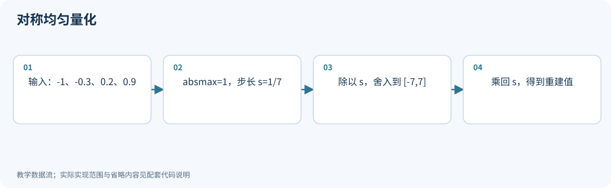
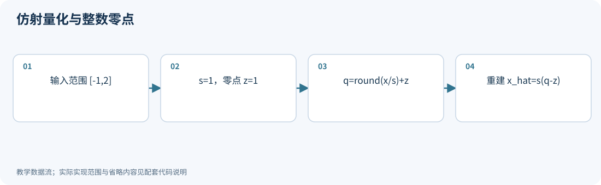
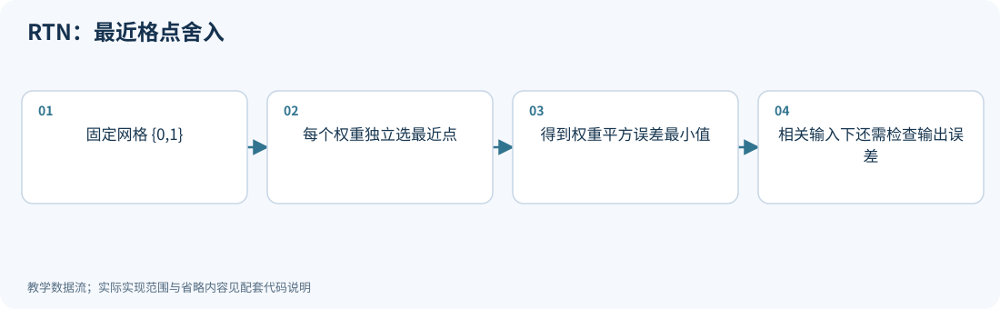
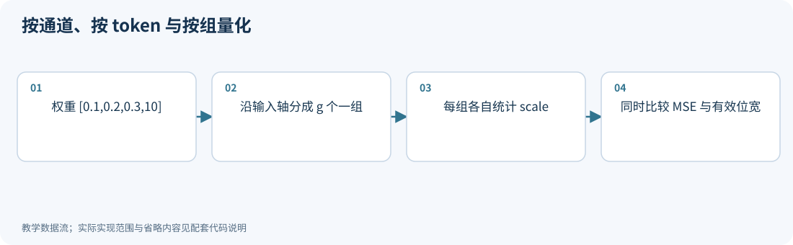
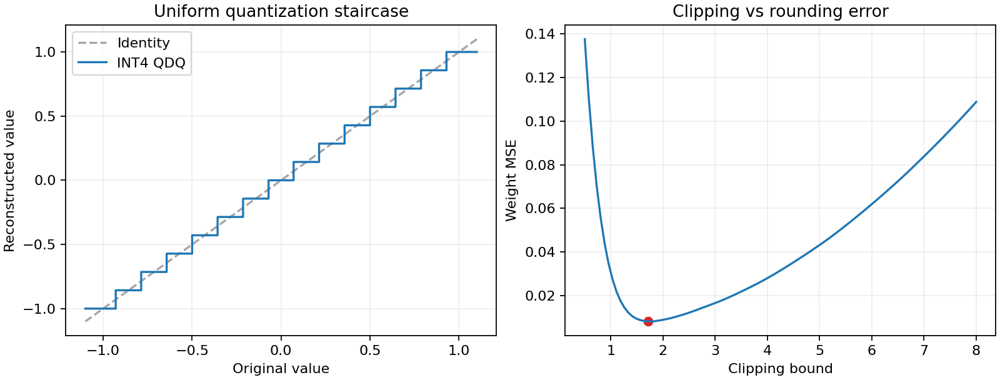
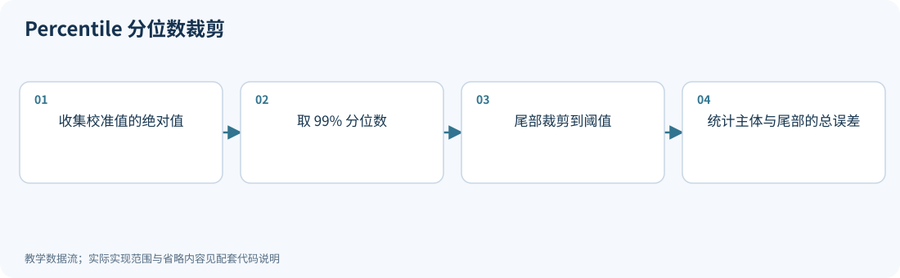
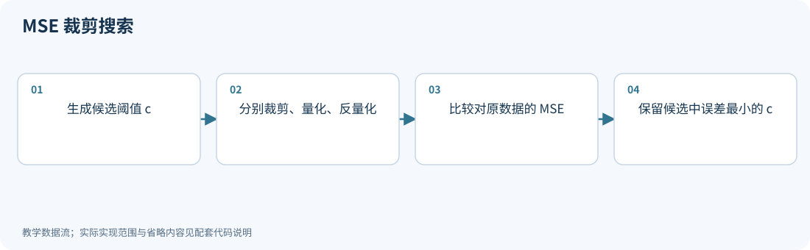
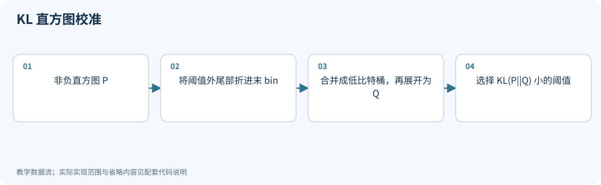
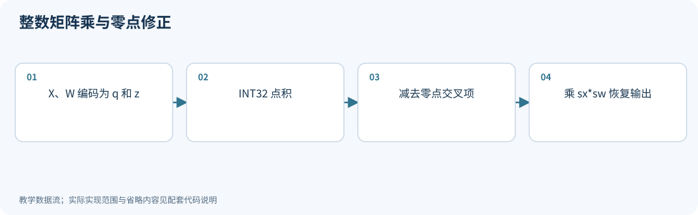
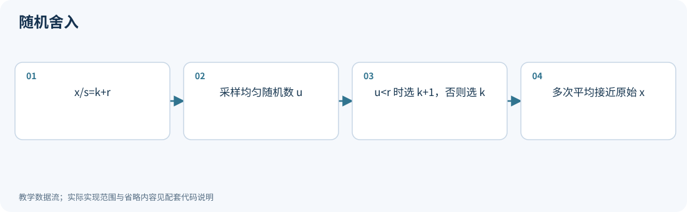

# 01｜从手算出发：均匀量化、分组与误差

<!-- course-objectives -->
**学习目标：** 完成量化和重定标手算；区分分组精度与存储成本；识别舍入、裁剪及物理布局的边界。

**先修知识：** 第 00 章；附录 A 的误差、均值与期望。 [进入本章测试](#chapter-assessment)；建议先独立作答，再展开答案。
<!-- /course-objectives -->

本章是全部方法的共同基础。先掌握它，再读 GPTQ、AWQ 会容易很多。

<!-- chapter-overview -->
<a id="chapter-start"></a>

**阅读路线：** 先区分整数编码与重建值，再学习尺度、零点和分组；从误差与裁剪进入整数点积、输出重定标和字节打包。

<details><summary>本章目录（13 节）</summary>

- [1.1 对称均匀量化](#principle-1-1)
- [1.2 非对称/仿射量化与 zero point](#principle-1-2)
- [1.3 为什么经常要求 0 可被精确表示](#principle-1-3)
- [1.4 RTN：最简单的权重量化算法](#principle-1-4)
- [1.5 分组：一个 scale 管多少数字](#principle-1-5)
- [1.6 真正的平均 bit 数](#principle-1-6)
- [1.7 舍入误差如何推导](#principle-1-7)
- [1.8 裁剪为什么可能提高精度](#principle-1-8)
- [1.9 量化矩阵乘法怎么算](#principle-1-9)
- [1.10 随机舍入](#principle-1-10)
- [1.11 从整数累加器到下一层：偏置、重定标与残差](#principle-1-11)
- [1.12 编码值、补码与物理打包](#principle-1-12)
- [1.13 本章测试与参考答案](#principle-1-13)

</details>

每项技术的图示、代码和讲解紧跟原理。例子在项目根目录运行，只需 NumPy；长篇参考资料可在各节末尾展开。[按技术查找](技术图解与代码索引.md) · [查看实验输出](../experiments/results/逐项技术实验结果.md)。

[分章测试与参考答案](#chapter-assessment) · [课程考核与综合练习](11_练习与答案.md#course-assessment-guide)

[本章实操：完整逐步注释](#chapter-demo)

<!-- /chapter-overview -->

<a id="principle-1-1"></a>
<a id="symmetric"></a>

## 1.1 对称均匀量化

给定 scale $s>0$，把实数 $x$ 映射成整数：

$$
q=\operatorname{clip}\left(\operatorname{round}(x/s),q_{\min},q_{\max}\right),
\qquad \widehat x=sq.
$$

`round` 表示取最近整数；`clip` 把超出区间的值截断；$\widehat x$ 是反量化后的近似值。不同框架对恰好落在半格的数可能使用不同舍入规则，复现实验时要固定规则。

以常见对称 INT8 约定为例，使用 $[-127,127]$，设：

$$
s=\frac{\max_i|x_i|}{127}.
$$

INT8 编码本身还存在 $-128$，但这种对称约定不使用它。INT4 同理，教学中用 $[-7,7]$，而非声称所有实现都这样做。

**手算：**$x=[-1.0,-0.3,0.2,0.9]$，对称 4 bit：

$$
s=1/7\approx0.142857.
$$

$$
x/s=[-7,-2.1,1.4,6.3],\quad q=[-7,-2,1,6].
$$

$$
\widehat x=[-1,-0.285714,0.142857,0.857143].
$$

存储的是四个低比特编码和一个 scale；反量化得到的数字一般不会等于原数。

<!-- inline-technique: symmetric -->

### 图解与代码



**运行：** `python experiments/technique_lab.py --technique symmetric`

<!-- executable: symmetric -->
```python
import numpy as np
x = np.array([-1., -.3, .2, .9])
s = np.max(abs(x)) / 7
q = np.clip(np.rint(x / s), -7, 7).astype(np.int8)
restored = s * q
assert np.array_equal(q, [-7, -2, 1, 6])
assert np.max(abs(restored - x)) <= s / 2 + 1e-12
print("scale, codes, restored:", s, q, restored)
```

**代码讲解**

1. 先用最大绝对值确定步长，再把 x/s 转换成整数坐标。np.rint 在半整数处采用偶数舍入。
2. q 是编码，restored 才是参与实数误差比较的重建值；乘回 scale 不会找回舍入丢掉的信息。
3. 第二个断言只适用于本例没有裁剪的范围；被裁剪的大值不满足半步长界。

> **示例边界：** 此处 int8 是便于观察的容器，四个编码并没有自动打包成两个字节。全零组和显式 bound 校验见 quant_lab.py 的 symmetric_qdq。

<details>
<summary>论文、博客与官方资料</summary>

- **论文**：[A White Paper on Neural Network Quantization](https://arxiv.org/abs/2106.08295)；[Quantization and Training of Neural Networks for Efficient Integer-Arithmetic-Only Inference](https://arxiv.org/abs/1712.05877)。
- **博客与技术文章**：[PyTorch 官方博客：Practical Quantization in PyTorch](https://pytorch.org/blog/quantization-in-practice/)。

基础量化机制参考综述与整数推理论文；不将每种范围统计方法当作单独提出的 LLM 算法。

</details>

<!-- /inline-technique -->

<a id="principle-1-2"></a>
<a id="affine"></a>

## 1.2 非对称/仿射量化与 zero point

如果数据主要在 $[2,5]$，硬要用以 0 为中心的区间会浪费编码。

更一般的形式是：

$$
q=\operatorname{clip}(\operatorname{round}(x/s)+z,q_{\min},q_{\max}),
\qquad \widehat x=s(q-z).
$$

$z$ 是 zero point，因为 $x=0$ 对应编码 $q=z$。

给定覆盖 0 的范围 $[a,b]$，常见初始化是：

$$
s=\frac{b-a}{q_{\max}-q_{\min}},\quad
z=\operatorname{clip}\left(\operatorname{round}(q_{\min}-a/s),q_{\min},q_{\max}\right).
$$

为了使 zero point 是合法整数，实际表示的端点可能略有偏移，不能保证 min/max 都精确表示。如果范围完全为正，通常先取 $a=\min(x_{\min},0)$；也存在用浮点 offset 的 min-max 格式，它和上述整数 zero point 约定不同。

**手算：** 范围 $[-1,2]$，2 bit 无符号编码 $[0,3]$：

$$
s=(2-(-1))/3=1,\qquad z=1.
$$

四个编码解码为：

| 编码 $q$ | 0 | 1 | 2 | 3 |
|---|---:|---:|---:|---:|
| 近似值 $s(q-z)$ | -1 | 0 | 1 | 2 |

$x=0.7\to q=2\to\widehat x=1$。

边界情况也要处理：全零组可以直接返回零；若 $b=a$，不能直接除以 0。生产实现通常对 scale 设下限或使用专门分支。

### 编码公式相同，端点与舍入约定仍可能不同

部署时需要固定四个独立选择：编码区间、尺度/零点的精度、半格舍入规则、饱和位置。
尤其在 ties-to-even 规则下，$\operatorname{round}(x/s)+z$ 与 $\operatorname{round}(x/s+z)$
在恰好半格且整数 $z$ 为奇数时可能不同：$\operatorname{round}(0.5)+1=1$，
而 $\operatorname{round}(1.5)=2$。因此移入或移出 zero point 时，不能默认所有半格行为相同。
本书基础实现采用前一种形式，复现后端时应以该后端约定为准。

若在 FP32 中用 $s$ 选码，但实际只保存 $\widehat s=\operatorname{FP16}(s)$，输出为
$\widehat x=\widehat s(q-z)$，会多出 $(\widehat s-s)(q-z)$ 的尺度误差。
手算的半步长界只针对其声明的精确网格，不能直接把 $|\widehat x-x|\le s/2$ 套到含尺度舍入的最终存储格式上。

<!-- inline-technique: affine -->

### 图解与代码



**运行：** `python experiments/technique_lab.py --technique affine`

<!-- executable: affine -->
```python
import numpy as np
x = np.array([-1., 0., .7, 2.])
lo, hi = min(x.min(), 0), max(x.max(), 0)
s = (hi - lo) / 3 if hi > lo else 1.
z = int(np.clip(np.rint(-lo/s), 0, 3))
q = np.clip(np.rint(x/s) + z, 0, 3).astype(int)
restored = s * (q-z)
assert z == 1 and restored[1] == 0
assert np.array_equal(q, [0, 1, 2, 3])
print("zero point, codes, restored:", z, q, restored)
```

**代码讲解**

1. lo/hi 将全正或全负数据的范围扩展到零，这是整数 zero point 的约定。
2. z 表示数值零的编码；编码 0 在本例表示 -1。反量化必须先减 z 再乘 s。

> **示例边界：** 浮点 offset 的 min-max 编码与这里的整数零点不同；存储成本还包含 scale 和 zero point。

<details>
<summary>论文、博客与官方资料</summary>

- **论文**：[A White Paper on Neural Network Quantization](https://arxiv.org/abs/2106.08295)；[Quantization and Training of Neural Networks for Efficient Integer-Arithmetic-Only Inference](https://arxiv.org/abs/1712.05877)。
- **博客与技术文章**：[PyTorch 官方博客：Practical Quantization in PyTorch](https://pytorch.org/blog/quantization-in-practice/)。

基础量化机制参考综述与整数推理论文；不将每种范围统计方法当作单独提出的 LLM 算法。

</details>

<!-- /inline-technique -->

<a id="principle-1-3"></a>

## 1.3 为什么经常要求 0 可被精确表示

padding、mask 后的零值、稀疏值经常出现。如果零不能精确表示，大量本应“没有贡献”的元素会累积偏差。

但不是所有格式都必须通过整数 zero point 实现它。对称整数格式、NF4 和浮点格式都能用其他方式表示零。

<a id="principle-1-4"></a>
<a id="rtn"></a>

## 1.4 RTN：最简单的权重量化算法

RTN 是 round-to-nearest：

1. 选格式、位宽和分组；
2. 从每组权重确定 scale/zero point；
3. 每个权重独立舍入到最近网格点；
4. 打包存储。

**给定固定网格**，逐元素最近舍入最小化：

$$
\sum_i(w_i-\widehat w_i)^2.
$$

原因很直接：目标是每个元素误差的和，元素之间没有交叉项，分别选最近点即可。RTN 不一定找到了最优 scale，也没有最小化最终模型误差。

<!-- inline-technique: rtn -->

### 图解与代码



**运行：** `python experiments/technique_lab.py --technique rtn`

<!-- executable: rtn -->
```python
import itertools
import numpy as np
w = np.array([.6, .6])
candidates = np.array(list(itertools.product([0., 1.], repeat=2)))
rtn = np.rint(w)
weight_cost = np.sum((candidates-w)**2, axis=1)
output_cost = (candidates.sum(axis=1)-w.sum())**2
assert np.isclose(np.sum((rtn-w)**2), weight_cost.min())
assert (rtn.sum()-w.sum())**2 > output_cost.min()
print("RTN:", rtn, "best output candidate:", candidates[output_cost.argmin()])
```

**代码讲解**

1. 枚举四个候选组合给出独立参照，验证最近舍入的权重误差最小。
2. 输出取两个权重之和，等价于输入 [1,1]。两个舍入误差同向相加，因此权重最优不等于输出最优。

> **示例边界：** 枚举只适合这个二维反例；真实模型中的离散搜索无法直接穷举。

<details>
<summary>论文、博客与官方资料</summary>

- **论文**：[A White Paper on Neural Network Quantization](https://arxiv.org/abs/2106.08295)。
- **博客与技术文章**：[PyTorch 官方博客：Practical Quantization in PyTorch](https://pytorch.org/blog/quantization-in-practice/)。

论文用于解释固定网格下的 RTN 和 PTQ 基础。

</details>

<!-- /inline-technique -->

<a id="principle-1-5"></a>
<a id="grouping"></a>

## 1.5 分组：一个 scale 管多少数字

| 粒度 | 共享范围 | 好处与代价 |
|---|---|---|
| per-tensor | 整个张量 | 元数据少，容易受极端值影响 |
| per-channel | 某个指定轴上的通道切片 | 适应通道差异，必须说明轴 |
| per-token | 一行激活 | 适应 token 间的幅度变化 |
| per-group | 例如同一权重行连续 128 个输入维度 | 精度与元数据折中 |
| per-block / microscaling | 硬件规定的小块 | 兼顾动态范围与原生算子布局 |

对 $W\in\mathbb R^{m\times d}$，常见 weight-only 分组是每行沿 $d$ 切块。“per-channel”如果不说明输入还是输出轴，容易误解。

**例子：** 权重是 $[0.1,0.2,0.3,10]$。共用 INT4 scale $10/7\approx1.43$，前三个数全部变成 0。如果分成 $[0.1,0.2]$、$[0.3,10]$，至少第一组能保留细节。

组越小不保证最终模型指标单调变好，但通常能减少局部范围不匹配；代价是更多 scale、加载操作和不一定更高效的 kernel。

<!-- inline-technique: grouping -->

### 图解与代码



**运行：** `python experiments/technique_lab.py --technique grouping`

<!-- executable: grouping -->
```python
import numpy as np
from experiments.quant_lab import group_qdq, mse
w = np.array([[.1, .2, .3, 10.]])
for bits in (4, 8):
    for group in (4, 2):
        restored = group_qdq(w, bits=bits, group_size=group)
        blocks = w.reshape(1, -1, group)
        step = np.max(abs(blocks), axis=-1, keepdims=True)/(2**(bits-1)-1)
        expected = (step*np.rint(blocks/step)).reshape(w.shape)
        assert np.allclose(restored, expected)
        print("bits, group, MSE, effective bits:",
              bits, group, mse(w, restored), bits + 16/group)
assert mse(w, group_qdq(w, group_size=2)) < mse(w, group_qdq(w, group_size=4))
```

**代码讲解**

1. group_qdq 把 [输出通道,输入通道] reshape 成 [输出通道,组,组内元素]，只在最后一轴求最大值。
2. 16/group 假设每组保存一个 FP16 scale；这里按四种配置同时报告误差和成本，便于修改参数。

> **示例边界：** 示例只支持完整组，不做 padding；小组精度改善是本例观察，不能据此保证真实任务或速度单调改善。

<details>
<summary>论文、博客与官方资料</summary>

- **论文**：[A White Paper on Neural Network Quantization](https://arxiv.org/abs/2106.08295)；[Quantization and Training of Neural Networks for Efficient Integer-Arithmetic-Only Inference](https://arxiv.org/abs/1712.05877)。
- **博客与技术文章**：[PyTorch 官方博客：Practical Quantization in PyTorch](https://pytorch.org/blog/quantization-in-practice/)。

基础量化机制参考综述与整数推理论文；不将每种范围统计方法当作单独提出的 LLM 算法。

</details>

<!-- /inline-technique -->

<a id="principle-1-6"></a>

## 1.6 真正的平均 bit 数

如果每组 $g$ 个权重，每个权重 $b$ bit，scale 用 $b_s$ bit，zero point 用 $b_z$ bit，那么：

$$
b_{\mathrm{eff}}=b+\frac{b_s+b_z}{g}.
$$

例如 4 bit 权重、组大小 128、FP16 scale、无 zero point：

$$
b_{\mathrm{eff}}=4+16/128=4.125.
$$

若再用 4 bit zero point，得到 4.15625 bit/weight。若框架用 INT32 存 zero point，开销又不同。还要加上未量化张量、索引、padding 等。

所以比较两种“2 bit 模型”，必须看完整文件或实际 bytes/parameter。

<a id="principle-1-7"></a>

## 1.7 舍入误差如何推导

在没有溢出、没有裁剪时，最近舍入满足：

$$
|e|=|\widehat x-x|\le s/2.
$$

若进一步**近似假设**误差在 $[-s/2,s/2]$ 均匀分布，则：

$$
\mathbb E[e^2]
=\int_{-s/2}^{s/2}e^2\frac1s\,de
=\frac1s\left[\frac{e^3}{3}\right]_{-s/2}^{s/2}
=\frac{s^2}{12}.
$$

这不是所有神经网络权重都严格满足的定理：网格相关性、离群值、裁剪都会破坏该统计假设。

固定范围、位数增加 1 bit，网格间隔大约减半，于是上述误差近似减少到四分之一。极低 bit 时，这个高分辨率近似尤其需要谨慎。

<a id="principle-1-8"></a>

## 1.8 裁剪为什么可能提高精度

假设 999 个数落在 $[-1,1]$，只有 1 个数为 20。以 20 定 scale，几乎所有普通值都被挤到很少的格子。

可以先裁剪到 $[-c,c]$，再量化。总误差有两部分：

$$
\mathbb E[(x-\widehat x)^2]
=\int_{|x|\le c}(x-Q_c(x))^2p(x)\,dx
+\int_{|x|>c}(x-Q_c(x))^2p(x)\,dx.
$$

如果端点恰好为 $\pm c$，第二项成为 $\int_{|x|>c}(|x|-c)^2p(x)dx$。第一项随 $c$ 变小通常降低；第二项会增加。最优裁剪范围是在两者之间折中。

如果那个离群值正好决定任务答案，裁剪它可能造成重大损失。因此“离群值少”不等于“离群值不重要”。

下面一组图由本项目实验生成：左侧是均匀量化的阶梯，右侧是在一组合成权重上改变裁剪范围得到的误差曲线。范围太小会裁掉太多值，范围太大又使网格过粗，最低点出现在两者之间。



接下来按统计范围、分位数、重建误差、直方图散度的顺序比较四种策略。把阈值交给优化器的方法另见 [OmniQuant LWC](04_可学习校准与HQQ.md#omni_lwc) 和 [PACT](07_QAT_QLoRA与原生低比特.md#pact)。

<!-- topic: minmax -->
<a id="minmax"></a>

### MinMax / AbsMax：保留观测范围

MinMax 使用观测到的最小值和最大值；AbsMax 用最大绝对值形成对称范围。它们简单快速，但少量极端值可能使主体的步长过大。下面用同一组输入观察对称与仿射范围的差异。

<!-- practice: minmax -->

<!-- inline-technique: minmax -->


**运行：** `python experiments/technique_lab.py --technique minmax`

<!-- executable: minmax -->
```python
import numpy as np
from experiments.quant_lab import symmetric_qdq, affine_qdq
x = np.array([.1, .2, .3, 10.])
symmetric, _, scale = symmetric_qdq(x)
affine, _, _, zero = affine_qdq(x, bits=4)
assert np.all(symmetric[:3] == 0)
print("AbsMax scale:", scale.item(), "output:", symmetric)
print("Affine output and zero point:", affine, zero)
```

**代码讲解**

1. 对称量化的步长由 10 决定，前三个值全部小于半步长，信息被舍掉。
2. 仿射版本保留整数零点，不能把全正范围直接映射到不含零的浮点 offset 格式。

> **示例边界：** 校准集之外仍可能出现更大值；保存全部校准范围不代表完全没有线上溢出。

<details>
<summary>论文、博客与官方资料</summary>

- **论文**：[A White Paper on Neural Network Quantization](https://arxiv.org/abs/2106.08295)；[Quantization and Training of Neural Networks for Efficient Integer-Arithmetic-Only Inference](https://arxiv.org/abs/1712.05877)。
- **博客与技术文章**：[PyTorch 官方博客：Practical Quantization in PyTorch](https://pytorch.org/blog/quantization-in-practice/)。

基础量化机制参考综述与整数推理论文；不将每种范围统计方法当作单独提出的 LLM 算法。

</details>

<!-- /inline-technique -->

<!-- topic: percentile -->
<a id="percentile"></a>

### Percentile：用分位数截去尾部

分位数裁剪允许少量尾部元素产生较大误差，换取主体更细的分辨率。分位数是需要选择的超参数；评价时仍应相对原数据计算误差，不能忽略被裁掉的部分。

<!-- practice: percentile -->

<!-- inline-technique: percentile -->



**运行：** `python experiments/technique_lab.py --technique percentile`

<!-- executable: percentile -->
```python
import numpy as np
from experiments.quant_lab import symmetric_qdq, mse
rng = np.random.default_rng(7)
x = rng.normal(0, .5, 10000); x[0] = 10.
bound = np.quantile(abs(x), .99)
clipped = symmetric_qdq(x, bound=bound)[0]
full = symmetric_qdq(x)[0]
assert 0 < bound < np.max(abs(x))
print("bound, clipped fraction:", bound, np.mean(abs(x) > bound))
print("MSE percentile, AbsMax:", mse(x, clipped), mse(x, full))
```

**代码讲解**

1. quantile 的输入是 abs(x)，所以得到的是对称阈值。尾部占比可能因并列值而不精确等于 1%。
2. 误差仍对原始 x 计算；如果先把 x 裁掉再计算 MSE，会漏掉尾部损失。

> **示例边界：** 本例不把分位数法优于 AbsMax 写成断言，避免把构造数据的收益误当成定理。

<details>
<summary>论文、博客与官方资料</summary>

- **论文**：[A White Paper on Neural Network Quantization](https://arxiv.org/abs/2106.08295)；[Quantization and Training of Neural Networks for Efficient Integer-Arithmetic-Only Inference](https://arxiv.org/abs/1712.05877)。
- **博客与技术文章**：[PyTorch 官方博客：Practical Quantization in PyTorch](https://pytorch.org/blog/quantization-in-practice/)。

基础量化机制参考综述与整数推理论文；不将每种范围统计方法当作单独提出的 LLM 算法。

</details>

<!-- /inline-technique -->

<!-- topic: mse_clipping -->
<a id="mse_clipping"></a>

### MSE 搜索：直接比较重建误差

遍历候选范围，量化并反量化后，选择相对原数据平方误差最小的候选。候选集合含 AbsMax 时，搜索可以保留它作为基线，但最优权重 MSE 不一定对应最优任务质量。

<!-- practice: mse_clipping -->

<!-- inline-technique: mse_clipping -->



**运行：** `python experiments/technique_lab.py --technique mse_clipping`

<!-- executable: mse_clipping -->
```python
import numpy as np
from experiments.quant_lab import symmetric_qdq, mse
rng = np.random.default_rng(8)
x = rng.normal(0, .5, 4096); x[0] = 7.
bounds = np.linspace(.3, np.max(abs(x)), 80)
errors = [mse(x, symmetric_qdq(x, bound=c)[0]) for c in bounds]
best = int(np.argmin(errors))
assert errors[best] <= errors[-1]
print("best bound, MSE, AbsMax MSE:", bounds[best], errors[best], errors[-1])
```

**代码讲解**

1. 候选集合包含 absmax，所以最佳候选的 MSE 不会大于该集合中的 AbsMax。
2. 每次都相对于未裁剪的 x 算误差；此处优化的是权重 MSE，换成层输出误差会得到不同目标。

> **示例边界：** 这是有限网格上的最优候选，不是连续阈值的全局解析最优。

<details>
<summary>论文、博客与官方资料</summary>

- **论文**：[A White Paper on Neural Network Quantization](https://arxiv.org/abs/2106.08295)；[Quantization and Training of Neural Networks for Efficient Integer-Arithmetic-Only Inference](https://arxiv.org/abs/1712.05877)。
- **博客与技术文章**：[PyTorch 官方博客：Practical Quantization in PyTorch](https://pytorch.org/blog/quantization-in-practice/)。

基础量化机制参考综述与整数推理论文；不将每种范围统计方法当作单独提出的 LLM 算法。

</details>

<!-- /inline-technique -->

<!-- topic: kl_calibration -->
<a id="kl_calibration"></a>

### KL 校准：比较直方图分布

将原直方图 $P$ 与量化后映回相同 bins 的直方图 $Q$ 比较，最小化 $D_{KL}(P\|Q)=\sum_iP_i\log(P_i/Q_i)$。必须处理空 bin、归一化与尾部合并；直方图相近也不等于任务损失最小。下面的代码固定了这些约定，便于逐步核对。

<!-- practice: kl_calibration -->

<!-- inline-technique: kl_calibration -->



**运行：** `python experiments/technique_lab.py --technique kl_calibration`

<!-- executable: kl_calibration -->
```python
import numpy as np
from experiments.technique_kernels import histogram_kl
counts = np.array([100, 90, 75, 60, 45, 30, 20, 10, 5, 3, 2, 1])
thresholds = range(5, len(counts)+1)
divergences = [histogram_kl(counts, t, bins=4) for t in thresholds]
assert min(divergences) >= -1e-12
assert abs(histogram_kl(np.ones(8), 8, bins=4)) < 1e-12
print("selected bin count:", list(thresholds)[np.argmin(divergences)])
print("KL values:", divergences)
```

**代码讲解**

1. histogram_kl 先折叠尾部，然后对连续 bins 合并，每个桶只向原本非空的 bins 平均分配质量。
2. p 和 q 都归一化后，才计算非空位置的 p*log(p/q)。均匀直方图可以无失真地合并、展开，作为独立控制。

> **示例边界：** 这是明确约定的非负直方图教学算法，不能宣称与某版本 TensorRT 校准器逐位一致；KL 也不等于任务损失。

<details>
<summary>论文、博客与官方资料</summary>

- **论文**：[A White Paper on Neural Network Quantization](https://arxiv.org/abs/2106.08295)。
- **博客与技术文章**：[NVIDIA 技术博客：TensorRT INT8 推理与校准](https://developer.nvidia.com/blog/int8-inference-autonomous-vehicles-tensorrt/)；[PyTorch 官方博客：Practical Quantization in PyTorch](https://pytorch.org/blog/quantization-in-practice/)。

博客介绍 TensorRT INT8 校准背景；示例的直方图合并规则已在代码中明确，不能认为与所有版本后端一致。

</details>

<!-- /inline-technique -->

<a id="principle-1-9"></a>
<a id="integer_matmul"></a>

## 1.9 量化矩阵乘法怎么算

对一个内积，假设整个归约范围内 scale 和 zero point 固定：

$$
x_i\approx s_x(q_{x,i}-z_x),\quad
w_i\approx s_w(q_{w,i}-z_w).
$$

$$
y=\sum_i x_iw_i\approx s_xs_w
\sum_i(q_{x,i}-z_x)(q_{w,i}-z_w).
$$

展开括号：

$$
\sum_iq_{x,i}q_{w,i}
-z_w\sum_iq_{x,i}
-z_x\sum_iq_{w,i}
+d z_xz_w.
$$

第一项可由整数点积计算，后面是 zero point 修正。INT8 乘法经常用 INT32 累加，输出再缩放成浮点或重新量化。

如果 scale 沿归约维度分组，则不能把所有 scale 一起提到求和外：

$$
y\approx\sum_g s_{x,g}s_{w,g}\sum_{i\in g}(q_{x,i}-z_{x,g})(q_{w,i}-z_{w,g}).
$$

这就是为什么量化粒度必须与 kernel 设计一起考虑。精度上很自然的 per-input-channel scale，在计算上可能很麻烦。

<!-- inline-technique: integer_matmul -->

### 图解与代码



**运行：** `python experiments/technique_lab.py --technique integer_matmul`

<!-- executable: integer_matmul -->
```python
import numpy as np
qx = np.array([2, 5, 7], dtype=np.int32)
qw = np.array([1, 4, 6], dtype=np.int32)
zx, zw, sx, sw = 3, 2, .1, .2
corrected = qx @ qw - zw*qx.sum() - zx*qw.sum() + len(qx)*zx*zw
integer_output = sx * sw * corrected
float_output = (sx*(qx-zx)) @ (sw*(qw-zw))
assert np.isclose(integer_output, float_output)
print("corrected integer sum, restored output:", corrected, integer_output)
```

**代码讲解**

1. 展开 (qx-zx)(qw-zw) 后出现两个求和修正项和一个常数项，代码与正文展开式逐项对应。
2. 最后用直接反量化后的浮点内积交叉核对，验证的是编码对应的输出，不是原始未量化输出。

> **示例边界：** NumPy 例子不测量 Tensor Core 性能；真实内核还需管理溢出、归约长度与累加类型。

<details>
<summary>论文、博客与官方资料</summary>

- **论文**：[Quantization and Training of Neural Networks for Efficient Integer-Arithmetic-Only Inference](https://arxiv.org/abs/1712.05877)。
- **博客与技术文章**：[PyTorch 官方博客：Practical Quantization in PyTorch](https://pytorch.org/blog/quantization-in-practice/)。

</details>

<!-- /inline-technique -->

<a id="principle-1-10"></a>
<a id="stochastic_rounding"></a>

## 1.10 随机舍入

令 $x/s=k+r$，其中 $k=\lfloor x/s\rfloor$、$r\in[0,1)$。以概率 $r$ 舍入到 $k+1$，其余概率舍入到 $k$：

$$
\mathbb E[sq]=s[(1-r)k+r(k+1)]=s(k+r)=x.
$$

在无裁剪且数学随机性理想时，这是无偏估计。它不保证单次误差小于最近舍入，也不保证把整个网络送入非线性后仍无偏。训练中，它有时能缓解极小更新总被舍掉的问题。

现在你应该能区分四件事：**整数编码、反量化值、量化格式、选择量化参数的算法。**

<!-- inline-technique: stochastic_rounding -->

### 图解与代码



**运行：** `python experiments/technique_lab.py --technique stochastic_rounding`

<!-- executable: stochastic_rounding -->
```python
import numpy as np
rng = np.random.default_rng(9)
x, s = .26, .1
base = np.floor(x/s)
fraction = x/s-base
samples = s*(base + (rng.random(100000) < fraction))
se = samples.std(ddof=1)/np.sqrt(len(samples))
assert abs(samples.mean()-x) < 6*se
print("mean, target, standard error:", samples.mean(), x, se)
```

**代码讲解**

1. fraction=0.6，因此约 60% 的样本重建成 0.3，其余重建成 0.2。
2. 用均值的标准误判断蒙特卡洛偏差；不能要求有限次采样平均值精确等于 x。

> **示例边界：** 截断到编码边界会破坏这里的无偏条件；随机数开销和训练收益需另外评估。

<details>
<summary>论文、博客与官方资料</summary>

- **论文**：[Stochastic rounding: implementation, error analysis and applications](https://doi.org/10.1098/rsos.211631)。
- **博客与技术文章**：[Nick Higham 作者博客：What Is Stochastic Rounding?](https://nhigham.com/2020/07/07/what-is-stochastic-rounding/)。

</details>

<!-- /inline-technique -->

<a id="principle-1-11"></a>

## 1.11 从整数累加器到下一层：偏置、重定标与残差

<a id="integer-output-pipeline"></a>

第 1.9 节得到了整数点积，还没有定义下一层接收的数值。设输入尺度为 $s_x$、第 $j$ 个输出通道的权重尺度为 $s_{w,j}$，两者在本次归约中固定。令

$$
a_j=\sum_i(q_{x,i}-z_x)(q_{w,ji}-z_{w,j}),\qquad
q_{b,j}=\operatorname{round}\left(\frac{b_j}{s_xs_{w,j}}\right).
$$

若采用整数偏置，$q_b$ 通常以 INT32 保存，零点为 0，尺度为 $s_xs_{w,j}$。输出重建为
$\widehat y_j=s_xs_{w,j}(a_j+q_{b,j})$。如果下一层要求输出尺度 $s_y$、零点 $z_y$，则

$$
q_{y,j}=\operatorname{clip}\left(
\operatorname{round}\left[\frac{s_xs_{w,j}}{s_y}(a_j+q_{b,j})\right]+z_y,
q_{\min},q_{\max}\right).
$$

这一步叫 **requantization，重定标并重新量化**。它包含新的舍入与可能的饱和，不能把 INT32 直接转换成 INT8 来替代。整数执行路径可以将实数乘子近似成整数乘子与移位；负数舍入、乘法中间位宽和饱和次序均属于数值约定。推导依据为 [Jacob 等，§2.2](https://arxiv.org/html/1712.05877v1)及 [gemmlowp 输出流水线说明](https://github.com/google/gemmlowp/blob/master/doc/quantization.md)。

如果 $s_x$ 每个 token 都变，$q_b$ 的对应尺度也会变，不能继续使用按旧 $s_x$ 离线生成的整数偏置。某些内核会在浮点输出阶段加 bias；沿归约维分组时，还要先正确合并不同尺度的部分和。

### 累加位宽必须覆盖归约长度

令中心化编码满足 $|q_x-z_x|\le A$、$|q_w-z_w|\le B$，归约长度为 $d$，则保守条件为

$$
|a_j+q_{b,j}|\le dAB+|q_{b,j}|\le 2^{31}-1.
$$

例如两侧均限制到 $[-127,127]$、不含偏置时，$d\le133144$ 足以排除该绝对值上界下的 INT32 溢出；实际允许 $-128$、非零零点、额外补偿项时必须重新计算。展开式中的中间项也可能溢出，即使最终修正后的值很小。数学上的整数恒等式不自动保证每种执行顺序都安全。

### 残差相加必须先统一数值单位

两条支路分别表示为 $x=s_x(q_x-z_x)$、$r=s_r(q_r-z_r)$。将和编码到输出网格：

$$
q_y=\operatorname{clip}\left(\operatorname{round}\left[
\frac{s_x}{s_y}(q_x-z_x)+\frac{s_r}{s_y}(q_r-z_r)\right]+z_y\right).
$$

只有尺度与零点满足特定条件时，编码才能直接相加；即便同尺度，也要先用宽整数相加，再处理零点与饱和。先把两支分别舍入到输出网格，与先求和再舍入可能不同。LLM 也可选择高精度残差流，需如实记录。

<!-- depth-example: integer_requantization -->
```python
import numpy as np
qx = np.array([2, 5, 7], dtype=np.int64)
qw = np.array([1, 4, 6], dtype=np.int64)
zx, zw, sx, sw, bias = 3, 2, .1, .2, .04
acc = (qx-zx) @ (qw-zw)
qb = int(np.rint(bias/(sx*sw)))
sy, zy = .05, 5
qy = int(np.clip(np.rint(sx*sw/sy*(acc+qb))+zy, 0, 255))
reference = (sx*(qx-zx)) @ (sw*(qw-zw)) + bias
assert (int(acc), qb, qy) == (21, 2, 14)
assert np.isclose(reference, .46) and abs(sy*(qy-zy)-reference) <= sy/2
# Two residual branches: 0.1*10 + 0.2*10 = 3, not 0.1*(10+10).
residual_code = int(np.rint((.1*10+.2*10)/.1))
assert residual_code == 30 and residual_code != 10+10
print('acc, bias code, output code:', int(acc), qb, qy)
```

这是整数语义与输出网格的 CPU 核对，未模拟某个设备的定点乘子实现。

<a id="principle-1-12"></a>

## 1.12 编码值、补码与物理打包

<a id="packing-contract"></a>

`round(...).astype(np.int8)` 仍占每元素一个字节；要实现 2/4 bit 存储，必须定义字节布局。至少固定：符号编码、一个字节中各值的顺序、张量形状与组轴、尾部 padding、scale/zero point 的类型。NF4 的 4 bit 是码本索引，不能按有符号 INT4 直接解释。

下面采用 **2 bit 二进制补码**，数值范围 $[-2,1]$。编码 $c=q\bmod4$，解码时 $c\ge2$ 就减 4；四个编码按低位到高位装入一个字节。它与将数值整体加 2 的偏移编码是不同协议。

<!-- depth-example: lowbit_packing -->
```python
import itertools
import numpy as np
q = np.array(list(itertools.product(range(-2, 2), repeat=4)), dtype=np.int64).ravel()
q = np.r_[q, -2, 1, 0]  # Exercise a non-multiple-of-four tail.
count = q.size
codes = (q & 3).astype(np.uint8)
codes = np.pad(codes, (0, (-count) % 4), constant_values=0)
shifts = np.array([0, 2, 4, 6], dtype=np.uint8)
packed = np.bitwise_or.reduce(codes.reshape(-1, 4) << shifts, axis=1)
raw = ((packed[:, None] >> shifts) & 3).ravel()[:count].astype(np.int16)
restored = np.where(raw >= 2, raw-4, raw)
assert np.array_equal(restored, q)
assert packed.nbytes == (count+3)//4
assert np.unique(packed[:256]).size == 256  # All byte patterns exercised.
assert packed[-1] == 6  # [-2, 1, 0, padding 0] -> 00000110.
print('values / packed bytes:', count, packed.nbytes)
```

源数据长 1027，payload 为 257 字节，尚未包括形状、尺度与长度元数据。原始长度必须保存，否则尾部补位可能被读成有效权重。仿射格式若 padding 参与运算，应编码为该组的零点；这里补码零的编码恰为 0，且解码后删除尾部。

此例是自定义教学协议，不是 GPTQ、AWQ 或 GGML 的实际打包格式。课程中从量化器推进到打包的路线可参考 [Quantization in Depth 的 Packing/Unpacking 2-Bit Weights 单元](https://www.deeplearning.ai/courses/quantization-in-depth)；跨后端必须进一步核对各自布局。

<!-- chapter-demo: 01 -->
## 本章实操｜完成 INT4 量化、打包与解码

<a id="chapter-demo"></a>

**实践目的：** 走完输入权重→保存尺度→整数码→字节→解码→层输出的完整小流程。

**环境：** Python 3.10+、NumPy、PyTorch；支持 CPU/CUDA，Colab 选择 GPU 运行时。无需下载模型。在项目根目录执行：

```bash
python experiments/chapter_demo_lab.py --chapter 01 --device cuda
# 没有GPU时显式使用CPU；auto在CUDA可用时优先使用GPU
python experiments/chapter_demo_lab.py --chapter 01 --device cpu
# 也可直接执行源码模块（同样在项目根目录）
python -m experiments.demos.ch01
```

**Colab：** 可直接上传[逐章 GPU Notebook](../experiments/notebooks/colab_chapter_demos.ipynb)，它自带所需源码；按单元选择本章运行。修改源码后将 `PRACTICE=True`，或命令行加 `--practice`；此模式跳过正文一致性检查，保留数值断言、设备核验及实际源码哈希。指定 `cuda` 后不可用会报错，不会静默退回 CPU。随机输入在 CPU 准备后一次搬到所选设备；矩阵、量化、训练和统计计算使用该设备的 PyTorch 张量。文件 I/O、Python 流程控制和打印在主机；默认 FP64 核验精度，不代表原生低比特 Tensor Core 性能。

**完整源码：** [带逐步注释的 demo](../experiments/demos/ch01.py)。默认只打印结果；保存命令与全部章节入口见[实操导航](../README.md#chapter-demos)。

<details><summary>展开完整代码：每一步的行为、计算逻辑与检查条件</summary>

<!-- chapter-demo-code: 01 -->
```python
"""第 01 章：分组 INT4 编码、物理打包、解码与输出误差。"""
import torch
from experiments.demo_runtime import get_runtime, same, exact

# 第 0 步：auto优先CUDA；runner可用--device指定。所有计算张量在此设备创建。
rt = get_runtime()
device, dtype = rt.device, rt.dtype

# 第 1 步：W 的形状是 [输出通道, 输入通道]，每行沿输入维切成 4 个值一组。
# 第二行含全零组，用来检查 scale=0 的退化情况。
W = rt.tensor([[-1., -.3, .2, .9, .03, .11, -.07, .15],
              [0., 0., 0., 0., 1.2, -.8, .4, -.1]])
group = 4
blocks = W.reshape(2, 2, group)
amax = torch.amax(abs(blocks), dim=-1, keepdim=True)

# 第 2 步：先把 scale 转成真正要存储的 FP16，再用该尺度选码。
# 非零组用 [-7,7]；全零组用有效尺度 1，避免除零。
scales = torch.where(amax == 0, torch.ones_like(amax), amax/7).to(torch.float16)
q = torch.clamp(torch.round(blocks/scales.to(dtype)), -7, 7).to(torch.int8)
qdq = (q*scales.to(dtype)).reshape(W.shape)

# 第 3 步：4-bit 补码 c=q mod 16；两个相邻编码组成一个字节。
# 仅 to(torch.int8) 仍然一值一字节，这一步才真的把 payload 减半。
codes = (q.reshape(-1).to(torch.int16) & 15).to(torch.uint8)
packed = codes[0::2] | (codes[1::2] << 4)
assert packed.nbytes == W.numel()//2

# 第 4 步：独立拆出高低 nibble；编码 >=8 表示负数，应减去 16。
unpacked = torch.empty(W.numel(), device=device, dtype=torch.int16)
unpacked[0::2] = packed & 15
unpacked[1::2] = packed >> 4
signed = torch.where(unpacked >= 8, unpacked-16, unpacked)
decoded = (signed.reshape(blocks.shape)*scales.to(dtype)).reshape(W.shape)
assert exact(signed, q.reshape(-1))
assert exact(decoded, qdq)
assert exact(decoded[1, :4], torch.zeros(4, device=device, dtype=dtype))

# 第 5 步：统计真实数组字节；这里不包含形状、格式标签或文件容器的开销。
bytes_used = packed.nbytes+scales.nbytes
print('整数码:', q.reshape(W.shape))
print('打包字节:', packed.tolist())
print('payload+scale bytes / bit每权重:', bytes_used, bytes_used*8/W.numel())

# 第 6 步：让一批输入通过原层与解码层，观察权重误差怎样传到输出。
X = rt.tensor([[1., 2., 0., -1., .2, .3, .4, .5], [1.]*8])
error = X@decoded.T-X@W.T
assert same(error, X@(decoded-W).T)
print('权重 MSE / 输出 MSE:', torch.mean((decoded-W)**2), torch.mean(error**2))
# 解码后用浮点矩阵乘验证数值，并没有执行 GPU INT4 GEMM。

# 收尾：等待本demo设备上的操作完成，方便Colab定位CUDA异步报错。
rt.synchronize()
```

</details>

**运行后观察：** 16个权重的payload是8字节，4个FP16尺度也是8字节；解码必须与相同存储尺度的QDQ逐值一致。

**动手修改：** 修改第二行的全零组；对照保存FP16尺度前后选码的差别。改变组大小时同步调整reshape和账本。

**适用边界：** 自定义补码布局，浮点解码矩阵乘；不代表GPTQ/AWQ格式或原生INT4加速。

<!-- /chapter-demo -->

<!-- chapter-assessment -->

<a id="principle-1-13"></a>

## 1.13 本章测试与参考答案

<a id="chapter-assessment"></a>

核心卷 8 题，仍按 100 分；另有简单、困难、特别困难拓展题各 1 道，不计入核心卷。难度相对于本章先修知识划分，题号保持原有顺序。核心卷建议 60–90 分钟，特别困难拓展可另留 30–60 分钟。

| 难度 | 按难度选题 |
|---|---|
| 简单 | [01-01](#exercise-01-01) · [01-02](#exercise-01-02) · [01-07](#exercise-01-07) · [01-E01](#exercise-01-e01) |
| 困难 | [01-03](#exercise-01-03) · [01-04](#exercise-01-04) · [01-05](#exercise-01-05) · [01-06](#exercise-01-06) · [01-08](#exercise-01-08) · [01-E02](#exercise-01-e02) |
| 特别困难 | [01-E03](#exercise-01-e03) |

每题提供至少三条参考路径，分别可能是解析解、等价推导、独立数值核验或满足条件的工程方案。固定条件下唯一的数值结果不因解法不同而改变；数值实验不能替代一般性证明。未明确要求比较多解时，可任选或组合路径回答全部子问；验证说明须补足题干要求的推导。开放题接受条件明确、证据充分的其他方案。

<a id="exercise-01-01"></a>

### 01-01｜对称 INT4 的编码（简单｜计算，10 分）

令 $x=[-3,-0.8,0,1.4,2.9]$，使用 $[-7,7]$ 与 AbsMax 步长、最近舍入。求编码、重建值及最大绝对误差。

<details><summary>参考答案与评分要点</summary>

**参考路径一：**

$s=3/7$，$q=[-7,-2,0,3,7]$，重建为 $[-3,-6/7,0,9/7,3]$。最大误差为 $|9/7-1.4|=4/35\approx0.114286$，小于 $s/2=3/14$。

**路径二：归一化坐标。** 先算 $x/s=[-7,-28/15,0,49/15,203/30]$，逐项最近舍入再乘 $3/7$。误差比较在重建实数域完成，不能比较整数编码与原输入。

**验证路径：反量化区间。** 对每个选中码字 q 检查原值是否位于 $s[q-1/2,q+1/2]$；无饱和时成立。列出误差 $[0,-2/35,0,-4/35,0.1]$ 即可找最大值。

**评分要点：** 步长与编码 4 分；重建 3 分；误差及界 3 分。

</details>

<a id="exercise-01-02"></a>

### 01-02｜仿射零点与补零（简单｜计算，10 分）

观测范围为 [−1,3]，编码为 [0,15]。令 s=4/15，z=round(1/s)，按最近舍入、无半格歧义计算 x=0 与 x=3 的编码/重建值。padding 应填什么编码？

<details><summary>参考答案与评分要点</summary>

**参考路径一：**

$z=4$。零编码为 4，重建为 0；3 的编码为 $\operatorname{round}(11.25)+4=15$，重建为 $44/15\approx2.93333$。padding 若代表实数零，应填 4。整数零点取整后不保证两端点都精确重建。

**路径二：从解码条件出发。** $\widehat x=s(q-z)$，零要求 q=z=4；最大编码15只能恢复 $s\times11=44/15$。直接从解码网格即可看出零与端点的区别。

**验证路径：枚举16个格点。** 格点为 $(4/15)(j-4)$，j=0…15，选距0和3最近的合法格点。该办法也验证“必须包含零”的 padding 编码。

**评分要点：** 两点计算 6 分；padding 2 分；端点解释 2 分。

</details>

<a id="exercise-01-03"></a>

### 01-03｜分组精度的价格（困难｜计算，15 分）

4096 个权重使用 4 bit，每组额外保存 FP16 scale 和 8 bit 零点，分别取 group=128 与 group=32。无其他开销，求字节数、两配置的字节差和有效 bit/weight。能否保证小组任务质量更好？

<details><summary>参考答案与评分要点</summary>

**参考路径一：**

128：32 组，$2048+32(2+1)=2144$ 字节，4.1875 bit/weight。32：128 组，$2048+128(2+1)=2432$ 字节，4.75 bit/weight。多 288 字节；细分范围可能降低局部误差，但不保证任务质量或速度单调改善。

**路径二：平均位宽。** $b_{eff}=4+(16+8)/g$，将 g=128/32 代入得4.1875/4.75，再乘4096/8得到字节。

**路径三：只算差额。** 组数增加128−32=96，每组3字节，因此增加288字节；主体2048字节相同。差额法可检查是否重复计算payload。

**评分要点：** 两配置账本各 5 分；差值 2 分；质量与速度边界 3 分。

</details>

<a id="exercise-01-04"></a>

### 01-04｜从点积到下一层（困难｜计算，15 分）

输入编码 [2,6]、零点 2、步长 0.25；权重编码 [−1,3]、零点 0、步长 0.5；bias=0.25。输出步长 0.25、零点 4，输出编码范围 [0,255]。求 INT32 点积、偏置码和输出码，并与直接反量化后点积加 bias 的浮点结果核对。

<details><summary>参考答案与评分要点</summary>

**参考路径一：**

中心化输入为 [0,4]，点积 $a=12$；偏置步长为 $0.125$，$q_b=2$。$q_y=\operatorname{round}(0.125(12+2)/0.25)+4=11$；重建输出 1.75，与解码输入/权重加 bias 的浮点参考相同。

**路径二：完整浮点参考。** 解码输入为[0,1]、权重为[−0.5,1.5]，点积加bias为1.75；输出编码为1.75/0.25+4=11。它独立核对整数流水线的结果。

**路径三：展开零点修正。** 原编码点积16，减去 $z_x\sum q_w=2\times2=4$ 得12；加整数bias2，再乘尺度比0.5并加输出零点4得11。

**评分要点：** 点积 4 分；偏置 3 分；重定标 5 分；独立浮点核对 3 分。

</details>

<a id="exercise-01-05"></a>

### 01-05｜什么时候不能用 s²/12（困难｜推导与反例，15 分）

解释 $s^2/12$ 的假设。再用步长 1、量化范围 [−2,2] 的 QDQ，分别讨论输入 0 和 10，说明半步长界能否套用。

<details><summary>参考答案与评分要点</summary>

**参考路径一：**

$s^2/12$ 来自把无裁剪的格内误差近似为 $U[-s/2,s/2]$，不是任意输入的精确均方误差。0 可精确表示，误差 0；10 饱和到 2，误差 −8，超过半步长界。该界只适用于未裁剪的最近舍入。

**路径二：积分推导。** 对均匀误差密度1/s，积分 $\int_{-s/2}^{s/2}e^2de/s=s^2/12$。输入质量集中在格点时该密度假设失效，0就是例子。

**路径三：分解两类误差。** 先令裁剪值 $x_c=\operatorname{clip}(x,-2,2)$，再量化。总误差为 $(Q(x_c)-x_c)+(x_c-x)$；半步长只约束第一项，10的第二项是−8。

**评分要点：** 统计假设 6 分；两个反例各 3 分；确定性界条件 3 分。

</details>

<a id="exercise-01-06"></a>

### 01-06｜两种二比特协议能互换吗（困难｜代码分析，15 分）

一个文件将有符号数 [−2,−1,0,1] 用二进制补码打包，低位优先。读取方却将每个编码减 2 作为恢复值。计算写入字节和错误读出的向量，并说明协议必须保存什么。

<details><summary>参考答案与评分要点</summary>

**参考路径一：**

补码为 [2,3,0,1]，字节值为 2+3×4+0×16+1×64=78。读取方得到 [0,1,−2,−1]。两种符号约定不同。至少保存符号/码本语义、位顺序、原始形状与长度、分组和尺度/零点；不能只写“2 bit”。

**路径二：按二进制串。** 四编码按低到高为10、11、00、01，字节高到低是01001110=78；错误解码把[2,3,0,1]减2。

**验证路径：穷举所有编码。** 对−2…1构造补码映射与偏移映射表，两表不相同。逐值往返能发现协议错误，单看文件大小和形状不能。

**评分要点：** 字节 4 分；错误向量 4 分；原因 3 分；必要元数据 4 分。

</details>

<a id="exercise-01-07"></a>

### 01-07｜随机舍入的均值与方差（简单｜计算，10 分）

将 0.3 随机舍入到 0 或 1，要求无偏。求概率和误差方差；若取 100 次独立结果的平均，方差是多少？

<details><summary>参考答案与评分要点</summary>

**参考路径一：**

$P(1)=0.3$、$P(0)=0.7$。误差均值 0，方差 $0.3(0.7)^2+0.7(-0.3)^2=0.21$。独立平均的方差为 0.0021；共享随机数时不能直接除以 100。

**路径二：Bernoulli公式。** 无偏要求p=0.3；$\operatorname{Var}(B)=p(1-p)=0.21$。独立均值方差为原方差/N。

**路径三：协方差展开。** $\operatorname{Var}(\bar e)=N^{-2}(\sum_i\operatorname{Var}e_i+2\sum_{i<j}\operatorname{Cov}(e_i,e_j))$。独立时交叉项为0；完全复用同一随机结果时方差仍为0.21。

**评分要点：** 概率 3 分；方差 4 分；独立平均与条件 3 分。

</details>

<a id="exercise-01-08"></a>

### 01-08｜裁剪方法如何公平比较（困难｜实验设计，10 分）

比较 AbsMax、Percentile、MSE 与 KL 校准时，如何避免“先裁掉异常值再算误差”以及使用测试集选阈值的问题？

<details><summary>参考答案与评分要点</summary>

**参考路径一：**

固定编码位宽、粒度、样本、后端和可比搜索预算；所有误差相对未裁剪的原始输入计算。阈值或直方图配置用校准/验证数据选择，测试集隔离。除权重/激活 MSE 外报告层输出和任务质量、饱和率、元数据与校准成本；KL 要说明 bins、尾部合并和空桶处理。

**方案二：先统一候选评测器。** 各方法只输出尺度/阈值，再交给同一个QDQ与误差评估函数；对原始数据累计饱和与舍入误差，减少实现差异造成的假收益。

**方案三：嵌套选择。** 校准集拟合参数，验证集选阈值/直方图设置，冻结后只测试一次；同时设置相同计算预算和“保持AbsMax”的候选，报告无改进的情况。

**评分要点：** 公平控制 3 分；原始参考与数据隔离 4 分；指标及 KL 约定 3 分。

</details>

<a id="exercise-01-e01"></a>

### 01-E01｜精确零值与编码零（简单｜拓展题，单独计分）

量化器为 $\widehat x=0.2(q-5)$，编码范围0…15。编码0、5、15各表示什么？真实零应写入哪个编码？

<details><summary>参考答案与评分要点</summary>

**解法一：直接代入。** 得−1、0、2，真实零编码为5。

**解法二：平移网格。** 将编码轴以5为中心平移，再以0.2缩放；编码0在中心左侧5格。

**验证路径：反求编码。** 对x=0解 $q=x/0.2+5=5$；回代必须重建零。直接填编码0会引入−1的常数偏差。

**评分要点：** 单独按 10 分评价：结论与条件 3 分、推理或设计过程 5 分、独立核验与边界 2 分。评分覆盖题干要求的全部子问；未要求比较多解时，可任选或组合参考路径完成作答。数值核验不能替代题干明确要求的证明，多解数量不额外加分。

</details>

<a id="exercise-01-e02"></a>

### 01-E02｜先重定标再相加为什么可能不同（困难｜拓展题，单独计分）

两支路真实值均为0.26，目标输出步长0.5、零点0、无裁剪。比较“各自最近舍入后相加”和“先相加再最近舍入”，并给出误差。

<details><summary>参考答案与评分要点</summary>

**解法一：逐步计算。** 每支0.26→0.5，相加1.0，相对0.52误差0.48；先相加0.52→0.5，误差−0.02。

**解法二：整数域计算。** 每支归一化0.52→1，编码相加2；联合归一化1.04→1。乘回步长分别得1.0和0.5。

**推导路径：量化不具可加性。** 令单支舍入误差为 $e_i$，先舍入路径误差为 $e_1+e_2$，联合路径只有一次舍入误差。前者界可到s，后者无裁剪时最多s/2；本例为具体反例。

**评分要点：** 单独按 10 分评价：结论与条件 3 分、推理或设计过程 5 分、独立核验与边界 2 分。评分覆盖题干要求的全部子问；未要求比较多解时，可任选或组合参考路径完成作答。数值核验不能替代题干明确要求的证明，多解数量不额外加分。

</details>

<a id="exercise-01-e03"></a>

### 01-E03｜从重定标误差推导安全的输出码条件（特别困难｜拓展题，单独计分）

设理想整数累加为a，真实乘子m，输出为 $q=\operatorname{round}(ma)+z$。实际乘子为 $\widetilde m$，且 $|\widetilde m-m|\le\epsilon$。无溢出/饱和；ma距最近半整数舍入边界为δ>0。给出两实现输出相同的充分条件，并说明当δ=0时为什么没有正的通用误差余量。

<details><summary>参考答案与评分要点</summary>

**解法一：区间稳定性。** 扰动绝对值 $|a(\widetilde m-m)|\le|a|\epsilon$；若严格小于δ，就仍在同一舍入区间，输出码相同。a=0时两乘积均为0，需单独识别。

**解法二：上下界包络。** 计算区间 $[ma-|a|\epsilon,ma+|a|\epsilon]$。若两端都严格落在同一半整数开区间，所有合法乘子给同一码字；区间测试可扩展到整批累加值。

**反例与边界：** 取a=1、m=0.5，ties-to-even给0；任意小正扰动都会给1。δ=0时舍入规则和扰动方向决定结果，不能仅用一个正ε保证一致。该证明不覆盖整数乘法中间溢出、分步定点舍入或饱和。

**评分要点：** 单独按 10 分评价：结论与条件 3 分、推理或设计过程 5 分、独立核验与边界 2 分。评分覆盖题干要求的全部子问；未要求比较多解时，可任选或组合参考路径完成作答。数值核验不能替代题干明确要求的证明，多解数量不额外加分。

</details>

**复习建议：** 计算错误先回到本章的形状、单位与约定；工程判断缺少依据时，补写目标函数、对照配置和验证边界。建议达到 80 分后继续；这是一项自学建议，不是经教学验证的能力认证标准。

[课程考核与综合练习](11_练习与答案.md#course-assessment-guide) · [返回学习目录](../README.md)

<!-- /chapter-assessment -->

<!-- chapter-footer -->

---

[上一章](00_基础与全景.md) · [本章目录](#chapter-start) · [下一章](02_GPTQ与二阶误差补偿.md) · [学习首页](../README.md) · [论文与博客](../references/论文与博客导航.md)

<!-- /chapter-footer -->
