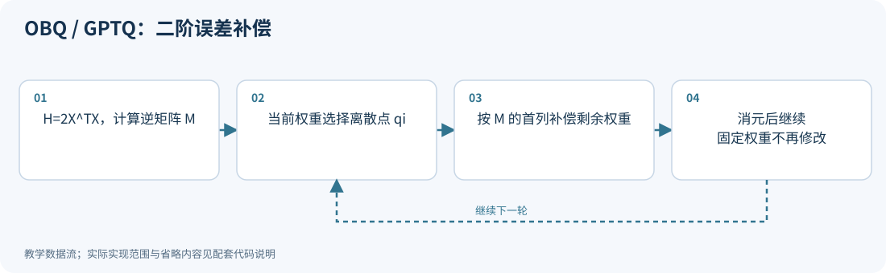
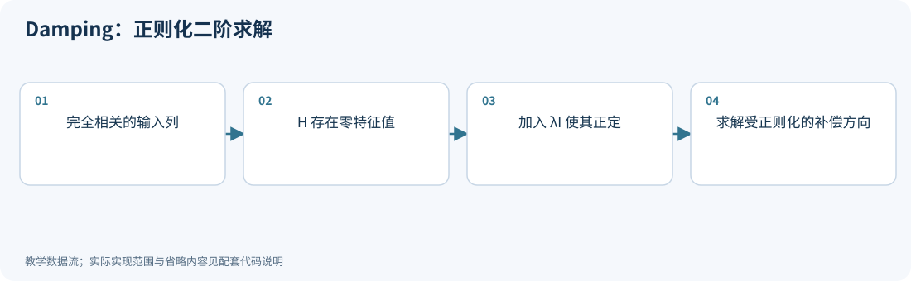
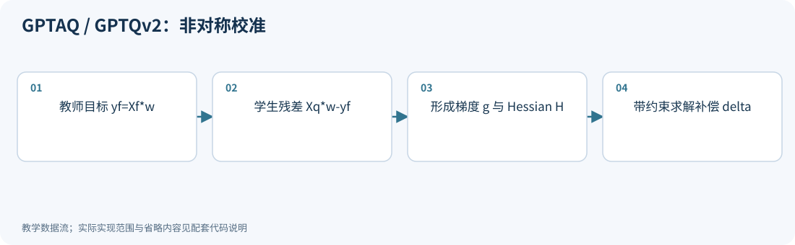

# 02｜GPTQ：量化一个权重，为什么要修改其他权重

<!-- course-objectives -->
**学习目标：** 从输出重建推到二阶补偿；区分局部连续最优和全局离散最优；解释 GPTQ 配置与校准输入的差异。

**先修知识：** 第 01 章；附录 A 的二次型、Hessian 和约束优化。 [进入本章测试](#chapter-assessment)；建议先独立作答，再展开答案。
<!-- /course-objectives -->

原始资料：[R01] GPTQ；[R02] GPTQv2 / GPTAQ。先推导数学，再解释工程算法。

<!-- chapter-overview -->
<a id="chapter-start"></a>

**阅读路线：** 沿“输出误差 → 约束补偿 → 二维手算 → 顺序更新”阅读，再比较 Cholesky、damping、非对称校准与损失感知网格，分清执行分块和量化分组。

<details><summary>本章目录（11 节）</summary>

- [2.1 权重误差小，不代表输出误差小](#principle-2-1)
- [2.2 先固定一个权重，剩余权重怎样补偿](#principle-2-2)
- [2.3 一个能完全手算的例子](#principle-2-3)
- [2.4 OBQ 到 GPTQ：数学公式相同，规模问题不同](#principle-2-4)
- [2.5 为什么代码里的公式看起来不一样](#principle-2-5)
- [2.6 damping 为什么必要](#principle-2-6)
- [2.7 GPTQv2 / GPTAQ：上一层已经有误差怎么办](#principle-2-7)
- [2.8 什么时候考虑 GPTQ](#principle-2-8)
- [2.9 LeanQuant：补偿之外，量化网格也应考虑损失代价](#principle-2-9)
- [2.10 分块、分组、列排序与顺序校准是四个不同选择](#principle-2-10)
- [2.11 本章测试与参考答案](#principle-2-11)

</details>

每项技术的图示、代码和讲解紧跟原理。例子在项目根目录运行，只需 NumPy；长篇参考资料可在各节末尾展开。[按技术查找](技术图解与代码索引.md) · [查看实验输出](../experiments/results/逐项技术实验结果.md)。

[分章测试与参考答案](#chapter-assessment) · [课程考核与综合练习](11_练习与答案.md#course-assessment-guide)

[本章实操：完整逐步注释](#chapter-demo)

<!-- /chapter-overview -->

<a id="principle-2-1"></a>

## 2.1 权重误差小，不代表输出误差小

一个输出神经元的权重写成列向量 $w\in\mathbb R^d$，输出为：

$$
y=Xw.
$$

令 $\delta=\widehat w-w$。量化输出误差：

$$
\widehat y-y=X\delta.
$$

平方误差：

$$
L=\|X\delta\|_2^2
=(X\delta)^T(X\delta)
=\delta^TX^TX\delta.
$$

令 $H=2X^TX$，得到：

$$
L=\frac12\delta^TH\delta.
$$

这就是常说的 Hessian。对二次函数求两次导数，得到的正是 $H$。这里它是**线性层输出重建误差关于权重的 Hessian**，不是整个语言模型任务损失的精确 Hessian。

为什么重要？展开二维情况：

$$
L=\frac12(H_{11}\delta_1^2+2H_{12}\delta_1\delta_2+H_{22}\delta_2^2).
$$

- 对角项告诉你每个方向有多敏感。
- 非对角项表达输入通道间的相关性；某些权重误差组合可以互相抵消。

如果 $X^TX=I$，目标退化为权重平方误差，固定独立网格的 RTN 就已经最优。GPTQ 的价值来自非均匀敏感性和相关性。

<a id="principle-2-2"></a>

## 2.2 先固定一个权重，剩余权重怎样补偿

假设第 $i$ 个权重必须量化到 $q_i$，所以：

$$
\delta_i=q_i-w_i=\epsilon_i.
$$

暂时允许其他权重连续变化，求：

$$
\min_\delta\frac12\delta^TH\delta
\quad\text{subject to }e_i^T\delta=\epsilon_i.
$$

$e_i$ 是第 $i$ 个位置为 1、其余为 0 的向量，因此 $e_i^T\delta=\delta_i$。

使用拉格朗日乘子，把约束加到目标中：

$$
\mathcal J(\delta,\lambda)=\frac12\delta^TH\delta
+\lambda(e_i^T\delta-\epsilon_i).
$$

第一步，对 $\delta$ 求导并令其为 0：

$$
H\delta+\lambda e_i=0
\Rightarrow\delta=-\lambda H^{-1}e_i.
$$

第二步，把约束代回去：

$$
-\lambda e_i^TH^{-1}e_i=\epsilon_i
\Rightarrow\lambda=-\frac{\epsilon_i}{[H^{-1}]_{ii}}.
$$

因此：

$$
\boxed{\delta^*=\frac{q_i-w_i}{[H^{-1}]_{ii}}H^{-1}e_i.}
$$

右边就是逆 Hessian 的第 $i$ 列，乘以一个系数。第 $i$ 个位置恰好变成所需舍入误差，其余位置提供最优连续补偿。

把结果代回损失，得到最小局部损失增加：

$$
\boxed{\Delta L_i=\frac{(q_i-w_i)^2}{2[H^{-1}]_{ii}}.}
$$

如果目标或 Hessian 定义省略了前面的 $1/2$，评分也会差一个常数；排序和补偿方向不受影响。

<a id="principle-2-3"></a>

## 2.3 一个能完全手算的例子

取：

$$
w=\begin{bmatrix}0.6\\0.6\end{bmatrix},\qquad
X=\begin{bmatrix}1&0.5\\0&\sqrt{3}/2\end{bmatrix}.
$$

于是：

$$
H=2X^TX=\begin{bmatrix}2&1\\1&2\end{bmatrix},\quad
H^{-1}=\frac13\begin{bmatrix}2&-1\\-1&2\end{bmatrix}.
$$

为方便演示，固定可用网格 $\{0,1\}$。

**直接 RTN：** 两个 0.6 都舍入成 1，得到 $\widehat w=(1,1)$，$\delta=(0.4,0.4)$。

$$
L_{RTN}=\frac12\delta^TH\delta=0.48.
$$

**先量化第一个，再补偿第二个：** 第一个权重 $0.6\to1$，即 $\epsilon_1=0.4$。

$$
\delta^*=\frac{0.4}{2/3}
\begin{bmatrix}2/3\\-1/3\end{bmatrix}
=\begin{bmatrix}0.4\\-0.2\end{bmatrix}.
$$

权重变成 $(1,0.4)$。为什么第二个减小？因为两个输入通道正相关，第一个增加后，第二个减少能抵消部分输出变化。

此时局部误差从不补偿的 0.16 降到 0.12。再把第二个 $0.4\to0$，最终得到：

$$
\widehat w=(1,0),\quad\delta=(0.4,-0.6),\quad L=0.28.
$$

本例中 $0.28<0.48$。注意：第一个权重一旦量化，之后不能再把它当自由变量修改。

它说明了补偿机制，不证明 GPTQ 在每个张量和每个网格上都优于 RTN。连续局部最优不等于全局离散最优。

<a id="principle-2-4"></a>
<a id="gptq"></a>

## 2.4 OBQ 到 GPTQ：数学公式相同，规模问题不同

OBQ 思路是反复选择局部损失增加最小的权重，再补偿剩余权重。逐权重、逐输出通道做选择，代价过高。

GPTQ 的主要工程改进包括：

1. **多个输出通道采用相同输入列顺序。** $H$ 只依赖输入 $X$，因此可以共享。
2. **分块处理和延迟更新。** 一个块内部逐列量化，对远处列的更新攒成大矩阵运算。
3. **使用 Cholesky 形式。** 减少反复更新逆矩阵造成的数值不稳定。

固定了一个变量后，自由变量对应的逆 Hessian 要更新。若 $M=H^{-1}$，消去第 $i$ 个变量后：

$$
M_{\mathrm{new}}=M_{-i,-i}
-\frac{M_{-i,i}M_{i,-i}}{M_{ii}}.
$$

这个式子可由分块矩阵求逆得到，不能在每一步不加改变地使用初始完整逆矩阵。

<!-- inline-technique: gptq -->

### 图解与代码



**运行：** `python experiments/technique_lab.py --technique gptq`

<!-- executable: gptq -->
```python
import numpy as np
X = np.array([[1., .5], [0., np.sqrt(3)/2]])
w = np.array([.6, .6]); current = w.copy()
M = np.linalg.inv(2*X.T@X)
for i in range(len(w)):
    qi = np.clip(np.rint(current[i]), 0, 1)
    current[i:] += (qi-current[i])*M[:, 0]/M[0, 0]
    M = M[1:, 1:] - np.outer(M[1:, 0], M[0, 1:])/M[0, 0]
loss = lambda q: np.sum((X@(q-w))**2)
assert np.allclose(current, [1, 0]) and np.isclose(loss(current), .28)
print("compensated, loss, RTN loss:", current, loss(current), loss(np.rint(w)))
```

**代码讲解**

1. current[i:] 只修改尚未固定的后缀；补偿系数的符号使用 qi-current[i]，所以直接相加。
2. Schur 消元得到下一次约束问题的逆 Hessian；不能反复使用最初的完整逆矩阵。
3. 原始 OBQ 还会按损失选择变量；GPTQ 共享列顺序并使用 Cholesky 与分块更新降低开销。

> **示例边界：** 代码是固定顺序、单输出行的 OBQ/GPTQ 核心机制，没有实现完整 GPTQ 的块更新、分组尺度和权重打包。

<details>
<summary>论文、博客与官方资料</summary>

- **论文**：[GPTQ: Accurate Post-Training Quantization for Generative Pre-trained Transformers](https://arxiv.org/abs/2210.17323)。
- **博客与技术文章**：[Hugging Face 中文博客：使用 AutoGPTQ 和 transformers 让大语言模型更轻量化](https://huggingface.co/blog/zh/gptq-integration)。
- **作者项目、官方文档与规范**：[GPTQ 作者实现与 README](https://github.com/IST-DASLab/gptq)。

博客记录 AutoGPTQ 的历史集成；当前安装接口以所选项目版本为准。

</details>

<!-- /inline-technique -->

<a id="principle-2-5"></a>

## 2.5 为什么代码里的公式看起来不一样

不少实现先计算上三角矩阵 $U$：

$$
H^{-1}=U^TU.
$$

按列处理时会看到类似：

```text
q_i = quantize(w_i)
err = (w_i - q_i) / U[i, i]
w[i:] = w[i:] - err * U[i, i:]
```

这里 $U$ 是逆 Hessian 的 Cholesky 因子。**它不是直接把 $H^{-1}$ 换了一个变量名。** 分母和更新向量必须使用同一种分解约定。

实际还可能按激活二阶矩大小重排输入列，例如 act-order；某些版本按组固定 scale 的方式也不同。比较两个“GPTQ 模型”时，要同时记录 group size、量化网格、列顺序和实现版本。

<a id="principle-2-6"></a>
<a id="damping"></a>

## 2.6 damping 为什么必要

如果校准样本不足，或者某些通道线性相关，$X^TX$ 可能不可逆或病态。

常用做法：

$$
H_\lambda=H+\lambda I,\quad\lambda>0.
$$

它既帮助数值求解，也可理解为对大幅权重补偿加惩罚。很多实现将 $\lambda$ 设为 Hessian 对角均值的一定比例。

damping 不是“越大越好”：太大会削弱输入相关性信息，使结果更接近简单权重误差优化。

### damping 的含义取决于坐标系

令原权重误差为列向量 $e$。使用 $H+\lambda I$ 相当于优化
$\tfrac12e^THe+\tfrac\lambda2\|e\|_2^2$，即惩罚大幅权重改动。

若先做一般可逆变换 $X'=XT$，则权重列变成 $w'=T^{-1}w$，应重新使用
$H'=T^THT$。在新坐标里加 $\lambda I$，映回原坐标的惩罚为
$\lambda\|T^{-1}e\|_2^2/2$。它通常不等于原坐标的各向同性惩罚；只有正交变换才保持该范数。
因此“旋转/缩放 + GPTQ”不仅要匹配权重与输入，也要明确 damping 在哪个坐标里定义。

若在原坐标确定一个正则化度量 $A\succ0$，要保持同一个优化问题，应整体变换为
$T^T(H+A)T$。这是由二次型直接推导出的组合规则，不是额外一种 GPTQ 算法。实现依据可回查 [GPTQ v2 的算法与 Cholesky 处理](https://arxiv.org/abs/2210.17323v2)。

<!-- inline-technique: damping -->

### 图解与代码



**运行：** `python experiments/technique_lab.py --technique damping`

<!-- executable: damping -->
```python
import numpy as np
X = np.array([[1., 1.], [2., 2.]])
H = 2*X.T@X
damping = .01*np.mean(np.diag(H))
regularized = H + damping*np.eye(2)
direction = np.linalg.solve(regularized, [1., 0.])
assert np.linalg.matrix_rank(H) == 1
assert np.linalg.eigvalsh(regularized).min() > 0
assert np.allclose(regularized@direction, [1, 0])
print("lambda, direction:", damping, direction)
```

**代码讲解**

1. 原 H 的秩为 1，不能稳定地直接求逆；加入 λ 后所有特征值都严格为正。
2. solve 计算所需的一列逆作用，不需要为这个例子显式形成全部逆矩阵。

> **示例边界：** 全零 Hessian 的对角均值仍为零，需要另设 λ 下限；这里用非零奇异矩阵展示常用相对 damping。

<details>
<summary>论文、博客与官方资料</summary>

- **论文**：[GPTQ: Accurate Post-Training Quantization for Generative Pre-trained Transformers](https://arxiv.org/abs/2210.17323)；[A White Paper on Neural Network Quantization](https://arxiv.org/abs/2106.08295)。
- **作者项目、官方文档与规范**：[GPTQ 作者实现与 README](https://github.com/IST-DASLab/gptq)。

这是 GPTQ 等二阶方法的数值稳定步骤，参考论文与作者实现，而不是独立量化算法。

</details>

<!-- /inline-technique -->

<a id="principle-2-7"></a>
<a id="gptaq"></a>

## 2.7 GPTQv2 / GPTAQ：上一层已经有误差怎么办

版本说明：arXiv:2504.02692 的早期版本名为 GPTQv2，核查到的 v3 改称 GPTAQ。这里使用双名称表示同一论文的演进，具体复现应固定版本。

设原模型当前层输入是 $X_f$，前面若干层量化后的输入是 $X_q$。

传统对称重建在同一份输入上比较：

$$
\|X_q\widehat W^T-X_qW^T\|_F^2.
$$

它适应当前量化输入，但目标本身已经包含上游误差。GPTQv2 强调**非对称校准**：

$$
\boxed{\min_{\widehat W}\|X_q\widehat W^T-X_fW^T\|_F^2.}
$$

这里“非对称”指输入来自不同精度路径，与“非对称整数 zero point”完全是两回事。

用一个输出神经元解释其数学差异。令目标 $y_f=X_fw$，当前权重为 $w$，则：

$$
L(w+\delta)=L(w)+g^T\delta+\frac12\delta^TH\delta,
$$

$$
g=2X_q^T(X_qw-y_f),\qquad H=2X_q^TX_q.
$$

普通同输入重建在原始权重处残差为零，所以 $g=0$。现在一般 $g\ne0$。再次加上约束 $\delta_i=\epsilon_i$：

$$
H\delta+g+\lambda e_i=0.
$$

解得：

$$
\boxed{
\delta^*=-H^{-1}g
+\frac{\epsilon_i+e_i^TH^{-1}g}{[H^{-1}]_{ii}}H^{-1}e_i.
}
$$

第一项先修正已有输出偏差，第二项确保选中的权重落到量化点。当 $g=0$，就退化为前面的补偿公式。

这个推导解释了非对称校准为什么多出误差修正项。**它是教学中的局部受约束二次问题，不是完整 GPTQv2 实现的逐行翻译。** 原论文还推导了可扩展的矩阵更新形式，避免每一步重新解系统。

<!-- inline-technique: gptaq -->

### 图解与代码



**运行：** `python experiments/technique_lab.py --technique gptaq`

<!-- executable: gptaq -->
```python
import numpy as np
Xf = np.array([[1., .5], [0., 1.]])
Xq = Xf + np.array([[.1, 0.], [0., -.1]])
w = np.array([.6, .6]); e = np.array([1., 0.]); epsilon = .4
H = 2*Xq.T@Xq
g = 2*Xq.T@(Xq@w-Xf@w)
M = np.linalg.inv(H)
delta = -M@g + (epsilon + e@M@g)/(e@M@e)*(M@e)
kkt = np.block([[H, e[:, None]], [e[None, :], np.zeros((1, 1))]])
independent = np.linalg.solve(kkt, np.r_[-g, epsilon])[:2]
assert np.allclose(delta, independent) and np.isclose(delta[0], epsilon)
print("existing gradient, constrained correction:", g, delta)
```

**代码讲解**

1. g 来自真实的教师/学生输入差异，没有任意指定；H 则只由学生输入决定。
2. 第一项 -M@g 修正已有残差，第二项把选中权重锁到舍入误差 epsilon。独立 KKT 求解核对约束解。

> **示例边界：** 这是一轮局部二次补偿，不是论文完整的可扩展矩阵更新流程；名称与版本对应关系见正文。

<details>
<summary>论文、博客与官方资料</summary>

- **论文**：[GPTAQ: Efficient Finetuning-Free Quantization for Asymmetric Calibration](https://arxiv.org/abs/2504.02692)。
- **作者项目、官方文档与规范**：[GPTAQ 作者实现与 README（原 GPTQv2）](https://github.com/Intelligent-Computing-Lab-Panda/GPTAQ)。

GPTQv2 是早期名称；作者仓库已迁移并更名为 GPTAQ。

</details>

<!-- /inline-technique -->

<a id="principle-2-8"></a>

## 2.8 什么时候考虑 GPTQ

- 已有训练好的模型，需要常见 W4A16 权重压缩；
- 有少量具有代表性的校准文本；
- 推理框架支持其输出布局及对应 kernel。

主要代价是校准计算与二阶统计存储；主要局限是局部重建目标、校准分布偏差和极低 bit 的离散误差。权重量化成功，也没有自动解决激活与 KV cache 的量化问题。

<a id="leanquant"></a>

<a id="principle-2-9"></a>

## 2.9 LeanQuant：补偿之外，量化网格也应考虑损失代价

本章先固定网格讨论补偿，但网格如何初始化同样影响最终误差。[LeanQuant v3，§3](https://arxiv.org/html/2407.10032v3)（首发 2024-07-14；所读版本 2026-01-01）将共享网格的选择与逆 Hessian 对角联系起来：

$$
\min_{\mathcal G}\sum_i([H^{-1}]_{ii})^{-p}|Q_{\mathcal G}(w_i)-w_i|^2.
$$

这里需要保护的是 $1/[H^{-1}]_{ii}$ 较大的方向，不能误写成“逆 Hessian 对角越大越敏感”。$p$ 是调节强调程度的超参数；$p=1$ 对应单次受约束代价的相对权重，其他取值不再是该代价的原样表达。

非均匀网格可用加权聚类，仿射网格则受等间距约束，通过尺度/零点候选搜索，再结合 GPTQ 顺序补偿。它与第 13 章 DASH-Q 的区别在于：LeanQuant 使用逆 Hessian 对角构造网格权重并保留补偿流程；DASH-Q 以原二阶矩的对角近似进行共享尺度回归。一般 $1/[H^{-1}]_{ii}\ne H_{ii}$，只有特定条件下才可等同。

方法改变的是编码决策，最终可以导出仿射或非均匀表示；后者需要匹配查表内核。比较应固定网格族、分组、搜索预算和完整存储。共享网格的加权优化也不同于“给定网格后，逐元素最近舍入会因乘正常数而改变”。

### 反馈目标还需包含尺度和有限网格的影响

[Revisiting Error Feedback for Model Quantization](https://arxiv.org/html/2610.18139v1)（2026-10-13）将反馈系数本身视为可优化变量，并讨论下游敏感性度量。
其理想 trace 目标假设瞬时量化误差具有固定、独立的共同方差；有限码字下，旋转可能改变范围与步长，反馈还可能造成饱和。
所以更小的 trace 不保证实际低比特误差更小，需同时核对步长、裁剪和最终输出损失。
这也解释了为什么“数学代理更优”和“真实模型更好”必须分别给证据。

<a id="principle-2-10"></a>

## 2.10 分块、分组、列排序与顺序校准是四个不同选择

<a id="gptq-configuration"></a>

复现 GPTQ 时，“128”可能指两个不同参数。[作者 `gptq.py`](https://github.com/IST-DASLab/gptq/blob/main/gptq.py)中的 `blocksize` 控制延迟补偿更新的计算块，`groupsize` 控制共享量化参数的权重组。二者可以都取 128，但数学角色不同，不能混为一个“分组大小”。

| 选择 | 改变什么 | 复现时核对什么 |
|---|---|---|
| `blocksize` | 块内逐列补偿、块外批量更新的组织 | 更新时机、临时内存、数值执行顺序 |
| `groupsize` | 哪些权重共享 scale/zero point | 元数据数量、分组轴与最终布局 |
| `actorder` / `desc_act` | 按输入二阶统计重排列处理次序 | 权重、Hessian、逆置换和组映射必须一致 |
| `true_sequential` | 一个 Transformer 块内按依赖次序校准子模块 | 后面的模块是否读取已经量化的前面模块输出 |

例如开启 act-order 后，如果按置换后的列顺序分组，恢复原列顺序时还需正确恢复“每列使用哪组参数”的映射；不能仅逆置换编码、仍按原连续组解释尺度。静态分组是另一种选择：预先在原列组上确定量化参数，再让排序列查回原组。其最终格式是否保存显式组索引取决于实现。

`true_sequential` 是块内数据采集的依赖关系；GPTQ 算法内部逐列补偿是权重更新顺序，二者也不能混用。[作者 LLaMA 校准代码](https://github.com/IST-DASLab/gptq/blob/main/llama.py)提供了按 Q/K/V、输出投影、MLP 等依赖分批处理的实例。不同架构应按实际计算图组织。

还有一种特殊情况：校准中某输入列的二阶矩对角为零。作者实现对这类列采用单独处理以避免奇异统计；这只说明该列在本次校准中没有能量，不能证明在目标业务中永远无用。应检查校准覆盖，尤其是低频 token、专家分支或条件激活。

这些配置应和位宽、网格、damping、样本协议、checkpoint revision 一起保存。同名“GPTQ 4 bit”不足以定义可比较的实验。

<!-- chapter-demo: 02 -->
## 本章实操｜逐步观察误差补偿并穷举核对

<a id="chapter-demo"></a>

**实践目的：** 把局部约束解落实为逐列更新，跟踪自由权重与逆矩阵的变化。

**环境：** Python 3.10+、NumPy、PyTorch；支持 CPU/CUDA，Colab 选择 GPU 运行时。无需下载模型。在项目根目录执行：

```bash
python experiments/chapter_demo_lab.py --chapter 02 --device cuda
# 没有GPU时显式使用CPU；auto在CUDA可用时优先使用GPU
python experiments/chapter_demo_lab.py --chapter 02 --device cpu
# 也可直接执行源码模块（同样在项目根目录）
python -m experiments.demos.ch02
```

**Colab：** 可直接上传[逐章 GPU Notebook](../experiments/notebooks/colab_chapter_demos.ipynb)，它自带所需源码；按单元选择本章运行。修改源码后将 `PRACTICE=True`，或命令行加 `--practice`；此模式跳过正文一致性检查，保留数值断言、设备核验及实际源码哈希。指定 `cuda` 后不可用会报错，不会静默退回 CPU。随机输入在 CPU 准备后一次搬到所选设备；矩阵、量化、训练和统计计算使用该设备的 PyTorch 张量。文件 I/O、Python 流程控制和打印在主机；默认 FP64 核验精度，不代表原生低比特 Tensor Core 性能。

**完整源码：** [带逐步注释的 demo](../experiments/demos/ch02.py)。默认只打印结果；保存命令与全部章节入口见[实操导航](../README.md#chapter-demos)。

<details><summary>展开完整代码：每一步的行为、计算逻辑与检查条件</summary>

<!-- chapter-demo-code: 02 -->
```python
"""第 02 章：逐列补偿，观察每一步并用穷举核对最终离散结果。"""
import itertools
import math
import torch
from experiments.demo_runtime import get_runtime, same

# 第 0 步：auto优先CUDA；runner可用--device指定。所有计算张量在此设备创建。
rt = get_runtime()
device, dtype = rt.device, rt.dtype

# 第 1 步：构造相关输入，让权重误差之间存在可以抵消的交叉项。
X = rt.tensor([[1., .5], [0., math.sqrt(3)/2]])
w = rt.tensor([.6, .6])
grid = rt.tensor([0., 1.])
H = 2*X.T@X
M = torch.linalg.inv(H)  # 仅二维教学；大模型使用稳定分解和批量更新。
current = w.clone()     # 工作副本会补偿，原 w 留作误差参照。
quantized = torch.empty_like(w)

# 第 2 步：先算 RTN 基线。固定网格下它优化权重距离，不利用输入相关性。
rtn = grid[torch.argmin(abs(w[:, None]-grid), dim=1)]
loss = lambda candidate: float(torch.sum((X@(candidate-w))**2))
print('RTN:', rtn, '输出 SSE:', loss(rtn))

# 第 3 步：每次固定一个码字，只允许后面的自由权重继续补偿。
for i in range(w.numel()):
    chosen = grid[torch.argmin(abs(grid-current[i]))]
    epsilon = chosen-current[i]
    # M 的第 0 行/列始终对应当前尚未固定的第一个变量。
    correction = epsilon*M[:, 0]/M[0, 0]
    current[i:] += correction
    quantized[i] = chosen
    assert same(current[i], chosen)
    print(f'第{i+1}步: 码字={chosen}, 连续补偿={correction}, 工作权重={current}')
    # 消去已经固定的变量，得到剩余主子矩阵的逆；不能重复用最初的逆。
    if len(M) > 1:
        M = M[1:, 1:]-torch.outer(M[1:, 0], M[0, 1:])/M[0, 0]
        assert same(M, torch.linalg.inv(H[i+1:, i+1:]))

# 第 4 步：用输出误差与二次型两条独立路径计算同一个目标。
delta = quantized-w
assert same(loss(quantized), .5*delta@H@delta)
assert same(quantized, [1., 0.])
assert same(loss(quantized), .28)

# 第 5 步：这里只有四个离散组合，可以穷举确定本例的全局最优值。
# 大模型无法这样穷举；本例最优不构成 GPTQ 一般全局最优的证明。
combinations = rt.tensor(list(itertools.product((0, 1), repeat=w.numel())), dtype=torch.int64)
candidates = grid[combinations]
costs = ((candidates-w)@X.T).square().sum(dim=1)
print('全部候选及 SSE:', list(zip(candidates.tolist(), costs.tolist())))
assert same(loss(quantized), costs.min())
print('补偿结果:', quantized, '输出 SSE:', loss(quantized))

# 收尾：等待本demo设备上的操作完成，方便Colab定位CUDA异步报错。
rt.synchronize()
```

</details>

**运行后观察：** RTN的输出SSE为0.48，顺序补偿为0.28；四候选穷举确认本例的最优值。

**动手修改：** 改变 w 或输入相关性；保持 H=2XᵀX 一致，重新判断最优结果，不照搬原数值断言。

**适用边界：** 二维固定网格的顺序补偿，不含完整GPTQ的分块、分组、打包与模型校准。

<!-- /chapter-demo -->

<!-- chapter-assessment -->

<a id="principle-2-11"></a>

## 2.11 本章测试与参考答案

<a id="chapter-assessment"></a>

核心卷 8 题，仍按 100 分；另有简单、困难、特别困难拓展题各 1 道，不计入核心卷。难度相对于本章先修知识划分，题号保持原有顺序。核心卷建议 60–90 分钟，特别困难拓展可另留 30–60 分钟。

| 难度 | 按难度选题 |
|---|---|
| 简单 | [02-01](#exercise-02-01) · [02-E01](#exercise-02-e01) |
| 困难 | [02-02](#exercise-02-02) · [02-03](#exercise-02-03) · [02-04](#exercise-02-04) · [02-05](#exercise-02-05) · [02-06](#exercise-02-06) · [02-07](#exercise-02-07) · [02-08](#exercise-02-08) · [02-E02](#exercise-02-e02) |
| 特别困难 | [02-E03](#exercise-02-e03) |

每题提供至少三条参考路径，分别可能是解析解、等价推导、独立数值核验或满足条件的工程方案。固定条件下唯一的数值结果不因解法不同而改变；数值实验不能替代一般性证明。未明确要求比较多解时，可任选或组合路径回答全部子问；验证说明须补足题干要求的推导。开放题接受条件明确、证据充分的其他方案。

<a id="exercise-02-01"></a>

### 02-01｜Hessian 的对象（简单｜基础辨析，10 分）

设 $X\in\mathbb R^{100\times4}$、$W\in\mathbb R^{3\times4}$。线性输出重建使用的 $H=2X^TX$ 多大？为什么三行权重可共享它？它是不是整个语言模型交叉熵的 Hessian？

<details><summary>参考答案与评分要点</summary>

**参考路径一：**

$H$ 是 $4\times4$，由输入决定；各输出行在相同 $X$ 下有相同二次重建曲率，故可共享。它不是全模型交叉熵关于全部参数的 Hessian；后者目标、变量和维度不同。

**路径二：按单行权重求导。** 将输出行w写成4维列向量，$L=\|X\delta\|^2$，二次求导得4×4的 $2X^TX$。换输出行不改变X。

**路径三：堆叠全部输出。** 无跨输出耦合时总重建损失是三行独立二次型之和，完整曲率可写成含3个相同H的块对角矩阵；这解释了共享而非共享全部模型任务曲率。

**评分要点：** 形状 3 分；共享原因 3 分；目标区别 4 分。

</details>

<a id="exercise-02-02"></a>

### 02-02｜RTN 在什么条件下已经最优（困难｜推导，10 分）

固定独立标量网格，且 $X^TX=\operatorname{diag}(1,4,9)$。正的对角权重会改变每个元素最近舍入的最优码字吗？如果允许共享 scale 一起优化呢？

<details><summary>参考答案与评分要点</summary>

**参考路径一：**

不会。损失为 $\sum_i h_i(\widehat w_i-w_i)^2$，每个 $h_i>0$ 只缩放该坐标代价。共享 scale 可变时，各坐标通过网格耦合，敏感性权重会改变最优尺度；不再是固定网格的独立选择。

**路径二：独立最小值之和。** 笛卡尔积网格允许每个坐标独立达到最小误差，乘正权后仍选同一码字，所以整体和也最小。

**验证路径：有限网格穷举。** 对两维小例列出所有组合，正对角项不会改变单坐标最近码字；加入共享可变尺度后必须外层搜索尺度，独立最优证明不再直接成立。

**评分要点：** 可分解公式 4 分；固定网格结论 3 分；共享尺度边界 3 分。

</details>

<a id="exercise-02-03"></a>

### 02-03｜二维补偿独立推导（困难｜推导与计算，15 分）

$H=\begin{bmatrix}4&2\\2&3\end{bmatrix}$，$L=\frac12\delta^TH\delta$，固定 $\delta_1=0.3$。不先求逆，直接求最佳 $\delta_2$ 与损失，再与不补偿对照。

<details><summary>参考答案与评分要点</summary>

**参考路径一：**

$L=2(0.3)^2+2(0.3)\delta_2+1.5\delta_2^2$。导数 $0.6+3\delta_2=0$，故 $\delta_2=-0.2$，$L=0.12$。不补偿时 $L=0.18$，减少 0.06。第二个坐标仍为连续变量。

**解法二：逆H公式。** $H^{-1}=\frac18\begin{bmatrix}3&-2\\-2&4\end{bmatrix}$，以第一列除首对角并乘0.3，得(0.3,−0.2)；损失 $0.3^2/(2\times3/8)=0.12$。

**解法三：完成平方。** 固定首坐标后 $L=1.5(\delta_2+0.2)^2+0.12$，最小值和补偿直接可见。不补偿多付 $1.5(0.2)^2=0.06$。

**评分要点：** 展开 4 分；求导及补偿 5 分；两个损失 4 分；连续条件 2 分。

</details>

<a id="exercise-02-04"></a>

### 02-04｜先补偿再舍入不是全局保证（困难｜计算，15 分）

沿用上一题的 $H$，原权重为 $(0.7,0.6)$，两坐标最终只能取 0 或 1。先把第一个量化到 1，再连续补偿第二个并最近舍入。求结果和最终损失；如何验证全局离散最优？

<details><summary>参考答案与评分要点</summary>

**参考路径一：**

第一坐标误差 0.3，第二坐标先减 0.2，变为 0.4，再舍入到 0；最终 $(1,0)$，误差 $(0.3,-0.6)$，损失 0.36。穷举四候选损失：(0,0) 为 2.36，(0,1) 为 0.66，(1,0) 为 0.36，(1,1) 为 0.66。本例达最优，但需要穷举才能确认，不代表顺序算法一般保证全局最优。

**路径二：条件切片穷举。** 首坐标固定1后只比较(1,0)与(1,1)，得0.36和0.66；再比较首坐标0的两点才能确认全局，而非仅验证局部选择。

**路径三：输出范数核对。** 找到满足 $X^TX=H/2$ 的Cholesky因子X，对每个候选计算 $\|X(q-w)\|^2$，独立验证二次型数字。数值穷举只证明本例。

**评分要点：** 顺序过程 5 分；最终损失 4 分；穷举与限制 6 分。

</details>

<a id="exercise-02-05"></a>

### 02-05｜阻尼与死通道（困难｜工程诊断，15 分）

校准矩阵两列完全相同，另一列全为零。为什么直接 Cholesky 可能失败？加入 $\lambda I$ 修复了什么、没有证明什么？

<details><summary>参考答案与评分要点</summary>

**参考路径一：**

列相关或零列令二阶统计奇异/半正定。正阻尼在精确算术下使其正定，并抑制过大补偿；数值实现还要选择合适尺度。它没有补足目标业务的数据覆盖，也没有证明零列在所有输入上都无用；需要检查样本与低频条件。

**路径二：特征值解释。** 完全相关与零列产生零特征值；加λI把所有特征值抬高λ。它使求解稳定，但没有产生未观测方向的数据。

**路径三：支持子空间视角。** 可先识别数据实际张成的空间，在支撑子空间分析可辨识误差，再规定其余方向的正则。相比简单加阻尼，必须说明子空间截断改变的目标，不能声称恢复真实曲率。

**评分要点：** 奇异原因 5 分；阻尼效果 5 分；数据与模型结论边界 5 分。

</details>

<a id="exercise-02-06"></a>

### 02-06｜128 与 128 不是同一个参数（困难｜配置分析，15 分）

一个实验只记录“GPTQ 4-bit 128”，同时开启 act-order。列出至少四个遗漏配置，并解释为什么只逆置换码字仍可能解码错误。

<details><summary>参考答案与评分要点</summary>

**参考路径一：**

应记录 blocksize、groupsize、网格/对称性、damping、act-order、static groups、true-sequential、校准协议及版本等。blocksize 管计算更新，groupsize 管共享尺度。若按排序后列分组，恢复列顺序还须恢复每列使用的尺度组映射；仅逆置换码字会与错误组参数组合。

**路径二：构造置换往返。** 保存原列编号、处理顺序和每列组编号，再把码字、组映射一起逆置换；逐列比较反量化权重。一个跨组交换即可暴露只置换码字的错误。

**路径三：区分时间与表示。** blocksize决定何时批量更新；groupsize决定共享参数；act-order决定处理顺序；true-sequential决定采集谁的输入。把四者写成不同配置字段，不能用“128”同时代指。

**评分要点：** 至少四项具体配置 4 分；块/组区别 4 分；组映射错误机制 7 分。

</details>

<a id="exercise-02-07"></a>

### 02-07｜非对称校准的目标（困难｜推导，10 分）

写出用量化前层输入 $X_q$ 对原浮点目标 $X_fW^T$ 重建的损失。若令 $E=\widehat W-W$、$R=(X_f-X_q)W^T$，展开平方项并说明为什么出现一阶交叉项。

<details><summary>参考答案与评分要点</summary>

**参考路径一：**

目标为 $\|X_q\widehat W^T-X_fW^T\|_F^2=\|X_qE^T-R\|_F^2$。展开得 $\|X_qE^T\|_F^2-2\langle X_qE^T,R\rangle+\|R\|_F^2$。中间项反映已有上游误差；输入相同使 $R=0$ 时才消失。

**解法二：残差回归。** 将量化层补偿看作让 $X_qE^T$ 拟合已知目标R；最小二乘天然包含线性驱动 $-2\langle X_qE^T,R\rangle$。

**解法三：迹运算。** 展开 $\operatorname{tr}[(X_qE^T-R)^T(X_qE^T-R)]$，两交叉迹相等，合为−2项。若X_f=X_q则R为0，退回对称重建。

**评分要点：** 目标 3 分；展开与符号 4 分；上游误差解释 3 分。

</details>

<a id="exercise-02-08"></a>

### 02-08｜声称优于 RTN 需要什么证据（困难｜实验设计，10 分）

设计 RTN 与 GPTQ 的受控比较，要求能区分补偿算法收益和不同量化配置带来的收益。

<details><summary>参考答案与评分要点</summary>

**参考路径一：**

固定浮点模型、最终位宽/分组/网格、后端和评测协议，比较 RTN 与开启补偿；再单独消融 act-order、damping 和校准输入协议。报告量化成本、独立任务质量及重载后性能。NumPy 二维反例只证明机制，不能作为真实模型排行榜。

**方案二：固定量化器，仅开关反馈。** 复用同一尺度、零点与列顺序，比较独立舍入和顺序补偿，以隔离反馈本身；再另做尺度与排序优化消融。

**方案三：模型级成对评估。** 对每题保存两模型结果，按任务/文档重采样差值，并保存量化耗时与重载路径。相同W4标签但不同后端的速度只能称配置比较，不能全归于算法。

**评分要点：** 配置控制 4 分；消融 3 分；三层证据与成本 3 分。

</details>

<a id="exercise-02-e01"></a>

### 02-E01｜输入各向同性时的舍入（简单｜拓展题，单独计分）

两个权重为(0.2,0.8)，网格{0,1}，H=2I，损失为一半二次型。RTN输出与损失是多少？

<details><summary>参考答案与评分要点</summary>

**解法一：逐元素距离。** 得(0,1)，误差(−0.2,0.2)，损失0.08。

**解法二：枚举。** 四点损失依次为0.68、0.08、1.28、0.68，最小为(0,1)。

**解法三：输入范数。** 取X=I即可使H=2XᵀX；直接比较输出向量平方距离，与权重最近舍入一致。

**评分要点：** 单独按 10 分评价：结论与条件 3 分、推理或设计过程 5 分、独立核验与边界 2 分。评分覆盖题干要求的全部子问；未要求比较多解时，可任选或组合参考路径完成作答。数值核验不能替代题干明确要求的证明，多解数量不额外加分。

</details>

<a id="exercise-02-e02"></a>

### 02-E02｜用 Schur 补解释补偿收益（困难｜拓展题，单独计分）

正定H按第一坐标分块为 $\begin{bmatrix}h&b^T\\b&C\end{bmatrix}$，固定首坐标误差ε。推导其余误差与最小损失，并解释相对不补偿节省多少。

<details><summary>参考答案与评分要点</summary>

**解法一：求导。** $L=\frac12h\epsilon^2+\epsilon b^Tv+\frac12v^TCv$；得 $v^*=-C^{-1}b\epsilon$，最小 $\frac12\epsilon^2(h-b^TC^{-1}b)$。

**解法二：完成平方。** 将L写为 $\frac12(v+C^{-1}b\epsilon)^TC(v+C^{-1}b\epsilon)+\frac12\epsilon^2(h-b^TC^{-1}b)$，非负平方项给出最小。

**解法三：逆矩阵联系。** $(H^{-1})_{11}=1/(h-b^TC^{-1}b)$，代入GPTQ约束损失公式得到同值；不补偿多付 $\frac12\epsilon^2b^TC^{-1}b\ge0$。这只对连续自由坐标成立。

**评分要点：** 单独按 10 分评价：结论与条件 3 分、推理或设计过程 5 分、独立核验与边界 2 分。评分覆盖题干要求的全部子问；未要求比较多解时，可任选或组合参考路径完成作答。数值核验不能替代题干明确要求的证明，多解数量不额外加分。

</details>

<a id="exercise-02-e03"></a>

### 02-E03｜相关输入下 RTN 何时被更远码字击败（特别困难｜拓展题，单独计分）

令 $H=2\begin{bmatrix}1&\rho\\\rho&1\end{bmatrix}$，$0<\rho<1$，$w=(0.49,0.49)$，网格{0,1}。比较RTN的(0,0)与(1,0)，推导后者更好的ρ阈值，并说明局部更优与全局证明的区别。

<details><summary>参考答案与评分要点</summary>

**解法一：显式二次型。** RTN损失 $0.4802(1+\rho)$；(1,0)损失 $0.5002-0.4998\rho$。相减为 $0.02-0.98\rho$，所以 $\rho>1/49$ 时非最近候选更好。

**解法二：和差坐标。** 误差损失为 $(1+\rho)(e_1+e_2)^2/2+(1-\rho)(e_1-e_2)^2/2$。相关性增大使和方向昂贵，(1,0)将误差和由−0.98降至0.02，以增大差方向误差交换收益，整理仍得相同阈值。

**解法三：补齐离散全集。** (0,1)与(1,0)同损失；(1,1)为 $0.5202(1+\rho)$，比RTN大。因此在此二维网格中比较已覆盖全部候选，可证明阈值两侧的全局最优；高维贪心通常无这种完备性。

**评分要点：** 单独按 10 分评价：结论与条件 3 分、推理或设计过程 5 分、独立核验与边界 2 分。评分覆盖题干要求的全部子问；未要求比较多解时，可任选或组合参考路径完成作答。数值核验不能替代题干明确要求的证明，多解数量不额外加分。

</details>

**复习建议：** 计算错误先回到本章的形状、单位与约定；工程判断缺少依据时，补写目标函数、对照配置和验证边界。建议达到 80 分后继续；这是一项自学建议，不是经教学验证的能力认证标准。

[课程考核与综合练习](11_练习与答案.md#course-assessment-guide) · [返回学习目录](../README.md)

<!-- /chapter-assessment -->

<!-- chapter-footer -->

---

[上一章](01_均匀量化与误差.md) · [本章目录](#chapter-start) · [下一章](03_离群值与缩放.md) · [学习首页](../README.md) · [论文与博客](../references/论文与博客导航.md)

<!-- /chapter-footer -->

[R01]: https://arxiv.org/abs/2210.17323

[R02]: https://arxiv.org/abs/2504.02692
