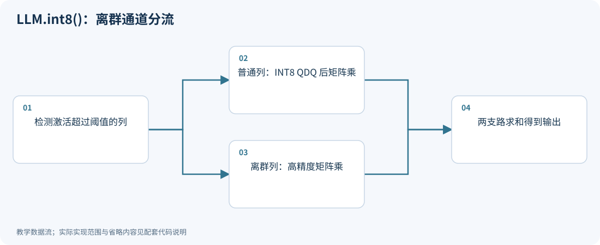
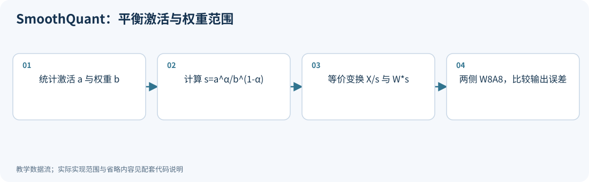
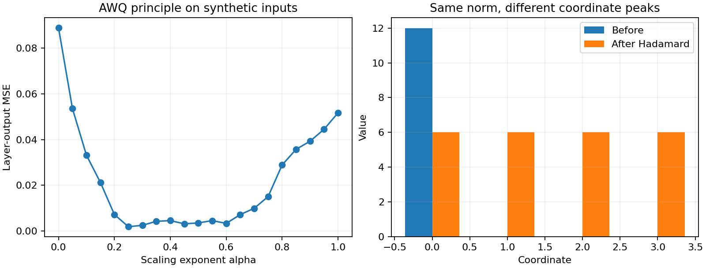
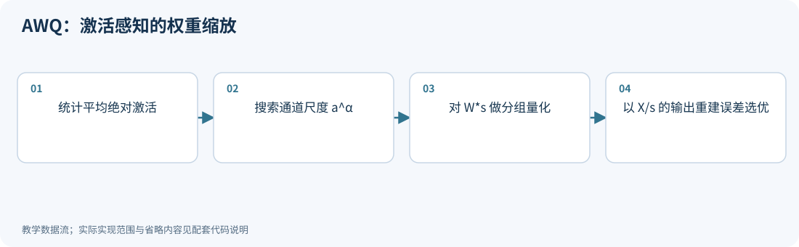
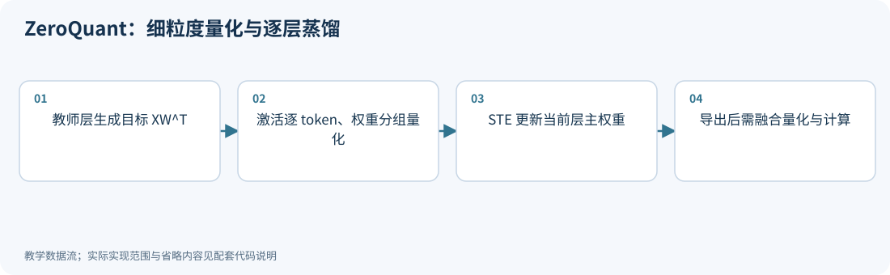
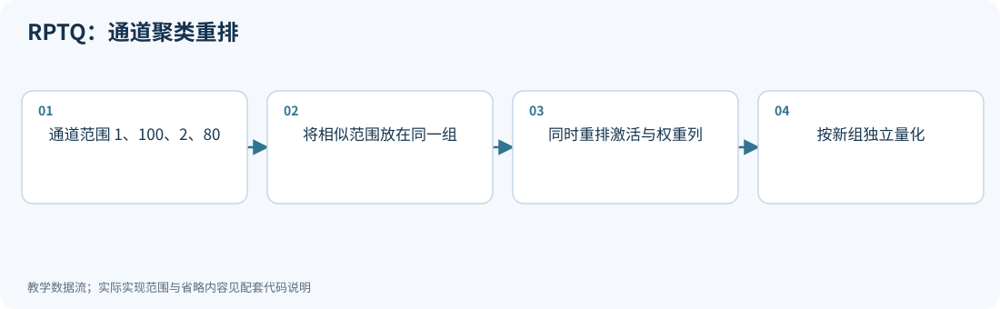

# 03｜离群值：分流、缩放、重排

<!-- course-objectives -->
**学习目标：** 分清离群元素与特征列；推导缩放和偏置修正；比较 AWQ、SmoothQuant、ZeroQuant 与 RPTQ 的优化对象。

**先修知识：** 第 01–02 章；矩阵乘法与按通道广播。 [进入本章测试](#chapter-assessment)；建议先独立作答，再展开答案。
<!-- /course-objectives -->

原始资料：[R03] LLM.int8()；[R04] SmoothQuant；[R05] AWQ；[R06] ZeroQuant；[R07] RPTQ。

<!-- chapter-overview -->
<a id="chapter-start"></a>

**阅读路线：** 先看离群通道分流，再用缩放恒等式比较 SmoothQuant 与 AWQ；接着学习逐层蒸馏、通道重排和输出偏置修正。

<details><summary>本章目录（10 节）</summary>

- [3.1 先认识激活离群值](#principle-3-1)
- [3.2 LLM.int8()：把困难部分分出来](#principle-3-2)
- [3.3 一个等价变换，引出两个重要算法](#principle-3-3)
- [3.4 SmoothQuant：让激活和权重共同承担范围](#principle-3-4)
- [3.5 AWQ：用激活告诉你哪些权重更重要](#principle-3-5)
- [3.6 SmoothQuant 与 AWQ 的准确对照](#principle-3-6)
- [3.7 ZeroQuant：量化方案要与执行系统一起设计](#principle-3-7)
- [3.8 RPTQ：相似范围的通道放到同一组](#principle-3-8)
- [3.9 跨层均衡与偏置修正：哪些传统量化经验能迁移](#principle-3-9)
- [3.10 本章测试与参考答案](#principle-3-10)

</details>

每项技术的图示、代码和讲解紧跟原理。例子在项目根目录运行，只需 NumPy；长篇参考资料可在各节末尾展开。[按技术查找](技术图解与代码索引.md) · [查看实验输出](../experiments/results/逐项技术实验结果.md)。

[分章测试与参考答案](#chapter-assessment) · [课程考核与综合练习](11_练习与答案.md#course-assessment-guide)

[本章实操：完整逐步注释](#chapter-demo)

<!-- /chapter-overview -->

<a id="principle-3-1"></a>

## 3.1 先认识激活离群值

考虑一行激活：

$$
x=[0.2,-0.4,0.1,30].
$$

如果整行用一个 INT4 scale，$s=30/7\approx4.29$，前三项都近似为零。

所谓“离群值问题”包含两种情况：

- 某些 token 的整体幅度很大；
- 某些通道在很多 token 上都很大。

per-token 可以缓解第一种，未必能解决第二种。不是所有模型、层、任务都呈现相同的离群分布，必须实际测量。

<a id="principle-3-2"></a>
<a id="llm_int8"></a>

## 3.2 LLM.int8()：把困难部分分出来

核心思想是把输入通道分成普通集合 $R$ 和离群集合 $O$：

$$
XW^T=X_RW_R^T+X_OW_O^T.
$$

这是严格的代数分解。然后：

$$
Y\approx\operatorname{Int8Matmul}(X_R,W_R)
+\operatorname{FP16Matmul}(X_O,W_O).
$$

普通部分使用向量级 INT8 量化；少量离群通道走高精度路径，最后相加。

**向量级量化的推导：** 每个激活行 $t$ 有 scale $a_t$，每个权重输出行 $j$ 有 scale $b_j$。对称量化时：

$$
Y_{tj}\approx a_tb_j\sum_k q^X_{tk}q^W_{jk}.
$$

scale 的组合是输出矩阵上的外积，容易与矩阵乘衔接。

**执行步骤：**

1. 检查输入，识别超过阈值的特征维度。
2. 将这些维度和对应权重列分到高精度路径。
3. 其余部分按向量量化并做 INT8 矩阵乘。
4. 将两条路径的结果相加。

**优点：** 直接保留高影响通道，通常不要求长时间再训练。

**代价：** 离群检测、索引和额外小矩阵乘；当离群通道很多或矩阵很小时，速度收益可能被开销抵消。它也不是整张计算图都在 INT8 中运行。

需要完整手算、矩阵形状、误差推导、阈值扫描和 T4 实测分析，可以继续阅读 [LLM.int8() 专题详解](专题_LLM_int8_原理与实测.md)。配套 [NumPy 实验](../experiments/llm_int8_lab.py) 可独立运行，并生成五组 PNG/SVG 图表；这是补充实验，不改变下方的基础技术示例。

<!-- inline-technique: llm_int8 -->

### 图解与代码



**运行：** `python experiments/technique_lab.py --technique llm_int8`

<!-- executable: llm_int8 -->
```python
import numpy as np
from experiments.quant_lab import symmetric_qdq, mse
X = np.array([[.1, 30., -.2], [.2, -25., .3]])
W = np.array([[.4, -.2, .8], [.3, .1, -.5]])
outlier = np.max(abs(X), axis=0) > 6
normal = ~outlier
x8 = symmetric_qdq(X[:, normal], bits=8, axis=1)[0]
w8 = symmetric_qdq(W[:, normal], bits=8, axis=1)[0]
output = x8@w8.T + X[:, outlier]@W[:, outlier].T
exact_split = X[:, normal]@W[:, normal].T + X[:, outlier]@W[:, outlier].T
assert np.allclose(exact_split, X@W.T)
assert np.array_equal(outlier, [False, True, False])
print("outlier columns, output MSE:", np.flatnonzero(outlier), mse(output, X@W.T))
```

**代码讲解**

1. axis=0 的检测在 token 维归约，得到需要分流的特征列；权重必须拆相同输入列。
2. 普通激活按 token、普通权重按输出行统计尺度，对应向量级量化。exact_split 检查分支拆分本身保持函数。

> **示例边界：** 高精度支路在这里使用 float64 验证代数；真实实现常用 FP16，并需处理空支路及检测、索引开销。

<details>
<summary>论文、博客与官方资料</summary>

- **论文**：[LLM.int8(): 8-bit Matrix Multiplication for Transformers at Scale](https://arxiv.org/abs/2208.07339)。
- **博客与技术文章**：[Hugging Face 博客：8-bit 矩阵乘与 bitsandbytes](https://huggingface.co/blog/hf-bitsandbytes-integration)。

</details>

<!-- /inline-technique -->

<a id="principle-3-3"></a>

## 3.3 一个等价变换，引出两个重要算法

令 $D=\operatorname{diag}(s_1,\ldots,s_d)$，所有 $s_j>0$：

$$
\boxed{XW^T=(XD^{-1})(WD)^T.}
$$

因为 $D^{-1}D=I$。这相当于把第 $j$ 个输入通道除以 $s_j$，同时把对应权重列乘以 $s_j$。

**量化前输出完全相同；量化后误差可能很不一样。** 原因是量化网格、共享 scale 和裁剪范围会改变。

这是 SmoothQuant 与 AWQ 的共同代数工具。但两者的目标不同。

<a id="principle-3-4"></a>
<a id="smoothquant"></a>

## 3.4 SmoothQuant：让激活和权重共同承担范围

目标通常是 W8A8：权重和激活都要量化。[R04]

对输入通道 $j$，从校准集统计：

$$
a_j=\max_t|X_{tj}|,\qquad b_j=\max_i|W_{ij}|.
$$

变换后最大幅度分别为：

$$
a'_j=a_j/s_j,\qquad b'_j=b_js_j.
$$

如果希望两者相等：

$$
a_j/s_j=b_js_j
\Rightarrow s_j=\sqrt{a_j/b_j}.
$$

于是两边的范围都成为 $\sqrt{a_jb_j}$。

论文使用可调形式：

$$
\boxed{s_j=\frac{a_j^\alpha}{b_j^{1-\alpha}},\quad\alpha\in[0,1].}
$$

$\alpha=1/2$ 对应上述平衡。由尺度公式可得：

$$
a'_j=(a_jb_j)^{1-\alpha},\qquad b'_j=(a_jb_j)^\alpha.
$$

增大 $\alpha$ 会使激活各通道的最大幅度更趋一致，同时将更多跨通道范围差异转移给权重。这不保证每个激活通道的绝对幅度都减小：当 $a_jb_j<1$ 时，$a'_j$ 反而随 $\alpha$ 增大而增大。例如 $a_j=0.1,b_j=0.01$，$\alpha$ 从 0 变到 1，激活幅度从 0.001 增至 1。需要区分“跨通道范围均衡”和“绝对幅度变小”。公式针对非零统计量，工程实现要加下限以处理零通道。

**手算：** 一个通道激活最大 100，权重最大 0.25。

$$
s=\sqrt{100/0.25}=20.
$$

激活范围由 100 变成 5，权重范围由 0.25 变成 5，但两者乘积不变。

这不保证权重量化误差降低；它希望用较小的权重误差代价，换回较大的激活误差收益。

**执行步骤：** 采集激活范围 → 计算通道 scale → 将变换尽可能融合到相邻权重和归一化参数 → 对变换后的权重和激活做 W8A8。

**局限：** 校准范围会漂移；INT4 激活可能仍太难；网络分支和共享输入要求一致处理，不能对一个分支改 scale 却忘记其他分支。

<!-- inline-technique: smoothquant -->

### 图解与代码



**运行：** `python experiments/technique_lab.py --technique smoothquant`

<!-- executable: smoothquant -->
```python
import numpy as np
from experiments.quant_lab import symmetric_qdq, mse
rng = np.random.default_rng(3)
X = rng.normal(size=(64, 8)); X[:, 0] *= 20
W = rng.normal(size=(4, 8))*.2
a = np.maximum(np.max(abs(X), axis=0), 1e-8)
b = np.maximum(np.max(abs(W), axis=0), 1e-8)
for alpha in (0., .5, 1.):
    s = a**alpha / b**(1-alpha)
    assert np.allclose((X/s)@(W*s).T, X@W.T)
    output = symmetric_qdq(X/s, bits=8, axis=1)[0] @ symmetric_qdq(W*s, bits=8, axis=1)[0].T
    print("alpha, output MSE, activation max spread:", alpha, mse(X@W.T, output), np.max(a/s)/np.min(a/s))
```

**代码讲解**

1. s 的长度等于输入维 d，NumPy 广播同时作用于 X 的特征列和 W 的输入列。
2. 先验证浮点等价，再插入两侧量化；最后一项是通道最大幅度的比值，α=1 时应接近 1。

> **示例边界：** 实际网络还需处理共享输入分支、归一化融合和校准范围漂移；示例并不寻找真实模型的最优 α。

<details>
<summary>论文、博客与官方资料</summary>

- **论文**：[SmoothQuant: Accurate and Efficient Post-Training Quantization for Large Language Models](https://arxiv.org/abs/2211.10438)。
- **作者项目、官方文档与规范**：[MIT Han Lab 作者项目：SmoothQuant](https://hanlab.mit.edu/projects/smoothquant)。

</details>

<!-- /inline-technique -->

<a id="principle-3-5"></a>
<a id="awq"></a>

## 3.5 AWQ：用激活告诉你哪些权重更重要

AWQ 主要研究低比特 weight-only 量化，例如 W4A16。[R05]

它的观察是：权重数值大，并不自动代表对输出最重要。对应输入激活经常较大的通道，权重量化误差更容易被放大。

对单个通道：

$$
\Delta y_j=x_j(\widehat w_j-w_j).
$$

在缩放之后量化权重：

$$
\widehat y_j=(x_j/s_j)Q(s_jw_j).
$$

因此：

$$
\Delta y_j=x_j\left(\frac{Q(s_jw_j)}{s_j}-w_j\right).
$$

若变换后的共享量化步长为 $\Delta'$，且没有裁剪，则：

$$
|\Delta y_j|\le |x_j|\frac{\Delta'}{2s_j}.
$$

增大 $s_j$ 有机会减少这个重要通道的误差。但 $\Delta'$ 也会随整组权重范围变大，所以不能无限增大 $s_j$。其他通道可能被牺牲，需要搜索折中。

**特别重要的反例：** 若每个输入通道单独使用独立 scale，而且权重与量化 scale 同时乘以 $s_j$，这个变换可能完全抵消，量化结果不变。AWQ 的收益依赖共享量化范围、分组以及重建目标，不是“乘大再除回去”天然有收益。

**如何选择 $s_j$：** 原始方法利用输入激活的幅度统计构造候选 scale，例如以平均绝对激活 $\bar a_j$ 的幂 $\bar a_j^\alpha$ 形成一维搜索族，搜索 $\alpha$，用校准输出误差选最优：

$$
\min_D\left\|XW^T-XD^{-1}Q(WD)^T\right\|_F^2.
$$

实现还会做尺度归一化、裁剪搜索和不同模块间的融合。不同版本可能扩展候选参数化，不能只凭一条启发式公式复现所有 AWQ 软件。

**不要误解“保护 1% 显著权重”：** 它是论文观察与动机之一。标准 AWQ 的关键是通过缩放保护重要通道，避免为这些元素单独保留 FP16 路径；不能把它描述成“固定 1% 用 FP16”。

**适用：** 想做高效 W4A16，校准成本可接受，部署 kernel 对 AWQ 格式支持好。

下面左图展示本项目合成数据上的缩放搜索：增大缩放强度并不总能降低误差，需要在重要通道和其他通道之间折中。右图是下一章将解释的 Hadamard 变换，它保持总能量，同时改变峰值在各坐标上的分布。



### 怎样检验“激活感知”是否真的改善了输出

令 $E=\widehat W-W$，固定输入 $X$，输出平方误差为
$\operatorname{tr}(EX^TXE^T)$。若只保留对角项，它变成
$\sum_j\|X_{:,j}\|^2\|E_{:,j}\|^2$；而平均绝对激活 $\mathbb E|x_j|$、最大激活和二阶矩并不相同。
AWQ 的统计尺度族用于缩小搜索空间，最终仍以重建误差选择配置；不能把一条幅度统计称为精确任务敏感性。

可在相同 group size 与编码网格下，对照无缩放、固定统计尺度和搜索尺度，保存独立输入上的层误差与模型指标。
若只降低校准集重建误差，应进一步检查分布偏差，而不是继续在最终测试集上选择 $\alpha$。
方法依据见 [AWQ v6 的缩放与裁剪流程](https://arxiv.org/abs/2306.00978v6)。

<!-- inline-technique: awq -->

### 图解与代码



**运行：** `python experiments/technique_lab.py --technique awq`

<!-- executable: awq -->
```python
import numpy as np
from experiments.quant_lab import group_qdq, mse
rng = np.random.default_rng(3)
X = rng.normal(size=(64, 8)); X[:, 0] *= 20
W = rng.normal(size=(4, 8))*.2
a = np.maximum(np.mean(abs(X), axis=0), 1e-8)
alphas = np.linspace(0, 1, 21); errors = []
for alpha in alphas:
    s = a**alpha; s /= np.sqrt(s.max()*s.min())
    reconstructed = (X/s)@group_qdq(W*s, group_size=4).T
    errors.append(mse(X@W.T, reconstructed))
best = int(np.argmin(errors))
assert errors[best] <= errors[0]
print("selected alpha, best MSE, RTN MSE:", alphas[best], errors[best], errors[0])
```

**代码讲解**

1. α=0 时所有缩放为 1，因此候选集合含有原始 RTN 基线，搜索不会丢掉这个候选。
2. 激活始终保持高精度，只对 W*s 量化；这与 SmoothQuant 两侧都量化的目标不同。

> **示例边界：** 未实现完整 AWQ 的裁剪搜索、Transformer 模块融合或设备内核；保存的是低比特主体，不是额外保留固定 1% FP16 权重。

<details>
<summary>论文、博客与官方资料</summary>

- **论文**：[AWQ: Activation-aware Weight Quantization for On-Device LLM Compression and Acceleration](https://arxiv.org/abs/2306.00978)。
- **作者项目、官方文档与规范**：[MIT Han Lab 作者项目：AWQ](https://hanlab.mit.edu/projects/awq)。

</details>

<!-- /inline-technique -->

<a id="principle-3-6"></a>

## 3.6 SmoothQuant 与 AWQ 的准确对照

| 项目 | SmoothQuant | AWQ |
|---|---|---|
| 共同工具 | $XD^{-1},WD$ | 同左 |
| 主要目标 | 同时量化权重和激活 | 低 bit 权重量化 |
| 主要困难 | 激活离群值使 A8/A4 困难 | 某些通道的权重误差影响特别大 |
| scale 依据 | 激活与权重的最大幅度，迁移系数 | 激活显著性与重建误差搜索 |
| 典型设置 | W8A8 | W4A16 |
| 直观解释 | 在权重和激活之间分配范围 | 给重要权重方向更细的有效分辨率 |

它们不只是同一个算法换了名字，也不是完全无关的技术。

<a id="principle-3-7"></a>
<a id="zeroquant"></a>

## 3.7 ZeroQuant：量化方案要与执行系统一起设计

ZeroQuant 的核心包括细粒度权重量化、per-token 激活量化、逐层知识蒸馏及融合推理内核。[R06]

**为什么 per-token 有用：** 若两行激活最大幅度分别为 1 和 20，整个张量共用 scale 会使第一行分辨率差 20 倍；逐行 scale 可以避免这种浪费。

**逐层蒸馏如何理解：** 对第 $l$ 层，用高精度层输出做教师目标：

$$
\min_{\theta_l}\|f_l^{FP}(X)-f_l^{Q}(X;\theta_l)\|_F^2.
$$

一次只处理局部层或块，减少同时保存整套教师和学生训练状态的开销。原论文强调不必拿到原始预训练数据，不表示完全不用输入样本。

**融合为什么重要：** 假设一个矩阵乘用 1 ms，但前后量化、反量化和内存拷贝又用 1 ms，那么矩阵乘本身快一倍，总时间只从 2 ms 降到 1.5 ms。把转换融合到相邻算子中，常常与量化算法同样重要。

ZeroQuant 是一套量化与推理方案，不能只缩写成“把权重分组”。

<!-- inline-technique: zeroquant -->

### 图解与代码



**运行：** `python experiments/technique_lab.py --technique zeroquant`

<!-- executable: zeroquant -->
```python
import numpy as np
from experiments.quant_lab import group_qdq, symmetric_qdq, mse
rng = np.random.default_rng(11)
X = rng.normal(size=(32, 8)); W = rng.normal(size=(4, 8))
target = X@W.T
Xq = symmetric_qdq(X, bits=8, axis=1)[0]
master = W.copy(); best = np.inf; initial = None
for step in range(30):
    Wq = group_qdq(master, bits=4, group_size=4)
    error = Xq@Wq.T-target
    best = min(best, mse(target, Xq@Wq.T))
    if initial is None:
        initial = best
    gradient = 2*error.T@Xq/error.size  # STE for weight QDQ.
    if step == 0:
        # Differentiate the smooth reconstruction in Wq, not through round.
        direction = np.arange(W.size).reshape(W.shape)/W.size
        eps = 1e-5
        loss = lambda weights: mse(target, Xq@weights.T)
        numerical = (loss(Wq+eps*direction)-loss(Wq-eps*direction))/(2*eps)
        assert np.isclose(numerical, np.sum(gradient*direction), atol=1e-9)
        previous_master = master.copy()
    master -= .03*gradient
    if step == 0:
        assert loss(Wq+master-previous_master) < loss(Wq)
assert np.linalg.norm(master-W) > 0
assert best < initial  # Regression for this fixed example, not every QAT run.
print("best local reconstruction MSE:", best)
```

**代码讲解**

1. target 固定为原始教师层输出；更新的仅是当前层 master，避免同时训练整模型。
2. 把 QDQ 的权重导数近似为 1 后，梯度等于普通线性层的梯度；有限差分核对的是 Wq 上的光滑重建目标，不是 round 的真实导数。
3. 首次参数更新必须降低平滑重建目标，以捕获方向写反；固定量化示例还检查最好损失的改善，但不要求每步下降。

> **示例边界：** 用单层 NumPy 和 W4A8 展示局部蒸馏机制；不包含论文的完整配置、数据流程或 fused kernel，不能测出其系统加速。

<details>
<summary>论文、博客与官方资料</summary>

- **论文**：[ZeroQuant: Efficient and Affordable Post-Training Quantization for Large-Scale Transformers](https://arxiv.org/abs/2206.01861)。
- **博客与技术文章**：[Microsoft Research 官方博客：DeepSpeed Compression / ZeroQuant](https://www.microsoft.com/en-us/research/blog/deepspeed-compression-a-composable-library-for-extreme-compression-and-zero-cost-quantization/)（本次直连返回 403，保留官方原文入口）。

</details>

<!-- /inline-technique -->

<a id="principle-3-8"></a>
<a id="rptq"></a>

## 3.8 RPTQ：相似范围的通道放到同一组

考虑四个通道的典型范围：

$$
[-1,1],\ [-100,100],\ [-2,2],\ [-80,80].
$$

按原顺序两两分组，每组都混入大范围。重排成：

$$
[-1,1],[-2,2]\mid[-100,100],[-80,80],
$$

第一组可以用更细的网格。

用置换矩阵 $P$ 表示重排，因为 $PP^T=I$：

$$
XW^T=(XP)(WP)^T.
$$

RPTQ 根据通道范围特征进行聚类和重排，再对不同簇分别量化，并把重排尽可能融合进 LayerNorm 和权重布局。[R07]

**它与旋转的区别：** 置换只移动坐标，不混合数值；旋转会把一个通道的值分散到多个新通道。

**代价与限制：** 需要校准、多个组的元数据及匹配的数据布局。重排若每层都产生实际 gather/scatter，也可能降低速度。因此范围更均匀不自动等于更快。

<!-- inline-technique: rptq -->

### 图解与代码



**运行：** `python experiments/technique_lab.py --technique rptq`

<!-- executable: rptq -->
```python
import numpy as np
from experiments.quant_lab import group_qdq, mse
X = np.array([[.5, 100., 1., 80.], [-1., -50., -2., -40.]])
W = np.array([[.2, .1, .3, -.1]])
order = np.argsort(np.max(abs(X), axis=0))
Xp, Wp = X[:, order], W[:, order]
assert np.allclose(Xp@Wp.T, X@W.T)
before = group_qdq(X, group_size=2)@W.T
after = group_qdq(Xp, group_size=2)@Wp.T
print("order, output MSE before/after:", order, mse(before, X@W.T), mse(after, X@W.T))
```

**代码讲解**

1. argsort 用范围排序演示重排动机；真实 RPTQ 使用通道范围特征聚类。
2. 这里把每行激活沿特征轴分成两组，仅示范不同通道被安排到同组后的量化效果。

> **示例边界：** 实际方法还要把置换融合到归一化及权重布局；每层额外执行 gather 可能抵消收益。

<details>
<summary>论文、博客与官方资料</summary>

- **论文**：[RPTQ: Reorder-based Post-training Quantization for Large Language Models](https://arxiv.org/abs/2304.01089v4)。
- **作者项目、官方文档与规范**：[RPTQ 作者实现与 README](https://github.com/hahnyuan/RPTQ4LLM)。

</details>

<!-- /inline-technique -->

<a id="principle-3-9"></a>

## 3.9 跨层均衡与偏置修正：哪些传统量化经验能迁移

<a id="equalization-bias-correction"></a>

[Data-Free Quantization，§4](https://arxiv.org/html/1906.04721v3)讨论了跨层范围均衡与输出偏置修正。这些基础方法有助于理解后来的缩放与补偿，但原论文依赖的 ReLU、BatchNorm 结构不能直接套到所有 LLM。

### ReLU 的缩放等变性与 LLM 的非线性边界

对行向量约定的两层网络

$$
F(X)=\operatorname{ReLU}(XW_1^T+b_1)W_2^T+b_2,
$$

取正对角矩阵 $D$，令 $W'_1=D^{-1}W_1$、$b'_1=D^{-1}b_1$、$W'_2=W_2D$。因为
$\operatorname{ReLU}(uD^{-1})=\operatorname{ReLU}(u)D^{-1}$，变换前后函数相同。这样可在相邻层之间重新分配通道范围。

SiLU/GELU 一般不满足这个等式。例如 $\operatorname{SiLU}(2)\ne2\operatorname{SiLU}(1)$。SwiGLU 还包含两个分支的乘法，因此必须说明缩放插在哪条分支、如何补偿全部消费者。第 3.3 节的线性等价式只保证其声明的位置合法，不能据此任意穿过非线性层。

### 输出偏差可以先用一个常数向量修正

设原层为 $Y=XW^T+b$，量化层为 $\widehat Y=X\widehat W^T+b$，定义 $E=\widehat W-W$。在固定校准分布下，用常数修正 $c$ 最小化

$$
\min_c\;\mathbb E\|\widehat Y-Y+c\|_2^2
$$

的最优解是 $c=-\mathbb E[\widehat Y-Y]=-\mu_XE^T$。因此取 $b'=b-\mu_XE^T$，剩余误差为
$(X-\mu_X)E^T$。它消除输出误差的均值，不能消除随输入变化的误差，也不保证任务质量一定提高。

<!-- depth-example: bias_correction -->
```python
import numpy as np
X = np.array([[1., 0.], [2., 1.], [3., 2.]])
W = np.array([[.6, -.7], [.2, .3]])
Wq = np.array([[.5, -.5], [0., .5]])
b = np.array([.1, -.2]); E = Wq-W
original = X@W.T+b
error = X@Wq.T+b-original
b_corrected = b-X.mean(axis=0)@E.T
corrected_error = X@Wq.T+b_corrected-original
assert np.allclose(corrected_error.mean(axis=0), 0.)
assert np.allclose(corrected_error, (X-X.mean(axis=0))@E.T)
assert np.isclose(np.mean(error**2),
                  np.mean(corrected_error**2)+np.mean(error.mean(axis=0)**2))
print('MSE before / after:', np.mean(error**2), np.mean(corrected_error**2))
```

MSE 分解说明同一批样本的均方误差不会因减去其均值而增加；换分布后仍要验证。若原模型没有 bias，新增修正向量需要后端支持或合法融合，不能宣称完全无开销。若输入也量化，应直接估计完整输出差，而不是仍只用 $\mu_XE^T$。

原论文使用 BatchNorm 统计估计输入分布以实现部分无数据修正。LLM 的 LayerNorm/RMSNorm 不保存等价的总体运行均值、方差，不能只读取它们的权重就得到 $\mu_X$。这也区别于 OmniQuant 的 LET：LET 在量化前保持原函数等价，偏置修正则在量化后补偿观察到的误差。

<!-- chapter-demo: 03 -->
## 本章实操｜分离校准搜索与独立输入评价

<a id="chapter-demo"></a>

**实践目的：** 比较仅量化权重和同时量化激活时，缩放参数的目标有何不同。

**环境：** Python 3.10+、NumPy、PyTorch；支持 CPU/CUDA，Colab 选择 GPU 运行时。无需下载模型。在项目根目录执行：

```bash
python experiments/chapter_demo_lab.py --chapter 03 --device cuda
# 没有GPU时显式使用CPU；auto在CUDA可用时优先使用GPU
python experiments/chapter_demo_lab.py --chapter 03 --device cpu
# 也可直接执行源码模块（同样在项目根目录）
python -m experiments.demos.ch03
```

**Colab：** 可直接上传[逐章 GPU Notebook](../experiments/notebooks/colab_chapter_demos.ipynb)，它自带所需源码；按单元选择本章运行。修改源码后将 `PRACTICE=True`，或命令行加 `--practice`；此模式跳过正文一致性检查，保留数值断言、设备核验及实际源码哈希。指定 `cuda` 后不可用会报错，不会静默退回 CPU。随机输入在 CPU 准备后一次搬到所选设备；矩阵、量化、训练和统计计算使用该设备的 PyTorch 张量。文件 I/O、Python 流程控制和打印在主机；默认 FP64 核验精度，不代表原生低比特 Tensor Core 性能。

**完整源码：** [带逐步注释的 demo](../experiments/demos/ch03.py)。默认只打印结果；保存命令与全部章节入口见[实操导航](../README.md#chapter-demos)。

<details><summary>展开完整代码：每一步的行为、计算逻辑与检查条件</summary>

<!-- chapter-demo-code: 03 -->
```python
"""第 03 章：在校准集搜索缩放，在独立输入上比较 AWQ/SmoothQuant 思路。"""
import torch
from experiments.demo_runtime import get_runtime, same

# 第 0 步：auto优先CUDA；runner可用--device指定。所有计算张量在此设备创建。
rt = get_runtime()
device, dtype = rt.device, rt.dtype
from experiments.demo_torch_kernels import group_qdq, symmetric_qdq

# 第 1 步：固定权重，分开生成校准输入与测试输入；测试不参与选择 alpha。
rng = rt.rng(300)
W = rng.normal(size=(4, 8))*.2
calibration = rng.normal(size=(64, 8))
test = rng.normal(size=(128, 8))
calibration[:, 0] *= 20
test[:, 0] *= 12  # 模拟幅度漂移，观察校准最优能否迁移。

# 第 2 步：两个方案都依赖 X/s 和 W*s 的成对变换。
# group_qdq 每行沿输入维切组；symmetric_qdq 的 axis=1 表示每 token 共享尺度。
def evaluate(X, scale, quantize_activation):
    transformed = X/scale
    weight_q = group_qdq(W*scale, bits=4, group_size=4)
    if quantize_activation:
        transformed = symmetric_qdq(transformed, bits=8, axis=1)[0]
    return float(torch.mean((transformed@weight_q.T-X@W.T)**2))

# 第 3 步：激活均值构造 AWQ 风格尺度族，最大幅度构造 SmoothQuant 尺度族。
# 两条路线分别在自己的目标下比较；这里不是完整论文校准流程。
mean_abs = torch.clamp_min(torch.mean(abs(calibration), dim=0), 1e-8)
act_max = torch.clamp_min(torch.amax(abs(calibration), dim=0), 1e-8)
weight_max = torch.clamp_min(torch.amax(abs(W), dim=0), 1e-8)
for name, quantize_activation in [('AWQ风格 W4A16', False), ('平滑 W4A8', True)]:
    candidates = [(None, rt.tensor([1.]*8))]  # 显式包含未缩放基线。
    for alpha in torch.linspace(0, 1, 11, device=device, dtype=dtype):
        scale = (act_max**alpha/weight_max**(1-alpha)
                 if quantize_activation else mean_abs**alpha)
        scale /= torch.sqrt(scale.min()*scale.max())
        assert same((calibration/scale)@(W*scale).T, calibration@W.T)
        candidates.append((float(alpha), scale))

    # 第 4 步：只依据 calibration 选候选；随后一次性报告 test 误差。
    errors = [evaluate(calibration, s, quantize_activation) for _, s in candidates]
    best = int(rt.tensor(errors).argmin())
    alpha, chosen_scale = candidates[best]
    assert errors[best] <= errors[0]
    print(name, '选择 alpha:', alpha, '校准 MSE:', errors[best])
    print('独立测试：未缩放 / 已选缩放 MSE:',
          evaluate(test, rt.tensor([1.]*8), quantize_activation),
          evaluate(test, chosen_scale, quantize_activation))

# 第 5 步：不能断言测试误差一定改善，也不能比较两方案的误差就推出速度排名。
# 本例未实现裁剪搜索、全模型分支融合、打包和低精度内核。

# 收尾：等待本demo设备上的操作完成，方便Colab定位CUDA异步报错。
rt.synchronize()
```

</details>

**运行后观察：** 两条路线各自打印已选alpha及校准/独立测试MSE；校准最优不保证测试最优。

**动手修改：** 改变test首通道的幅度，保持calibration不变；观察分布漂移是否改变收益。

**适用边界：** AWQ风格与平滑目标的小矩阵实验，未做裁剪搜索或整模型融合。

<!-- /chapter-demo -->

<!-- chapter-assessment -->

<a id="principle-3-10"></a>

## 3.10 本章测试与参考答案

<a id="chapter-assessment"></a>

核心卷 8 题，仍按 100 分；另有简单、困难、特别困难拓展题各 1 道，不计入核心卷。难度相对于本章先修知识划分，题号保持原有顺序。核心卷建议 60–90 分钟，特别困难拓展可另留 30–60 分钟。

| 难度 | 按难度选题 |
|---|---|
| 简单 | [03-01](#exercise-03-01) · [03-02](#exercise-03-02) · [03-E01](#exercise-03-e01) |
| 困难 | [03-03](#exercise-03-03) · [03-04](#exercise-03-04) · [03-05](#exercise-03-05) · [03-06](#exercise-03-06) · [03-07](#exercise-03-07) · [03-08](#exercise-03-08) · [03-E02](#exercise-03-e02) |
| 特别困难 | [03-E03](#exercise-03-e03) |

每题提供至少三条参考路径，分别可能是解析解、等价推导、独立数值核验或满足条件的工程方案。固定条件下唯一的数值结果不因解法不同而改变；数值实验不能替代一般性证明。未明确要求比较多解时，可任选或组合路径回答全部子问；验证说明须补足题干要求的推导。开放题接受条件明确、证据充分的其他方案。

<a id="exercise-03-01"></a>

### 03-01｜离群列不是离群元素（简单｜基础辨析，10 分）

设 $X=\begin{bmatrix}1&9&0\\8&1&1\end{bmatrix}$，阈值为 6，用“任一 token 超阈值即选整列”的规则，哪些列进入高精度分支？异常元素比例和选中列比例各是多少？

<details><summary>参考答案与评分要点</summary>

**参考路径一：**

使用从 0 开始的索引，选中列 {0,1}。异常元素为 2/6=1/3，选中列为 2/3。整列分解会把这些列在所有 token 上的贡献交给高精度分支；不能用异常元素比例直接估算分支矩阵宽度。

**路径二：布尔掩码。** 对abs(X)>6得到[[0,1,0],[1,0,0]]，沿token轴取any得到[1,1,0]。对元素掩码和列掩码分别求平均，分母不同。

**路径三：按矩阵宽度解释。** 高精度分支取X的两列及W的同两列；它处理2/3归约宽度，而非只有两个单独乘法。这与异常元素的1/3比例不同。

**评分要点：** 集合 4 分；两个比例 4 分；成本区别 2 分。

</details>

<a id="exercise-03-02"></a>

### 03-02｜两种缩放的相同式与不同目标（简单｜基础辨析，10 分）

AWQ 与 SmoothQuant 都可利用 $XW^T=(XD^{-1})(WD)^T$。它们是否因此是同一算法？

<details><summary>参考答案与评分要点</summary>

**参考路径一：**

不是。恒等式只提供可选的坐标缩放；SmoothQuant 通常平衡权重与激活范围以支持 W/A 联合量化，AWQ 主要利用激活显著性改善 weight-only 量化。目标、尺度选择、共享范围与实际执行精度不同。

**路径二：从优化目标反推。** 一个目标同时包含激活与权重QDQ，另一个主要在浮点激活下重建量化权重输出；即使使用相同缩放恒等式，最优尺度通常不同。

**路径三：用缩放抵消反例。** 若权重每列独立AbsMax缩放完全抵消，AWQ式权重调整可能无收益；激活共享范围仍可能受改变。这说明需看量化粒度，不能只看代数式。

**评分要点：** 等价式角色 3 分；两者目标 5 分；实现条件 2 分。

</details>

<a id="exercise-03-03"></a>

### 03-03｜SmoothQuant 的数值平衡（困难｜计算，15 分）

激活通道峰值为 $(81,4)$，权重相应输入列峰值为 $(1,16)$，$\alpha=1/2$，$s_j=\sqrt{a_j/w_j}$。求尺度、缩放后两侧峰值，并判断这是否等价于最小化输出 MSE。

<details><summary>参考答案与评分要点</summary>

**参考路径一：**

$s=(9,0.5)$；激活峰值 $a/s=(9,8)$，权重峰值 $w\odot s=(9,8)$。这证明范围在该配方下平衡，输出误差还取决于量化网格、组内分布和误差相关性，不能推出 MSE 最优。

**解法二：解平衡方程。** 要求 $a_j/s_j=w_js_j$，得 $s_j^2=a_j/w_j$。正根为9和0.5，平衡幅度为 $\sqrt{a_jw_j}$，即9和8。

**验证路径：保持乘积。** 两侧范围乘积分别始终是81和64；选取相等的两侧幅度就是其平方根。范围平衡没有包含码字位置或输出损失，因此仍是代理。

**评分要点：** 尺度 4 分；两侧峰值 6 分；范围代理边界 5 分。

</details>

<a id="exercise-03-04"></a>

### 03-04｜AWQ 缩放可以完全抵消（困难｜推导，15 分）

同一输入列采用独立 AbsMax 步长 $s$，乘正数 $c$ 后步长变为 $cs$，量化后再除以 $c$。在固定对称编码范围、精确算术下证明输出权重不变，并指出 AWQ 何时仍可能有效。

<details><summary>参考答案与评分要点</summary>

**参考路径一：**

$\operatorname{DQ}(Q(cw))/c=cs\operatorname{round}(cw/(cs))/c=s\operatorname{round}(w/s)$，相同裁剪亦保持关系。只有共享范围/分组、固定尺度约束或其他耦合令缩放不完全抵消时，才可能重新分配有效分辨率；必须结合真实量化粒度。

**路径二：无量纲坐标。** 量化实际只看w/s，缩放w和s同倍后无量纲坐标不变，因此编码不变；最后除c恢复相同重建。

**验证路径：同组/不同组对照。** 在列独立尺度时计算两个路径逐位相等，再改为跨列共享scale观察差异。只有后者引入列间竞争，才可检验AWQ的有效机制。

**评分要点：** 公式与裁剪条件 8 分；共享结构解释 5 分；非普适收益 2 分。

</details>

<a id="exercise-03-05"></a>

### 03-05｜重排必须同时改变哪些对象（困难｜代码分析，15 分）

实现 RPTQ 时仅对输入 X 置换列，权重 W 保持原状，程序仍可矩阵相乘。为什么形状检查发现不了错误？正确的浮点等价表达是什么？

<details><summary>参考答案与评分要点</summary>

**参考路径一：**

置换不改变形状，但特征与权重失配。对同一置换矩阵 $P$，应同时使用 $X^{\prime}=XP$、$W^{\prime}=WP$，于是 $X^{\prime}(W^{\prime})^T=XPP^TW^T=XW^T$。还须保持后续量化组、消费者与布局的一致性；先关量化验证等价，再评估分组改变的收益。

**路径二：内积重索引。** $\sum_jX_jW_j=\sum_jX_{\pi(j)}W_{\pi(j)}$，同一双射只改求和次序；只置换一侧则把不同特征相乘。

**验证路径：基向量输入。** 用X=I读取每个输入坐标对应的权重贡献，任何单侧置换都立即显示列映射改变，比随机形状测试更容易定位。

**评分要点：** 形状不足 4 分；正确配对及证明 7 分；验证顺序 4 分。

</details>

<a id="exercise-03-06"></a>

### 03-06｜均值修正剩下什么（困难｜推导与计算，15 分）

单输出权重误差为 $E=[0.1,-0.2]$，校准输入均值为 $\mu=[2,1]$。应加多少偏置修正？对 $x=[3,1]$ 修正后误差是多少？再将均值改为 $[2,0]$ 计算偏置修正。

<details><summary>参考答案与评分要点</summary>

**参考路径一：**

第一种均值误差 $\mu E^T=0$，修正为 0；在 $x=[3,1]$ 上误差仍为 0.1。第二种均值误差为 0.2，应加 −0.2。修正只移除当前分布上的常数偏差，不能消除输入相关误差。

**路径二：中心化误差。** 修正后误差为 $(x-\mu)E^T$；第一种均值下x−μ=(1,0)，输出0.1。第二种μ使常数误差0.2，应减去它。

**路径三：最小二乘常数项。** 选择c最小化校准输出误差平方，导数要求c=−平均误差。将给定μ带入即可，不必显式修改每个权重。

**评分要点：** 两个均值计算 6 分；单样本误差 4 分；修正符号与限制 5 分。

</details>

<a id="exercise-03-07"></a>

### 03-07｜CNN 经验为什么不能直接搬到 LLM（困难｜机制判断，10 分）

跨层均衡依赖 ReLU 的正尺度等变性。说明为什么换成 SiLU 后不能无条件保持等价，以及为什么不能把 RMSNorm 参数当作 BatchNorm 的运行均值。

<details><summary>参考答案与评分要点</summary>

**参考路径一：**

ReLU 对正 $c$ 满足 $f(cx)=cf(x)$，但 SiLU 的 sigmoid 因子也随输入改变，通常不满足。RMSNorm 的归一化统计来自当前 token，不保存 BatchNorm 式的总体运行均值；固定可学习增益不等于输入分布均值。

**路径二：用数值反例。** SiLU(2)≈1.7616，但2SiLU(1)≈1.4621，所以正尺度不能任意穿过非线性；同一RMSNorm增益可作用于均值不同的数据，不能唯一确定总体均值。

**路径三：检查可移动的图节点。** 只有输入无关的仿射参数可在合法相邻线性层间吸收；SiLU函数值和RMS统计依赖输入，必须保留或成对补偿，不能按固定BatchNorm折叠。

**评分要点：** 非线性条件 5 分；归一化统计区别 5 分。

</details>

<a id="exercise-03-08"></a>

### 03-08｜怎样拆解 W8A8 系统收益（困难｜实验设计，10 分）

某 ZeroQuant 风格方案同时加入细粒度量化、逐层蒸馏和融合 kernel。设计能够辨别三个贡献的消融。

<details><summary>参考答案与评分要点</summary>

**参考路径一：**

保持模型、数据与最终评测相同，比较基础量化、加入细粒度配置、加入逐层蒸馏、启用融合 kernel；必要时使用交叉组合检查相互作用。数值/质量对照固定表示，kernel 对照固定量化模型，报告蒸馏成本、量化后误差与独立性能。

**方案二：完整因子实验。** 对细粒度、蒸馏、融合三个开关做可执行的2³组合，测质量与时间的主效应和交互；不支持的组合标明缺项而非补造。

**方案三：先锁定表示再比执行。** 第一阶段所有方案用同一参考算子比较数值/质量，第二阶段固定导出的同一权重切换融合内核。蒸馏与布局改动的收益由此分别归因。

**评分要点：** 可归因对照 4 分；数值与 kernel 分离 4 分；成本和交互 2 分。

</details>

<a id="exercise-03-e01"></a>

### 03-E01｜缩放后的两侧峰值（简单｜拓展题，单独计分）

某通道激活峰值16、权重峰值1，选缩放s=4。计算变换后峰值，并判断输出是否因纯缩放改变。

<details><summary>参考答案与评分要点</summary>

**解法一：逐侧计算。** 激活除4为4，权重乘4为4；未量化的乘积不变。

**解法二：标量恒等式。** $(x/4)(4w)=xw$，因此逐通道的配对缩放保持线性输出。

**验证路径：恢复原坐标。** 将变换后的激活乘4、权重除4应返回原值；量化前能返回并不保证量化后误差相同。

**评分要点：** 单独按 10 分评价：结论与条件 3 分、推理或设计过程 5 分、独立核验与边界 2 分。评分覆盖题干要求的全部子问；未要求比较多解时，可任选或组合参考路径完成作答。数值核验不能替代题干明确要求的证明，多解数量不额外加分。

</details>

<a id="exercise-03-e02"></a>

### 03-E02｜归一化以后权重仍可能更难量化（困难｜拓展题，单独计分）

两列权重共享AbsMax尺度，$W=(0.2,1)$。输入尺度变换 $D=\operatorname{diag}(10,1)$。只用代表值{-1,0,1}和AbsMax，比较原权重QDQ与缩放后再还原的QDQ。计算对应输入 $x=(1,1)$ 的输出误差，半格按ties-to-even。

<details><summary>参考答案与评分要点</summary>

**解法一：直接量化。** 原尺度1，W→(0,1)，原输出1.2、重建1，误差−0.2。变换W D=(2,1)，尺度2，编码(1,0)，还原权重(0.2,0)，输出0.2、误差−1。

**解法二：变换域内计算。** 输入变成(0.1,1)，量化权重(2,0)，输出0.2；与原坐标还原计算相同。共享尺度让第二列的分辨率变粗。

**反例解释：** 精确等价的缩放可恶化量化；半格规则在此决定第二列编码，若改用其他tie规则应重新计算。应联合评价两侧误差而非只压低激活峰值。

**评分要点：** 单独按 10 分评价：结论与条件 3 分、推理或设计过程 5 分、独立核验与边界 2 分。评分覆盖题干要求的全部子问；未要求比较多解时，可任选或组合参考路径完成作答。数值核验不能替代题干明确要求的证明，多解数量不额外加分。

</details>

<a id="exercise-03-e03"></a>

### 03-E03｜一次缩放如何同时满足多个消费者（特别困难｜拓展题，单独计分）

输入X同时进入两线性层 $XW_1^T+b_1$ 和 $XW_2^T+b_2$。将其改成 $X_c=(X-\mathbf1c^T)D^{-1}$。推导两分支等价条件，并分析“每分支有不同最优D，却只修改一次共享输入”能否直接实现。

<details><summary>参考答案与评分要点</summary>

**解法一：逐分支代入。** 对所有k必须用 $W_k^*=W_kD$、$b_k^*=b_k+W_kc$。同一输入的D/c必须在全部消费者中匹配，否则输出改变。

**解法二：堆叠消费者。** 将W₁/W₂纵向拼接、bias拼接，视为一个更宽输出线性层，应用一次LET恒等式，再切分输出。这直接证明共同变换的约束。

**工程方案：** 不同D₁/D₂可分别在各分支在线转换输入，或从统一公共坐标再作局部变换，但增加计算/缓存；另一方案联合优化公共D。不能把两个不同D同时无条件折叠到同一个输入张量。

**评分要点：** 单独按 10 分评价：结论与条件 3 分、推理或设计过程 5 分、独立核验与边界 2 分。评分覆盖题干要求的全部子问；未要求比较多解时，可任选或组合参考路径完成作答。数值核验不能替代题干明确要求的证明，多解数量不额外加分。

</details>

**复习建议：** 计算错误先回到本章的形状、单位与约定；工程判断缺少依据时，补写目标函数、对照配置和验证边界。建议达到 80 分后继续；这是一项自学建议，不是经教学验证的能力认证标准。

[课程考核与综合练习](11_练习与答案.md#course-assessment-guide) · [返回学习目录](../README.md)

<!-- /chapter-assessment -->

<!-- chapter-footer -->

---

[上一章](02_GPTQ与二阶误差补偿.md) · [本章目录](#chapter-start) · [下一章](04_可学习校准与HQQ.md) · [学习首页](../README.md) · [论文与博客](../references/论文与博客导航.md)

<!-- /chapter-footer -->

[R03]: https://arxiv.org/abs/2208.07339

[R04]: https://arxiv.org/abs/2211.10438

[R05]: https://arxiv.org/abs/2306.00978

[R06]: https://arxiv.org/abs/2206.01861

[R07]: https://arxiv.org/abs/2304.01089
