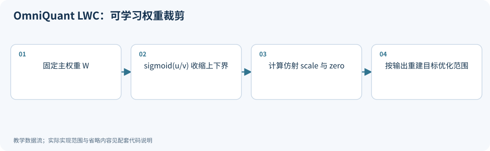
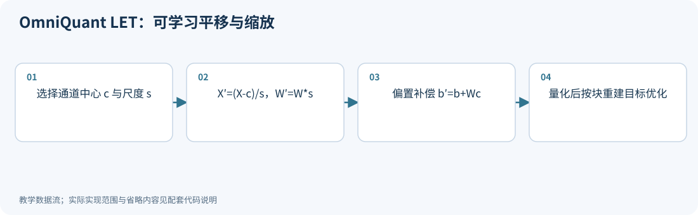
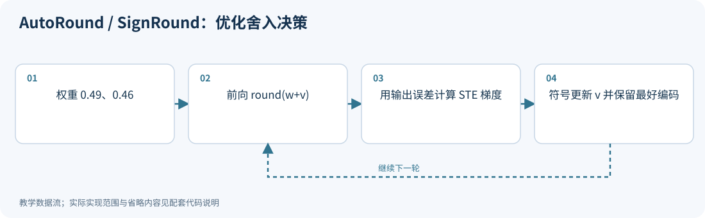
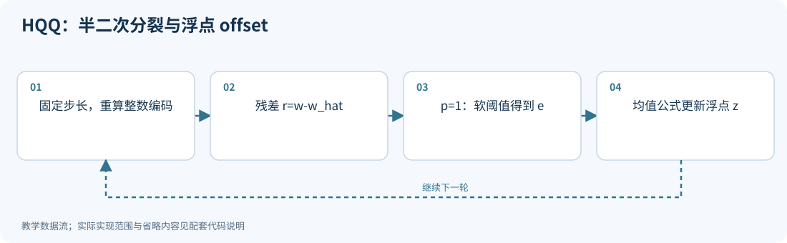

# 04｜优化量化器：OmniQuant、AutoRound、HQQ

<!-- course-objectives -->
**学习目标：** 理解量化参数优化和 QAT 的区别；求解 HQQ 的可解子问题；检查变换融合与校准过拟合。

**先修知识：** 第 01–03 章；附录 A 的梯度与平方损失。 [进入本章测试](#chapter-assessment)；建议先独立作答，再展开答案。
<!-- /course-objectives -->

原始资料：[R08] OmniQuant；[R09] SignRound / AutoRound；[R10] HQQ 作者实现。

<!-- chapter-overview -->
<a id="chapter-start"></a>

**阅读路线：** 把裁剪、平移、尺度和舍入决策看作可优化变量；对照有数据、无数据校准，并补齐 AdaRound 与 BRECQ 的基础联系。

<details><summary>本章目录（9 节）</summary>

- [4.1 共同出发点：把量化配置变成变量](#principle-4-1)
- [4.2 OmniQuant 的 LWC：学习裁剪强度](#principle-4-2)
- [4.3 OmniQuant 的 LET：同时学习平移和缩放](#principle-4-3)
- [4.4 AutoRound / SignRound：为什么一定要舍入到最近值](#principle-4-4)
- [4.5 HQQ：没有激活校准数据，怎么优化量化](#principle-4-5)
- [4.6 如何理解这些方法与 QAT 的关系](#principle-4-6)
- [4.7 无校准数据的双轴缩放：SINQ 与 DualQuant](#principle-4-7)
- [4.8 AdaRound 与 BRECQ：理解局部校准的基础路线](#principle-4-8)
- [4.9 本章测试与参考答案](#principle-4-9)

</details>

每项技术的图示、代码和讲解紧跟原理。例子在项目根目录运行，只需 NumPy；长篇参考资料可在各节末尾展开。[按技术查找](技术图解与代码索引.md) · [查看实验输出](../experiments/results/逐项技术实验结果.md)。

[分章测试与参考答案](#chapter-assessment) · [课程考核与综合练习](11_练习与答案.md#course-assessment-guide)

[本章实操：完整逐步注释](#chapter-demo)

<!-- /chapter-overview -->

<a id="principle-4-1"></a>

## 4.1 共同出发点：把量化配置变成变量

前面的方法已经告诉我们：scale、裁剪范围、坐标变换都影响误差。既然能计算校准输出误差，就可以直接优化这些变量：

$$
\min_\phi\|f_{FP}(X)-f_Q(X;\phi)\|_F^2.
$$

$\phi$ 可以是裁剪阈值、通道缩放、舍入偏移等。这里 $f$ 可以是一层，也可以是一个 Transformer block。

块重建的好处是同时考虑该块内多层及非线性的影响；代价是优化更贵，保存激活更多，而且可能过拟合小校准集。

<a id="principle-4-2"></a>
<a id="omni_lwc"></a>

## 4.2 OmniQuant 的 LWC：学习裁剪强度

假设某组权重最小值 $w_{min}<0$、最大值 $w_{max}>0$，用两个系数缩小范围：

$$
a=\beta w_{min},\quad b=\gamma w_{max},\quad
\beta,\gamma\in(0,1).
$$

例如原范围 $[-10,8]$，若 $\beta=0.6,\gamma=0.75$，新范围是 $[-6,6]$。

用 sigmoid 参数化：

$$
\beta=\sigma(u),\quad\gamma=\sigma(v),\quad
\sigma(t)=1/(1+e^{-t}).
$$

这样优化器更新 $u,v$ 时，裁剪系数始终在合法范围。再由 $a,b$ 计算 scale 和 zero point，执行伪量化，最小化块输出误差。[R08]

这叫 Learnable Weight Clipping，LWC。它不直接把每个浮点权重都当作独立训练变量。

<!-- inline-technique: omni_lwc -->

### 图解与代码



**运行：** `python experiments/technique_lab.py --technique omni_lwc`

<!-- executable: omni_lwc -->
```python
import numpy as np
from experiments.quant_lab import mse
X = np.array([[1., .1, 2., 1.], [.5, -.2, 1., .3]])
W = np.array([[-.3, -4., .2, 2.]])
candidates = []
for u in (-2., 0., 2.):
    for v in (-2., 0., 2.):
        lo = W.min()/(1+np.exp(-u))
        hi = W.max()/(1+np.exp(-v))
        scale = (hi-lo)/15; zero = np.clip(np.rint(-lo/scale), 0, 15)
        Wq = scale*(np.clip(np.rint(W/scale)+zero, 0, 15)-zero)
        candidates.append((mse(X@W.T, X@Wq.T), u, v))
best = min(candidates)
assert np.isfinite(best[0])
assert best[1:] == (2., 2.)  # Independently recorded optimum for these inputs.
assert best[0] < next(cost for cost, u, v in candidates if u == v == 0.)
print("best output MSE, u, v:", best)
```

**代码讲解**

1. u/v 经 sigmoid 后在 (0,1)，保证负端点和正端点分别向零收缩。
2. 用小网格直接搜索两个变量，清楚展示 LWC 的可优化对象和目标；原论文通过 STE 梯度进行块级优化。
3. 本组输入的最优候选为 (2,2)，误差低于 (0,0)；断言核对选中的候选，避免选到最差项仍通过。

> **示例边界：** 示例只处理同时含正负值的一组权重，使用枚举代替优化器；这不是完整 OmniQuant 校准实现。

<details>
<summary>论文、博客与官方资料</summary>

- **论文**：[OmniQuant: Omnidirectionally Calibrated Quantization for Large Language Models](https://arxiv.org/abs/2308.13137)。
- **作者项目、官方文档与规范**：[OmniQuant 作者实现与 README](https://github.com/OpenGVLab/OmniQuant)。

LWC 与 LET 是 OmniQuant 的两个组成部分，使用同一篇原论文。

</details>

<!-- /inline-technique -->

<a id="principle-4-3"></a>
<a id="omni_let"></a>

## 4.3 OmniQuant 的 LET：同时学习平移和缩放

对带偏置的线性层：

$$
Y=XW^T+b.
$$

引入通道平移 $c\in\mathbb R^d$、对角尺度 $D$，令：

$$
X'=(X-\mathbf1c^T)D^{-1},\quad W'=WD,
$$

$$
b'=b+Wc.
$$

则：

$$
X'W'^T+\mathbf1b'^T
=XW^T+\mathbf1b^T.
$$

这里 $\mathbf1$ 表示对每个 token 行广播同一向量。减去中心让数据更接近零，再缩放改善通道范围；偏置补偿保证原函数不变。

注意 $b'=b+Wc$ 的矩阵方向，不能误写成 $W^Tc$。

OmniQuant 将类似的可学习等价变换 LET 安排在线性层与 Attention 的合适位置，和 LWC 联合做 block 重建。论文和实现针对无偏置层、归一化融合及分支有专门处理；不能把上述单层公式不加检查地复制到整个网络。

**优化步骤：** 固定主权重 → 初始化缩放/平移/裁剪 → 前向伪量化 → 比较块输出 → 通过 STE 等近似梯度更新校准变量 → 融合并导出。

**局限：** 计算量高于简单统计法；校准数据与最终任务差异大时可能失效；可融合性取决于变换位置和网络结构。

### 局部变换能否融合，要检查所有消费者

若同一 $X$ 同时进入 Q/K/V 投影或门控 MLP 的多个分支，改变 $X$ 的表示时，需要对每个消费者应用匹配变换。
只补偿一条分支会改变原始浮点函数。平移还会引入偏置补偿，不能仅因为某个线性层没有 bias 参数就忽略它。
原方法在归一化、Attention 和线性连接处安排可融合的变换，具体位置属于算法的一部分。[OmniQuant v3，§3](https://arxiv.org/abs/2308.13137v3)

建议把验证分成两次：先关掉量化检查原模型与变换后模型的逐层输出，再开启量化检查误差。
如果第一次已经不等价，后面的质量变化无法归因于量化器优化。有限精度下还应观察极端缩放是否制造溢出或病态变换。

<!-- inline-technique: omni_let -->

### 图解与代码



**运行：** `python experiments/technique_lab.py --technique omni_let`

<!-- executable: omni_let -->
```python
import numpy as np
from experiments.quant_lab import symmetric_qdq, mse
X = np.array([[10., .2], [12., -.1], [9., .3]])
W = np.array([[.4, .8], [-.2, .5]]); b = np.array([.1, -.3])
c = X.mean(axis=0); s = np.array([2., .5])
Xp, Wp, bp = (X-c)/s, W*s, b+W@c
assert np.allclose(Xp@Wp.T+bp, X@W.T+b)
approximate = symmetric_qdq(Xp, bits=4, axis=1)[0] @ symmetric_qdq(Wp, axis=1)[0].T + bp
print("bias correction, quantized output MSE:", W@c, mse(approximate, X@W.T+b))
```

**代码讲解**

1. c 与 s 的长度为输入维，bp 长度为输出维；W@c 的方向不能写反。
2. 先用固定候选验证 LET 的代数基础，再插入量化观察误差。学习时把 c/s 交给块重建优化器即可。

> **示例边界：** 这里只展示 LET 参数化及前向，不实现联合优化；无偏置模型、归一化与多分支融合须按架构处理。

<details>
<summary>论文、博客与官方资料</summary>

- **论文**：[OmniQuant: Omnidirectionally Calibrated Quantization for Large Language Models](https://arxiv.org/abs/2308.13137)。
- **作者项目、官方文档与规范**：[OmniQuant 作者实现与 README](https://github.com/OpenGVLab/OmniQuant)。

LWC 与 LET 是 OmniQuant 的两个组成部分，使用同一篇原论文。

</details>

<!-- /inline-technique -->

<a id="principle-4-4"></a>
<a id="autoround"></a>

## 4.4 AutoRound / SignRound：为什么一定要舍入到最近值

假设两个权重分别为 0.49 和 0.49，输入只有一行 $x=(1,1)$。原输出是 0.98。

若网格为 $\{0,1\}$，最近舍入得到 $(0,0)$，输出误差为 $-0.98$。选择 $(1,0)$ 则输出为 1，误差只有 0.02。

虽然单个 0.49 舍入到 1 更远，联合输出却更准确。这与 GPTQ 的动机相通，只是优化方式不同。

引入可学习舍入偏移 $v_i$，一个教学参数化为：

$$
q_i=\operatorname{clip}\left(\operatorname{round}(w_i/s+z+v_i),q_{min},q_{max}\right),
\quad\widehat w_i=s(q_i-z).
$$

$v_i$ 改变向上或向下舍入的选择。与裁剪系数一起，通过 block 输出重建优化。

SignRound 使用符号梯度下降：

$$
\theta_{t+1}=\theta_t-\eta\operatorname{sign}(\nabla_\theta L).
$$

更新方向由梯度符号决定，步长由学习率控制；舍入操作的反向需要近似梯度。实际优化过程还会记录最优校准状态。[R09]

**命名说明：** 原论文使用 SignRound 名称；AutoRound 是延续并扩展这一思路的软件与算法体系，不同版本支持范围及调参策略会变化。

**适用：** 希望通过适度离线优化提高低 bit 舍入质量；导出后通常仍是普通低 bit 权重，不必保留每个 $v_i$ 参与推理。

**局限：** 块误差低不代表最终任务一定更好；位宽极低、校准集过小或优化预算不足时，仍可能退化。

<!-- inline-technique: autoround -->

### 图解与代码



**运行：** `python experiments/technique_lab.py --technique autoround`

<!-- executable: autoround -->
```python
import numpy as np
w = np.array([.49, .46]); v = np.zeros(2)
target = w.sum(); best_loss = np.inf; best_q = None
for step in range(20):
    q = np.clip(np.rint(w+v), 0, 1)
    error = q.sum()-target
    if error**2 < best_loss:
        best_loss, best_q = error**2, q.copy()
    gradient = np.full(2, 2*error)  # Identity STE in the active range.
    v -= .02*np.sign(gradient)
assert best_loss < (np.rint(w).sum()-target)**2
print("best codes, output squared error:", best_q, best_loss)
```

**代码讲解**

1. 两个权重的初始 RTN 都为零，但输出目标为 0.95。联合选择 [1,0] 可以大幅减小输出误差。
2. 梯度通过 round 的恒等替代导数传到 v；硬舍入可能来回跳，因此必须保留最优已见状态。

> **示例边界：** 仅演示固定尺度下的舍入偏移与 SignSGD；完整 AutoRound 还涉及裁剪、块重建、版本相关的优化策略。

<details>
<summary>论文、博客与官方资料</summary>

- **论文**：[Optimize Weight Rounding via Signed Gradient Descent for the Quantization of LLMs](https://arxiv.org/abs/2309.05516)。
- **博客与技术文章**：[Hugging Face 博客：Introducing AutoRound](https://huggingface.co/blog/autoround)。
- **作者项目、官方文档与规范**：[AutoRound 官方实现与技术说明](https://github.com/intel/auto-round)。

原论文的 SignRound 与持续演进的 AutoRound 软件有版本差异。

</details>

<!-- /inline-technique -->

<a id="principle-4-5"></a>
<a id="hqq"></a>

## 4.5 HQQ：没有激活校准数据，怎么优化量化

HQQ 的核心路线直接优化权重重建，不需要校准输入。[R10]

本节明确区分“半二次分裂的数学动机”和“作者代码的具体更新”。作者实现中，主要的 proximal 路径固定 scale、优化浮点 zero/offset；另有实验性 scale 更新或 autograd 路径，不能混称为同一算法。

先使用本书的反量化步长 $s$：

$$
\widehat w_i=s(q_i-z).
$$

考虑稳健误差：

$$
\min_{q,z}\sum_i|w_i-s(q_i-z)|^p,\quad0<p\le1.
$$

小于 2 的指数相对减少极大残差对总目标的支配；当 $p<1$ 时目标非凸。它并不是在保护所有任务敏感方向，因为没有观察激活。

引入辅助残差 $e_i$，将难问题拆成：

$$
\min_{q,z,e}\sum_i|e_i|^p
+\frac\beta2\sum_i(w_i-s(q_i-z)-e_i)^2.
$$

当 $\beta$ 增大，第二项更强地要求 $e_i$ 等于真实量化残差。这就是“半二次分裂”的直觉：把非二次误差与一个容易求解的二次问题分开。

**固定 $q,z$，更新 $e$：** 对于 $p=1$，令 $r_i=w_i-s(q_i-z)$，问题是：

$$
\min_e |e|+\frac\beta2(r-e)^2.
$$

在 $e>0$ 区间求导：$1+\beta(e-r)=0$，得到 $e=r-1/\beta$；负区间类似，合并为软阈值：

$$
\boxed{e=\operatorname{sign}(r)\max(|r|-1/\beta,0).}
$$

当 $p<1$ 时，真实 proximal 问题更复杂。作者代码采用相应的收缩更新形式，不能把简单的幂函数阈值说成任意 $p$ 下精确的全局解。

**固定 $q,e$，更新 $z$：** 令二次项对 $z$ 的导数为 0：

$$
\sum_i(w_i-sq_i+sz-e_i)=0,
$$

因此：

$$
\boxed{z=\operatorname{mean}_i\left(q_i-\frac{w_i-e_i}{s}\right).}
$$

**与作者代码对应：** 代码中变量 `scale` 是这里步长的倒数 $a=1/s$，执行：

```text
q = round(w * a + z).clip(qmin, qmax)
w_hat = (q - z) / a
e = shrink(w - w_hat, beta, p)
z = mean(q - (w - e) * a)
beta = beta * kappa
```

注意代码在每轮从原权重重算量化索引；它不等于对前面的 $(q,z,e)$ 联合目标执行每个变量的严格精确坐标最小化。分裂目标解释其更新动机，具体实现包含近似、启发式与提前停止。

这里的 $z$ 可以是浮点数，因此不等同于第 01 章严格整数 zero point 的约定。部署到要求整数 zero point 的后端时，还要处理格式转换。

**优点：** 不收集激活，校准流程简单，适合快速试验不同位宽和分组。

**局限：** 不能直接识别输入相关性和任务敏感性；权重误差目标变好，不代表模型输出误差一定变好。

<!-- inline-technique: hqq -->

### 图解与代码



**运行：** `python experiments/technique_lab.py --technique hqq`

<!-- executable: hqq -->
```python
import numpy as np
w = np.array([-.3, -.1, .06, .5])
s, z, beta = .1, 5., 10.
for step in range(5):
    q = np.clip(np.rint(w/s+z), 0, 15)
    r = w-s*(q-z)
    e = np.sign(r)*np.maximum(abs(r)-1/beta, 0)
    z = np.mean(q-(w-e)/s)
    assert abs(np.sum(w-s*(q-z)-e)) < 1e-12
    beta *= 1.2
print("floating offset, final reconstruction:", z, s*(q-z))
```

**代码讲解**

1. e 的软阈值是 p=1 子问题的解析解；更新 z 后二次残差之和为零，断言直接检查驻点条件。
2. 每轮重新从原 w 算编码，和作者主要 proximal 路径相同的更新结构；作者代码的 scale 常表示这里 1/s。

> **示例边界：** 固定 s、p=1 的教学路径，没有作者实现的完整提前停止逻辑；p<1 的收缩通常是近似，z 也不是整数 zero point。

<details>
<summary>论文、博客与官方资料</summary>

- **作者项目、官方文档与规范**：[HQQ 作者项目与方法说明](https://github.com/dropbox/hqq)；[Hugging Face 官方文档：HQQ](https://huggingface.co/docs/transformers/quantization/hqq)；[HQQ 作者实现：hqq/core/optimize.py](https://raw.githubusercontent.com/dropbox/hqq/master/hqq/core/optimize.py)。

HQQ 主要以作者技术材料和代码公开；作者项目现迁移到 dropbox/hqq。原 hqq_blog 本次返回 404，提供可访问的项目说明与源码，不把博客误标为独立论文。

</details>

<!-- /inline-technique -->

<a id="principle-4-6"></a>

## 4.6 如何理解这些方法与 QAT 的关系

| 方法 | 核心可优化变量 | 是否使用激活校准 | 典型目标 |
|---|---|---|---|
| OmniQuant | 裁剪、尺度、平移等 | 是 | block 重建 |
| AutoRound | 舍入偏移、裁剪等 | 是 | block 重建 |
| HQQ 基础路径 | 量化索引、offset 等 | 否 | 权重稳健重建 |
| 典型 QAT | 主权重及量化参数 | 使用训练输入 | 任务/蒸馏损失 |

“训练后量化”允许一定程度的优化。真正需要比较的是优化对象、目标函数、数据预算和计算成本。

<a id="sinq-dualquant"></a>

<a id="principle-4-7"></a>

## 4.7 无校准数据的双轴缩放：SINQ 与 DualQuant

HQQ 不是无激活校准路线的唯一选择。[SINQ v4，§2](https://arxiv.org/html/2509.22944v4)（首发 2025-09-26；所读版本 2026-01-29）使用双轴尺度表示一个权重块：

$$
\widehat W=D_r Q D_c,\qquad X\widehat W^T=(XD_c)Q^TD_r.
$$

$r$ 作用于输出行，$c$ 作用于输入列。含偏移的实现还使用 $D_r(Q+Z)D_c$，并按实际 tile 记录组尺度、偏移与输入列尺度。
SINQ 交替归一化行列标准差，以权重结构估计有利于输出重建的尺度；它不是对非负矩阵做行列和归一化的普通 Sinkhorn 算法，也不保证最小化权重 MSE。作者把权重列统计与典型输入幅度的经验关系称作“伪激活感知”，不能据此声称无数据恢复了真实任务分布。

[DualQuant v1，§4](https://arxiv.org/html/2610.13767v1)（首发 2026-10-09）则直接最小化双尺度权重重建误差，通过固定码字后的尺度回归和重新量化交替更新，并约束可存储尺度。两者具有相似的表示形式，但优化目标不同；DualQuant 的输入列尺度还用于激活量化前的重缩放。

下面核对公共代数结构和一个固定码字的行尺度子问题，**不是完整 SINQ 或 DualQuant**：

<!-- depth-example: dual_axis_scaling -->
```python
import numpy as np
X = np.array([[1., .2, -1.], [.4, 2., .1]])
Q = np.array([[1., -2., 3.], [2., 1., -1.]])
r, c = np.array([.3, .7]), np.array([2., .5, 1.])
Wq = r[:, None]*Q*c[None, :]
assert np.allclose(X@Wq.T, ((X*c)@Q.T)*r)
W = Wq+np.array([[.1, 0., -.1], [0., .2, .1]])
U = Q*c
fitted = np.sum(W*U, axis=1)/np.sum(U*U, axis=1)
assert np.sum((W-fitted[:, None]*U)**2) <= np.sum((W-Wq)**2)
print('row scales:', fitted)
```

部署时，输入尺度只有被所有共享分支一致吸收才可能消除在线乘法，否则应计入激活量化内核。双尺度也不等于 QLoRA 的 double quantization：后者压缩尺度本身。DualQuant 报告的 RTX 4090 打包实验使用 **INT4、group 64**，不能把该速度直接解释成 4090 的 NVFP4 原生性能。其收敛讨论还有码字稳定等条件，不能推广为所有离散迭代全局最优。

<a id="principle-4-8"></a>

## 4.8 AdaRound 与 BRECQ：理解局部校准的基础路线

<a id="adaround-brecq"></a>

在进入 OmniQuant、AutoRound 等 LLM 方法前，有必要补上两个基础问题：**舍入到最近值是否最优，重建单元应该是一层还是一个块？** [MIT 量化课程第二讲](https://hanlab.mit.edu/courses/2024-fall-65940)包含自适应舍入；原始机制分别见 [AdaRound v2，§3](https://arxiv.org/html/2004.10568v2)与 [BRECQ v2，§3](https://arxiv.org/html/2102.05426v2)。

### AdaRound：优化上下舍入选择

固定对称网格尺度 $s$，可把软量化权重写成

$$
\widetilde W=s\,\operatorname{clip}\left(
\lfloor W/s\rfloor+h(V),q_{\min},q_{\max}\right),\qquad h(V)\in[0,1].
$$

原算法用拉伸后裁剪的 sigmoid 表示 $h$，同时优化重建损失与推动 $h$ 接近 0/1 的正则项，最后硬化为向下或向上舍入。浮点主权重固定，训练的是舍入变量；有梯度并不自动变成全模型 QAT。

考虑两个权重 $w=(0.49,0.49)$、输入 $x=(1,1)$、步长 $s=1$，候选网格含 0、1。RTN 给出 $(0,0)$，输出误差为 $-0.98$；选择 $(1,0)$ 时误差只有 $0.02$，虽然权重平方误差从 $0.4802$ 增至 $0.5002$。这说明量化变量之间存在输出层面的耦合，不能逐元素独立最小化距离。

AdaRound 的最终重建目标还可以让浮点分支输入为 $X$，量化分支输入为前层量化后得到的 $\widehat X$，并包含层后的激活函数。这里的 **asymmetric reconstruction** 指两分支的输入不同，和量化器是否采用非零 zero point 是两回事。AutoRound 与它同属舍入优化路线，但优化器、变量和块处理方式不同，不能视为同一实现。

### BRECQ：把交叉影响保留在重建单元里

逐层重建成本低，但可能忽略同一残差块内的误差相互作用；直接重建整个网络又很贵，且容易过拟合小校准集。BRECQ 选择块作为单元，并从任务损失的二阶近似出发，对块输出误差赋予敏感性权重。一种概括形式是

$$
\mathcal L_{block}\approx\mathbb E\left[\Delta z^T H_z\Delta z\right],
\qquad H_z\approx\operatorname{diag}\bigl(\mathbb E[g_z\odot g_z]\bigr).
$$

常数因子在这里省略。$g_z$ 来自所选下游损失对块输出的梯度；对角 Fisher 是特定估计和近似，不能无条件等同于精确 Hessian。它也不同于 GPTQ 线性输出重建中的输入二阶矩 $X^TX$，两者坐标与目标不同。

| 路线 | 主要变量 | 重建目标与边界 |
|---|---|---|
| GPTQ | 量化码字及未量化权重补偿 | 线性层输出的二阶重建 |
| AdaRound | 向上/向下舍入的软变量 | 层输出，允许包含非线性和前层误差 |
| BRECQ | 块内舍入及相关量化参数 | 块输出与敏感性加权 |
| OmniQuant / AutoRound | 等价变换、裁剪或舍入等 | 各自定义的 LLM 块校准目标 |

AdaRound/BRECQ 的原始实验主要面向视觉网络。这里补充的是校准思想与历史联系，不能把其 CNN 精度结果作为 LLM 的性能证据。迁移到 Transformer 时，还须处理 Attention、残差、多分支、校准内存与真实导出格式。

<!-- chapter-demo: 04 -->
## 本章实操｜优化舍入变量与浮点 offset

<a id="chapter-demo"></a>

**实践目的：** 明确哪些变量更新、为什么需要STE，以及HQQ哪一步具有解析解。

**环境：** Python 3.10+、NumPy、PyTorch；支持 CPU/CUDA，Colab 选择 GPU 运行时。无需下载模型。在项目根目录执行：

```bash
python experiments/chapter_demo_lab.py --chapter 04 --device cuda
# 没有GPU时显式使用CPU；auto在CUDA可用时优先使用GPU
python experiments/chapter_demo_lab.py --chapter 04 --device cpu
# 也可直接执行源码模块（同样在项目根目录）
python -m experiments.demos.ch04
```

**Colab：** 可直接上传[逐章 GPU Notebook](../experiments/notebooks/colab_chapter_demos.ipynb)，它自带所需源码；按单元选择本章运行。修改源码后将 `PRACTICE=True`，或命令行加 `--practice`；此模式跳过正文一致性检查，保留数值断言、设备核验及实际源码哈希。指定 `cuda` 后不可用会报错，不会静默退回 CPU。随机输入在 CPU 准备后一次搬到所选设备；矩阵、量化、训练和统计计算使用该设备的 PyTorch 张量。文件 I/O、Python 流程控制和打印在主机；默认 FP64 核验精度，不代表原生低比特 Tensor Core 性能。

**完整源码：** [带逐步注释的 demo](../experiments/demos/ch04.py)。默认只打印结果；保存命令与全部章节入口见[实操导航](../README.md#chapter-demos)。

<details><summary>展开完整代码：每一步的行为、计算逻辑与检查条件</summary>

<!-- chapter-demo-code: 04 -->
```python
"""第 04 章：优化舍入变量，并跟踪 HQQ 的一个可解子问题。"""
import math
import torch
from experiments.demo_runtime import get_runtime

# 第 0 步：auto优先CUDA；runner可用--device指定。所有计算张量在此设备创建。
rt = get_runtime()
device, dtype = rt.device, rt.dtype

# 第 1 步：固定原始权重；只让舍入偏移变化，目标是联合输出误差。
w = rt.tensor([.49, .46])
X = rt.tensor([[1., 1.], [.9, 1.1]])
target = X@w
offset = torch.zeros_like(w)
best_loss = math.inf
best_codes = None

# 第 2 步：前向真实 round，反向手写 identity STE。
# loss=mean(error²)，因此梯度是 2 X^T error/n；这里省略裁剪外梯度。
for iteration in range(30):
    normalized = w+offset
    codes = torch.clamp(torch.round(normalized), 0, 1)
    error = X@codes-target
    loss = torch.mean(error**2)
    if loss < best_loss:
        best_loss, best_codes = float(loss), codes.clone()
    gradient = 2*X.T@error/len(X)
    mask = (normalized > 0) & (normalized < 1)
    offset -= .02*torch.sign(gradient)*mask
    if iteration in (0, 1, 5, 29):
        print('舍入迭代 / 当前码 / 当前损失:', iteration, codes, loss)
assert best_loss < torch.mean((X@torch.round(w)-target)**2)
print('保留的最佳码与损失:', best_codes, best_loss)

# 第 3 步：另用一组权重演示 HQQ p=1、固定尺度的分裂更新。
# 这里 zero 是浮点 offset，不能当作整数仿射 zero point 导出。
weights = rt.tensor([-.3, -.1, .06, .5])
scale, zero, beta = .1, 5., 10.
for iteration in range(5):
    # 作者路径每轮从原 weights 重新选码，随后对残差做软阈值。
    q = torch.clamp(torch.round(weights/scale+zero), 0, 15)
    residual = weights-scale*(q-zero)
    auxiliary = torch.sign(residual)*torch.clamp_min(abs(residual)-1/beta, 0)
    # 固定 q 和 auxiliary 时，下面的均值是二次子问题的解析驻点。
    zero = torch.mean(q-(weights-auxiliary)/scale)
    stationary_residual = weights-scale*(q-zero)-auxiliary
    assert abs(stationary_residual.sum()) < 1e-12
    print('HQQ迭代 / offset / 权重MSE:', iteration, zero,
          torch.mean((weights-scale*(q-zero))**2))
    beta *= 1.2

# 第 4 步：本例只证明固定变量子问题的条件，不断言整个启发式迭代单调最优。
# 修改 X 能改变最佳舍入；HQQ 这条路径不使用 X，所以不能感知该任务变化。

# 收尾：等待本demo设备上的操作完成，方便Colab定位CUDA异步报错。
rt.synchronize()
```

</details>

**运行后观察：** 最佳舍入码的损失低于RTN；每次HQQ offset更新后的二次残差之和为零。

**动手修改：** 改变X的第二行再观察舍入结果；HQQ只读取weights，比较两种数据依赖。

**适用边界：** 局部STE和p=1固定尺度HQQ子问题，不宣称完整迭代全局最优。

<!-- /chapter-demo -->

<!-- chapter-assessment -->

<a id="principle-4-9"></a>

## 4.9 本章测试与参考答案

<a id="chapter-assessment"></a>

核心卷 8 题，仍按 100 分；另有简单、困难、特别困难拓展题各 1 道，不计入核心卷。难度相对于本章先修知识划分，题号保持原有顺序。核心卷建议 60–90 分钟，特别困难拓展可另留 30–60 分钟。

| 难度 | 按难度选题 |
|---|---|
| 简单 | [04-01](#exercise-04-01) · [04-02](#exercise-04-02) · [04-E01](#exercise-04-e01) |
| 困难 | [04-03](#exercise-04-03) · [04-04](#exercise-04-04) · [04-05](#exercise-04-05) · [04-06](#exercise-04-06) · [04-07](#exercise-04-07) · [04-08](#exercise-04-08) · [04-E02](#exercise-04-e02) |
| 特别困难 | [04-E03](#exercise-04-e03) |

每题提供至少三条参考路径，分别可能是解析解、等价推导、独立数值核验或满足条件的工程方案。固定条件下唯一的数值结果不因解法不同而改变；数值实验不能替代一般性证明。未明确要求比较多解时，可任选或组合路径回答全部子问；验证说明须补足题干要求的推导。开放题接受条件明确、证据充分的其他方案。

<a id="exercise-04-01"></a>

### 04-01｜谁在被优化（简单｜基础辨析，10 分）

分别说明 OmniQuant、AutoRound、HQQ 基础路径和典型全权重 QAT 的可优化变量与目标；不能只回答“有无反向传播”。

<details><summary>参考答案与评分要点</summary>

**参考路径一：**

OmniQuant 优化裁剪及等价变换变量、以块重建为主；AutoRound 优化舍入/裁剪等变量；HQQ 基础路径从权重出发处理码字和 offset 等稳健重建；典型 QAT 更新主权重及可能的量化参数，常使用任务/蒸馏目标。分类还需看数据与计算预算。

**路径二：冻结变量表。** 列出主权重、尺度、舍入变量、offset、激活和教师中哪些固定/可变，比较其损失输入，能比“有无梯度”更准确识别路线。

**路径三：查看最终导出。** 校准变量可能只用于离线决定码字，推理不保留；QAT的主权重则经过适配再量化。导出形态可帮助理解，但单独不足以判定训练目标。

**评分要点：** 四种变量/目标各 2 分；分类边界 2 分。

</details>

<a id="exercise-04-02"></a>

### 04-02｜裁剪系数与整数零点（简单｜计算，10 分）

权重组范围 [−8,6]，LWC 系数 β=0.75、γ=0.5。用无符号 4 bit 仿射量化，求裁剪范围、步长和零点；求两端点重建。

<details><summary>参考答案与评分要点</summary>

**参考路径一：**

范围 [−6,3]；s=9/15=0.6，z=round(6/0.6)=10。编码 0 和 15 分别重建 −6 与 3。这个例子端点恰可重建，不能推广到任意经零点取整的范围。

**路径二：端点方程。** 要求 $s(0-z)=-6$、$s(15-z)=3$，相减得15s=9，再得z=10；本题恰得到合法整数。

**验证路径：网格枚举。** 列出0.6(j−10)，j=0…15，检查−6、0、3都在格点中；再确认LWC系数仅缩小原两侧范围。

**评分要点：** 范围 3 分；尺度零点 4 分；重建及限制 3 分。

</details>

<a id="exercise-04-03"></a>

### 04-03｜LET 的偏置方向（困难｜推导与计算，15 分）

$W=\begin{bmatrix}1&2\\-1&3\end{bmatrix}$、$b=(0.5,-0.5)$、$c=(1,-1)$、$D=\operatorname{diag}(2,0.5)$。求 $W^{\prime}=WD$、$b^{\prime}=b+Wc$，并证明变换输入后的输出不变。

<details><summary>参考答案与评分要点</summary>

**参考路径一：**

$W^{\prime}=\begin{bmatrix}2&1\\-2&1.5\end{bmatrix}$，$Wc=(-1,-4)$，$b^{\prime}=(-0.5,-4.5)$。$(X-\mathbf1c^T)D^{-1}(WD)^T+\mathbf1(b+Wc)^T=XW^T+\mathbf1b^T$；用到了对角 $D$ 的对称性与相消。

**解法二：单token展开。** $x_cW^{*T}=(x-c^T)W^T=xW^T-c^TW^T$，补bias恰消去后项；对每行相同，所以可广播到全部token。

**验证路径：基向量加零输入。** X=0检验偏置是否为原b，X=I检验线性项是否为W。两者都匹配才能确定仿射函数整体等价，单个随机输入不足以完整识别。

**评分要点：** 矩阵与偏置 7 分；展开证明 6 分；广播/转置正确 2 分。

</details>

<a id="exercise-04-04"></a>

### 04-04｜HQQ 的软阈值子问题（困难｜推导与计算，15 分）

对 $p=1$、$\beta=4$，求 $\min_e |e|+\beta(r-e)^2/2$ 在 $r=[-0.6,-0.1,0,0.7]$ 上的解。为何不能将同一表达式称为任意 $p<1$ 的精确解？

<details><summary>参考答案与评分要点</summary>

**参考路径一：**

阈值 $1/\beta=0.25$，$e=\operatorname{sign}(r)\max(|r|-0.25,0)=[-0.35,0,0,0.45]$。分正负区间求导、在零点检查次梯度可得。$p<1$ 目标非凸，近端结构不同，需要另解或明确采用近似。

**解法二：次梯度区间。** e=0最优要求 $\beta r\in[-1,1]$；超过区间时正负分支分别解 $e=r\mp1/\beta$。直接得到阈值0.25。

**验证路径：分段候选比较。** 对每个r只需考虑e=0、合法的正分支解与负分支解，代回目标取最小。本题结果与软阈值一致；p<1时应重新求驻点和边界。

**评分要点：** 阈值与数值 6 分；推导或次梯度理由 5 分；非凸边界 4 分。

</details>

<a id="exercise-04-05"></a>

### 04-05｜HQQ 的 offset 与部署格式（困难｜计算与诊断，15 分）

固定 $s=0.5$、$q=[0,2]$、$w=[0.2,0.9]$、$e=[0.1,-0.1]$。用 $z=\operatorname{mean}(q-(w-e)/s)$ 更新 offset。计算更新后以及将 z 转为整数 0 后的重建向量；后端只接受整数零点时，能否将两者当成相同模型？

<details><summary>参考答案与评分要点</summary>

**参考路径一：**

两项为 −0.2 和 0，$z=-0.1$。重建为 $s(q-z)=[0.05,1.05]$；改用整数零点 0 后成为 [0,1]。需要重新约束/校准或格式转换并检查误差，不能把浮点 offset 与整数零点混用。

**解法二：offset平移单位。** z每变化Δz，全部重建变化−sΔz。将−0.1改0即所有值减少0.05，因此[0.05,1.05]变[0,1]。

**解法三：二次回归。** 将残差 $r_i=w_i-sq_i-e_i$ 固定，最小化∑(r_i+sz)²，得 $z=-\bar r/s$；与给定公式相同，并说明z是实值解而非整数约束解。

**评分要点：** 更新 5 分；两种重建 6 分；导出判断 4 分。

</details>

<a id="exercise-04-06"></a>

### 04-06｜双轴尺度应该乘在哪一侧（困难｜推导，15 分）

$\widehat W=D_rQD_c$，$W$ 形状为 $3\times4$。求 $D_r,D_c$ 的形状，并写出 $X\widehat W^T$ 的分步执行。为何这不等于 QLoRA double quantization？

<details><summary>参考答案与评分要点</summary>

**参考路径一：**

$D_r$ 为 $3\times3$、$D_c$ 为 $4\times4$；$X\widehat W^T=(XD_c)Q^TD_r$。行尺度作用输出、列尺度作用输入，共享分支须一致处理；double quantization 是再压缩尺度常数，和双轴数值表示不是同一概念。

**路径二：逐元素展开。** $\widehat w_{ji}=r_jq_{ji}c_i$，所以 $y_j=r_j\sum_i(x_ic_i)q_{ji}$；形状与尺度位置从下标直接得出。

**验证路径：维度与零输入。** XD_c仍是n×4，乘Qᵀ得n×3，再右乘D_r；零输入仍给零线性输出。若写成D_rX则一般形状不合法；双重量化则不涉及这种双轴乘法。

**评分要点：** 形状 4 分；公式 5 分；轴与共享条件 3 分；术语区别 3 分。

</details>

<a id="exercise-04-07"></a>

### 04-07｜舍入优化与块重建如何关联（困难｜方法比较，10 分）

AdaRound 的非对称重建和仿射量化的非对称零点是否同义？BRECQ 的输出侧 Fisher 与 GPTQ 的输入二阶矩是否可直接替换？

<details><summary>参考答案与评分要点</summary>

**参考路径一：**

都不能混同。非对称重建使用不同的浮点/量化前层输入；非对称量化描述网格和零点。BRECQ 的输出敏感性与下游损失有关，GPTQ 的输入二阶矩来自固定线性重建；坐标、形状和近似条件不同。

**路径二：构造独立开关。** 即使zero point为0，也能用不同分支输入做非对称重建；反之同一输入也能用非零zero point。这两个属性可独立变化。

**路径三：检查微分变量。** GPTQ的Hessian针对输入坐标对应的权重扰动；BRECQ输出Fisher针对块输出变化。先写Jacobian才能在度量之间映射，不能只因都叫曲率就代换。

**评分要点：** 两类非对称 5 分；两类曲率/统计 5 分。

</details>

<a id="exercise-04-08"></a>

### 04-08｜校准误差下降但任务变差（困难｜实验设计，10 分）

迭代越久块 MSE 越低，但独立问答准确率下降。请给出至少三个可检验原因和对应排查，不把“多训练”作为唯一答案。

<details><summary>参考答案与评分要点</summary>

**参考路径一：**

可能是校准域过窄：换域/长度分桶验证；代理目标与任务不一致：比较 logits 与任务指标；过拟合：独立验证选迭代、控制预算；变换融合错误：关闭量化查等价；导出不一致：比较导出前后层输出；应逐一消融，不根据测试集选最好状态。

**方案二：分层最小化排错。** 先关闭量化测变换等价，再用固定码字测重载，再在独立数据测层损失与任务；每层通过后才调查下一层，避免多种错误相互掩盖。

**方案三：学习曲线诊断。** 同时画校准、验证重建和任务分数随迭代变化；校准降而验证升提示过拟合，两者都降而任务差提示代理错配。必须独立验证假设，曲线本身不是因果证明。

**评分要点：** 三个原因与排查各 3 分；隔离测试原则 1 分。

</details>

<a id="exercise-04-e01"></a>

### 04-E01｜是否使用反向传播决定 PTQ/QAT 吗（简单｜拓展题，单独计分）

方法甲冻结主权重，只学scale并最小化块输出误差；方法乙前向伪量化后训练全部主权重与语言建模损失。分别如何描述？

<details><summary>参考答案与评分要点</summary>

**路径一：看变量。** 甲是可学习校准/PTQ风格；乙是QAT。主权重是否适配是关键差异之一。

**路径二：看目标与预算。** 甲以局部重建和少量校准为主，乙以训练目标和参数适配为主；两者都可反向传播，因此不能按该开关分类。

**验证路径：审查参数更新。** 比较训练前后的主权重/scale及优化器参数组，确认声明的冻结与更新真实发生，名称本身不构成证据。

**评分要点：** 单独按 10 分评价：结论与条件 3 分、推理或设计过程 5 分、独立核验与边界 2 分。评分覆盖题干要求的全部子问；未要求比较多解时，可任选或组合参考路径完成作答。数值核验不能替代题干明确要求的证明，多解数量不额外加分。

</details>

<a id="exercise-04-e02"></a>

### 04-E02｜浮点 offset 投影到整数零点（困难｜拓展题，单独计分）

固定s=0.5与码字q=(0,2)，目标w=(0.2,0.9)，无辅助残差。求最优实值z和最优整数z，比较损失。重建为s(q−z)。

<details><summary>参考答案与评分要点</summary>

**解法一：求导。** $z^*=\operatorname{mean}(q-w/s)=(-0.4+0.2)/2=-0.1$，重建(0.05,1.05)，SSE0.045。整数最优0，重建(0,1)，SSE0.05。

**解法二：完成平方。** 总损失为 $2s^2(z+0.1)^2+0.045$，所以整数域选最靠近−0.1的0，多付0.005。

**验证路径：离散凸比较。** 比较z=−1、0、1的SSE为0.45、0.05、0.65，并用凸二次函数排除更远整数。此结论固定q；重新计算码字后是另一子问题。

**评分要点：** 单独按 10 分评价：结论与条件 3 分、推理或设计过程 5 分、独立核验与边界 2 分。评分覆盖题干要求的全部子问；未要求比较多解时，可任选或组合参考路径完成作答。数值核验不能替代题干明确要求的证明，多解数量不额外加分。

</details>

<a id="exercise-04-e03"></a>

### 04-E03｜尺度与码字交替更新何时单调（特别困难｜拓展题，单独计分）

设统一目标 $L(s,q)=\|w-sq\|^2$，q属于固定有限集合，s属于固定正数集合。每轮先精确最小化q，再精确最小化s。证明目标不增；若尺度用不同代理或投影后重新估计目标，为何原证明可能失效？

<details><summary>参考答案与评分要点</summary>

**证明一：两条不等式。** $L(s_t,q_{t+1})\le L(s_t,q_t)$，再有 $L(s_{t+1},q_{t+1})\le L(s_t,q_{t+1})$，连接得不增。需要原值仍在各子问题可行集合内。

**证明二：候选保留。** 即使子问题近似求解，只要把当前方案纳入候选，并按同一最终L选最佳，也能保证不增；不要求每个子问题全局最优。

**反例及限制：** 若w=q=1，当前s=1损失0，代理把s改为2，则最终损失1。不同目标、可行域变化或部署精度未计入都会破坏上述比较。目标不增且有下界只保证目标值收敛，不能证明变量收敛或全局离散最优。

**评分要点：** 单独按 10 分评价：结论与条件 3 分、推理或设计过程 5 分、独立核验与边界 2 分。评分覆盖题干要求的全部子问；未要求比较多解时，可任选或组合参考路径完成作答。数值核验不能替代题干明确要求的证明，多解数量不额外加分。

</details>

**复习建议：** 计算错误先回到本章的形状、单位与约定；工程判断缺少依据时，补写目标函数、对照配置和验证边界。建议达到 80 分后继续；这是一项自学建议，不是经教学验证的能力认证标准。

[课程考核与综合练习](11_练习与答案.md#course-assessment-guide) · [返回学习目录](../README.md)

<!-- /chapter-assessment -->

<!-- chapter-footer -->

---

[上一章](03_离群值与缩放.md) · [本章目录](#chapter-start) · [下一章](05_旋转与非相干化.md) · [学习首页](../README.md) · [论文与博客](../references/论文与博客导航.md)

<!-- /chapter-footer -->

[R08]: https://arxiv.org/abs/2308.13137

[R09]: https://arxiv.org/abs/2309.05516

[R10]: https://github.com/mobiusml/hqq/blob/master/hqq/core/optimize.py
