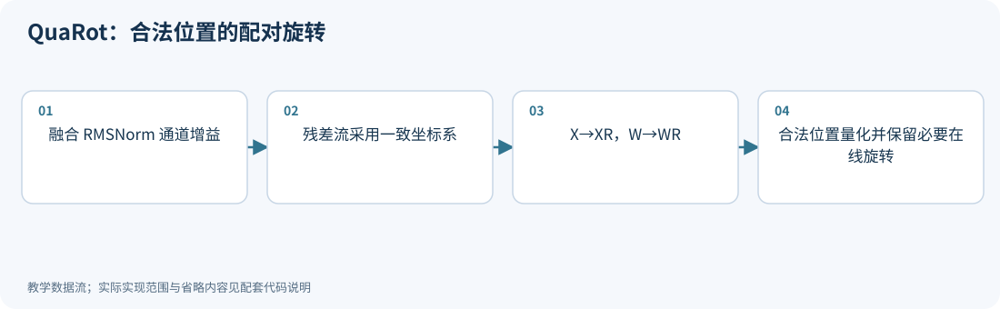
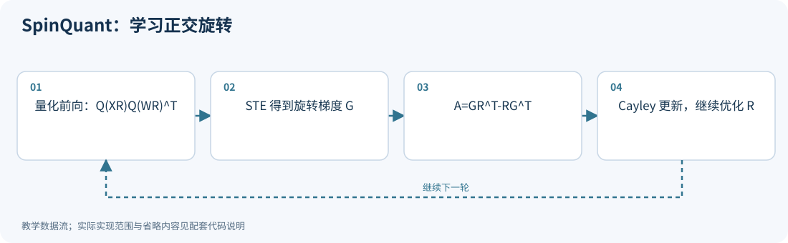
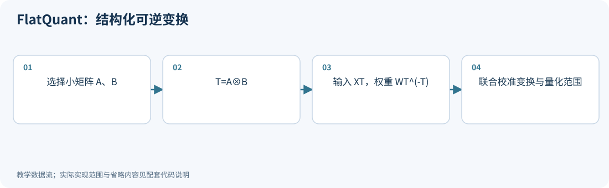
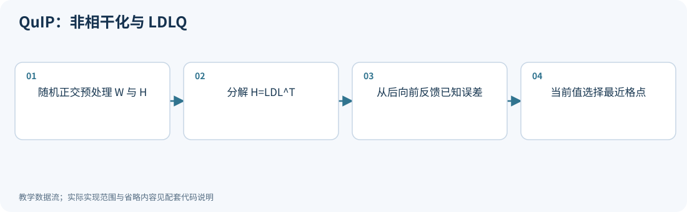

# 05｜旋转：换一个坐标系，量化为什么就容易了

<!-- course-objectives -->
**学习目标：** 证明旋转与一般可逆变换的等价条件；理解非相干化；分析非线性位置和在线变换成本。

**先修知识：** 第 03–04 章；附录 A 的正交、特征值和矩阵范数。 [进入本章测试](#chapter-assessment)；建议先独立作答，再展开答案。
<!-- /course-objectives -->

原始资料：[R11] QuaRot；[R12] SpinQuant；[R13] FlatQuant；[R14] QuIP；[R15] QuIP#。

<!-- chapter-overview -->
<a id="chapter-start"></a>

**阅读路线：** 先证明正交变换保持什么，再检查它可以放在网络的哪些位置。随后比较固定旋转、学习旋转和一般可逆变换。

<details><summary>本章目录（10 节）</summary>

- [5.1 正交矩阵是什么](#principle-5-1)
- [5.2 四维手算：把尖峰分散](#principle-5-2)
- [5.3 为什么常用 Hadamard](#principle-5-3)
- [5.4 QuaRot：让整个 Transformer 在可旋转的位置协同变化](#principle-5-4)
- [5.5 SpinQuant：旋转本身也可以学习](#principle-5-5)
- [5.6 FlatQuant：从正交旋转扩展到可逆线性变换](#principle-5-6)
- [5.7 QuIP：让权重与敏感方向不集中在少数坐标](#principle-5-7)
- [5.8 QuIP#：更快的预处理，加上格点码本](#principle-5-8)
- [5.9 四种变换放在一起理解](#principle-5-9)
- [5.10 本章测试与参考答案](#principle-5-10)

</details>

每项技术的图示、代码和讲解紧跟原理。例子在项目根目录运行，只需 NumPy；长篇参考资料可在各节末尾展开。[按技术查找](技术图解与代码索引.md) · [查看实验输出](../experiments/results/逐项技术实验结果.md)。

[分章测试与参考答案](#chapter-assessment) · [课程考核与综合练习](11_练习与答案.md#course-assessment-guide)

[本章实操：完整逐步注释](#chapter-demo)

<!-- /chapter-overview -->

<a id="principle-5-1"></a>

## 5.1 正交矩阵是什么

一个实方阵 $R$ 若满足：

$$
R^TR=RR^T=I,
$$

就叫正交矩阵。它包括旋转和反射，保持向量长度与内积：

$$
\|xR\|_2^2=xRR^Tx^T=\|x\|_2^2,
$$

$$
(xR)(yR)^T=xy^T.
$$

于是线性层有等价关系：

$$
\boxed{XW^T=(XR)(WR)^T.}
$$

和上一章的缩放一样：浮点函数不变，但坐标上的分布会变。

<a id="principle-5-2"></a>

## 5.2 四维手算：把尖峰分散

取归一化 Hadamard 矩阵：

$$
R=\frac12\begin{bmatrix}
1&1&1&1\\
1&-1&1&-1\\
1&1&-1&-1\\
1&-1&-1&1
\end{bmatrix}.
$$

可以直接验证 $R^TR=I$。对 $x=[12,0,0,0]$：

$$
xR=[6,6,6,6].
$$

能量没变：$12^2=4\times6^2$，但最大坐标从 12 降到 6。

这说明尖峰被打散。这个特殊向量在某些量化网格下，旋转前后都能精确表示，所以不能单凭它宣称量化误差一定降低。真正收益要在完整向量分布、共享 scale 和权重上测量。

对于随机旋转，固定向量的能量平均分到 $d$ 个坐标：

$$
\mathbb E[(xR)_j^2]=\|x\|_2^2/d.
$$

在适当随机性与高维条件下，最大坐标通常远小于把全部能量集中在一个坐标时的大小。这是旋转抑制离群值的依据，不是每一次旋转都严格改善最大值的保证。

<a id="principle-5-3"></a>

## 5.3 为什么常用 Hadamard

稠密矩阵旋转每个向量需要 $O(d^2)$ 计算。Hadamard 可以通过逐级加减实现快速变换，典型复杂度 $O(d\log d)$。

二阶 Hadamard：

$$
H_2=\begin{bmatrix}1&1\\1&-1\end{bmatrix}.
$$

递推：

$$
H_{2d}=\begin{bmatrix}H_d&H_d\\H_d&-H_d\end{bmatrix}.
$$

除以 $\sqrt d$ 后归一化。随机化通常还会加入随机符号对角矩阵或置换。非 2 的幂维度需要专门分解、合适阶数的矩阵或实现支持，不能假设任何维度都直接套最简单版本。

<a id="principle-5-4"></a>
<a id="quarot"></a>

## 5.4 QuaRot：让整个 Transformer 在可旋转的位置协同变化

QuaRot 的核心是利用网络中的等价变换，将残差流和部分内部激活旋转，减轻离群值，再配合权重、激活及 KV 量化。[R11]

困难在于：不能在任何位置随意插入旋转。

**线性层：** 成对变换可以保持等价，见 5.1。

**残差加法：**

$$
(x+f(x))R=xR+f(x)R.
$$

两条支路必须使用相容的坐标系。

**RMSNorm：** 先忽略逐通道增益，记：

$$
N(x)=\frac{x}{\sqrt{\|x\|_2^2/d+\varepsilon}}.
$$

因为旋转保持长度：

$$
N(xR)=N(x)R.
$$

实际 RMSNorm 带逐通道增益，通常要先将增益吸收到后续线性权重，再应用该性质。普通 LayerNorm 还减去坐标均值，任意旋转通常不保持这个均值方向，不能无条件照搬。

**非线性：** 一般 $\operatorname{SiLU}(xR)\ne\operatorname{SiLU}(x)R$。因此 MLP 非线性前后的旋转必须安排成正确的配对结构，必要时保留在线变换。

**Attention：** 若同时旋转 Query 与 Key：

$$
(QR)(KR)^T=QK^T.
$$

但有 RoPE 时，需要注意插入位置。通常在 RoPE 后对 Q、K 应用同一变换容易看出等价；任意旋转移到 RoPE 前并不自动等价。

**步骤：** 融合归一化增益 → 在合法位置安排配对旋转 → 离线融合可融合的权重 → 保留必要的在线 Hadamard → 校准并量化。

论文中的“end-to-end 4 bit”需要结合具体算子范围理解：归一化、softmax、累加器等仍可能使用高精度，并不是每一个浮点操作都变成 INT4。

<!-- inline-technique: quarot -->

### 图解与代码



**运行：** `python experiments/technique_lab.py --technique quarot`

<!-- executable: quarot -->
```python
import numpy as np
from experiments.quant_lab import hadamard, symmetric_qdq, mse
X = np.array([[12., .1, -.2, .3], [4., -.3, .1, -.2]])
W = np.array([[.2, .5, -.1, .3]])
R = hadamard(4)
rms = lambda x: x/np.sqrt(np.mean(x*x, axis=-1, keepdims=True)+1e-6)
assert np.allclose((X@R)@(W@R).T, X@W.T)
assert np.allclose(rms(X@R), rms(X)@R)
approximate = symmetric_qdq(X@R, axis=1)[0] @ symmetric_qdq(W@R, axis=1)[0].T
print("peaks before/after:", np.max(abs(X)), np.max(abs(X@R)))
print("rotated W4A4 output MSE:", mse(X@W.T, approximate))
```

**代码讲解**

1. R=H/√d 保证 RᵀR=I；两个线性输入侧同时右乘 R，乘积保持不变。
2. rms 不含逐通道增益，所以旋转可以穿过它；带增益的 RMSNorm 必须先处理参数融合。

> **示例边界：** 只验证一个线性层与无增益 RMSNorm；整个 Transformer 还要处理残差、非线性、RoPE 和在线旋转位置。

<details>
<summary>论文、博客与官方资料</summary>

- **论文**：[QuaRot: Outlier-Free 4-Bit Inference in Rotated LLMs](https://arxiv.org/abs/2404.00456)。
- **作者项目、官方文档与规范**：[QuaRot 作者实现与 README](https://github.com/spcl/QuaRot)。

</details>

<!-- /inline-technique -->

<a id="principle-5-5"></a>
<a id="spinquant"></a>

## 5.5 SpinQuant：旋转本身也可以学习

随机旋转的结果存在差异。SpinQuant 保持原模型权重固定，优化旋转，使量化后的网络损失更低。[R12]

可以写成：

$$
\min_R\mathcal L(f_{Q, R}(x),y)
\quad\text{subject to }R^TR=I.
$$

这里 $Q$ 表示前向里有量化操作。浮点等价模型的输出本来不随合法旋转变化，因此必须把量化误差放进优化过程。

为什么不能直接普通梯度下降？因为 $R-\eta G$ 一般不再正交，会破坏函数等价关系。

一种保持正交的方式是 Cayley 更新。构造反对称矩阵 $A$，满足 $A^T=-A$，例如从梯度构造 $A=GR^T-RG^T$。定义：

$$
C=(I+\eta A/2)^{-1}(I-\eta A/2),\qquad R_{new}=CR.
$$

由于 $A^T=-A$，可验证 $C^TC=I$。于是若 $R$ 正交，更新后的 $R_{new}$ 仍正交。实际 Cayley 优化器还会包含动量、步长与高效求解细节。

**代价：** 要做带量化模拟的优化，校准时间更长；随机初始化和校准集会影响结果。

**收益边界：** 目标是找到更好的量化坐标系，不是证明“所有模型的 4 bit 都无损”。

<!-- inline-technique: spinquant -->

### 图解与代码



**运行：** `python experiments/technique_lab.py --technique spinquant`

<!-- executable: spinquant -->
```python
import numpy as np
from experiments.quant_lab import symmetric_qdq
rng = np.random.default_rng(12)
X = rng.normal(size=(16, 4)); X[:, 0] *= 5
W = rng.normal(size=(3, 4)); R = np.eye(4); losses = []
for step in range(20):
    Xq = symmetric_qdq(X@R, axis=1)[0]
    Wq = symmetric_qdq(W@R, axis=1)[0]
    E = Xq@Wq.T-X@W.T
    losses.append(np.mean(E**2))
    G = 2*(X.T@(E@Wq) + W.T@(E.T@Xq))/E.size
    A = G@R.T-R@G.T
    R = np.linalg.solve(np.eye(4)+.005*A, (np.eye(4)-.005*A)@R)
    assert np.allclose(R.T@R, np.eye(4), atol=1e-10)
print("initial/best local loss:", losses[0], min(losses))
```

**代码讲解**

1. 梯度经过两个量化分支；本例对 round 使用恒等 STE，并将当前尺度视为常量。
2. Aᵀ=-A，Cayley 的左右因子构成正交映射。每步断言验证几何约束，而不要求硬量化损失逐步下降。

> **示例边界：** 用单层输出重建展示学习旋转；原始 SpinQuant 的模型级损失、旋转位置、动量和优化预算不在此例中。

<details>
<summary>论文、博客与官方资料</summary>

- **论文**：[SpinQuant: LLM Quantization with Learned Rotations](https://arxiv.org/abs/2405.16406)。
- **作者项目、官方文档与规范**：[SpinQuant 作者实现与 README](https://github.com/facebookresearch/SpinQuant)。

</details>

<!-- /inline-technique -->

<a id="principle-5-6"></a>
<a id="flatquant"></a>

## 5.6 FlatQuant：从正交旋转扩展到可逆线性变换

只要 $T$ 可逆，就有：

$$
\boxed{XW^T=(XT)(WT^{-T})^T.}
$$

正交矩阵是特殊情况，此时 $T^{-T}=T$。一般可逆矩阵还能缩放、拉伸和改变不同方向的相对尺度。

FlatQuant 学习使权重与激活更适合量化的变换，并联合考虑裁剪等因素。[R13] 目标可理解为：

$$
\min_T\|XW^T-Q_A(XT)Q_W(WT^{-T})^T\|_F^2.
$$

这只是局部线性层的解释式；完整方法在 Transformer 的多个位置安排变换和校准。

**为什么不用随便一个大矩阵：**$d=4096$ 的稠密变换每个 token 约需要 $d^2=1678$ 万个乘加项，开销可能太高。

FlatQuant 使用 Kronecker 分解等结构，例如：

$$
T=T_1\otimes T_2,\quad d=d_1d_2.
$$

通过把向量 reshape 成小矩阵，再做左右两次小矩阵乘，可将运算量降到约 $O(d(d_1+d_2))$。若 $d_1=d_2=64$，约为 52 万个乘加项，低于稠密版本；实际性能还依赖融合内核与数据布局。

**代价：** 一般可逆变换可能放大误差，条件数差时还会导致数值问题；需要学习成本、约束和相应 kernel。它并非“旋转越自由越好”。

<!-- inline-technique: flatquant -->

### 图解与代码



**运行：** `python experiments/technique_lab.py --technique flatquant`

<!-- executable: flatquant -->
```python
import numpy as np
from experiments.quant_lab import symmetric_qdq, mse
rng = np.random.default_rng(13)
X = rng.normal(size=(8, 4)); W = rng.normal(size=(3, 4))
A = np.array([[1., .2], [0., .8]])
B = np.array([[.8, 0.], [.1, 1.2]])
T = np.kron(A, B)
transformed = np.einsum('nij,ia,jb->nab', X.reshape(-1, 2, 2), A, B).reshape(X.shape)
Wp = np.linalg.solve(T, W.T).T
assert np.allclose(transformed, X@T)
assert np.allclose(transformed@Wp.T, X@W.T)
approximate = symmetric_qdq(transformed, axis=1)[0] @ symmetric_qdq(Wp, axis=1)[0].T
print("condition number, QDQ MSE:", np.linalg.cond(T), mse(approximate, X@W.T))
```

**代码讲解**

1. einsum 对 reshape 后的两个特征轴分别作用 A 和 B，与显式 Kronecker 矩阵乘的结果一致。
2. solve(T,W.T).T 实现 WT⁻ᵀ，不能直接写成 W@T；条件数展示一般可逆变换的数值风险。

> **示例边界：** 给定一组变换验证结构和前向，没有复现 FlatQuant 对变换、裁剪及多模块位置的完整学习过程。

<details>
<summary>论文、博客与官方资料</summary>

- **论文**：[FlatQuant: Flatness Matters for LLM Quantization](https://arxiv.org/abs/2410.09426)。
- **作者项目、官方文档与规范**：[FlatQuant 作者实现与 README](https://github.com/ruikangliu/FlatQuant)。

</details>

<!-- /inline-technique -->

<a id="principle-5-7"></a>
<a id="quip"></a>

## 5.7 QuIP：让权重与敏感方向不集中在少数坐标

“非相干性”听起来复杂，可以先理解为：重要信息不要只挤在几个坐标轴上。

若 Hessian 特征分解为：

$$
H=U\Lambda U^T,
$$

特征向量矩阵 $U$ 的元素若比较分散，每个坐标轴就不会独占某个特别敏感方向。理论分析常用类似以下界定：

$$
\max_{ij}|U_{ij}|\le\mu/\sqrt d.
$$

$\mu$ 越小，表示越不集中。权重矩阵本身也可以用最大元素与整体 Frobenius 范数的比值衡量集中程度。

QuIP 把随机正交预处理与 Hessian 感知的 LDLQ 量化结合起来。[R14]

**LDLQ 的直觉推导：** 分解正定 Hessian：

$$
H=LDL^T,
$$

其中 $L$ 为单位下三角，$D$ 为对角矩阵。令误差 $e=\widehat w-w$，则：

$$
e^THe=\sum_iD_{ii}\left(e_i+\sum_{j>i}L_{ji}e_j\right)^2.
$$

如果按从后到前的顺序量化，已有的 $e_j$ 就能作为反馈，令：

$$
\widehat w_i=Q\left(w_i-\sum_{j>i}L_{ji}e_j\right).
$$

这样让当前括号尽量小。不同实现可以使用相反遍历和对应转置分解；关键是分解方向、反馈方向和量化顺序必须一致。

这个展开解释了误差反馈。QuIP 的理论保证还需要关于非相干性、网格和误差模型的假设，不是对任意 LLM 最终任务精度的无条件保证。

### 变换后必须重新表达二阶统计

对输入变换 $X'=XT$，权重应为 $W'=WT^{-T}$，重建 Hessian 应为

$$
H'=2X'^TX'=T^THT.
$$

令量化在新坐标产生误差 $E'=\widehat W'-W'$。映回原权重坐标的误差为
$E=E'T^T$，因此

$$
\|X'E'^T\|_F^2=\|XE^T\|_F^2
=\frac12\operatorname{tr}(E'H'E'^T).
$$

这给出一个实用排错标准：先验证浮点输出等价，再用**同一份变换后的输入**计算统计。
不能旋转权重后继续使用原坐标的 Hessian。对角 damping 在一般缩放下的变化见第 02 章。

<!-- depth-example: transformed_hessian -->
```python
import numpy as np
rng = np.random.default_rng(1801)
X = rng.normal(size=(9, 3))
T = np.array([[2., .3, 0.], [0., .5, .1], [0., 0., 1.]])
Ep = rng.normal(size=(2, 3))*.01
H = 2*X.T@X
Hp = T.T@H@T
E = Ep@T.T
assert np.allclose((X@T)@Ep.T, X@E.T)
assert np.isclose(np.sum(((X@T)@Ep.T)**2), .5*np.trace(Ep@Hp@Ep.T))
lam = .1
assert not np.allclose(T.T@(H+lam*np.eye(3))@T, Hp+lam*np.eye(3))
print('output SSE:', np.sum((X@E.T)**2))
```

该例验证坐标与损失一致性，不证明某个变换一定降低量化误差。运行：
`python experiments/deep_dive_lab.py --case transformed_hessian`。

<!-- inline-technique: quip -->

### 图解与代码



**运行：** `python experiments/technique_lab.py --technique quip`

<!-- executable: quip -->
```python
import numpy as np
from experiments.technique_kernels import ldl_feedback
H = np.array([[2., 1.], [1., 2.]])
w = np.array([.6, .6]); grid = np.array([0., 1.])
quantized, L, D = ldl_feedback(w, H, grid)
e = quantized-w
assert np.allclose(L@np.diag(D)@L.T, H)
assert np.isclose(e@H@e, np.sum(D*(L.T@e)**2))
assert np.array_equal(quantized, [0., 1.])
print("reverse-order LDLQ, quadratic loss:", quantized, e@H@e)
```

**代码讲解**

1. helper 从 Cholesky 因子提取单位下三角 L 和正对角 D，随后执行正文的反向反馈公式。
2. 结果与正向 GPTQ 的 [1,0] 不同，但本例对称，损失相同。遍历方向、分解形式和反馈方向必须配套。

> **示例边界：** 只验证 LDLQ 子步骤；完整 QuIP 还包括非相干预处理、有限网格范围与理论假设，不能由本例宣称 2 bit 任务质量保证。

<details>
<summary>论文、博客与官方资料</summary>

- **论文**：[QuIP: 2-Bit Quantization of Large Language Models With Guarantees](https://arxiv.org/abs/2307.13304)。
- **作者项目、官方文档与规范**：[QuIP 作者实现与 README](https://github.com/Cornell-RelaxML/QuIP)。

</details>

<!-- /inline-technique -->

<a id="principle-5-8"></a>

## 5.8 QuIP#：更快的预处理，加上格点码本

QuIP# 在这条路线中引入随机 Hadamard 非相干预处理、块级 LDLQ、基于 $E_8$ 格的结构化向量码本，并结合微调。[R15]

为什么还需要码本？旋转后，若数据更接近分散、近高斯的形态，一组 8 个数可以联合选择代表向量，利用多维空间的几何结构，优于逐元素放在方形网格上。

$E_8$ 格的数学定义、向量查表和 bit 数计算见[下一章的 QuIP# 码本小节](06_码本_稀疏与混合精度.md#quip_sharp)，对应图示和代码紧跟定义。这里先把握总流程：QuIP# 同时依赖非相干预处理、块级误差反馈和结构化码本。

<a id="principle-5-9"></a>

## 5.9 四种变换放在一起理解

| 变换 | 改变什么 | 保持什么 | 主要代价 |
|---|---|---|---|
| 通道重排 | 坐标顺序 | 数值集合、长度 | 布局或 gather |
| 对角缩放 | 通道相对幅度 | 成对变换后的线性输出 | scale 与融合要求 |
| 正交旋转 | 坐标方向，混合数值 | 长度与内积 | 在线变换或训练 |
| 一般可逆变换 | 方向和尺度 | 正确配对后的线性输出 | 更多计算与数值条件约束 |

它们共同改变了量化器看到的数据分布。只有把相应逆变换正确配对，并考虑整个计算图，才能保持量化前的模型函数。

<!-- chapter-demo: 05 -->
## 本章实操｜搜索合法旋转并同步变换 Hessian

<a id="chapter-demo"></a>

**实践目的：** 先验证浮点等价，再比较量化误差，最后用非线性反例解释融合边界。

**环境：** Python 3.10+、NumPy、PyTorch；支持 CPU/CUDA，Colab 选择 GPU 运行时。无需下载模型。在项目根目录执行：

```bash
python experiments/chapter_demo_lab.py --chapter 05 --device cuda
# 没有GPU时显式使用CPU；auto在CUDA可用时优先使用GPU
python experiments/chapter_demo_lab.py --chapter 05 --device cpu
# 也可直接执行源码模块（同样在项目根目录）
python -m experiments.demos.ch05
```

**Colab：** 可直接上传[逐章 GPU Notebook](../experiments/notebooks/colab_chapter_demos.ipynb)，它自带所需源码；按单元选择本章运行。修改源码后将 `PRACTICE=True`，或命令行加 `--practice`；此模式跳过正文一致性检查，保留数值断言、设备核验及实际源码哈希。指定 `cuda` 后不可用会报错，不会静默退回 CPU。随机输入在 CPU 准备后一次搬到所选设备；矩阵、量化、训练和统计计算使用该设备的 PyTorch 张量。文件 I/O、Python 流程控制和打印在主机；默认 FP64 核验精度，不代表原生低比特 Tensor Core 性能。

**完整源码：** [带逐步注释的 demo](../experiments/demos/ch05.py)。默认只打印结果；保存命令与全部章节入口见[实操导航](../README.md#chapter-demos)。

<details><summary>展开完整代码：每一步的行为、计算逻辑与检查条件</summary>

<!-- chapter-demo-code: 05 -->
```python
"""第 05 章：配对旋转、变换 Hessian、独立校准和非线性反例。"""
import torch
from experiments.demo_runtime import get_runtime, same

# 第 0 步：auto优先CUDA；runner可用--device指定。所有计算张量在此设备创建。
rt = get_runtime()
device, dtype = rt.device, rt.dtype
from experiments.demo_torch_kernels import hadamard, group_qdq

# 第 1 步：构造离群输入，用两个不同随机流分出校准/测试数据。
rng = rt.rng(500)
W = rng.normal(size=(4, 8))
calibration = rng.normal(size=(48, 8))
test = rng.normal(size=(96, 8))
calibration[:, 0] *= 15
test[:, 0] *= 15
H = 2*calibration.T@calibration

# 第 2 步：原坐标与四个随机符号 Hadamard 都作为候选。
# R=diag(signs)@H8，两个因子都正交，因此 R 仍保持长度和内积。
rotations = [torch.eye(8, device=device, dtype=dtype)]
for _ in range(4):
    signs = rng.choice([-1., 1.], size=8)
    rotations.append(torch.diag(signs)@hadamard(8, device=device))

# 第 3 步：每个候选同时旋转输入与权重，先验证未量化时函数完全一致。
records = []
for index, R in enumerate(rotations):
    Xr, Wr = calibration@R, W@R
    assert same(R.T@R, torch.eye(8, device=device, dtype=dtype))
    assert same(Xr@Wr.T, calibration@W.T)
    H_rotated = R.T@H@R
    assert same(H_rotated, 2*Xr.T@Xr)
    # 量化器看到的是旋转后的权重；误差也必须放在同一个坐标系下计算。
    Wq = group_qdq(Wr, bits=3, group_size=4)
    E = Wq-Wr
    output_sse = torch.sum((Xr@E.T)**2)
    assert same(output_sse, .5*torch.trace(E@H_rotated@E.T))
    records.append((float(output_sse), Wq, R))
    print('候选 / 校准SSE / 激活峰值:', index, output_sse, torch.amax(abs(Xr)))

# 第 4 步：校准选择后再报告测试误差；包含恒等矩阵使校准目标不劣于基线。
best = min(range(len(records)), key=lambda i: records[i][0])
assert records[best][0] <= records[0][0]
for index in (0, best):
    _, Wq, R = records[index]
    print('候选 / 独立测试MSE:', index, torch.mean(((test@R)@Wq.T-test@W.T)**2))

# 第 5 步：检查旋转不能任意穿过非线性，解释整模型融合为什么要看计算图。
x = rt.tensor([[1., -2.]])
R = hadamard(2, device=device)
assert not same(torch.clamp_min(x@R, 0), torch.clamp_min(x, 0)@R)
print('ReLU前后随意移动旋转：不等价')
# 这里只量化权重，未复现 QuaRot 的全部激活/KV 位置或 SpinQuant 训练。

# 收尾：等待本demo设备上的操作完成，方便Colab定位CUDA异步报错。
rt.synchronize()
```

</details>

**运行后观察：** RᵀR与浮点输出通过检查；输出SSE和变换后Hessian二次型一致；ReLU前后移动旋转不等价。

**动手修改：** 增加随机符号候选或取消离群通道，观察峰值与测试误差是否一起变化。

**适用边界：** 只演示权重量化坐标系；未实现QuaRot全部量化位置或学习旋转。

<!-- /chapter-demo -->

<!-- chapter-assessment -->

<a id="principle-5-10"></a>

## 5.10 本章测试与参考答案

<a id="chapter-assessment"></a>

核心卷 8 题，仍按 100 分；另有简单、困难、特别困难拓展题各 1 道，不计入核心卷。难度相对于本章先修知识划分，题号保持原有顺序。核心卷建议 60–90 分钟，特别困难拓展可另留 30–60 分钟。

| 难度 | 按难度选题 |
|---|---|
| 简单 | [05-01](#exercise-05-01) · [05-E01](#exercise-05-e01) |
| 困难 | [05-02](#exercise-05-02) · [05-03](#exercise-05-03) · [05-04](#exercise-05-04) · [05-05](#exercise-05-05) · [05-06](#exercise-05-06) · [05-07](#exercise-05-07) · [05-08](#exercise-05-08) · [05-E02](#exercise-05-e02) |
| 特别困难 | [05-E03](#exercise-05-e03) |

每题提供至少三条参考路径，分别可能是解析解、等价推导、独立数值核验或满足条件的工程方案。固定条件下唯一的数值结果不因解法不同而改变；数值实验不能替代一般性证明。未明确要求比较多解时，可任选或组合路径回答全部子问；验证说明须补足题干要求的推导。开放题接受条件明确、证据充分的其他方案。

<a id="exercise-05-01"></a>

### 05-01｜Hadamard 保留了什么（简单｜计算，10 分）

$R=\frac1{\sqrt2}\begin{bmatrix}1&1\\1&-1\end{bmatrix}$、$x=(4,0)$。计算 $xR$、变换前后 L2 范数和最大绝对值；最大值变小是否足以证明量化误差变小？

<details><summary>参考答案与评分要点</summary>

**参考路径一：**

$xR=(2\sqrt2,2\sqrt2)$；两者范数均为 4，最大幅度由 4 降到 $2\sqrt2$。共享尺度、网格与分布仍决定误差；原向量可能本来可精确表示，故不能只凭峰值下结论。

**路径二：能量分配。** 原能量16，由Hadamard平均分到两个坐标各8，幅值各√8，范数仍√16。

**验证路径：内积不变。** 直接算RRᵀ=I，所以任何x都保持平方范数；峰值降低是本例现象，不对每个向量保证。

**评分要点：** 结果 4 分；两类统计 3 分；量化边界 3 分。

</details>

<a id="exercise-05-02"></a>

### 05-02｜旋转如何配对（困难｜推导，10 分）

$X^{\prime}=XR$ 且 $R$ 正交。求应使用的权重 $W^{\prime}$；若改成任意可逆 $T$，仍取 $W^{\prime}=WT$ 是否正确？

<details><summary>参考答案与评分要点</summary>

**参考路径一：**

正交时 $W^{\prime}=WR$，$XR(WR)^T=XRR^TW^T$。一般应取 $W^{\prime}=WT^{-T}$，于是 $(XT)(WT^{-T})^T=XW^T$；直接取 $WT$ 只有在满足相应 $TT^T=I$ 等条件时成立。

**解法二：求解矩阵条件。** 需要 $T(W^*)^T=W^T$，左乘T⁻¹后转置得 $W^*=WT^{-T}$。正交情形再简化。

**解法三：基向量逐行核对。** 对X的每个标准基输入验证 $XT(W^*)^T=XW^T$，相当于验证整个线性映射；这是代码中的独立验证方法。

**评分要点：** 正交推导 4 分；一般配对及条件 6 分。

</details>

<a id="exercise-05-03"></a>

### 05-03｜Hessian 随坐标变化（困难｜推导与计算，15 分）

$H=\operatorname{diag}(2,8)$、$T=\operatorname{diag}(2,0.5)$、$\lambda=0.1$。计算 $H^{\prime}=T^THT$、$T^T(H+\lambda I)T$ 和 $H^{\prime}+\lambda I$。

<details><summary>参考答案与评分要点</summary>

**参考路径一：**

$H^{\prime}=\operatorname{diag}(8,2)$；变换后阻尼为 $\operatorname{diag}(8.4,2.025)$；直接在新坐标加同一 λ 则为 $\operatorname{diag}(8.1,2.1)$。因为旧正则变成 $\lambda T^TT$，一般不同。

**路径二：正则作为范数。** 原坐标L2惩罚换坐标后包含TᵀT=diag(4,0.25)，因此阻尼分别0.4、0.025，而不是两个0.1。

**验证路径：选两个误差方向。** 将e₁/e₂代入两种二次型，分别读出对角代价，能直接发现8.4与8.1、2.025与2.1的不同。

**评分要点：** 三矩阵各 3 分；正则项推导 4 分；条件区别 2 分。

</details>

<a id="exercise-05-04"></a>

### 05-04｜RMSNorm 增益能否直接旋转（困难｜推导，15 分）

无增益的 $\mathrm{RMS}(x)=x/\sqrt{\|x\|^2/d+\epsilon}$ 与正交旋转可交换。若后面再乘非均匀对角增益 $G$，为何不能直接假设仍可交换？用 $G=\operatorname{diag}(1,2)$ 与二维 Hadamard 判断。

<details><summary>参考答案与评分要点</summary>

**参考路径一：**

范数保持使无增益部分满足 $\mathrm{RMS}(xR)=\mathrm{RMS}(x)R$；但通常 $GR\ne RG$，给定 G 与 Hadamard 即不交换。应先把固定增益合法吸收到所有相关线性消费者或使用完整配对变换，不能丢弃增益。

**路径二：交换子。** 计算GR−RG，非均匀G使其非零；只有增益与R满足交换关系时才可直接移动。

**验证路径：选e₁输入。** 归一化后的公共因子相同，剩下比较e₁GR与e₁RG，两向量不同。这在单个输入上已足以否定无条件可交换。

**评分要点：** 无增益证明 5 分；不交换反例 5 分；合法处理 5 分。

</details>

<a id="exercise-05-05"></a>

### 05-05｜正交约束怎样维护（困难｜机制分析，15 分）

直接对旋转矩阵做 $R-\eta G$，为什么通常失去正交性？对反对称矩阵 $A^T=-A$，Cayley 变换 $C=(I-A)(I+A)^{-1}$ 为什么正交？

<details><summary>参考答案与评分要点</summary>

**参考路径一：**

普通梯度步不限制列间正交和单位长度。Cayley 中 I−A 与 I+A 可交换，且转置互换两者；计算 CᵀC 得 I。实反对称 A 的 I+A 可逆。更新仍须核对数值稳定性，正交本身不保证量化损失下降。

**证明二：转置求逆。** $C^T=(I-A)^{-1}(I+A)$，两多项式因子可交换，故CᵀC=I。

**验证路径：二维旋转。** 令 $A=\begin{bmatrix}0&a\\-a&0\end{bmatrix}$，所得C的行列范数均1且相互正交，可直观对应一个角度；数值验证只是一般代数证明的核对。

**评分要点：** 梯度步问题 4 分；转置/相消推导 7 分；可逆与损失边界 4 分。

</details>

<a id="exercise-05-06"></a>

### 05-06｜FlatQuant 的表达力与代价（困难｜工程分析，15 分）

任意可逆变换比正交旋转多了什么自由度？若变换条件数很大，即使代数等价为何还可能在部署中失败？

<details><summary>参考答案与评分要点</summary>

**参考路径一：**

可伸缩与拉伸不同方向，改变长度和条件结构；但求逆及有限精度运算可能放大误差，导致极端数值、溢出或校准过拟合。应检查条件数/尺度、关闭量化时的等价误差，再测量化质量、逆变换与实际运行成本；结构化参数化减少但不消除这些问题。

**路径二：误差放大界。** 变换和逆变换的舍入扰动受各自算子范数放大，条件数大意味着某些方向恢复敏感，精确恒等式无法排除有限精度退化。

**方案三：受限变换对照。** 比较正交、限制尺度比的一般变换、完全自由变换，在同预算下检查条件数、浮点等价误差和部署质量。若自由变换仅校准集更好，应调查过拟合与病态。

**评分要点：** 新增自由度 4 分；数值风险机制 5 分；验证及成本 6 分。

</details>

<a id="exercise-05-07"></a>

### 05-07｜非相干不是完全独立（困难｜概念判断，10 分）

解释 QuIP 中“敏感方向分散”的含义。随机 Hadamard 是否保证每个有限维向量的所有坐标独立服从高斯？

<details><summary>参考答案与评分要点</summary>

**参考路径一：**

非相干强调权重或 Hessian 特征方向不集中在少数坐标，通常以最大坐标与总体尺度比较。结构化随机变换可以分散尖峰并形成近似分布性质，但有限维坐标受长度约束且可能相关，不是逐坐标独立高斯的无条件保证。

**路径二：能量约束反证。** 正交后坐标平方和固定；若所有坐标都是独立非退化高斯，平方和会随机变化，故不能把固定向量的旋转结果等同独立高斯。

**路径三：区分三种性质。** 峰值分散、单坐标边缘近高斯、联合坐标独立是不同强度的结论。需要检查所用随机矩阵分布和维数，不能从第一项跳到第三项。

**评分要点：** 非相干解释 5 分；随机分布与约束 5 分。

</details>

<a id="exercise-05-08"></a>

### 05-08｜旋转真的划算吗（困难｜实验设计，10 分）

设计一个比较 RTN、固定旋转+RTN、学习旋转+RTN 的实验，要求区分变换本身、训练预算和内核的贡献。

<details><summary>参考答案与评分要点</summary>

**参考路径一：**

固定模型、目标格式、分组、校准/测试数据，先无量化验证合法位置；固定旋转用多个种子，学习旋转记录训练预算并设置可比搜索预算。分开报告质量、离线成本、在线变换时间和整体延迟；使用相同后端或明确后端差异，并包含无旋转基线。

**方案二：随机搜索对照优化。** 固定同样离线时间，比较多个随机旋转的最佳验证候选与学习旋转；避免学习方案只是获得更多搜索预算。

**方案三：分别锁定数值和执行。** 用同一QDQ参考路径测旋转质量，再固定导出模型测是否融合/在线执行。比较总延迟时要包含必要变换，不能只计GEMM。

**评分要点：** 控制与等价检查 3 分；随机与优化预算 3 分；完整成本和内核对照 4 分。

</details>

<a id="exercise-05-e01"></a>

### 05-E01｜正交旋转的内积核验（简单｜拓展题，单独计分）

二维Hadamard R，x=(1,1)、y=(1,−1)。求xR、yR及旋转前后内积。

<details><summary>参考答案与评分要点</summary>

**解法一：相乘。** xR=(√2,0)、yR=(0,√2)，内积都为0。

**解法二：正交恒等式。** $(xR)(yR)^T=xRR^Ty^T=xy^T=0$，不用逐项相乘。

**几何路径：** 两向量原来正交，正交变换保持角度和长度；同一结论不适用于仅对一侧旋转。

**评分要点：** 单独按 10 分评价：结论与条件 3 分、推理或设计过程 5 分、独立核验与边界 2 分。评分覆盖题干要求的全部子问；未要求比较多解时，可任选或组合参考路径完成作答。数值核验不能替代题干明确要求的证明，多解数量不额外加分。

</details>

<a id="exercise-05-e02"></a>

### 05-E02｜旋转如何改变共享尺度误差（困难｜拓展题，单独计分）

向量w=(1,0.2)，量化到{-s,0,s}，s为AbsMax；二维Hadamard后量化再逆变换。比较原域与旋转域重建SSE，说明能否推广。

<details><summary>参考答案与评分要点</summary>

**解法一：直接重建。** 原w→(1,0)，SSE0.04。wR=(1.2,0.8)/√2，尺度1.2/√2，编码(1,1)，逆变换后(1.2,0)，SSE0.08，反而更差。

**解法二：在旋转域算误差。** 量化误差为(0,0.4/√2)，平方和0.08；正交逆变换保误差范数，不必重新还原才能算SSE。

**解释路径：** 峰值从1降到约0.8485，但原本0.2所在的方向被改变且共享网格误差重分配。本例否定“降峰值必降失真”，并不否定某些分布上的经验收益。

**评分要点：** 单独按 10 分评价：结论与条件 3 分、推理或设计过程 5 分、独立核验与边界 2 分。评分覆盖题干要求的全部子问；未要求比较多解时，可任选或组合参考路径完成作答。数值核验不能替代题干明确要求的证明，多解数量不额外加分。

</details>

<a id="exercise-05-e03"></a>

### 05-E03｜哪类对角缩放可以穿过所有二维旋转（特别困难｜拓展题，单独计分）

令 $D=\operatorname{diag}(a,b)$，$R_\theta=\begin{bmatrix}\cos\theta&-\sin\theta\\\sin\theta&\cos\theta\end{bmatrix}$，a,b>0。推导DRθ=RθD的条件；推广到由多个RoPE二维块组成的旋转，并区分“一个特殊角度”与“所有位置”。

<details><summary>参考答案与评分要点</summary>

**解法一：交换子。** 非对角差为 $(b-a)\sin\theta$，因此固定θ下需a=b或sinθ=0；若要求所有位置角度都满足且存在非退化旋转，必须a=b。

**解法二：基向量图像。** 旋转把e₁的分量混到e₂；若两轴不同缩放，先混合与后混合产生不同相对幅度。只有该二维子空间的标量缩放才能对一般角度保持等价。

**推广与反例：** 对角D在每个RoPE配对内取相同尺度，不同配对可不同。θ=0或π时任意对角D暂时可交换，但不能据一个位置外推全部序列；实际配对也可能是前后半维而非相邻内存维。

**评分要点：** 单独按 10 分评价：结论与条件 3 分、推理或设计过程 5 分、独立核验与边界 2 分。评分覆盖题干要求的全部子问；未要求比较多解时，可任选或组合参考路径完成作答。数值核验不能替代题干明确要求的证明，多解数量不额外加分。

</details>

**复习建议：** 计算错误先回到本章的形状、单位与约定；工程判断缺少依据时，补写目标函数、对照配置和验证边界。建议达到 80 分后继续；这是一项自学建议，不是经教学验证的能力认证标准。

[课程考核与综合练习](11_练习与答案.md#course-assessment-guide) · [返回学习目录](../README.md)

<!-- /chapter-assessment -->

<!-- chapter-footer -->

---

[上一章](04_可学习校准与HQQ.md) · [本章目录](#chapter-start) · [下一章](06_码本_稀疏与混合精度.md) · [学习首页](../README.md) · [论文与博客](../references/论文与博客导航.md)

<!-- /chapter-footer -->

[R11]: https://arxiv.org/abs/2404.00456

[R12]: https://arxiv.org/abs/2405.16406

[R13]: https://arxiv.org/abs/2410.09426

[R14]: https://arxiv.org/abs/2307.13304

[R15]: https://arxiv.org/abs/2402.04396
