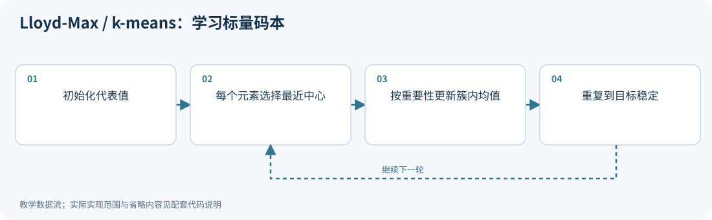
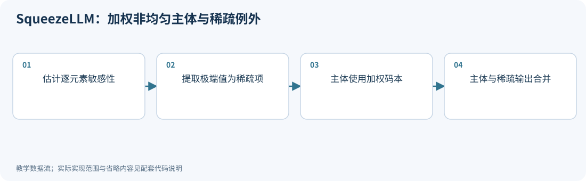
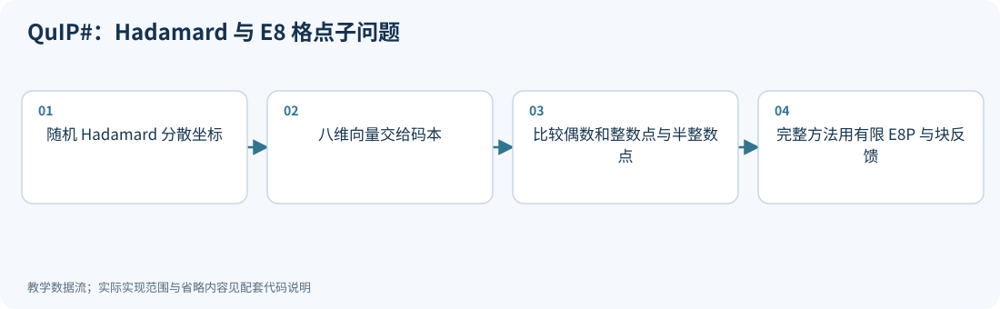
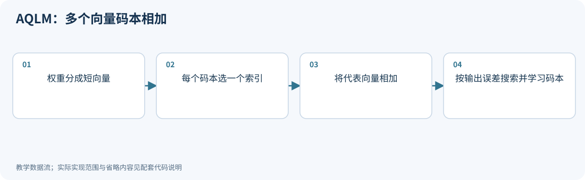
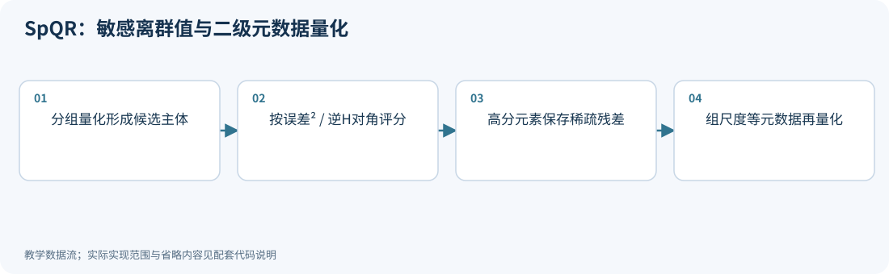
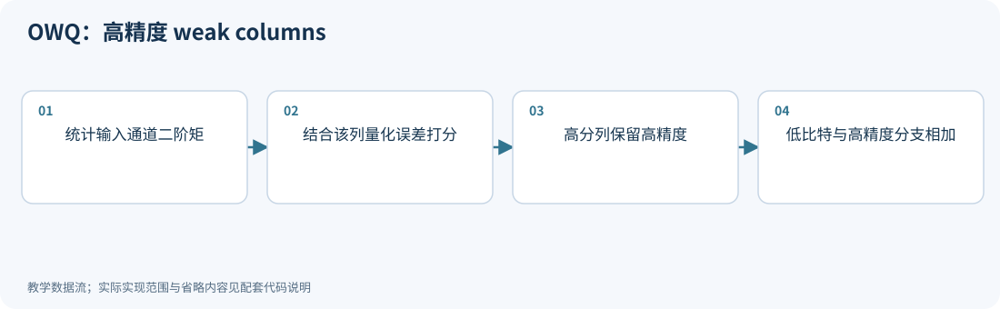
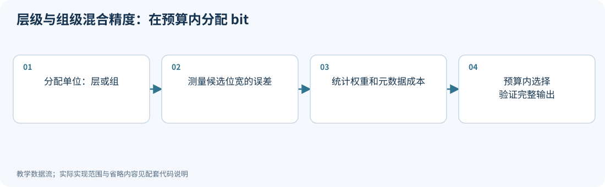

# 06｜改变编码方式：非均匀码本、向量量化与稀疏例外

<!-- course-objectives -->
**学习目标：** 计算码本、索引和稀疏元数据成本；理解码本最优条件；在完整预算下比较混合精度与组合压缩。

**先修知识：** 第 01–02 章；附录 A 的加权平方误差与 SVD。 [进入本章测试](#chapter-assessment)；建议先独立作答，再展开答案。
<!-- /course-objectives -->

原始资料：[R15] QuIP#；[R16] AQLM；[R17] SqueezeLLM；[R18] SpQR；[R19] OWQ。

<!-- chapter-overview -->
<a id="chapter-start"></a>

**阅读路线：** 从标量码本的加权均值出发，扩展到向量码本、加法编码和稀疏例外，再分析位宽分配与组合压缩的完整成本。

<details><summary>本章目录（12 节）</summary>

- [6.1 为什么代表值必须等间隔](#principle-6-1)
- [6.2 从最小平方误差推出 k-means / Lloyd-Max](#principle-6-2)
- [6.3 SqueezeLLM：敏感性加权码本与稀疏部分](#principle-6-3)
- [6.4 向量量化：多个数共用一个选择](#principle-6-4)
- [6.5 QuIP# 的格点码本：不必显式存巨大查找表](#principle-6-5)
- [6.6 AQLM：用多个小码本相加](#principle-6-6)
- [6.7 SpQR：多数值低 bit，少数难点高精度](#principle-6-7)
- [6.8 OWQ：以输入列为单位保护敏感部分](#principle-6-8)
- [6.9 稀疏例外真的便宜吗](#principle-6-9)
- [6.10 混合精度：为每层、每组分配 bit](#principle-6-10)
- [6.11 量化与剪枝、低秩、蒸馏组合时怎样算账](#principle-6-11)
- [6.12 本章测试与参考答案](#principle-6-12)

</details>

每项技术的图示、代码和讲解紧跟原理。例子在项目根目录运行，只需 NumPy；长篇参考资料可在各节末尾展开。[按技术查找](技术图解与代码索引.md) · [查看实验输出](../experiments/results/逐项技术实验结果.md)。

[分章测试与参考答案](#chapter-assessment) · [课程考核与综合练习](11_练习与答案.md#course-assessment-guide)

[本章实操：完整逐步注释](#chapter-demo)

<!-- /chapter-overview -->

<a id="principle-6-1"></a>

## 6.1 为什么代表值必须等间隔

其实不必须。假设大量权重集中在零附近，少量位于尾部。等间隔网格可能把太多代表值放在很少出现的区域。

非均匀标量量化维护码本：

$$
\mathcal C=\{c_1,\ldots,c_K\},\quad K\le2^b.
$$

每个权重存一个索引 $a_i$，反量化为 $c_{a_i}$。

例如四个代表值可以是 $\{-1,-0.1,0.1,1\}$，而不是等间隔的 $\{-1,-1/3,1/3,1\}$。哪种更好取决于数据与误差目标。

<a id="principle-6-2"></a>
<a id="lloyd_max"></a>

## 6.2 从最小平方误差推出 k-means / Lloyd-Max

考虑：

$$
\min_{a_i,c_k}\sum_i(w_i-c_{a_i})^2.
$$

它包含两个子问题：

1. **固定码本，选索引。** 每个 $w_i$ 选择最近的 $c_k$。
2. **固定索引，更新码本。** 对一个簇 $S_k$：

$$
\frac{\partial}{\partial c_k}\sum_{i\in S_k}(w_i-c_k)^2
=2\sum_{i\in S_k}(c_k-w_i)=0.
$$

所以：

$$
c_k=\frac1{|S_k|}\sum_{i\in S_k}w_i.
$$

交替执行直到收敛。这就是一维 k-means 的基本思想。

对连续分布，最优重建值是相应区间的条件均值，邻接区间的判定边界在相邻重建值中点。这类交替优化称为 Lloyd-Max。

如果权重有不同敏感性 $h_i>0$：

$$
\min_{a,c}\sum_i h_i(w_i-c_{a_i})^2,
$$

求导得到加权均值：

$$
\boxed{c_k=\frac{\sum_{i\in S_k}h_iw_i}{\sum_{i\in S_k}h_i}.}
$$

例子：同一簇中两个数为 0 和 1，重要性分别为 9 和 1，最佳中心为 0.1，而非 0.5。让更重要的元素误差更小。

<!-- inline-technique: lloyd_max -->

### 图解与代码



**运行：** `python experiments/technique_lab.py --technique lloyd_max`

<!-- executable: lloyd_max -->
```python
import numpy as np
from experiments.technique_kernels import lloyd, nearest
values = np.array([0., 1., 3., 4.])
importance = np.array([9., 1., 1., 1.])
centers, losses = lloyd(values, 2, importance)
assert np.all(np.diff(losses) <= 1e-10)
assert np.allclose(centers, [.1, 3.5])
print("centers, reconstructed values:", centers, nearest(values, centers))
```

**代码讲解**

1. 第一个簇的最优中心为 (9*0+1*1)/10=0.1；普通均值 0.5 会忽略敏感性差异。
2. 固定归属的最优更新和最近中心重新分配都不会增加同一目标，但只能保证局部收敛。

> **示例边界：** 这是有限样本的加权一维 k-means；连续分布的 Lloyd-Max 用区间条件均值，初始化也会影响局部解。

<details>
<summary>论文、博客与官方资料</summary>

- **论文**：[Least Squares Quantization in PCM（Lloyd）](https://doi.org/10.1109/TIT.1982.1056489)；[Quantizing for Minimum Distortion（Max）](https://doi.org/10.1109/TIT.1960.1057548)。
- **作者项目、官方文档与规范**：[scikit-learn 官方示例：k-means 的假设与限制](https://scikit-learn.org/stable/auto_examples/cluster/plot_kmeans_assumptions.html)。

两篇经典论文对应量化理论；scikit-learn 示例用于理解 k-means 背景，不是完整连续分布 Lloyd-Max 实现。

</details>

<!-- /inline-technique -->

<a id="principle-6-3"></a>
<a id="squeezellm"></a>

## 6.3 SqueezeLLM：敏感性加权码本与稀疏部分

SqueezeLLM 将两个想法结合：[R17]

- 利用敏感性加权的非均匀量化，把代表值放在重要位置；
- 把少量极端或敏感元素提取到高精度稀疏部分。

其敏感性依据可从任务损失的二阶近似理解：

$$
\Delta\mathcal L\approx g^Te+\frac12e^TH_{task}e.
$$

在近似忽略一阶项和非对角项后：

$$
\Delta\mathcal L\approx\frac12\sum_i h_i e_i^2.
$$

实际为了避免昂贵的任务 Hessian，可用梯度平方统计构造经验 Fisher 的对角近似：

$$
h_i\approx\frac1N\sum_{n=1}^N
\left(\frac{\partial\ell_n}{\partial w_i}\right)^2.
$$

注意，这与 GPTQ 的线性层重建 Hessian $2X^TX$ 不是同一个对象。

分解为：

$$
W=D+S,\qquad\widehat W=Q(D)+S.
$$

$D$ 是适合低 bit 量化的主体，$S$ 只含少量需特殊处理的元素。实现必须正确处理被提取位置，例如主体在这些位置为可精确表示的零，或稀疏项存储对量化主体的残差。

**算法步骤：** 统计敏感性 → 选择稀疏例外 → 对主体做加权聚类 → 存储低 bit 索引和码本 → 推理时合并主体与稀疏贡献。

**代价：** 查表、稀疏索引与特殊 kernel。数值误差降低，不保证在缺乏支持的硬件上也更快。

<!-- inline-technique: squeezellm -->

### 图解与代码



**运行：** `python experiments/technique_lab.py --technique squeezellm`

<!-- executable: squeezellm -->
```python
import numpy as np
from experiments.technique_kernels import lloyd, nearest
W = np.array([[.1, -.2, .3, 8.], [-.3, .2, .4, -.1]])
importance = np.array([[9., 1., 2., 1.], [1., 3., 1., 1.]])
protected = abs(W) > 3
centers, _ = lloyd(W[~protected], 4, importance[~protected])
dense = nearest(W, centers); dense[protected] = 0
sparse = np.where(protected, W, 0)
reconstructed = dense+sparse
assert np.array_equal(reconstructed[protected], W[protected])
print("centers, protected count:", centers, protected.sum())
print("weighted error:", np.sum(importance*(reconstructed-W)**2))
```

**代码讲解**

1. importance 在这里是给定的正权重；实际 SqueezeLLM 通过任务梯度统计近似 Fisher 对角敏感性。
2. 对保护位置强制 dense=0，然后 sparse 保存原值，保证合并后恰好恢复，避免码本中无零时的重复贡献。

> **示例边界：** 示例省略 Fisher 采集、稀疏索引编码和专用查表内核；稀疏项在 NumPy 中仍以稠密数组表示。

<details>
<summary>论文、博客与官方资料</summary>

- **论文**：[SqueezeLLM: Dense-and-Sparse Quantization](https://arxiv.org/abs/2306.07629)。
- **作者项目、官方文档与规范**：[SqueezeLLM 作者实现与 README](https://github.com/SqueezeAILab/SqueezeLLM)。

</details>

<!-- /inline-technique -->

<a id="principle-6-4"></a>

## 6.4 向量量化：多个数共用一个选择

标量量化分别处理每个数。向量量化每 $g$ 个权重构成一组：

$$
w_{group}\in\mathbb R^g,
\qquad c_k\in\mathbb R^g.
$$

整组只存一个代表向量的索引。每组独立采用固定长度二进制索引时，开销为：

$$
b_{index}=\frac{\lceil\log_2K\rceil}{g}\quad\text{bit/weight}.
$$

例如 $g=8,K=65536=2^{16}$，每组 16 bit，即每权重 2 bit。若 $K$ 不是 2 的幂，$\log_2K$ 只是理想信息量，不能直接当作独立索引的物理位数。还须计入码本、对齐和其他元数据。

为什么可能比标量网格好？如果二维数据沿对角线分布，联合码本可以把代表点排在对角线上；独立标量码本却生成很多数据根本不会出现的组合。多维量化利用了几何结构与相关性。

<a id="principle-6-5"></a>
<a id="quip_sharp"></a>

## 6.5 QuIP# 的格点码本：不必显式存巨大查找表

一个包含 65536 个八维 FP16 向量的普通表，大小为：

$$
65536\times8\times2=1{,}048{,}576\text{ bytes}.
$$

如果每个张量都要维护这样一张表，开销不可忽略。结构化格点码本可以利用对称性和代数规则紧凑编码。

$E_8$ 格可以写为：

$$
E_8=\{x\in\mathbb Z^8\cup(\mathbb Z+1/2)^8:
\sum_i x_i\in2\mathbb Z\}.
$$

也就是两类点的并集：

- 八个坐标都是整数，且坐标和为偶数；
- 八个坐标都是半整数，且坐标和仍为偶数。

**寻找附近格点的直觉：** 分别寻找满足偶数和约束的最近整数点、最近半整数点，再比较距离。如果简单舍入后的坐标和奇偶性不对，就调整一个坐标，并选取增加平方误差最小的调整。

QuIP# 使用基于 $E_8$ 的有限结构化码本，结合符号、对称性和特定打包规则，并不直接把无限 $E_8$ 格原封不动存下来。上面的几何定义用来理解来源，不替代论文中有限 E8P 码本的具体规则。

它的完整链路是：非相干预处理 → 块级 Hessian 误差反馈 → 格点向量量化 → 可选/配套微调与专用推理。

<!-- inline-technique: quip_sharp -->

### 图解与代码



**运行：** `python experiments/technique_lab.py --technique quip_sharp`

<!-- executable: quip_sharp -->
```python
import numpy as np
from experiments.quant_lab import hadamard
from experiments.technique_kernels import nearest_e8
x = np.array([1.2, .1, -.3, .4, .8, -.1, .2, .5])
signs = np.diag([1., -1., 1., 1., -1., 1., -1., 1.])
R = signs@hadamard(8)
rotated = x@R
lattice_point = nearest_e8(rotated)
restored = lattice_point@R.T
fractions = np.mod(lattice_point, 1)
assert np.allclose(fractions, 0) or np.allclose(fractions, .5)
assert int(round(lattice_point.sum())) % 2 == 0
assert np.isclose(np.sum((x-restored)**2), np.sum((rotated-lattice_point)**2))
print("E8 point, reconstruction error:", lattice_point, np.linalg.norm(x-restored))
```

**代码讲解**

1. nearest_e8 分别找最近的偶数和整数向量，以及平移半格后的候选，再比较距离；奇偶不符时修正代价最小的坐标。
2. 反向乘 R.T 恢复原坐标。正交变换保持平方误差，因此旋转域和原域误差相同。

> **示例边界：** 代码量化到无限 E8 格，不能把结果直接宣称为 16 bit/向量或完整 QuIP#；有限 E8P 截断、索引打包和 BlockLDLQ 需按 R15 实现。

<details>
<summary>论文、博客与官方资料</summary>

- **论文**：[QuIP#: Even Better LLM Quantization with Hadamard Incoherence and Lattice Codebooks](https://arxiv.org/abs/2402.04396)。
- **作者项目、官方文档与规范**：[QuIP# 作者实现与 README](https://github.com/Cornell-RelaxML/quip-sharp)。

</details>

<!-- /inline-technique -->

<a id="principle-6-6"></a>
<a id="aqlm"></a>

## 6.6 AQLM：用多个小码本相加

如果一个巨大码本太贵，能不能把它分解成多个小码本？AQLM 的核心表示是：[R16]

$$
\boxed{\widehat w_{group}=\sum_{r=1}^M c^{(r)}_{a_r}.}
$$

每个码本有 $K=2^k$ 个向量，每组存 $M$ 个索引，开销为：

$$
b_{index}=\frac{Mk}{g}.
$$

例如 $M=2,k=8,g=8$：每组存两个 8 bit 索引，仍为 2 bit/weight。两个码本理论上组合成 $256^2$ 种和，但只需存 $2\times256$ 个基础向量。

若共享码本以 FP16 存储，两个八维码本共需：

$$
2\times256\times8\times2=8192\text{ bytes}.
$$

这只是示例配置，不是所有 AQLM 模型都采用它；行尺度等也有额外开销。

**二维手算：**

$$
\mathcal C_1=\{(1,0),(0,1)\},\quad
\mathcal C_2=\{(0.2,0.2),(-0.2,-0.2)\}.
$$

目标 $(1.15,0.18)$ 可由 $(1,0)+(0.2,0.2)=(1.2,0.2)$ 近似。只需告诉解码器两个索引。

**学习目标：** AQLM 不只最小化权重差，而是使用校准输入的输出重建误差：

$$
\min_{\mathcal C,a}\|XW^T-X\widehat W(\mathcal C,a)^T\|_F^2.
$$

交替进行：

1. 固定码本，搜索离散索引组合，例如 beam search；
2. 固定索引，优化连续码本参数；
3. 在更大的 Transformer block 范围联合优化，减轻层间误差。

为什么索引选择不简单？多个码本相加产生组合耦合，且 $X^TX$ 使不同输入方向的误差互相影响。

**适用：** 追求很低权重 bit 数、可以接受较高离线优化成本，并且推理系统支持对应码本解码。

### 相同主体位宽不等于相同表示成本

若一个码本覆盖 $N$ 个权重、向量长度为 $g$、使用 $M$ 个含 $K$ 个向量的码本、每个码本值用 $b_c$ bit，
一个忽略边界对齐的账本是

$$
b_{eff}\approx\frac{M\lceil\log_2K\rceil}{g}+\frac{MKg\,b_c}{N}+b_{scale}+b_{other}.
$$

第一个项是索引，第二项是码本摊销；小矩阵或过多独立码本时，摊销成本可能很高。
当 $K$ 不是 2 的幂，固定长度索引使用向上取整位数，不能把信息量 $\log_2K$ 直接当成物理存储。
该公式是通用存储推导，具体编码还须计行尺度、残差索引、对齐与未量化部分。

比较 AQLM、VPTQ、QuIP#、QTIP 时还应问：向量沿哪个轴分组、码字选择是否有状态、码本是否训练、
是否需要重建整块权重以及有无融合查表内核。相同“2 bit”标签不能替代这些条件。

<!-- inline-technique: aqlm -->

### 图解与代码



**运行：** `python experiments/technique_lab.py --technique aqlm`

<!-- executable: aqlm -->
```python
import itertools
import numpy as np
C1 = np.array([[1., 0.], [0., 1.]])
C2 = np.array([[.2, .2], [-.2, -.2]])
w = np.array([1.15, .18]); X = np.array([[1., .5], [.2, 1.]])
candidates = []
for i, j in itertools.product(range(2), repeat=2):
    reconstructed = C1[i]+C2[j]
    candidates.append((np.sum((X@(reconstructed-w))**2), i, j))
loss, i, j = min(candidates)
assert (i, j) == (0, 0)
print("indices, reconstruction, output error:", (i, j), C1[i]+C2[j], loss)
print("index bits per weight:", 2*np.log2(len(C1))/len(w))
```

**代码讲解**

1. 两个索引决定一个和向量，原型总数是码本大小之和，可能的组合数却是乘积。
2. 目标函数用 X 放大量化误差，保留了校准输入相关性。真实规模用 beam search 等方法代替穷举。

> **示例边界：** 此例固定码本展示离散搜索；完整 AQLM 还会学习码本、行尺度并进行块级联合优化。

<details>
<summary>论文、博客与官方资料</summary>

- **论文**：[Extreme Compression of Large Language Models via Additive Quantization](https://arxiv.org/abs/2401.06118)。
- **作者项目、官方文档与规范**：[AQLM 作者实现与 README](https://github.com/Vahe1994/AQLM)。

</details>

<!-- /inline-technique -->

<a id="principle-6-7"></a>
<a id="spqr"></a>

## 6.7 SpQR：多数值低 bit，少数难点高精度

SpQR 的主体是分组量化，利用误差敏感性识别难以量化的离群权重，将其单独存储，并进一步量化 scale/zero point 等元数据。[R18]

其敏感性与 OBS/GPTQ 的受约束误差分析有关：

$$
\Delta L_i\propto\frac{(q_i-w_i)^2}{[H^{-1}]_{ii}}.
$$

同样大的权重，不一定同样难量化；应看量化后的损失代价。

**执行步骤：** 按块计算量化参数与误差 → 隔离高损失元素 → 对主体量化并做误差补偿 → 存稀疏高精度项 → 对元数据再压缩。

双层量化的动机很直接：如果组很小，scale 的开销可能吃掉低 bit 收益，元数据也应纳入优化。

**注意名称中的 near-lossless：** 指论文评估设置中的近乎不损害质量，不是数学无损压缩。量化后的原始权重通常无法逐位恢复。

<!-- inline-technique: spqr -->

### 图解与代码



**运行：** `python experiments/technique_lab.py --technique spqr`

<!-- executable: spqr -->
```python
import numpy as np
from experiments.quant_lab import symmetric_qdq
W = np.array([[.1, .3, .6, 3.], [-.2, .7, 1.1, 2.]])
blocks = W.reshape(2, 2, 2)
_, codes, scales = symmetric_qdq(blocks, axis=-1)
compressed_scales = symmetric_qdq(scales, bits=8)[0]
dense = (codes*compressed_scales).reshape(W.shape)
M = np.linalg.inv(np.array([[2., .2, 0, 0], [.2, 1., 0, 0], [0, 0, 3., .1], [0, 0, .1, 1.]]))
scores = (W-dense)**2 / np.diag(M)[None, :]
protected = np.zeros(W.size, dtype=bool); protected[np.argmax(scores)] = True
protected = protected.reshape(W.shape)
sparse = np.where(protected, W-dense, 0)
assert np.allclose((dense+sparse)[protected], W[protected])
print("protected location, scale quantization error:", np.argwhere(protected), np.max(abs(scales-compressed_scales)))
```

**代码讲解**

1. 先二次量化尺度，再形成真实的 dense，稀疏项保存 W-dense，避免忽略元数据误差。
2. 评分分母用逆 Hessian 对角，和普通权重绝对值排序不同；这里选一个最高分元素解释机制。

> **示例边界：** 没有实现完整顺序补偿及 SpQR 的具体元数据布局；二级尺度使用教学 INT8，不能作为官方 codec 导出。

<details>
<summary>论文、博客与官方资料</summary>

- **论文**：[SpQR: A Sparse-Quantized Representation for Near-Lossless LLM Weight Compression](https://arxiv.org/abs/2306.03078)。
- **作者项目、官方文档与规范**：[SpQR 作者实现与 README](https://github.com/Vahe1994/SpQR)。

</details>

<!-- /inline-technique -->

<a id="principle-6-8"></a>
<a id="owq"></a>

## 6.8 OWQ：以输入列为单位保护敏感部分

OWQ 观察到激活离群值可使某些输入列对应的权重特别敏感，将这些 weak columns 保持高精度，对其余部分做低 bit 量化。[R19]

用对角近似解释列敏感性：若 $E=\widehat W-W$，则：

$$
\|XE^T\|_F^2
\approx\sum_j(X^TX)_{jj}\|E_{:,j}\|_2^2.
$$

输入二阶矩大、且该列量化误差大的列，应当优先保护。这个式子是直觉代理，不替代原论文排序和调参的全部细节。

**为什么按列：** 与逐元素稀疏例外相比，列更规则，便于按两条矩阵乘路径计算；但一个列中可能只有部分元素敏感，整列保护又会花更多 bit。

OWQ 还讨论了只调整高精度部分进行高效微调。推理时仍要计入混合精度权重与对应算子开销。

<!-- inline-technique: owq -->

### 图解与代码



**运行：** `python experiments/technique_lab.py --technique owq`

<!-- executable: owq -->
```python
import numpy as np
from experiments.quant_lab import symmetric_qdq, mse
X = np.array([[1., 30., .2], [.5, -20., .3]])
W = np.array([[.1, .21, 1.], [.3, -.26, .8]])
Wq = symmetric_qdq(W, bits=3, axis=1)[0]
scores = np.sum(X**2, axis=0)*np.sum((W-Wq)**2, axis=0)
keep = np.zeros(3, dtype=bool); keep[np.argmax(scores)] = True
output = X[:, ~keep]@Wq[:, ~keep].T + X[:, keep]@W[:, keep].T
combined = Wq.copy(); combined[:, keep] = W[:, keep]
assert np.allclose(output, X@combined.T)
print("protected column, output MSE:", np.flatnonzero(keep), mse(output, X@W.T))
```

**代码讲解**

1. 输入二阶矩大且量化残差大的列更值得保护；scores 是正文的对角敏感性代理。
2. 通过两支路输出和合并权重输出一致性，核对输入列拆分方向。

> **示例边界：** 此评分是教学对角近似，不替代 OWQ 原实现的完整排序、预算分配与量化补偿。

<details>
<summary>论文、博客与官方资料</summary>

- **论文**：[OWQ: Outlier-Aware Weight Quantization for Efficient Fine-Tuning and Inference of Large Language Models](https://arxiv.org/abs/2306.02272)。
- **作者项目、官方文档与规范**：[OWQ 作者实现与 README](https://github.com/xvyaward/owq)。

</details>

<!-- /inline-technique -->

<a id="principle-6-9"></a>

## 6.9 稀疏例外真的便宜吗

若主体为 $b$ bit，有比例 $\rho$ 的元素额外存一个 16 bit 残差和一个 $b_{idx}$ bit 索引，则粗略平均开销：

$$
b_{eff}\approx b+\rho(16+b_{idx})+\text{其他元数据}.
$$

如果例外替换主体编码，则应改成 $(1-\rho)b+\rho(16+b_{idx})$。两者对应不同存储约定，不能混算。

即使 $\rho$ 很小，不规则访存也可能带来明显延迟。压缩率、误差、吞吐需要分别评估。

<a id="principle-6-10"></a>
<a id="mixed_precision"></a>

## 6.10 混合精度：为每层、每组分配 bit

混合精度先确定分配单位，再决定每个单位使用的位宽。分配单位既可以是一整层，也可以是同一层中的权重组。它与统一位宽的分组量化不同：每组独立 scale，并不意味着每组的 bit 数也不同。

### 层级分配：按层敏感性分配预算

一个教学模型假设第 $l$ 层误差近似为：

$$
E_l(b_l)\approx C_l2^{-2b_l},
\quad\sum_lP_lb_l\le B.
$$

$P_l$ 是参数量，$C_l$ 表示该层敏感程度。拉格朗日目标：

$$
\sum_lC_l2^{-2b_l}+\lambda\left(\sum_lP_lb_l-B\right).
$$

对连续变量 $b_l$ 求导：

$$
-2\ln2\,C_l2^{-2b_l}+\lambda P_l=0,
$$

得到：

$$
b_l=\frac12\log_2\frac{2\ln2\,C_l}{\lambda P_l}.
$$

结论：在这个简化模型里，单位参数的敏感程度越高，越值得分配更多 bit。

真实系统只能选有限格式，还有 kernel 限制、层间相关性和低 bit 近似失效问题，因此通常通过敏感性测量、候选配置搜索和实测决定。MoE router、首尾层等是否保留高精度，应由具体模型的误差与成本决定。

### 组级分配：同一层可以使用不同位宽

把第 $l$ 层的权重继续分成组 $g$，令 $n_{l,g}$ 为组内元素数、$b_{l,g}$ 为候选位宽、$m_{l,g}(b)$ 为该候选的元数据与对齐开销。用校准数据测得或估计每个组在不同位宽下的重建失真 $D_{l,g}(b)$，可以建立离散预算问题：

$$
\min_{b_{l,g}\in\mathcal B_{l,g}}\sum_{l,g}D_{l,g}(b_{l,g})
\quad\text{subject to}\quad
\sum_{l,g}\left[n_{l,g}b_{l,g}+m_{l,g}(b_{l,g})\right]\le B.
$$

$\mathcal B_{l,g}$ 必须是目标后端支持的格式集合。$m$ 应包括 scale、zero point（如有）、格式标签以及实际需要的 padding。不能只把组内权重的位数相加。

实际流程是：对每个组分别尝试候选位宽 → 记录失真和完整存储成本 → 在预算内选组合 → 重建完整层并验证输出。组很少时可以穷举；组数增大后，可以使用动态规划、整数优化或基于误差收益与成本的搜索。

**失真可加是一个需要检查的条件。** 一般情况下，$X^TX$ 的跨组非对角项会让不同组的误差相互影响，$\sum D_{l,g}$ 只是代理目标。下面故意构造对角输入统计，使组间交叉项为零，并用完整层输出误差独立核对；真实模型仍须做整体重建和任务评估。

下面的组级例子只有一层、两个各含 32 个权重的组。每组候选为 2/4/8 bit，额外存一个 FP16 scale 和一个 8 bit 格式标签。在 **368 bit（46 字节）** 预算内，最优候选给敏感的第一组 8 bit、第二组 2 bit。相同容器中的统一 4/4 bit 候选仅使用 304 bit；选择 8/2 是把剩余预算集中到更需要精度的组。

<!-- inline-technique: mixed_precision -->

### 图解与代码



**运行：** `python experiments/technique_lab.py --technique mixed_precision`

<!-- executable: mixed_precision -->
```python
import itertools
import numpy as np
parameters = np.array([8, 16]); sensitivity = np.array([20., 1.])
budget = 96
feasible = []
for bits in itertools.product([2, 4, 8], repeat=2):
    b = np.array(bits)
    cost = int(parameters@b)
    if cost <= budget:
        error = np.sum(sensitivity*2.**(-2*b))
        feasible.append((error, bits, cost))
error, bits, cost = min(feasible)
assert cost <= budget and bits == (8, 2)
print("selected bits, payload budget, proxy error:", bits, cost, error)

# One layer, two groups: measure candidate errors, including FP16 scales.
from experiments.quant_lab import symmetric_qdq
groups = np.tile([[.13, .21, .77, 1.], [.01, -.02, .03, .04]], (1, 8))
group_size = groups.shape[1]
X = np.diag(np.repeat([4., 1.], group_size))
choices = (2, 4, 8); decoded = {}; distortion = {}
for g, group in enumerate(groups):
    columns = slice(g*group_size, (g+1)*group_size)
    for b in choices:
        _, codes, scale = symmetric_qdq(group, bits=b)
        decoded[g, b] = codes*scale.astype(np.float16).astype(np.float64)
        distortion[g, b] = np.mean((X[:, columns]@(decoded[g, b]-group))**2)
metadata_bits = 16+8  # FP16 scale and one byte specifying the format.
group_budget = 368
candidates = []
for allocation in itertools.product(choices, repeat=len(groups)):
    stored_bits = sum(group_size*b+metadata_bits for b in allocation)
    if stored_bits <= group_budget:
        loss = sum(distortion[g, b] for g, b in enumerate(allocation))
        candidates.append((loss, allocation, stored_bits))
loss, allocation, stored_bits = min(candidates)
restored = np.concatenate([decoded[g, b] for g, b in enumerate(allocation)])
full_layer_mse = np.mean((X@(restored-groups.ravel()))**2)
uniform4_mse = sum(distortion[g, 4] for g in range(len(groups)))
assert allocation == (8, 2) and stored_bits == group_budget
assert np.isclose(loss, full_layer_mse) and loss < uniform4_mse
print("group bits, stored bits, bytes:", allocation, stored_bits, stored_bits/8)
print("full-layer MSE, uniform-4 MSE:", full_layer_mse, uniform4_mse)
```

**代码讲解**

1. 第一段是按层分配的解析代理例子：第二层参数量更大，但敏感系数低，所以在 96 bit 的纯权重预算内选择 8/2 bit。
2. 第二段的 groups 来自同一层，shape 为 [2,32]；每组分别试 2/4/8 bit，并用校准输入计算该组造成的输出 MSE。
3. 组级成本计入 FP16 scale 和一字节格式标签，且用转成 FP16 后的实际尺度解码，避免只算元数据成本却忽略尺度舍入。
4. 穷举在 368 bit 预算内选出 8/2 bit；第一组获得更高精度，第二组节省预算。不同组的尺度独立、位宽也不同。
5. X 的对角结构保证跨组误差不耦合，因此可以将分组失真之和与完整层 MSE 独立核对；一般校准输入下未必相等。

> **示例边界：** 层级例子使用高分辨率误差代理且只计 payload；组级例子显式计入所声明的元数据，但未物理打包或实现混合位宽 kernel。真实部署还要计入实际对齐和调度成本，并核对后端支持。

<details>
<summary>论文、博客与官方资料</summary>

- **论文**：[HAWQ-V2: Hessian Aware trace-Weighted Quantization of Neural Networks](https://arxiv.org/abs/1911.03852)；[A White Paper on Neural Network Quantization](https://arxiv.org/abs/2106.08295)。
- **博客与技术文章**：[PyTorch 官方博客：Practical Quantization in PyTorch](https://pytorch.org/blog/quantization-in-practice/)。

HAWQ-V2 是层级混合精度的代表性阅读材料；组级例子演示通用的位宽预算分配，包含元数据成本与完整层误差核对，不是 HAWQ-V2 的完整算法复现。

</details>

<!-- /inline-technique -->

<a id="principle-6-11"></a>

## 6.11 量化与剪枝、低秩、蒸馏组合时怎样算账

<a id="compression-composition"></a>

[《大语言模型》§9.4](https://llmbook-zh.github.io/LLMBook.pdf)以及 [Datawhale 模型压缩教程](https://github.com/datawhalechina/awesome-compression)把剪枝、低秩和蒸馏放在更广的压缩体系中。对量化研究而言，关键是明确它们改变了哪些变量及执行条件。

**剪枝与量化。** 剪枝将部分连接或结构移除，量化减少保留数值的表示成本。将权重设为零而仍用密集格式保存，不自动减少存储或密集 GEMM 工作量。对保留比例 $\rho$、每个非零值 $b$ bit、每个索引 $i$ bit 的简单稀疏表示，忽略行指针时

$$
b_{eff}\approx\rho(b+i).
$$

它要比密集 $b$ bit 节省存储，须满足 $\rho<b/(b+i)$。例如 $b=4,i=16$，需要保留比例小于 20%；使用块索引、位图或规则结构时应改用相应账本。存储盈亏条件也不等于速度盈亏条件，2:4 等稀疏指令还要求特定硬件、布局和形状。

**低秩与量化。** 将 $W\in\mathbb R^{o\times d}$ 替换为 $UV$、$U\in\mathbb R^{o\times r}$、$V\in\mathbb R^{r\times d}$，参数量由 $od$ 变成 $r(o+d)$。若因子位宽为 $b_U,b_V$，主体存储为 $(orb_U+rdb_V)/8$，还须加尺度。其前向包含两个 GEMM 与中间激活 $XV^T$。这不同于低比特主体旁增加一个低秩**残差补偿分支**，后者仍保留主体矩阵。

**蒸馏与量化。** 蒸馏提供训练目标，可以让较小架构或同架构低精度学生模仿教师；只有学生的架构或数值表示真的变化，才形成相应部署压缩。教师推理、数据生成和训练成本属于离线成本，学生部署成本另算。

组合的先后顺序一般不可交换。剪枝或低秩分解改变后续激活分布和张量形状，可能使原量化尺度与校准统计失效；量化先改变权重，也可能改变剪枝重要性。应比较“只有结构压缩”“只有量化”“两者组合”，最后对完整模型重新校准或适配，并以相同质量门槛和实际后端检验收益。

<!-- chapter-demo: 06 -->
## 本章实操｜拟合码本、保存索引并计算摊销

<a id="chapter-demo"></a>

**实践目的：** 训练加权标量码本，再按实际存储精度编码和打包。

**环境：** Python 3.10+、NumPy、PyTorch；支持 CPU/CUDA，Colab 选择 GPU 运行时。无需下载模型。在项目根目录执行：

```bash
python experiments/chapter_demo_lab.py --chapter 06 --device cuda
# 没有GPU时显式使用CPU；auto在CUDA可用时优先使用GPU
python experiments/chapter_demo_lab.py --chapter 06 --device cpu
# 也可直接执行源码模块（同样在项目根目录）
python -m experiments.demos.ch06
```

**Colab：** 可直接上传[逐章 GPU Notebook](../experiments/notebooks/colab_chapter_demos.ipynb)，它自带所需源码；按单元选择本章运行。修改源码后将 `PRACTICE=True`，或命令行加 `--practice`；此模式跳过正文一致性检查，保留数值断言、设备核验及实际源码哈希。指定 `cuda` 后不可用会报错，不会静默退回 CPU。随机输入在 CPU 准备后一次搬到所选设备；矩阵、量化、训练和统计计算使用该设备的 PyTorch 张量。文件 I/O、Python 流程控制和打印在主机；默认 FP64 核验精度，不代表原生低比特 Tensor Core 性能。

**完整源码：** [带逐步注释的 demo](../experiments/demos/ch06.py)。默认只打印结果；保存命令与全部章节入口见[实操导航](../README.md#chapter-demos)。

<details><summary>展开完整代码：每一步的行为、计算逻辑与检查条件</summary>

<!-- chapter-demo-code: 06 -->
```python
"""第 06 章：训练小型加权码本，编码、检查空簇并计算真实成本。"""
import torch
from experiments.demo_runtime import get_runtime, exact

# 第 0 步：auto优先CUDA；runner可用--device指定。所有计算张量在此设备创建。
rt = get_runtime()
device, dtype = rt.device, rt.dtype

# 第 1 步：给每个权重附一个正的重要性；固定数据以便逐步手算。
# 重要性可以来自估计器，这里人为指定，不冒充任务 Hessian。
w = rt.tensor([-1., -.85, -.2, -.12, -.02, .08, .4, .9])
importance = rt.tensor([1., 1., 2., 8., 8., 2., 1., 1.])
centers = rt.tensor([-1., -.3, .2, 1.])
history = []

# 第 2 步：交替选最近码字和更新加权均值。
# 固定码本时，正的重要性不改变单元素的最近邻；共享中心更新才受其影响。
for iteration in range(12):
    indices = torch.argmin((w[:, None]-centers)**2, dim=1)
    for k in range(len(centers)):
        members = indices == k
        if members.any():
            centers[k] = torch.sum(importance[members]*w[members])/importance[members].sum()
        # 空簇保留旧中心，避免对空集合求均值产生 NaN。
    loss = torch.sum(importance*(w-centers[indices])**2)
    history.append(float(loss))
assert torch.all(torch.diff(rt.tensor(history)) <= 1e-12)

# 第 3 步：实际保存 FP16 码本后重新选码；保存精度会改变最近邻边界。
stored_centers = centers.to(torch.float16)
indices = torch.argmin((w[:, None]-stored_centers.to(dtype))**2, dim=1).to(torch.uint8)
decoded = stored_centers[indices.long()].to(dtype)
print('FP16码本 / 索引 / 重建:', stored_centers, indices, decoded)
print('加权损失:', torch.sum(importance*(w-decoded)**2))

# 第 4 步：4 个中心需要每索引 2 bit；四个索引低位在前装成一个字节。
# 位移和归约保留在所选设备；不足4个码补零，再按原长度裁掉。
padded = torch.nn.functional.pad(indices.long(), (0, (-indices.numel()) % 4))
shifts = torch.arange(4, device=device)*2
packed = torch.sum(padded.reshape(-1, 4) << shifts, dim=1).to(torch.uint8)
unpacked = ((packed.long()[:, None] >> shifts) & 3).flatten()[:len(indices)]
assert exact(unpacked, indices)

# 第 5 步：小矩阵的码本摊销很贵，不能仅用 2 bit 宣称实际压缩率。
bytes_used = packed.nbytes+stored_centers.nbytes
print('小例 payload+码本 bytes / 实际bit每权重:', bytes_used, bytes_used*8/len(w))
for parameter_count in (8, 1024):
    estimated_bytes = (parameter_count+3)//4+stored_centers.nbytes
    print('共享同一码本的权重数 / 预算bit每权重:',
          parameter_count, estimated_bytes*8/parameter_count)
# 这里没有行尺度、稀疏例外或文件头；它们在真实格式中仍需另计。

# 收尾：等待本demo设备上的操作完成，方便Colab定位CUDA异步报错。
rt.synchronize()
```

</details>

**运行后观察：** 固定分配/中心的交替步骤损失不增加；小例的码本开销可能超过索引本身。

**动手修改：** 把importance全部改成1，比较中心移动；增大共享权重数观察码本摊销。

**适用边界：** 四中心的标量量化，不是完整AQLM/QuIP#或稀疏推理实现。

<!-- /chapter-demo -->

<!-- chapter-assessment -->

<a id="principle-6-12"></a>

## 6.12 本章测试与参考答案

<a id="chapter-assessment"></a>

核心卷 8 题，仍按 100 分；另有简单、困难、特别困难拓展题各 1 道，不计入核心卷。难度相对于本章先修知识划分，题号保持原有顺序。核心卷建议 60–90 分钟，特别困难拓展可另留 30–60 分钟。

| 难度 | 按难度选题 |
|---|---|
| 简单 | [06-01](#exercise-06-01) · [06-02](#exercise-06-02) · [06-07](#exercise-06-07) · [06-E01](#exercise-06-e01) |
| 困难 | [06-03](#exercise-06-03) · [06-04](#exercise-06-04) · [06-05](#exercise-06-05) · [06-06](#exercise-06-06) · [06-08](#exercise-06-08) · [06-E02](#exercise-06-e02) |
| 特别困难 | [06-E03](#exercise-06-e03) |

每题提供至少三条参考路径，分别可能是解析解、等价推导、独立数值核验或满足条件的工程方案。固定条件下唯一的数值结果不因解法不同而改变；数值实验不能替代一般性证明。未明确要求比较多解时，可任选或组合路径回答全部子问；验证说明须补足题干要求的推导。开放题接受条件明确、证据充分的其他方案。

<a id="exercise-06-01"></a>

### 06-01｜为什么 2 bit 不总是四个标量（简单｜基础辨析，10 分）

标量 2 bit、向量量化平均 2 bit/weight、加法码本平均 2 bit/weight，是否表示相同的可选权重集合？

<details><summary>参考答案与评分要点</summary>

**参考路径一：**

不是。标量四级逐元素选择；向量量化以一组权重共同选择码字；加法量化以多个码本项之和表示一组向量。相同平均索引位宽不代表同样的几何集合、误差、码本开销或解码成本。

**路径二：计数可选集合。** g维标量2-bit有 $4^g$ 个独立组合；一个B-bit向量索引最多选 $2^B$ 个联合代表；多个码本相加还可能存在重复和非笛卡尔结构。

**路径三：看解码器。** 逐元素查表、整向量查表、多表求和的数据访问不同；平均索引位数相同也无法确定实际内存、表示集合和延迟。

**评分要点：** 三种表示各 2 分；位宽与集合/成本区别 4 分。

</details>

<a id="exercise-06-02"></a>

### 06-02｜加权质心向哪里移动（简单｜计算，10 分）

一个码字负责表示数值 [0,2,4]，误差权重分别为 [1,1,2]。求使 $\sum_i h_i(w_i-c)^2$ 最小的 c，与普通均值比较，并计算这两个代表值各自的加权平方损失。

<details><summary>参考答案与评分要点</summary>

**参考路径一：**

对 c 求导，$c=\sum h_iw_i/\sum h_i=(0+2+8)/4=2.5$，普通均值为 2。加权平方损失分别为 11 和 12；码字向权重较高的 4 移动。

**解法二：完成平方。** 损失为 $4(c-2.5)^2+11$，最优与损失直接可见；c=2时多1。

**解法三：展开重复样本。** 权重[1,1,2]等价于无权重样本[0,2,4,4]，平均为2.5。此解释适用于整数权重，非整数正权仍用加权平均。

**评分要点：** 求导/公式 4 分；质心 3 分；损失与解释 3 分。

</details>

<a id="exercise-06-03"></a>

### 06-03｜小矩阵上的码本摊销（困难｜计算，15 分）

8192 个权重，每 8 个一组，每组使用两个 256 项的八维 FP16 码本索引。两个码本全矩阵共享，另外每组一个 FP16 scale。求索引、码本、尺度字节数和完整 bit/weight。

<details><summary>参考答案与评分要点</summary>

**参考路径一：**

1024 组；索引为 1024×2×8/8=2048 字节；码本为 2×256×8×2=8192 字节；尺度为 2048 字节。合计 12288 字节，即 12 bit/weight。主体索引虽只有 2 bit/weight，短矩阵中的码本摊销很大。

**路径二：平均位宽分项。** 索引2 bit/值；scale每8值16bit，即2 bit/值；共享码本8192字节摊到8192值即8 bit/值，总12。

**路径三：比较大矩阵极限。** 索引与每组scale合计4 bit/值固定，码本项为65536/N bit/值；在N=8192时是8，随N增长才被摊薄。

**评分要点：** 三项各 3 分；总量和有效位宽 4 分；摊销结论 2 分。

</details>

<a id="exercise-06-04"></a>

### 06-04｜稀疏例外是替换还是残差（困难｜计算，15 分）

密集主体为 4 bit，1% 元素额外保存 FP16 残差与 16 bit 索引。先按“保留全部主体并额外存残差”算平均位宽，再按“例外替换主体编码”计算。忽略尺度和行指针。

<details><summary>参考答案与评分要点</summary>

**参考路径一：**

额外残差方案：4+0.01×(16+16)=4.32 bit/weight；替换方案：0.99×4+0.01×32=4.28 bit/weight。两者协议不同，还应说明索引结构、尺度与不规则访存成本。

**路径二：100个元素账本。** 额外残差方案存100×4+32=432bit；替换方案存99×4+32=428bit，再除100。

**路径三：从协议差额核对。** 两方案只差例外是否保留原4-bit编码，差额ρb=0.04bit/值；不能对残差布局套替换公式。

**评分要点：** 两表达式与结果各 5 分；协议差别与遗漏成本 5 分。

</details>

<a id="exercise-06-05"></a>

### 06-05｜码本组合必须联合搜索吗（困难｜算法分析，15 分）

加法量化有两个码本。先选第一个码本的最近邻，再对残差选第二个，是否保证全局最佳码本对？构造一维反例。

<details><summary>参考答案与评分要点</summary>

**参考路径一：**

不保证。例如目标 10，第一码本 {0,9}，第二码本 {0,10}。贪心先选 9，残差 1 再选 0，总误差 1；联合选择 0+10 可零误差。需要联合/近似组合搜索并说明预算，不能将贪心当成全局最优。

**解法二：枚举四对。** 目标10、两码本{0,9}/{0,10}产生0、10、9、19，最佳10不是先选最接近目标的9所得。

**算法路径：束搜索。** 保留多个第一码本候选再扩展第二码本，能在本例找到最优；束宽太小时仍无一般全局保证。穷举所有组合才提供完备验证。

**评分要点：** 不保证 3 分；完整反例 8 分；搜索成本与结论 4 分。

</details>

<a id="exercise-06-06"></a>

### 06-06｜混合精度预算的穷举（困难｜计算，15 分）

两个各有 100 个权重的组，候选 2/4 bit，每组固定 16 bit 尺度。第一组在 2/4 bit 下失真为 9/1，第二组为 2/0.5；假设失真可加，预算 632 bit。枚举可行方案并选最优。

<details><summary>参考答案与评分要点</summary>

**参考路径一：**

2/2 的成本 432、损失 11；4/2 成本 632、损失 3；2/4 成本 632、损失 9.5；4/4 成本 832 不可行。选择 4/2。此结论依赖给定可加失真与固定元数据；真实跨组交叉项和布局需复核。

**解法二：按增量收益分配。** 从2/2的432bit、损失11起，升第一组花200bit减8，升第二组花200bit减1.5；剩余恰200，选第一组。

**解法三：小型动态规划。** 以组和已用bit为状态，累积每个合法位宽的失真，排除832bit方案。动态规划仅在离散成本、可加目标成立时精确；真实交叉项需整层复测。

**评分要点：** 成本与可行集 6 分；损失与选择 6 分；假设边界 3 分。

</details>

<a id="exercise-06-07"></a>

### 06-07｜低秩替换和低秩补偿（简单｜概念与计算，10 分）

一个 1024×1024 矩阵用 rank-32 因子替换，主体参数数目是多少？若是量化主体旁添加 rank-32 补偿，能否只按因子参数数目算模型大小？

<details><summary>参考答案与评分要点</summary>

**参考路径一：**

替换因子为 1024×32 与 32×1024，共 65536 个参数；补偿仍保留原量化主体，需主体+两因子+尺度等。两个 GEMM、中间激活及额外分支成本也要计入；参数少不自动等于延迟同比下降。

**路径二：比较两个线性图。** 替换删除原矩阵，路径X→V→U；补偿保留原矩阵并与X→B→A分支相加，不能省略主体成本。

**路径三：参数比例。** 替换比例 $32(1024+1024)/1024^2=1/16$，但因子位宽、中间激活和两次启动使速度比例不必1/16。

**评分要点：** 参数量 4 分；替换/补偿区别 4 分；执行成本 2 分。

</details>

<a id="exercise-06-08"></a>

### 06-08｜按权重 MSE 排名够不够（困难｜实验设计，10 分）

比较标量、向量、稀疏例外三种方案时，哪些条件必须固定，哪些指标不能相互替代？

<details><summary>参考答案与评分要点</summary>

**参考路径一：**

区分机制比较与部署选型。机制比较控制模型、完整 bit 预算、校准数据和搜索预算，检查同层输出及任务；部署选型固定质量门槛和硬件负载，允许适配后端但披露差异。文件大小、峰值内存、离线编码、查表/解包延迟各自测量，不用权重 MSE 或索引位宽替代。

**方案二：固定字节前沿。** 将码本、scale、索引和例外都计入成本，在相同预算点比较独立质量；画质量—完整字节曲线，避免以payload标签比较。

**方案三：固定任务门槛。** 对各方法选择达到同一质量底线的可执行配置，比较延迟/显存与离线成本。此回答部署问题，不能冒充固定网格下某机制的纯收益。

**评分要点：** 比较目标和控制 4 分；质量链条 3 分；完整系统成本 3 分。

</details>

<a id="exercise-06-e01"></a>

### 06-E01｜标量码本查找（简单｜拓展题，单独计分）

码本{−1,0,2,4}，输入1.8。最近邻代表值是多少？该码本索引最少需要几bit？

<details><summary>参考答案与评分要点</summary>

**解法一：距离枚举。** 距离2.8、1.8、0.2、2.2，选2。4项需要2bit。

**解法二：判决边界。** 排序码本的中点为−0.5、1、3；1.8落在(1,3)内，代表值2。

**验证路径：索引与值分开。** 若按升序编号0…3，编码2恰也等于代表值2，是巧合；输入3.8编码3但重建4。

**评分要点：** 单独按 10 分评价：结论与条件 3 分、推理或设计过程 5 分、独立核验与边界 2 分。评分覆盖题干要求的全部子问；未要求比较多解时，可任选或组合参考路径完成作答。数值核验不能替代题干明确要求的证明，多解数量不额外加分。

</details>

<a id="exercise-06-e02"></a>

### 06-E02｜码本多大才不值得（困难｜拓展题，单独计分）

向量量化索引2bit/值，固定共享码本8KiB，每128值一个FP16尺度。与无元数据的密集4bit存储比较，N满足什么条件才更省？假设N为128的倍数。

<details><summary>参考答案与评分要点</summary>

**解法一：字节不等式。** $N/4+8192+N/64<N/2$，得N>65536/1.875≈34952.53，最小合法N为35072。

**解法二：平均bit。** $2+16/128+65536/N<4$，解得同阈值。等于阈值仅持平，不算更省。

**验证路径：邻近整组。** N=34944时容量差为+2字节，N=35072时为−28字节。真实码本布局、对齐或稀疏例外会改变门槛。

**评分要点：** 单独按 10 分评价：结论与条件 3 分、推理或设计过程 5 分、独立核验与边界 2 分。评分覆盖题干要求的全部子问；未要求比较多解时，可任选或组合参考路径完成作答。数值核验不能替代题干明确要求的证明，多解数量不额外加分。

</details>

<a id="exercise-06-e03"></a>

### 06-E03｜可加失真代理何时失效（特别困难｜拓展题，单独计分）

两个组各有一维误差e₁,e₂，输入二阶矩 $C=\begin{bmatrix}1&0.9\\0.9&1\end{bmatrix}$。比较方案A误差(1,−1)与B误差(0.5,0.5)，分别算“只看对角的代理”和真实输出平方误差，解释排序是否反转；给出控制交叉项的上界。

<details><summary>参考答案与评分要点</summary>

**解法一：二次型。** 代理A=2、B=0.5，偏好B；真实A=2−1.8=0.2、B=0.5+0.45=0.95，反而A好。省略交叉项可反转排序。

**解法二：主方向。** C在和/差方向特征值为1.9/0.1，A落在弱方向、B落在强方向；投影能量乘特征值即0.2/0.95。

**界与改进方案：** 交叉项大小 $|2C_{12}e_1e_2|\le0.9(e_1^2+e_2^2)$。可保留重要跨组块、对最终候选做整层重建，或使用该上界筛选；不能把独立组误差之和当无条件精确目标。

**评分要点：** 单独按 10 分评价：结论与条件 3 分、推理或设计过程 5 分、独立核验与边界 2 分。评分覆盖题干要求的全部子问；未要求比较多解时，可任选或组合参考路径完成作答。数值核验不能替代题干明确要求的证明，多解数量不额外加分。

</details>

**复习建议：** 计算错误先回到本章的形状、单位与约定；工程判断缺少依据时，补写目标函数、对照配置和验证边界。建议达到 80 分后继续；这是一项自学建议，不是经教学验证的能力认证标准。

[课程考核与综合练习](11_练习与答案.md#course-assessment-guide) · [返回学习目录](../README.md)

<!-- /chapter-assessment -->

<!-- chapter-footer -->

---

[上一章](05_旋转与非相干化.md) · [本章目录](#chapter-start) · [下一章](07_QAT_QLoRA与原生低比特.md) · [学习首页](../README.md) · [论文与博客](../references/论文与博客导航.md)

<!-- /chapter-footer -->

[R15]: https://arxiv.org/abs/2402.04396

[R16]: https://arxiv.org/abs/2401.06118

[R17]: https://arxiv.org/abs/2306.07629

[R18]: https://arxiv.org/abs/2306.03078

[R19]: https://arxiv.org/abs/2306.02272
