# 07｜让模型适应量化：QAT、QLoRA、LoftQ、BitNet

<!-- course-objectives -->
**学习目标：** 区分 QAT、QLoRA 与原生低比特训练；核对 STE 和尺度梯度；计算完整训练账本并分析 adapter 部署。

**先修知识：** 第 01、04、06 章；梯度、链式法则和低秩矩阵。 [进入本章测试](#chapter-assessment)；建议先独立作答，再展开答案。
<!-- /course-objectives -->

原始资料：[R20] PACT；[R21] LSQ；[R22] LLM-QAT；[R23] EfficientQAT；[R24] QLoRA；[R25] LoftQ；[R26] BitNet b1.58。

<!-- chapter-overview -->
<a id="chapter-start"></a>

**阅读路线：** 先解决 round 的反向传播和主权重累积，再区分各类低精度训练；最后检查 QAT 状态切换、QLoRA 显存与合并后的函数。

<details><summary>本章目录（18 节）</summary>

- [7.1 QAT 的根本困难：round 无法正常反向传播](#principle-7-1)
- [7.2 为什么训练时仍要保留高精度主权重](#principle-7-2)
- [7.3 LSQ：让步长也能学习](#principle-7-3)
- [7.4 PACT：学习裁剪阈值](#principle-7-4)
- [7.5 LLM-QAT：用原模型生成数据，再蒸馏给量化模型](#principle-7-5)
- [7.6 EfficientQAT：把训练开销拆开](#principle-7-6)
- [7.7 LoRA：先补一块低秩矩阵](#principle-7-7)
- [7.8 QLoRA：量化保存基础权重，训练 LoRA](#principle-7-8)
- [7.9 NF4：面向近似正态分布的非均匀 16 点码本](#principle-7-9)
- [7.10 双重量化与分页优化器：两种不同的内存优化](#principle-7-10)
- [7.11 LoftQ：让量化误差一开始就被 LoRA 接住](#principle-7-11)
- [7.12 BitNet b1.58：原生三值权重](#principle-7-12)
- [7.13 五种路线如何分辨](#principle-7-13)
- [7.14 PV-Tuning：离散码字不一定必须通过 STE 更新](#principle-7-14)
- [7.15 QAT 模拟与真实低精度训练要分别描述](#principle-7-15)
- [7.16 QAT 的训练状态与导出状态必须一致](#principle-7-16)
- [7.17 QLoRA 的完整账本：训练内存、数据与合并](#principle-7-17)
- [7.18 本章测试与参考答案](#principle-7-18)

</details>

每项技术的图示、代码和讲解紧跟原理。例子在项目根目录运行，只需 NumPy；长篇参考资料可在各节末尾展开。[按技术查找](技术图解与代码索引.md) · [查看实验输出](../experiments/results/逐项技术实验结果.md)。

[分章测试与参考答案](#chapter-assessment) · [课程考核与综合练习](11_练习与答案.md#course-assessment-guide)

[本章实操：完整逐步注释](#chapter-demo)

<!-- /chapter-overview -->

<a id="principle-7-1"></a>

## 7.1 QAT 的根本困难：round 无法正常反向传播

量化前向为：

$$
\widehat w=s\operatorname{clip}(\operatorname{round}(w/s),q_{min},q_{max}).
$$

`round` 的导数在非跳变点几乎处处为 0，在跳变点又不可导。如果直接使用真实导数，梯度传不回权重。

**直通估计器 STE** 在反向时用一个近似导数，例如：

$$
\frac{\partial\widehat w}{\partial w}\approx
\mathbf1\{q_{min}<w/s<q_{max}\}.
$$

直观上：前向确实看到量化数值，反向假装区间内的量化是恒等映射，区间外裁剪梯度为 0。

PyTorch 风格的简化示意：

```python
x_hat = x + (quantize_dequantize(x) - x).detach()
```

这个版本对所有位置使用恒等梯度，没有包含裁剪梯度；需要裁剪感知时要另外实现。它是人为选择的梯度估计，不是 `round` 的真实导数。

<a id="principle-7-2"></a>
<a id="qat_ste"></a>

## 7.2 为什么训练时仍要保留高精度主权重

假设量化步长为 0.1，每次梯度更新只有 0.01。如果每次更新后直接覆盖成低 bit 权重，小更新可能不断被舍掉。

保留浮点主权重则可以累积：

$$
w_{master}^{t+1}=w_{master}^{t}-\eta g_t,
\qquad\widehat w^t=Q(w_{master}^t).
$$

前向用 $\widehat w^t$，优化器更新 $w_{master}^t$。积累足够多的小更新，量化值才跨到相邻格点。

因此“前向 4 bit”不表示训练全程只需要 4 bit 内存：主权重、梯度、优化器状态和激活都要单独计算。

<!-- inline-technique: qat_ste -->

### 图解与代码

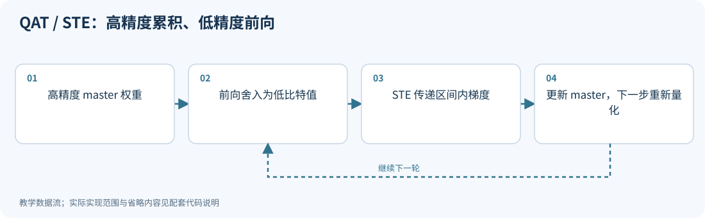

**运行：** `python experiments/technique_lab.py --technique qat_ste`

<!-- executable: qat_ste -->
```python
import numpy as np
target = np.array([.26, -.37]); master = np.zeros(2)
s = .1; losses = []
for step in range(30):
    q = np.clip(np.rint(master/s), -7, 7)
    reconstructed = s*q
    losses.append(np.mean((reconstructed-target)**2))
    active = abs(master/s) < 7
    gradient = (reconstructed-target)*active  # Mean-square gradient for N=2.
    master -= .2*gradient
assert min(losses) < losses[0]
assert np.any(abs(master/s-np.rint(master/s)) > 1e-6)
print("master, forward weights, best loss:", master, reconstructed, min(losses))
```

**代码讲解**

1. 优化器只更新 master；q 是当前步的离散前向状态，下次重新计算。
2. active 实现裁剪区间内的 STE。主权重不是网格点，这说明它确实保留了尚不足以跨格的小更新。

> **示例边界：** 仅训练一个权重向量的平方误差；真实 QAT 还需管理激活、任务损失、梯度和优化器状态，训练内存不会变成纯 4 bit。

<details>
<summary>论文、博客与官方资料</summary>

- **论文**：[Estimating or Propagating Gradients Through Stochastic Neurons for Conditional Computation](https://arxiv.org/abs/1308.3432)；[A White Paper on Neural Network Quantization](https://arxiv.org/abs/2106.08295)。
- **博客与技术文章**：[PyTorch 官方博客：Practical Quantization in PyTorch](https://pytorch.org/blog/quantization-in-practice/)。

STE 原论文解释替代梯度；QAT 综述与博客说明量化训练的应用。

</details>

<!-- /inline-technique -->

<a id="principle-7-3"></a>
<a id="lsq"></a>

## 7.3 LSQ：让步长也能学习

LSQ 将 scale/步长 $s$ 视为可训练参数。[R21]

令 $v=w/s$，在未裁剪区间：

$$
\widehat w=s\operatorname{round}(v).
$$

用 STE 令 $\partial\operatorname{round}(v)/\partial v\approx1$，链式法则给出：

$$
\frac{\partial\widehat w}{\partial s}
\approx\operatorname{round}(w/s)
+s\left(-\frac{w}{s^2}\right)
=\operatorname{round}(w/s)-w/s.
$$

连同裁剪区间：

$$
\frac{\partial\widehat w}{\partial s}\approx
\begin{cases}
q_{min},&w/s<q_{min},\\
\operatorname{round}(w/s)-w/s,&q_{min}\le w/s\le q_{max},\\
q_{max},&w/s>q_{max}.
\end{cases}
$$

例如 $w=0.26,s=0.1$，$\widehat w=0.3$，步长的近似导数为 $3-2.6=0.4$。最终增大还是减小 $s$，还要乘上下游损失对 $\widehat w$ 的梯度。

LSQ 还对步长梯度缩放，例如使用与 $1/\sqrt{Nq_{max}}$ 相关的因子，避免一个共享步长累积太多元素梯度后更新过大。完整定义应按其权重/激活量化设置读取。

LSQ 最初不是专为 LLM 提出，但它说明了现代可学习量化器的重要基础。

### 梯度检查要针对声明的替代计算图

STE 是人为定义的反向规则。对原始硬舍入函数做有限差分，通常会得到零、跳变或与 STE 不同的导数；
这不直接说明某个 STE 实现写错。正确做法是逐项核对声明的替代 Jacobian、裁剪掩码、共享 scale 的归约与梯度缩放。

还要明确 scale 是否参与求导：动态 absmax/RMS 可以只用于前向统计并停止梯度，也可以纳入计算图；
两者的总导数不同。对归约轴、组大小、零组以及裁剪边界使用相同前向，而保持反向规则一致，才能比较优化器行为。
本节代码核验的是指定的平滑替代函数，不是对真实 `round` 求导的数值证明。

<!-- inline-technique: lsq -->

### 图解与代码

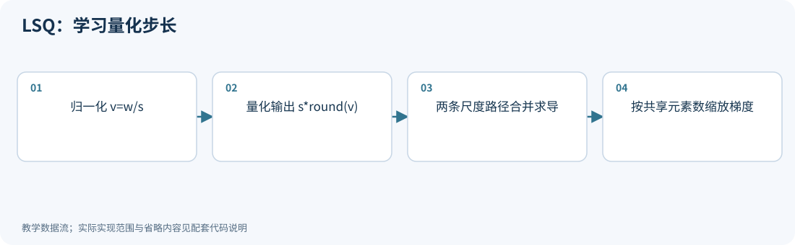

**运行：** `python experiments/technique_lab.py --technique lsq`

<!-- executable: lsq -->
```python
import numpy as np
w = np.array([.26, -.91, .8]); s = .1
v = w/s; q = np.clip(np.rint(v), -7, 7)
derivative = np.where(v < -7, -7., np.where(v > 7, 7., q-v))
loss_gradient = np.array([1., .2, -.1])
scaled_gradient = (loss_gradient@derivative)/np.sqrt(w.size*7)
w0, s0 = .26, .1; q0, v0 = 3., 2.6
surrogate = lambda t: t*(q0+w0/t-v0)
eps = 1e-6
numerical = (surrogate(s0+eps)-surrogate(s0-eps))/(2*eps)
assert np.isclose(numerical, .4)
print("STE derivatives, scaled loss gradient:", derivative, scaled_gradient)
```

**代码讲解**

1. 区间外输出为 s*qmin 或 s*qmax，所以导数为边界编码；区间内才使用 q-v。
2. 有限差分作用于明确构造的 surrogate，不能对真实 round 函数做差分后宣称验证 STE。

> **示例边界：** 演示 LSQ 的步长替代梯度，未构建训练器；初始化和梯度缩放应按权重/激活的实际设置选择。

<details>
<summary>论文、博客与官方资料</summary>

- **论文**：[Learned Step Size Quantization](https://arxiv.org/abs/1902.08153)。
- **博客与技术文章**：[PyTorch 官方博客：Practical Quantization in PyTorch](https://pytorch.org/blog/quantization-in-practice/)。

博客提供 QAT 背景；LSQ 步长梯度与缩放规则以原论文为准。

</details>

<!-- /inline-technique -->

<a id="principle-7-4"></a>
<a id="pact"></a>

## 7.4 PACT：学习裁剪阈值

PACT 原始形式针对非负激活，定义：

$$
y=\min(\max(x,0),\alpha).
$$

再量化：

$$
\widehat y=\frac{\alpha}{2^b-1}
\operatorname{round}\left(\frac{(2^b-1)y}{\alpha}\right).
$$

$\alpha$ 大，保留尾部但网格变粗；$\alpha$ 小，普通值分辨率高但大值被裁剪。将 $\alpha$ 与网络共同优化，就让训练自己寻找折中。[R20]

裁剪本身对阈值的导数是 $\partial y/\partial\alpha=1$（当 $x>\alpha$），其余为 0；量化后的完整梯度还涉及步长变化和 STE。

现代 LLM 激活常有正有负，不能直接套只截到 $[0,\alpha]$ 的原始 PACT。需要对称双边或两个独立边界等适配。

<!-- inline-technique: pact -->

### 图解与代码

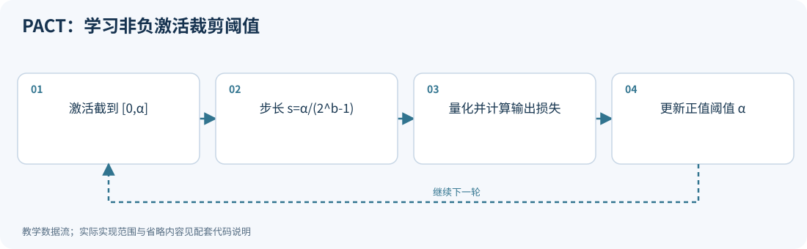

**运行：** `python experiments/technique_lab.py --technique pact`

<!-- executable: pact -->
```python
import numpy as np
x = np.array([-.2, .2, .8, 2.4]); target = np.maximum(x, 0)
alpha = 1.; levels = 15
for step in range(20):
    s = alpha/levels
    clipped = np.clip(x, 0, alpha)
    q = np.rint(clipped/s); output = s*q
    derivative = np.where(x > alpha, 1., np.where(x < 0, 0., q/levels-x/alpha))
    gradient = np.mean(2*(output-target)*derivative)
    alpha = max(alpha-.1*gradient, 1e-6)
assert alpha > 1. and output[0] == 0
print("learned alpha, quantized nonnegative output:", alpha, output)
```

**代码讲解**

1. x>α 时输出饱和在 α，导数为 1；负输入经过非负裁剪，导数为零。
2. 区间内的 q/levels-x/α 来自步长与归一化两条路径的 STE；这是完整量化前向的一种明确梯度约定。

> **示例边界：** 本例使用完整步长 STE 展示可学习裁剪，原 PACT 的具体梯度和正则化配置需查 R20；有正负值的 LLM 激活不能直接套单边裁剪。

<details>
<summary>论文、博客与官方资料</summary>

- **论文**：[PACT: Parameterized Clipping Activation for Quantized Neural Networks](https://arxiv.org/abs/1805.06085)。
- **博客与技术文章**：[PyTorch 官方博客：Practical Quantization in PyTorch](https://pytorch.org/blog/quantization-in-practice/)。

博客提供 QAT 和裁剪背景；PACT 的参数化及原始训练设置以原论文为准。

</details>

<!-- /inline-technique -->

<a id="principle-7-5"></a>
<a id="llm_qat"></a>

## 7.5 LLM-QAT：用原模型生成数据，再蒸馏给量化模型

原始预训练数据往往不可获得。LLM-QAT 利用原模型生成文本，并以原模型输出分布为教师，训练量化学生。[R22]

可以用蒸馏目标解释：

$$
\mathcal L_{KD}=\sum_t D_{KL}(p_{teacher}(\cdot\mid x_{<t})\|p_{student}(\cdot\mid x_{<t})).
$$

它要求的不只是“选中同一个 token”，而是整个词表概率分布尽可能接近。

**步骤：** 生成校准/训练文本 → 教师给出软目标 → 学生前向插入权重、激活、KV 的量化模拟 → 通过 STE 更新训练参数 → 导出低精度模型。

“Data-Free”主要指不依赖原始训练集，不是凭空训练，也不是没有计算或生成数据成本。

<!-- inline-technique: llm_qat -->

### 图解与代码

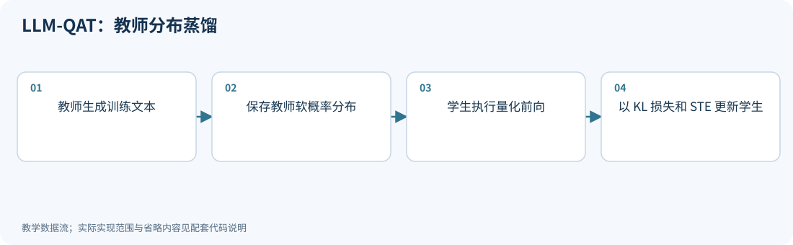

**运行：** `python experiments/technique_lab.py --technique llm_qat`

<!-- executable: llm_qat -->
```python
import numpy as np
from experiments.quant_lab import softmax, symmetric_qdq
rng = np.random.default_rng(14)
X = rng.normal(size=(12, 4)); teacher = rng.normal(size=(5, 4))
target = softmax(X@teacher.T)
master = teacher + .1*rng.normal(size=teacher.shape)
losses = []
for step in range(30):
    Wq = symmetric_qdq(master, bits=4, axis=1)[0]
    probabilities = softmax(X@Wq.T)
    losses.append(np.mean(np.sum(target*np.log(target/probabilities), axis=1)))
    gradient = (probabilities-target).T@X/len(X)
    if step == 0:
        direction = np.arange(master.size).reshape(master.shape)/master.size
        loss = lambda weights: np.mean(np.sum(target*np.log(target/softmax(X@weights.T)), axis=1))
        eps = 1e-5
        numerical = (loss(Wq+eps*direction)-loss(Wq-eps*direction))/(2*eps)
        assert np.isclose(numerical, np.sum(gradient*direction), atol=1e-9)
    master -= .1*gradient
assert min(losses) >= -1e-12
assert np.allclose(target.sum(axis=1), 1)
assert min(losses) < losses[0]  # Expected only for this fixed teaching fixture.
print("initial/best teacher-student KL:", losses[0], min(losses))
```

**代码讲解**

1. target 固定为教师概率；KL 对学生 logits 的梯度是 probabilities-target，因此可以手写小线性分类器的蒸馏更新。
2. 学生前向插入 QDQ，反向通过恒等 STE 更新 master，教师参数始终不变。
3. 有限差分核对 Wq 上的平滑 KL 梯度；固定数据还检查最好 KL 的改善，删除更新或反向更新都会失败。

> **示例边界：** 用随机特征代替文本和 Transformer，只演示蒸馏更新；没有实现文本生成以及权重、激活、KV 的完整联合 QAT。

<details>
<summary>论文、博客与官方资料</summary>

- **论文**：[LLM-QAT: Data-Free Quantization Aware Training for Large Language Models](https://arxiv.org/abs/2305.17888)。
- **作者项目、官方文档与规范**：[LLM-QAT 作者实现与 README](https://github.com/facebookresearch/LLM-QAT)。

</details>

<!-- /inline-technique -->

<a id="principle-7-6"></a>
<a id="efficientqat"></a>

## 7.6 EfficientQAT：把训练开销拆开

EfficientQAT 将工作拆成两阶段：[R23]

1. **Block-AP**：逐个 Transformer block 优化其参数，进行局部重建；降低同时训练整模型的资源需求。
2. **E2E-QP**：在端到端模型中固定主体权重，主要训练量化参数（特别是 scale/step size），修正层间累计误差。

直觉是：先给每个零件做较充分的局部适配，再用较少可训练参数协调全局。

它并没有消除训练成本，也不保证任何位宽都能恢复到浮点模型质量。数据预算、优化器、量化粒度和部署格式仍是重要条件。

<!-- inline-technique: efficientqat -->

### 图解与代码

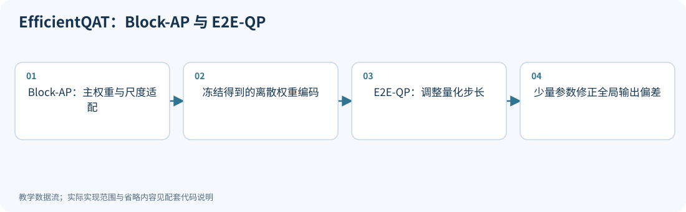

**运行：** `python experiments/technique_lab.py --technique efficientqat`

<!-- executable: efficientqat -->
```python
import numpy as np
X = np.array([[1., .2], [.3, 1.], [1., -.5]])
target = X@np.array([.23, -.66]); master = np.array([.23, -.66]); s = .2
for step in range(20):  # Toy Block-AP: update both master weights and scale.
    q = np.clip(np.rint(master/s), -7, 7)
    gradient = 2*X.T@(X@(s*q)-target)/len(X)
    ds = gradient@(q-master/s)
    master -= .03*gradient; s = max(s-.01*ds, 1e-4)
frozen_codes = np.clip(np.rint(master/s), -7, 7).copy()
before = np.mean((X@(s*frozen_codes)-target)**2)
for step in range(40):  # Toy E2E-QP: only s is updated.
    direction = X@frozen_codes
    ds = 2*direction@(s*direction-target)/len(X)
    s = max(s-.01*ds, 1e-4)
after = np.mean((X@(s*frozen_codes)-target)**2)
assert after <= before + 1e-12
print("fixed codes, final scale, before/after MSE:", frozen_codes, s, before, after)
```

**代码讲解**

1. 第一阶段更新 master 和 s；第二阶段把 q 固定，梯度只经过乘法 s*q。
2. 主体编码固定不代表反量化权重数值完全不变：尺度变化仍会改变 s*q，这正是第二阶段的自由度。

> **示例边界：** 单层玩具例子展示两阶段的可训练对象，无法体现真实逐块训练节省内存或跨 Transformer 层的端到端协调。

<details>
<summary>论文、博客与官方资料</summary>

- **论文**：[EfficientQAT: Efficient Quantization-Aware Training for Large Language Models](https://arxiv.org/abs/2407.11062)。
- **作者项目、官方文档与规范**：[EfficientQAT 作者实现与 README](https://github.com/OpenGVLab/EfficientQAT)。

</details>

<!-- /inline-technique -->

<a id="principle-7-7"></a>
<a id="lora"></a>

## 7.7 LoRA：先补一块低秩矩阵

在介绍 QLoRA 前，需要知道 LoRA。

原权重 $W\in\mathbb R^{m\times d}$，新增：

$$
\Delta W=BA,\quad B\in\mathbb R^{m\times r},\quad A\in\mathbb R^{r\times d},\quad r\ll\min(m,d).
$$

前向：

$$
Y=XW^T+X(BA)^T.
$$

只训练 $A,B$，**可训练参数量**由全量微调的 $md$ 变为 $r(m+d)$；原基础权重 $W$ 仍需保存，独立 adapter 部署时还额外保存 $A,B$。例如 $m=d=4096,r=16$：

- 完整权重约 1678 万参数；
- adapter 约 13.1 万参数。

实际 LoRA 通常还有一个缩放系数，如 $\alpha_{LoRA}/r$，这里为简化省略。

<!-- inline-technique: lora -->

### 图解与代码

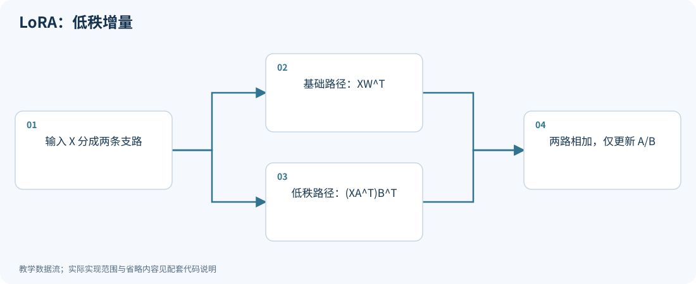

**运行：** `python experiments/technique_lab.py --technique lora`

<!-- executable: lora -->
```python
import numpy as np
rng = np.random.default_rng(15)
X = rng.normal(size=(5, 8)); W = rng.normal(size=(6, 8))
A = rng.normal(size=(2, 8)); B = rng.normal(size=(6, 2))
adapter_scale = 4/2
separate = X@W.T + adapter_scale*(X@A.T)@B.T
merged = X@(W+adapter_scale*B@A).T
assert np.allclose(separate, merged)
assert A.size+B.size < W.size
print("base and trainable parameters:", W.size, A.size+B.size)
```

**代码讲解**

1. X@A.T 把 8 维映射到秩 2，再乘 B.T 输出 6 维；无需在每步显式形成完整 BA。
2. adapter_scale 展示常见 α/r 缩放；初始化和合并时必须一并计算这个系数。

> **示例边界：** 代码验证线性合并关系，不包含 dropout 或多模块训练；把增量合入量化基础权重后通常还需重新量化。

<details>
<summary>论文、博客与官方资料</summary>

- **论文**：[LoRA: Low-Rank Adaptation of Large Language Models](https://arxiv.org/abs/2106.09685)。
- **作者项目、官方文档与规范**：[Hugging Face PEFT 文档：LoRA 与 LoftQ 初始化](https://huggingface.co/docs/peft/developer_guides/lora)。

LoRA 有独立原论文，不能用 QLoRA 论文替代其原始来源。

</details>

<!-- /inline-technique -->

<a id="principle-7-8"></a>
<a id="qlora"></a>

## 7.8 QLoRA：量化保存基础权重，训练 LoRA

QLoRA 的典型前向是：[R24]

$$
\boxed{Y=X\operatorname{dequant}(W_{NF4})^T+X(BA)^T.}
$$

- 基础模型以 4 bit NF4 等形式压缩保存，并被冻结。
- 计算时按块反量化到 BF16/FP16 等计算类型。
- 梯度穿过基础模型的计算路径，传向需要训练的 adapter；基础权重本身不更新。

它是高效微调方案，**不是“把所有权重、激活、梯度、优化器都改成 4 bit”**，也不等同于训练所有主权重的 QAT。

<!-- inline-technique: qlora -->

### 图解与代码

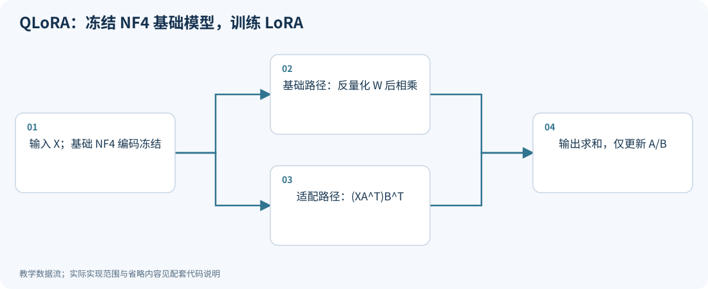

**运行：** `python experiments/technique_lab.py --technique qlora`

<!-- executable: qlora -->
```python
import numpy as np
from experiments.quant_lab import NF4, codebook_qdq
rng = np.random.default_rng(16)
X = rng.normal(size=(16, 8)); W = rng.normal(size=(4, 8))
base = codebook_qdq(W, NF4, group_size=8); snapshot = base.copy()
A = rng.normal(size=(2, 8))*.1; B = np.zeros((4, 2))
target = X@W.T; losses = []
for step in range(60):
    low = X@A.T
    error = X@base.T+low@B.T-target
    losses.append(np.mean(error**2))
    grad_B = 2*error.T@low/error.size
    grad_A = 2*(error@B).T@X/error.size
    A -= .2*grad_A; B -= .2*grad_B
assert np.array_equal(base, snapshot) and np.linalg.norm(B) > 0
assert min(losses) < losses[0]
print("frozen-base adapter loss before/best:", losses[0], min(losses))
```

**代码讲解**

1. B 从零开始，因此初始 adapter 不改变基础模型输出；第一步先更新 B，之后梯度也进入 A。
2. 两个梯度在参数更新前同时计算，避免把新 B 与旧 A 混在同一次梯度中。基础权重快照验证冻结状态。

> **示例边界：** 为便于 NumPy 检验，base 是常驻 float64 重建数组，不能据此测量 QLoRA 显存；实际实现保留打包基础权重并按算子反量化。

<details>
<summary>论文、博客与官方资料</summary>

- **论文**：[QLoRA: Efficient Finetuning of Quantized LLMs](https://arxiv.org/abs/2305.14314)。
- **博客与技术文章**：[Hugging Face 博客：4-bit quantization 与 QLoRA](https://huggingface.co/blog/4bit-transformers-bitsandbytes)。

NF4、Double Quantization 和分页优化器在这里作为 QLoRA 的组成技术阅读。

</details>

<!-- /inline-technique -->

<a id="principle-7-9"></a>
<a id="nf4"></a>

## 7.9 NF4：面向近似正态分布的非均匀 16 点码本

正态分布在零附近密集，在尾部稀疏。若只有 16 个代表值，就可以在零附近排得更密。

一个通用分位数构造直觉是：设标准正态累计分布函数为 $\Phi$，先在概率轴上均匀选取 $p_i\in(0,1)$，再映回：

$$
u_i=\Phi^{-1}(p_i).
$$

最后归一化到 $[-1,1]$ 并保证能精确表示零。**这只是解释分位数思路，不是 NF4 精确码本生成式。** 实际 NF4 对正负侧和零有特定约定。

常用实现的 16 个代表值近似为：

```text
-1.000000, -0.696193, -0.525073, -0.394917,
-0.284441, -0.184773, -0.091050,  0.000000,
 0.079580,  0.160930,  0.246112,  0.337915,
 0.440710,  0.562617,  0.722957,  1.000000
```

每组用最大绝对值 $a$ 归一化：

$$
u_i=w_i/a,\quad q_i=\arg\min_k|u_i-c_k|,\quad\widehat w_i=a c_{q_i}.
$$

NF4 编码是表索引，没有 FP4 那样的“符号位、指数位、尾数位”划分。

“对正态分布最优”的表述必须看具体优化准则；等概率分箱不自动等于平方误差最优的 Lloyd-Max。再加上实际权重、分块 absmax 后的分布不完全正态，NF4 不是所有张量和任务上的普适最优格式。

<!-- inline-technique: nf4 -->

### 图解与代码

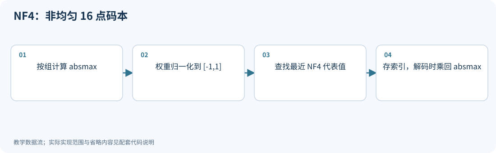

**运行：** `python experiments/technique_lab.py --technique nf4`

<!-- executable: nf4 -->
```python
import numpy as np
from experiments.quant_lab import NF4
w = np.array([[-1., -.3, 0., .1, .7, 2.]])
scale = np.max(abs(w), axis=1, keepdims=True)
indices = np.argmin(abs(w[..., None]/scale[..., None]-NF4), axis=-1)
restored = scale*NF4[indices]
assert np.array_equal(indices[:, 2], [7]) and restored[0, 2] == 0
assert indices.min() >= 0 and indices.max() < 16
print("indices, decoded weights:", indices, restored)
```

**代码讲解**

1. 多增加一维后同时比较每个归一化权重与 16 个代表值的距离，argmin 返回可保存的索引。
2. 索引 7 对应精确零；必须查 NF4 表才能解释编码，不能直接把索引当作有符号整数权重。

> **示例边界：** 此例不做物理 nibble 打包。NF4 与 15 级对称 INT4、16 级等间隔及仿射格式的完整对照见基础实验 08。

<details>
<summary>论文、博客与官方资料</summary>

- **论文**：[QLoRA: Efficient Finetuning of Quantized LLMs](https://arxiv.org/abs/2305.14314)。
- **博客与技术文章**：[Hugging Face 博客：4-bit quantization 与 QLoRA](https://huggingface.co/blog/4bit-transformers-bitsandbytes)。

NF4、Double Quantization 和分页优化器在这里作为 QLoRA 的组成技术阅读。

</details>

<!-- /inline-technique -->

<a id="principle-7-10"></a>

## 7.10 双重量化与分页优化器：两种不同的内存优化

QLoRA 的另外两项设计分别处理量化元数据和优化器状态。先看如何减少 scale 的存储，再看如何控制训练过程中的设备内存峰值。

<!-- topic: double_quant -->
<a id="double_quant"></a>

### Double Quantization：连 scale 也量化

每 64 个权重存一个 FP32 scale，仅 scale 的开销：

$$
32/64=0.5\text{ bit/weight}.
$$

如果把第一级 scale 改成 8 bit，再每 256 个第一级 scale 保存一个 FP32 二级 scale，则近似开销：

$$
8/64+32/(64\times256)=0.126953\text{ bit/weight}.
$$

相比原始 0.5，节省约 0.373 bit/weight。还可能存在偏移和其他少量元数据，这是典型配置的近似算账。

它量化的是量化常数，不是“把权重连续量化两遍，得到更高精度”。

<!-- practice: double_quant -->

<!-- inline-technique: double_quant -->

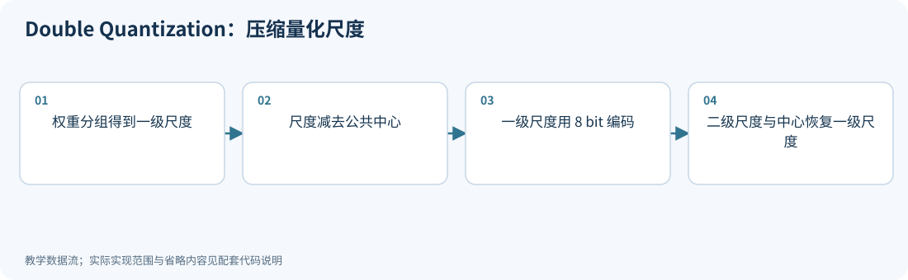

**运行：** `python experiments/technique_lab.py --technique double_quant`

<!-- executable: double_quant -->
```python
import numpy as np
rng = np.random.default_rng(17)
weights = rng.normal(size=(256, 64))
scales = np.max(abs(weights), axis=1)
offset = scales.mean(); residual = scales-offset
second_scale = np.max(abs(residual))/127
codes = np.clip(np.rint(residual/second_scale), -127, 127).astype(np.int8)
restored_scales = offset+second_scale*codes
assert np.max(abs(restored_scales-scales)) <= second_scale/2+1e-12
original_bpw = 32/64
nested_bpw = 8/64+32/(64*256)
print("scale overhead before/after, extra center bits:", original_bpw, nested_bpw, 32/weights.size)
```

**代码讲解**

1. 8/64 是每个权重摊到的一级尺度编码，32/(64*256) 是二级 FP32 scale 的摊销。
2. offset 也需要保存，代码另行报告它的开销。重建尺度误差还会传播到整组权重。

> **示例边界：** 这里用均匀 INT8 示范嵌套量化，不等同于 bitsandbytes 的具体 8 bit 动态码本和序列化格式。

<details>
<summary>论文、博客与官方资料</summary>

- **论文**：[QLoRA: Efficient Finetuning of Quantized LLMs](https://arxiv.org/abs/2305.14314)。
- **博客与技术文章**：[Hugging Face 博客：4-bit quantization 与 QLoRA](https://huggingface.co/blog/4bit-transformers-bitsandbytes)。

NF4、Double Quantization 和分页优化器在这里作为 QLoRA 的组成技术阅读。

</details>

<!-- /inline-technique -->

<!-- topic: paged_optimizer -->
<a id="paged_optimizer"></a>

### Paged Optimizer：按需迁移优化器状态

分页优化器通过按需在主存和设备之间迁移优化器状态，控制设备内存峰值。它改变状态的驻留位置，与 NF4 编码和 scale 压缩是不同的技术；迁移仍会消耗带宽。下面用有限的驻留页数演示状态换入、换出及更新。

<!-- practice: paged_optimizer -->

<!-- inline-technique: paged_optimizer -->

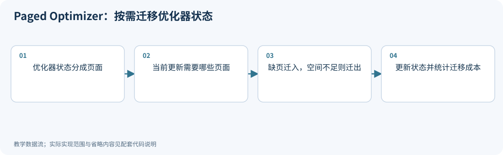

**运行：** `python experiments/technique_lab.py --technique paged_optimizer`

<!-- executable: paged_optimizer -->
```python
from collections import OrderedDict
import numpy as np
host = {j: np.zeros(4) for j in range(3)}
resident = OrderedDict(); reference = {j: np.zeros(4) for j in range(3)}
loads = 0
for page in [0, 1, 0, 2, 1]:
    if page not in resident:
        if len(resident) == 2:
            old, state = resident.popitem(last=False); host[old] = state.copy()
        resident[page] = host[page].copy(); loads += 1
    resident.move_to_end(page)
    resident[page] = .9*resident[page]+.1*np.ones(4)
    reference[page] = .9*reference[page]+.1*np.ones(4)
    assert len(resident) <= 2
for page in host:
    assert np.allclose(resident.get(page, host[page]), reference[page])
print("resident pages, total loads:", len(resident), loads)
```

**代码讲解**

1. OrderedDict 在这里模拟两个页面的驻留预算，淘汰页面时必须把更新后的状态写回 host。
2. 与不分页的 reference 比较，验证状态迁移没有丢失动量；loads 展示容量下降带来的数据搬运。

> **示例边界：** 这是 LRU 状态迁移的教学模拟；实际 QLoRA paged optimizer 使用统一内存等机制，不等同于本例调度器，也没有在这里测量 GPU 内存。

<details>
<summary>论文、博客与官方资料</summary>

- **论文**：[QLoRA: Efficient Finetuning of Quantized LLMs](https://arxiv.org/abs/2305.14314)。
- **博客与技术文章**：[Hugging Face 博客：4-bit quantization 与 QLoRA](https://huggingface.co/blog/4bit-transformers-bitsandbytes)。

NF4、Double Quantization 和分页优化器在这里作为 QLoRA 的组成技术阅读。

</details>

<!-- /inline-technique -->

<a id="principle-7-11"></a>
<a id="loftq"></a>

## 7.11 LoftQ：让量化误差一开始就被 LoRA 接住

普通 QLoRA 通常先量化 $W$，再初始化 adapter。LoftQ 同时考虑两者：[R25]

$$
\boxed{\min_{Q,A,B}\|W-Q-BA\|_F^2.}
$$

固定 $Q$，残差 $E=W-Q$。对残差做 SVD：

$$
E=U\Sigma V^T.
$$

保留最大的 $r$ 个奇异值，最佳 rank-$r$ Frobenius 近似：

$$
E_r=U_r\Sigma_rV_r^T.
$$

可以取：

$$
B=U_r\Sigma_r^{1/2},\quad A=\Sigma_r^{1/2}V_r^T.
$$

固定 $A,B$，再量化剩余部分：

$$
Q\leftarrow\operatorname{Quantize}(W-BA).
$$

交替进行若干次，再开始任务微调。实际 LoRA 缩放系数要一并纳入参数初始化。

**为什么有效：** 量化器负责主体，低秩矩阵负责能以少数方向表达的残差。若误差没有低秩结构，rank 很小的 LoRA 就不可能完全补偿。

<!-- inline-technique: loftq -->

### 图解与代码

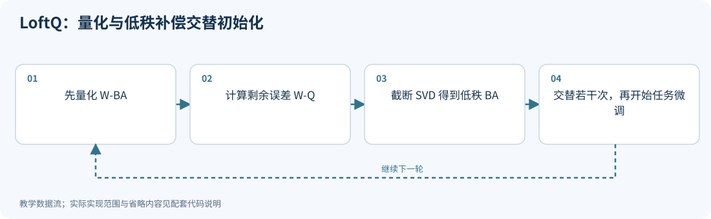

**运行：** `python experiments/technique_lab.py --technique loftq`

<!-- executable: loftq -->
```python
import numpy as np
from experiments.quant_lab import group_qdq
rng = np.random.default_rng(18)
W = rng.normal(size=(6, 8)); correction = np.zeros_like(W); rank = 2
for step in range(4):
    Q = group_qdq(W-correction, group_size=4)
    E = W-Q
    U, singular, Vt = np.linalg.svd(E, full_matrices=False)
    B = U[:, :rank]*np.sqrt(singular[:rank])
    A = np.sqrt(singular[:rank])[:, None]*Vt[:rank]
    correction = B@A
    assert np.isclose(np.sum((E-correction)**2), np.sum(singular[rank:]**2))
    print("iteration, residual SSE:", step, np.sum((W-Q-correction)**2))
```

**代码讲解**

1. 固定 Q 时，截断 SVD 给出 Frobenius 范数下最佳 rank-2 修正；断言使用舍弃奇异值能量独立核对。
2. 下一轮量化 W-correction，让低比特主体与低秩分支重新分工。

> **示例边界：** 当前 quantizer 的尺度重新估计是启发式，不能保证交替过程每轮单调下降；实际 LoRA 的 α/r 缩放也需纳入初始化。

<details>
<summary>论文、博客与官方资料</summary>

- **论文**：[LoftQ: LoRA-Fine-Tuning-Aware Quantization for Large Language Models](https://arxiv.org/abs/2310.08659)。
- **作者项目、官方文档与规范**：[LoftQ 作者实现与 README](https://github.com/yxli2123/LoftQ)；[Hugging Face PEFT 文档：LoRA 与 LoftQ 初始化](https://huggingface.co/docs/peft/developer_guides/lora)。

PEFT 文档中的初始化接口与完整 LoftQ 交替优化流程需要区分。

</details>

<!-- /inline-technique -->

<a id="principle-7-12"></a>
<a id="bitnet"></a>

## 7.12 BitNet b1.58：原生三值权重

BitNet b1.58 让特定线性层的权重在前向时取 $\{-1,0,1\}$，配合尺度恢复数值。[R26]

用全体或约定区域的平均绝对值作为尺度，教学形式：

$$
\beta=\frac1N\sum_i|w_i|,\quad
q_i=\operatorname{clip}\left(\operatorname{round}(w_i/(\beta+\varepsilon)),-1,1\right),
\quad\widehat w_i\approx\beta q_i.
$$

具体 BitLinear 还包括激活量化、归一化和尺度恢复；embedding、输出头等的处理需查看具体模型。

为什么叫 1.58 bit？三个可能值的理想固定长度块编码下界为：

$$
\log_2 3\approx1.58496.
$$

单独存一个三值数通常仍需 2 bit；通过块打包才能逼近这个平均值，scale、padding 和其他张量仍有开销。如果分布不均，熵又是另一个概念。

三值点积：

$$
\sum_iq_ix_i
=\sum_{q_i=1}x_i-\sum_{q_i=-1}x_i.
$$

因此可以利用加减、查表和专用 kernel。整体缩放、激活处理等仍存在，不能宣称整个模型完全没有乘法。

**最重要的边界：** BitNet 是配合训练设计的原生低精度模型路线。将任意现有 BF16 LLM 直接舍入为三值，通常不能得到论文的结果；训练期间仍可保留高精度潜在权重和优化器状态。

**公开模型进展：** 2025-04-16 提交的 [BitNet b1.58 2B4T 技术报告](https://arxiv.org/abs/2504.12285)介绍了 2B 规模、4T token 原生训练模型及公开权重和实现。本轮核对了该报告的摘要与版本信息；这是现有原生低比特路线的模型发布进展，不作为另一种 PTQ 算法重复计数。

<!-- inline-technique: bitnet -->

### 图解与代码

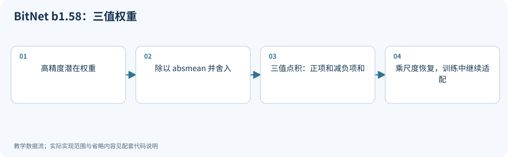

**运行：** `python experiments/technique_lab.py --technique bitnet`

<!-- executable: bitnet -->
```python
import numpy as np
w = np.array([-.7, -.1, .2, .8]); x = np.array([1., 2., 3., 4.])
beta = np.mean(abs(w))
q = np.clip(np.rint(w/max(beta, 1e-8)), -1, 1).astype(int)
additions = x[q == 1].sum()-x[q == -1].sum()
output = beta*additions
assert set(q).issubset({-1, 0, 1})
assert np.isclose(output, (beta*q)@x)
print("ternary weights, output, ideal bits:", q, output, np.log2(3))
```

**代码讲解**

1. q 只控制是否加、减或跳过一个输入；最后乘 beta 才恢复权重的整体幅度。
2. log2(3) 是三值块编码的理想平均位数，不代表 NumPy int 数组已经只占 1.58 bit/元素。

> **示例边界：** 未实现完整 BitLinear 的激活量化、归一化或原生训练；直接把现成 BF16 模型三值化通常不能复现论文能力。

<details>
<summary>论文、博客与官方资料</summary>

- **论文**：[The Era of 1-bit LLMs: All Large Language Models are in 1.58 Bits](https://arxiv.org/abs/2402.17764)；[BitNet b1.58 2B4T Technical Report](https://arxiv.org/abs/2504.12285)。
- **作者项目、官方文档与规范**：[BitNet 官方推理框架与技术说明](https://github.com/microsoft/BitNet)。

论文解释原生三值模型；官方推理框架的支持范围随版本演进。

</details>

<!-- /inline-technique -->

<a id="principle-7-13"></a>

## 7.13 五种路线如何分辨

| 路线 | 通常更新什么 | 核心目标 |
|---|---|---|
| PTQ | 量化配置、局部校准变量 | 尽快压缩已有模型 |
| QAT | 主权重及量化参数 | 让模型适应量化前向 |
| QLoRA | LoRA 参数，基础权重冻结 | 降低微调内存 |
| LoftQ | 量化表示与 LoRA 初始化 | 让低秩项先补偿量化残差 |
| BitNet | 原生低 bit 架构的训练参数 | 从训练阶段建立低精度模型 |

部署时还要明确 adapter 是独立执行还是被合并。把 LoRA 合并进低比特权重往往需要重新量化，质量与延迟应重新评估。

<a id="pv-tuning"></a>

<a id="principle-7-14"></a>

## 7.14 PV-Tuning：离散码字不一定必须通过 STE 更新

[PV-Tuning v2，§3](https://arxiv.org/html/2405.14852v2)（首发 2024-05-23；版本 2024-05-30）补齐了码本表示与量化训练之间的连接。它交替处理两类变量：P 步固定分配关系，优化连续代表值；V 步固定代表值集合，更新离散分配。名字中的 P/V 表示被固定的 partition/value，不应反过来理解。

对固定代表值集合 $\mathcal C$、当前重建 $w$ 与可微损失 $L$，一个二次上界给出

$$
u=w-\eta\nabla L(w),\qquad w^+=\arg\min_{z\in\mathcal C^d}\|z-\nu\|^2.
$$

如果步长过小，投影仍回到原码字。PV-Tuning 利用子空间离散更新，使部分坐标能采用更合适的局部步长。其理论保证依赖光滑性、子问题求解等条件，是损失下降/收敛条件，**不是任意 LLM 的全局最优证明**。大模型中通常使用近似更新，码本、尺度和离散码都需要明确记录。

<!-- depth-example: discrete_code_update -->
```python
import numpy as np
w = np.array([0., 0.]); target = np.array([.8, .2])
levels = np.array([0., 1.])
loss = lambda x: np.sum((x-target)**2)
grad = 2*(w-target)
small = levels[np.argmin(abs((w-.1*grad)[:, None]-levels), axis=1)]
large = levels[np.argmin(abs((w-.5*grad)[:, None]-levels), axis=1)]
assert np.array_equal(small, w)
assert np.array_equal(large, [1., 0.]) and loss(large) < loss(w)
print('small / larger projected steps:', small, large)
```

此例只解释量化格点阻挡小更新的现象。PV-Tuning 的损失可以是模型级目标，与只重建单个权重块的 k-means 不同；它还不同于冻结基础码字、仅训练 adapter 的 QLoRA。作者实现见 [AQLM 的 pv-tuning 分支](https://github.com/Vahe1994/AQLM/tree/pv-tuning)。

<a id="quantized-training-recipe"></a>

<a id="principle-7-15"></a>

## 7.15 QAT 模拟与真实低精度训练要分别描述

前向含 QDQ 的 QAT 可以仍用高精度 GEMM；真实低精度预训练还会量化反向矩阵乘及相关状态。以 $Y=XW^T$ 为例：

$$
dX=dYW,\qquad dW=dY^TX.
$$

三次 GEMM 的归约轴、输入分布、尺度布局与累加需求不同。某个分组布局适合前向，不代表转置后可直接复用同一量化结果；需要重排、重新量化或额外副本时，应计入成本。

| 要记录的部分 | 需要区分的选择 |
|---|---|
| 前向 | W/A 的实际格式、QDQ 或低精度 GEMM、尺度更新 |
| 反向 | dY、保存/重算的 X/W、dX/dW 累加类型 |
| 主参数与优化器 | 主权重、梯度、动量/二阶矩各自精度与驻留位置 |
| 训练预算 | token、总 FLOPs、设备时间、教师或 rollout 成本 |

[Mixed Precision Scaling Laws for Quantized Pretraining](https://arxiv.org/html/2610.17637v1)（2026-10-13）显式区分前向与反向配置，并研究持续优化误差；它提供建模方向，不给出适用于所有模型的“最优 bit 数”。实际选型应比较相同总预算下的收敛质量，不能把更低权重存储位宽直接换算为训练显存或训练加速。

<a id="principle-7-16"></a>

## 7.16 QAT 的训练状态与导出状态必须一致

<a id="qat-training-lifecycle"></a>

一个可训练的伪量化器还不足以构成完整 QAT 流程。应区分三类状态：**模型主参数、统计范围的 observer、真正执行 round/clip 的 fake quantizer**。observer 收集范围，不等于已经量化；模型进入 `eval()` 也不自动代表所有量化统计都已冻结。

| 阶段 | 应明确的行为 | 常见失败 |
|---|---|---|
| 准备 | 确定量化层、粒度、范围和部署格式；插入 observer/fake quantizer | 训练图与目标内核采用不同的组轴或数值范围 |
| 初始化或预热 | 选择何时开始统计、何时启用量化误差 | 一开始的异常范围长期支配尺度 |
| 适配训练 | 更新主权重和声明的量化参数，检查梯度能通过替代计算图 | 转成整数或错误 `detach` 截断梯度 |
| 稳定与评估 | 明确范围统计是否固定，关闭 dropout，固定评测协议 | 验证数据继续改变 observer，评测实际修改模型 |
| 转换与重载 | 硬化码字、打包、导出尺度，重新加载后再比较 | 只评测浮点伪量化模型，未验证部署表示 |

并非所有算法都采用同一预热或冻结时点。**冻结统计 observer 不等于冻结 LSQ 的可学习尺度**；动态激活量化在推理时仍会对当前输入求尺度。应按目标算法定义状态切换，不能照搬 CNN 的“冻结 BatchNorm”步骤。

教师蒸馏时，教师参数不更新；教师与学生的 token 对齐、padding 掩码、词表和目标温度必须一致。若采用
$T^2D_{KL}(\operatorname{softmax}(z_t/T)\|\operatorname{softmax}(z_s/T))$，应同时记录 $T$、缩放因子和按 token 的归约方式。只匹配 top-1 标签与匹配完整分布是不同目标。背景见[《大语言模型》§9.4.1](https://llmbook-zh.github.io/LLMBook.pdf)。

模型转换后至少比较：同一输入的层输出、模型 logits、固定前缀损失，以及实际生成。误差容限需要考虑累加与舍入路径；“权重码字一致”不保证不同 kernel 的结果逐位一致。

<a id="principle-7-17"></a>

## 7.17 QLoRA 的完整账本：训练内存、数据与合并

<a id="qlora-memory-deployment"></a>

[Hands-On Large Language Models 第 12 章配套 Notebook](https://github.com/HandsOnLLM/Hands-On-Large-Language-Models/tree/main/chapter12)把模板处理、NF4 加载、训练准备、LoRA、训练和合并串成流程；具体接口应再对照 [PEFT 量化训练文档](https://huggingface.co/docs/peft/main/developer_guides/quantization)。理解流程后，还需要解释其中几种不同的内存与数值状态。

### 冻结基础权重，仍然需要激活与反向传播

设量化基础参数数目为 $P_q$、未量化且冻结的基础参数为 $P_u$、可训练 adapter 参数为 $P_a$。一个不含分片与 offload 的预算模型为

$$
M_{train}\approx P_qb_{eff}/8+P_uc_u+
P_a(c_a+c_g+c_m+c_v+c_{master})+
M_{saved\ activations}+M_{workspace}+M_{runtime}.
$$

$c$ 表示每元素字节数，分别对应未量化基础参数、adapter 权重、梯度、Adam 两个状态和可选主副本；没有主副本时 $c_{master}=0$。$b_{eff}$ 已包含所采用量化元数据，不能再次重复计入。优化器、混合精度及分片策略不同，这些项也不同，不能固定成“QLoRA 每参数若干字节”。

基础权重不产生待更新的完整梯度与 Adam 状态，但训练早期层的 adapter 时，反向仍须通过后面的冻结层传递，因此要保存或重算激活。长序列、大 microbatch 和大词表 logits 都可能成为峰值显存来源。gradient checkpointing 用额外计算减少保存的激活；推理 KV cache 保存历史 K/V，二者不是同一份缓存。

`prepare_model_for_kbit_training` 的具体处理依赖后端和版本；[PEFT 源码](https://github.com/huggingface/peft/blob/main/src/peft/utils/other.py)包含冻结基础参数及精度处理。训练前应实际检查可训练参数集合、梯度和 dtype。对 LoRA 的 $A/B$，如果一侧初始为零，另一侧首步梯度可能为零，这是初始化结构的结果，不能仅以“第一步所有梯度都非零”判断成功。

### 模板、标签与量化是不同误差来源

训练数据需要应用目标模型的 chat template，并明确训练所有 token 还是仅 assistant 回答。`attention_mask` 决定可见输入，loss mask 决定哪些预测参与优化，两者不能互相代替。若 PAD 与 EOS 共用 ID，应根据真实 padding 位置屏蔽标签，避免把有效 EOS 一并删除。模板控制符重复、词表变更后 embedding 未调整等错误，也会表现为“量化后回答异常”。模板规则见 [Transformers 官方说明](https://huggingface.co/docs/transformers/main/chat_templating)。

### adapter 必须与训练时的基础权重配对

令训练时解码后的基础权重为 $\widehat W=\operatorname{DQ}(Q(W))$，训练得到的 adapter 为 $\Delta W=BA$（缩放已吸收）。训练所得函数使用
$\widehat W+\Delta W$，并不等于 $W+\Delta W$。

| 部署方式 | 实际有效权重 | 需要验证 |
|---|---|---|
| 原量化基础模型＋独立 adapter | $\widehat W+\Delta W$ | 两条计算路径的 kernel、调度与延迟 |
| 反量化该基础模型后合并 | $\widehat W+\Delta W$，另有浮点运算舍入 | 权重可能回到高精度存储 |
| 重新加载原浮点模型后合并 | $W+\Delta W$ | 与训练基础差了 $W-\widehat W$ |
| 合并后重新量化 | $\operatorname{DQ}(Q_{new}(\widehat W+\Delta W))$ | 新的网格误差、校准与完整评测 |

不同后端不一定支持全部合并方式，不能把 `merge_and_unload()` 当作无条件保持低比特格式的操作。

<!-- depth-example: adapter_merge_base -->
```python
import numpy as np
W = np.array([[.63, -1.27]])
Wq = .1*np.rint(W/.1)
delta = np.array([[.04, -.02]])
x = np.array([[2., 3.]])
trained = x@(Wq+delta).T
wrong_base = x@(W+delta).T
requantized = .1*np.rint((Wq+delta)/.1)
assert np.allclose(wrong_base-trained, x@(W-Wq).T)
assert not np.allclose(trained, wrong_base)
assert not np.allclose(trained, x@requantized.T)
print('trained / original-base merge / requantized:',
      trained.item(), wrong_base.item(), (x@requantized.T).item())
```

例子使用小型均匀网格验证三种函数不同，不模拟 NF4 或某个合并 API。实际部署应保存基础模型 revision、量化配置、adapter 配置与 tokenizer，使重载能重建同一个函数。

<!-- chapter-demo: 07 -->
## 本章实操｜训练 QAT 主权重和冻结基座 adapter

<a id="chapter-demo"></a>

**实践目的：** 真正执行小型训练循环，区分STE主权重更新与LoRA参数更新，并验证合并。

**环境：** Python 3.10+、NumPy、PyTorch；支持 CPU/CUDA，Colab 选择 GPU 运行时。无需下载模型。在项目根目录执行：

```bash
python experiments/chapter_demo_lab.py --chapter 07 --device cuda
# 没有GPU时显式使用CPU；auto在CUDA可用时优先使用GPU
python experiments/chapter_demo_lab.py --chapter 07 --device cpu
# 也可直接执行源码模块（同样在项目根目录）
python -m experiments.demos.ch07
```

**Colab：** 可直接上传[逐章 GPU Notebook](../experiments/notebooks/colab_chapter_demos.ipynb)，它自带所需源码；按单元选择本章运行。修改源码后将 `PRACTICE=True`，或命令行加 `--practice`；此模式跳过正文一致性检查，保留数值断言、设备核验及实际源码哈希。指定 `cuda` 后不可用会报错，不会静默退回 CPU。随机输入在 CPU 准备后一次搬到所选设备；矩阵、量化、训练和统计计算使用该设备的 PyTorch 张量。文件 I/O、Python 流程控制和打印在主机；默认 FP64 核验精度，不代表原生低比特 Tensor Core 性能。

**完整源码：** [带逐步注释的 demo](../experiments/demos/ch07.py)。默认只打印结果；保存命令与全部章节入口见[实操导航](../README.md#chapter-demos)。

<details><summary>展开完整代码：每一步的行为、计算逻辑与检查条件</summary>

<!-- chapter-demo-code: 07 -->
```python
"""第 07 章：手写 QAT 的 STE 更新，与冻结量化基座的 LoRA 训练对照。"""
import torch
from experiments.demo_runtime import get_runtime, same, exact

# 第 0 步：auto优先CUDA；runner可用--device指定。所有计算张量在此设备创建。
rt = get_runtime()
device, dtype = rt.device, rt.dtype
from experiments.demo_torch_kernels import group_qdq

# 第 1 步：构造一个线性教师，校准/测试输入分离；不用下载真实模型。
rng = rt.rng(700)
X = rng.normal(size=(96, 4))
test = rng.normal(size=(64, 4))
W = rt.tensor([[.33, -.26, .12, .43], [-.14, .38, -.32, .09]])
# 相关输入使权重误差能互相补偿；若输入各向同性，初始最近舍入可能已经最优。
X[:, 1] = X[:, 0]+.1*X[:, 1]
test[:, 1] = test[:, 0]+.1*test[:, 1]
teacher = X@W.T

# 第 2 步：固定步长和范围，明确 STE 所对应的前向量化器。
step = .2
quantize = lambda value: step*torch.clamp(torch.round(value/step), -3, 3)
master = W.clone()  # 主权重保留小更新，前向另生成 qdq 权重。
best_q = quantize(master)
best_loss = float(torch.mean((X@best_q.T-teacher)**2))
initial_loss = best_loss
crossed_grid = False
for iteration in range(120):
    qdq = quantize(master)
    error = X@qdq.T-teacher
    # loss 是所有 token×输出元素的平均，梯度必须除以 error.numel()。
    gradient = 2*error.T@X/error.numel()
    ste_mask = abs(master/step) < 3
    master -= .04*gradient*ste_mask
    candidate = quantize(master)
    crossed_grid = crossed_grid or not exact(candidate, quantize(W))
    loss = float(torch.mean((X@candidate.T-teacher)**2))
    if loss < best_loss:
        best_loss, best_q = loss, candidate.clone()
assert best_loss <= initial_loss
assert crossed_grid  # 主权重积累的小更新确实改变过前向码字。
print('QAT初始 / 最佳校准MSE / 测试MSE:', initial_loss, best_loss,
      torch.mean((test@best_q.T-test@W.T)**2))

# 第 3 步：另建冻结 INT4 QDQ 基座，只优化 B@A 的低秩增量。
# 这是 QLoRA 的冻结基座结构演示；此处格式为 INT4，不是完整 NF4/分页实现。
base = group_qdq(W, bits=4, group_size=4)
original_base = base.clone()
A = rng.normal(size=(1, 4))*.1
B = torch.zeros((2, 1), device=device, dtype=dtype)
before = torch.mean((X@base.T-teacher)**2)
for _ in range(300):
    error = X@(base+B@A).T-teacher
    grad_weight = 2*error.T@X/error.numel()
    # 同一轮的两个梯度都用更新前的 A/B，避免边更新边改变另一梯度。
    grad_B = grad_weight@A.T
    grad_A = B.T@grad_weight
    B -= .2*grad_B
    A -= .2*grad_A
assert exact(base, original_base)
after = torch.mean((X@(base+B@A).T-teacher)**2)
assert after < before

# 第 4 步：浮点合并与双支路代数等价；再量化合并权重又会引入误差。
separate = test@base.T+(test@A.T)@B.T
merged = base+B@A
assert same(separate, test@merged.T)
requantized = group_qdq(merged, bits=4, group_size=4)
print('adapter前后校准MSE:', before, after)
print('独立adapter / 重新量化合并后测试MSE:',
      torch.mean((separate-test@W.T)**2), torch.mean((test@requantized.T-test@W.T)**2))
# 不对原始硬 round 做有限差分来验证 STE；STE 是这里明确选择的替代导数。

# 收尾：等待本demo设备上的操作完成，方便Colab定位CUDA异步报错。
rt.synchronize()
```

</details>

**运行后观察：** 相关输入下QAT主权重积累更新并跨越网格；adapter训练时base逐值不变；浮点合并等价，再量化可能改变误差。

**动手修改：** 修改学习率、步数或rank，同时保留原基座检查和独立test；不要用test选择最佳迭代。

**适用边界：** PyTorch CPU/CUDA手写梯度的线性教学训练；INT4 QDQ基座并非完整NF4 QLoRA或原生低比特训练。
真实模型/GPU流程继续使用 [Colab Notebook](../experiments/notebooks/colab_qwen3_quantization.ipynb)，执行范围见[模型实验验收](10_实验_评估与选型.md#model-validation-milestones)。

<!-- /chapter-demo -->

<!-- chapter-assessment -->

<a id="principle-7-18"></a>

## 7.18 本章测试与参考答案

<a id="chapter-assessment"></a>

核心卷 8 题，仍按 100 分；另有简单、困难、特别困难拓展题各 1 道，不计入核心卷。难度相对于本章先修知识划分，题号保持原有顺序。核心卷建议 60–90 分钟，特别困难拓展可另留 30–60 分钟。

| 难度 | 按难度选题 |
|---|---|
| 简单 | [07-01](#exercise-07-01) · [07-03](#exercise-07-03) · [07-04](#exercise-07-04) · [07-E01](#exercise-07-e01) |
| 困难 | [07-02](#exercise-07-02) · [07-05](#exercise-07-05) · [07-06](#exercise-07-06) · [07-07](#exercise-07-07) · [07-08](#exercise-07-08) · [07-E02](#exercise-07-e02) |
| 特别困难 | [07-E03](#exercise-07-e03) |

每题提供至少三条参考路径，分别可能是解析解、等价推导、独立数值核验或满足条件的工程方案。固定条件下唯一的数值结果不因解法不同而改变；数值实验不能替代一般性证明。未明确要求比较多解时，可任选或组合路径回答全部子问；验证说明须补足题干要求的推导。开放题接受条件明确、证据充分的其他方案。

<a id="exercise-07-01"></a>

### 07-01｜训练的对象与保存的对象（简单｜基础辨析，10 分）

说明 QAT 的高精度主权重、前向量化权重、梯度和优化器状态为何不必同精度；QLoRA 又冻结了哪部分？

<details><summary>参考答案与评分要点</summary>

**参考路径一：**

主权重保留小更新，前向量化权重模拟/执行部署数值，梯度与优化器状态服务优化稳定性，精度可分别选择。QLoRA 冻结量化基础权重并训练 adapter 等显式参数；基础编码 4 bit 不表示反向与所有状态也为 4 bit。

**路径二：小更新反例。** 若主权重仅保留粗网格，连续多次小于半步长的更新可被反复舍去；保留高精度主副本可累积到跨格点。梯度/动量则是另一个状态账本。

**路径三：沿计算图追踪。** 基础权重冻结不代表反向不经过基础层；梯度仍需流向前面adapter，因而激活保存与重算成本不会自动消失。

**评分要点：** 四类角色 6 分；QLoRA 与精度边界 4 分。

</details>

<a id="exercise-07-02"></a>

### 07-02｜LSQ 的替代梯度（困难｜计算与辨析，10 分）

未裁剪区间，$w=0.37,s=0.1$，$\widehat w=s\operatorname{round}(w/s)$。求编码、真实局部 $\partial\widehat w/\partial s$ 与 LSQ 的 STE 导数；为什么两者不同？

<details><summary>参考答案与评分要点</summary>

**参考路径一：**

编码为 4，附近真实函数为 4s，所以真实导数为 4。LSQ 替代导数为 $4-3.7=0.3$，额外缩放因子本题不计；反向对 round 使用了指定替代规则，不能将它称为原函数的真实导数。

**解法二：有限差分区分。** 对原函数在不跨格点的s附近作微扰，输出斜率4；对定义好的替代图按链式法则得0.3。两种验证对应不同函数。

**解法三：链式法则展开。** $\widehat w=sq(w/s)$，替代 $dq/du=1$，导数为 $q+s(-w/s^2)=q-w/s$；真实局部dq/du=0则只剩q。

**评分要点：** 编码与真实导数 4 分；STE 3 分；替代图解释 3 分。

</details>

<a id="exercise-07-03"></a>

### 07-03｜LoRA 的参数节省（简单｜计算，15 分）

$W$ 为 $4096\times4096$，$\Delta W=BA$ 的秩 r=16。给出 A/B 形状、可训练参数数目和相对原矩阵的比例，不计 bias。

<details><summary>参考答案与评分要点</summary>

**参考路径一：**

$A\in\mathbb R^{16\times4096}$、$B\in\mathbb R^{4096\times16}$；共 131072 个参数，原矩阵 16777216 个，比例 1/128≈0.78125%。不代表总训练内存也降到 1/128，因为还要存基础模型和激活。

**路径二：每个秩一分量计费。** 一列B和一行A共8192个参数，16分量为131072；除4096²得1/128。

**路径三：一般公式。** 方阵d×d的LoRA比例为2r/d，代d=4096、r=16；非方阵则为r(o+d)/(od)，不能总用2r/d。

**评分要点：** 形状 4 分；数目 5 分；比例 3 分；内存边界 3 分。

</details>

<a id="exercise-07-04"></a>

### 07-04｜双重量化的账本（简单｜计算，15 分）

1024 个 4 bit 权重，每 64 个共享一个 scale。方案 A 每个 scale 存 FP32；方案 B 将 16 个 scale 各存 8 bit，并共享一个 FP32 二级尺度。只按题目指定结构计算两种字节数与有效位宽。

<details><summary>参考答案与评分要点</summary>

**参考路径一：**

权重 512 字节。A 加 16×4=64，合计 576 字节，即 4.5 bit/weight；B 加 16+4=20，合计 532 字节，即 4.15625 bit/weight。少 44 字节。本题是账本，不是 bitsandbytes 实际布局；二级量化还可能引入数值误差。

**路径二：元数据差额。** FP32尺度64字节，压缩后20字节，减少44；相同512字节payload抵消。

**路径三：有效位宽分项。** A为4+32/64=4.5；B为4+8/64+32/1024=4.15625。最后一项是二级全局尺度，不应漏掉或按每组重复计费。

**评分要点：** 两方案各 5 分；差值 2 分；布局与误差边界 3 分。

</details>

<a id="exercise-07-05"></a>

### 07-05｜QLoRA 训练内存不能只看基础权重（困难｜计算，15 分）

简化模型的冻结量化基础占 4 GiB，adapter 有 1000 万参数，每参数权重/梯度各 2 字节、两个 Adam 状态各 4 字节，无额外主副本。保存激活 3 GiB，工作区及运行时 1 GiB。总量多少 GiB？

<details><summary>参考答案与评分要点</summary>

**参考路径一：**

adapter 状态共 10⁷×(2+2+4+4)=120000000 字节≈0.111759 GiB，总计约 8.111759 GiB。不能把 120 MB 写成 0.12 GiB。若另有主副本、临时 logits、分片或 offload，应重新计费；本题不是实际框架保证。

**路径二：先统一为字节。** 固定部分8×2³⁰字节，加1.2×10⁸字节，最后统一除2³⁰，避免GB/GiB混加。

**路径三：按训练阶段核验。** 加载基础、创建adapter、第一次优化器步、前向保留激活各阶段分别观察新增分配。此测量可验证题设账本，但allocator峰值仍可能包含临时项。

**评分要点：** adapter 计算 6 分；单位与合计 6 分；配置条件 3 分。

</details>

<a id="exercise-07-06"></a>

### 07-06｜adapter 合并的三个模型（困难｜推导，15 分）

训练在 $\widehat W$ 上得到 $\Delta W$。比较 $\widehat W+\Delta W$、$W+\Delta W$、$Q(\widehat W+\Delta W)$；此处 Q 为量化后反量化。写出相对训练有效权重的差并说明验证。

<details><summary>参考答案与评分要点</summary>

**参考路径一：**

第一种差为 0（忽略浮点算术）；第二种为 $W-\widehat W$；第三种为 $Q(\widehat W+\Delta W)-(\widehat W+\Delta W)$。两种差分别来自基础模型切换与再次量化；需固定基础 revision/配置，比较重载 logits、任务质量与实际后端，不能仅凭 API 名称推断等价。

**路径二：直接比较输出。** 对同一X，误差为X乘上述权重差的转置；用基向量可定位基础权重切换，用任务数据测实际影响。

**路径三：分离两个转换。** 先将量化基础解码合并，检查与独立adapter相符，再重新量化合并权重。两阶段分别评估，可区分基模型不匹配和新网格误差。

**评分要点：** 三种差各 3 分；来源解释 3 分；验证 3 分。

</details>

<a id="exercise-07-07"></a>

### 07-07｜训练看似正常，为什么没有适应量化（困难｜代码诊断，10 分）

前向把权重 round 后转整数，再转回浮点，没有 STE；训练器仍报告 loss。另一个实现 eval 时仍更新 observer。分别说明问题与检查。

<details><summary>参考答案与评分要点</summary>

**参考路径一：**

第一种路径通常切断主权重所需梯度，loss 可由其他参数变化而下降；检查 requires_grad、梯度路径与实际参数更新，使用明确替代图。第二种评估输入改变统计与量化参数，模型并非固定；按方法冻结 observer，同时区分动态推理尺度和可学习尺度。

**路径二：参数快照。** 保存主权重与量化参数前后差，结合梯度是否存在判断实际更新；只看loss曲线可能被其他可训练参数误导。

**路径三：重复验证幂等性。** eval模式同一批输入连续评估，观察observer状态是否改变；若改变则非固定模型测量。动态激活范围可变属于算法设计，应与持久observer更新区分。

**评分要点：** 梯度问题与检查 5 分；统计状态与区别 5 分。

</details>

<a id="exercise-07-08"></a>

### 07-08｜BitNet 能否由普通模型直接舍入得到（困难｜方法判断，10 分）

把现有 BF16 权重舍入到 {−1,0,1}，然后宣称得到 BitNet b1.58 的同等能力。该推断缺少什么？设计最小对照。

<details><summary>参考答案与评分要点</summary>

**参考路径一：**

缺少原生训练/适配配方、激活量化与归一化、尺度、模型结构和训练数据预算。log₂3 描述编码数目，不是能力保证。至少对照原浮点模型、直接三值 PTQ 与按指定训练配方适配的模型，报告实际 bit 成本、训练预算、独立任务和后端；不能把不同预训练预算混比。

**路径二：表示与训练分开。** 能把权重写入三值集合只证明表示合法；激活、归一化、优化和预训练分布决定模型是否适应该表示。

**方案三：等总预算比较。** 对现有checkpoint恢复问题固定同一基础模型；对原生训练问题固定总训练/部署资源并允许不同规模。两类实验回答不同问题，不能把原生模型的成绩归给直接三值转换。

**评分要点：** 缺失机制 4 分；公平对照 4 分；位宽/训练预算边界 2 分。

</details>

<a id="exercise-07-e01"></a>

### 07-E01｜训练梯度属于谁（简单｜拓展题，单独计分）

一个QLoRA线性层冻结基础权重Wq，只训练A、B。是否应该为Wq创建Adam一阶/二阶状态？反向是否仍可计算输入梯度？

<details><summary>参考答案与评分要点</summary>

**路径一：可训练参数。** 标准冻结基础不需要Wq的更新状态，优化器只管理显式可训练参数。

**路径二：链式法则。** 即使Wq固定，y对输入x的导数仍含Wq，反向可以传给前层adapter；冻结参数不等于停止整个计算图。

**验证路径：检查优化器与梯度。** 列出optimizer参数组，确认不含Wq；用前层可训练变量检查梯度非断开，不能仅看Wq.grad为空。

**评分要点：** 单独按 10 分评价：结论与条件 3 分、推理或设计过程 5 分、独立核验与边界 2 分。评分覆盖题干要求的全部子问；未要求比较多解时，可任选或组合参考路径完成作答。数值核验不能替代题干明确要求的证明，多解数量不额外加分。

</details>

<a id="exercise-07-e02"></a>

### 07-E02｜零初始化 LoRA 的第一步梯度（困难｜拓展题，单独计分）

$Y=X(W+BA)^T$，A随机非零、B初始0，令G=∂L/∂(BA)。推导A/B梯度并解释第一步A梯度为零是否意味着训练失败。

<details><summary>参考答案与评分要点</summary>

**解法一：矩阵微分。** d(BA)=dB A+B dA，故∂L/∂B=G Aᵀ、∂L/∂A=BᵀG。B=0时A梯度为0，B梯度通常非零但不保证。

**解法二：标量缩小。** L依赖乘积ba，∂L/∂a=bG、∂L/∂b=aG；b=0时先更新b，再使后续a获得梯度，直接说明机制。

**验证路径：两步快照。** 第一步检查B是否更新；第二步再检查A梯度/更新。若G Aᵀ恰为0还需调查输入/损失，而不能以“所有参数首步必须有梯度”为验收规则。

**评分要点：** 单独按 10 分评价：结论与条件 3 分、推理或设计过程 5 分、独立核验与边界 2 分。评分覆盖题干要求的全部子问；未要求比较多解时，可任选或组合参考路径完成作答。数值核验不能替代题干明确要求的证明，多解数量不额外加分。

</details>

<a id="exercise-07-e03"></a>

### 07-E03｜双线性参数化的等价性与优化轨迹（特别困难｜拓展题，单独计分）

同一LoRA更新ΔW=BA，可改写为 $B_c=cB,A_c=A/c$，c>0。证明前向等价；在普通SGD、相同学习率η且忽略O(η²)时，推导两种参数化的一步ΔW变化为何可能不同。此题不含LoRA额外缩放及权重衰减。

<details><summary>参考答案与评分要点</summary>

**解法一：梯度推导。** 前向有 $B_cA_c=(cB)(A/c)=BA$。令 $G=\partial L/\partial\Delta W$，SGD使 $\delta\Delta W\approx-\eta(GA^TA+BB^TG)$；重参数化后为 $-\eta(c^{-2}GA^TA+c^2BB^TG)$。前向相同，但因子空间的欧氏步长不同。

**解法二：标量反例。** a=b=1、G=1，原一阶变化−2η；c=2时a_c=0.5、b_c=2，一阶变化−4.25η。直接展开两个SGD乘积也可见差异。

**工程方案：** 若要使对应因子SGD步完全按缩放映射一致，可对B_c用η_B=c²η，对A_c用η_A=η/c²，在同一初始有效权重与G下成立。Adam、裁剪、衰减和量化会改变该关系，需按真实优化器重新分析。

**评分要点：** 单独按 10 分评价：结论与条件 3 分、推理或设计过程 5 分、独立核验与边界 2 分。评分覆盖题干要求的全部子问；未要求比较多解时，可任选或组合参考路径完成作答。数值核验不能替代题干明确要求的证明，多解数量不额外加分。

</details>

**复习建议：** 计算错误先回到本章的形状、单位与约定；工程判断缺少依据时，补写目标函数、对照配置和验证边界。建议达到 80 分后继续；这是一项自学建议，不是经教学验证的能力认证标准。

[课程考核与综合练习](11_练习与答案.md#course-assessment-guide) · [返回学习目录](../README.md)

<!-- /chapter-assessment -->

<!-- chapter-footer -->

---

[上一章](06_码本_稀疏与混合精度.md) · [本章目录](#chapter-start) · [下一章](08_KV缓存与Attention量化.md) · [学习首页](../README.md) · [论文与博客](../references/论文与博客导航.md)

<!-- /chapter-footer -->

[R20]: https://arxiv.org/abs/1805.06085

[R21]: https://arxiv.org/abs/1902.08153

[R22]: https://arxiv.org/abs/2305.17888

[R23]: https://arxiv.org/abs/2407.11062

[R24]: https://arxiv.org/abs/2305.14314

[R25]: https://arxiv.org/abs/2310.08659

[R26]: https://arxiv.org/abs/2402.17764
