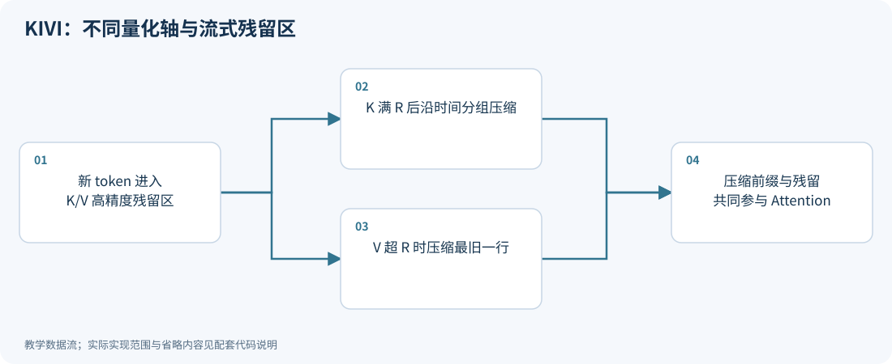
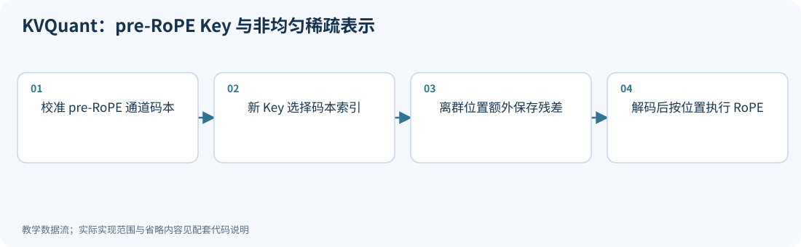
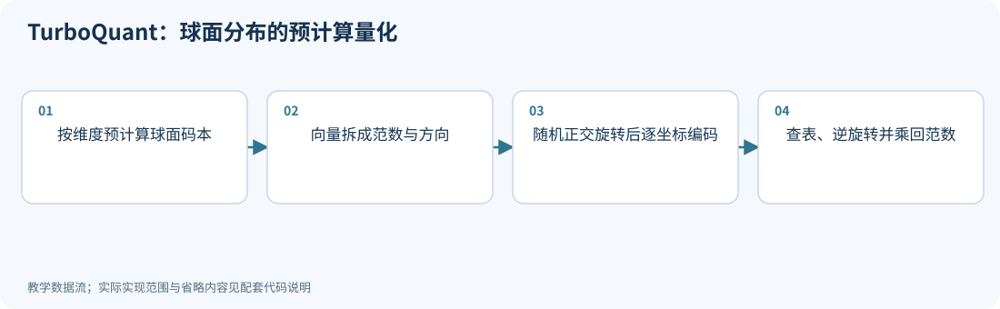
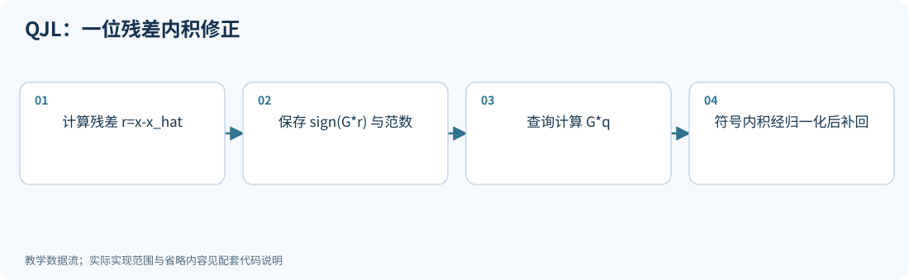
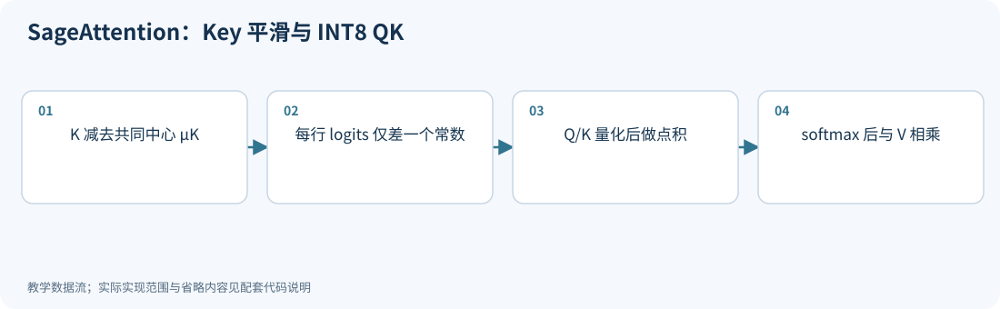
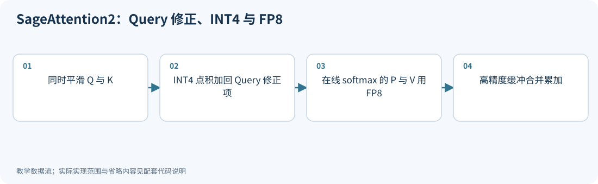
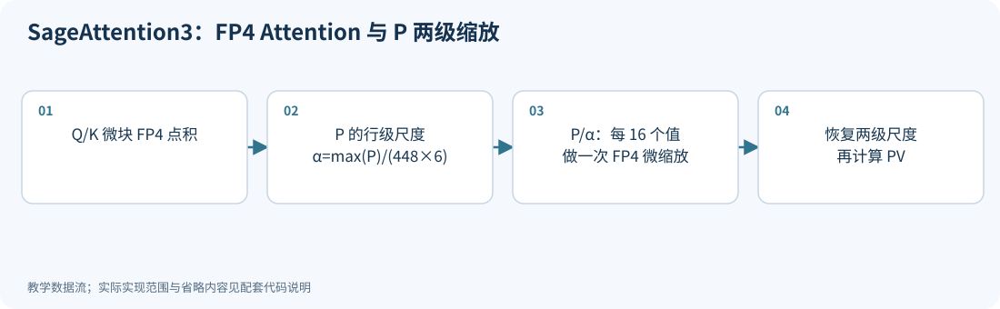

# 08｜长上下文：KV cache 与 Attention 量化

<!-- course-objectives -->
**学习目标：** 计算 KV 的完整容量；区分 K/V 误差路径；检查分段 softmax、RoPE 位置与缓存运行正确性。

**先修知识：** 第 00、01、05–06 章；softmax 与矩阵乘法。 [进入本章测试](#chapter-assessment)；建议先独立作答，再展开答案。
<!-- /course-objectives -->

原始资料：[R27] KIVI；[R28] KVQuant；[R29] TurboQuant；[R30–R32] SageAttention 系列。

<!-- chapter-overview -->
<a id="chapter-start"></a>

**阅读路线：** 先算 KV 缓存大小和误差传播，再看缓存如何编码、更新与恢复；对照低精度 Attention、物理分页和分步缓存正确性。

<details><summary>本章目录（12 节）</summary>

- [8.1 为什么生成越长，显存越大](#principle-8-1)
- [8.2 K 的误差与 V 的误差不在同一个位置](#principle-8-2)
- [8.3 KIVI：Key 按通道，Value 按 token](#principle-8-3)
- [8.4 KVQuant：利用 RoPE 前的结构、非均匀码本和稀疏例外](#principle-8-4)
- [8.5 TurboQuant：随机旋转后，使用可预先设计的码本](#principle-8-5)
- [8.6 TurboQuant 的内积修正为什么要额外一层](#principle-8-6)
- [8.7 缓存量化和 Attention 算子量化是两个目标](#principle-8-7)
- [8.8 SageAttention：利用 softmax 的平移不变性平滑 K](#principle-8-8)
- [8.9 SageAttention2：更细粒度的 INT4 与 FP8](#principle-8-9)
- [8.10 SageAttention3：微缩放 FP4 与两级尺度](#principle-8-10)
- [8.11 KV 量化、分页与 FlashAttention 分别解决什么](#principle-8-11)
- [8.12 本章测试与参考答案](#principle-8-12)

</details>

每项技术的图示、代码和讲解紧跟原理。例子在项目根目录运行，只需 NumPy；长篇参考资料可在各节末尾展开。[按技术查找](技术图解与代码索引.md) · [查看实验输出](../experiments/results/逐项技术实验结果.md)。

[分章测试与参考答案](#chapter-assessment) · [课程考核与综合练习](11_练习与答案.md#course-assessment-guide)

[本章实操：完整逐步注释](#chapter-demo)

<!-- /chapter-overview -->

<a id="principle-8-1"></a>

## 8.1 为什么生成越长，显存越大

生成第 $t$ 个 token 时，需要用当前 Query 与历史所有 Key 计算注意力，并读取对应 Value。

若不缓存，每次都重新计算历史 $K,V$，会重复大量工作。因此保留 KV cache。

对标准多头注意力或 GQA，假设 K/V 头维度相同，纯缓存 payload 为：

$$
\boxed{M_{KV}=2BLTh_{KV}d_h\frac b8.}
$$

- $B$：并发序列数；
- $L$：层数；
- $T$：每条序列当前缓存长度；
- $h_{KV}$：KV 头数，不一定等于 Query 头数；
- $d_h$：每个头的维度；
- $b$：每个缓存元素的 bit 数；
- 2：K 与 V 两份。

例如 $B=1,L=32,T=8192,h_{KV}=8,d_h=128,b=16$：

$$
M_{KV}=1{,}073{,}741{,}824\text{ bytes}=1\text{ GiB}.
$$

并发变成 8 条，就是 8 GiB；长度再翻倍，又翻倍。4 bit 的纯 payload 降为原来的四分之一，但 scale、残留高精度窗口、分页块和对齐开销仍在。

GQA/MQA 是减少 KV 头数的架构选择，可以与量化叠加；MLA 等压缩注意力结构的缓存组成不同，不能直接套这个公式。

<a id="principle-8-2"></a>

## 8.2 K 的误差与 V 的误差不在同一个位置

对单个 Query $q$：

$$
z=qK^T/\sqrt{d_h},\quad p=\operatorname{softmax}(z),\quad o=pV.
$$

设量化误差为 $E_K,E_V$。如果 Query 暂时不量化：

$$
\delta z=qE_K^T/\sqrt{d_h}.
$$

softmax 的导数：

$$
\frac{\partial p_i}{\partial z_j}=p_i(\mathbf1_{i=j}-p_j),
\qquad J=\operatorname{diag}(p)-pp^T.
$$

推导：对 $p_i=e^{z_i}/\sum_ke^{z_k}$ 使用商法则即可。

一阶近似：

$$
\delta p^T\approx J\delta z^T,
\qquad\boxed{\delta o\approx\delta p\,V+pE_V.}
$$

K 误差先改变“注意哪些 token”，V 误差改变“取回的内容”。这就是二者未必应使用同样量化策略的原因。

忽略的 $\delta pE_V$ 是二阶交叉项；误差大时，一阶近似可能失效。

<a id="principle-8-3"></a>
<a id="kivi"></a>

## 8.3 KIVI：Key 按通道，Value 按 token

KIVI 的实测观察与设计是：[R27]

- **K：per-channel。** 某些特征维度跨 token 持续出现大值，单独处理能避免污染其他维度。
- **V：per-token。** 结合 Value 的分布及注意力加权机制，将误差限制在各 token 内。

注意轴的含义。设缓存矩阵形状 $[T,d_h]$：

- K 的一组通常取固定通道 $j$ 在一段 token 上的值 $K[t:t+g,j]$。
- V 的一组通常取固定 token 内一段通道 $V[t,j:j+g]$。

不要把 per-channel 理解成“把所有通道混在一个组”。

**为什么要残留窗口：** V 的新 token 生成后即可按该行量化。K 的 per-channel 组沿时间积累，在组尚未填满时无法知道完整范围。

因此维护：

$$
KV=KV_{quantized\ prefix}+KV_{recent\ high\ precision}.
$$

新 token 进入高精度尾部，达到约定组大小/残留长度后，将旧段量化并转入压缩缓存。两部分通过分块注意力共同计算。

标题的 “asymmetric” 首先强调 K/V 的不同策略，具体编码也可能使用仿射 min-max 量化，阅读时要分清层次。

**优点：** 不需要训练或离线调参的基础方案，适合流式生成。

**局限：** 残留窗口和元数据降低实际压缩比例；很短序列时收益不大；2 bit 质量取决于模型、任务和组大小。

### 压缩前缀与高精度尾部怎样合并 Attention

缓存分段后，每段都可以计算自己的 softmax 统计，但**不能把各段归一化输出直接相加或平均**。
对同一 Query 的第 $b$ 段 logits $z^{(b)}$ 与 Value $V^{(b)}$，定义

$$
m_b=\max_i z_i^{(b)},\quad
\ell_b=\sum_i e^{z_i^{(b)}-m_b},\quad
u_b=\sum_i e^{z_i^{(b)}-m_b}v_i^{(b)}.
$$

令 $m=\max_bm_b$，则整个缓存的注意力输出为

$$
o=\frac{\sum_b e^{m_b-m}u_b}{\sum_b e^{m_b-m}\ell_b}.
$$

这来自对全局 softmax 分子、分母按段求和，也是在线 softmax 的基础；K/V 各段可以采用不同存储精度。
公式保证的是**给定解码后 K/V 的计算等价**，没有恢复量化时丢失的信息。相关分块计算见 [FlashAttention-2](https://arxiv.org/abs/2307.08691)。

<!-- depth-example: segmented_attention -->
```python
import numpy as np
z = np.array([1000., 999., 996., 1001., 998.])
V = np.array([[1., 0.], [0., 1.], [2., -1.], [-1., 3.], [2., 2.]])
parts = [(z[:2], V[:2]), (z[2:], V[2:])]
stats = []
for logits, values in parts:
    m = logits.max(); weights = np.exp(logits-m)
    stats.append((m, weights.sum(), weights@values))
m = max(s[0] for s in stats)
merged = sum(np.exp(mb-m)*ub for mb, lb, ub in stats)/sum(np.exp(mb-m)*lb for mb, lb, ub in stats)
p = np.exp(z-z.max()); p /= p.sum()
assert np.allclose(merged, p@V)
assert not np.allclose(merged, np.mean([ub/lb for mb, lb, ub in stats], axis=0))
print('merged attention:', merged)
```

实现还要处理 causal mask、分页顺序和 GQA 的 Query/KV 头映射。全被 mask 的分段应贡献零分母与零分子，不能直接计算 $-\infty-(-\infty)$。运行：`python experiments/deep_dive_lab.py --case segmented_attention`。

流式缓存的错误处理也属于状态正确性：新 token 触发 K/V 转存时，应先完成所有必要编码，再提交两条流的状态。若中途因尺度溢出或无效输入失败，缓存长度、旧块和残留区应保持追加前的状态，允许修正输入后重试。本教程的 `TinyKIVI` 采用这种提交顺序，但它仍是无物理 bit 打包的 CPU 状态演示。

<!-- inline-technique: kivi -->

### 图解与代码



**运行：** `python experiments/technique_lab.py --technique kivi`

<!-- executable: kivi -->
```python
import numpy as np
from experiments.technique_kernels import TinyKIVI
cache = TinyKIVI(dim=4, group=2, residual=4, bits=2)
keys, values = [], []
assert cache.reconstruct()[0].shape == (0, 4)
for t in range(9):
    k = t*np.array([1., 8., .1, .5])+np.arange(4)*.03
    v = np.sin(np.arange(4)+t)
    keys.append(k); values.append(v); cache.append(k, v)
    K, V = cache.reconstruct()
    assert K.shape == V.shape == (t+1, 4)
    if cache.k_recent:
        assert np.array_equal(K[-1], k)
    assert np.array_equal(V[-1], v)
assert (len(cache.k_recent), len(cache.v_recent)) == (1, 4)
assert np.array_equal(V[-4:], np.array(values)[-4:])
print("K/V high-precision tail lengths:", len(cache.k_recent), len(cache.v_recent))
```

**代码讲解**

1. TinyKIVI 的 encode(axis=0) 给 Key 的每个固定通道沿 token 分组；Value reshape 后用 axis=1 沿特征分组。
2. 9 个 token、残留阈值 4 时，Key 已批量压缩两次，只剩 1 行；Value 仍保留最近 4 行。检查尾部原值和总顺序。

> **示例边界：** 单头 CPU 模型，2 bit 编码存入 uint8 容器，未物理打包；不实现融合 Attention、分页或实际压缩率测量。

<details>
<summary>论文、博客与官方资料</summary>

- **论文**：[KIVI: A Tuning-Free Asymmetric 2bit Quantization for KV Cache](https://arxiv.org/abs/2402.02750)。
- **博客与技术文章**：[Hugging Face 博客：Key-Value Cache Quantization](https://huggingface.co/blog/kv-cache-quantization)。
- **作者项目、官方文档与规范**：[KIVI 作者实现与 README](https://github.com/jy-yuan/KIVI)。

Hugging Face 博客介绍基于 KIVI 思路的缓存量化，也说明其框架实现与论文的差异。

</details>

<!-- /inline-technique -->

<a id="principle-8-4"></a>
<a id="kvquant"></a>

## 8.4 KVQuant：利用 RoPE 前的结构、非均匀码本和稀疏例外

KVQuant 包含多项互补设计：[R28]

1. 对 Key 按通道量化；
2. 在 RoPE 前量化 Key，利用更稳定的通道结构；
3. 根据校准集学习敏感性加权的非均匀代表值；
4. 提取少量动态离群值，单独保存；
5. 用专门 kernel 控制动态量化和解码开销。

**为什么 RoPE 前后不同：** 一个二维 RoPE 旋转为：

$$
\begin{bmatrix}k'_1\\k'_2\end{bmatrix}
=\begin{bmatrix}\cos\theta&-\sin\theta\\\sin\theta&\cos\theta\end{bmatrix}
\begin{bmatrix}k_1\\k_2\end{bmatrix}.
$$

$\theta$ 随位置变化。原来总在第一维的大值会随位置混到另一维，量化器看到的通道统计更不稳定。

如果压缩存储的是 pre-RoPE Key，读取时必须按位置正确恢复相应变换，或者在 kernel 中以等价方式处理。不能跳过 RoPE。

非均匀码本和稀疏离群值的数学基础见第 06 章，只是对象换成动态 KV。动态数据意味着范围、离群索引和编码必须在线生成。

“支持千万上下文”一类论文结果，应结合其模型、硬件、缓存配置理解；缓存装得下，不代表模型训练时获得了相应长度的推理能力，也不保证计算耗时可接受。

<!-- inline-technique: kvquant -->

### 图解与代码



**运行：** `python experiments/technique_lab.py --technique kvquant`

<!-- executable: kvquant -->
```python
import numpy as np
from experiments.technique_kernels import lloyd, nearest, rope_rows
rng = np.random.default_rng(20)
calibration = rng.normal(size=(128, 4))*[.1, 8., .2, 2.]
K = rng.normal(size=(6, 4))*[.1, 8., .2, 2.]; K[2, 1] = 40.
dense = np.empty_like(K)
for j in range(4):
    centers, _ = lloyd(calibration[:, j], 4)
    dense[:, j] = nearest(K[:, j], centers)
protected = abs(K) > np.max(abs(calibration), axis=0)
residual = np.where(protected, K-dense, 0)
restored = dense+residual
positions = np.arange(len(K))
rotated = rope_rows(restored, positions)
reference = rope_rows(K, positions)
assert restored[2, 1] == K[2, 1]
assert np.isclose(np.sum((rotated-reference)**2), np.sum((restored-K)**2))
print("sparse exceptions, post-RoPE SSE:", protected.sum(), np.sum((rotated-reference)**2))
```

**代码讲解**

1. 码本在校准集上学习，在线 Key 只做索引选择和稀疏残差生成；两个阶段的数据分开。
2. RoPE 是逐位置正交变换，因此解码误差的二范数保持不变，但量化轴的分布统计会改变。

> **示例边界：** 为缩短例子，码本未使用真实 Fisher 敏感性加权；展示的是 pre-RoPE、码本和稀疏恢复机制，未实现 KVQuant 的全部 Value 策略与 kernel。

<details>
<summary>论文、博客与官方资料</summary>

- **论文**：[KVQuant: Towards 10 Million Context Length LLM Inference with KV Cache Quantization](https://arxiv.org/abs/2401.18079)。
- **作者项目、官方文档与规范**：[KVQuant 作者实现与 README](https://github.com/SqueezeAILab/KVQuant)。

</details>

<!-- /inline-technique -->

<a id="principle-8-5"></a>
<a id="turboquant"></a>

## 8.5 TurboQuant：随机旋转后，使用可预先设计的码本

TurboQuant 研究在线向量量化，并应用于 KV cache 与向量检索。[R29] 核心包括 MSE 导向量化和针对内积的残差修正两个层次。

先令向量 $x\in\mathbb R^d$ 归一化：

$$
u=x/\|x\|_2.
$$

对 $u$ 应用随机正交旋转 $R$，得到 $v=Ru$。理想 Haar 随机旋转下，固定单位向量被映到球面上的均匀随机方向。

一个坐标 $v_j$ 的密度满足：

$$
p(v_j=t)\propto(1-t^2)^{(d-3)/2},\quad t\in[-1,1].
$$

它关于零对称，所以：

$$
\mathbb E[v_j]=0,\quad\mathbb E[v_j^2]=1/d.
$$

当维度较大时，坐标近似为 $\mathcal N(0,1/d)$。坐标并非严格独立，因为总能量始终为 1。某些可检索论文文本出现均值写成 1 的表述；这里根据球面对称性使用均值 0。

**为什么有用：** 旋转后的坐标分布可预知，于是可提前为它设计 Lloyd-Max 标量码本，不必为每个模型重新拟合数据分布。

**MSE 路径：** 存储范数 → 随机旋转 → 将每个坐标映射到预计算码本 → 存索引；解码时查表、逆旋转并乘回范数。零向量要单独处理。

在量化坐标中直接算内积时，查询也要做相容变换，才能利用旋转保持内积的性质。

理论中的随机矩阵假设与工程上的快速结构化旋转未必完全相同；应分别验证。

<!-- inline-technique: turboquant -->

### 图解与代码



**运行：** `python experiments/technique_lab.py --technique turboquant`

<!-- executable: turboquant -->
```python
import numpy as np
from experiments.technique_kernels import lloyd, nearest
rng = np.random.default_rng(21); d = 8
grid = np.linspace(-.999, .999, 2048)
density = (1-grid**2)**((d-3)/2)
centers, _ = lloyd(grid, 8, importance=density)
orthogonal, triangular = np.linalg.qr(rng.normal(size=(d, d)))
R = orthogonal@np.diag(np.sign(np.diag(triangular)))
x = rng.normal(size=d); norm = np.linalg.norm(x)
unit = x/norm; rotated = R@unit
decoded = norm*(R.T@nearest(rotated, centers))
assert np.allclose(R.T@R, np.eye(d))
assert np.isclose(np.linalg.norm(rotated), 1)
print("precomputed centers, reconstruction MSE:", centers, np.mean((x-decoded)**2))
```

**代码讲解**

1. density 是球面坐标密度的未归一化权重；加权均值不受统一归一化常数影响，因此可直接学习离散近似码本。
2. QR 后修正 R 因子的对角符号得到高斯矩阵诱导的 Haar 正交矩阵；码本只依赖维度和位宽，不拟合模型权重。

> **示例边界：** 用离散积分近似标量码本，只演示 MSE 路径；零向量需直接编码为零，快速结构化旋转也不自动满足相同 Haar 假设。

<details>
<summary>论文、博客与官方资料</summary>

- **论文**：[TurboQuant: Online Vector Quantization with Near-optimal Distortion Rate](https://arxiv.org/abs/2504.19874)。
- **博客与技术文章**：[Google Research：TurboQuant — Redefining AI efficiency with extreme compression](https://research.google/blog/turboquant-redefining-ai-efficiency-with-extreme-compression/)（本次网络无法直连，访问状态见核验记录）。

Google Research 博客用于理解研究背景，具体变体与数学条件以原论文为准；博客链接的访问情况见核验记录。

</details>

<!-- /inline-technique -->

<a id="principle-8-6"></a>
<a id="qjl"></a>

## 8.6 TurboQuant 的内积修正为什么要额外一层

最小化 $\|x-\widehat x\|^2$ 的量化器，不一定让 $q^T\widehat x$ 成为 $q^Tx$ 的无偏估计。

设第一阶段重建为 $\widehat x_0$，残差 $r=x-\widehat x_0$。则：

$$
q^Tx=q^T\widehat x_0+q^Tr.
$$

只需再估计残差内积。下面是 QJL 类一位随机投影的关键恒等式。

取独立高斯向量 $g\sim\mathcal N(0,I)$，令 $u=r/\|r\|$。分解：

$$
g=a u+g_\perp,\quad a\sim\mathcal N(0,1).
$$

因为 $\operatorname{sign}(g^Tr)=\operatorname{sign}(a)$，而垂直分量期望为零：

$$
\mathbb E[\operatorname{sign}(g^Tr)g]
=\mathbb E[|a|]u
=\sqrt{2/\pi}\,r/\|r\|.
$$

对 $m$ 个独立高斯投影 $g_i$，定义：

$$
\widehat{q^Tr}
=\frac{\|r\|}{m}\sqrt{\frac\pi2}
\sum_{i=1}^m\operatorname{sign}(g_i^Tr)(g_i^Tq).
$$

取期望就得到 $q^Tr$。残差编码只需每个投影一个符号 bit，再加残差范数及共享随机映射的信息。

TurboQuant 的内积版本先用 $(b-1)$ bit 做 MSE 量化，再对残差使用一位方案，在对应设置下组合成约 $b$ bit/坐标的主体编码。

**必须保留的条件：**

- 这里的无偏是对随机投影取期望，单次结果仍有误差；
- 残差修正映射要满足相应独立性与分布假设；
- 范数和其他元数据仍有存储成本；
- 注意力 softmax 是非线性的，内积无偏不推出最终 Attention 或文本输出无偏。

不要把“近最优失真率”说成数学无损，也不要把 TurboQuant 的不同变体和后来相关的 PolarQuant 名称无条件视为同一算法。

<!-- inline-technique: qjl -->

### 图解与代码



**运行：** `python experiments/technique_lab.py --technique qjl`

<!-- executable: qjl -->
```python
import numpy as np
rng = np.random.default_rng(22)
residual = rng.normal(size=8); query = rng.normal(size=8)
G = rng.normal(size=(100000, 8))
signs = np.sign(G@residual)
samples = np.linalg.norm(residual)*np.sqrt(np.pi/2)*signs*(G@query)
target = residual@query
se = samples.std(ddof=1)/np.sqrt(len(samples))
assert abs(samples.mean()-target) < 6*se
print("true dot, estimated mean, standard error:", target, samples.mean(), se)
```

**代码讲解**

1. 每个高斯投影产生一个可保存的符号位；查询投影保持实值，避免两侧同时符号化改变估计器。
2. 100000 个样本用于检查概率恒等式，不是每个实际 KV 向量都要保存这么多 bit；实际投影数决定方差与存储开销。

> **示例边界：** G 必须满足独立性与分布条件；残差为零时应直接返回零。内积无偏不推出 softmax、Attention 或生成文本无偏。

<details>
<summary>论文、博客与官方资料</summary>

- **论文**：[QJL: 1-Bit Quantized JL Transform for KV Cache Quantization with Zero Overhead](https://arxiv.org/abs/2406.03482)；[TurboQuant: Online Vector Quantization with Near-optimal Distortion Rate](https://arxiv.org/abs/2504.19874)。
- **作者项目、官方文档与规范**：[QJL 作者实现与 README](https://github.com/amirzandieh/QJL)。

QJL 有独立原论文；这里的残差修正还参考 TurboQuant，不能把无偏内积等同于无偏 Attention。

</details>

<!-- /inline-technique -->

<a id="principle-8-7"></a>

## 8.7 缓存量化和 Attention 算子量化是两个目标

- **KV cache 量化**：主要压缩长期存储的 K/V，读取时可以解码到较高精度计算。
- **Attention 量化**：让 $QK^T$ 和/或 $PV$ 的矩阵乘本身采用低精度硬件。

两者可以组合，但需要兼容的数据布局、尺度和 kernel。压缩缓存 4 倍，不等于 Attention 快 4 倍。

<a id="principle-8-8"></a>
<a id="sageattention"></a>

## 8.8 SageAttention：利用 softmax 的平移不变性平滑 K

SageAttention 第一代的重要思路是对 Q/K 使用 INT8 矩阵乘，并设计 Attention 的量化与融合执行；另一部分矩阵乘按其具体配置保留较高精度。[R30]

其平滑 Key 的代数依据十分漂亮。令所有 Key 减去同一向量 $\mu_K$：

$$
K'=K-\mathbf1\mu_K^T.
$$

则：

$$
qK'^T=qK^T-(q\mu_K)\mathbf1^T.
$$

一行 logits 的每个位置减去相同常数 $c=q\mu_K$。而：

$$
\operatorname{softmax}(z-c\mathbf1)_i
=\frac{e^{z_i-c}}{\sum_je^{z_j-c}}
=\frac{e^{z_i}}{\sum_je^{z_j}}.
$$

所以精确数学中注意力概率不变，却可能让 K 更容易量化。使用 mask 时，只要所有可见位置减去同一常数，这个性质仍成立。

如果同时平移 Query，就不能直接丢掉修正项。令 $Q'=Q-\mathbf1\mu_Q^T$：

$$
QK'^T=Q'K'^T+\mathbf1(\mu_Q^TK'^T).
$$

第二项在不同 Key 位置通常不同，必须恢复或以等价形式处理。

<!-- inline-technique: sageattention -->

### 图解与代码



**运行：** `python experiments/technique_lab.py --technique sageattention`

<!-- executable: sageattention -->
```python
import numpy as np
from experiments.quant_lab import symmetric_qdq, softmax, mse
rng = np.random.default_rng(23)
Q = rng.normal(size=(3, 8)); K = rng.normal(size=(12, 8))+5
V = rng.normal(size=(12, 4)); centered = K-K.mean(axis=0)
reference = softmax(Q@K.T/np.sqrt(8))@V
assert np.allclose(softmax(Q@centered.T/np.sqrt(8))@V, reference)
Q8 = symmetric_qdq(Q, bits=8, axis=1)[0]
K8 = symmetric_qdq(centered, bits=8, axis=1)[0]
output = softmax(Q8@K8.T/np.sqrt(8))@V
print("smoothed INT8 attention output MSE:", mse(output, reference))
```

**代码讲解**

1. 先用未量化点积验证平移恒等式，确保观察到的后续误差来自量化。
2. 这里保留 V 和 PV 的高精度，以单独观察 QK INT8 与 Key 平滑；真实版本的具体类型见原论文。

> **示例边界：** 按行 QDQ 的 CPU 教学实现，没有复现分块在线 softmax、融合内核或论文的速度数字。

<details>
<summary>论文、博客与官方资料</summary>

- **论文**：[SageAttention: Accurate 8-Bit Attention for Plug-and-play Inference Acceleration](https://arxiv.org/abs/2410.02367)。
- **作者项目、官方文档与规范**：[SageAttention 系列作者实现与更新记录](https://github.com/thu-ml/SageAttention)。

</details>

<!-- /inline-technique -->

<a id="principle-8-9"></a>
<a id="sageattention2"></a>

## 8.9 SageAttention2：更细粒度的 INT4 与 FP8

SageAttention2 将 Q/K 量化到硬件适合的线程粒度 INT4，并将 Attention 中的 $\widetilde P,V$ 路径量化为 FP8，结合更充分的 Q/K 平滑和累加精度控制。[R31]

这里 $\widetilde P$ 可指分块在线 softmax 中尚未完成最终归一化的概率块，不必在显存中显式构造整个 $T\times T$ 矩阵。

**为什么粒度细有帮助：** 一个尺度覆盖范围越小，极端元素污染越少。线程粒度的选择同时受寄存器组织、tensor core 指令和加载布局约束。

**为什么强调 FP32 buffer：** 即使乘法是 FP8，如果局部累加或中间 buffer 精度不足，误差仍会逐步放大。低精度输入、乘法与累加器是三个独立决策。

<!-- inline-technique: sageattention2 -->

### 图解与代码



**运行：** `python experiments/technique_lab.py --technique sageattention2`

<!-- executable: sageattention2 -->
```python
import numpy as np
from experiments.quant_lab import symmetric_qdq, softmax, mse
from experiments.technique_kernels import float_qdq
rng = np.random.default_rng(24)
Q = rng.normal(size=(3, 8))+2; K = rng.normal(size=(16, 8))+3
V = rng.normal(size=(16, 4)); Kc = K-K.mean(axis=0)
mean_Q = Q.mean(axis=0, keepdims=True); Qc = Q-mean_Q
correction = mean_Q@Kc.T
assert np.allclose(Qc@Kc.T+correction, Q@Kc.T)
assert np.ptp(correction) > 0
Q4 = symmetric_qdq(Qc, bits=4, axis=1)[0]
K4 = symmetric_qdq(Kc, bits=4, axis=1)[0]
P = softmax((Q4@K4.T+correction)/np.sqrt(8))
output = float_qdq(P, axis=1)@float_qdq(V, axis=0)
reference = softmax(Q@K.T/np.sqrt(8))@V
print("INT4 QK plus FP8 PV output MSE:", mse(output, reference))
```

**代码讲解**

1. correction 在不同 Key 位置不同，np.ptp 检查它不是可被 softmax 消除的常数。
2. 先恢复 Query 修正，再执行 softmax；P/V 通过有限 E4M3 码本做数值模拟，累加在 NumPy 高精度中完成。

> **示例边界：** 未复现 per-thread 数据布局，代码用按行 QDQ 与显式 P 展示数据流；原生 FP8 部分累加和 FP32 buffer 的误差需在 GPU 上验证。

<details>
<summary>论文、博客与官方资料</summary>

- **论文**：[SageAttention2: Efficient Attention with Thorough Outlier Smoothing and Per-thread INT4 Quantization](https://arxiv.org/abs/2411.10958)。
- **作者项目、官方文档与规范**：[SageAttention 系列作者实现与更新记录](https://github.com/thu-ml/SageAttention)。

</details>

<!-- /inline-technique -->

<a id="principle-8-10"></a>
<a id="sageattention3"></a>

## 8.10 SageAttention3：微缩放 FP4 与两级尺度

SageAttention3 面向支持相应运算的硬件，利用 microscaling FP4 执行 Attention 的两个矩阵乘。[R32]

难点之一是 $P$ 的数值很小，而微块 scale 自己也只有 FP8 精度。如果直接对小概率做 FP4，scale 的量化可能引入额外误差。

用一个简化的概率行说明两级尺度：

$$
\alpha=\frac{\max_jP_j}{448\times6},\qquad P'=P/\alpha.
$$

448 是常见 E4M3 格式最大有限值，6 是 E2M1 FP4 最大幅度。然后对每个微块 $g$：

$$
s_g=\operatorname{FP8}\left(\frac{\max_{j\in g}|P'_j|}{6}\right),\quad
p^{(4)}_j=\operatorname{FP4}(P'_j/s_g).
$$

恢复：

$$
\widehat P_j=\alpha s_g p^{(4)}_j.
$$

第一级把范围映到适合 FP8 scale 使用的区间，第二级做局部 FP4 微缩放。零行/零块需要专门分支。实际在线 softmax 的尺度必须与分块归一化一起管理。

注意：FP4 的是数值本身，FP8 可以是块 scale；不能把“P 的 scale 是 FP8”误读成“P 本身用 FP8”。

**适用边界：** kernel 加速比依赖 GPU、形状、head dimension 和数据类型；论文还涉及图像/视频等模型，不能把这些结果直接当成所有自回归 LLM 的吞吐收益。

<!-- inline-technique: sageattention3 -->

### 图解与代码



**运行：** `python experiments/technique_lab.py --technique sageattention3`

<!-- executable: sageattention3 -->
```python
import numpy as np
from experiments.quant_lab import softmax, mse
from experiments.technique_kernels import micro_fp4
rng = np.random.default_rng(25)
Q = rng.normal(size=(3, 32)); K = rng.normal(size=(32, 32))
V = rng.normal(size=(32, 32))
Q4, _ = micro_fp4(Q); K4, _ = micro_fp4(K)
P = softmax(Q4@K4.T/np.sqrt(32))
alpha = np.max(P, axis=1, keepdims=True)/(448*6)
P4 = np.empty_like(P)
for row in range(len(P)):
    normalized, _ = micro_fp4(P[row:row+1]/alpha[row], tensor_scale=1.)
    P4[row] = alpha[row]*normalized[0]
V4, _ = micro_fp4(V.T); V4 = V4.T  # Group along the PV reduction axis.
output = P4@V4
assert np.all(np.isfinite(output)) and np.all(P4 >= 0)
print("two-level FP4 attention MSE:", mse(output, softmax(Q@K.T/np.sqrt(32))@V))
```

**代码讲解**

1. α 的行级缩放和 micro_fp4 内的 16 元素尺度是两层不同尺度；恢复时必须一起乘回。
2. V 先转置再量化，使微块沿 PV 的归约轴组织，不能仅因为 shape 可乘就随意选择分组轴。

> **示例边界：** 展示完整概率矩阵的数值路径；真实内核使用未最终归一化的分块概率并维护在线 softmax 统计，不会显式存整个 P。有限 LUT 舍入也不是硬件逐位仿真。

<details>
<summary>论文、博客与官方资料</summary>

- **论文**：[SageAttention3: Microscaling FP4 Attention for Inference and An Exploration of 8-bit Training](https://arxiv.org/abs/2505.11594)。
- **作者项目、官方文档与规范**：[SageAttention 系列作者实现与更新记录](https://github.com/thu-ml/SageAttention)。

三代方法分别链接各自论文；项目仓库共同维护，复现时应固定相应版本和硬件配置。

</details>

<!-- /inline-technique -->

<a id="principle-8-11"></a>

## 8.11 KV 量化、分页与 FlashAttention 分别解决什么

<a id="cache-runtime-contract"></a>

这三类技术经常一起出现，但改善的是不同成本：

| 技术 | 主要改变 | 保留的成本或限制 |
|---|---|---|
| KV cache | 保留历史投影，避免重复计算过去 token 的 K/V | 缓存随有效历史增长，decode 仍读取历史 |
| KV 量化 | 压缩每个缓存值的表示 | 尺度、尾部窗口、编码解码成本与精度误差 |
| PagedAttention | 用块表将逻辑历史映射到物理缓存页 | 页内尾部空位、块表、引用计数与共享管理 |
| FlashAttention | 分块融合 Attention，减少 HBM 读写及中间矩阵物化 | 稠密精确 Attention 的算术量仍为 prefill $O(T^2d_h)$ |

[FlashAttention 原论文](https://arxiv.org/html/2205.14135v2)减少 IO，并不把稠密注意力的二次算术复杂度变成线性；单 Query 的 decode 注意力对历史长度仍为 $O(Td_h)$。[PagedAttention 原论文](https://arxiv.org/html/2309.06180v1)改善分配、碎片和共享，也不自动降低每个 K/V 元素的位宽。

### 容量要按物理块计算

若每页容纳 $p$ 个 token，第 $i$ 个请求已缓存 $T_i$ 个 token，没有共享、滑动窗口或额外高精度尾部，令 $C_q$ 为所有相关层合计的每 token 缓存字节数，则

$$
M_{allocated}\approx\sum_i\left\lceil\frac{T_i}{p}\right\rceil pC_q+M_{block\ metadata}.
$$

$C_q$ 应含实际 K/V payload 和量化元数据。该简化式假设元数据可按完整页均摊；若量化分组与页边界不对齐，需要按实际块布局重新计算。存在高精度尾部时应分开计算，不能将整个缓存都乘统一的 4/16。

例如页长 16，两个请求长度为 17 和 31，无共享时一共占 64 个 token 槽，而有效 token 只有 48。前缀共享时按唯一物理页计费；共享页被追加或修改时可能触发 copy-on-write。量化范围若依赖未来 token，共享可变页的尺度也不能被某个请求随意改写。

### 缓存正确性是加速的前提

对同一个固定 token 前缀，分别运行“完整前缀前向”和“prefill 后逐 token 追加”，比较最后位置 logits。必须一致处理绝对位置、RoPE、因果掩码、GQA 头映射和 padding。缓存保存了哪些位置，就只追加尚未处理的位置；不能既复用历史 cache 又把全部历史再次送入。

优先检查页边界、量化组边界、高精度尾部转存时刻、不同长度 batch 和前缀分叉。随后才在相同路径上启用 KV 量化，以免把位置或块表错误误判为量化误差。长期生成还需另外验证误差累积；单次固定前缀一致不能替代长轨迹质量评测。

<!-- chapter-demo: 08 -->
## 本章实操｜追加缓存并正确合并分段 Attention

<a id="chapter-demo"></a>

**实践目的：** 跟踪K/V不同量化轴和尾部生命周期，同时校验Attention和失败回滚。

**环境：** Python 3.10+、NumPy、PyTorch；支持 CPU/CUDA，Colab 选择 GPU 运行时。无需下载模型。在项目根目录执行：

```bash
python experiments/chapter_demo_lab.py --chapter 08 --device cuda
# 没有GPU时显式使用CPU；auto在CUDA可用时优先使用GPU
python experiments/chapter_demo_lab.py --chapter 08 --device cpu
# 也可直接执行源码模块（同样在项目根目录）
python -m experiments.demos.ch08
```

**Colab：** 可直接上传[逐章 GPU Notebook](../experiments/notebooks/colab_chapter_demos.ipynb)，它自带所需源码；按单元选择本章运行。修改源码后将 `PRACTICE=True`，或命令行加 `--practice`；此模式跳过正文一致性检查，保留数值断言、设备核验及实际源码哈希。指定 `cuda` 后不可用会报错，不会静默退回 CPU。随机输入在 CPU 准备后一次搬到所选设备；矩阵、量化、训练和统计计算使用该设备的 PyTorch 张量。文件 I/O、Python 流程控制和打印在主机；默认 FP64 核验精度，不代表原生低比特 Tensor Core 性能。

**完整源码：** [带逐步注释的 demo](../experiments/demos/ch08.py)。默认只打印结果；保存命令与全部章节入口见[实操导航](../README.md#chapter-demos)。

<details><summary>展开完整代码：每一步的行为、计算逻辑与检查条件</summary>

<!-- chapter-demo-code: 08 -->
```python
"""第 08 章：逐 token 追加 KIVI 风格缓存，核验尾部与分段 softmax。"""
import math
import torch
from experiments.demo_runtime import get_runtime, same, exact

# 第 0 步：auto优先CUDA；runner可用--device指定。所有计算张量在此设备创建。
rt = get_runtime()
device, dtype = rt.device, rt.dtype
from experiments.demo_torch_kernels import softmax
from experiments.demo_torch_kernels import TinyKIVI

# 第 1 步：预先生成 K/V，以追加顺序模拟 decode；只有一个头，无 RoPE。
rng = rt.rng(800)
keys = rng.normal(size=(9, 4))
values = rng.normal(size=(9, 4))
queries = rng.normal(size=(9, 4))
keys[:, 0] *= 8
cache = TinyKIVI(dim=4, group=2, residual=4, bits=2, device=device)

# 第 2 步：每次只追加当前 token；K 在尾部满4个时分时间组量化，
# V 保留最近4个，旧行按特征组量化。两个尾部长度不必相同。
for t in range(len(keys)):
    cache.append(keys[t], values[t])
    Kq, Vq = cache.reconstruct()
    assert Kq.shape == Vq.shape == (t+1, 4)
    z = queries[t]@Kq.T/math.sqrt(4)
    direct = softmax(z)@Vq

    # 第 3 步：按任意 token 边界分段，保留每段的最大值、分母和未归一化分子。
    # 不能直接平均两段各自的 softmax 输出，因为每段概率质量不同。
    statistics = []
    for start in range(0, t+1, 3):
        logits, V = z[start:start+3], Vq[start:start+3]
        maximum = logits.max()
        unnormalized = torch.exp(logits-maximum)
        statistics.append((maximum, unnormalized.sum(), unnormalized@V))
    global_max = max(m for m, _, _ in statistics)
    numerator = sum(torch.exp(m-global_max)*u for m, _, u in statistics)
    denominator = sum(torch.exp(m-global_max)*mass for m, mass, _ in statistics)
    merged = numerator/denominator
    assert same(merged, direct)

    # 第 4 步：比较原始缓存，区分“Attention计算正确”和“缓存量化无误差”。
    reference = softmax(queries[t]@keys[:t+1].T/2)@values[:t+1]
    print('长度 / K尾部 / V尾部 / 输出MSE:', t+1,
          len(cache.k_recent), len(cache.v_recent), torch.mean((merged-reference)**2))
    if t < 3:
        assert same(merged, reference)  # 尚未触发任何量化。

# 第 5 步：模拟追加失败，确保已存在缓存没有被半更新。
before = tuple(array.clone() for array in cache.reconstruct())
try:
    cache.append(torch.full((4,), math.nan, device=device, dtype=dtype), torch.ones(4, device=device, dtype=dtype))
except ValueError:
    pass
else:
    raise AssertionError('非有限输入必须被拒绝')
for actual, expected in zip(cache.reconstruct(), before):
    assert exact(actual, expected)
print('无效追加后 K/V 状态保持不变')
# TinyKIVI 的码存在 uint8 容器中，未物理打包成2 bit，不能用数组字节数推压缩率。

# 收尾：等待本demo设备上的操作完成，方便Colab定位CUDA异步报错。
rt.synchronize()
```

</details>

**运行后观察：** 打印每步K/V尾部长度；分段合并等于解码缓存上的全局softmax；量化后可以偏离原缓存。

**动手修改：** 改变residual和group，保持整组约束；重点观察跨越尾部转存边界的那一步。

**适用边界：** 单头无RoPE、uint8容器的CPU/CUDA状态实验，不含真实2-bit存储或融合Attention内核。

<!-- /chapter-demo -->

<!-- chapter-assessment -->

<a id="principle-8-12"></a>

## 8.12 本章测试与参考答案

<a id="chapter-assessment"></a>

核心卷 8 题，仍按 100 分；另有简单、困难、特别困难拓展题各 1 道，不计入核心卷。难度相对于本章先修知识划分，题号保持原有顺序。核心卷建议 60–90 分钟，特别困难拓展可另留 30–60 分钟。

| 难度 | 按难度选题 |
|---|---|
| 简单 | [08-01](#exercise-08-01) · [08-07](#exercise-08-07) · [08-E01](#exercise-08-e01) |
| 困难 | [08-02](#exercise-08-02) · [08-03](#exercise-08-03) · [08-04](#exercise-08-04) · [08-05](#exercise-08-05) · [08-06](#exercise-08-06) · [08-08](#exercise-08-08) · [08-E02](#exercise-08-e02) |
| 特别困难 | [08-E03](#exercise-08-e03) |

每题提供至少三条参考路径，分别可能是解析解、等价推导、独立数值核验或满足条件的工程方案。固定条件下唯一的数值结果不因解法不同而改变；数值实验不能替代一般性证明。未明确要求比较多解时，可任选或组合路径回答全部子问；验证说明须补足题干要求的推导。开放题接受条件明确、证据充分的其他方案。

<a id="exercise-08-01"></a>

### 08-01｜缓存量化与 Attention 量化（简单｜基础辨析，10 分）

一个实现用 INT4 保存 KV，读取后恢复 FP16 计算 Attention；另一个 KV 为 FP16，但 QK 用 INT8。分别减少了哪种成本？

<details><summary>参考答案与评分要点</summary>

**参考路径一：**

第一个压缩长期缓存表示，仍可能付 FP16 Attention 与解码成本；第二个降低某个 Attention 矩阵乘的操作数精度，缓存容量没有因此必然减小。两者可以组合，但需要兼容布局、尺度和后端。

**路径二：拆内存与算力。** 按缓存元素位宽算容量，按QK/PV操作数和累加精度算计算；两个账本独立，可各自改善或恶化。

**路径三：四配置对照。** 浮点/低比特KV×浮点/低精度Attention四组，固定模型和请求，用实际兼容配置测主效应与交互，不能将一个开关代表两个机制。

**评分要点：** 各路径对象 6 分；独立成本与组合条件 4 分。

</details>

<a id="exercise-08-02"></a>

### 08-02｜K 和 V 的误差不对称（困难｜推导，10 分）

固定单个 query，$p=\mathrm{softmax}(qK^T/\sqrt d)$、$o=pV$。写出 K/V 小扰动导致的一阶输出误差，并说明省略的项。

<details><summary>参考答案与评分要点</summary>

**参考路径一：**

$\delta z=qE_K^T/\sqrt d$；$\delta p^T\approx(\operatorname{diag}(p)-pp^T)\delta z^T$；$\delta o\approx\delta pV+pE_V$。省略 $\delta pE_V$ 及 softmax 高阶项。K 先改变分配概率，V 改变读取内容；大扰动下一阶式不保证准确。

**解法二：分步微分。** 先令K扰动影响z，再用softmax的Jacobian得到δp，最后对pV用乘法微分。可避免把Key误差直接当作Value误差。

**验证路径：有限扰动缩放。** 固定随机方向，逐次缩小ε，对比真实输出差与一阶式；在光滑且小扰动下残差应近二阶。它验证局部近似，不证明大误差可忽略高阶项。

**评分要点：** logits 2 分；Jacobian 3 分；输出式与高阶限制 5 分。

</details>

<a id="exercise-08-03"></a>

### 08-03｜GQA 缓存账本（困难｜计算，15 分）

B=2、L=16、T=2048、KV 头数 4、头维度 64，K/V 均为 FP16。计算 payload MiB；改成 4 bit，每 64 个缓存值一个 FP16 scale，无零点、尾部和分页，算完整 MiB 及相对 FP16 的压缩比。

<details><summary>参考答案与评分要点</summary>

**参考路径一：**

元素总数 2×2×16×2048×4×64=33554432。FP16 为 64 MiB。4 bit 主体为 16 MiB，尺度共 33554432/64×2=1 MiB，合计 17 MiB，压缩比 64/17≈3.7647。

**路径二：每token账本。** 所有层一条序列每token共2×16×4×64=8192值；乘4096个并发token得总元素。再乘2字节或含scale的4.25/8字节。

**路径三：从FP16比例修正。** 64MiB的纯4-bit部分为16MiB；每64值的16bit尺度相当于0.25bit/值，即FP16容量的1/64=1MiB，总17。

**评分要点：** 元素计数 4 分；FP16 3 分；低比特主体/尺度 6 分；比例 2 分。

</details>

<a id="exercise-08-04"></a>

### 08-04｜KIVI 沿哪个轴分组（困难｜形状与生命周期，15 分）

K/V 张量为 [T,d]，group=4。解释 Key per-channel 和 Value per-token 分组差异；当只生成 3 个新 token 时，为什么 Key 组不能直接按完整时间组编码？

<details><summary>参考答案与评分要点</summary>

**参考路径一：**

Key 固定通道跨 4 个时间位置共享参数；Value 固定 token 在通道维成组。Key 还没观察到第 4 个值，范围未完整，通常保留高精度尾部或使用明确在线策略；不能悄悄改旧尺度却不重新编码已存值。短序列需计尾部与元数据，不能全按低比特算。

**路径二：用切片表示。** Key组为K[t:t+4,j]，Value组为V[t,j:j+4]；前者未来时间值未到，后者当前token向量已完整。

**方案三：显式在线协议。** 可以保留尾部，也可用预设尺度立即编码，但后者不再是观察完整组范围的同一方案。若更新尺度，则必须重新解释/编码旧码字并计成本。

**评分要点：** 轴定义 6 分；流式时序 5 分；内存与改尺度边界 4 分。

</details>

<a id="exercise-08-05"></a>

### 08-05｜两个 Attention 分段如何合并（困难｜计算，15 分）

两段局部输出为 $o_1=2,o_2=8$；$m_1=0,m_2=\ln2$、$\ell_1=2,\ell_2=1$。计算全局输出，并说明本例为何恰与平均相同；若把 $\ell_2$ 改为 3 呢？

<details><summary>参考答案与评分要点</summary>

**参考路径一：**

用 m=ln2，权重为 $(e^{-\ln2}2,1)=(1,1)$，输出 5，因两段全局质量相等而恰等于平均。改为 3 后权重 (1,3)，输出 $(2+24)/4=6.5$，不能再平均。

**解法二：未平移配分函数。** 两段权重原为e⁰×2=2和e^ln2×1=2，总和4；修改后第二段为6，总和8，得到5和6.5。

**解法三：概率质量混合。** 局部输出是条件均值，全局输出需乘每段的全局概率质量；第一例质量各一半，第二例1/4、3/4，不能一般平均条件均值。

**评分要点：** 权重推导 6 分；两输出 6 分；成立条件 3 分。

</details>

<a id="exercise-08-06"></a>

### 08-06｜Key 去均值不等于任意缩放安全（困难｜推导与反例，15 分）

为什么所有 Key 减去同一向量可保持 softmax，而给不同历史 token 乘不同系数通常不行？给出两个 logits 的缩放反例。

<details><summary>参考答案与评分要点</summary>

**参考路径一：**

平移产生每行常数 $-(q\mu_K)\mathbf1^T$，softmax 不变。不同 token 缩放改变相对 logits；例如原 logits (1,1) 概率 (0.5,0.5)，变成 (1,2) 后概率约 (0.26894,0.73106)。范数元数据须在 softmax 前恢复，不能按共同常数删除。

**路径二：softmax比值。** 概率比p₁/p₂=e^(z₁−z₂)，共同平移不改差值；逐token缩放通常改差值。本例概率比从1变e⁻¹。

**验证路径：归一化权重。** 对原与变化后分数分别计算稳定softmax，比较概率再聚合任意不同Value；若Value恰相同可能掩盖概率错误，不应只测试相同V。

**评分要点：** 平移证明 6 分；反例 5 分；缩放恢复位置 4 分。

</details>

<a id="exercise-08-07"></a>

### 08-07｜分页槽位不等于有效 token（简单｜计算与判断，10 分）

页长 16，三请求有效长度为 1、17、32，无前缀共享。计算有效 token 数、分配槽位数与空槽数。FlashAttention 会否自动消除这些分页空位？

<details><summary>参考答案与评分要点</summary>

**参考路径一：**

有效 token 50，分配 (1+2+2)×16=80 槽，空 30。FlashAttention 改善 Attention 分块与 IO；分页分配由缓存管理控制，不能认为它会自动消除页内碎片。应按实际物理块和量化布局计内存。

**路径二：逐请求余量。** 长1分16空15，长17分32空15，长32分32空0，总空30。

**路径三：区分逻辑/物理。** 有效50token是逻辑账本，80槽是物理账本，Attention可mask掉空位却不代表allocator没有为其分配。

**评分要点：** 三数量 6 分；算法对象区别 4 分。

</details>

<a id="exercise-08-08"></a>

### 08-08｜缓存边界的最小测试（困难｜实验设计，10 分）

量化缓存在第 128 个 token 转存，并采用 16-token 页。设计能发现“历史重复输入、RoPE 错位、转存后尺度错误”的测试。

<details><summary>参考答案与评分要点</summary>

**参考路径一：**

固定同一 token 序列，对照整段前向与逐 token 缓存前向，先关闭量化比较 logits；检查 15/16/17 与 127/128/129 等边界、不同长度 batch、padding 和绝对位置。再启用量化，对照解码缓存的独立 Attention；逐项比较码字/尺度/块表，最后做长生成质量。

**方案二：状态机测试。** 把追加、满页、满组、转存、分叉作为状态转移，每次比对逻辑token顺序与解码KV。尤其检查跨越两个边界同时发生的情况。

**方案三：故障隔离对照。** 固定浮点KV测试位置/页表，固定解码KV测试Attention，最后量化编码检查尺度。每阶段建立独立参考，可定位哪一环首次偏离。

**评分要点：** 两阶段参考 4 分；具体边界与位置 4 分；长轨迹和定位 2 分。

</details>

<a id="exercise-08-e01"></a>

### 08-E01｜不等长度的KV总量（简单｜拓展题，单独计分）

两个请求分别长100和300token，每token完整缓存含K/V共2KiB，无分页和共享。总量多少KiB？用最大长度乘batch会怎样？

<details><summary>参考答案与评分要点</summary>

**解法一：求和。** (100+300)×2=800KiB。

**解法二：逐请求。** 200+600=800KiB。

**对照路径：** max长度×batch会算300×2×2=1200KiB，是两请求都按最大长度分配时的容量；只有真实采用这种布局才可这样算。

**评分要点：** 单独按 10 分评价：结论与条件 3 分、推理或设计过程 5 分、独立核验与边界 2 分。评分覆盖题干要求的全部子问；未要求比较多解时，可任选或组合参考路径完成作答。数值核验不能替代题干明确要求的证明，多解数量不额外加分。

</details>

<a id="exercise-08-e02"></a>

### 08-E02｜Key误差为什么与softmax位置有关（困难｜拓展题，单独计分）

两个Key产生logits z=(0,0)，扰动为δz=(ε,−ε)。给出概率变化的一阶式；若z=(10,−10)，同样ε的局部敏感性如何变化？

<details><summary>参考答案与评分要点</summary>

**解法一：Jacobian。** z=0时J=[[0.25,−0.25],[−0.25,0.25]]，δp≈(ε/2,−ε/2)。极端z时p₁p₂≈e⁻²⁰，变化约(2εe⁻²⁰,−2εe⁻²⁰)。

**解法二：logistic。** 两类p₁=σ(z₁−z₂)，扰动使差值加2ε；导数σ(1−σ)在差值0最大，在20附近很小。

**验证路径：对称有限差分。** 用稳定softmax比较±ε输出，缩小ε核对导数。局部饱和不保证大扰动安全，足够大的ε仍可跨越决策边界。

**评分要点：** 单独按 10 分评价：结论与条件 3 分、推理或设计过程 5 分、独立核验与边界 2 分。评分覆盖题干要求的全部子问；未要求比较多解时，可任选或组合参考路径完成作答。数值核验不能替代题干明确要求的证明，多解数量不额外加分。

</details>

<a id="exercise-08-e03"></a>

### 08-E03｜分段softmax合并能否组成并行归约（特别困难｜拓展题，单独计分）

每段保存(m,ℓ,u)，其中m为最大logit、ℓ为减去m后的指数和、u为同权重加权Value和。给出两段合并规则，证明任意合并树在实数精确算术下得到相同结果，并处理全mask空段。

<details><summary>参考答案与评分要点</summary>

**解法一：规范化统计。** m=max(m₁,m₂)，ℓ=e^(m₁−m)ℓ₁+e^(m₂−m)ℓ₂，u同式。每次都代表并集的同一个未归一化softmax分子/分母，因此无论树形最终一致。

**解法二：不变表示。** 三元组等价于 $Z=e^m\ell$、$U=e^mu$ 与最大值；并集仅对Z/U加法并取max，实数下具有结合性。实际使用相对指数避免直接e^m溢出。

**实现边界：** 空段用ℓ=0、u=0并显式跳过，无需计算−∞−(−∞)；全部空时输出由mask约定定义，不能除0。浮点舍入会让不同树形略有差异，应以容限测试而非宣称逐位结合。

**评分要点：** 单独按 10 分评价：结论与条件 3 分、推理或设计过程 5 分、独立核验与边界 2 分。评分覆盖题干要求的全部子问；未要求比较多解时，可任选或组合参考路径完成作答。数值核验不能替代题干明确要求的证明，多解数量不额外加分。

</details>

**复习建议：** 计算错误先回到本章的形状、单位与约定；工程判断缺少依据时，补写目标函数、对照配置和验证边界。建议达到 80 分后继续；这是一项自学建议，不是经教学验证的能力认证标准。

[课程考核与综合练习](11_练习与答案.md#course-assessment-guide) · [返回学习目录](../README.md)

<!-- /chapter-assessment -->

<!-- chapter-footer -->

---

[上一章](07_QAT_QLoRA与原生低比特.md) · [本章目录](#chapter-start) · [下一章](09_浮点格式与推理系统.md) · [学习首页](../README.md) · [论文与博客](../references/论文与博客导航.md)

<!-- /chapter-footer -->

[R27]: https://arxiv.org/abs/2402.02750

[R28]: https://arxiv.org/abs/2401.18079

[R29]: https://arxiv.org/abs/2504.19874

[R30]: https://arxiv.org/abs/2410.02367

[R31]: https://arxiv.org/abs/2411.10958

[R32]: https://arxiv.org/abs/2505.11594
