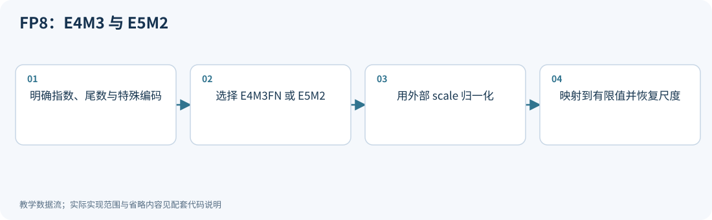
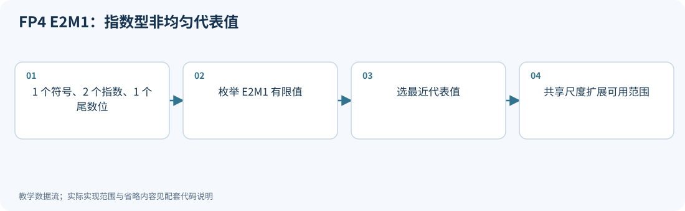
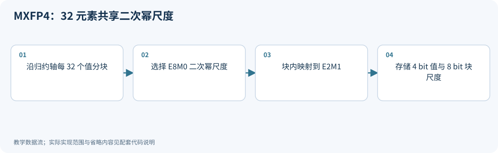
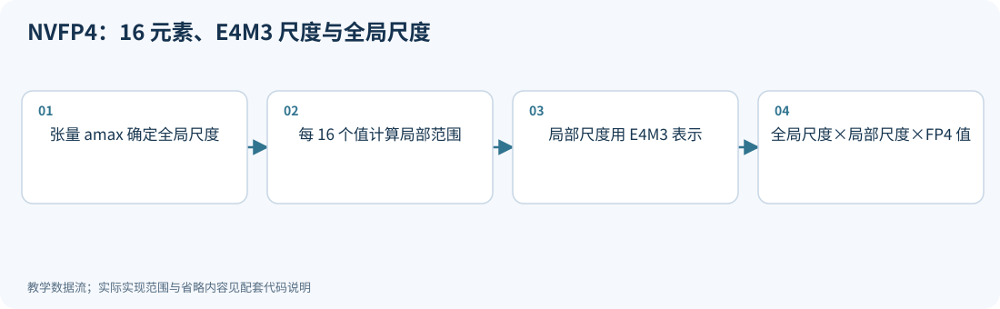
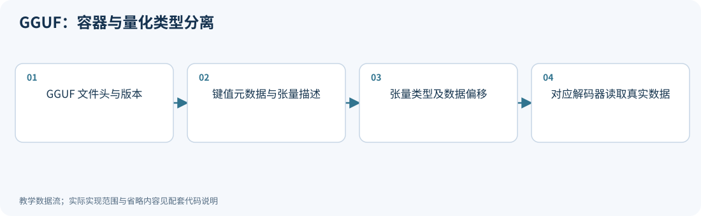
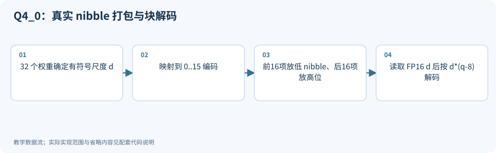
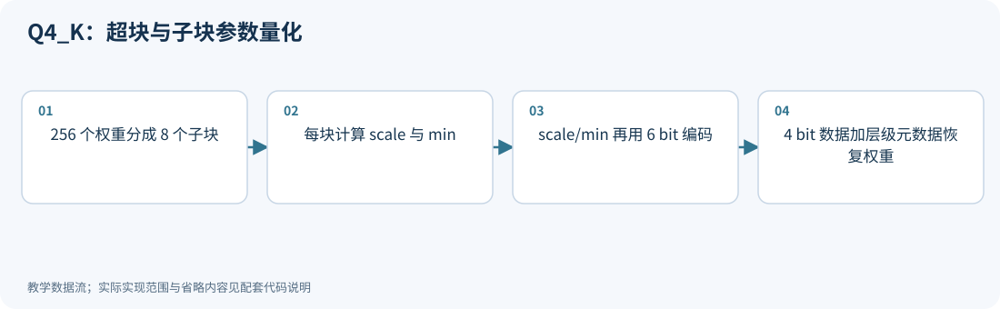
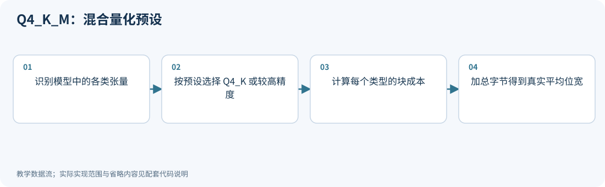
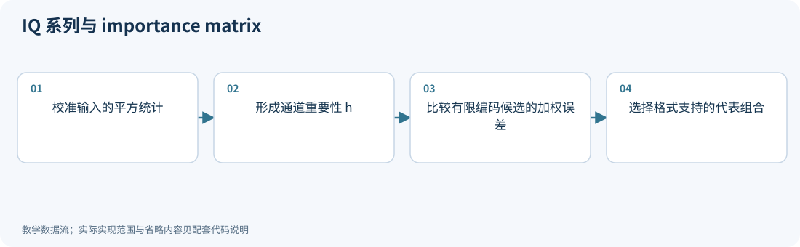
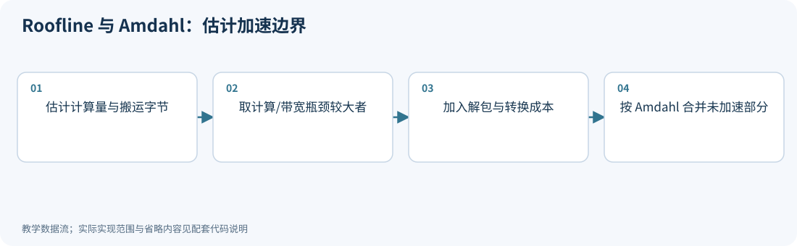

# 09｜INT4、NF4、FP8、MXFP4、NVFP4 与真实速度

<!-- course-objectives -->
**学习目标：** 分辨数值格式、容器和内核；计算微缩放开销；验证保存重载与真实执行路径。

**先修知识：** 第 01、06–08 章；矩阵形状、字节与吞吐单位。 [进入本章测试](#chapter-assessment)；建议先独立作答，再展开答案。
<!-- /course-objectives -->

原始资料：[R24] NF4；[R33] FP8；[R34] OCP MX 规范；[R35] NVIDIA NVFP4；[R36] llama.cpp / GGML。

<!-- chapter-overview -->
<a id="chapter-start"></a>

**阅读路线：** 先读懂浮点代表值与缩放，再从容器走到块布局和执行路线；最后闭合保存、重载、Q/DQ 图与性能验证流程。

<details><summary>本章目录（18 节）</summary>

- [9.1 浮点数如何表示](#principle-9-1)
- [9.2 浮点为何还需要 scale](#principle-9-2)
- [9.3 静态、动态、延迟缩放](#principle-9-3)
- [9.4 FP4 E2M1：只有这些绝对值](#principle-9-4)
- [9.5 MXFP4：每 32 个数共享一个二次幂尺度](#principle-9-5)
- [9.6 NVFP4：更小微块、更细 scale、两级缩放](#principle-9-6)
- [9.7 格式、算法、文件容器、内核是四个层次](#principle-9-7)
- [9.8 GGUF、Q4_0、Q4_K_M、IQ 系列](#principle-9-8)
- [9.9 为什么 4 bit 不一定比 16 bit 快](#principle-9-9)
- [9.10 用数字算一次收益边界](#principle-9-10)
- [9.11 部署前记录什么](#principle-9-11)
- [9.12 CPU 查表、FP6 与移位计算：格式之外的执行路线](#principle-9-12)
- [9.13 从量化公式到可保存、可重载的模型](#principle-9-13)
- [9.14 Q/DQ 图、融合与归一化边界](#principle-9-14)
- [9.15 用执行证据解释加速与分布式收益](#principle-9-15)
- [9.16 低比特 GEMM 内核为什么需要布局与流水线设计](#principle-9-16)
- [9.17 新 GPU 的原生格式、指令与软件支持需要分层核对](#principle-9-17)
- [9.18 本章测试与参考答案](#principle-9-18)

</details>

每项技术的图示、代码和讲解紧跟原理。例子在项目根目录运行，只需 NumPy；长篇参考资料可在各节末尾展开。[按技术查找](技术图解与代码索引.md) · [查看实验输出](../experiments/results/逐项技术实验结果.md)。

[分章测试与参考答案](#chapter-assessment) · [课程考核与综合练习](11_练习与答案.md#course-assessment-guide)

[本章实操：完整逐步注释](#chapter-demo)

<!-- /chapter-overview -->

<a id="principle-9-1"></a>
<a id="fp8"></a>

## 9.1 浮点数如何表示

一个普通规格化二进制浮点数可以写成：

$$
x=(-1)^s\times2^{e-bias}\times(1+m/2^p).
$$

- $s$：符号位；
- $e$：指数编码，控制数量级；
- $m$：尾数编码；
- $p$：尾数位数，控制同一数量级下的精细程度。

零、次正规数、无穷和 NaN 使用特殊规则，不能把这个式子套到所有编码上。

| 格式 | 符号/指数/尾数 | 直观特点 |
|---|---|---|
| FP32 | 1/8/23 | 范围与精度都较高 |
| FP16 | 1/5/10 | 尾数较细，动态范围较小 |
| BF16 | 1/8/7 | 指数范围接近 FP32，尾数更粗 |
| FP8 E4M3 | 1/4/3 | 较细尾数，较小动态范围 |
| FP8 E5M2 | 1/5/2 | 更大范围，更粗尾数 |
| FP4 E2M1 | 1/2/1 | 极少代表值，需要精心缩放 |

FP8 有 FN、FNUZ 等不同具体变体，最大值和特殊数规则会不同。常见 NVIDIA E4M3 最大有限值为 448，E5M2 为 57344，不能将其当成所有同名变体的通用规则。

本教程的有限值查表模拟只接受非空、有限实数输入；NaN、Inf、复数和无法在 float64 中安全计算的尺度会报错。它不模拟真实硬件对特殊值的传播、饱和或异常处理，因此不能以“查表返回了一个有限值”来掩盖无效输入。

<!-- inline-technique: fp8 -->

### 图解与代码



**运行：** `python experiments/technique_lab.py --technique fp8`

<!-- executable: fp8 -->
```python
import numpy as np
from experiments.technique_kernels import fp_levels, float_qdq
e4 = fp_levels('e4m3'); e5 = fp_levels('e5m2')
assert e4.max() == 448 and e5.max() == 57344
assert e4[e4 > 0].min() == 2.**-9
assert e5[e5 > 0].min() == 2.**-16
x = np.array([0., .1, 1.3, 20., 1000.])
print("E4M3 scaled reconstruction:", float_qdq(x, 'e4m3'))
print("E5M2 scaled reconstruction:", float_qdq(x, 'e5m2'))
```

**代码讲解**

1. fp_levels 按指数/尾数枚举有限值并剔除保留编码；边界断言核对具体格式而不是泛称 FP8。
2. float_qdq 先除以 amax/Fmax，再映射到格式代表值，最后乘回尺度。浮点有指数仍然可能需要外部 scale。

> **示例边界：** 不含 NaN、无穷传播和有符号零；LUT 在恰好半格处取排序中的先值，不是硬件 ties-to-even 的逐位替代。

<details>
<summary>论文、博客与官方资料</summary>

- **论文**：[FP8 Formats for Deep Learning](https://arxiv.org/abs/2209.05433)。
- **作者项目、官方文档与规范**：[NVIDIA Transformer Engine 2.8：Using FP8 and FP4](https://archive.docs.nvidia.com/deeplearning/transformer-engine-releases/release-2.8/user-guide/examples/fp8_primer.html)。

引用固定版本的 Transformer Engine 2.8 文档，便于对照缩放与数值格式。

</details>

<!-- /inline-technique -->

<a id="principle-9-2"></a>

## 9.2 浮点为何还需要 scale

FP8 自带指数，但可表示范围仍有限。通常使用：

$$
q=\operatorname{cast}_{FP8}(x/s),\qquad\widehat x=sq.
$$

若格式最大有限值为 $F_{max}$，一个简单选择是：

$$
s=\max|x|/F_{max}.
$$

这样让观察到的最大值落在格式范围内。实践中会加入 margin、裁剪和历史统计。

浮点更像按数量级分配**相对分辨率**；定点均匀量化在给定 scale 下提供固定**绝对分辨率**。哪种更好取决于分布及硬件。

<a id="principle-9-3"></a>
<a id="dynamic_scaling"></a>

## 9.3 静态、动态、延迟缩放

- **静态缩放**：离线校准后固定 scale，运行开销低，但可能遇到新输入溢出。
- **当前动态缩放**：当前张量先求 amax 再量化，适应性强，但需要归约或额外遍历。
- **延迟缩放**：当前步用历史 amax 决定的 scale，同时记录本步统计供未来使用，降低某些依赖开销；遇到突发大值可能不合适。
- **块动态缩放**：每个小块计算自己的尺度，适应局部分布，但增加元数据并受布局约束。

“动态量化”通常指量化参数随运行输入变化，不表示模型权重在在线训练。

FP8 训练还需要分别处理前向激活、权重、反向梯度和累加类型。[R33] 早期方案常按张量需求组合 E4M3/E5M2，但现代 recipes 不止一种，不能认为训练全部张量必然使用同一 FP8 格式。

<!-- inline-technique: dynamic_scaling -->

### 图解与代码


**运行：** `python experiments/technique_lab.py --technique dynamic_scaling`

<!-- executable: dynamic_scaling -->
```python
import numpy as np
from experiments.technique_kernels import fp_levels, nearest
levels = fp_levels('e4m3')
def quantize(row, bound):
    scale = max(bound, 1e-12)/448
    return scale*nearest(row/scale, levels)
fixed_amax = history_amax = 1.
for row in (np.array([.2, 1.]), np.array([1., 16.])):
    current_amax = np.max(abs(row))
    static = quantize(row, fixed_amax)
    current = quantize(row, current_amax)
    delayed = quantize(row, history_amax)
    print("static/current/delayed:", static, current, delayed)
    history_amax = current_amax
assert current[-1] == 16 and delayed[-1] == static[-1] == 1
```

**代码讲解**

1. 第二步突然出现 16，当前动态方案及时扩大范围；静态与只看上一步的延迟方案仍按最大值 1 编码。
2. 更新 history_amax 必须在使用历史尺度之后，否则就偷偷变成当前动态缩放。块动态缩放见后面的 MXFP4/NVFP4 示例。

> **示例边界：** 生产延迟缩放常用多步历史最大值和 margin，本例只用一帧历史展示时序；饱和、溢出策略也需按后端确定。

<details>
<summary>论文、博客与官方资料</summary>

- **论文**：[FP8 Formats for Deep Learning](https://arxiv.org/abs/2209.05433)。
- **作者项目、官方文档与规范**：[NVIDIA Transformer Engine 2.8：Using FP8 and FP4](https://archive.docs.nvidia.com/deeplearning/transformer-engine-releases/release-2.8/user-guide/examples/fp8_primer.html)。

引用固定版本的 Transformer Engine 2.8 文档，便于对照缩放与数值格式。

</details>

<!-- /inline-technique -->

<a id="principle-9-4"></a>
<a id="fp4"></a>

## 9.4 FP4 E2M1：只有这些绝对值

常见 E2M1 的非负可表示值为：

$$
0,0.5,1,1.5,2,3,4,6.
$$

加上负号，16 个编码包含正负零，因此不同实数值不一定有 16 个。

观察间距：从 0.5 到 1 间隔 0.5，从 4 到 6 间隔 2。越大的数，绝对间隔越大。

因此同样是 4 bit：

- INT4 是均匀整数网格，再乘 scale；
- NF4 是特定非均匀码本索引；
- FP4 是有指数语义的浮点编码。

不能仅替换名字或文件后缀实现互相转换，必须重新解码/编码，并评估新误差。

<!-- inline-technique: fp4 -->

### 图解与代码



**运行：** `python experiments/technique_lab.py --technique fp4`

<!-- executable: fp4 -->
```python
import numpy as np
from experiments.technique_kernels import fp_levels, nearest
levels = fp_levels('e2m1')
assert np.array_equal(levels[levels >= 0], [0, .5, 1, 1.5, 2, 3, 4, 6])
x = np.array([.1, .6, 1.2, 2.7, 5.8])
q = nearest(x, levels)
print("inputs, E2M1 values:", x, q)
print("unique real values:", len(levels))
assert len(levels) == 15
```

**代码讲解**

1. 16 个物理编码包含正零和负零，因此只有 15 个不同实数值；LUT 把两个零合并了。
2. 2.7 可以映射到 3，而 5.8 映射到 6，间距随数量级变化。scale 如何选择由上层微缩放格式决定。

> **示例边界：** 代码不返回 E2M1 的原始 4 bit 位模式，也不模拟有符号零；只检查有限值几何。

<details>
<summary>论文、博客与官方资料</summary>

- **论文**：[Microscaling Data Formats for Deep Learning](https://arxiv.org/abs/2310.10537)。
- **作者项目、官方文档与规范**：[OCP Microscaling Formats (MX) Specification v1.0](https://www.opencompute.org/documents/ocp-microscaling-formats-mx-v1-0-spec-final-pdf)；[NVIDIA Transformer Engine 2.8：Using FP8 and FP4](https://archive.docs.nvidia.com/deeplearning/transformer-engine-releases/release-2.8/user-guide/examples/fp8_primer.html)。

MX 论文解释微缩放背景；具体 E2M1 和 MXFP4 格式以 OCP 规范为准。

</details>

<!-- /inline-technique -->

<a id="principle-9-5"></a>
<a id="mxfp4"></a>

## 9.5 MXFP4：每 32 个数共享一个二次幂尺度

OCP MX 规范定义多种微缩放格式。[R34] 对 MXFP4，典型分组为 32 个 E2M1 数据值，共享一个 E8M0 scale：

$$
\widehat x_i=s_{block}\,q_i^{E2M1}.
$$

E8M0 的有限有效 scale 表示二次幂，像 $2^{-3},2^{-2},\ldots$。其特殊编码规则按规范处理。

**为什么用二次幂：** 缩放便于硬件实现、指数调整简单，但 scale 的分辨率较粗。

例如理想 scale 为 0.3，二次幂只能选附近的 0.25 或 0.5；为避免溢出可能需要更保守的选择，从而减少有效精度。准确的选尺度规则按目标实现定义。

不计其他开销，平均存储位宽：

$$
4+8/32=4.25\text{ bit/value}.
$$

MXFP8、MXFP6 等也属于同一微缩放家族，但数据类型和数值范围不同。

<!-- inline-technique: mxfp4 -->

### 图解与代码



**运行：** `python experiments/technique_lab.py --technique mxfp4`

<!-- executable: mxfp4 -->
```python
import numpy as np
from experiments.technique_kernels import micro_fp4
x = np.r_[np.linspace(-.8, .8, 32), np.linspace(-8, 8, 32)]
restored, metadata = micro_fp4(x, kind='mx')
scales = metadata['block_scale'].ravel()
assert np.allclose(np.log2(scales), np.rint(np.log2(scales)))
assert np.array_equal(micro_fp4(np.zeros(32), 'mx')[0], np.zeros(32))
print("block scales, MSE, bits/value:", scales, np.mean((x-restored)**2), 4+8/32)
```

**代码讲解**

1. helper 将末轴分成 32 个一块，计算理想 amax/6，再使用 ceil(log2) 选择不小于它的二次幂尺度。
2. 4+8/32=4.25 是主体和尺度的平均位宽，不能只按每个元素 4 bit 计算。

> **示例边界：** 这里采用保守 ceil 选尺度策略，不承诺等于任一设备的默认 recipe；E8M0 极端范围和特殊编码未逐位实现。

<details>
<summary>论文、博客与官方资料</summary>

- **论文**：[Microscaling Data Formats for Deep Learning](https://arxiv.org/abs/2310.10537)。
- **作者项目、官方文档与规范**：[OCP Microscaling Formats (MX) Specification v1.0](https://www.opencompute.org/documents/ocp-microscaling-formats-mx-v1-0-spec-final-pdf)；[NVIDIA Transformer Engine 2.8：Using FP8 and FP4](https://archive.docs.nvidia.com/deeplearning/transformer-engine-releases/release-2.8/user-guide/examples/fp8_primer.html)。

MX 论文解释微缩放背景；具体 E2M1 和 MXFP4 格式以 OCP 规范为准。

</details>

<!-- /inline-technique -->

<a id="principle-9-6"></a>
<a id="nvfp4"></a>

## 9.6 NVFP4：更小微块、更细 scale、两级缩放

NVIDIA NVFP4 通常使用：[R35]

- 每个元素 E2M1 FP4；
- 每 16 个元素共享一个 FP8 E4M3 scale；
- 再使用一个张量级高精度尺度，帮助局部 scale 覆盖范围。

数学表示：

$$
\boxed{\widehat x_i=s_{tensor}\,s_{block}^{E4M3}\,q_i^{E2M1}.}
$$

局部 E4M3 scale 不仅能取二次幂，因此比 E8M0 更细；组从 32 减到 16，也更能适应局部分布。代价是多一些元数据。

不计张量级尺度和其他开销：

$$
4+8/16=4.5\text{ bit/value}.
$$

相对 16 bit，理想比值为 $16/4.5\approx3.56$，不是严格 4 倍。

NVFP4 不等于“任何 GPU 都能快速运行的 4 bit 文件”。原生矩阵乘加速依赖相应硬件、指令、矩阵形状与软件 kernel 支持。PTQ 或 QAT 可以负责把模型适配到 NVFP4，但格式本身并没有替你解决所有模型误差问题。

### 两级尺度的误差也会进入矩阵乘

把理想实数尺度记为 $\alpha,s$，部署尺度记为 $\widehat\alpha=\alpha+e_\alpha$、
$\widehat s=s+e_s$。令 $u=x/(\alpha s)$，最终选中的 FP4 码字为 $q=u+e_q$，则有精确分解

$$
\widehat x-x
=\underbrace{\alpha s e_q}_{\text{码字误差}}
+\underbrace{\alpha e_s q}_{\text{块尺度误差}}
+\underbrace{e_\alpha\widehat s q}_{\text{全局尺度误差}}.
$$

这里 $q$ 已固定为实际选中的码字，恒等式无需误差独立假设；真实量化时尺度改变也可能让 $q$ 跳到另一格。
因此只模拟 E2M1、却把所有尺度保持 FP32，并没有完整模拟 NVFP4。
依据 [NVFP4 官方格式说明](https://developer.nvidia.com/blog/introducing-nvfp4-for-efficient-and-accurate-low-precision-inference/)做数值对照时，还应固定缩放方向、微块轴、舍入、饱和、次正规数和累加类型。

<!-- depth-example: fp4_scale_error -->
```python
import numpy as np
alpha, s, u = 1.3, .3, np.array([.4, 1.2, -2.7])
q = np.array([.5, 1., -3.])
ahat, shat = 1.3001, .3125
x = alpha*s*u
restored = ahat*shat*q
terms = alpha*s*(q-u)+alpha*(shat-s)*q+(ahat-alpha)*shat*q
assert np.allclose(restored-x, terms)
assert not np.allclose(restored-x, alpha*s*(q-u))
print('complete error:', restored-x)
```

**两侧微块尺度不同，不能随意移出整个归约。** 对一个矩阵乘元素，若归约维分组一致，

$$
\widehat Y_{ij}=\alpha_X\alpha_W\sum_g
s^X_{i,g}s^W_{j,g}\sum_{k\in g}q^X_{ik}q^W_{jk}.
$$

只有与 $g$ 无关的尺度才能移到最外层。拼接残差通道时还需保持组边界、尺度布局和硬件支持一致；
代数上的一次拼接乘法并不自动等于一次可直接调用的 FP4 GEMM。

<!-- inline-technique: nvfp4 -->

### 图解与代码



**运行：** `python experiments/technique_lab.py --technique nvfp4`

<!-- executable: nvfp4 -->
```python
import numpy as np
from experiments.technique_kernels import micro_fp4, fp_levels
x = np.r_[np.linspace(-.8, .8, 16), np.linspace(-8, 8, 16)]
restored, meta = micro_fp4(x, kind='nv')
assert np.all(np.isin(meta['block_scale'], fp_levels('e4m3')))
recomputed = meta['tensor_scale']*meta['block_scale']*meta['payload']
assert np.array_equal(restored, recomputed.reshape(x.shape))
print("tensor scale, block scales:", meta['tensor_scale'], meta['block_scale'].ravel())
print("MSE, block-only bits/value:", np.mean((x-restored)**2), 4+8/16)
```

**代码讲解**

1. 张量尺度把局部尺度的可用范围映射到 E4M3，解码时必须与局部尺度一起乘回。
2. 4.5 bit/value 尚未计张量尺度、padding 或未量化张量；block scale 是 FP8 不代表数据本身也是 FP8。

> **示例边界：** NumPy 数值分解不执行原生 NVFP4 指令；真实速度、数据布局和舍入规则依赖硬件及后端。

<details>
<summary>论文、博客与官方资料</summary>

- **论文**：[Pretraining Large Language Models with NVFP4](https://arxiv.org/abs/2509.25149)。
- **博客与技术文章**：[NVIDIA: Introducing NVFP4 for Efficient and Accurate Low-Precision Inference](https://developer.nvidia.com/blog/introducing-nvfp4-for-efficient-and-accurate-low-precision-inference/)。
- **作者项目、官方文档与规范**：[NVIDIA Transformer Engine 2.8：Using FP8 and FP4](https://archive.docs.nvidia.com/deeplearning/transformer-engine-releases/release-2.8/user-guide/examples/fp8_primer.html)。

NVFP4 预训练论文是扩展阅读，训练配方不等同于本教程的推理数值示例；格式结构见 NVIDIA 官方说明。

</details>

<!-- /inline-technique -->

<a id="principle-9-7"></a>
<a id="gguf"></a>

## 9.7 格式、算法、文件容器、内核是四个层次

| 层次 | 回答的问题 | 例子 |
|---|---|---|
| 数值格式 | 用哪些编码表示数字？ | INT4、NF4、E4M3、NVFP4 |
| 量化算法 | 怎样选择编码、尺度、补偿？ | GPTQ、AWQ、HQQ、QAT |
| 文件容器 | 张量、元数据、分词器信息怎么装？ | GGUF、safetensors |
| 推理内核 | 这些字节如何变成实际计算？ | 对应的解包、反量化、GEMM/Attention kernel |

同一个容器可以装不同数值格式；同一个算法也可能导出不同内核需要的布局。

<!-- inline-technique: gguf -->

### 图解与代码



**运行：** `python experiments/technique_lab.py --technique gguf`

<!-- executable: gguf -->
```python
import struct
# GGUF v3 header only: magic, version, tensor_count, metadata_kv_count.
header = struct.pack('<4sIQQ', b'GGUF', 3, 0, 0)
magic, version, tensors, metadata = struct.unpack('<4sIQQ', header)
assert magic == b'GGUF' and version == 3
assert len(header) == 24 and tensors == metadata == 0
print("header fields:", magic, version, tensors, metadata)
```

**代码讲解**

1. 4s/I/Q/Q 对应 4 字节魔数、32 bit 版本以及两个 64 bit 计数；小端格式由 '<' 指定。
2. 这个头本身没有任何数值量化信息；真正的张量描述和数据块才决定如何解码参数。

> **示例边界：** 只构造空容器头来解释格式层次，不生成可加载的 LLM，也不覆盖完整 GGUF 元数据或对齐规范。

<details>
<summary>论文、博客与官方资料</summary>

- **作者项目、官方文档与规范**：[GGML 官方 GGUF v3 规范](https://raw.githubusercontent.com/ggml-org/ggml/master/docs/gguf.md)；[Hugging Face 官方文档：GGUF](https://huggingface.co/docs/hub/gguf)。

GGUF 是容器格式，使用官方规范与文档作为原始资料，不虚列独立量化论文。

</details>

<!-- /inline-technique -->

<a id="principle-9-8"></a>

## 9.8 GGUF、Q4_0、Q4_K_M、IQ 系列

GGUF 是容器，不是一个固定量化算法。[R36]

下载量化模型时，应同时看文件大小、量化类型、模型版本、上下文配置和 runtime 支持。下面分别从块结构、层级参数和混合预设理解几种名字；格式名不能单独证明质量。

<!-- topic: q4_0 -->
<a id="q4_0"></a>

### Q4_0：一个尺度与 32 个编码

核查到的 GGML 结构中，32 个元素存 16 字节低 bit payload，加 2 字节尺度：

$$
18\times8/32=4.5\text{ bit/weight}.
$$

这比“每个值 4 bit”多，是 scale 的成本。

<!-- practice: q4_0 -->

<!-- inline-technique: q4_0 -->



**运行：** `python experiments/technique_lab.py --technique q4_0`

<!-- executable: q4_0 -->
```python
import numpy as np
w = np.linspace(-1, 1, 32, dtype=np.float32)
extreme = w[np.argmax(abs(w))]
d = float(extreme/-8) if extreme != 0 else 0.
codes = np.clip(np.floor(w/d+8.5), 0, 15).astype(np.uint8) if d else np.full(32, 8, dtype=np.uint8)
packed = codes[:16] | (codes[16:] << 4)
block = np.array([d], dtype='<f2').tobytes()+packed.tobytes()
decoded_scale = float(np.frombuffer(block, dtype='<f2', count=1)[0])
data = np.frombuffer(block, dtype=np.uint8, offset=2)
unpacked = np.r_[data & 15, data >> 4].astype(int)
restored = decoded_scale*(unpacked-8)
assert np.array_equal(unpacked, codes) and len(block) == 18
print("bytes, effective bits, reconstruction MSE:", len(block), len(block)*8/32, np.mean((w-restored)**2))
```

**代码讲解**

1. Q4_0 的同一字节分别放第 j 和第 j+16 个编码，并非简单把相邻两个权重塞在一起。
2. 解码必须使用已存成 FP16 的尺度；用量化前 float32 尺度验证会漏掉尺度自身的舍入误差。

> **示例边界：** 展示基础参考量化与块布局，不承诺与含 importance 优化的所有 llama.cpp 版本编码一致；本例不拼装完整 GGUF。

<details>
<summary>论文、博客与官方资料</summary>

- **作者项目、官方文档与规范**：[llama.cpp 官方量化说明与类型预设](https://raw.githubusercontent.com/ggml-org/llama.cpp/master/tools/quantize/README.md)；[GGML 类型定义](https://raw.githubusercontent.com/ggml-org/llama.cpp/master/ggml/src/ggml-common.h)；[GGML Q4_0 / Q4_K 等格式的参考编码器](https://raw.githubusercontent.com/ggml-org/llama.cpp/master/ggml/src/ggml-quants.c)。

Q4_* 是 GGML 实现中的编码类型；结构、位布局和编码器以官方源码为准。

</details>

<!-- /inline-technique -->

<!-- topic: q4_k -->
<a id="q4_k"></a>

### Q4_K：超块与子块参数

Q4_K 采用 super-block 与子块量化；典型 256 元素结构含 128 字节 payload、12 字节子块 scale/min 编码及两个 FP16 超块参数：

$$
(128+12+4)\times8/256=4.5\text{ bit/weight}.
$$

虽然平均位宽相同，子块表示能力和量化参数并不等于 Q4_0。

<!-- practice: q4_k -->

<!-- inline-technique: q4_k -->



**运行：** `python experiments/technique_lab.py --technique q4_k`

<!-- executable: q4_k -->
```python
import numpy as np
rng = np.random.default_rng(26)
blocks = rng.normal(size=(8, 32))
minimum = -blocks.min(axis=1, keepdims=True)
scales = (blocks.max(axis=1, keepdims=True)+minimum)/15
d, dmin = float(np.float16(scales.max()/63)), float(np.float16(minimum.max()/63))
scale6 = np.clip(np.rint(scales/d), 1, 63)
min6 = np.clip(np.rint(minimum/dmin), 0, 63)
effective_s, effective_m = d*scale6, dmin*min6
q = np.clip(np.rint((blocks+effective_m)/effective_s), 0, 15)
reconstructed = q*effective_s-effective_m
total_bytes = 128+12+4
assert total_bytes*8/256 == 4.5
print("Q4_K byte accounting, toy MSE:", total_bytes, np.mean((blocks-reconstructed)**2))
```

**代码讲解**

1. scale6/min6 一共 16 个 6 bit 参数，占 12 字节；两个 FP16 参数另占 4 字节，主体 4 bit 编码占 128 字节。
2. 先量化子块参数，再根据实际有效尺度选择 q，避免用未存储的理想参数反量化。

> **示例边界：** 用简单 min/max 展示分层数值关系，不生成 Q4_K 官方位布局；真实编码器的搜索、负最小值约定和边界处理更加完整。

<details>
<summary>论文、博客与官方资料</summary>

- **作者项目、官方文档与规范**：[llama.cpp 官方量化说明与类型预设](https://raw.githubusercontent.com/ggml-org/llama.cpp/master/tools/quantize/README.md)；[GGML 类型定义](https://raw.githubusercontent.com/ggml-org/llama.cpp/master/ggml/src/ggml-common.h)；[GGML Q4_0 / Q4_K 等格式的参考编码器](https://raw.githubusercontent.com/ggml-org/llama.cpp/master/ggml/src/ggml-quants.c)。

Q4_* 是 GGML 实现中的编码类型；结构、位布局和编码器以官方源码为准。

</details>

<!-- /inline-technique -->

<!-- topic: q4_k_m -->
<a id="q4_k_m"></a>

### Q4_K_M：按张量选择精度的预设

Q4_K_M 是混合量化预设，某些张量可能使用更高精度，所以整个模型平均位宽不应直接按单个 Q4_K block 计算；具体分配随实现和模型类型变化。

<!-- practice: q4_k_m -->

<!-- inline-technique: q4_k_m -->



**运行：** `python experiments/technique_lab.py --technique q4_k_m`

<!-- executable: q4_k_m -->
```python
tensors = [
    ('toy_mlp', 4096*4096, 4.5),
    ('toy_attention', 4096*4096, 6.5625),  # Q6_K block: 210 bytes / 256 values.
    ('toy_norm', 4096, 32.),
]
total_parameters = sum(n for _, n, _ in tensors)
total_bytes = sum(n*bpw/8 for _, n, bpw in tensors)
average = total_bytes*8/total_parameters
assert average > 4.5
print("weighted effective bits, bytes:", average, total_bytes)
```

**代码讲解**

1. 平均位宽必须用参数量加权，而不是把类型位宽直接取算术平均；少量 FP32 张量也要计入。
2. 这里的名字带 toy，表示人为指定的组合，用来演示预设与 block 类型的区别。

> **示例边界：** 上述张量分配不是 llama.cpp 的固定 Q4_K_M 默认规则；真实映射随架构与版本变化，应读取实际 GGUF 张量类型。

<details>
<summary>论文、博客与官方资料</summary>

- **作者项目、官方文档与规范**：[llama.cpp 官方量化说明与类型预设](https://raw.githubusercontent.com/ggml-org/llama.cpp/master/tools/quantize/README.md)；[Hugging Face 官方文档：GGUF](https://huggingface.co/docs/hub/gguf)；[GGML 类型定义](https://raw.githubusercontent.com/ggml-org/llama.cpp/master/ggml/src/ggml-common.h)。

Q4_K_M 是混合量化预设，具体张量分配由模型与实现版本决定，没有统一独立算法论文。

</details>

<!-- /inline-technique -->

<!-- topic: iq -->
<a id="iq"></a>

### IQ 系列：重要性统计与编码选择

IQ 包含多种利用重要性统计、非均匀编码或码本的格式。不同 IQ 类型规则不同，不能笼统说“全部只是重要层多给 bit”。importance matrix 的常见基础是激活二阶统计，用来衡量误差影响，并不必然等于完整 Hessian。

<!-- practice: iq -->

<!-- inline-technique: iq -->



**运行：** `python experiments/technique_lab.py --technique iq`

<!-- executable: iq -->
```python
import numpy as np
X = np.array([[1., 10.], [2., -10.]])
importance = np.sum(X**2, axis=0)
w = np.array([.2, .2])
toy_codebook = np.array([[.2, 0.], [0., .25]])
plain = np.sum((toy_codebook-w)**2, axis=1)
weighted = np.sum(importance*(toy_codebook-w)**2, axis=1)
assert plain.argmin() == 0 and weighted.argmin() == 1
print("importance, unweighted/weighted choices:", importance, plain.argmin(), weighted.argmin())
```

**代码讲解**

1. 第二个输入方向幅度更大，在那里产生相同误差会更昂贵，因此加权后改选更照顾第二维的候选。
2. 有限向量码本的候选选择存在耦合，重要性可以改变最优代表；不是简单给重要层多几个 bit。

> **示例边界：** toy_codebook 不是任何具体 IQ 格式的官方码本；IQ2、IQ3、IQ4 等各有规则，部署须选择对应编码器和解码内核。

<details>
<summary>论文、博客与官方资料</summary>

- **作者项目、官方文档与规范**：[llama.cpp 官方 importance matrix 说明](https://raw.githubusercontent.com/ggml-org/llama.cpp/master/tools/imatrix/README.md)；[llama.cpp 官方量化说明与类型预设](https://raw.githubusercontent.com/ggml-org/llama.cpp/master/tools/quantize/README.md)；[GGML 类型定义](https://raw.githubusercontent.com/ggml-org/llama.cpp/master/ggml/src/ggml-common.h)。

IQ 包含多种具体编码类型，使用 importance matrix 文档和各类型源码，不归并成一篇不存在的论文。

</details>

<!-- /inline-technique -->

<a id="principle-9-9"></a>

## 9.9 为什么 4 bit 不一定比 16 bit 快

一个常见近似是 Roofline 模型：

$$
t\gtrsim\max\left(\frac{F}{P_{compute}},\frac{D}{B_{memory}}\right)+t_{overhead}.
$$

- $F$：计算量；
- $P_{compute}$：可实现的计算吞吐；
- $D$：要搬运的数据量；
- $B_{memory}$：有效带宽；
- $t_{overhead}$：解包、反量化、旋转、调度等开销。

这是估算模型，不是精确性能公式。通信、缓存重用和算子间依赖也会影响真实执行。

**小 batch decode：** 每生成一个 token 都可能要读取大量权重，通常更容易受带宽限制。weight-only 量化减少读取量，往往有价值。

**大 batch / prefill：** 权重被更多 token 复用，矩阵乘可能更受计算吞吐限制。这时 W8A8、FP8 或原生 FP4 计算路径可能比只压缩存储更重要。

**长上下文 decode：** KV 读取也可能成为主要成本，需要考虑缓存量化。

这些是常见趋势，不是所有模型和硬件的固定规律。

<a id="principle-9-10"></a>
<a id="roofline"></a>

## 9.10 用数字算一次收益边界

假设一次解码需要读取 14 GB 权重，有效带宽 1 TB/s，理想读取下界为：

$$
14/1000\text{ s}=14\text{ ms}.
$$

压缩成 3.5 GB，理想读取下界降为 3.5 ms，但元数据、实际带宽、缓存和解码开销会改变结果。这不是任何 GPU 的实测值。

再用 Amdahl 定律：若原总时间只有 60% 能被某技术加速 4 倍，剩余 40% 不变，则总加速比：

$$
S=\frac1{0.4+0.6/4}\approx1.82.
$$

所以矩阵乘“快 4 倍”与生成“快 4 倍”是不同陈述。

<!-- inline-technique: roofline -->

### 图解与代码



**运行：** `python experiments/technique_lab.py --technique roofline`

<!-- executable: roofline -->
```python
flops = 2*7e9
compute = 100e12; bandwidth = 1e12
fp16_time = max(flops/compute, 14e9/bandwidth)
int4_time = max(flops/compute, 3.5e9/bandwidth)+.001
local_speedup = fp16_time/int4_time
total_speedup = 1/(.4+.6/4)
assert local_speedup < 4
assert abs(total_speedup-1.818181818) < 1e-8
print("estimated FP16/INT4 milliseconds:", fp16_time*1000, int4_time*1000)
print("local estimate and Amdahl example:", local_speedup, total_speedup)
```

**代码讲解**

1. max 反映计算与数据供给中的主要瓶颈，额外 1 ms 用来说明解包等开销会压低理想压缩收益。
2. Amdahl 例子假设只有 60% 的原总时间能加速 4 倍，剩余 40% 保持不变。

> **示例边界：** 全部数值都是预算假设，没有进行 CPU/GPU 性能测量；通信、缓存和依赖也未包含在这个简单模型中。

<details>
<summary>论文、博客与官方资料</summary>

- **论文**：[Roofline: An Insightful Visual Performance Model for Multicore Architectures](https://doi.org/10.1145/1498765.1498785)；[Validity of the Single Processor Approach to Achieving Large Scale Computing Capabilities（Amdahl）](https://doi.org/10.1145/1465482.1465560)。
- **作者项目、官方文档与规范**：[NERSC 官方文档：Roofline Performance Model](https://docs.nersc.gov/tools/performance/roofline/)。

</details>

<!-- /inline-technique -->

<a id="principle-9-11"></a>

## 9.11 部署前记录什么

记录以下信息，结果才可比较：模型精确版本、参数量、W/A/KV 格式、组大小、校准数据、排除层、kernel/backend 版本、硬件、batch、输入输出长度、峰值显存、质量指标、TTFT 和 decode 时间。

CPU、GPU 和 NPU 的格式支持不同，实际加载到的模型和 kernel 才是依据。伪量化的 Python `round` 实验能验证数学，却不能证明硬件加速。

<a id="alternative-execution"></a>

<a id="principle-9-12"></a>

## 9.12 CPU 查表、FP6 与移位计算：格式之外的执行路线

只介绍 GPU INT4/FP4 会漏掉重要的部署选择。这些路线的主要区别是**如何执行低比特表示**，并不都提出新的校准算法。

**T-MAC：位平面查表。** [T-MAC v2，§3](https://arxiv.org/html/2407.00088v2)（首发 2024-06-25）把多比特权重拆成位平面，为一小组输入激活预计算符号组合的点积表，再用权重编码索引查表。若一组含 $g$ 个激活，完整符号表有 $2^g$ 项；多组权重可复用同一激活表，但表的构建、寄存器压力与访存不可忽略。它与“向量码本里存代表权重”不同：这里在线表保存的是**当前激活的部分点积结果**。

<!-- depth-example: bitplane_lookup -->
```python
import itertools
import numpy as np
x = np.array([.5, -1., 2., .25])
patterns = np.array(list(itertools.product([-1., 1.], repeat=4)))
table = patterns@x
b0, b1 = np.array([1., -1., 1., -1.]), np.array([-1., -1., 1., 1.])
lookup = lambda b: table[np.flatnonzero(np.all(patterns == b, axis=1))[0]]
weights = .5*b0+1.5*b1
assert np.isclose(.5*lookup(b0)+1.5*lookup(b1), weights@x)
print('lookup dot:', weights@x)
```

此例验证位平面组合，不实现 T-MAC 的表压缩、SIMD 与融合内核；作者工程见 [T-MAC](https://github.com/microsoft/T-MAC)。

**FP6-LLM / TC-FPx：非标准位宽的高效反量化。** [FP6-LLM v2，§5](https://arxiv.org/html/2401.14112v2)通过离线预打包、对齐的读取和寄存器内 FP6→FP16 解码，调用支持的 Tensor Core 计算。这里的 FP6 存储不是“GPU 必须有原生 FP6 乘法”；收益来自搬运减少和解码流水化，不能由 6/16 的位宽比直接推断速度。

**QRazor 与 FPoT：需要匹配算术单元的编码。** [QRazor v2，§4](https://arxiv.org/html/2501.13331v2)先建立较高精度整数表示，再按组保留显著位并保存移位标记；[FPoT v1](https://arxiv.org/html/2610.21257v1)（2026-10-15）用更细的幂次网格与近似移位加法数据通路。它们的专用运算单元、RTL 面积或每 MAC 能耗结果，不等于现成 GPU 的端到端加速。符号位、组标记、尺度和最终算术近似也必须计入精度与容量。

部署对照应同时列 **编码位宽、内存布局、执行操作数类型、累加类型、目标指令和真实后端**。同一量化模型在 CPU、GPU、NPU 上可能需要完全不同的最优路径。

<a id="principle-9-13"></a>

## 9.13 从量化公式到可保存、可重载的模型

<a id="quantized-model-lifecycle"></a>

一个张量经 QDQ 后仍以 FP16 保存在原线性层中，与一个真正保存低比特编码的层，是两种实现。可部署流程应闭合为：


### 一个量化线性层必须声明的契约

对 $W\in\mathbb R^{o\times d}$，如果每个输出通道一个尺度，尺度通常表示成 $[o,1]$；沿输入轴分组则为 $[o,\lceil d/g\rceil]$。转换后的布局可能转置、交错或预打包，形状相似并不能证明广播轴正确。

| 状态 | 必须携带的信息 |
|---|---|
| payload | 编码位宽、符号/码本含义、打包顺序、实际布局版本 |
| 量化参数 | scale、zero point 或码本，类型、形状、作用轴与分组规则 |
| 结构 | 原张量形状、padding、bias、排除层、共享权重关系 |
| 计算 | 激活类型、乘法与累加类型、输出类型、支持的后端 |
| 模型上下文 | 模型配置、tokenizer、chat template、所需变换与 adapter |

用 PyTorch 自定义推理层时，不参与训练但需要保存及设备迁移的 payload/scale 可以注册为 persistent buffer；普通 Python 属性中的 Tensor 不会自动获得相同的 `state_dict` 与 `.to()` 行为。格式配置也必须序列化，而不仅是张量。[`Module.register_buffer` 与 `state_dict` 的官方实现](https://github.com/pytorch/pytorch/blob/main/torch/nn/modules/module.py)给出了这些语义。调用 `.half()` 等操作还可能改变浮点 buffer 的类型，需确认 scale 精度没有被意外修改。

线性层替换应检查特殊的转置权重模块、融合 QKV、共享 embedding/输出头以及 LoRA 包装。仅递归匹配 `nn.Linear` 不能保证覆盖全部目标，也可能破坏原有共享关系。bias 是否保留、哪些层保持高精度应成为显式配置。

### 重载验证不能只检查文件能打开

先验证 `unpack(pack(codes))` 与原码字一致，再比较重载前后的重建权重。随后用相同输入比较：原始浮点层、QDQ 参考层、重载后的量化层、目标内核。两种不同 kernel 若存在累加顺序差别，应按事先定义的容限判断，并继续做模型级质量检查。

若参考 `forward` 每次完整解包成 FP16 再调用普通线性层，它能验证数值，但会产生权重展开与临时内存成本。存储压缩率、运行峰值显存和加速比仍需各自测量。加载阶段同时保留原权重、打包权重、转换工作区时，峰值也可能高于稳态；不能用加载完成后的显存估计转换是否能在设备上完成。

<a id="principle-9-14"></a>

## 9.14 Q/DQ 图、融合与归一化边界

<a id="qdq-graph-boundaries"></a>

ONNX 的 [QuantizeLinear](https://onnx.ai/onnx/operators/onnx__QuantizeLinear.html)和 [DequantizeLinear](https://onnx.ai/onnx/operators/onnx__DequantizeLinear.html)显式描述编码和重建；支持的 dtype、axis、block size 与舍入规则依赖 opset。TensorRT 的[显式量化说明](https://docs.nvidia.com/deeplearning/tensorrt/latest/inference-library/quantized-types-explicit-quantization.html)进一步说明 Q/DQ 图如何约束精度与融合。**图上出现 Q/DQ 节点不等于所有 GEMM 已使用目标低精度指令**，还需查看构建结果和执行路径。

在导出与融合中，应区分两种变换：

- **浮点函数等价变换**：例如固定推理统计下的 Linear/Conv 与 BatchNorm 融合。
- **含量化节点的重排**：还必须保持量化网格位置。通常 $Q(x+y)\ne Q(x)+Q(y)$，因而浮点等价不保证随意移动 Q/DQ 后仍等价。

BatchNorm 在推理统计固定后是仿射函数。若其输入来自 $A=XW^T+\mathbf1b^T$，则可以用

$$
\alpha=\gamma/\sqrt{\sigma^2+\epsilon},\qquad
W'=\operatorname{diag}(\alpha)W,\qquad b'=\alpha\odot(b-\mu)+\beta
$$

融合到相邻线性层；应基于融合后的权重重新估计量化范围。参考 [PyTorch 的 eval 融合实现](https://github.com/pytorch/pytorch/blob/main/torch/nn/utils/fusion.py)。LayerNorm/RMSNorm 的统计量来自当前 token，通常不能整体折叠成常数矩阵。某些方法只吸收其中固定的可学习尺度或偏置，动态归一化仍然存在。

不同格式转换也需要区分 **无损 repack** 与 **重新量化**：只改码字排列且保留数值语义可以不引入新量化误差；换分组、码本、尺度精度或数值格式时通常要重建再编码。已有量化模型不能仅修改配置标签就变成另一种格式。

<a id="principle-9-15"></a>

## 9.15 用执行证据解释加速与分布式收益

<a id="quantization-profiler"></a>

[AI Systems Performance Engineering 第 14、16–18 章配套材料](https://github.com/cfregly/ai-performance-engineering/tree/main/code)将编译、服务调度、prefill/decode 与 Attention 分开分析；[作者性能分析指南](https://github.com/cfregly/ai-performance-engineering/blob/main/docs/tooling-and-profiling.md)可用来组织排查。量化场景可按下面顺序建立证据：

1. **核对路径**：记录实际量化层、后端、算子形状，确认没有静默回退或完整权重常驻展开。
2. **查看时间线**：用框架 profiler 或 Nsight Systems 找到 prefill/decode、CPU 空隙、转换、复制、同步和通信。
3. **检查主要内核**：再用 Nsight Compute 等查看访存、指令、占用与归约瓶颈；指标名称以当前设备与工具查询结果为准。
4. **独立计时**：关闭高开销采样或 replay，以相同工作负载重测。profile 时间不直接作为普通运行延迟。

缓存命中、编译缓存、CUDA Graph 的输入形状桶及预热范围都应固定。新的 batch 或上下文形状可能引发重新编译、重新捕获或回退。设备事件只覆盖约定 stream 上的工作；端到端服务还包括主机、排队、网络及其他 stream 的依赖，不能混为同一个计时范围。

### 权重量化不会自动压缩通信

张量并行若沿归约维拆分，结果是 $Y=\sum_r X_rW_r^T$。各 rank 的权重即使是 INT4，待归约的部分输出仍可能是 BF16/FP32。若 rank 使用不同局部尺度，不能直接对低比特编码做普通整数 all-reduce；需要明确共同尺度或先恢复数值单位。

当通信成本基本不变、GEMM 变快后，通信在总时间中的占比可能上升。应比较同一 GPU 数的量化前后结果，也可另设“压缩后减少 GPU 数”的部署方案，但两类结果的资源预算要分别列明。

prefill/decode 分离时，量化 KV 可以减少传输 payload，但要计编码、格式转换、发送、接收和读取成本。双方必须对缓存布局、scale、RoPE 与页元数据达成一致。不能仅由网络字节数减少推断 TTFT 或 TPOT 会同比改善。

<a id="principle-9-16"></a>

## 9.16 低比特 GEMM 内核为什么需要布局与流水线设计

<a id="lowbit-kernel-design"></a>

只实现 `unpack → dequantize → matmul` 的三个独立步骤，可能先写出完整高精度权重，再由 GEMM 读回，从而抵消低比特读取收益。以 W4A16 为例，常见融合执行路线是：

$$
\text{打包权重与尺度读取}\to\text{片段解码}\to
\text{乘加与累加}\to\text{输出缩放/偏置}.
$$

完整矩阵无需一直展开到全局显存，解码片段可以在寄存器或片上存储中立即被使用。[Marlin 作者说明](https://github.com/IST-DASLab/marlin)具体讨论了权重与尺度的离线重排、异步加载、双缓冲、反量化与 Tensor Core 指令的调度。这是执行层面的设计，不是另一种选择码字的校准算法。

### 从算术强度理解 batch 的影响

考虑 $X\in\mathbb R^{M\times K}$、$W\in\mathbb R^{N\times K}$，GEMM 约有 $2MKN$ 次浮点运算。若理想化地忽略激活、输出和元数据流量，权重只从 HBM 读取一遍，其存储位宽为 $b$，则

$$
I_W=\frac{2MKN}{KNb/8}=\frac{16M}{b}\quad\text{FLOP/byte}.
$$

W16 时为 $M$，W4 时为 $4M$。这只是**只计权重流量**的估计：真实激活、输出、重复加载和解码操作会改变结果；达到计算瓶颈后也不再有与位宽比相同的提速。decode 中 $M$ 常与活跃 token 数相关，prefill 中则包含大量输入 token，两者需要不同的 tile 与调度选择。

### 分块与流水线有互相制约的成本

| 设计 | 可能的收益 | 必须观察的代价 |
|---|---|---|
| 连续、对齐的打包读取 | 减少内存事务浪费 | padding、转置与离线 repack 成本 |
| 更大 tile、复用激活 | 降低重复访存 | 寄存器/共享内存占用增加，驻留线程块可能减少 |
| 加载与计算双缓冲 | 重叠下一块加载与当前块计算 | 缓冲容量、同步和额外在途状态 |
| 解码与矩阵乘交错 | 利用不同执行单元，隐藏部分解码耗时 | 解码吞吐、依赖链与指令发射仍可能限制速度 |
| 沿 K 拆分为多个部分和 | 小 M/N 时提供更多并行工作 | 额外归约、工作区与不同的累加误差 |

[CUTLASS 的 GEMM 层次与流水线说明](https://docs.nvidia.com/cutlass/latest/media/docs/cpp/efficient_gemm.html)提供通用背景。更高 occupancy 不自动等于更快；若为了驻留更多线程而减少寄存器，反而发生 spill，可能增加访存。group size 与 K 方向 tile 也要相容，否则尺度加载或跨组处理会打断简单内循环。

因此应比较相同 $M/N/K$、相同有效位宽与质量约束下的实际内核，覆盖小 batch、prefill、非整齐维度和尾块。Marlin 等原项目报告的特定 GPU/形状结果不应外推为所有硬件的固定加速比；本文未运行其 GPU benchmark。

<a id="principle-9-17"></a>

## 9.17 新 GPU 的原生格式、指令与软件支持需要分层核对

<a id="gpu-architecture-quantization"></a>

**调研日期：2026-10-20。** “GPU支持某格式”至少包含四件不同的事：可以存储其编码、可以转换数值、矩阵单元原生消费这种格式，以及选定软件确实提供目标形状的内核。张量能创建，甚至QDQ能在CUDA执行，都不能替代后两项证据。

| 架构与代表设备 | 原生低精度能力及执行路径 | 对LLM量化的含义 |
|---|---|---|
| Turing T4（SM75）、Ampere A100（SM80） | 对应整数/半精度矩阵指令；不具备Blackwell原生FP4路径 | W4A16可以通过解码后矩阵乘受益；FP4示例只能验证数值机制 |
| Ada L4/L40/RTX 4090（SM89） | FP8 `mma`；FP8并非Hopper独有 | 仍须核对库版本、累加与形状，不能据FP8支持推断FP4支持 |
| Hopper H100/H200（SM90） | FP8及WGMMA；细粒度缩放常依赖软件处理 | 原生FP8与1×128/128×128软件块缩放不是同一概念 |
| Blackwell B200/GB200（SM100）、B300/GB300（SM103） | MXFP4/6/8、NVFP4及块缩放Tensor Core路径；SM100采用`tcgen05.mma` | 尺度本身成为指令输入，算法必须满足块长、编码和布局 |
| Blackwell RTX 50（SM120）、GB10（SM121） | 窄精度、块缩放`mma.sync`路径 | 不能直接复制SM100的TMEM/集群/内核假设；SM120文档要求TN布局并限制集群配置 |
| AMD CDNA3：MI300/MI325 | FP8 Matrix Core，采用相应FNUZ编码 | 与OCP FP8的特殊值/编码语义有差异，不能只重解释同一字节 |
| AMD CDNA4：MI350X/MI355X | 原生MXFP4/MXFP6/MXFP8，`V_MFMA_SCALE_*_F8F6F4`使用32元素E8M0块尺度 | 支持开放MX路线；可研究不同操作数精度，但软件支持仍是独立条件 |
| AMD RDNA4：RX 9070系列 | 对应OCP FP8矩阵支持，官方表未列FP4/FP6矩阵支持 | “AMD新GPU”不等于“与CDNA4拥有相同低比特能力” |

设备与CC对应见 [NVIDIA官方表](https://developer.nvidia.com/cuda/gpus)；指令依据为 [PTX 9.0归档](https://docs.nvidia.com/cuda/archive/13.0.0/parallel-thread-execution/index.html#warp-level-matrix-instructions-mma)、[CUTLASS SM100/SM120说明](https://docs.nvidia.com/cutlass/latest/media/docs/cpp/blackwell_functionality.html#blackwell-sm120-gemms)。AMD依据为 [ROCm精度支持](https://rocm.docs.amd.com/en/latest/reference/precision-support.html)、[MI350微架构](https://rocm.docs.amd.com/en/latest/reference/gpu-arch/mi350.html)与 [CDNA4 ISA §7.2](https://www.amd.com/content/dam/amd/en/documents/instinct-tech-docs/instruction-set-architectures/amd-instinct-cdna4-instruction-set-architecture.pdf)。这是已核对范围，不是对未来架构的完备支持表。

### MX是开放格式，NVFP4是厂商格式；算法不一定“只能在某GPU成立”

Hadamard、误差补偿和随机舍入的数学可以跨设备实现；原生速度依赖硬件。MXFP4/6/8采用32值共享E8M0，忽略padding等开销时分别为4.25、6.25、8.25 bit/value。NVFP4通常是16值共享E4M3再配全局尺度，约4.5 bit/value。PTX把非负E4M3尺度写作UE4M3：有效值占7位，但仍装在一个字节中，不能据此把尺度成本算成7 bit。

FP6 E3M2有更宽范围，E2M3有更细尾数；与第9.12节FP6-LLM在寄存器内解码到FP16不同，CDNA4提供原生FP6矩阵路径。是否值得使用应比较完整字节、量化质量、转换成本和目标内核，而非仅看6比4大。[HIP低精度格式](https://rocm.docs.amd.com/projects/HIP/en/latest/reference/low_fp_types.html)

### 转置会改变量化组，不能只转置码字

对$Y=XW^T$，前向与$dX=dYW$的归约方向不同。一般
$Q_{row}(W)^T\ne Q_{row}(W^T)$，因为1D微块改变了成员及尺度。Transformer Engine的MXFP8训练从同一高精度原输入分别产生两个方向的表示，避免从已量化值重编码；NVFP4训练中的2D权重尺度是另一种一致性选择，见[第14章](14_新进展_训练与MoE.md#native-fp4-training)。两个方向的副本、转置与重算都需算入成本。[TE 2.8](https://archive.docs.nvidia.com/deeplearning/transformer-engine-releases/release-2.8/user-guide/examples/fp8_primer.html#Handling-transposes)

### 软件支持表必须与架构表一起读

AMD Quark提供MXFP4校准和导出流程，但“成功导出”不能证明推理调用了MFMA。所读hipBLASLt 1.4.1文档支持`VEC32_UE8M0`描述，同时将`VEC16_UE4M3`明确标为尚未支持；因此不能看到枚举名就认为NVFP4内核可用。这是特定库版本限制，不是对所有AMD软件的永久判断。[Quark FP4教程](https://quark.docs.amd.com/latest/tutorials/torch/example_fp4.html)、[hipBLASLt尺度枚举](https://rocm.docs.amd.com/projects/hipBLASLt/en/latest/reference/datatypes.html)

NVIDIA同样如此：TE 2.8的MXFP8训练检查排除SM120+的全部GEMM布局路径，而CUTLASS有SM120特定布局支持。应按实际库/算子检查，不能笼统称RTX 5090“不支持MXFP8”。后端与原生探针见[第15章](15_新进展_KV与推理系统.md#architecture-backends)。

<!-- demo-slot: gpu_formats -->

<!-- chapter-demo: gpu_formats -->
### 专题实操｜核对硬件能力与 MXFP4/6/8 表示成本

<a id="demo-gpu_formats"></a>

**实践目的：** 读取实际设备信息，在同一输入上比较开放微缩放格式；设备名称不能替代内核支持检查。

**环境：** Python 3.10+、NumPy、PyTorch；支持 CPU/CUDA，Colab 选择 GPU 运行时。无需下载模型。在项目根目录执行：

```bash
python experiments/chapter_demo_lab.py --chapter gpu_formats --device cuda
# 没有GPU时显式使用CPU；auto在CUDA可用时优先使用GPU
python experiments/chapter_demo_lab.py --chapter gpu_formats --device cpu
# 也可直接执行源码模块（同样在项目根目录）
python -m experiments.demos.gpu_formats
```

**Colab：** 可直接上传[逐章 GPU Notebook](../experiments/notebooks/colab_chapter_demos.ipynb)，它自带所需源码；按单元选择本章运行。修改源码后将 `PRACTICE=True`，或命令行加 `--practice`；此模式跳过正文一致性检查，保留数值断言、设备核验及实际源码哈希。指定 `cuda` 后不可用会报错，不会静默退回 CPU。随机输入在 CPU 准备后一次搬到所选设备；矩阵、量化、训练和统计计算使用该设备的 PyTorch 张量。文件 I/O、Python 流程控制和打印在主机；默认 FP64 核验精度，不代表原生低比特 Tensor Core 性能。

**完整源码：** [带逐步注释的 demo](../experiments/demos/gpu_formats.py)。默认只打印结果；保存命令与全部章节入口见[实操导航](../README.md#chapter-demos)。

<details><summary>展开完整代码：每一步的行为、计算逻辑与检查条件</summary>

<!-- chapter-demo-code: gpu_formats -->
```python
"""新架构格式：设备能力提示与MXFP4/6/8数值模拟，CPU/CUDA均可运行。"""
import torch
from experiments.demo_runtime import get_runtime, same
from experiments.demo_torch_kernels import fp_levels, nearest, positive_scale

# 第0步：显式选择设备；CUDA可用只证明通用张量可运行，不等于原生FP4可用。
rt = get_runtime()
device = rt.device
if device.type == 'cuda':
    capability = torch.cuda.get_device_capability(device)
    print('GPU / compute capability:', torch.cuda.get_device_name(device), capability)
    if capability in ((10, 0), (10, 3)):
        print('Blackwell数据中心：查tcgen05、后端版本和尺度布局；本例仍是模拟。')
    elif capability in ((12, 0), (12, 1)):
        print('Blackwell SM12x：查mma.sync及SM120/121专用内核，不复用SM100全部假设。')
    else:
        print('未在本例已核对的Blackwell集合中；不据此声称有原生FP4内核。')
else:
    print('CPU运行：验证数值关系，未检测原生GPU内核。')

# 第1步：同一输入分成32元素微块；第二块整体放大以检查独立尺度。
x = rt.rng(9020).normal(size=(2, 64))
x[:, 32:] *= 12
blocks = x.reshape(2, 2, 32)

# 第2步：构造OCP FP6 E3M2有限值，bias=3，所有指数编码均用于有限值。
# FP4/FP8复用已有表；静态码本送到设备后距离与选码均在设备上计算。
positive6 = [2.**-2*m/4 if e == 0 else 2.**(e-3)*(1+m/4)
             for e in range(8) for m in range(4)]
levels6 = rt.tensor(sorted(set(positive6+[-v for v in positive6])))
assert same(levels6.max(), 28.) and same(levels6[levels6 > 0].min(), .0625)
formats = [('MXFP4', 4, fp_levels('e2m1', x)),
           ('MXFP6 E3M2', 6, levels6), ('MXFP8 E4M3', 8, fp_levels('e4m3', x))]

# 第3步：保守ceil选择二次幂尺度；这不是厂商默认转换recipe的逐位复现。
for name, bits, levels in formats:
    maximum = blocks.abs().amax(dim=-1, keepdim=True)
    # 零块选scale=1；非零块的理想尺度必须可表示，再限制到E8M0有限指数。
    ideal = positive_scale(torch.where(maximum > 0, maximum/levels.max(), torch.ones_like(maximum)))
    scale = 2.**torch.ceil(torch.log2(ideal)).clamp(-127, 127)
    decoded = scale*nearest(blocks/scale, levels)
    assert same(torch.log2(scale), torch.round(torch.log2(scale)))
    assert torch.isfinite(decoded).all()
    print(name, 'MSE:', ((decoded-blocks)**2).mean(), '预算bit/value:', bits+8/32)

# 第4步：FP4最大代表值6，中间没有5；FP6的更多码字不等于任务必然更好。
assert not (fp_levels('e2m1', x) == 5).any()
print('完整部署还要计padding、保留层和工作区；这些数值MSE不能推断内核速度。')
rt.synchronize()
```

</details>

**运行后观察：** 打印原生能力提示、三种FP格式误差与4.25/6.25/8.25 bit每值的预算；计算是数值模拟。

**动手修改：** 改变输入通道范围，再观察FP6的误差与存储折中；换GPU时记录compute capability。

**适用边界：** CPU/CUDA码本模拟，尺度采用保守ceil；未执行AMD MFMA或NVIDIA原生微缩放指令。

<!-- /chapter-demo -->

<!-- chapter-demo: 09 -->
## 本章实操｜保存打包层并从文件独立重载

<a id="chapter-demo"></a>

**实践目的：** 验证存储契约与执行数值，比较payload字节与真实容器文件大小。

**环境：** Python 3.10+、NumPy、PyTorch；支持 CPU/CUDA，Colab 选择 GPU 运行时。无需下载模型。在项目根目录执行：

```bash
python experiments/chapter_demo_lab.py --chapter 09 --device cuda
# 没有GPU时显式使用CPU；auto在CUDA可用时优先使用GPU
python experiments/chapter_demo_lab.py --chapter 09 --device cpu
# 也可直接执行源码模块（同样在项目根目录）
python -m experiments.demos.ch09
```

**Colab：** 可直接上传[逐章 GPU Notebook](../experiments/notebooks/colab_chapter_demos.ipynb)，它自带所需源码；按单元选择本章运行。修改源码后将 `PRACTICE=True`，或命令行加 `--practice`；此模式跳过正文一致性检查，保留数值断言、设备核验及实际源码哈希。指定 `cuda` 后不可用会报错，不会静默退回 CPU。随机输入在 CPU 准备后一次搬到所选设备；矩阵、量化、训练和统计计算使用该设备的 PyTorch 张量。文件 I/O、Python 流程控制和打印在主机；默认 FP64 核验精度，不代表原生低比特 Tensor Core 性能。

**完整源码：** [带逐步注释的 demo](../experiments/demos/ch09.py)。默认只打印结果；保存命令与全部章节入口见[实操导航](../README.md#chapter-demos)。

<details><summary>展开完整代码：每一步的行为、计算逻辑与检查条件</summary>

<!-- chapter-demo-code: 09 -->
```python
"""第 09 章：把自定义 INT4 格式写入临时文件，重载后验证层输出。"""
import tempfile
from pathlib import Path
import math
import numpy as np  # 仅用于NPZ文件I/O，数值运算用PyTorch。
import torch
from experiments.demo_runtime import get_runtime, exact

# 第 0 步：auto优先CUDA；runner可用--device指定。所有计算张量在此设备创建。
rt = get_runtime()
device, dtype = rt.device, rt.dtype

# 第 1 步：声明格式契约；每行是一组，FP16 scale，补码 nibble 低位在前。
# 这个格式是教学协议，不是 GGUF、GPTQ 或 AWQ 的实际布局。
W = rt.tensor([[.3, -.7, 1., -.2], [.1, .6, -.3, .8]])
scale = (torch.amax(abs(W), dim=1, keepdim=True)/7).to(torch.float16)
codes = torch.clamp(torch.round(W/scale.to(dtype)), -7, 7).to(torch.int8)
raw = (codes.flatten().to(torch.int16) & 15).to(torch.uint8)
payload = raw[::2] | (raw[1::2] << 4)
reference_decoded = codes*scale.to(dtype)

# 第 2 步：临时目录随运行结束清理；不会修改项目里已有模型或结果。
with tempfile.TemporaryDirectory(prefix='int4_demo_') as directory:
    filename = Path(directory)/'linear.npz'
    # 只有文件I/O边界搬到CPU；读取后再明确搬回目标设备。
    np.savez(filename, payload=payload.detach().cpu().numpy(),
             scale=scale.detach().cpu().numpy(), shape=np.array(W.shape),
             format_version=np.array(1), group_axis=np.array(1))
    file_bytes = filename.stat().st_size

    # 第 3 步：禁用 pickle，只读取数值字段；先检查版本和形状再解码。
    with np.load(filename, allow_pickle=False) as archive:
        assert int(archive['format_version']) == 1 and int(archive['group_axis']) == 1
        shape = tuple(int(x) for x in archive['shape'])
        stored_scale = rt.tensor(archive['scale'].copy(), dtype=torch.float16)
        stored_payload = rt.tensor(archive['payload'].copy(), dtype=torch.uint8)
    assert shape == (2, 4) and stored_scale.shape == (2, 1)
    assert stored_payload.numel()*2 == math.prod(shape)

    # 第 4 步：重载过程只用文件字段，不借用原始权重或原始整数码。
    unsigned = torch.empty(stored_payload.numel()*2, device=device, dtype=torch.int16)
    unsigned[::2] = stored_payload & 15
    unsigned[1::2] = stored_payload >> 4
    signed = torch.where(unsigned >= 8, unsigned-16, unsigned)
    restored = signed.reshape(shape)*stored_scale.to(dtype)
    assert exact(restored, reference_decoded)

    # 第 5 步：同一个输入同时通过内存 QDQ 参考与文件重载结果。
    X = rt.tensor([[1., 2., -.5, .3], [.2, -.4, .8, 1.]])
    assert exact(X@restored.T, X@reference_decoded.T)
    print('payload+scale / NPZ实际文件 bytes:', payload.nbytes+scale.nbytes, file_bytes)
    print('重载层相对原始层的MSE:', torch.mean((X@restored.T-X@W.T)**2))

# 第 6 步：NPZ 的字段/容器开销对小文件占比很大；payload 与文件大小不是同一指标。
# 本例恢复浮点权重做矩阵乘，只验证保存契约，不能证明低比特推理加速。

# 收尾：等待本demo设备上的操作完成，方便Colab定位CUDA异步报错。
rt.synchronize()
```

</details>

**运行后观察：** 临时NPZ中的payload/scale可以恢复QDQ层；文件本身比payload大，容器元数据也占空间。

**动手修改：** 将format_version或scale轴故意改错，检查哪一步首先发现不一致，再恢复。

**适用边界：** 临时文件自动清理，自定义INT4层；不生成完整GGUF，也不测速原生低比特算子。
真实模型/GPU流程继续使用 [Colab Notebook](../experiments/notebooks/colab_qwen3_quantization.ipynb)，执行范围见[模型实验验收](10_实验_评估与选型.md#model-validation-milestones)。

<!-- /chapter-demo -->

<!-- chapter-assessment -->

<a id="principle-9-18"></a>

## 9.18 本章测试与参考答案

<a id="chapter-assessment"></a>

核心卷 8 题，仍按 100 分；另有原三档拓展题各 1 道及 1 道架构专题拓展题，均单独计分，不计入核心卷。难度相对于本章先修知识划分，题号保持原有顺序。核心卷建议 60–90 分钟，特别困难拓展可另留 30–60 分钟。

| 难度 | 按难度选题 |
|---|---|
| 简单 | [09-01](#exercise-09-01) · [09-02](#exercise-09-02) · [09-03](#exercise-09-03) · [09-E01](#exercise-09-e01) |
| 困难 | [09-04](#exercise-09-04) · [09-05](#exercise-09-05) · [09-06](#exercise-09-06) · [09-07](#exercise-09-07) · [09-08](#exercise-09-08) · [09-E02](#exercise-09-e02)  · [09-E04](#exercise-09-e04) |
| 特别困难 | [09-E03](#exercise-09-e03) |

每题提供至少三条参考路径，分别可能是解析解、等价推导、独立数值核验或满足条件的工程方案。固定条件下唯一的数值结果不因解法不同而改变；数值实验不能替代一般性证明。未明确要求比较多解时，可任选或组合路径回答全部子问；验证说明须补足题干要求的推导。开放题接受条件明确、证据充分的其他方案。

<a id="exercise-09-01"></a>

### 09-01｜同为 4 bit，为什么不能改标签转换（简单｜基础辨析，10 分）

解释 INT4、NF4、FP4 和 GGUF 各属于哪个层次。把 NF4 checkpoint 的配置改成 INT4 是否能保留同一权重值？

<details><summary>参考答案与评分要点</summary>

**参考路径一：**

INT4 是整数网格编码，NF4 是非均匀码本索引，FP4 是低位浮点编码；GGUF 是装张量与元数据的容器。相同 4 bit 模式的数值语义不同，不能只改标签，需解码后按目标表示重新编码及评估误差。

**路径二：相同位串反例。** NF4的索引通过码本恢复，INT4通过符号/零点与scale恢复，FP4通过指数尾数恢复；同一位串通常映射不同实数。

**路径三：查看文件层次。** GGUF字段可以描述不同张量格式，但容器本身不决定数值映射。改metadata而不转换payload只改变解释，不能保证模型函数。

**评分要点：** 四类层次 6 分；转换机制与误差 4 分。

</details>

<a id="exercise-09-02"></a>

### 09-02｜浮点精度与范围（简单｜概念判断，10 分）

FP16 和 BF16 都为 16 bit，是否有相同动态范围？FP8 E4M3 与 E5M2 的取舍是什么？为何格式名还不够？

<details><summary>参考答案与评分要点</summary>

**参考路径一：**

FP16 指数 5 位、尾数 10 位；BF16 指数 8 位、尾数 7 位，后者范围大、尾数分辨率较粗。E4M3 更细尾数、较小范围，E5M2 相反；还需固定具体变体、特殊值、scale 和累加类型。不能把位数相同当作相同数值集合。

**路径二：指数与尾数分别算。** 指数位控制可跨的数量级，尾数位控制同一数量级的间距；相同总位数只能说明编码数量，不说明范围与精度。

**验证路径：用具体dtype的有限值集合。** 检查最大/最小正常与次正规数、零/NaN规则，再比较相邻代表值；不能从E4M3名字推断所有FN/FNUZ变体完全相同。

**评分要点：** 两种16位格式 4 分；FP8 3 分；变体与缩放 3 分。

</details>

<a id="exercise-09-03"></a>

### 09-03｜MXFP4 与 NVFP4 的成本（简单｜计算，15 分）

1024 个值，MXFP4 每 32 值一个 8-bit scale；NVFP4 每 16 值一个 8-bit scale，另有一个 FP32 全局尺度。按题目布局无其他开销，算各自字节数与有效位宽。

<details><summary>参考答案与评分要点</summary>

**参考路径一：**

主体均为 512 字节。MXFP4 加 32 字节，为 544 字节、4.25 bit/value；NVFP4 加 64+4 字节，为 580 字节、4.53125 bit/value。不能只用 4/16 推算完整压缩率，实际布局还可能有对齐或其他元数据。

**路径二：位宽分项。** MX为4+8/32=4.25；NV为4+8/16+32/1024=4.53125，乘1024/8得到544/580字节。

**路径三：分组数量。** 同样512payload，32个或64个一字节scale；NV另一个4字节全局项，差36字节。这仅覆盖题设格式，没有padding。

**评分要点：** 两项账本各 6 分；完整位宽与边界 3 分。

</details>

<a id="exercise-09-04"></a>

### 09-04｜静态与延迟尺度的突变（困难｜计算，15 分）

假设 FP8 最大幅值 448，第一步 amax=1，第二步出现 16。无 margin、饱和转换。静态/仅使用上一帧 amax 的延迟缩放在第二步能重建多大值？当前动态缩放呢？

<details><summary>参考答案与评分要点</summary>

**参考路径一：**

静态和一帧延迟用 s=1/448，16 超范围后饱和，最大重建 1；当前动态 s=16/448，最大重建 16。一般延迟策略可能使用多步历史与 margin，本题不代表所有配方。动态归约也有开销，不能仅看这个例子决定部署方案。

**路径二：比较归一化值。** 旧s=1/448时16/s=7168，超448后饱和；动态s=16/448时归一化恰448。

**路径三：时间依赖图。** 延迟缩放在本步先用历史再更新统计；若先读取本步amax再生成s，就已经改成当前动态算法，不是修复同一延迟步骤。

**评分要点：** 三尺度与重建 9 分；配方条件 3 分；收益/成本 3 分。

</details>

<a id="exercise-09-05"></a>

### 09-05｜位宽压缩与端到端加速（困难｜计算，15 分）

一个阶段处理 4 GB 数据，有效带宽 1 TB/s；压缩后含元数据 1.125 GB，另增加 0.5 ms 解码耗时，假设该阶段纯带宽受限。求阶段时间和加速比。若该阶段占原总时间 60%，其余不变，总加速多少？

<details><summary>参考答案与评分要点</summary>

**参考路径一：**

原阶段 4 ms；新阶段 1.125+0.5=1.625 ms，局部 4/1.625=32/13≈2.46154 倍。总加速为 1/(0.4+0.6×1.625/4)=160/103≈1.55340。数据单位为十进制；这是预算假设，不是设备实测。

**路径二：统一到原总时间。** 把原阶段4ms对应60%，原总为20/3ms，未加速部分8/3ms；新总1.625+8/3=103/24ms，比值160/103。

**路径三：节省比例。** 原阶段节省1−1.625/4=0.59375，整段总时间只节省0.6×0.59375=0.35625，所以新总比例0.64375，再取倒数。

**评分要点：** 局部时间 5 分；局部比 3 分；Amdahl 5 分；估计边界 2 分。

</details>

<a id="exercise-09-06"></a>

### 09-06｜一个量化层保存了什么（困难｜代码审查，15 分）

自定义层把 qweight 注册为 buffer，却将 scale、原始 shape 和 group size 只留在临时变量；保存后重载可以跑但答案变了。给出排查顺序。

<details><summary>参考答案与评分要点</summary>

**参考路径一：**

先检查所有解码所需的持久状态：payload、scale、零点/码本、组轴、原形状、padding 和布局版本。检查 state_dict、buffer dtype/设备迁移，比较 pack/unpack 码字、重建权重、层输出、模型 logits；新进程重载，避免旧变量掩盖缺失。能执行不等于恢复同一函数。

**方案二：独立解码器。** 用保存的元数据在CPU恢复权重，与保存前量化权重逐项比对，再测kernel。若解码已不同，无需先调服务性能。

**方案三：最小非方阵。** 使用非方矩阵、非整组尾部、不同尺度和bias测试，能暴露转置、广播与padding错误；全1或方阵测试容易掩盖这些问题。

**评分要点：** 完整状态 5 分；分层比较 6 分；新进程与 dtype 4 分。

</details>

<a id="exercise-09-07"></a>

### 09-07｜量化为什么不自动减少通信（困难｜推导判断，10 分）

张量并行输出 $Y=\sum_r X_rW_r^T$，权重是 INT4，部分输出为 BF16。能否直接把 all-reduce 流量也算成原来的 1/4？不同 rank 的 scale 不同会怎样？

<details><summary>参考答案与评分要点</summary>

**参考路径一：**

不能。all-reduce 通信的是部分输出而非权重文件，BF16 输出仍按其格式传输。若要压缩通信须另定义协议、误差及尺度；不同尺度的整数码不能直接相加当作同单位数值，需统一尺度或先恢复。GEMM 加速还可能让通信成为新瓶颈。

**路径二：通信字节账本。** 固定部分输出张量shape和BF16类型，通信规模不随静态权重payload变；只有通信协议或shape改变才重新算。

**路径三：异尺度反例。** 两rank编码均1而尺度0.1和1，实际和1.1；直接整数和2无法用未声明的一个尺度恢复。需要共同尺度或转换并计误差。

**评分要点：** 通信对象 4 分；尺度与协议 4 分；瓶颈变化 2 分。

</details>

<a id="exercise-09-08"></a>

### 09-08｜证明低比特内核真的在执行（困难｜实验设计，10 分）

某 profile 显示 Python 层名为 QuantLinear，运行却比 FP16 慢。应收集哪些证据，如何避免把 profiler 自身开销算作正常延迟？

<details><summary>参考答案与评分要点</summary>

**参考路径一：**

核对实际算子/内核、输入输出 dtype、M/N/K、解包与临时展开、CPU/设备拷贝、同步和回退；观察主要内核的内存/计算瓶颈。先定位再单独关闭高开销 profiling，固定预热、形状、并发与输出长度计时，分别报告编译/加载和稳态结果。层名不是指令证据。

**方案二：去掉封装做微基准。** 固定真实M/N/K、layout和dtype直接调用目标kernel，与独立参考结果比较，然后回到模型时间线；先验证数值再测正常计时。

**方案三：端到端A/B。** 相同模型请求只切后端，记录转换、host空隙、流同步和生成实际token，分冷/热/稳态报告。profile用于归因，独立低开销计时用于发布速度。

**评分要点：** 实际路径 5 分；计时控制 3 分；阶段与证据区分 2 分。

</details>

<a id="exercise-09-e01"></a>

### 09-E01｜容器与数值格式（简单｜拓展题，单独计分）

一个safetensors文件含uint8打包权重和FP16尺度。能否只由后缀判断它是GPTQ还是AWQ，以及是否支持当前GPU？

<details><summary>参考答案与评分要点</summary>

**路径一：层次分类。** 后缀只说明容器，算法、布局与kernel不由它唯一决定。

**路径二：读取配置。** 查量化配置、组轴、pack顺序与格式版本，才可匹配解码器和后端支持。

**验证路径：实际重载。** 用目标后端重载并确认实际算子与数值输出；文件能打开不等于内核支持或更快。

**评分要点：** 单独按 10 分评价：结论与条件 3 分、推理或设计过程 5 分、独立核验与边界 2 分。评分覆盖题干要求的全部子问；未要求比较多解时，可任选或组合参考路径完成作答。数值核验不能替代题干明确要求的证明，多解数量不额外加分。

</details>

<a id="exercise-09-e02"></a>

### 09-E02｜权重展开使理论带宽收益消失（困难｜拓展题，单独计分）

矩阵有N个权重，忽略scale。W4读取后先写出FP16全矩阵，再让GEMM从HBM读FP16；假设这些步骤都经过HBM且没有缓存复用。与直接一次读FP16比较，仅权重相关流量各是多少？

<details><summary>参考答案与评分要点</summary>

**解法一：按阶段累加。** W4读0.5N字节，展开写2N，再读2N，共4.5N；浮点直接2N，前者为2.25倍。

**解法二：单位权重路线。** 每个值依次搬0.5+2+2字节，而非仅0.5；因此4倍payload压缩不等于4倍运行流量下降。

**工程方案：** 融合解码到寄存器/片上片段可避免完整HBM写回，或者在足够复用次数下缓存展开权重摊销转换；两者分别付解码吞吐或更大驻留成本，需实际profile。

**评分要点：** 单独按 10 分评价：结论与条件 3 分、推理或设计过程 5 分、独立核验与边界 2 分。评分覆盖题干要求的全部子问；未要求比较多解时，可任选或组合参考路径完成作答。数值核验不能替代题干明确要求的证明，多解数量不额外加分。

</details>

<a id="exercise-09-e03"></a>

### 09-E03｜压缩后瓶颈如何随batch迁移（特别困难｜拓展题，单独计分）

假设GEMM操作量为2MKN，硬件计算吞吐P=100TFLOP/s、带宽B=1TB/s；只计权重读一遍，位宽b。推导带宽与计算时间相等的M，分别算W16/W4；加入激活/输出和解码成本后，哪些结论仍可靠？

<details><summary>参考答案与评分要点</summary>

**解法一：时间相等。** $2MKN/P=KNb/(8B)$，得 $M=Pb/(16B)$。P/B=100FLOP/byte，W16边界100，W4边界25。

**解法二：算术强度。** $I=16M/b$，与机器平衡P/B=100比较；低于该值较可能带宽受限，高于则计算约束更突出。

**边界分析：** 新流量改变D，解码增加工作或串行开销，P也必须是所用计算路径可实现的吞吐。因此25/100仅是题设理想交点，不是实际batch阈值；可靠的是量化减少权重流量后瓶颈可能转向计算和其他开销。

**评分要点：** 单独按 10 分评价：结论与条件 3 分、推理或设计过程 5 分、独立核验与边界 2 分。评分覆盖题干要求的全部子问；未要求比较多解时，可任选或组合参考路径完成作答。数值核验不能替代题干明确要求的证明，多解数量不额外加分。

</details>

<a id="exercise-09-e04"></a>

### 09-E04｜同一GPU上的格式预算与执行证据（困难｜架构专题，单独计分）

忽略padding和额外状态，分别计算MXFP4、MXFP6、MXFP8、NVFP4的主体加块尺度位宽。Colab能在CUDA上运行这四种格式的查表模拟，能否证明它们都有原生矩阵指令？怎样补足证据？

<details><summary>参考答案与评分要点</summary>

**计算路径：** MX每32值共享8 bit尺度，分别为4.25、6.25、8.25 bit/value；NVFP4每16值共享8 bit尺度，为4.5 bit/value，另计张量尺度。小张量或padding明显时应直接统计实际字节。

**能力分层：** CUDA张量运算仅证明模拟可执行。应先记录GPU型号与compute capability，再对照目标指令、库版本、操作数格式、布局和形状支持；不能从FP8能力推断FP4能力。

**执行核验：** 在匹配后端运行原生算子并保存配置及输出，再用profiler核对实际内核。最后以相同输入和计时边界比较性能；查表MSE不构成速度证据。可运行 `gpu_formats` demo检查预算与设备提示。

**评分要点：** 四种预算4分；能力分层3分；可执行核验方案3分。

</details>

**复习建议：** 计算错误先回到本章的形状、单位与约定；工程判断缺少依据时，补写目标函数、对照配置和验证边界。建议达到 80 分后继续；这是一项自学建议，不是经教学验证的能力认证标准。

[课程考核与综合练习](11_练习与答案.md#course-assessment-guide) · [返回学习目录](../README.md)

<!-- /chapter-assessment -->

<!-- chapter-footer -->

---

[上一章](08_KV缓存与Attention量化.md) · [本章目录](#chapter-start) · [下一章](10_实验_评估与选型.md) · [学习首页](../README.md) · [论文与博客](../references/论文与博客导航.md)

<!-- /chapter-footer -->

[R24]: https://arxiv.org/abs/2305.14314

[R33]: https://arxiv.org/abs/2209.05433

[R34]: https://www.opencompute.org/documents/ocp-microscaling-formats-mx-v1-0-spec-final-pdf

[R35]: https://developer.nvidia.com/blog/introducing-nvfp4-for-efficient-and-accurate-low-precision-inference/

[R36]: https://github.com/ggml-org/llama.cpp/blob/master/ggml/src/ggml-common.h
