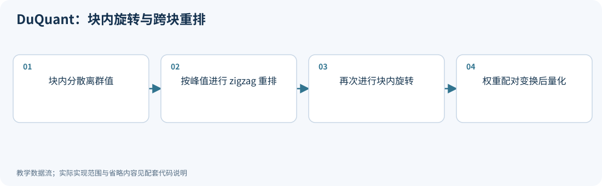
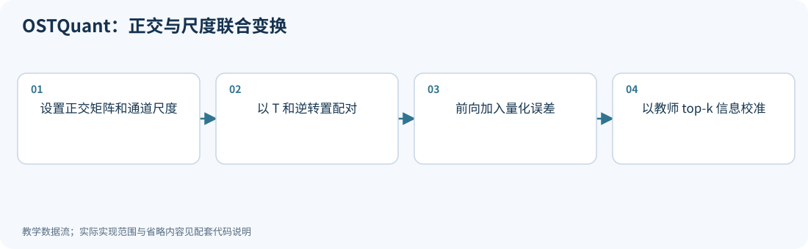
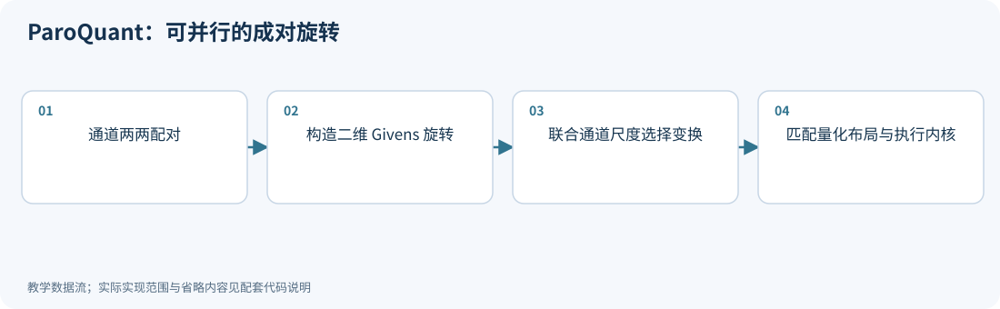
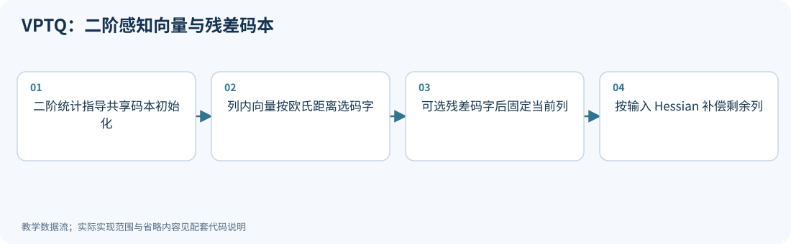
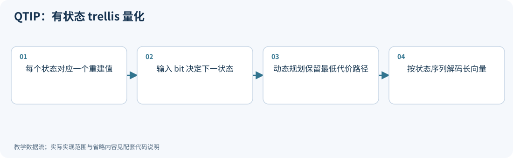
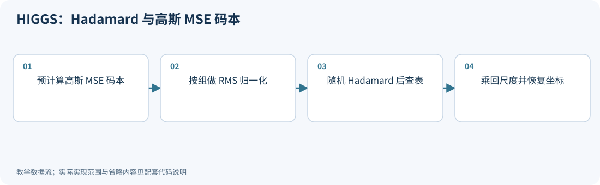
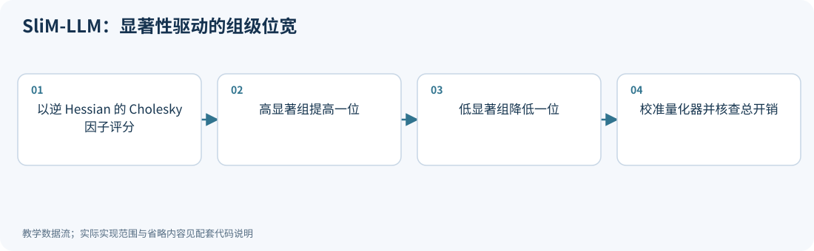

# 12｜新进展：变换、码本与有状态编码

<!-- course-objectives -->
**学习目标：** 对照变换、向量轴与有状态编码；计算码本和路径成本；验证局部代理及分配假设。

**先修知识：** 第 02–06 章；正交变换、码本与离散预算。 [进入本章测试](#chapter-assessment)；建议先独立作答，再展开答案。
<!-- /course-objectives -->

本章补充前面尚未覆盖的重要路线，包括 2024–2025 年首发、后续仍被新工作采用的方法。它们不是全部在 2026 年首次提出；各节列出首次提交时间和本次核对的论文版本。检索范围、筛选规则及其他候选见[检索记录](../references/原始资料索引.md#search-method)。

建议先读第 03、05、06 章。这里重点回答：除了单次旋转和独立码字，还能在哪些结构上优化量化？

<!-- chapter-overview -->
<a id="chapter-start"></a>

**阅读路线：** 比较结构化旋转、向量与有状态编码，再理解组级和表示内部的位宽分配；重点区分 GPTVQ/VPTQ 与不同谱代理。

<details><summary>本章目录（11 节）</summary>

- [12.1 DuQuant：块内旋转之后，为什么还要重排](#principle-12-1)
- [12.2 OSTQuant：让旋转和尺度共同适应量化空间](#principle-12-2)
- [12.3 ParoQuant：把可学习旋转约束成硬件友好的结构](#principle-12-3)
- [12.4 VPTQ：二阶感知的向量和残差码本](#principle-12-4)
- [12.5 QTIP：用状态转移替代巨大向量码本](#principle-12-5)
- [12.6 HIGGS：高斯 MSE 码本与线性误差模型](#principle-12-6)
- [12.7 SliM-LLM：把组级位宽分配变成具体算法](#principle-12-7)
- [12.8 如何比较本章的变换与编码路线](#principle-12-8)
- [12.9 GPTVQ：多输入列联合编码与 VPTQ 的区别](#principle-12-9)
- [12.10 谱对齐与球面位宽分配：新方法改变了哪项约束](#principle-12-10)
- [12.11 本章测试与参考答案](#principle-12-11)

</details>

每项技术的图示、代码和讲解紧跟原理。例子在项目根目录运行，只需 NumPy；长篇参考资料可在各节末尾展开。[按技术查找](技术图解与代码索引.md) · [查看实验输出](../experiments/results/逐项技术实验结果.md)。

[分章测试与参考答案](#chapter-assessment) · [课程考核与综合练习](11_练习与答案.md#course-assessment-guide)

[本章实操：完整逐步注释](#chapter-demo)

<!-- /chapter-overview -->

<a id="principle-12-1"></a>
<a id="duquant"></a>

## 12.1 DuQuant：块内旋转之后，为什么还要重排

<!-- publication: duquant -->
**文献时间：** 首次提交 2024-06-03；本次核对 2406.01721v3（版本日期 2024-11-01）。
<!-- /publication -->

块对角旋转只混合块内通道。如果一个块集中了大离群值、另一个块幅度很小，各块之间的不平衡仍然存在。DuQuant 先做平滑与局部旋转，再将通道按峰值排序，以 zigzag 顺序分配到不同块，最后进行第二次局部旋转。

在本书行向量约定下，将整条预处理链记为可逆矩阵：

$$
T=D^{-1}R_1PR_2,\qquad XW^T=(XT)(WT^{-T})^T.
$$

$D$ 是通道尺度，$R_1,R_2$ 是块对角正交矩阵，$P$ 是置换。局部旋转分散峰值，跨块置换改善块间分布；两者作用不同。原方法还用离群位置引导贪心构造旋转，而不是任意选择一个固定矩阵。

它主要面向低位宽权重和激活。额外变换是否可融合、是否需要在线执行，仍要由网络位置和内核决定。

### 离群值的两种形态与消融方式

原论文 §2 区分持续集中在少数通道的离群值，以及少量位置上幅度特别大的离群值；后者可能使仅靠缩放的方案把困难转移到权重。
§3.2 的局部旋转由当前最大激活位置引导，搜索多个旋转并保留峰值较小的候选，随后才做跨块 zigzag 重排。
下面的固定 Hadamard 示例只验证结构，不包含这一步搜索。[DuQuant v3](https://arxiv.org/html/2406.01721v3)

验证时应依次对照：仅平滑、平滑加一次块旋转、再加重排、再加第二次旋转。
在同一校准集之外，同时观察激活/权重范围、层输出误差、实际在线变换耗时。
如果峰值下降但层输出误差上升，应检查共享量化范围、权重误差和非线性位置，而不是继续以“峰值最小”作为唯一选择标准。

<!-- inline-technique: duquant -->

### 图解与代码



**运行：** `python experiments/technique_lab.py --technique duquant`

<!-- executable: duquant -->
```python
import numpy as np
from experiments.quant_lab import hadamard
X = np.array([[10., 8., .2, .1, .1, .3, .2, .1], [4., 2., .3, .1, .2, .4, .1, .2]])
W = np.arange(24, dtype=float).reshape(3, 8)/20
R = np.kron(np.eye(2), hadamard(4))
order = np.argsort(-np.max(abs(X@R), axis=0))
buckets = [[], []]
for rank, channel in enumerate(order):
    bucket = rank % 2 if (rank//2) % 2 == 0 else 1-rank % 2
    buckets[bucket].append(channel)
permutation = np.eye(8)[:, buckets[0]+buckets[1]]
T = R@permutation@R
assert np.allclose(T.T@T, np.eye(8))
assert np.allclose((X@T)@(W@T).T, X@W.T)
print('zigzag order:', buckets[0]+buckets[1])
print('peak before/after:', np.max(abs(X)), np.max(abs(X@T)))
```

**代码讲解**

1. 重排按块号往返分配大、小峰值，避免最大的通道全部进入同一个块。
2. R、置换和第二次 R 都正交，因此它们的乘积仍正交；权重右乘同一 T 保持输出。

> **示例边界：** 用固定 Hadamard 代替论文的离群值引导贪心旋转，省略初始平滑和完整校准；本例验证组合变换，不保证每组数据的峰值都下降。

<details>
<summary>论文、博客与官方资料</summary>

- **论文**：[DuQuant: Distributing Outliers via Dual Transformation Makes Stronger Quantized LLMs](https://arxiv.org/abs/2406.01721)（[所读版本正文](https://arxiv.org/html/2406.01721v3)）。
- **作者项目、官方文档与规范**：[DuQuant: Distributing Outliers via Dual Transformation Makes Stronger Quantized LLMs](https://duquant.github.io)；[GitHub - Hsu1023/DuQuant: [NeurIPS 2024 Oral🔥] DuQuant: Distributing Outliers via Dual Transformation Makes Stronger Quantized LLMs. · GitHub](https://github.com/Hsu1023/DuQuant)。

正文和代码演示范围见本节；项目可访问不等于已复现论文训练、模型评测或硬件性能。

</details>

<!-- /inline-technique -->

<a id="principle-12-2"></a>
<a id="ostquant"></a>

## 12.2 OSTQuant：让旋转和尺度共同适应量化空间

<!-- publication: ostquant -->
**文献时间：** 首次提交 2025-01-23；本次核对 2501.13987v1（版本日期 2025-01-23）。
<!-- /publication -->

OSTQuant 将正交变换与对角缩放作为联合优化变量，并用 Quantization Space Utilization Rate（QSUR）讨论分布与量化空间的匹配。相较单纯减小最大值，它关心数据如何分布在可用空间里。

例如令 $T=RD$，仍有：

$$
XW^T=(XT)(WT^{-T})^T.
$$

该恒等式只负责保证浮点等价；真正的目标包含量化前向。论文还提出 KL-Top，只对教师预测概率最高的若干类别计算部分 KL 项：

$$
I=\operatorname{TopK}(p),\qquad L_{top}=\sum_{i\in I}p_i\log\frac{p_i}{q_i}.
$$

按此截断求和式，$p_I,q_I$ 未必重新归一化，因此不要直接套用完整概率分布 KL 的非负性。全局变换、初始化和损失选择共同构成方法；下面的局部例子不替代整模型优化。

### QSUR 与 KL-Top 分别承担什么作用

QSUR 是分布几何的代理指标；它的高斯与体积解释不能直接推出任意经验激活的任务最优量化。
论文 §4 在全局量化前向上优化变换，§4.2 使用 KL-Top 保留教师的重点预测。[OSTQuant v1](https://arxiv.org/html/2501.13987v1)

截断求和与“子集重新归一化后的 KL”是不同目标。若
$p=(0.6,0.4)$、$q=(0.9,0.1)$，只保留教师 top-1，原定义得到
$0.6\log(0.6/0.9)<0$；重新归一化后两者都为 $(1)$，KL 则为零。
这不是完整 KL 非负性被推翻，而是截断项不再是两个完整概率分布的 KL。

<!-- depth-example: truncated_kl -->
```python
import numpy as np
p, q = np.array([.6, .4]), np.array([.9, .1])
partial = p[0]*np.log(p[0]/q[0])
full = np.sum(p*np.log(p/q))
conditional = np.log((p[0]/p[0])/(q[0]/q[0]))
assert partial < 0 and full > 0 and conditional == 0
print('partial / full / renormalized:', partial, full, conditional)
```

报告 KL-Top 时应说明 top-k 来自教师还是学生、是否重归一化以及温度。浮点等价变换本身也不能保证量化后的优化不会过拟合校准集。

<!-- inline-technique: ostquant -->

### 图解与代码



**运行：** `python experiments/technique_lab.py --technique ostquant`

<!-- executable: ostquant -->
```python
import numpy as np
from experiments.quant_lab import hadamard, symmetric_qdq, softmax
rng = np.random.default_rng(1202)
X = rng.normal(size=(6, 4)); W = rng.normal(size=(3, 4))
T = hadamard(4)@np.diag([.5, 1., 2., 1.])
Wp = np.linalg.solve(T, W.T).T
assert np.allclose((X@T)@Wp.T, X@W.T)
teacher = softmax(X@W.T)
student = softmax(symmetric_qdq(X@T, axis=1)[0] @ symmetric_qdq(Wp, axis=1)[0].T)
indices = np.argsort(teacher, axis=1)[:, -2:]
p = np.take_along_axis(teacher, indices, axis=1)
q = np.take_along_axis(student, indices, axis=1)
kl_top = np.mean(np.sum(p*np.log(p/q), axis=1))
assert np.isfinite(kl_top)
print('teacher top-2 indices and partial KL:', indices, kl_top)
```

**代码讲解**

1. T=R D 的逆转置一般不等于 T；solve 明确保持矩阵方向，避免把一般缩放当成正交变换。
2. 示例按原文 top-k 求和式保留原概率，不重新归一化；截断部分和不能直接套用完整 KL 非负性的结论。

> **示例边界：** 仅验证变换和 KL-Top 的计算，没有实现 QSUR 评估、WOMI 初始化或跨 Transformer 块的优化与融合。

<details>
<summary>论文、博客与官方资料</summary>

- **论文**：[OstQuant: Refining Large Language Model Quantization with Orthogonal and Scaling Transformations for Better Distribution Fitting](https://arxiv.org/abs/2501.13987)（[所读版本正文](https://arxiv.org/html/2501.13987v1)）。
- **作者项目、官方文档与规范**：[GitHub - BrotherHappy/OSTQuant: [ICLR2025]: OSTQuant: Refining Large Language Model Quantization with Orthogonal and Scaling Transformations for Better Distribution Fitting · GitHub](https://github.com/BrotherHappy/OSTQuant)。

正文和代码演示范围见本节；项目可访问不等于已复现论文训练、模型评测或硬件性能。

</details>

<!-- /inline-technique -->

<a id="principle-12-3"></a>
<a id="paroquant"></a>

## 12.3 ParoQuant：把可学习旋转约束成硬件友好的结构

<!-- publication: paroquant -->
**文献时间：** 首次提交 2025-11-13；本次核对 2511.10645v2（版本日期 2026-02-14）。
<!-- /publication -->

任意稠密旋转会增加每个 token 的计算。ParoQuant 使用独立的二维 Givens 旋转和通道尺度，兼顾校准自由度与实现规整性，面向 weight-only 的推理模型。

二维旋转为：

$$
G(\theta)=\begin{bmatrix}\cos\theta&-\sin\theta\\\sin\theta&\cos\theta\end{bmatrix}.
$$

将多个不重叠的 $G$ 放在块对角上，就能并行处理通道对。它与 SpinQuant 的共同点是优化坐标系；关键差别之一是对变换结构和执行成本施加更明确的限制。

学习角度后仍须检查运行时融合。不可吸收的旋转会随 token 数量反复执行，长推理场景尤其不能只看离线重建损失。

### 完整方法还包含第二阶段适配

论文 §4.1 采用多轮独立通道对旋转，跨轮更换配对以增加表达能力；每轮不重叠的配对可并行处理。
若轮数为 $K$、维度为 $d$，理想算术量约为 $O(Kd)$，但实际时间还取决于访存和融合。
§4.2 先优化旋转与通道缩放，再以 QAT 类方式微调权重和量化尺度/零点。后一个阶段改变了模型参数，完整收益不能全部归因于旋转。[ParoQuant v2](https://arxiv.org/html/2511.10645v2)

其块目标还区分原始输入 $X$ 和上游量化后的输入 $X'$：比较量化块 $f_Q(X')$ 与原块 $f_{FP}(X)$。
复现应至少记录变换轮数、两个阶段各自训练预算，以及是否采用该非对称目标。下面的固定角度枚举不实现第二阶段。

<!-- inline-technique: paroquant -->

### 图解与代码



**运行：** `python experiments/technique_lab.py --technique paroquant`

<!-- executable: paroquant -->
```python
import numpy as np
from experiments.quant_lab import group_qdq, mse
rng = np.random.default_rng(1203)
X = rng.normal(size=(16, 4)); X[:, 0] *= 8
W = rng.normal(size=(3, 4)); scores = []
D = np.diag([.5, 2., 1., 1.])
for theta in [0., np.pi/8, np.pi/4]:
    c, s = np.cos(theta), np.sin(theta)
    R = np.kron(np.eye(2), [[c, -s], [s, c]])
    T = D@R; Wp = np.linalg.solve(T, W.T).T
    assert np.allclose((X@T)@Wp.T, X@W.T)
    scores.append(mse(X@W.T, (X@T)@group_qdq(Wp, group_size=2).T))
print('candidate-angle output MSE:', scores)
```

**代码讲解**

1. 二维旋转块之间互不依赖；缩放和旋转的先后顺序由 T 明确表示。
2. 只量化权重，保持激活浮点；用少量角度枚举展示局部校准目标。

> **示例边界：** 枚举代替多轮成对变换学习；省略非对称块重建、第二阶段权重与量化参数微调，以及融合 kernel 和真实推理测时。

<details>
<summary>论文、博客与官方资料</summary>

- **论文**：[ParoQuant: Pairwise Rotation Quantization for Efficient Reasoning LLM Inference](https://arxiv.org/abs/2511.10645)（[所读版本正文](https://arxiv.org/html/2511.10645v2)）。
- **作者项目、官方文档与规范**：[GitHub - z-lab/paroquant: [ICLR 2026] ParoQuant: Pairwise Rotation Quantization for Efficient Reasoning LLM Inference · GitHub](https://github.com/z-lab/paroquant)；[ParoQuant: Pairwise Rotation Quantization for Efficient Reasoning LLM Inference - Z Lab](https://z-lab.ai/projects/paroquant/)。

正文和代码演示范围见本节；项目可访问不等于已复现论文训练、模型评测或硬件性能。

</details>

<!-- /inline-technique -->

<a id="principle-12-4"></a>
<a id="vptq"></a>

## 12.4 VPTQ：二阶感知的向量和残差码本

<!-- publication: vptq -->
**文献时间：** 首次提交 2024-09-25；本次核对 2409.17066v2（版本日期 2024-10-22）。
<!-- /publication -->

VPTQ 将输入列之间的二阶补偿与列内部的向量编码分开。采用本书 $W\in\mathbb R^{m\times d}$ 约定，固定输入列 $j$，将 $W_{:,j}$ 沿输出维切成短向量 $v$。这与把同一行的多个输入列联合量化不同。

令剩余输入列的重建 Hessian 为 $H$、$M=H^{-1}$。若当前列被固定为向量近似，误差为 $e=\widehat W_{:,j}-W_{:,j}$，最优连续补偿的代价为

$$
\Delta L=\frac{\|e\|_2^2}{2M_{jj}}.
$$

对当前同一列，分母是公共常数，因此选码字时用

$$
i^*=\arg\min_i\|v-c_i\|_2^2.
$$

**这里不是在输出向量上再套一个任意 $H$ 的 Mahalanobis 距离。** 输入 Hessian 的维度为 $d\times d$，不等于列内向量长度。二阶信息用于跨列补偿；初始化共享码本时，论文 §3.2 另用各输入列的 Hessian 对角重要性做加权聚类。

主码字之后可对 $v-c_{i^*}$ 再选残差码字，重建为 $c_{i^*}+r_j$。码本初始化、向量方向和补偿顺序均与 AQLM/GPTVQ 有区别。完整方法还支持离群码本及微调。[VPTQ v2，§3.1–3.2、算法 1](https://arxiv.org/pdf/2409.17066v2)

下面同时验证欧氏码字选择和一次跨输入列补偿；码本、主/残差索引及高精度例外仍需计入完整存储。

<!-- inline-technique: vptq -->

### 图解与代码



**运行：** `python experiments/technique_lab.py --technique vptq`

<!-- executable: vptq -->
```python
import numpy as np
W = np.array([[.85, .4], [-.32, .6]])
H = np.array([[2., 1.], [1., 2.]])  # Input-column Hessian, not an output-vector metric.
M = np.linalg.inv(H)
vector = W[:, 0]
main = np.array([[0., 0.], [1., 0.], [.65, -.32], [1., -1.]])
residual = np.array([[0., 0.], [.2, .05], [-.15, -.25]])
cost = lambda candidates: np.sum((candidates-vector)**2, axis=-1)
first = int(np.argmin(cost(main)))
second = int(np.argmin(cost(main[first]+residual)))
assert (first, second) == (2, 1)  # Euclidean search within one input column.
restored = main[first]+residual[second]
e = restored-vector
delta = np.outer(e, M[0, :]/M[0, 0])
compensated_loss = .5*np.trace(delta@H@delta.T)
no_compensation = np.column_stack([e, np.zeros_like(e)])
assert np.allclose((W+delta)[:, 0], restored)
assert np.isclose(compensated_loss, (e@e)/(2*M[0, 0]))
assert compensated_loss < .5*np.trace(no_compensation@H@no_compensation.T)
assert cost(restored) <= cost(main[first])
print('main/residual indices:', first, second)
print('column error and compensated loss:', e, compensated_loss)
```

**代码讲解**

1. 向量来自同一输入列的多个输出行，码字搜索用欧氏距离；H 描述两个输入列的相关性。
2. delta 的第一列精确满足码字约束，第二列连续补偿；独立比较二次型与受约束最小损失公式。

> **示例边界：** 固定小码本，仅演示一列与下一列的连续补偿；未实现共享码本训练、完整顺序量化、离群码本或模型微调。

<details>
<summary>论文、博客与官方资料</summary>

- **论文**：[VPTQ: Extreme Low-bit Vector Post-Training Quantization for Large Language Models](https://arxiv.org/abs/2409.17066)（[所读版本正文](https://arxiv.org/pdf/2409.17066v2)）。
- **作者项目、官方文档与规范**：[GitHub - microsoft/VPTQ: VPTQ, A Flexible and Extreme low-bit quantization algorithm · GitHub](https://github.com/microsoft/VPTQ)。

正文和代码演示范围见本节；项目可访问不等于已复现论文训练、模型评测或硬件性能。

</details>

<!-- /inline-technique -->

<a id="principle-12-5"></a>
<a id="qtip"></a>

## 12.5 QTIP：用状态转移替代巨大向量码本

<!-- publication: qtip -->
**文献时间：** 首次提交 2024-06-17；本次核对 2406.11235v4（版本日期 2025-06-18）。
<!-- /publication -->

直接把高维向量映射到一个大码本，码本规模通常随维度迅速增长。QTIP 引入 trellis-coded quantization：解码器维护状态，每个新编码片段改变状态，并产生下一段重建值。

一个教学 bitshift 转移可以写成：

$$
s_{t+1}=((s_t\ll b)\;|\;u_t)\bmod 2^L,
\qquad\widehat w_t=c(s_{t+1}).
$$

$L$ 控制状态数，$b$ 控制每步新输入的编码位数。某个位置的最佳码字受前面路径约束，因此编码需要动态规划等全局路径搜索，不能逐元素独立舍入。

QTIP 还结合非相干处理、特定码构造和硬件实现。固定起点、尾咬合路径、查表或计算式解码对应不同开销，不能由下面的小状态例子直接推断实际 bit/weight。

### 编码有路径依赖，解码仍可并行

设一条权重序列有 $T$ 个标量，每步产生 $V$ 个值、每值引入 $k$ bit，状态为 $L$ bit。
相邻步骤共享 $L-kV$ 个状态 bit，完整编码占 $kT+L-kV$ bit，尚未计对齐与尺度。
每个输出仅依赖编码流中的一个有限 bit 窗口，因此不同位置可以并行解码；不能把 Viterbi 编码的顺序依赖误当成逐 token 推理必须串行。

尾咬合要求首尾重叠一致，可省去边界状态开销，但精确求解更贵。论文 §3.2 使用两次 Viterbi 的近似流程，并未证明它对所有输入都得到全局最优路径。[QTIP v4](https://arxiv.org/html/2406.11235v4)

比较时应固定实际平均位宽、序列分块长度和状态大小，并分别测离线编码与在线解码；增加状态数改善失真也可能显著增加离线内存。

<!-- inline-technique: qtip -->

### 图解与代码



**运行：** `python experiments/technique_lab.py --technique qtip`

<!-- executable: qtip -->
```python
import itertools
import numpy as np
values = np.array([-.8, -.1, .9, .2, -.4])
codebook = np.array([-1., -.25, .25, 1.])
paths = {0: (0., [])}
for value in values:
    next_paths = {}
    for state, (cost, bits) in paths.items():
        for bit in (0, 1):
            nxt = ((state << 1) | bit) & 3
            candidate = (cost+(codebook[nxt]-value)**2, bits+[bit])
            if nxt not in next_paths or candidate[0] < next_paths[nxt][0]:
                next_paths[nxt] = candidate
    paths = next_paths
best_cost, best_bits = min(paths.values(), key=lambda item: item[0])
def decode(bits):
    state = 0; output = []
    for bit in bits:
        state = ((state << 1) | bit) & 3; output.append(codebook[state])
    return np.array(output)
brute = min(np.sum((decode(b)-values)**2) for b in itertools.product((0, 1), repeat=len(values)))
assert np.isclose(best_cost, brute)
print('bit path, decoded values, SSE:', best_bits, decode(best_bits), best_cost)
```

**代码讲解**

1. 一个新 bit 同时受旧状态约束，不能对每个元素独立选最近码字；动态规划利用相同尾状态合并路径。
2. 对五步路径穷举提供独立最优性检查，展示 trellis 如何在小状态空间里处理更长序列。

> **示例边界：** 四状态、固定起点的教学 trellis；未实现 QTIP 的非相干预处理、尾咬合约束、Gaussian 码构造及 GPU 解码。

<details>
<summary>论文、博客与官方资料</summary>

- **论文**：[QTIP: Quantization with Trellises and Incoherence Processing](https://arxiv.org/abs/2406.11235)（[所读版本正文](https://arxiv.org/html/2406.11235v4)）。
- **作者项目、官方文档与规范**：[GitHub - Cornell-RelaxML/qtip · GitHub](https://github.com/Cornell-RelaxML/qtip)。

正文和代码演示范围见本节；项目可访问不等于已复现论文训练、模型评测或硬件性能。

</details>

<!-- /inline-technique -->

<a id="principle-12-6"></a>
<a id="higgs"></a>

## 12.6 HIGGS：高斯 MSE 码本与线性误差模型

<!-- publication: higgs -->
**文献时间：** 首次提交 2024-11-26；本次核对 2411.17525v1（版本日期 2024-11-26）。
<!-- /publication -->

HIGGS 将随机 Hadamard、尺度归一化与预计算高斯 MSE 网格组合起来。对于归一化的正交 $R$，用 RMS 尺度写为：

$$
s=\sqrt{\|w\|_2^2/g},\qquad u=wR/s,
\qquad \widehat w=sQ_{\mathcal C}(u)R^T.
$$

此时 $u$ 的平均平方幅度为 1，便于使用针对标准高斯分布设计的网格。高维随机变换使分布更接近高斯是近似性质，不是每个小向量都严格高斯。

论文的线性误差分析还支持非均匀位宽分配，但依赖其局部扰动和误差模型假设。不能把“权重 MSE 更小”扩展成对任何模型、任何下游任务都必然更好。完整实现使用多维网格与专门内核。

### “线性定理”线性于什么

论文 §3 定义各层相对平方误差
$t_l^2=\mathbb E\|\widehat W_l-W_l\|_F^2/\|W_l\|_F^2$，在其假设下近似写成

$$
\mathbb E[\mathrm{PPL}(\widehat W)]\approx\mathrm{PPL}(W)+\sum_l a_l t_l^2.
$$

它不是说 PPL 对位宽线性。条件包含局部平滑、小扰动，以及归一化 Hessian 的特定块近似；局部驻点条件可以在相应无偏压缩假设下放宽。
低位宽的大误差、跨层耦合或任务变化都可能破坏这种近似。[HIGGS v1，§3–5](https://arxiv.org/html/2411.17525v1)

可用固定开发集逐层施加小扰动拟合 $a_l$，再用未参与拟合的联合量化配置检查预测误差。
若线性代理不能预测联合退化，就不应直接按它分配整模型位宽。HIGGS 的网格还能与 GPTQ 的误差补偿结合，数据无关网格与使用激活的编码策略并不冲突。

<!-- inline-technique: higgs -->

### 图解与代码



**运行：** `python experiments/technique_lab.py --technique higgs`

<!-- executable: higgs -->
```python
import numpy as np
from experiments.quant_lab import hadamard
from experiments.technique_kernels import lloyd, nearest
grid = np.linspace(-5, 5, 2001)
centers, _ = lloyd(grid, 16, importance=np.exp(-grid**2/2))
w = np.array([4., -.1, .2, .3, -.2, .1, .4, -.3])
R = np.diag([1, -1, 1, -1, 1, 1, -1, 1])@hadamard(8)
scale = np.sqrt(np.mean(w*w))
normalized = (w@R)/scale
quantized = nearest(normalized, centers)
restored = scale*(quantized@R.T)
assert np.isclose(np.mean(normalized**2), 1.)
assert np.allclose(scale*(normalized@R.T), w)
print('Gaussian grid and weight MSE:', centers, np.mean((restored-w)**2))
```

**代码讲解**

1. 使用 RMS 而非 L2 范数直接归一化，使旋转后每维的平均平方幅度为 1；两种写法相差 sqrt(group_size)。
2. 码本在一个截断高斯积分网格上预计算，没有读取模型校准激活。

> **示例边界：** 使用一维离散 Lloyd 近似展示流程；完整 HIGGS 使用多维 MSE 网格、特定内核及可选非均匀位宽分配。

<details>
<summary>论文、博客与官方资料</summary>

- **论文**：[Pushing the Limits of Large Language Model Quantization via the Linearity Theorem](https://arxiv.org/abs/2411.17525)（[所读版本正文](https://arxiv.org/html/2411.17525v1)）。
- **作者项目、官方文档与规范**：[HIGGS · Hugging Face](https://huggingface.co/docs/transformers/quantization/higgs)。

正文和代码演示范围见本节；项目可访问不等于已复现论文训练、模型评测或硬件性能。

</details>

<!-- /inline-technique -->

<a id="principle-12-7"></a>
<a id="slim_llm"></a>

## 12.7 SliM-LLM：把组级位宽分配变成具体算法

<!-- publication: slim_llm -->
**文献时间：** 首次提交 2024-05-23；本次核对 2405.14917v2（版本日期 2025-05-25）。
<!-- /publication -->

第 06 章介绍了通用位宽预算问题。SliM-LLM 进一步利用权重显著性的空间分组结构：Salience-Determined Bit Allocation（SBA）选择组位宽，Salience-Weighted Quantizer Calibration（SQC）保护组内重要元素。

**论文正文与算法/源码的记号需要分开读取。** v2 正文 Definition 3.1 写为：

$$
\delta_{ij}=\frac{w_{ij}^2}{([H^{-1}]_{jj})^2}.
$$

但附录算法 1–2 先定义 $H^{in}=\operatorname{Cholesky}((H+\lambda I)^{-1})$，再用其对角平方评分。
作者[固定提交 `cfdf5ff` 的 `get_salience`](https://github.com/Aaronhuang-778/SliM-LLM/blob/cfdf5ff9a1785ba93197761e47ea66b8786790f2/slim-llm/slim_gptq.py#L62)也采用后一约定：先求逆，再做上三角 Cholesky；变量虽名为 `Hinv`，实际保存的是该因子。明确写成

$$
H_\lambda=H+0.01I,\qquad M=H_\lambda^{-1}=U^TU,\qquad
\delta^{impl}_{ij}=\frac{w_{ij}^2}{U_{jj}^2}.
$$

这里的绝对阻尼 0.01 是该提交评分函数的设置，不代表所有实现。一般 $U_{jj}^2\ne M_{jj}$，不能把因子对角与逆矩阵对角混用。
即使阻尼后 $H_\lambda=\operatorname{diag}(1,4)$、权重为 $(1,0.4)$，字面套用正文式得到 $(1,2.56)$，实现式却得到 $(1,0.64)$，排序相反。
这属于原始来源内部的公式与执行约定差异；本节保留两者，并以下方按固定源码约定计算的例子作为复现入口。核对范围与源码哈希见[实现核验清单](../references/provenance/implementation_checks.json)。

这些分数用于显著性排序，仍需区分原始/阻尼统计、消元阶段与单次受约束损失。对等大小组，以 $N$ bit 为基准，将相同数量的高显著组提升到 $N+1$、低显著组降低到 $N-1$，可维持平均 payload 位宽：

$$
|\mathcal G_{N+1}|=|\mathcal G_{N-1}|.
$$

原方法还要搜索调整多少组并校准量化器。等数量约束不自动维持包含 scale、标签和 padding 的完整文件大小，后端对混合格式的支持同样关键。

### 组位宽分配与组内校准需要分开验证

SBA 决定各组的位宽；SQC 在位宽已经确定后，利用组内显著性调整量化器。只实施高低组各升降一位，尚未复现后一个步骤。
建议比较统一位宽、仅 SBA、仅 SQC、二者组合，并保持总 payload、元数据、校准数据与搜索预算可比。[SliM-LLM v2，§3](https://arxiv.org/pdf/2405.14917v2)

从“平均 2 bit”到“模型文件平均 2 bit”还差标签、尺度和混合布局成本。下面用 1/2/3 bit 说明预算，未给出 1-bit 的真实编码器；不能把对称 `[-qmax,qmax]` 量化器直接设成 1 bit，因为这会得到 $qmax=0$。

<!-- inline-technique: slim_llm -->

### 图解与代码



**运行：** `python experiments/technique_lab.py --technique slim_llm`

<!-- executable: slim_llm -->
```python
import numpy as np
W = np.array([[1., 1., .4, .4, .1, .1, .05, .05]])
H = np.diag([1., 1., 4., 4., 1., 1., 1., 1.])
H_reg = H + .01*np.eye(8)  # Absolute damping in the pinned get_salience method.
M = np.linalg.inv(H_reg)
U = np.linalg.cholesky(M).T
assert np.allclose(U.T@U, M)
scores = W**2 / np.diag(U)[None, :]**2
# Independent scalar check, valid here because H_reg is diagonal.
assert np.allclose(scores, W**2*np.diag(H_reg)[None, :])
salience = scores.reshape(4, 2).sum(axis=1)
paper_salience = (W**2/np.diag(M)[None, :]**2).reshape(4, 2).sum(axis=1)
assert salience.argmax() == 0 and paper_salience.argmax() == 1
order = np.argsort(salience)
bits = np.full(4, 2)
bits[order[0]] = 1; bits[order[-1]] = 3
assert np.array_equal(bits, [3, 2, 2, 1]) and bits.mean() == 2
print('literal paper / implementation salience:', paper_salience, salience)
print('group salience, assigned bits:', salience, bits)
print('payload bits:', np.sum(bits*2))
```

**代码讲解**

1. M 是阻尼后 Hessian 的逆，U 才是作者代码变量 Hinv 实际保存的上三角 Cholesky 因子；本例按 w²/Ujj² 评分并按组求和。
2. 对角 H 的独立标量计算核对实现分数；若将 U 的对角误换成 M 的对角，最高显著组从第 1 组变为第 2 组。
3. 一组升到 3 bit、一组降到 1 bit，其余保持 2 bit；此等数量约束只在组大小一致时保持相同 payload。

> **示例边界：** 按固定作者版本演示 SBA 评分与预算约束，并对照论文正文的字面公式；未实现候选数量搜索、SQC、1-bit 编码和实际打包。

<details>
<summary>论文、博客与官方资料</summary>

- **论文**：[SliM-LLM: Salience-Driven Mixed-Precision Quantization for Large Language Models](https://arxiv.org/abs/2405.14917)（[所读版本正文](https://arxiv.org/pdf/2405.14917v2)）。
- **作者项目、官方文档与规范**：[GitHub - Aaronhuang-778/SliM-LLM: [ICML 2025] SliM-LLM: Salience-Driven Mixed-Precision Quantization for Large Language Models · GitHub](https://github.com/Aaronhuang-778/SliM-LLM)；[SliM-LLM get_salience：固定提交 cfdf5ff](https://github.com/Aaronhuang-778/SliM-LLM/blob/cfdf5ff9a1785ba93197761e47ea66b8786790f2/slim-llm/slim_gptq.py#L62)。

论文 Definition 3.1 的字面公式与附录算法/固定源码存在记号差异；本节示例按源码的 Cholesky 因子评分，CPU 单独执行核验见来源索引的实现核验清单，未复现完整模型。

</details>

<!-- /inline-technique -->

<a id="principle-12-8"></a>

## 12.8 如何比较本章的变换与编码路线

| 路线 | 真正增加的自由度 | 必须控制的比较变量 | 最容易遗漏的成本 |
|---|---|---|---|
| DuQuant / OSTQuant / ParoQuant | 变换结构、尺度、部分方法的后续适配 | 量化网格、校准/训练预算、是否改变主权重 | 在线旋转、融合限制、额外适配训练 |
| VPTQ / AQLM | 向量码本、残差或加法索引 | 向量轴、码本大小、完整有效位宽 | 码本摊销、搜索、查表与重建 |
| QTIP | 重叠 bit 窗口与有状态码字路径 | 状态数、序列长度、首尾约束 | 离线 Viterbi 内存、边界与对齐 |
| HIGGS | 预计算网格与可组合的编码策略 | 是否使用激活、网格维度、位宽分配 | 变换与实际解码内核 |
| SliM-LLM | 组位宽与组内显著性校准 | 主体/元数据预算、支持的位宽集合 | 格式标签与混合计算布局 |

如果目标是判断某种机制是否有效，先固定最终表示和校准预算做消融；如果目标是部署选型，
则固定质量底线、实际显存与请求分布，允许各方法使用自己的最佳可执行配置。这是两类不同的研究问题。

<a id="gptvq"></a>

<a id="principle-12-9"></a>

## 12.9 GPTVQ：多输入列联合编码与 VPTQ 的区别

[GPTVQ v2，§4](https://arxiv.org/html/2402.15319v2)（首发 2024-02-23；版本 2025-06-03）将 GPTQ 扩展到同一权重行的多个输入列联合量化，并用数据感知的码本初始化与后续误差补偿。VPTQ 则在当前输入列沿输出方向组成向量，两者的“向量长度”并不是同一个轴。

从第 02 章的二次约束问题可推导多坐标形式。令 $M=H^{-1}$，选择矩阵 $S$ 取出待固定的输入坐标，约束 $S^T\delta=\epsilon$，则

$$
\delta^*=MS(S^TMS)^{-1}\epsilon,\qquad
\Delta L=\tfrac12\epsilon^T(S^TMS)^{-1}\epsilon.
$$

一个标量约束时分母只是 $M_{ii}$；多个输入坐标时出现小矩阵，体现向量编码与输入相关性的耦合。该式用于解释联合补偿，不是 GPTVQ 完整实现逐行翻译；实际算法还处理码本训练、分组、Cholesky 与码本压缩。

| 方法 | 主要联合单位 | 需核对的额外事项 |
|---|---|---|
| GPTVQ | 同一行的多个输入坐标 | 数据感知码本、跨列补偿、码本存储 |
| VPTQ | 同一输入列内的输出向量 | 列内欧氏选择、共享码本初始化与残差 |
| AQLM | 短向量的多码本索引组合 | 多码本联合搜索及模型微调 |
| QTIP | 编码流的重叠 bit 窗口 | 状态数、首尾约束与离线搜索 |

<a id="spectral-and-spherical"></a>

<a id="principle-12-10"></a>

## 12.10 谱对齐与球面位宽分配：新方法改变了哪项约束

[SpectrumQuant v1，§4](https://arxiv.org/html/2610.20303v1)（2026-10-14）从校准协方差构造对齐与混合变换。正交变换保持协方差 Frobenius 范数，因此最大化非对角平方和等价于最小化对角平方和；固定 trace 下，对角均衡是该代理的最优点。原文连接量化误差时使用高分辨率噪声模型和由最大方差确定共享范围的假设，不能直接推出任意离散 FP4、裁剪与权重/激活联合量化都最优。

[SAGE v1，§3](https://arxiv.org/html/2610.14745v1)（2026-10-10）研究权重的符号、方向码本与半径表示，使用激活加权的分组与拟合，并在固定预算中选择方向索引和半径的位数。
若向量长 $v$、逐元素符号占 $v$ bit、方向索引占 $b_d$、半径占 $b_r$，主体成本为

$$
b_{payload}=\frac{v+b_d+b_r}{v}.
$$

还需加入码本、半径量化参数与对齐。这是**表示内部**的预算分配，与只给不同层选位宽不同。SAGE 是 weight-only 向量量化工作，不能因名字相似而与 SageAttention 系列混为一谈。

两篇均作为具体机制的研究证据；尚不能仅凭局部最优代理或单篇实验，替代既有稳定后端和同预算模型验证。

<!-- chapter-demo: 12 -->
## 本章实操｜动态规划编码 trellis 并独立解码

<a id="chapter-demo"></a>

**实践目的：** 理解编码路径依赖、状态合并与bit流成本，而非逐元素最近邻。

**环境：** Python 3.10+、NumPy、PyTorch；支持 CPU/CUDA，Colab 选择 GPU 运行时。无需下载模型。在项目根目录执行：

```bash
python experiments/chapter_demo_lab.py --chapter 12 --device cuda
# 没有GPU时显式使用CPU；auto在CUDA可用时优先使用GPU
python experiments/chapter_demo_lab.py --chapter 12 --device cpu
# 也可直接执行源码模块（同样在项目根目录）
python -m experiments.demos.ch12
```

**Colab：** 可直接上传[逐章 GPU Notebook](../experiments/notebooks/colab_chapter_demos.ipynb)，它自带所需源码；按单元选择本章运行。修改源码后将 `PRACTICE=True`，或命令行加 `--practice`；此模式跳过正文一致性检查，保留数值断言、设备核验及实际源码哈希。指定 `cuda` 后不可用会报错，不会静默退回 CPU。随机输入在 CPU 准备后一次搬到所选设备；矩阵、量化、训练和统计计算使用该设备的 PyTorch 张量。文件 I/O、Python 流程控制和打印在主机；默认 FP64 核验精度，不代表原生低比特 Tensor Core 性能。

**完整源码：** [带逐步注释的 demo](../experiments/demos/ch12.py)。默认只打印结果；保存命令与全部章节入口见[实操导航](../README.md#chapter-demos)。

<details><summary>展开完整代码：每一步的行为、计算逻辑与检查条件</summary>

<!-- chapter-demo-code: 12 -->
```python
"""第 12 章：四状态 trellis 编码，动态规划和穷举交叉核验。"""
import itertools
import torch
from experiments.demo_runtime import get_runtime, same, exact

# 第 0 步：auto优先CUDA；runner可用--device指定。所有计算张量在此设备创建。
rt = get_runtime()
device, dtype = rt.device, rt.dtype

# 第 1 步：每个状态对应一个标量码字；每步输入一个bit，状态保留最近两bit。
# 固定初始状态0，所以首步只有两个状态可达，不能逐元素任意选码字。
values = rt.tensor([-.8, -.1, .9, .2, -.4])
codebook = rt.tensor([-1., -.25, .25, 1.])
paths = {0: (0., [])}

# 第 2 步：每层只保留到达同一状态的最低代价路径。
# 后续可达集合只依赖当前状态，因此此前更高代价路径可以安全丢弃。
for t, value in enumerate(values):
    following = {}
    for state, (cost, bits) in paths.items():
        for bit in (0, 1):
            next_state = ((state << 1) | bit) & 3
            next_cost = cost+(value-codebook[next_state])**2
            if next_state not in following or next_cost < following[next_state][0]:
                following[next_state] = (float(next_cost), bits+[bit])
    paths = following
    print('位置 / 可达状态最低SSE:', t, {s: round(c, 5) for s, (c, _) in paths.items()})
best_cost, best_bits = min(paths.values(), key=lambda item: item[0])

# 第 3 步：解码只需要初始状态、bit流与共享码本，不需要原始 values。
def decode(bits):
    state = 0
    output = []
    for bit in bits:
        state = ((state << 1) | bit) & 3
        output.append(codebook[state])
    return torch.stack(output)
decoded = decode(best_bits)
assert same(torch.sum((decoded-values)**2), best_cost)

# 第 4 步：本例仅2^5条路径，穷举提供独立全局最优核验。
exhaustive = min(torch.sum((decode(bits)-values)**2)
                 for bits in itertools.product((0, 1), repeat=len(values)))
assert same(best_cost, exhaustive)

# 第 5 步：bit流真正打包；注明尾部补齐以及固定起点假设。
bits_tensor = rt.tensor(best_bits, dtype=torch.int64)
padded = torch.nn.functional.pad(bits_tensor, (0, (-len(best_bits)) % 8))
shifts = torch.arange(8, device=device)
packed = torch.sum(padded.reshape(-1, 8) << shifts, dim=1).to(torch.uint8)
restored_bits = ((packed.long()[:, None] >> shifts) & 1).flatten()[:len(values)]
assert exact(restored_bits, best_bits)
print('最佳bit流 / 重建 / SSE:', best_bits, decoded, best_cost)
print('逻辑bit数 / 实际payload字节:', len(best_bits), packed.nbytes)
# 还应记录长度、码本与块边界；这里只展示 QTIP 的路径思想，不含其实际码构造或内核。

# 收尾：等待本demo设备上的操作完成，方便Colab定位CUDA异步报错。
rt.synchronize()
```

</details>

**运行后观察：** 每层输出可达状态最低SSE；最终动态规划与32条路径穷举的最小值一致。

**动手修改：** 修改values或码本，保持相同初始状态比较；增加序列长度时注意穷举指数增长。

**适用边界：** 四状态固定起点的教学编码，不含QTIP尾咬合或真实GPU解码结构。

<!-- /chapter-demo -->

<!-- chapter-assessment -->

<a id="principle-12-11"></a>

## 12.11 本章测试与参考答案

<a id="chapter-assessment"></a>

核心卷 10 题，仍按 100 分；另有简单、困难、特别困难拓展题各 1 道，不计入核心卷。难度相对于本章先修知识划分，题号保持原有顺序。核心卷建议 60–90 分钟，特别困难拓展可另留 30–60 分钟。

| 难度 | 按难度选题 |
|---|---|
| 简单 | [12-01](#exercise-12-01) · [12-03](#exercise-12-03) · [12-04](#exercise-12-04) · [12-E01](#exercise-12-e01) |
| 困难 | [12-02](#exercise-12-02) · [12-05](#exercise-12-05) · [12-06](#exercise-12-06) · [12-07](#exercise-12-07) · [12-08](#exercise-12-08) · [12-09](#exercise-12-09) · [12-10](#exercise-12-10) · [12-E02](#exercise-12-e02) |
| 特别困难 | [12-E03](#exercise-12-e03) |

每题提供至少三条参考路径，分别可能是解析解、等价推导、独立数值核验或满足条件的工程方案。固定条件下唯一的数值结果不因解法不同而改变；数值实验不能替代一般性证明。未明确要求比较多解时，可任选或组合路径回答全部子问；验证说明须补足题干要求的推导。开放题接受条件明确、证据充分的其他方案。

<a id="exercise-12-01"></a>

### 12-01｜DuQuant 的四步各解决什么（简单｜方法辨析，10 分）

对 $T=D^{-1}R_1PR_2$，解释平滑、第一轮块旋转、跨块置换、第二轮块旋转各自作用。只有固定 Hadamard 示例是否等于完整方法？

<details><summary>参考答案与评分要点</summary>

**参考路径一：**

平滑重新分配通道范围，第一轮旋转分散块内尖峰，置换调整不同块之间的分布，第二轮再混合重排后的块。完整方法还涉及数据引导的旋转搜索及具体配置；固定矩阵仅展示结构。关闭量化先核对成对变换等价。

**路径二：按作用轴。** 块旋转只混块内维度，置换搬移块间成员，平滑调整幅度；结构分工表明多轮操作不是单次任意旋转的同义替换。

**方案三：阶段消融。** 逐步加入平滑/旋转/重排/二次旋转，保持最终格式和预算一致，用独立数据观察两侧范围与输出误差；仅有固定Hadamard例子不能覆盖搜索和完整系统。

**评分要点：** 四作用 6 分；示例/完整方法与验证 4 分。

</details>

<a id="exercise-12-02"></a>

### 12-02｜截断 KL 为什么可为负（困难｜计算，10 分）

$p=(0.8,0.2)$、$q=(0.9,0.1)$。只保留教师 top-1，计算未归一化截断项和子集重新归一化后的 KL，并判断能否套完整 KL 非负性。

<details><summary>参考答案与评分要点</summary>

**参考路径一：**

截断项为 $0.8\ln(0.8/0.9)\approx-0.0942264$；重新归一化后两分布均为 (1)，KL=0。完整 KL 约 0.044403，非负。三个目标不同，截断项不满足完整分布 KL 的前提。

**解法二：KL链式分解。** 对子集I，截断项等于 $p_I\log(p_I/q_I)+p_ID_{KL}(p(\cdot|I)\|q(\cdot|I))$；单元素条件KL为0，质量比项为负。

**验证路径：补上被丢项。** 另一个项0.2ln2≈0.138629，与−0.094226相加为0.044403；非负性属于完整和，而非每个类别单项。

**评分要点：** 两个子集结果 4 分；完整KL/非负条件 4 分；目标区别 2 分。

</details>

<a id="exercise-12-03"></a>

### 12-03｜通道配对轮数的成本（简单｜计算与分析，10 分）

ParoQuant 风格变换对 d=4096 个通道做 3 轮不重叠二维配对。每轮有多少对，总共多少对旋转？这是否足以确定 GPU 时间？

<details><summary>参考答案与评分要点</summary>

**参考路径一：**

每轮 2048 对，共 6144 对。理想算术规模 O(3d)，但实际还有配对读取、重排、融合、并行度与启动成本；完整方法可能含第二阶段适配，其收益和预算要单列。不能用 O(d) 直接当实测加速。

**路径二：总处理维度。** 每轮4096个维度各参与一次两两变换，除以每对2维得2048；3轮共6144。

**性能路径：按算术、搬运、启动拆账。** 配对数仅给算术规模；布局、跨轮重排、融合与训练阶段另算。可用同轮数不同布局的kernel对照定位差别。

**评分要点：** 对数计算 4 分；执行成本 4 分；适配阶段 2 分。

</details>

<a id="exercise-12-04"></a>

### 12-04｜VPTQ 与 GPTVQ 的轴（简单｜形状辨析，10 分）

$W\in\mathbb R^{2048\times4096}$，向量长 8。VPTQ 当前输入列中的向量沿哪一维？GPTVQ 同行联合输入坐标沿哪一维？输入 Hessian 多大？

<details><summary>参考答案与评分要点</summary>

**参考路径一：**

VPTQ 固定输入列，沿 2048 个输出行分成 8 维向量；GPTVQ 固定输出行，沿 4096 个输入坐标组成向量；输入 Hessian 为 4096×4096。不能把任意8×8输入度量直接套到VPTQ输出列内向量。

**路径二：坐标标签。** 固定W[:,j]得到输出向量；固定W[i,:]的一段得到输入向量。用非方矩阵确保两个轴不会因尺寸相同而被混淆。

**路径三：度量维度检查。** X的特征数4096决定输入二阶矩4096²；列内8维输出码字不能直接与任意输入8×8子矩阵相乘，需明确推导来源。

**评分要点：** 两个方向各 3 分；Hessian 2 分；误用边界 2 分。

</details>

<a id="exercise-12-05"></a>

### 12-05｜列内公共因子会改变最近邻吗（困难｜计算，10 分）

VPTQ 当前列 $M_{jj}=0.5$，两个候选误差向量分别为 (0.1,0.2) 和 (0.3,0)。按 $\Delta L=\|e\|^2/(2M_{jj})$ 比较。这个结论是否意味着整个方法不需要二阶信息？

<details><summary>参考答案与评分要点</summary>

**参考路径一：**

候选损失分别为 0.05 和 0.09，选第一个。当前列的公共正因子不改变欧氏最近邻排序；但共享码本初始化、跨列补偿和不同列重要性仍可使用二阶信息。

**解法二：正因子单调性。** 对固定列，1/(2M_jj)=1，两个损失排序就是欧氏距离；任意公共正因子都保持排序。

**路径三：列间对照。** 不同列的M_jj不同，可改变相同向量误差的代价；共享码本训练与反馈涉及多列，因此单列最近邻简单不意味着二阶统计无用。

**评分要点：** 数值与选择 5 分；列内与跨列的区分 5 分。

</details>

<a id="exercise-12-06"></a>

### 12-06｜Trellis 的状态与边界位（困难｜计算，10 分）

按正文教学状态转移，L=4、b=2、当前状态 s=5、新编码 u=3，下一状态是多少？另按完整流公式，T=64 个标量、每步 V=2 个、每值 k=2 bit、L=8，非尾咬合流占多少 bit？

<details><summary>参考答案与评分要点</summary>

**参考路径一：**

下一状态 ((5<<2)|3) mod16=23 mod16=7。流占 kT+L−kV=128+8−4=132 bit，即 2.0625 bit/value。还未计对齐/尺度；尾咬合有额外一致性条件，不能任意删边界位。

**路径二：位窗口。** 当前0101左移2位并入11，保留低4位0111，即7。状态有重叠历史，编码需要维护边界。

**路径三：把132分成首窗与增量。** 首步状态8bit，后续31步各引入4bit，共8+124=132；这与kT+L−kV公式独立一致。

**评分要点：** 状态 4 分；位数与平均 4 分；条件 2 分。

</details>

<a id="exercise-12-07"></a>

### 12-07｜HIGGS 归一化与代理验证（困难｜推导，10 分）

对长度 g 的非零 w、正交 R，令 $s=\sqrt{\|w\|^2/g}$、$u=wR/s$。证明 u 的平均平方幅度为 1；是否因此每个 u 都严格高斯、PPL 对 bit 线性？

<details><summary>参考答案与评分要点</summary>

**参考路径一：**

$\|u\|^2/g=\|wR\|^2/(s^2g)=1$。保持二阶幅度不等于严格高斯；论文线性代理近似针对各层相对平方误差及其假设，不是对位宽线性。应以未用于拟合的联合配置验证代理。

**证明二：RMS定义。** 非零w的RMS就是s；正交不改能量，除s后RMS为1。

**反例路径：** 有相同RMS的向量可一个全为±1、另一个只有少数非零，分布完全不同。因此二阶归一化不能单独证明高斯或PPL代理。

**评分要点：** 证明 5 分；两种错误推断 3 分；验证 2 分。

</details>

<a id="exercise-12-08"></a>

### 12-08｜不等大小组的位宽交换（困难｜计算，10 分）

三个权重组大小为 64、128、256，原来都为 3 bit；把 64 元素组升到 4 bit，256 元素组降到 2 bit，其余不变。payload 是否保持？总平均位宽是多少？

<details><summary>参考答案与评分要点</summary>

**参考路径一：**

原 payload 为 448×3=1344 bit；新为64×4+128×3+256×2=1152 bit，平均1152/448=18/7≈2.57143 bit。升降相同组数仅在组大小等条件下才守恒；元数据仍要另计。

**解法二：增量核对。** 升64组多64bit，降256组少256bit，净减192；1344−192=1152。

**解法三：加权平均。** 平均bit按元素数权重64/448、128/448、256/448算，不能给三个组各1/3权重。

**评分要点：** 两payload 5 分；均值 3 分；条件 2 分。

</details>

<a id="exercise-12-09"></a>

### 12-09｜表示内部的 bit 预算（困难｜计算与辨析，10 分）

某 SAGE 风格表示每向量 8 个数，逐元素符号 8 bit、方向索引 6 bit、半径 2 bit。主体平均位宽是多少？若每 64 个向量共享 256 字节码本开销，算含该项的平均位宽。

<details><summary>参考答案与评分要点</summary>

**参考路径一：**

主体 (8+6+2)/8=2 bit/value；64 向量共512值，码本摊销256×8/512=4 bit/value，合计6。还未计其他参数和对齐。方向/半径位数分配不同于只按层选位宽，也不等于 SageAttention。

**路径二：完整64向量块。** 主体64×16=1024bit，码本2048bit，共3072bit，除512个元素为6。

**路径三：极限对照。** 随共享向量数N_v增大，码本摊销为2048/(8N_v)，主体仍2bit/值；本例N_v=64，不能把大模型摊销结论直接搬来。

**评分要点：** 主体 3 分；摊销与总计 5 分；方法区别 2 分。

</details>

<a id="exercise-12-10"></a>

### 12-10｜哪一种最小消融能回答问题（困难｜实验设计，10 分）

选择 DuQuant、QTIP 或 SliM-LLM 中一种，提出至少三个对照和明确的失败判据。

<details><summary>参考答案与评分要点</summary>

**参考路径一：**

例如 SliM-LLM：统一位宽、仅 SBA 分配、仅 SQC 校准、二者结合，控制完整位预算和校准/搜索成本。在独立模型任务与实际后端测量；若局部代理更好但任务退化或完整成本超预算，不能判为该目标下成功。DuQuant 可按变换阶段消融，QTIP 可固定总bit比较状态/边界策略。

**方案二：DuQuant阶段控制。** 比较同一网格下无变换、仅平滑、加第一旋转、加重排/第二旋转，并记录在线成本。若降峰值却损害独立质量，按原目标判失败。

**方案三：QTIP固定完整位宽。** 比较不同状态长度、边界/尾咬合方案，补齐状态与scale成本，测离线编码和在线解码；只增大状态而不控制成本不能证明同预算更优。

**评分要点：** 具体对照 4 分；预算与独立指标 3 分；失败判据 3 分。

</details>

<a id="exercise-12-e01"></a>

### 12-E01｜向量轴的快速辨认（简单｜拓展题，单独计分）

W形状100×200。沿一列每10个输出构成向量，共多少个向量？若沿每行每10个输入构成向量，完整矩阵共多少个？

<details><summary>参考答案与评分要点</summary>

**解法一：逐轴。** 单列有100/10=10个；每行200/10=20个，100行共2000个。

**解法二：总元素。** 整个矩阵20000值，每向量10值，无重叠完整覆盖时总是2000个；问题第一部分仅限单列，所以是10。

**验证路径：张量reshape。** 列向量化需先明确轴再reshape；总向量数量相同不代表含有相同坐标或使用同一二阶度量。

**评分要点：** 单独按 10 分评价：结论与条件 3 分、推理或设计过程 5 分、独立核验与边界 2 分。评分覆盖题干要求的全部子问；未要求比较多解时，可任选或组合参考路径完成作答。数值核验不能替代题干明确要求的证明，多解数量不额外加分。

</details>

<a id="exercise-12-e02"></a>

### 12-E02｜非尾咬合编码怎样摊销边界（困难｜拓展题，单独计分）

固定每值2bit、状态L=12、每步V=2，按正文非尾咬合流公式。T=16与T=256时各占多少bit和平均位宽？

<details><summary>参考答案与评分要点</summary>

**解法一：公式。** kT+L−kV=2T+8，分别40bit和520bit，平均2.5和2.03125。

**解法二：首状态加增量。** 首步12bit，剩T/2−1步各4bit，得同样数字。

**解释路径：** 固定8bit边界随块长摊薄，但更长路径可能增加编码内存/搜索代价；还需加字节对齐、尺度和代码构造元数据。

**评分要点：** 单独按 10 分评价：结论与条件 3 分、推理或设计过程 5 分、独立核验与边界 2 分。评分覆盖题干要求的全部子问；未要求比较多解时，可任选或组合参考路径完成作答。数值核验不能替代题干明确要求的证明，多解数量不额外加分。

</details>

<a id="exercise-12-e03"></a>

### 12-E03｜Top-k截断损失与完整KL的关系（特别困难｜拓展题，单独计分）

有限分布p/q，q_i>0，子集I质量为P、Q，0<P,Q<1。推导完整KL相对I及补集的分解。给出“只改善I内重归一化KL”却不保证完整KL改善的例子。

<details><summary>参考答案与评分要点</summary>

**解法一：展开对数。** I中 $p_i=Pp_{i|I}$、$q_i=Qq_{i|I}$，贡献 $P\log(P/Q)+P KL(p_I\|q_I)$；补集同理。完整KL为二元质量KL加两条件KL加权和。

**解法二：两阶段概率模型。** 先选是否属于I，再在集合内选类别；对联合概率的log比取期望，得到质量项与条件项。这揭示被截断掉的不仅是尾部类别，也包括总质量匹配。

**反例路径：** p=(0.4,0.4,0.2)、I={1,2}。q_A=(0.5,0.3,0.2)的I内KL>0；q_B=(0.1,0.1,0.8)的I内KL=0，但完整KL从约0.02582升至约0.83178。局部比例改善不能补偿I总质量从0.8降至0.2。

**评分要点：** 单独按 10 分评价：结论与条件 3 分、推理或设计过程 5 分、独立核验与边界 2 分。评分覆盖题干要求的全部子问；未要求比较多解时，可任选或组合参考路径完成作答。数值核验不能替代题干明确要求的证明，多解数量不额外加分。

</details>

**复习建议：** 计算错误先回到本章的形状、单位与约定；工程判断缺少依据时，补写目标函数、对照配置和验证边界。建议达到 80 分后继续；这是一项自学建议，不是经教学验证的能力认证标准。

[课程考核与综合练习](11_练习与答案.md#course-assessment-guide) · [返回学习目录](../README.md)

<!-- /chapter-assessment -->

<!-- chapter-footer -->

---

[上一章](11_练习与答案.md) · [本章目录](#chapter-start) · [下一章](13_新进展_FP4与误差修正.md) · [学习首页](../README.md) · [论文与博客](../references/论文与博客导航.md)

<!-- /chapter-footer -->
