# 13｜新进展：FP4 校准、鲁棒目标与低秩修正

<!-- course-objectives -->
**学习目标：** 区分尺度、编码与残差修正；求解固定码字子问题；解释鲁棒目标和秩/位宽预算的限制。

**先修知识：** 第 02、04、06、09 章；附录 A 的谱范数与低秩近似。 [进入本章测试](#chapter-assessment)；建议先独立作答，再展开答案。
<!-- /course-objectives -->

本章集中讨论 2026 年可核验的代表性进展，尤其是 10 月上旬出现的 OSFP4、DRQ、DBW 和两阶段低秩补偿。它们目前的证据强弱不同；首次提交日期、所读版本及项目状态见各节与[检索记录](../references/原始资料索引.md#search-method)。

建议先读第 02、04、06、09 章。本章的共同问题是：给定低精度格式后，还能优化哪些尺度、码字、目标或补偿结构？

<!-- chapter-overview -->
<a id="chapter-start"></a>

**阅读路线：** 从尺度回归与 FP4 格式进入鲁棒目标、剪枝、低秩补偿和超低比特标量编码，按公开版本核对局部最优的条件。

<details><summary>本章目录（15 节）</summary>

- [13.1 DASH-Q：简化曲率，重新优化量化器](#principle-13-1)
- [13.2 ARCQuant：让激活残差进入同一个 FP4 GEMM](#principle-13-2)
- [13.3 TORQ：区分块间能量和块内码字分布](#principle-13-3)
- [13.4 SOAR：尺度不仅可以由 absmax 决定](#principle-13-4)
- [13.5 FOCUS：编码端可以比解码端更灵活](#principle-13-5)
- [13.6 PRQuant：将离散权重残差排成连续尾块](#principle-13-6)
- [13.7 OSFP4：按 RTN/SIC 路径联合优化](#principle-13-7)
- [13.8 DRQ：校准误差更低，为什么仍可能更差](#principle-13-8)
- [13.9 DBW：让 0 bit 进入位宽决策](#principle-13-9)
- [13.10 Align, Then Correct：最终适配器的秩必须受约束](#principle-13-10)
- [13.11 将 FP4 改进放到同一张实验表](#principle-13-11)
- [13.12 超低比特标量编码：FidelityQ 与 RoleQ](#principle-13-12)
- [13.13 MR-GPTQ / FP-Quant：按微缩放格式重做PTQ](#principle-13-13)
- [13.14 Four Over Six：使用E4M3尺度的额外自由度](#principle-13-14)
- [13.15 本章测试与参考答案](#principle-13-15)

</details>

每项技术的图示、代码和讲解紧跟原理。例子在项目根目录运行，只需 NumPy；长篇参考资料可在各节末尾展开。[按技术查找](技术图解与代码索引.md) · [查看实验输出](../experiments/results/逐项技术实验结果.md)。

[分章测试与参考答案](#chapter-assessment) · [课程考核与综合练习](11_练习与答案.md#course-assessment-guide)

[本章实操：完整逐步注释](#chapter-demo)

<!-- /chapter-overview -->

<a id="principle-13-1"></a>
<a id="dash_q"></a>

## 13.1 DASH-Q：简化曲率，重新优化量化器

<!-- publication: dash_q -->
**文献时间：** 首次提交 2026-04-15；本次核对 2604.13806v2（版本日期 2026-09-16）。
<!-- /publication -->

完整 Hessian 的跨通道关系有助于补偿误差，但有限校准样本也会让这些关系带噪。DASH-Q 用对角统计作为敏感性，并交替执行整数分配和带正则的尺度回归。

对一组权重，令重建为 $sq_j-z$，其目标为：

$$
\min_{s,z}\sum_jh_j(w_j-sq_j+z)^2+\lambda s^2.
$$

固定 $q$ 时，记加权均值为 $\bar q_h,\bar w_h$：

$$
s^*=\frac{\sum_jh_j(q_j-\bar q_h)(w_j-\bar w_h)}{\sum_jh_j(q_j-\bar q_h)^2+\lambda},
\qquad z^*=s^*\bar q_h-\bar w_h.
$$

这里 $z$ 是浮点 offset。只把 Hessian 对角化、但保持独立量化网格固定，并不会改变 RTN 的最优舍入；共享尺度和 offset 的优化是重要部分。对角近似的收益也取决于被丢掉的是噪声还是有用相关性。

### 为什么对角敏感性仍能改进共享尺度

当每个权重的格点都已固定时，$h_j>0$ 只是把该元素平方误差乘正常数，不改变它的最近码字。
但同一组共用 $s,z$，某个候选尺度会同时改变所有元素的误差；此时 $h_j$ 决定组内优先保护谁。
这区分了“加权独立舍入”和“加权量化器回归”。

注意这里的重建是 $sq-z$，所以 $z$ 与权重同单位。若后端使用 $s(q-z_{int})$，则对应
$z_{int}=z/s$；它未必是可存储的整数。导出前要把 offset 约束到目标格式，再重测误差。
固定码字的闭式最优也不保证含投影、边界处理的完整迭代全局最优。[DASH-Q v2，§5 与附录 A](https://arxiv.org/html/2604.13806v2)

<!-- inline-technique: dash_q -->

### 图解与代码

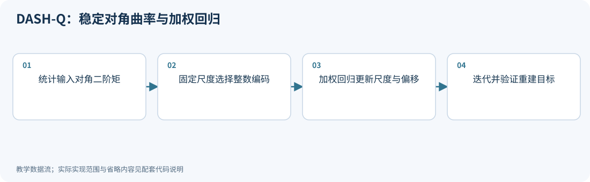

**运行：** `python experiments/technique_lab.py --technique dash_q`

<!-- executable: dash_q -->
```python
import numpy as np
w = np.array([-.9, -.2, .12, .43, .8]); h = np.array([1., 8., 8., 3., 1.])
ridge = .01; s = np.ptp(w)/3; z = -w.min()
for step in range(8):
    q = np.clip(np.rint((w+z)/s), 0, 3)
    mq, mw = np.average(q, weights=h), np.average(w, weights=h)
    s = np.sum(h*(q-mq)*(w-mw))/(np.sum(h*(q-mq)**2)+ridge)
    z = s*mq-mw
error = s*q-z-w
assert abs(h@error) < 1e-10
assert abs((h*error)@q+ridge*s) < 1e-10
print('scale, floating offset, weighted SSE:', s, z, np.sum(h*error**2))
```

**代码讲解**

1. 本例重建为 s*q-z，z 是实值 offset，不是前文整数 zero point；两者不能混用。
2. 固定 q 的两个一阶驻点条件独立核对回归解。只固定独立网格再用对角权重，并不会改变逐元素 RTN。

> **示例边界：** 一组 2-bit 权重的回归子问题；未实现整模型校准、分组导出、停止准则和论文部署后端。

<details>
<summary>论文、博客与官方资料</summary>

- **论文**：[Robust Ultra Low-Bit Post-Training Quantization via Stable Diagonal Curvature Estimate](https://arxiv.org/abs/2604.13806)（[所读版本正文](https://arxiv.org/html/2604.13806v2)）。

本次核对了所列论文正文与方法，但未确认可访问的独立作者博客或项目入口；以论文公式和伪代码为依据，不用无关博客填充链接。

</details>

<!-- /inline-technique -->

<a id="principle-13-2"></a>
<a id="arcquant"></a>

## 13.2 ARCQuant：让激活残差进入同一个 FP4 GEMM

<!-- publication: arcquant -->
**文献时间：** 首次提交 2026-01-12；本次核对 2601.07475v2（版本日期 2026-07-04）。
<!-- /publication -->

ARCQuant 针对 NVFP4 激活误差，把需要修正的通道残差再量化，并复制其对应的量化权重列。令 $S$ 是选中的输入通道，$R_S=X_S-Q(X)_S$：

$$
Y\approx Q(X)Q(W)^T+Q(R_S)Q(W_S)^T
=[Q(X),Q(R_S)]\,[Q(W),Q(W_S)]^T.
$$

增加的是矩阵乘的归约维度，而不是一条任意高精度补偿支路。两部分仍采用统一 NVFP4，有利于使用标准矩阵乘硬件。

原方法还包括校准时的通道排序、阈值选择和内核设计。新增通道增加计算和数据量，是否更快取决于补偿比例和实际融合方式。

### 补偿的收益边界

若暂时补偿全部通道且残差不再量化，$Q(X)+[X-Q(X)]=X$，输出变成 $XQ(W)^T$。
这消除了激活近似，却仍保留权重误差；部分通道、残差再量化时还会留下额外项。
因此 ARCQuant 不等价于恢复全精度乘法。

原方法离线确定重排和补偿通道数，在线只对选中通道计算残差；不能把它误写成每个 token 都重选任意稀疏位置。
如果扩展 $S$ 列，主 GEMM 的乘加数在同一输出形状下约增加 $S/K$，还应计残差量化、对齐和尺度处理。[ARCQuant v2，§3.2–3.4](https://arxiv.org/html/2601.07475v2)

### 精确残差是消融对照，不保证输出误差最小

<a id="residual-control-boundary"></a>

设 $\widehat W=W+E_W$，补偿全部激活残差 $R=X-\widehat X$，而实际存储 $\widehat R=R+E_R$。最终输出误差为

$$
(\widehat X+\widehat R)\widehat W^T-XW^T
=XE_W^T+E_R\widehat W^T.
$$

精确保存残差令 $E_R=0$，消除了这一侧的近似；但总输出平方误差还含交叉项
$2\langle XE_W^T,E_R\widehat W^T\rangle_F$，它可以为负。因此残差量化有时反而减小总输出误差。
这不是应主动保留噪声的理由：换输入或权重后，抵消可能消失。对消融应报告实际误差，不预设“浮点残差最好”。

下面先用步长 0.1 的标量网格手算，再用本项目的 NVFP4 数值模拟验证同类反例。
标量中 $x=0.96,w=1.04$ 均量化为 1，原输出为 0.9984；精确残差输出为 0.96，残差量化为零后的输出为 1，后者更接近原输出。

<!-- depth-example: residual_cancellation -->
```python
import numpy as np
from experiments.technique_kernels import micro_fp4
x, w = .96, 1.04
quantize = lambda value: .1*np.rint(value/.1)
xq, wq = quantize(x), quantize(w)
r = x-xq
reference = x*w
float_error = (xq+r)*wq-reference
quantized_error = (xq+quantize(r))*wq-reference
assert np.isclose(float_error**2, .00147456)
assert np.isclose(quantized_error**2, .00000256)
assert quantized_error**2 < float_error**2
print('scalar SSE, exact / quantized residual:', float_error**2, quantized_error**2)

# A fixed pair selected as a counterexample, not a representative benchmark.
rng = np.random.default_rng(20261020)
pairs = rng.normal(size=(22, 2, 1, 16))
X, W = pairs[-1]
Xq, _ = micro_fp4(X); Wq, _ = micro_fp4(W)
Rq, _ = micro_fp4(X-Xq)
E_R = Rq-(X-Xq)
base_error = X@(Wq-W).T
extra_error = E_R@Wq.T
actual_error = (Xq+Rq)@Wq.T-X@W.T
assert np.allclose(actual_error, base_error+extra_error)
exact_sse = np.sum(base_error**2)
quantized_sse = np.sum(actual_error**2)
assert quantized_sse < exact_sse
print('NVFP4 simulation SSE, exact / quantized residual:', exact_sse, quantized_sse)
```

运行 `python experiments/deep_dive_lab.py --case residual_cancellation`。该例只否定无条件的输出最优保证，不测真实模型或 GPU。
只有固定同一个目标、明确可行集合包含关系，并求得相应最优解时，才可称为误差界。
例如固定量化主体与秩约束后，精确截断 SVD 给出权重 Frobenius 重建误差的下界；它仍不是任务质量上界。

<!-- inline-technique: arcquant -->

### 图解与代码

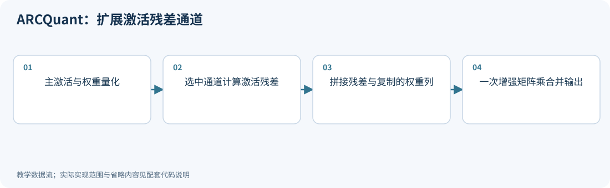

**运行：** `python experiments/technique_lab.py --technique arcquant`

<!-- executable: arcquant -->
```python
import numpy as np
from experiments.technique_kernels import micro_fp4
rng = np.random.default_rng(1302)
X = rng.normal(size=(4, 32)); X[:, :16] *= 5
W = rng.normal(size=(3, 32))
Xq, _ = micro_fp4(X); Wq, _ = micro_fp4(W)
selected = np.arange(16)
residual = X[:, selected]-Xq[:, selected]
Rq, _ = micro_fp4(residual)
augmented_X = np.concatenate([Xq, Rq], axis=1)
augmented_W = np.concatenate([Wq, Wq[:, selected]], axis=1)
merged = augmented_X@augmented_W.T
separate = Xq@Wq.T+Rq@Wq[:, selected].T
assert np.allclose(merged, separate)
print('reduction dimension before/after:', X.shape[1], augmented_X.shape[1])
print('corrected output MSE:', np.mean((merged-X@W.T)**2))
```

**代码讲解**

1. 残差来自激活 X-Xq；权重分支复制已量化的 Wq 对应列，不是再计算一份权重残差。
2. 选择 16 个通道让新增尾块满足微块尺寸；等价性断言核对拼接矩阵乘与两项输出之和。

> **示例边界：** 预先指定补偿通道，省略论文阈值选择与重排；micro_fp4 是 CPU 数值模拟，无法测出统一 GEMM 的实际加速。

<details>
<summary>论文、博客与官方资料</summary>

- **论文**：[ARCQuant: Boosting NVFP4 Quantization with Augmented Residual Channels for LLMs](https://arxiv.org/abs/2601.07475)（[所读版本正文](https://arxiv.org/html/2601.07475v2)）。
- **作者项目、官方文档与规范**：[GitHub - actypedef/ARCQuant: [ACL 2026 Main] Code for the paper "ARCQuant: Boosting NVFP4 Quantization with Augmented Residual Channels for LLMs" · GitHub](https://github.com/actypedef/ARCQuant)。

正文和代码演示范围见本节；项目可访问不等于已复现论文训练、模型评测或硬件性能。

</details>

<!-- /inline-technique -->

<a id="principle-13-3"></a>
<a id="torq"></a>

## 13.3 TORQ：区分块间能量和块内码字分布

<!-- publication: torq -->
**文献时间：** 首次提交 2026-05-19；本次核对 2605.19561v1（版本日期 2026-05-19）。
<!-- /publication -->

TORQ 针对 MXFP4 的微块结构提出两个层次。Macro-Equilibrium 在不同块的相同位置之间旋转，使二阶矩更均衡；Micro-Alignment 在块内搜索旋转，使数据更适合 FP4 码字。

宏观目标之一为：

$$
\operatorname{diag}(R^TCR)=\frac{\operatorname{tr}(C)}{B}\mathbf1.
$$

该几何目标可以通过正交变换实现，但“等方差等于最小失真”需要同构凸误差等额外条件，不能直接当作离散 FP4 的无条件定理。微观阶段还以码字占用率为代理进行角度和尺度搜索。

因此，TORQ 与普通 Hadamard 预处理的区别在于优化对象和块结构；并非任意旋转都保持其特定数据布局与成本。

### 方差均衡的最优性需要同一个误差函数

若各块使用同一凸函数 $\phi$，且 $\sum_bv_b=S$，Jensen 不等式给出
$\sum_b\phi(v_b)\ge B\phi(S/B)$；严格凸时等号要求均衡。
若块间函数不同，仅有凸性不够：最小化 $v_1^2+4v_2^2$ 且 $v_1+v_2=2$，最优为 $(1.6,0.4)$，并非 $(1,1)$。

此外，离散 FP4 的失真依赖码字、离群值和共享指数，并不天然只由方差决定。
码字占用趋于均匀也只是代理目标，不等于 MSE 最优。这里对原文 §4.1 的条件作上述限定，避免将均衡写成普适定理。[TORQ v1](https://arxiv.org/html/2605.19561v1)

<!-- depth-example: variance_equalization -->
```python
import numpy as np
x = np.linspace(0, 2, 2001)
heterogeneous = x*x+4*(2-x)**2
best = x[np.argmin(heterogeneous)]
assert np.isclose(best, 1.6)
assert heterogeneous.min() < 1**2+4*1**2
homogeneous = x*x+(2-x)**2
assert np.isclose(x[np.argmin(homogeneous)], 1.)
print('same / different block costs:', 1., best)
```

<!-- inline-technique: torq -->

### 图解与代码

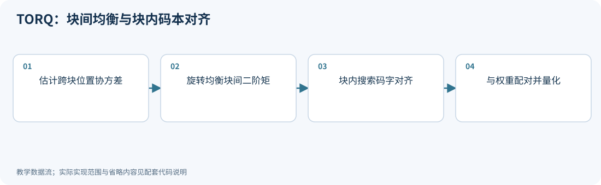

**运行：** `python experiments/technique_lab.py --technique torq`

<!-- executable: torq -->
```python
import numpy as np
from experiments.quant_lab import hadamard
rng = np.random.default_rng(1303)
X = rng.normal(size=(64, 8)); X[:, :4] *= 5
W = rng.normal(size=(3, 8)); T = np.eye(8)
for position in range(4):
    columns = [position, position+4]
    covariance = X[:, columns].T@X[:, columns]/len(X)
    _, U = np.linalg.eigh(covariance)
    R = U@hadamard(2)
    T[np.ix_(columns, columns)] = R
    assert np.allclose(np.diag(R.T@covariance@R), np.trace(covariance)/2)
assert np.allclose(T.T@T, np.eye(8))
assert np.allclose((X@T)@(W@T).T, X@W.T)
print('inter-block covariance diagonals equalized at all four positions')
```

**代码讲解**

1. 每次只旋转两个块中同一位置的通道；不是将整个块任意混成一个量化组。
2. 谱分解加 Hadamard 是一个清楚的等方差构造，用于核对宏观目标；各位置互不重叠，因此可组成一个正交 T。

> **示例边界：** 演示宏观均衡子问题，未实现论文的 Givens 构造或微观占用率搜索；FP4 下方差均衡是代理目标，不能声称严格最优失真。

<details>
<summary>论文、博客与官方资料</summary>

- **论文**：[TORQ: Two-Level Orthogonal Rotation for MXFP4 Quantization](https://arxiv.org/abs/2605.19561)（[所读版本正文](https://arxiv.org/html/2605.19561v1)）。

本次核对了所列论文正文与方法，但未确认可访问的独立作者博客或项目入口；以论文公式和伪代码为依据，不用无关博客填充链接。

</details>

<!-- /inline-technique -->

<a id="principle-13-4"></a>
<a id="soar"></a>

## 13.4 SOAR：尺度不仅可以由 absmax 决定

<!-- publication: soar -->
**文献时间：** 首次提交 2026-05-12；本次核对 2605.12245v1（版本日期 2026-05-12）。
<!-- /publication -->

NVFP4 的重建含全局尺度 $\alpha$、E4M3 块尺度 $\Delta_i$ 和 FP4 码字 $Q_i$。固定码字与块尺度后，全局尺度有闭式解：

$$
\alpha^*=\frac{\sum_i\langle W_i,\Delta_iQ_i\rangle}{\sum_i\|\Delta_iQ_i\|_F^2}.
$$

固定 $\alpha,Q_i$ 时，块尺度也有相应最小二乘解，但需要投影到可存储的 E4M3 集合。码字又依赖尺度，因此完整流程是交替更新，而不是一次闭式解就完成整个非凸问题。

SOAR 还用 Decoupled Scale Search（DSS）区分高精度的编码尺度和硬件约束下的解码尺度。它优化的是现有格式的表示，不通过更改格式名称获得额外精度。

### 闭式解与离散尺度投影

固定 $\alpha,Q_i$ 时，令 $d_i=\alpha Q_i$，块尺度子问题是
$\min_s\|W_i-sd_i\|^2$，解为 $s^*=\langle W_i,d_i\rangle/\|d_i\|^2$。
因为损失可写成 $\|d_i\|^2(s-s^*)^2+\mathrm{const}$，在相同码字、无额外限制的条件下，
选离 $s^*$ 最近的合法 E4M3 值就解决了该离散子问题。若 $d_i=0$，分母为零，应保持有效尺度或另行处理。

码字重算后进入下一轮子问题，仍需比较同一个联合重建目标；工程上应保存最好候选，检查投影与边界。
DSS 则联合搜索编码与解码尺度，与下面只更新全局尺度的演示不同。[SOAR v1，§3.2–3.3](https://arxiv.org/html/2605.12245v1)

<!-- inline-technique: soar -->

### 图解与代码

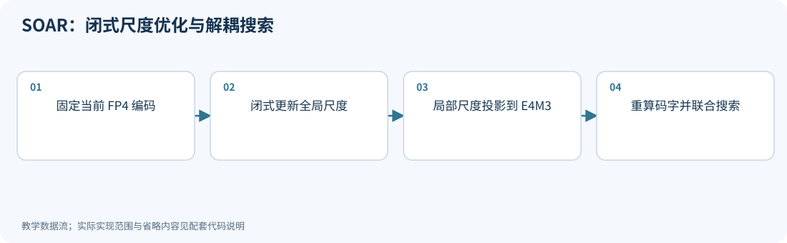

**运行：** `python experiments/technique_lab.py --technique soar`

<!-- executable: soar -->
```python
import numpy as np
from experiments.technique_kernels import nearest, fp_levels
W = np.linspace(-1, 1, 32).reshape(2, 16)
block_scale = np.array([[.25], [.5]])
q = nearest(W/block_scale, fp_levels('e2m1'))
U = block_scale*q
alpha = np.sum(W*U)/np.sum(U*U)
before = np.sum((W-U)**2)
after = np.sum((W-alpha*U)**2)
assert abs(np.sum((alpha*U-W)*U)) < 1e-12
assert after <= before+1e-12
assert np.all(np.isin(block_scale, fp_levels('e4m3')))
print('closed-form global scale, SSE before/after:', alpha, before, after)
```

**代码讲解**

1. 对固定局部尺度和码字，alpha 是一个实数最小二乘系数；驻点条件和误差比较共同验证更新。
2. 局部尺度已经是 E4M3 数值，alpha 则是独立的高精度尺度，二者的可用值集合不同。

> **示例边界：** 只实现 CJSO 的全局尺度子步；完整 SOAR 还重算码字、投影局部尺度，并执行 DSS 联合候选搜索。

<details>
<summary>论文、博客与官方资料</summary>

- **论文**：[SOAR: Scale Optimization for Accurate Reconstruction in NVFP4 Quantization](https://arxiv.org/abs/2605.12245)（[所读版本正文](https://arxiv.org/html/2605.12245v1)）。
- **作者项目、官方文档与规范**：[GitHub - steven-bao1/SOAR: SOAR: Scale Optimization for Accurate Reconstruction in NVFP4 Quantization · GitHub](https://github.com/steven-bao1/SOAR)。

正文和代码演示范围见本节；项目可访问不等于已复现论文训练、模型评测或硬件性能。

</details>

<!-- /inline-technique -->

<a id="principle-13-5"></a>
<a id="focus"></a>

## 13.5 FOCUS：编码端可以比解码端更灵活

<!-- publication: focus -->
**文献时间：** 首次提交 2026-08-03；本次核对 2608.01847v1（版本日期 2026-08-03）。
<!-- /publication -->

部署真正需要保存的是 FP4 码字和解码尺度，离线产生码字时使用的尺度未必需要保存。FOCUS 以连续系数放松二者的耦合：

$$
s^{enc}_{i,k}=c_{i,k}s^{dec}_i,\qquad
q_{i,k}=Q_{FP4}(w_{i,k}/s^{enc}_{i,k}),\quad
\widehat w_{i,k}=s^{dec}_iq_{i,k}.
$$

CRS 引入编码系数；DGS 允许一个硬件微块内的多个更小子块使用不同系数，而解码仍共享原微块尺度。论文通过端到端尺度学习选择码字，导出时丢弃这些系数。

给定固定解码格点，最近舍入已经最小化独立权重 MSE。因此额外编码自由度的意义应结合联合输出或任务目标理解，不能宣称任何偏离最近舍入的方案都降低权重误差。

### 与 SOAR 的共性及差别

两者都利用编码端无需被部署格式保存的自由度。SOAR 的 DSS 进行局部尺度对搜索；FOCUS 用
$s^{enc}=c\,s^{dec}$ 的耦合参数化与更细子块系数，在端到端量化前向上学习，原主权重保持冻结。
原文使用的子块大小为 8：NVFP4 一个硬件块有 2 个子块，MXFP4 有 4 个。[FOCUS v1，CRS/DGS](https://arxiv.org/html/2608.01847v1)

正确的无额外推理开销检查是：导出后仅保留格式要求的码字与解码尺度，不再读取 $c$。
应比较导出前后实际反量化值与输出；若训练时连续尺度没有按部署精度投影，导出误差可能抵消收益。

<!-- inline-technique: focus -->

### 图解与代码

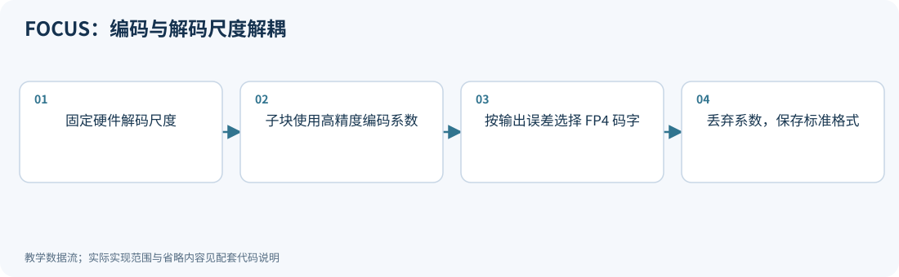

**运行：** `python experiments/technique_lab.py --technique focus`

<!-- executable: focus -->
```python
import itertools
import numpy as np
from experiments.technique_kernels import nearest, fp_levels
rng = np.random.default_rng(1305)
W = rng.normal(size=16)*.3
X = rng.normal(size=(8, 16)); X[:, 1] = X[:, 0]
decode_scale = .125; candidates = []
for c0, c1 in itertools.product([.8, 1., 1.2], repeat=2):
    encoding_scale = decode_scale*np.repeat([c0, c1], 8)
    q = nearest(W/encoding_scale, fp_levels('e2m1'))
    restored = decode_scale*q
    candidates.append((np.mean((X@(restored-W))**2), (c0, c1)))
best = min(candidates)
baseline = next(loss for loss, pair in candidates if pair == (1., 1.))
assert best[0] <= baseline and decode_scale in fp_levels('e4m3')
print('chosen subblock coefficients and output MSE:', best[1], best[0])
```

**代码讲解**

1. 同一个 16 元素块共享解码尺度，但两个 8 元素子块有独立编码系数，展示 DGS。
2. 目标是校准输出误差；给定固定重建格点时，独立 RTN 已最小化纯权重 MSE，不能用更差的舍入宣称普遍降低权重误差。

> **示例边界：** 有限候选搜索代替端到端尺度学习，只展示 CRS/DGS 自由度；不实现整模型训练和导出。

<details>
<summary>论文、博客与官方资料</summary>

- **论文**：[FOCUS: FP4 Optimization via Coupled-Relaxation and Dual-Granularity Scaling](https://arxiv.org/abs/2608.01847)（[所读版本正文](https://arxiv.org/html/2608.01847v1)）。
- **作者项目、官方文档与规范**：[GitHub - Tencent/AngelSlim: Model compression toolkit engineered for enhanced usability, comprehensiveness, and efficiency. · GitHub](https://github.com/tencent/AngelSlim)。

正文和代码演示范围见本节；项目可访问不等于已复现论文训练、模型评测或硬件性能。 AngelSlim 是综合工具库，链接存在不证明所有论文配方已在某个发行版中提供。

</details>

<!-- /inline-technique -->

<a id="principle-13-6"></a>
<a id="prquant"></a>

## 13.6 PRQuant：将离散权重残差排成连续尾块

<!-- publication: prquant -->
**文献时间：** 首次提交 2026-08-16；本次核对 2609.22106v2（版本日期 2026-09-26）。
<!-- /publication -->

PRQuant 先按缩放后的权重量化误差识别重要输入列，将它们排列到连续尾部，再离线形成权重残差。令 $E_S=W_S-Q(W)_S$，核心补偿关系为：

$$
Y\approx XQ(W)^T+X_SE_S^T
=[X,X_S]\,[Q(W),E_S]^T.
$$

它与 ARCQuant 容易混淆：ARCQuant 计算在线激活残差并复制权重；PRQuant 准备离线权重残差并复用激活。连续尾块主要改善布局和访问方式，缩放与残差补偿承担主要数值改进。

实际方案还会量化残差并组织为规整的 MXFP4 增强 GEMM。下面先验证乘法结构，不将未量化的残差结果冒充实际 FP4 精度。

### 重排的作用与残差的作用

如果只是对已经固定的 $Q(W)$ 同时重排输入和权重，浮点输出保持不变，重排的主要收益是让补偿通道形成连续尾块。
如果重排发生在按连续微块重新量化之前，它还会改变共享范围，因此可能改变数值误差。
这两种实验不能混称为“仅重排”的收益。

PRQuant 的残差在离线从权重构造，ARCQuant 的残差在线从激活构造；前者增加静态补偿权重，后者增加在线残差计算。
两者都需要对增强维度的微块尺度和对齐进行真实实现，不能由拼接恒等式推断硬件速度。[PRQuant v2，§4](https://arxiv.org/html/2609.22106v2)

<!-- inline-technique: prquant -->

### 图解与代码

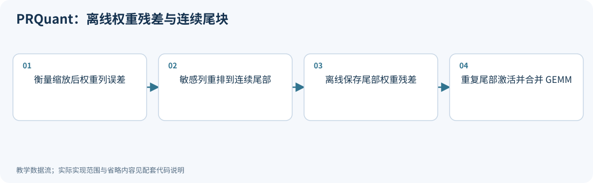

**运行：** `python experiments/technique_lab.py --technique prquant`

<!-- executable: prquant -->
```python
import numpy as np
from experiments.quant_lab import group_qdq
rng = np.random.default_rng(1306)
X = rng.normal(size=(5, 8)); W = rng.normal(size=(3, 8))
Q = group_qdq(W, group_size=4); E = W-Q
ranked = np.argsort(np.sum(E**2, axis=0))
Xp, Qp, Ep = X[:, ranked], Q[:, ranked], E[:, ranked]
tail = 2
Xa = np.concatenate([Xp, Xp[:, -tail:]], axis=1)
Wa = np.concatenate([Qp, Ep[:, -tail:]], axis=1)
output = Xa@Wa.T
expected = X@Q.T+Xp[:, -tail:]@Ep[:, -tail:].T
assert np.allclose(output, expected)
print('contiguous tail columns:', ranked[-tail:])
print('augmented reduction dimension:', Xa.shape[1])
```

**代码讲解**

1. 与 ARCQuant 相反，本例补的是权重残差，并复制激活尾部；残差不需要每个 token 在线重新计算。
2. 排列本身保持线性运算，主要价值还包括使尾部访问和执行布局规整；不能把它单独当成误差下降的来源。

> **示例边界：** 使用 INT4 数值代理验证增强乘法，残差保留浮点；真实 PRQuant 还使用缩放、MXFP4 残差编码和融合内核。

<details>
<summary>论文、博客与官方资料</summary>

- **论文**：[PRQuant: Permutation Residual Quantization for Low-Overhead Inference](https://arxiv.org/abs/2609.22106)（[所读版本正文](https://arxiv.org/html/2609.22106v2)）。

本次核对了所列论文正文与方法，但未确认可访问的独立作者博客或项目入口；以论文公式和伪代码为依据，不用无关博客填充链接。

</details>

<!-- /inline-technique -->

<a id="principle-13-7"></a>
<a id="osfp4"></a>

## 13.7 OSFP4：按 RTN/SIC 路径联合优化

<!-- publication: osfp4 -->
**文献时间：** 首次提交 2026-10-06；本次核对 2610.08231v1（版本日期 2026-10-06）。
<!-- /publication -->

OSFP4 为每个投影联合优化对角平滑矩阵和 NVFP4 块尺度，并区分 weight-only、W4A4，以及 RTN 或 successive interference cancellation（SIC）权重量化路径。

用本书约定概括联合目标：

$$
\min_{D,\Gamma_W,\Gamma_X}
\|XW^T-Q_A(XD^{-1};\Gamma_X)Q_W(WD;\Gamma_W)^T\|_F^2.
$$

这只是描述自由度的局部目标；原论文进一步分析乘性 dither 量化器来构建可优化损失，然后搜索确定性的 E4M3 尺度。分析中的随机重建值不一定属于真实 FP4 码本，不能直接作为部署权重。

其关键在于让平滑、尺度和实际舍入路径相互匹配，而不是认为一个固定 SmoothQuant 配方对所有 FP4 方式都同样合适。

### 从随机代理到可导出的确定性码字

论文 §2 定义乘性抖动量化器
$\widetilde Q(x)=2^UQ_{FP4}(2^{-U}x)$，$U\sim\mathrm{Uniform}[0,1)$。
平均失真比硬舍入曲线更适合构造优化目标，但 $2^U$ 后的重建值一般不在原 FP4 码本内。
§3 再以优化尺度指导确定性候选搜索，最后落到合法尺度和码字。[OSFP4 v1](https://arxiv.org/html/2610.08231v1)

还需区分离线优化中使用的激活尺度变量与推理时的动态尺度：后者由当次激活重新确定。
评价时分别报告随机代理损失、确定性 QDQ 层误差和整模质量；若只改善了第一项，尚不能证明导出模型受益。
RTN 与 SIC 的误差路径不同，应按实际编码路径选择目标，不能只把最末舍入器替换掉。

<!-- inline-technique: osfp4 -->

### 图解与代码

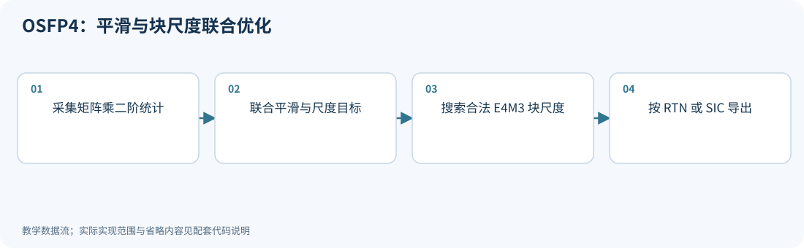

**运行：** `python experiments/technique_lab.py --technique osfp4`

<!-- executable: osfp4 -->
```python
import numpy as np
from experiments.technique_kernels import micro_fp4
rng = np.random.default_rng(1307)
X = rng.normal(size=(8, 32)); X[:, 0] *= 8
W = rng.normal(size=(4, 32))
target = X@W.T; losses = []
for exponent in [0., .5, 1.]:
    s = np.maximum(np.max(abs(X), axis=0), 1e-6)**exponent
    assert np.allclose((X/s)@(W*s).T, target)
    Xq, _ = micro_fp4(X/s)
    for multiplier in [.8, 1., 1.2]:
        alpha = multiplier*np.max(abs(W*s))/(448*6)
        Wq, _ = micro_fp4(W*s, tensor_scale=alpha)
        losses.append((np.mean((Xq@Wq.T-target)**2), exponent, multiplier))
print('best limited joint candidate:', min(losses))
assert np.isfinite(min(losses)[0])
```

**代码讲解**

1. 同时改变 s 和量化尺度，而不是先固定一个平滑方案再仅调整名称为 NVFP4。
2. 量化前先核对等价变换；量化后的目标用完整矩阵乘输出比较。

> **示例边界：** 少量平滑与全局尺度候选仅解释联合目标；未实现论文的乘性 dither 分析、分块优化、精细 E4M3 搜索或 SIC。

<details>
<summary>论文、博客与官方资料</summary>

- **论文**：[OSFP4: Joint Optimization of Diagonal Smoothing and Block Scales for NVFP4 Quantization](https://arxiv.org/abs/2610.08231)（[所读版本正文](https://arxiv.org/html/2610.08231v1)）。
- **作者项目、官方文档与规范**：[GitHub - neriahbd/OSFP4 · GitHub](https://github.com/neriahbd/OSFP4)；[GitHub - neriahbd/vllm-osfp4: OSFP4 checkpoint support for vLLM. · GitHub](https://github.com/neriahbd/vllm-osfp4)。

正文和代码演示范围见本节；项目可访问不等于已复现论文训练、模型评测或硬件性能。

</details>

<!-- /inline-technique -->

<a id="principle-13-8"></a>
<a id="drq"></a>

## 13.8 DRQ：校准误差更低，为什么仍可能更差

<!-- publication: drq -->
**文献时间：** 首次提交 2026-10-08；本次核对 2610.11226v1（版本日期 2026-10-08）。
<!-- /publication -->

DRQ 研究固定量化网格上的后处理。它保留位宽、分组、尺度、零点与推理算子，只更新整数码，以降低输入分布变化下的最坏重建误差。

记 $E=\widehat W-W$、$H=X^TX/n$、$C\succ0$。限制新增二阶矩为 $\Delta\succeq0$ 且 $\operatorname{tr}(C\Delta)\le\alpha$，则：

$$
L_{DRQ}=\operatorname{tr}(EHE^T)+\alpha\|EC^{-1/2}\|_2^2.
$$

第二项度量在 $u^TCu=1$ 下最大的 $\|Eu\|^2$；最坏分布增量由一个秩一方向达到。论文使用 $C=(1-\beta)H+\beta I$，并在更新码字时限制校准损失增长，检查独立子集。

这说明“优化校准分布上的平均误差”与“对分布变化稳健”是不同目标。DRQ 的实证结果不能解释为对任意未知分布都有效。

### 谱范数项的推导与搜索限制

置 $B=C^{1/2}\Delta C^{1/2}$，则 $B\succeq0$、$\operatorname{tr}(B)\le\alpha$。
最坏增量成为

$$
\max_B\operatorname{tr}\!\left(C^{-1/2}E^TEC^{-1/2}B\right)
=\alpha\lambda_{max}(C^{-1/2}E^TEC^{-1/2}).
$$

最优 $B$ 可把全部预算放到最大特征向量，得到正文的秩一最坏方向。
这只解决**给定码字矩阵时**的内层最大化，外层整数码搜索仍是离散问题。
原方法按当前最坏方向给更新排序，再对候选重新求最坏方向并检查校准损失增长。[DRQ v1，§3.2–3.3](https://arxiv.org/html/2610.11226v1)

把旧方向上的目标下降当成完整鲁棒目标下降是不充分的。$\alpha,\beta$ 也应在开发数据上选择，
检查集不能反复充当最终任务测试集。该不确定集合只允许受限的半正定二阶矩增量，不覆盖所有实际分布漂移。

<!-- inline-technique: drq -->

### 图解与代码

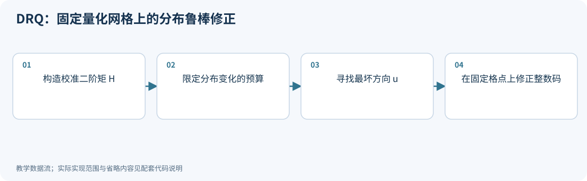

**运行：** `python experiments/technique_lab.py --technique drq`

<!-- executable: drq -->
```python
import numpy as np
H = np.array([[1., .8], [.8, 1.]])
C = .8*H+.2*np.eye(2); alpha = .3
E = np.array([[.4, -.6], [.1, .2]])
values, U = np.linalg.eigh(C)
inverse_root = (U*(1/np.sqrt(values)))@U.T
_, singular, Vt = np.linalg.svd(E@inverse_root)
u = inverse_root@Vt[0]
Delta = alpha*np.outer(u, u)
baseline = np.trace(E@H@E.T)
robust = baseline+alpha*singular[0]**2
assert np.isclose(np.trace(C@Delta), alpha)
assert np.isclose(np.trace(E@(H+Delta)@E.T), robust)
print('calibration loss and attained worst-case loss:', baseline, robust)
```

**代码讲解**

1. 约束 tr(C Delta)≤alpha 下，最坏增量由一个秩一协方差方向达到；这里验证它与谱范数闭式目标相等。
2. C=(1-beta)H+beta I 保证正定，避免未被校准激活覆盖的方向完全不受约束。

> **示例边界：** 验证 DRQ 的最坏分布子问题；未执行码值更新排序、检查集校准损失增长限制或整模型离线细化。

<details>
<summary>论文、博客与官方资料</summary>

- **论文**：[When Lower Reconstruction Loss Hurts: Distributionally Robust Refinement for Low-Bit LLM Quantization](https://arxiv.org/abs/2610.11226)（[所读版本正文](https://arxiv.org/html/2610.11226v1)）。

本次核对了所列论文正文与方法，但未确认可访问的独立作者博客或项目入口；以论文公式和伪代码为依据，不用无关博客填充链接。

</details>

<!-- /inline-technique -->

<a id="principle-13-9"></a>
<a id="differentiable_bits"></a>

## 13.9 DBW：让 0 bit 进入位宽决策

<!-- publication: differentiable_bits -->
**文献时间：** 首次提交 2026-10-05；本次核对 2610.06026v1（版本日期 2026-10-05）。
<!-- /publication -->

DBW（Differentiable Bit-Widths）将 SVD 分量的位宽作为可学习变量。0 bit 表示该分量被删除，因此剪枝与量化可以共同决定，而不是先固定秩再统一量化。

一个等大小分量的预算归一化示意为：

$$
\widetilde b_c=B\frac{\operatorname{ReLU}(\beta_c)}{\sum_j\operatorname{ReLU}(\beta_j)}.
$$

直接向下取整会浪费预算，论文使用 Hamilton 最大余数法分配剩余整数位数，并用 STE 处理不可导步骤。完整方法还包括矩阵级预算、分量量化器和奇异值熵目标。

位宽总和只有在分量成本一致或已正确加权时才等于实际存储预算。真实导出仍需计算两侧因子、尺度、索引和混合 GEMM 的成本。

### 0 bit 分量的真实成本与熵目标

若分量为 $\sigma_k u_kv_k^T$，删除它会省去两侧向量及其元数据；保留时的主体成本约为
$m b_{u,k}+d b_{v,k}$，不能只计一个标量 $b_k$。
跨不同尺寸矩阵的位宽总和应先转成加权存储预算。

原方法还优化归一化奇异值熵，促使谱能量集中，从而更容易删去部分分量。
**熵小不是质量保证**：单独最小化熵可以造成塌缩，因此需要与块重建目标联合解释。
下面仅做 Hamilton 离散分配，不包含该优化过程。[DBW v1，§2.2–2.3](https://arxiv.org/html/2610.06026v1)

实现时还要处理所有预算参数都非正导致归一化分母为零，以及 Hamilton 分配得到后端不支持位宽的情况；
需要按可执行候选集合检查，不能在连续预算满足后直接宣称已经可以部署。

<!-- inline-technique: differentiable_bits -->

### 图解与代码

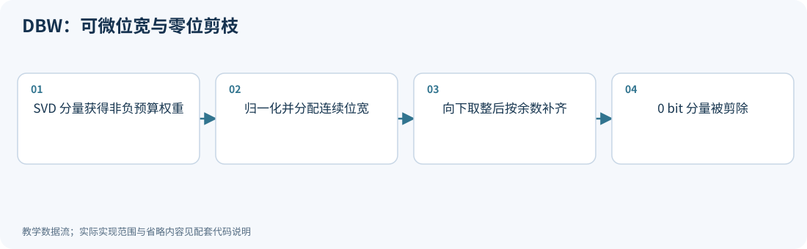

**运行：** `python experiments/technique_lab.py --technique differentiable_bits`

<!-- executable: differentiable_bits -->
```python
import numpy as np
beta = np.array([2.5, 1., .1, 0.]); budget = 8
positive = np.maximum(beta, 0)
continuous = budget*positive/positive.sum()
bits = np.floor(continuous).astype(int)
leftover = budget-int(bits.sum())
order = np.argsort(-(continuous-bits), kind='stable')
bits[order[:leftover]] += 1
W = np.diag([4., 1., .2, .01])
U, singular, Vt = np.linalg.svd(W)
kept = bits > 0
pruned = (U[:, kept]*singular[kept])@Vt[kept]
assert bits.sum() == budget and np.any(bits == 0)
assert np.linalg.matrix_rank(pruned) == kept.sum()
print('continuous/integer component bits:', continuous, bits)
```

**代码讲解**

1. 最大余数法避免所有分量各自向下取整后浪费预算；分量尺寸相同时位宽总和可代表统一成本单位。
2. 0 bit 决定该分量不再参与重建；位宽分配和秩截断在同一个决策空间里。

> **示例边界：** 仅实现预算离散化和零位掩码，保留分量未做实际量化；省略 STE 位宽训练、奇异值熵损失、双层预算和 mixed-precision GEMM。

<details>
<summary>论文、博客与官方资料</summary>

- **论文**：[Differentiable Bit-Widths: Co-optimizing Pruning and Quantization via SVD for Ultra-Efficient LLM Compression](https://arxiv.org/abs/2610.06026)（[所读版本正文](https://arxiv.org/html/2610.06026v1)）。
- **作者项目、官方文档与规范**：[GitHub - MMAI-Laboratory/DBW: [NeurIPS'26] Differentiable Bit-Widths: Co-Optimizing Pruning and Quantization via SVD for Ultra-Efficient LLM Compression · GitHub](https://github.com/MMAI-Laboratory/DBW)。

正文和代码演示范围见本节；项目可访问不等于已复现论文训练、模型评测或硬件性能。

</details>

<!-- /inline-technique -->

<a id="principle-13-10"></a>
<a id="align_correct"></a>

## 13.10 Align, Then Correct：最终适配器的秩必须受约束

<!-- publication: align_correct -->
**文献时间：** 首次提交 2026-10-06；本次核对 2610.08164v1（版本日期 2026-10-06）。
<!-- /publication -->

第一阶段用教师输入与量化输入之间的非对称输出目标、输出侧 Fisher 权重和输入二阶矩，求解低秩回归。第二阶段在已补偿模型上重新采集梯度和曲率，再进行低秩自然梯度修正。

在白化坐标中，用 $Y_0$ 表示已有适配器、$M$ 表示自然梯度方向，第二阶段的结构是：

$$
Y_2=\operatorname{SVD}_r(Y_0-\alpha M).
$$

不能替换为 $Y_0-\alpha\operatorname{SVD}_r(M)$：后者的秩可能达到 $2r$。论文约束的是更新后的最终适配器，且使用信赖比例控制步长。

“Training-Free”指不以优化器迭代训练适配器，并不表示不用校准数据或反向传播。梯度和 Fisher 的重新测量仍有计算、内存和数据成本。

### 第一阶段为什么不是对权重残差直接做 SVD

令 $X_q\in\mathbb R^{n\times d}$，目标残差
$R=X_fW^T-X_q\widehat W^T\in\mathbb R^{n\times m}$，适配矩阵为 $B\in\mathbb R^{m\times d}$。
固定输出侧正定 Fisher 近似 $F$，目标为
$\|(R-X_qB^T)F^{1/2}\|_F^2/n$。
定义 $H=X_q^TX_q/n\succ0$、$C=R^TX_q/n$，配方完成平方后得到

$$
B^*=F^{-1/2}\operatorname{SVD}_r(F^{1/2}CH^{-1/2})H^{-1/2}.
$$

其中 $\operatorname{SVD}_r(M)$ 表示截断后的矩阵。左侧给输出敏感方向加权，右侧按输入二阶统计白化，
因此一般不同于对 $W-\widehat W$ 做截断 SVD。半正定或病态统计需要明确阻尼/支撑子空间，不能无条件求逆。
第二阶段的 Fisher 与梯度还要在已补偿模型上重测。[Align, Then Correct v1，§4](https://arxiv.org/html/2610.08164v1)

在上述正定度量、固定统计与未额外收缩的条件下，令
$M=F^{1/2}CH^{-1/2}$、$B_{full}=CH^{-1}$，并用 $L(B)$ 表示上述归一化目标，则

$$
L(B^*)-L(B_{full})=\sum_{i>r}\sigma_i(M)^2.
$$

这给出独立核对公式的方式：使用非单位输入/输出度量，比较秩约束解与完整回归解的损失差，
它应等于白化目标舍弃的奇异值能量。加入收缩、因子量化或改变统计后，需重新计算实际损失。

<!-- inline-technique: align_correct -->

### 图解与代码

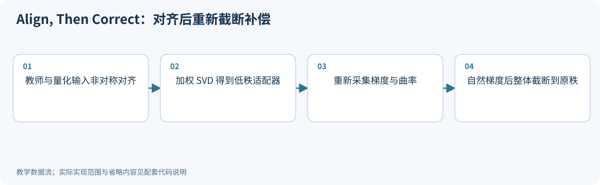

**运行：** `python experiments/technique_lab.py --technique align_correct`

<!-- executable: align_correct -->
```python
import numpy as np
rng = np.random.default_rng(1310)
Xq, _ = np.linalg.qr(rng.normal(size=(8, 4)))
Xf = Xq+.05*rng.normal(size=Xq.shape)
W = rng.normal(size=(3, 4)); Wq = np.round(W*2)/2
target = Xf@W.T-Xq@Wq.T
def rank_one(matrix):
    U, s, Vt = np.linalg.svd(matrix, full_matrices=False)
    return s[0]*np.outer(U[:, 0], Vt[0])
C1 = rank_one(Xq.T@target)  # Identity input metric and output Fisher here.
gradient = .02*rng.normal(size=C1.shape)  # A given re-measured gradient.
C2 = rank_one(C1-gradient)
naive = C1+rank_one(-gradient)
assert np.linalg.matrix_rank(C2, tol=1e-10) == 1
assert np.linalg.matrix_rank(naive, tol=1e-10) == 2
assert np.sum((Xq@C1-target)**2) <= np.sum(target**2)+1e-12
print('final rank versus separate-truncation rank:', np.linalg.matrix_rank(C2), np.linalg.matrix_rank(naive))
```

**代码讲解**

1. 先构造来自 Xf 与 Xq 的真实非对称残差；Xq 正交列使输入度量为单位阵，简化了加权回归。
2. 关键是 rank_r(C1-step)，不是 C1+rank_r(-step)；后者可能使最终适配器秩翻倍。

> **示例边界：** 省略非单位 Fisher 的白化、信赖比例缩放和真实反向统计采集；gradient 是给定示例，不能据此宣称训练免费或实际任务恢复。

<details>
<summary>论文、博客与官方资料</summary>

- **论文**：[Align, Then Correct: Training-Free Two-Stage Low-Rank Compensation for Extremely Quantized Large Language Models](https://arxiv.org/abs/2610.08164)（[所读版本正文](https://arxiv.org/html/2610.08164v1)）。

本次核对了所列论文正文与方法，但未确认可访问的独立作者博客或项目入口；以论文公式和伪代码为依据，不用无关博客填充链接。

</details>

<!-- /inline-technique -->

<a id="principle-13-11"></a>

## 13.11 将 FP4 改进放到同一张实验表

| 类别 | 代表方法 | 改动发生在哪里 | 最小必要消融 |
|---|---|---|---|
| 尺度/编码优化 | SOAR、FOCUS、OSFP4 | 码字分配、解码尺度、可选平滑 | 相同硬件格式下，对照 absmax、尺度优化、加入变换 |
| 规整残差增强 | ARCQuant、PRQuant | 在线激活残差或离线权重残差 | 不补偿、精确残差消融、实际低精度残差；计增强维度与完整输出误差 |
| 二阶/鲁棒目标 | DASH-Q、DRQ | 曲率近似、共享参数或固定网格码字 | 校准与独立分布上的误差，保持网格与预算可比 |
| 结构与补偿 | DBW、Align, Then Correct | 因子位宽、删除分量、低秩适配 | 相同完整字节预算、补偿因子精度与实际推理路径 |
| 微块旋转与二阶补偿 | [MR-GPTQ / FP-Quant](#mr-gptq-fpquant) | 配对旋转、尺度搜索与静态act-order；最终仍导出MXFP4/NVFP4 | 分别关闭旋转、尺度搜索、补偿和排序；同网格比较RTN与补偿，独立核验连续子问题 |
| 微块范围候选 | Four Over Six（第13.14节） | 对合法E4M3尺度的4/6候选比较；仍是NVFP4表示 | 固定全局尺度、舍入和误差准则，对照统一6、统一4及逐块选择；随机舍入另查选择偏差 |

尺度优化应先证明导出表示与校准前向一致；残差方法应计入扩展矩阵的所有尺度、padding 和读取；
鲁棒方法应在独立分布上验证；低秩方法应报告最终秩和因子精度。
这些条件成立之后，才能讨论某方法是否在目标硬件上改善质量—成本关系。

MR-GPTQ属于PTQ流程，Four Over Six提供范围选择子步骤；它们的搜索对象不同，不能仅按名称竞争排名。若组合两者，应保持解码格式、校准数据和搜索预算一致，再检查码字与尺度导出后的完整输出误差。新增方法的版本与原始证据见第13.13–13.14节。

<a id="fidelityq-roleq"></a>

<a id="principle-13-12"></a>

## 13.12 超低比特标量编码：FidelityQ 与 RoleQ

本章不仅涉及 FP4，规则标量码字在 2 bit 与三值表示上也有进展。[FidelityQ v1，§3](https://arxiv.org/html/2610.14934v1)（2026-10-10）拟合镜像四级标量码本，并通过教师分布差异选择校准序列。对正值 $0<a<b$，令 $\alpha=(a+b)/2$、$\beta=(b-a)/2$，则

$$
\{-b,-a,a,b\}=\{\alpha s_1+\beta s_2:s_1,s_2\in\{-1,1\}\}.
$$

所以四级非均匀码本仍可由两个符号平面和尺度计算，无需任意大查表；但这不保证目标硬件有高效位平面内核。高分歧样本用于校准后，应在独立数据上测任务泛化，避免把改善教师 KL 当作保证知识不丢失。

[RoleQ v1，§3](https://arxiv.org/html/2610.21808v1)（2026-10-15）按 Transformer 单元功能选择尺度轴：读入残差流的 Q/K/V、gate/up 投影按输出单元设尺度，写回残差流的 O/down 投影按输入单元设尺度。该结构规则无需数据搜索，**完整转换流程仍包含 GPTQ 类校准、旋转和可选尺度蒸馏**，不能笼统称整套方法“无校准”。

对三值向量的简单权重 MSE 子问题，给定非零支持 $S$，最优尺度为
$a=\sum_{i\in S}|w_i|/|S|$；最佳支持可在绝对值降序的前缀中搜索，最大化
$(\sum_{i\in S}|w_i|)^2/|S|$。该子问题的精确最优不等于整模型离散最优。

<!-- depth-example: ternary_support_fit -->
```python
import itertools
import numpy as np
w = np.array([.8, -.3, .1])
order = np.argsort(-abs(w)); values = abs(w)[order]
k = int(np.argmax(np.cumsum(values)**2/np.arange(1, len(w)+1)))+1
codes = np.zeros_like(w); codes[order[:k]] = np.sign(w[order[:k]])
scale = np.mean(values[:k]); loss = np.sum((w-scale*codes)**2)
errors = []
for q in itertools.product([-1., 0., 1.], repeat=len(w)):
    q = np.array(q); a = max(0., (w@q)/(q@q)) if q@q else 0.
    errors.append(np.sum((w-a*q)**2))
assert np.isclose(loss, min(errors))
print('ternary scale / codes:', scale, codes)
```

RoleQ 还研究稀疏第二三值平面，额外平面、尺度、索引与蒸馏成本均应计入。它属于现有 checkpoint 的低比特转换路线，与 BitNet 的原生低精度训练目标不同；“1.58 bit”不构成公平比较条件。

<a id="principle-13-13"></a>

## 13.13 MR-GPTQ / FP-Quant：按微缩放格式重做PTQ

<a id="mr-gptq-fpquant"></a>

**来源：** [Bridging the Gap Between Promise and Performance for Microscaling FP4 Quantization，2509.23202v3](https://arxiv.org/html/2509.23202v3)，首发2025-09-27，所读版本2026-03-03，重点§3–5、附录B/F。MR-GPTQ是算法，FP-Quant是集成路线，QuTLASS是执行库，三者不应作为三个独立数学方法重复计数。

微块越小，共享范围受到极端值污染的方式越不同。NVFP4的16元素块已经保护了部分大值，对整块旋转可能反而增加这些方向的误差；MXFP4还受到E8M0粗尺度的影响。论文在分布模型和实测下分析这种差别，并不证明任意模型“小组永远不需要旋转”。尤其absmax保护最大值的理想论证忽略尺度舍入时才精确，实际FP8尺度仍会引入误差。

MR-GPTQ的主要改动是：

1. **尺度网格优化。** NVFP4对张量尺度与微块尺度交替优化；固定码字的子问题与完整离散搜索要区分。MXFP4旋转路径采用适配其分布的尺度策略。
2. **静态act-order。** 先按原始连续微块确定网格，再用列排序改进补偿顺序，最后恢复列顺序和原组映射。减少运行时重排依赖，但不同格式仍须核对组索引。
3. **小块旋转与融合。** $XW^T=(XR)(WR)^T$，权重旋转离线完成，激活旋转、量化和尺度计算在线融合。$R$采用结构化块，旋转大小和微块大小应一并记录。

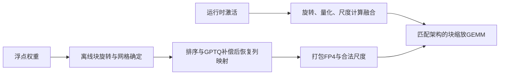

### 原文支持的结论与反例

v3的真实vLLM实验中，NVFP4平均表现最好的PTQ路线是普通GPTQ，MR-GPTQ并非总优；MXFP4的MR-GPTQ改善更明显。附录B的Qwen3-32B示例中，MXFP4 RTN+Had32的Recovery为98.67%，GPTQ+Had32为95.58%，已经说明单个组合不保证单调获益。Recovery是对应任务平均相对基线，不是每个任务无损。

论文报告B200单层最高约3.6倍、完整vLLM最高约2.2倍，但前者与后者的计时边界不同；不能把RTX5090的另组结果与B200的模型/负载混在一起。静态act-order、旋转、尺度优化分别消融，并计入在线量化成本后，才能归因。

[Transformers 5.20.2 FP-Quant文档](https://huggingface.co/docs/transformers/v5.20.2/en/quantization/fp_quant)区分原生Blackwell内核与`pseudoquantization=True`；该集成版本的QAT仅支持伪量化，不能据此声称同接口已经原生FP4训练。原生训练另见Quartet系列。

<!-- demo-slot: mr_gptq -->

<!-- chapter-demo: mr_gptq -->
### 专题实操｜在固定微块尺度下比较旋转与顺序补偿

<a id="demo-mr_gptq"></a>

**实践目的：** 将配对旋转、Hessian重采集、FP4码字与顺序补偿连起来，明确各消融改变了什么。

**环境：** Python 3.10+、NumPy、PyTorch；支持 CPU/CUDA，Colab 选择 GPU 运行时。无需下载模型。在项目根目录执行：

```bash
python experiments/chapter_demo_lab.py --chapter mr_gptq --device cuda
# 没有GPU时显式使用CPU；auto在CUDA可用时优先使用GPU
python experiments/chapter_demo_lab.py --chapter mr_gptq --device cpu
# 也可直接执行源码模块（同样在项目根目录）
python -m experiments.demos.mr_gptq
```

**Colab：** 可直接上传[逐章 GPU Notebook](../experiments/notebooks/colab_chapter_demos.ipynb)，它自带所需源码；按单元选择本章运行。修改源码后将 `PRACTICE=True`，或命令行加 `--practice`；此模式跳过正文一致性检查，保留数值断言、设备核验及实际源码哈希。指定 `cuda` 后不可用会报错，不会静默退回 CPU。随机输入在 CPU 准备后一次搬到所选设备；矩阵、量化、训练和统计计算使用该设备的 PyTorch 张量。文件 I/O、Python 流程控制和打印在主机；默认 FP64 核验精度，不代表原生低比特 Tensor Core 性能。

**完整源码：** [带逐步注释的 demo](../experiments/demos/mr_gptq.py)。默认只打印结果；保存命令与全部章节入口见[实操导航](../README.md#chapter-demos)。

<details><summary>展开完整代码：每一步的行为、计算逻辑与检查条件</summary>

<!-- chapter-demo-code: mr_gptq -->
```python
"""MR-GPTQ核心消融：微块旋转、固定FP4尺度、顺序补偿；非完整论文实现。"""
import torch
from experiments.demo_runtime import get_runtime, same
from experiments.demo_torch_kernels import hadamard, micro_fp4, fp_levels, nearest

# 第0步：所有大于标量的数据在指定设备；输入随机流一致，便于CPU/CUDA核对。
rt = get_runtime()
device = rt.device
W = rt.rng(13021).normal(size=(2, 32))*.2
X = rt.rng(13022).normal(size=(96, 32))
test = rt.rng(13023).normal(size=(64, 32))
X[:, 0] *= 8
test[:, 0] *= 5

# 第1步：固定共享网格逐列补偿。每一步只允许尚未固定的列连续变化。
def compensate(weight, hessian, scales):
    current = weight.clone()
    result = torch.empty_like(weight)
    inverse = torch.linalg.inv(hessian)
    levels = fp_levels('e2m1', weight)
    for column in range(weight.shape[1]):
        q = scales[:, column]*nearest(current[:, column]/scales[:, column], levels)
        epsilon = q-current[:, column]
        current[:, column:] += epsilon[:, None]*(inverse[0]/inverse[0, 0])[None, :]
        result[:, column] = q
        # 独立核验一：已固定的全部列必须等于保存码字，检查更新方向和索引。
        assert same(current[:, :column+1], result[:, :column+1])
        if inverse.shape[0] > 1:
            inverse = inverse[1:, 1:]-torch.outer(inverse[1:, 0], inverse[0, 1:])/inverse[0, 0]
            # 独立核验二：直接从原始H求自由变量的条件最优解，不复用逆更新公式。
            # H_ff(w_f-w0_f)=-H_fc(q_c-w0_c)，正定H保证连续子问题唯一最优。
            free_h = hessian[column+1:, column+1:]
            fixed_error = result[:, :column+1]-weight[:, :column+1]
            rhs = hessian[column+1:, :column+1]@fixed_error.T
            optimum = weight[:, column+1:]-torch.linalg.solve(free_h, rhs).T
            assert same(current[:, column+1:], optimum, atol=1e-10, rtol=1e-8)
            # 独立核验三：Schur消元必须等于剩余主子矩阵的逆。
            assert same(inverse, torch.linalg.inv(free_h), atol=1e-10, rtol=1e-8)
    return result

# 第2步：分别对照MXFP4/NVFP4，旋转大小匹配32/16的微块。
# 激活始终采用相同格式的RTN；权重RTN与补偿使用完全相同的初始尺度。
for kind, group in [('mx', 32), ('nv', 16)]:
    for rotated in (False, True):
        R = (torch.kron(torch.eye(32//group, device=device, dtype=rt.dtype),
                        hadamard(group, device=device)) if rotated
             else torch.eye(32, device=device, dtype=rt.dtype))
        Wr, Xr = W@R, X@R
        assert same(Xr@Wr.T, X@W.T)
        hessian = 2*Xr.T@Xr
        hessian += .01*hessian.diag().mean()*torch.eye(32, device=device, dtype=rt.dtype)
        baseline, state = micro_fp4(Wr, kind)
        scales = (state['tensor_scale']*state['block_scale']).expand_as(state['payload']).reshape(W.shape)
        corrected = compensate(Wr, hessian, scales)

        # 第3步：验证最终权重仍落在固定解码网格；补偿未增加存储变量。
        assert same(corrected/scales, nearest(corrected/scales, fp_levels('e2m1', W)))
        for name, weight in [('RTN', baseline), ('补偿', corrected)]:
            cal_q, _ = micro_fp4(Xr, kind)
            test_q, _ = micro_fp4(test@R, kind)
            print(kind, '旋转:', rotated, name, '校准/测试MSE:',
                  ((cal_q@weight.T-X@W.T)**2).mean(),
                  ((test_q@weight.T-test@W.T)**2).mean())

# 第4步：未加入尺度搜索与static act-order，也没匹配实际内核的swizzle。
# 不断言补偿/旋转在每个格式和数据集都获胜，特别是NVFP4小微块。
print('已逐步核对固定坐标、连续条件最优解与逆Hessian更新。')
rt.synchronize()
```

</details>

**运行后观察：** 逐步核对固定坐标、原始H的条件最优线性求解与逆更新；报告MXFP4/NVFP4、旋转和补偿的校准/测试误差，不预设统一赢家。

**动手修改：** 改变校准首通道幅度，观察两格式旋转收益是否一致；保持原始测试输入固定。

**适用边界：** MR-GPTQ核心链路的简化：固定初始尺度，没有全局尺度搜索、static act-order和融合内核。

<!-- /chapter-demo -->

<a id="principle-13-14"></a>

## 13.14 Four Over Six：使用E4M3尺度的额外自由度

<a id="four-over-six"></a>

**来源：** [Four Over Six，2512.02010v5](https://arxiv.org/html/2512.02010v5)，首发2025-12-01，所读版本2026-05-09，§3–5、附录A。E2M1较大正值为3、4、6，没有5；若块内许多值接近最大幅度的四分之三，缩到4可能比缩到6更合适。

固定全局解码尺度$\alpha$后，对每块比较$u\in\{4,6\}$：

$$
s_g^{(u)}=Q_{E4M3}\left(\frac{\max|x_g|}{\alpha u}\right),\quad
q_g^{(u)}=Q_{E2M1}\left(\frac{x_g}{\alpha s_g^{(u)}}\right),\quad
u_g=\arg\min_u\|x_g-\alpha s_g^{(u)}q_g^{(u)}\|^2.
$$

这是选择两种尺度与码字，**没有把FP4改成均匀整数网格**。比较时必须使用已舍入的E4M3尺度。零块、极小尺度、饱和和全局尺度的余量仍需处理。论文CUDA实现把两个候选及误差留在寄存器中；v5报告量化内核额外开销低于15%，不是完整推理固定增加15%。

该技巧依赖$s_4/s_6=1.5$附近的细尺度：E8M0只能表示二次幂，因此不能把同样的4/6尺度比原样保留到MXFP4。逐块最小MSE也不保证任务改善；v5表6中Llama-3.2-1B的RTN加4/6平均分从52.3降到51.9。

**训练时的选择偏差：** 若两个候选已经分别随机舍入，再按这次随机结果的MSE选优，整体估计通常有偏。v5附录A.3明确说明这一点，并比较先用确定性误差选尺度、再随机舍入的替代方案。无偏、方差与真实训练质量需要分别观察；不能只用“SR本身无偏”证明整个4/6训练图无偏。与只解固定码字尺度回归的SOAR、学习编码尺度的FOCUS相比，4/6是可以在线计算的有限候选策略。

<!-- demo-slot: four_over_six -->

<!-- chapter-demo: four_over_six -->
### 专题实操｜比较4/6两种实际FP8尺度并验证选择偏差

<a id="demo-four_over_six"></a>

**实践目的：** 先保存合法尺度再比较重建MSE，演示为什么微块自适应优于统一缩到4，以及随机选优为何有偏。

**环境：** Python 3.10+、NumPy、PyTorch；支持 CPU/CUDA，Colab 选择 GPU 运行时。无需下载模型。在项目根目录执行：

```bash
python experiments/chapter_demo_lab.py --chapter four_over_six --device cuda
# 没有GPU时显式使用CPU；auto在CUDA可用时优先使用GPU
python experiments/chapter_demo_lab.py --chapter four_over_six --device cpu
# 也可直接执行源码模块（同样在项目根目录）
python -m experiments.demos.four_over_six
```

**Colab：** 可直接上传[逐章 GPU Notebook](../experiments/notebooks/colab_chapter_demos.ipynb)，它自带所需源码；按单元选择本章运行。修改源码后将 `PRACTICE=True`，或命令行加 `--practice`；此模式跳过正文一致性检查，保留数值断言、设备核验及实际源码哈希。指定 `cuda` 后不可用会报错，不会静默退回 CPU。随机输入在 CPU 准备后一次搬到所选设备；矩阵、量化、训练和统计计算使用该设备的 PyTorch 张量。文件 I/O、Python 流程控制和打印在主机；默认 FP64 核验精度，不代表原生低比特 Tensor Core 性能。

**完整源码：** [带逐步注释的 demo](../experiments/demos/four_over_six.py)。默认只打印结果；保存命令与全部章节入口见[实操导航](../README.md#chapter-demos)。

<details><summary>展开完整代码：每一步的行为、计算逻辑与检查条件</summary>

<!-- chapter-demo-code: four_over_six -->
```python
"""Four Over Six的候选比较与随机选优偏差；CPU/CUDA共同数值路径。"""
import torch
from experiments.demo_runtime import get_runtime, same
from experiments.demo_torch_kernels import fp_levels, nearest

# 第0步：用两个16元素微块，固定全局scale=1；这使实际尺度可直接手算。
rt = get_runtime()
x = rt.tensor([[10., 20., 30., 40.]*4, [15., 30., 120., 180.]*4])

# 第1步：对同一原输入计算两个合法E4M3尺度，再选FP4码字。
# 先转尺度再选码，避免错误地使用未保存的理想scale进行误差比较。
restorations, scales = [], []
for limit in (4., 6.):
    maximum = x.abs().amax(dim=1, keepdim=True)
    scale = nearest(maximum/limit, fp_levels('e4m3', x))
    scale = torch.where(maximum == 0, torch.ones_like(scale), scale.clamp(min=2.**-9))
    codes = nearest(x/scale, fp_levels('e2m1', x))
    restorations.append(scale*codes)
    scales.append(scale)
restorations = torch.stack(restorations)
losses = ((restorations-x)**2).mean(dim=-1)
choices = losses.argmin(dim=0)
decoded = restorations[choices, torch.arange(2, device=rt.device)]
assert choices.tolist() == [0, 1]
assert same(decoded, x)
print('4/6候选MSE（行是候选，列是块）:', losses)
print('所选范围上限:', rt.tensor([4., 6.])[choices])

# 第2步：局部最小MSE只针对这两个确定候选。对角尺度仅有二次幂时，
# 理想的s4/s6=1.5无法精确保持，这就是不能原样搬到E8M0的原因。
assert not same(torch.log2(rt.tensor(1.5)), torch.round(torch.log2(rt.tensor(1.5))))

# 第3步：精确枚举两种无偏估计器，但按当前误差选优会引入选择偏差。
# 目标1；A取0或2各一半，B取0.5(概率0.75)或2.5(概率0.25)，均值都是1。
a = rt.tensor([0., 2.])
b = rt.tensor([.5, 2.5])
pa, pb = rt.tensor([.5, .5]), rt.tensor([.75, .25])
assert same(a@pa, 1.) and same(b@pb, 1.)
selected = torch.where((a[:, None]-1).abs() <= (b[None, :]-1).abs(), a[:, None], b[None, :])
expectation = (selected*pa[:, None]*pb[None, :]).sum()
assert same(expectation, .625)
print('分别无偏，按最小误差选择后的期望:', expectation)

# 第4步：这说明统计机制，不冒充4/6完整随机量化器的误差大小。
# 本例FP查表平局取首值，实际CUDA转换的tie规则应按后端核验。
rt.synchronize()
```

</details>

**运行后观察：** 第一块选4、第二块选6；局部MSE不劣于两个候选。两个均值为1的估计器按误差选优后均值变为0.625。

**动手修改：** 换微块数据或误差准则；区分固定候选的最小MSE和随机候选选优的统计偏差。

**适用边界：** global scale固定为1的16元素数值演示，tie规则为查表首值；不是CUDA fused 4/6或完整论文复现。

<!-- /chapter-demo -->

<!-- chapter-demo: 13 -->
## 本章实操｜搜索 FP4 尺度并诊断残差路径

<a id="chapter-demo"></a>

**实践目的：** 在相同数值格式下优化尺度，分开测独立测试误差与残差补偿。

**环境：** Python 3.10+、NumPy、PyTorch；支持 CPU/CUDA，Colab 选择 GPU 运行时。无需下载模型。在项目根目录执行：

```bash
python experiments/chapter_demo_lab.py --chapter 13 --device cuda
# 没有GPU时显式使用CPU；auto在CUDA可用时优先使用GPU
python experiments/chapter_demo_lab.py --chapter 13 --device cpu
# 也可直接执行源码模块（同样在项目根目录）
python -m experiments.demos.ch13
```

**Colab：** 可直接上传[逐章 GPU Notebook](../experiments/notebooks/colab_chapter_demos.ipynb)，它自带所需源码；按单元选择本章运行。修改源码后将 `PRACTICE=True`，或命令行加 `--practice`；此模式跳过正文一致性检查，保留数值断言、设备核验及实际源码哈希。指定 `cuda` 后不可用会报错，不会静默退回 CPU。随机输入在 CPU 准备后一次搬到所选设备；矩阵、量化、训练和统计计算使用该设备的 PyTorch 张量。文件 I/O、Python 流程控制和打印在主机；默认 FP64 核验精度，不代表原生低比特 Tensor Core 性能。

**完整源码：** [带逐步注释的 demo](../experiments/demos/ch13.py)。默认只打印结果；保存命令与全部章节入口见[实操导航](../README.md#chapter-demos)。

<details><summary>展开完整代码：每一步的行为、计算逻辑与检查条件</summary>

<!-- chapter-demo-code: 13 -->
```python
"""第 13 章：在同一个 NVFP4 数值格式里搜索全局尺度，再检查激活残差。"""
import torch
from experiments.demo_runtime import get_runtime, same, exact

# 第 0 步：auto优先CUDA；runner可用--device指定。所有计算张量在此设备创建。
rt = get_runtime()
device, dtype = rt.device, rt.dtype
from experiments.demo_torch_kernels import micro_fp4

# 第 1 步：张量最后一维必须是16的倍数，匹配模拟器的 NVFP4 微块。
rng = rt.rng(1300)
W = rng.normal(size=(4, 32))
calibration = rng.normal(size=(48, 32))
test = rng.normal(size=(64, 32))
default_W, metadata = micro_fp4(W, kind='nv')
default_scale = metadata['tensor_scale']

# 第 2 步：枚举全局尺度；每个候选都重新计算 E4M3 块尺度和 E2M1 码字。
# 目标用 calibration 的层输出，不是只看权重 MSE；倍率1保留默认基线。
candidates = []
for multiplier in (.6, .8, 1., 1.2, 1.4):
    quantized, state = micro_fp4(W, kind='nv', tensor_scale=default_scale*multiplier)
    error = calibration@(quantized-W).T
    candidates.append((float(torch.mean(error**2)), multiplier, quantized, state))
best = min(candidates, key=lambda item: item[0])
assert best[0] <= next(row[0] for row in candidates if row[1] == 1.)
print('倍率与校准MSE:', [(m, loss) for loss, m, _, _ in candidates])
print('选择倍率 / 测试MSE:', best[1], torch.mean((test@(best[2]-W).T)**2))

# 第 3 步：仅从保存的三类数值重建，核验尺度方向与微块布局。
state = best[3]
reconstructed = (state['tensor_scale']*state['block_scale']*state['payload']).reshape(W.shape)
assert exact(reconstructed, best[2])
print('声明的NVFP4 payload+scale预算bit每权重:', 4+8/16+32/W.numel())
# 张量仍用PyTorch浮点容器；全局scale用高精度模拟，此预算不是张量实际nbytes。

# 第 4 步：激活也量化时，对比不补偿、精确残差、再量化残差三种输出。
Xq, _ = micro_fp4(test)
residual = test-Xq
Rq, _ = micro_fp4(residual)
Wq = best[2]
reference = test@W.T
outputs = {'不补偿': Xq@Wq.T, '精确残差': test@Wq.T, '量化残差': (Xq+Rq)@Wq.T}
for name, output in outputs.items():
    print(name, '测试输出MSE:', torch.mean((output-reference)**2))

# 第 5 步：完整误差包含两侧交叉项，因此不预设精确残差的输出误差最小。
E_R = Rq-residual
assert same(outputs['量化残差']-reference, test@(Wq-W).T+E_R@Wq.T)
# 本例为尺度搜索和残差诊断，未实现 SOAR/ARCQuant 的完整训练或 GPU 拼接执行。

# 收尾：等待本demo设备上的操作完成，方便Colab定位CUDA异步报错。
rt.synchronize()
```

</details>

**运行后观察：** 默认尺度包含在候选中；三种残差路径均报告实际误差，完整误差展开必须相等。

**动手修改：** 改变候选倍率或校准分布；观察权重MSE和输出MSE是否选择不同尺度。

**适用边界：** NVFP4数值模拟，未执行SOAR/ARCQuant完整算法或原生FP4 GEMM。

<!-- /chapter-demo -->

<!-- chapter-assessment -->

<a id="principle-13-15"></a>

## 13.15 本章测试与参考答案

<a id="chapter-assessment"></a>

核心卷 10 题，仍按 100 分；另有原三档拓展题各 1 道及 2 道架构专题拓展题，均单独计分，不计入核心卷。难度相对于本章先修知识划分，题号保持原有顺序。核心卷建议 60–90 分钟，特别困难拓展可另留 30–60 分钟。

| 难度 | 按难度选题 |
|---|---|
| 简单 | [13-01](#exercise-13-01) · [13-E01](#exercise-13-e01) |
| 困难 | [13-02](#exercise-13-02) · [13-03](#exercise-13-03) · [13-04](#exercise-13-04) · [13-05](#exercise-13-05) · [13-06](#exercise-13-06) · [13-07](#exercise-13-07) · [13-08](#exercise-13-08) · [13-10](#exercise-13-10) · [13-E02](#exercise-13-e02)  · [13-E04](#exercise-13-e04) |
| 特别困难 | [13-09](#exercise-13-09) · [13-E03](#exercise-13-e03)  · [13-E05](#exercise-13-e05) |

每题提供至少三条参考路径，分别可能是解析解、等价推导、独立数值核验或满足条件的工程方案。固定条件下唯一的数值结果不因解法不同而改变；数值实验不能替代一般性证明。未明确要求比较多解时，可任选或组合路径回答全部子问；验证说明须补足题干要求的推导。开放题接受条件明确、证据充分的其他方案。

<a id="exercise-13-01"></a>

### 13-01｜浮点 offset 与整数零点（简单｜计算与辨析，10 分）

DASH-Q 形式为 $sq-z$，给定 s=0.25、z=0.3。若改写成 $s(q-z_{int})$，$z_{int}$ 是多少？后端要求整数时能否无损导出？

<details><summary>参考答案与评分要点</summary>

**参考路径一：**

$z_{int}=z/s=1.2$，不是整数。若取整会改变重建网格，需要重新约束/优化并测误差；不能把两种 z 当作同单位参数。尺度固定下加权独立舍入仍与最近邻一致，共享尺度优化则会受权重影响。

**路径二：比较物理单位。** sq与w同单位，所以减去的z也与w同单位；s(q−z_int)括号内是编码单位，必须有z_int=z/s。

**反例路径：** 若直接用z_int=0.3，相同码字q=0重建−0.075而非−0.3，已明显不是同一函数；整数后端还多一层可行性约束。

**评分要点：** 参数换算 4 分；整数导出 4 分；目标区别 2 分。

</details>

<a id="exercise-13-02"></a>

### 13-02｜固定码字的最佳尺度（困难｜推导与计算，10 分）

令 $w=(1,2)$、$d=(1,3)$，求 $\min_s\|w-sd\|^2$。若合法尺度只有 {0.5,0.75,1}，选哪个？当 d=0 应怎么处理？

<details><summary>参考答案与评分要点</summary>

**参考路径一：**

$s^*=w^Td/(d^Td)=7/10=0.7$。损失可写成 $10(s-0.7)^2+0.1$，选 0.75，损失0.125。d=0时损失与s无关，不能除零，应按实现保留有效尺度等。结论只适用于固定d。

**解法二：投影几何。** sd是向量d张成直线上的点，最小二乘就是w在这条直线的正交投影；离散尺度选择最近s*。

**解法三：枚举合法尺度。** s=0.5、0.75、1的损失为0.5、0.125、1；可直接核对最优0.75，但连续最优0.7不能误当合法导出值。

**评分要点：** 求导解 4 分；离散选择与损失 4 分；零向量/固定条件 2 分。

</details>

<a id="exercise-13-03"></a>

### 13-03｜编码尺度可丢，为什么解码尺度不能丢（困难｜机制分析，10 分）

FOCUS 类方案用 $s^{enc}=cs^{dec}$ 选码字，部署以 $s^{dec}q$ 恢复。说明 c 为什么可以只用于离线，以及导出前必须做什么检查。

<details><summary>参考答案与评分要点</summary>

**参考路径一：**

c 影响最终离散码字的选择；码字固定后，部署重建只需 q 与解码尺度。须确认线上不再引用 c，码字、scale 精度和微块布局真实可存储，导出前后 QDQ/层输出一致或在声明容限内；固定解码网格的独立权重MSE已由最近邻最优，额外收益需结合联合目标解释。

**路径二：解码器不变量。** 固定(q,s_dec)后，无论用哪个c产生它，解码函数都相同；c只记录搜索过程，不是必需运行状态。

**验证路径：删除离线变量后重载。** 在独立进程仅保留合法payload/scale运行，比较重建值和输出；如果仍需读取c，原“无新增在线成本”的条件不成立。

**评分要点：** 离线变量作用 4 分；导出检查 4 分；最近邻边界 2 分。

</details>

<a id="exercise-13-04"></a>

### 13-04｜激活残差与权重残差（困难｜推导比较，10 分）

分别写出 ARCQuant 的“激活残差+复制权重”和 PRQuant 的“权重残差+复用激活”矩阵结构。若前者补偿所有激活残差且残差不再量化，能否得到全精度输出？

<details><summary>参考答案与评分要点</summary>

**参考路径一：**

ARC：$Q(X)Q(W)^T+Q(R_S)Q(W_S)^T$；PR：$XQ(W)^T+X_SE_S^T$。前者精确补偿全部激活后得到 $XQ(W)^T$，仍有权重误差；后者还需计残差量化和新增静态权重。拼接等式不证明零开销。

**路径二：看残差来自哪边。** 在线X残差对应复制W列；离线W残差对应复用X列。将矩阵尺寸列出能避免把两算法对换。

**消融路径：精确残差控制。** 暂去残差量化分别看能恢复哪侧误差，再加入低精度残差和布局。这是理想化对照，不保证输出误差最小；两侧误差可能抵消，见[残差反例](#residual-control-boundary)，也不能据此推断任务质量上界。

**评分要点：** 两结构 5 分；剩余误差 3 分；成本 2 分。

</details>

<a id="exercise-13-05"></a>

### 13-05｜均衡何时不是最优（困难｜推导与计算，10 分）

在 $v_1+v_2=2$、$v_i\ge0$ 下最小化 $v_1^2+4v_2^2$。与均分比较，并指出为什么不能只用“两个函数都凸”证明 TORQ 式均衡普遍最优。

<details><summary>参考答案与评分要点</summary>

**参考路径一：**

代入 $v_2=2-v_1$，导数 $2v_1-8(2-v_1)=0$，得(1.6,0.4)，目标3.2；均分目标5。Jensen的等分下界需要同构凸代价，FP4失真还依赖网格、共享尺度与分布，不能只看方差。

**解法二：等边际条件。** 两项导数2v₁与8v₂相等，故v₁=4v₂，结合总量2得1.6/0.4。

**解法三：完成平方。** $v_1^2+4(2-v_1)^2=5(v_1-1.6)^2+3.2$，最小不在1。同构函数才在等总量下有均衡的Jensen等号条件。

**评分要点：** 求导最优 4 分；两值 3 分；同构与格式条件 3 分。

</details>

<a id="exercise-13-06"></a>

### 13-06｜平均误差较小也可能有坏方向（困难｜计算，10 分）

取 $H=\operatorname{diag}(0.01,1)$、$C=I$、$\alpha=0.1$，候选误差 $E_A=\operatorname{diag}(3,0)$、$E_B=I$。计算各自校准项与 DRQ 风格目标 $\operatorname{tr}(EHE^T)+\alpha\|E\|_2^2$，哪个被选？若将 $\alpha$ 改为 0.2，选择是否改变？

<details><summary>参考答案与评分要点</summary>

**参考路径一：**

A校准项0.09、谱平方9、总0.99；B校准项1.01、谱平方1、总1.11，当前α仍选A。若α=0.2，则A1.89、B1.21改选B。这说明最坏方向惩罚与参数大小共同决定选择，不是只比较谱范数。

**路径二：关于α的两条直线。** A=0.09+9α，B=1.01+α，交点α=0.115；0.1在左选A，0.2在右选B。

**几何路径：** A在校准弱方向放大3倍，平均项小但最坏平方为9；B较均衡却在常见方向有误差，α决定怎样交换平均与最坏损失。

**评分要点：** 两项数值 5 分；α变化 3 分；权衡解释 2 分。

</details>

<a id="exercise-13-07"></a>

### 13-07｜旧最坏方向改善不够（困难｜研究诊断，10 分）

一个鲁棒码字更新降低了旧最大特征向量上的误差，但没有重新计算谱范数。为什么不能断言完整最坏目标下降？

<details><summary>参考答案与评分要点</summary>

**参考路径一：**

更新后另一方向可能成为新的最大误差方向；内层最大化依赖候选矩阵。应重新估计最大特征值/方向并核对完整目标，同时约束校准损失增长、在独立数据上验证。内层解析解也不意味着外层离散搜索全局最优。

**反例路径：** 对角误差从diag(2,0)改成diag(1,3)，旧e₁方向平方从4降1，新的最坏e₂方向平方9，谱目标反而变坏。

**方案三：验收完整目标。** 候选生成可用旧方向近似，但接受时重算谱上界/最大特征值和平均项；若只用低精度估计，需说明误差容限和不能保证的情况。

**评分要点：** 方向切换 4 分；完整验证 4 分；内外层边界 2 分。

</details>

<a id="exercise-13-08"></a>

### 13-08｜Hamilton 分配与真实预算（困难｜计算，10 分）

三个等成本分量的连续位预算是 [2.6,1.6,0.8]，总和5。按最大余数法分配整数位，结果是什么？若三个分量尺寸分别是100、200、1000，原“总位数5”还能代表固定存储吗？

<details><summary>参考答案与评分要点</summary>

**参考路径一：**

先取整 [2,1,0]，剩 2 位给余数 0.8 和一个 0.6，按预先规定的并列规则可得 [3,1,1] 或 [2,2,1]。改为不等尺寸后，两者主体成本分别为 $100\times3+200\times1+1000\times1=1500$ bit 和 $100\times2+200\times2+1000\times1=1600$ bit。需要按元素数加权，并核对合法位宽、两侧因子和元数据，不能只求位宽之和。

**路径二：资源单位重写。** 先把每个分量的每增加1bit成本写成元素数，再用带权整数分配；“总位数5”的Hamilton规则只适合等成本的题设。

**验证路径：两种并列规则。** 对原等成本分量，[3,1,1]与[2,2,1]都满足5；改尺寸后分别1500/1600bit。并列并不影响原预算，却影响不等成本预算。

**评分要点：** 最大余数及并列 5 分；加权预算 3 分；部署限制 2 分。

</details>

<a id="exercise-13-09"></a>

### 13-09｜截断更新方向与截断最终矩阵（特别困难｜推导反例，10 分）

$Y_0=\operatorname{diag}(1,0)$、$M=\operatorname{diag}(0,2)$、$\alpha=1$、r=1。比较 $Y_0-\alpha\operatorname{SVD}_1(M)$ 与 $\operatorname{SVD}_1(Y_0-\alpha M)$ 的秩和矩阵。

<details><summary>参考答案与评分要点</summary>

**参考路径一：**

第一式为diag(1,−2)，秩2；第二式保留绝对奇异值更大的第二方向，为diag(0,−2)，秩1。约束最终adapter秩必须对更新后的矩阵投影；额外因子量化还会引入误差。

**解法二：奇异方向。** Y₀与M占正交的两个rank-1方向；直接相减把两者都保留，所以rank可增至2；对结果截断才删去较弱方向。

**验证路径：重构SVD。** 对Y₀−M=diag(1,−2)计算奇异值2、1并保留最大的方向，得diag(0,−2)。负号由左右奇异向量承担，不能把结果误写为diag(0,2)。

**评分要点：** 两个矩阵与秩 7 分；约束对象解释 3 分。

</details>

<a id="exercise-13-10"></a>

### 13-10｜FP4 实验需要哪些消融（困难｜实验设计，10 分）

比较 absmax、尺度优化、规整残差增强和鲁棒码字调整，怎样避免把更多存储或不同内核当作算法精度收益？

<details><summary>参考答案与评分要点</summary>

**参考路径一：**

固定格式/尺度精度与基础模型，区分不加容量的尺度/码字优化和新增残差容量方案；列出完整位宽、增强维度、校准预算与后端。残差方案对照不补偿、精确残差消融和真实低精度残差，分别测完整输出误差，不预设精确残差为质量上界；鲁棒方法用独立分布测试。最终在同资源或明确不同预算下评估质量和延迟。

**方案二：成组预算对照。** 不增加payload的尺度/码字方法在同格式比较；带残差的方法按完整存储或相同延迟门槛另分组，不能把两组最高分直接当纯校准增益。

**方案三：三级误差链。** 对每候选记录代理损失、真实可导出QDQ损失、独立任务质量，再测kernel。若只代理下降或导出误差变大，应按最终目标拒绝而非选最好离线数字。

**评分要点：** 机制/容量分离 4 分；消融与独立分布 4 分；部署成本 2 分。

</details>

<a id="exercise-13-e01"></a>

### 13-E01｜一组合法尺度的最近选择（简单｜拓展题，单独计分）

固定d=(1,2)、w=(0.6,1.2)，合法s为{0.5,1}，最小化 $\|w-sd\|^2$。选谁？

<details><summary>参考答案与评分要点</summary>

**解法一：枚举。** s=0.5损失0.05，s=1损失0.8，选0.5。

**解法二：连续解。** s*=wᵀd/||d||²=0.6，合法值离0.6最近的是0.5。

**几何路径：** w=0.6d，损失等于5(s−0.6)²；此最近尺度结论依赖d固定、同一欧氏目标。

**评分要点：** 单独按 10 分评价：结论与条件 3 分、推理或设计过程 5 分、独立核验与边界 2 分。评分覆盖题干要求的全部子问；未要求比较多解时，可任选或组合参考路径完成作答。数值核验不能替代题干明确要求的证明，多解数量不额外加分。

</details>

<a id="exercise-13-e02"></a>

### 13-E02｜残差再量化后的完整误差（困难｜拓展题，单独计分）

设激活和权重近似为 $\widehat X=X+E_X$、$\widehat W=W+E_W$，补偿全部激活残差R=X−Xhat，但部署残差为Rhat=R+E_R。推导输出 $(\widehat X+\widehat R)\widehat W^T$ 相对 $XW^T$ 的误差。

<details><summary>参考答案与评分要点</summary>

**解法一：先相消。** Xhat+Rhat=X+E_R，所以误差 $XE_W^T+E_RW^T+E_RE_W^T$；原E_X消去，但残差量化E_R留下。

**解法二：逐项展开。** 先展开XhatWhatᵀ与RhatWhatᵀ，利用R=−E_X抵消相关项，可独立检验符号。

**消融与工程路径：** 若 $E_R=0$，仍有 $XE_W^T$；若再有 $E_W=0$，则一定精确，这是充分条件。特定输入上的误差抵消也可能使输出相同，不能反推权重误差必为零，也不能将精确残差称为总输出质量上界。若只补部分通道，还需保留未补的 $E_X$ 分量，且新增通道、尺度与执行代价另计。

**评分要点：** 单独按 10 分评价：结论与条件 3 分、推理或设计过程 5 分、独立核验与边界 2 分。评分覆盖题干要求的全部子问；未要求比较多解时，可任选或组合参考路径完成作答。数值核验不能替代题干明确要求的证明，多解数量不额外加分。

</details>

<a id="exercise-13-e03"></a>

### 13-E03｜固定误差矩阵的最坏二阶矩增量（特别困难｜拓展题，单独计分）

给定任意误差矩阵 $E$ 和与其输入维度匹配的正定矩阵 $C$，求 $\max_{\Delta\succeq0,\,\operatorname{tr}(C\Delta)\le\alpha}\operatorname{tr}(E\Delta E^T)$，$\alpha>0$。至少从白化和方向分配两种方式解释最优值，并指出这是否解决了完整离散量化优化。

<details><summary>参考答案与评分要点</summary>

**证明一：白化。** $B=C^{1/2}\Delta C^{1/2}$ 满足 $B\succeq0$ 与 $\operatorname{tr}(B)\le\alpha$；目标为 $\operatorname{tr}(AB)$，其中 $A=C^{-1/2}E^TEC^{-1/2}$。由于 $A\preceq\lambda_{max}(A)I$，目标至多为 $\alpha\lambda_{max}(A)$。取最大特征值对应的单位向量 $v$，令 $B=\alpha vv^T$ 即可达到该值。

**证明二：方向预算。** 将白化B分解为各单位方向的非负能量，总能量≤α，每方向每单位收益vᵀAv不超过λmax，故把全部预算投到最大方向最优。最优值为 $\alpha\|EC^{-1/2}\|_2^2$。

**边界与验证：** 该解仅针对固定E的内层问题；改变码字会改变E及最坏方向，外层仍离散。C必须正定或另定义支撑与约束；不确定集合也不覆盖所有真实分布漂移。可用二维谱分解与约束候选验证，但数值穷举不是一般证明。

**评分要点：** 单独按 10 分评价：结论与条件 3 分、推理或设计过程 5 分、独立核验与边界 2 分。评分覆盖题干要求的全部子问；未要求比较多解时，可任选或组合参考路径完成作答。数值核验不能替代题干明确要求的证明，多解数量不额外加分。

</details>

<a id="exercise-13-e04"></a>

### 13-E04｜补偿方向错误为什么仍可能落在合法网格（困难｜架构专题，单独计分）

某FP4 demo只检查最终码字合法。若把补偿更新的加号改成减号，为什么可能仍通过？对$H=\begin{bmatrix}2&1\\1&2\end{bmatrix}$、$w=(0.6,0.6)$，固定第一个坐标为1，求剩余坐标的连续最优值，并设计独立检查。

<details><summary>参考答案与评分要点</summary>

**驻点求解：** 固定误差$\delta_1=0.4$后，自由坐标满足$H_{22}\delta_2+H_{21}\delta_1=0$，得$\delta_2=-0.2$，剩余权重为0.4。正定H保证这个连续子问题唯一最优。

**约束核验：** 当前已固定前缀必须等于保存的量化码字；剩余后缀应直接用原始H的主子矩阵和已固定误差求解。逆H更新另与自由主子矩阵的逆比较，可分别发现补偿符号和Schur消元错误。

**故障实验：** 在 `mr_gptq` demo中分别反转补偿符号、将逆矩阵更新减号改加号，新的逐步断言应失败。错误算法最后仍可投影到合法码本，所以“落在网格”不能证明补偿正确；也不能用所有数据上优于RTN作为正确性条件。

**评分要点：** 连续最优值及条件4分；独立检查4分；网格与性能断言的限制2分。

</details>

<a id="exercise-13-e05"></a>

### 13-E05｜4/6确定性选优与随机选优的区别（特别困难｜架构专题，单独计分）

Four Over Six对同一块的两个确定性重建选最小MSE，能保证什么？另设目标为1，A以等概率取0或2，B以0.75/0.25概率取0.5或2.5，A与B独立；每次选择离1更近的样本。求两估计器及所选值的期望，解释为何不矛盾。

<details><summary>参考答案与评分要点</summary>

**确定候选路径：** 对同一原始块、相同误差准则，所选误差不超过这两个候选中的任一个；必须先把实际保存的尺度量化到合法E4M3再计算重建。这不保证整层输出误差或跨数据集任务质量最优。

**精确枚举：** E[A]=E[B]=1。四种联合情形的概率为0.375、0.125、0.375、0.125，所选值为0.5、0、0.5、2，故期望为0.625。局部误差选优改变了被选样本的分布，因此产生偏差。

**实现核验：** `four_over_six` demo分别检查合法尺度候选与上述精确枚举。随机量化若要主张无偏，必须分析包含选择规则的完整期望，不能把候选各自无偏直接传递给选优结果；该反例也不定量代表完整4/6训练误差。

**评分要点：** 确定性保证及范围3分；枚举和期望4分；统计解释与实现边界3分。

</details>

**复习建议：** 计算错误先回到本章的形状、单位与约定；工程判断缺少依据时，补写目标函数、对照配置和验证边界。建议达到 80 分后继续；这是一项自学建议，不是经教学验证的能力认证标准。

[课程考核与综合练习](11_练习与答案.md#course-assessment-guide) · [返回学习目录](../README.md)

<!-- /chapter-assessment -->

<!-- chapter-footer -->

---

[上一章](12_新进展_变换与编码.md) · [本章目录](#chapter-start) · [下一章](14_新进展_训练与MoE.md) · [学习首页](../README.md) · [论文与博客](../references/论文与博客导航.md)

<!-- /chapter-footer -->
