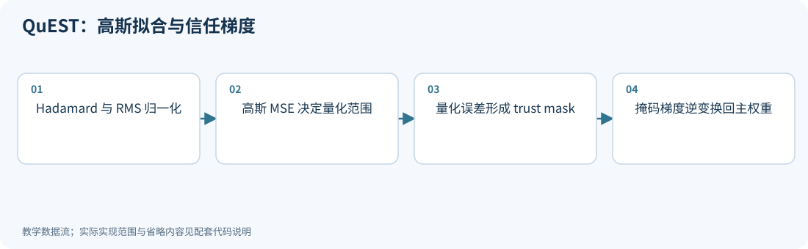
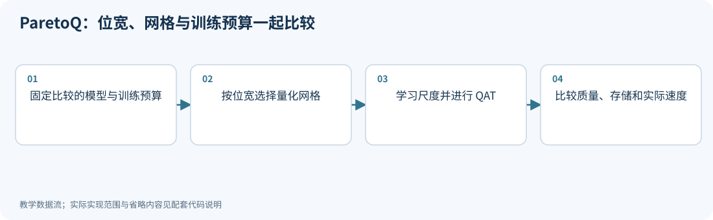
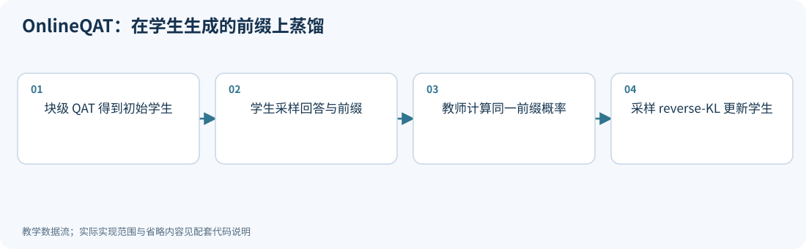
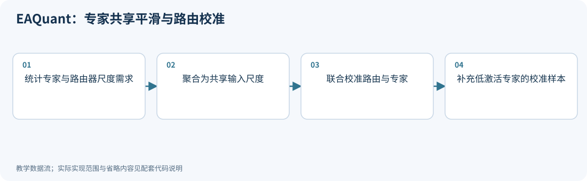
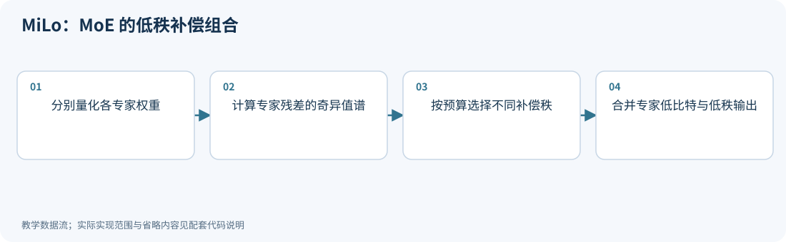
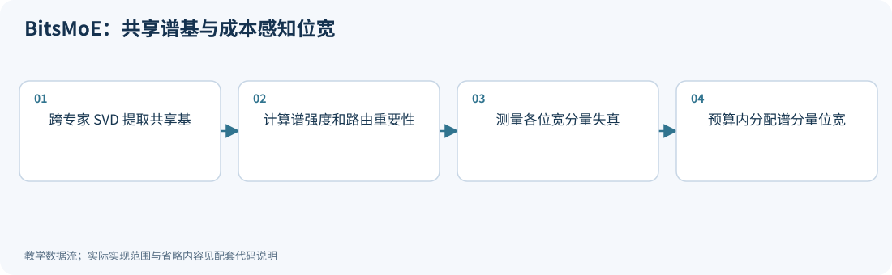

# 14｜新进展：低比特训练与 MoE 专家结构

<!-- course-objectives -->
**学习目标：** 理解信任梯度和学生前缀训练；分析 MoE 路由稳定性；比较总训练预算与完整专家存储。

**先修知识：** 第 06–07 章；第 13 章的低秩与预算思想。 [进入本章测试](#chapter-assessment)；建议先独立作答，再展开答案。
<!-- /course-objectives -->

本章把“训练适应量化”和“利用专家结构”分开讨论。前者需要明确训练数据、更新变量与损失，后者还要明确路由、共享参数和每个专家的实际使用情况。日期与论文版本见各节；其他检索候选见[检索记录](../references/原始资料索引.md#search-method)。

建议先读第 07 章和第 06 章的混合精度。低位宽不自动意味着更低训练成本，MoE 的总参数量也不等于每个 token 的激活参数量。

<!-- chapter-overview -->
<a id="chapter-start"></a>

**阅读路线：** 先看梯度估计与训练数据，再比较专家共享、补偿和位宽分配；结合路由代理反例与循环 Transformer 的适用范围。

<details><summary>本章目录（12 节）</summary>

- [14.1 QuEST：从普通 STE 到信任梯度](#principle-14-1)
- [14.2 ParetoQ：比较位宽前，先统一比较条件](#principle-14-2)
- [14.3 OnlineQAT：为什么要使用学生访问的前缀](#principle-14-3)
- [14.4 EAQuant：路由也是量化后的行为](#principle-14-4)
- [14.5 MiLo：为 MoE 分配低秩补偿容量](#principle-14-5)
- [14.6 BitsMoE：共享谱基以后，按分量分配 bit](#principle-14-6)
- [14.7 MoE 的评测不能只报告平均专家误差](#principle-14-7)
- [14.8 专家排名、敏感性强度与反例证据](#principle-14-8)
- [14.9 共享权重的循环 Transformer：校准还要覆盖迭代阶段](#principle-14-9)
- [14.10 原生FP4训练：格式、梯度与数值一致性一起设计](#principle-14-10)
- [14.11 TetraJet-v2：振荡抑制、高精度例外与完整训练成本](#principle-14-11)
- [14.12 本章测试与参考答案](#principle-14-12)

</details>

每项技术的图示、代码和讲解紧跟原理。例子在项目根目录运行，只需 NumPy；长篇参考资料可在各节末尾展开。[按技术查找](技术图解与代码索引.md) · [查看实验输出](../experiments/results/逐项技术实验结果.md)。

[分章测试与参考答案](#chapter-assessment) · [课程考核与综合练习](11_练习与答案.md#course-assessment-guide)

[本章实操：完整逐步注释](#chapter-demo)

<!-- /chapter-overview -->

<a id="principle-14-1"></a>
<a id="quest"></a>

## 14.1 QuEST：从普通 STE 到信任梯度

<!-- publication: quest -->
**文献时间：** 首次提交 2025-02-07；本次核对 2502.05003v2（版本日期 2025-06-10）。
<!-- /publication -->

QuEST 先在 Hadamard 域对权重和激活做 RMS 归一化，再使用针对高斯分布的 MSE 范围拟合。反向并非对所有量化位置都使用恒等 STE，而是屏蔽量化误差过大的分量。

若量化发生在 $x_h=xR$，重建为 $\widehat x_h$，信任掩码和梯度可概括为：

$$
M=\mathbf1\{|\widehat x_h-x_h|\le T\},\qquad
g_x=(M\odot g_h)R^T.
$$

$T$ 与该网格的半步长有关，必须使用与误差一致的归一化单位。掩码作用于 Hadamard 域，逆变换后梯度会重新混合，因此不能把它理解成永久冻结若干原始权重通道。

论文包含从 1 bit 到更高位宽的训练与执行实验。所谓合适位宽必须结合模型规模、训练预算和硬件支持，不能只从一次单向量拟合推断。

### 分布拟合与训练梯度是两条路径

QuEST 的高斯范围拟合不靠反向传播训练尺度；先用 RMS 统一幅度，再使用预计算的分布拟合范围。
若该范围为 $[-a,a]$、有 $2^b$ 个等距代表值，半步长为 $a/(2^b-1)$。
信任掩码必须在相同的归一化单位中比较误差，再将梯度逆变换回原坐标。[QuEST v2，§3.1–3.2](https://arxiv.org/html/2502.05003v2)

“逆变换混合梯度”并不保证每个原坐标每步都获得非零梯度，某些方向仍可抵消。
有效消融应同时比较普通 STE、仅高斯拟合、仅 Hadamard、加入 trust mask，记录训练质量、被屏蔽比例及变换成本；
只验证一次掩码乘法不能证明训练稳定性。

<!-- inline-technique: quest -->

### 图解与代码



**运行：** `python experiments/technique_lab.py --technique quest`

<!-- executable: quest -->
```python
import numpy as np
from experiments.quant_lab import hadamard
from experiments.technique_kernels import nearest
grid = np.linspace(-5, 5, 1001); density = np.exp(-grid**2/2)
alpha = min(np.linspace(.5, 3., 80), key=lambda a: np.sum(density*(nearest(grid, np.linspace(-a, a, 4))-grid)**2))
R = hadamard(8)
x = np.array([3., -.7, .2, .1, -.2, .4, -.6, .8])@R.T
xh = x@R; rms = np.sqrt(np.mean(xh*xh)); normalized = xh/rms
q = nearest(normalized, np.linspace(-alpha, alpha, 4))
mask = abs(q-normalized) <= alpha/3+1e-12
grad_h = np.arange(1., 9.); grad_x = (mask*grad_h)@R.T
direction = np.arange(8.)/8
assert np.any(mask) and np.any(~mask)
assert np.isclose(grad_x@direction, (mask*grad_h)@(direction@R))
print('Gaussian-fit range and trusted coordinates:', alpha, mask)
```

**代码讲解**

1. 四级均匀网格的半步长为 alpha/3；阈值在归一化域比较，不能混用原值与归一化值的单位。
2. 掩码作用在量化发生的 Hadamard 域，随后通过逆变换传回梯度；不是永久冻结同名原始通道。

> **示例边界：** 只展示一次前向拟合和信任梯度传播；没有训练完整 LLM、优化稀疏扩展或测试 GPU kernel。

<details>
<summary>论文、博客与官方资料</summary>

- **论文**：[QuEST: Stable Training of LLMs with 1-Bit Weights and Activations](https://arxiv.org/abs/2502.05003)（[所读版本正文](https://arxiv.org/html/2502.05003v2)）。
- **作者项目、官方文档与规范**：[GitHub - IST-DASLab/QuEST: Work in progress. · GitHub](https://github.com/IST-DASLab/QuEST)。

正文和代码演示范围见本节；项目可访问不等于已复现论文训练、模型评测或硬件性能。

</details>

<!-- /inline-technique -->

<a id="principle-14-2"></a>
<a id="paretoq"></a>

## 14.2 ParetoQ：比较位宽前，先统一比较条件

<!-- publication: paretoq -->
**文献时间：** 首次提交 2025-02-04；本次核对 2502.02631v2（版本日期 2025-10-13）。
<!-- /publication -->

ParetoQ 把位宽、量化函数、模型规模和训练预算放进同一比较框架。其发现强调：1/1.58/2 bit 与 3/4 bit 的适应行为不同，不能拿某个位宽的 PTQ 与另一个位宽的大量 QAT 直接比较。

框架按位宽使用不同量化器，包括二值量化、针对三值及 2-bit 的 SEQ，以及较高位宽的 LSQ。一个基本几何限制是：**偶数个、严格对称且等间距的代表值无法同时包含零**。

因此，四级网格可以重视对称覆盖，也可以使用包含零但不对称的整数范围。学习尺度和裁剪会进一步改变有效格点，位宽数字本身不足以描述量化器。

论文报告的最优训练分配和 Pareto 前沿属于特定模型、预算与评测设置。下面只展示网格与尺度自由度，不复制完整训练策略或给出普适“最佳 bit 数”。

### 公平预算需要区分 token、FLOPs 与设备时间

论文以 $B_{train}=B_{FPT}+B_{QAT}$ 描述训练 token 的分配，并研究从浮点训练切到量化适配的时机。
相同 token 数不必对应相同训练 FLOPs 或墙钟时间：量化模拟、变换、教师计算与内核会改变成本。
因此报告应同时列原始训练、QAT、模型规模与部署存储，不能仅控制最后一段微调步数。[ParetoQ v2，§2–3](https://arxiv.org/pdf/2502.02631v2)

有两种互补问题：固定同一个预训练 checkpoint，比较恢复方法；固定总训练与部署预算，比较不同规模和位宽。
前者回答怎样压缩现成模型，后者回答怎样训练最划算的模型。二者的优胜者可以不同。

<!-- inline-technique: paretoq -->

### 图解与代码



**运行：** `python experiments/technique_lab.py --technique paretoq`

<!-- executable: paretoq -->
```python
import numpy as np
from experiments.technique_kernels import nearest
w = np.array([-.9, -.4, -.1, .05, .3, .8])
symmetric_four = np.linspace(-1., 1., 4)
zero_integer_four = np.array([-2., -1., 0., 1.])
assert len(symmetric_four) == len(zero_integer_four) == 4
assert 0. not in symmetric_four and 0. in zero_integer_four
scale = 1.
for _ in range(8):
    q = nearest(w/scale, symmetric_four)
    scale = (w@q)/(q@q)
assert abs((scale*q-w)@q) < 1e-12
print('two four-level geometries:', symmetric_four, zero_integer_four)
print('learned representative scale:', scale)
```

**代码讲解**

1. 偶数个等间距、严格对称的代表值无法同时包含零；这会影响极低位宽量化器的设计。
2. 固定码字后的尺度回归说明 scale 也是自由度，而位宽本身不能决定结果优劣。

> **示例边界：** 仅示范网格族和单组尺度优化，不是 ParetoQ 的完整 SEQ/LSQ 梯度或训练调度；论文的最优位宽结论依赖其预算与模型设置。

<details>
<summary>论文、博客与官方资料</summary>

- **论文**：[ParetoQ: Improving Scaling Laws in Extremely Low-bit LLM Quantization](https://arxiv.org/abs/2502.02631)（[所读版本正文](https://arxiv.org/pdf/2502.02631v2)）。
- **博客与技术文章**：[ParetoQ: Scaling Laws in Extremely Low-bit LLM Quantization - PyTorch](https://pytorch.org/blog/paretoq-scaling-laws-in-extremely-low-bit-llm-quantization/)。
- **作者项目、官方文档与规范**：[MobileLLM - a facebook Collection](https://huggingface.co/collections/facebook/mobilellm)。

正文和代码演示范围见本节；项目可访问不等于已复现论文训练、模型评测或硬件性能。

</details>

<!-- /inline-technique -->

<a id="principle-14-3"></a>
<a id="onlineqat"></a>

## 14.3 OnlineQAT：为什么要使用学生访问的前缀

<!-- publication: onlineqat -->
**文献时间：** 首次提交 2026-10-07；本次核对 2610.09346v1（版本日期 2026-10-07）。
<!-- /publication -->

固定教师答案上的恢复训练，未必覆盖量化学生自由生成时会访问的状态。OnlineQAT 先进行块级低比特初始化，再让学生采样回答，由冻结教师评价同一批前缀。

在固定前缀上，其目标方向为 reverse KL：

$$
D_{KL}(p_S\|p_T)=\mathbb E_{a\sim p_S}\left[\log p_S(a)-\log p_T(a)\right].
$$

一个采样更新信号使用停止梯度的对数比：

$$
A(a)=\operatorname{sg}[\log p_S(a)-\log p_T(a)],\qquad
L_{sample}=A(a)\log p_S(a).
$$

注意采样分布、KL 方向与停止梯度缺一不可。采样损失本身不是 KL 的数值估计，使用教师采样也不再是同一个估计器。下面验证固定前缀的梯度期望；完整方法还要管理长序列 rollout、教师成本和训练稳定性。

### 固定前缀梯度不等于完整轨迹目标的梯度

对固定前缀 $h$，令 $p_\theta(a\mid h)$ 为学生分布，则

$$
\nabla_\theta D_{KL}(p_\theta\|p_T)
=\mathbb E_{a\sim p_\theta}[(\log p_\theta(a)-\log p_T(a))\nabla_\theta\log p_\theta(a)],
$$

因为额外的 $+1$ 项期望为 $\sum_a\nabla p_\theta(a)=0$。这解释了停止梯度的对数比与采样分布必须匹配。
论文还在学生生成的前缀上应用此更新。[OnlineQAT v1，§3.2](https://arxiv.org/html/2610.09346v1)

若把前缀分布写成 $d_\theta(h)$，完整目标
$J=\mathbb E_{h\sim d_\theta}[\ell_\theta(h)]$ 的梯度还包含
$\mathbb E[\ell_\theta(h)\nabla\log d_\theta(h)]$。
把采样前缀当作固定训练数据的 token 级估计，并未自动包含这一项或未来回报。
因此下方实验只核对固定前缀的期望梯度，不声称证明整个序列目标的无偏优化。

应保存温度、长度归一化、采样策略、教师版本和 rollout 成本；若用截断 top-p 分布采样，却用未截断分布的概率计算估计器，也会改变其数学对应关系。

<!-- inline-technique: onlineqat -->

### 图解与代码



**运行：** `python experiments/technique_lab.py --technique onlineqat`

<!-- executable: onlineqat -->
```python
import numpy as np
from experiments.quant_lab import softmax, symmetric_qdq
rng = np.random.default_rng(1403)
logits = np.array([1.1, -.3, .2])
student = softmax(symmetric_qdq(logits, bits=3)[0])
teacher = softmax(np.array([.8, .2, -.1]))
actions = rng.choice(3, size=100000, p=student)
log_ratio = np.log(student/teacher)
advantage = log_ratio[actions]  # Treated as stop-gradient in the estimator.
score = np.eye(3)[actions]-student
estimated = np.mean(advantage[:, None]*score, axis=0)
exact = student*(log_ratio-student@log_ratio)
assert np.allclose(estimated, exact, atol=.01)
print('sampled/exact reverse-KL logit gradients:', estimated, exact)
```

**代码讲解**

1. 动作按学生分布采样，log_ratio 作为停止梯度的权重；若从教师采样，优化的估计器就不同。
2. 用单前缀上的解析 reverse-KL 梯度核对蒙特卡洛估计，不把采样损失值当作真实 KL。

> **示例边界：** 只验证固定前缀的梯度估计；未实现长序列 rollout、块级初始化、策略更新或训练稳定性。

<details>
<summary>论文、博客与官方资料</summary>

- **论文**：[OnlineQAT: On-Policy Distillation for Ultra-Low-Bit Large Language Models](https://arxiv.org/abs/2610.09346)（[所读版本正文](https://arxiv.org/html/2610.09346v1)）。

本次核对了所列论文正文与方法，但未确认可访问的独立作者博客或项目入口；以论文公式和伪代码为依据，不用无关博客填充链接。

</details>

<!-- /inline-technique -->

<a id="principle-14-4"></a>
<a id="eaquant"></a>

## 14.4 EAQuant：路由也是量化后的行为

<!-- publication: eaquant -->
**文献时间：** 首次提交 2025-06-16；本次核对 2506.13329v3（版本日期 2026-02-01）。
<!-- /publication -->

多个专家共享同一上游归一化层，因此为每个专家独立计算的平滑尺度不能都直接融合到同一输入。EAQuant 聚合专家与路由器的尺度需求，形成共同的 $\bar s$：

$$
XW_e^T=(X/\bar s)(W_e\bar s)^T,\qquad
XW_{gate}^T=(X/\bar s)(W_{gate}\bar s)^T.
$$

同时变换路由器十分重要：即使专家重建较好，路由 logits 的小变化也可能改变 top-k 专家集合。论文还使用路由相关损失校准，并补充低激活专家的校准数据。

“专家激活少”不等于“不重要”。未被充分覆盖的专家可能对特定语言、代码或任务非常关键，不能仅用平均激活频率替代任务敏感性。

### 路由稳定需要观察边界附近的专家

EAQuant 的路由校准将 logit MSE 与路由相关 KL-Top 组合；候选不只包括已选 top-k，还包括其后的一部分专家，
以覆盖容易跨越选择边界的位置。专家补采样则用于缓解低激活专家缺少校准数据的问题。[EAQuant v3，§2.2–2.4](https://arxiv.org/html/2506.13329v3)

这些是优化目标，不能保证所有 token 的 top-k 不变。评测应报告 top-k 集合一致率、边界 logit 间隔、gate 权重变化、
各专家覆盖量和最终任务质量。共享尺度较大时仍可能增加部分专家的权重量化误差，需要联合看激活与权重两侧。

<!-- inline-technique: eaquant -->

### 图解与代码



**运行：** `python experiments/technique_lab.py --technique eaquant`

<!-- executable: eaquant -->
```python
import numpy as np
rng = np.random.default_rng(1404)
X = rng.normal(size=(12, 4)); X[:8, 0] = 2.; X[8:, 0] = -1.
gate = np.array([[1., 0, 0, 0], [-1., 0, 0, 0]])
experts = rng.normal(size=(2, 3, 4))
route = np.argmax(X@gate.T, axis=1); requirements = []
for e in range(2):
    a = np.max(abs(X[route == e]), axis=0)
    b = np.maximum(np.max(abs(experts[e]), axis=0), 1e-6)
    requirements.append(np.sqrt(a/b))
requirements.append(np.sqrt(np.max(abs(X), axis=0)/np.maximum(np.max(abs(gate), axis=0), 1e-6)))
shared = np.max(requirements, axis=0)
assert np.allclose((X/shared)@(gate*shared).T, X@gate.T)
for W in experts:
    assert np.allclose((X/shared)@(W*shared).T, X@W.T)
print('routed sample counts:', np.bincount(route, minlength=2))
print('shared smoothing scale:', shared)
```

**代码讲解**

1. 聚合必须包含路由器，否则共享输入变换可能改变路由 logits；等价性在量化前分别核对。
2. 每个专家收到的样本数不同，覆盖不足会影响统计；论文通过继续采样补齐稀少专家，而不是随意改变推理路由。

> **示例边界：** 只演示共享平滑和覆盖检测，未实现路由 KL-Top/MSE 优化、数据补采集及完整 MoE 激活量化。

<details>
<summary>论文、博客与官方资料</summary>

- **论文**：[EAQuant: Enhancing Post-Training Quantization for MoE Models via Expert-Aware Optimization](https://arxiv.org/abs/2506.13329)（[所读版本正文](https://arxiv.org/html/2506.13329v3)）。
- **作者项目、官方文档与规范**：[GitHub - darren-fzq1/EAQuant: EAQuant: Enhancing Post-Training Quantization for MoE Models via Expert-Aware Optimization · GitHub](https://github.com/darren-fzq1/EAQuant)。

正文和代码演示范围见本节；项目可访问不等于已复现论文训练、模型评测或硬件性能。

</details>

<!-- /inline-technique -->

<a id="principle-14-5"></a>
<a id="milo"></a>

## 14.5 MiLo：为 MoE 分配低秩补偿容量

<!-- publication: milo -->
**文献时间：** 首次提交 2025-04-03；本次核对 2504.02658v2（版本日期 2025-04-07）。
<!-- /publication -->

MiLo 在极低位宽 MoE 权重旁添加低秩补偿，并交替优化量化部分与低秩残差。用专家 $e$ 表示：

$$
W_e\approx Q_e+A_eB_e,\qquad\operatorname{rank}(A_eB_e)\le r_e.
$$

与统一增加相同 rank 不同，MiLo 根据矩阵和架构特征分配补偿容量，并考虑 INT3 执行支持。若两因子为高精度，额外参数量为 $r_e(m_e+d_e)$，因此低秩补偿不是免费的精度恢复。

其量化子步骤使用 HQQ 类更新，低秩子步骤使用截断 SVD。两者目标并不完全相同，因此完整交替过程不能仅凭每个子步骤的直觉就宣称单调收敛。

### 补偿因子自身也要量化

原方法 §3.2.5 比较统一、稠密层、专家频率和峰度等秩策略；§3.2.6 还将低秩因子量化到 INT3。
当前示例保留浮点补偿：在每次固定量化主体和秩的子问题中，精确截断 SVD 最小化权重 Frobenius 重建误差；这个误差下界不等于层输出或任务质量上界，也不证明整条交替优化达到全局最优。[MiLo v2](https://arxiv.org/html/2504.02658v2)

若 $A,B$ 的量化误差分别为 $E_A,E_B$，则实际补偿多出

$$
(A+E_A)(B+E_B)-AB=E_AB+AE_B+E_AE_B.
$$

增加秩既增加参数与计算，也可能增加因子量化误差；必须重测部署表示。
秩分配不能只依据频率：罕见专家可能承担稀有任务。建议在同一完整字节预算下比较不同秩策略，
把补偿存储、第二条乘法路径和专家通信一并计入。

<!-- inline-technique: milo -->

### 图解与代码



**运行：** `python experiments/technique_lab.py --technique milo`

<!-- executable: milo -->
```python
import numpy as np
from experiments.quant_lab import symmetric_qdq
rng = np.random.default_rng(1405)
experts = rng.normal(size=(2, 6, 8)); ranks = [1, 3]
extra_parameters = 0
for W, rank in zip(experts, ranks):
    Wq = symmetric_qdq(W, bits=3, axis=1)[0]
    E = W-Wq
    U, singular, Vt = np.linalg.svd(E, full_matrices=False)
    correction = (U[:, :rank]*singular[:rank])@Vt[:rank]
    after = np.sum((E-correction)**2)
    assert np.isclose(after, np.sum(singular[rank:]**2))
    extra_parameters += rank*sum(W.shape)
    print('rank and residual SSE:', rank, after)
print('additional low-rank parameters:', extra_parameters)
```

**代码讲解**

1. 不同专家可以分配不同的低秩容量；截断 SVD 的剩余能量给出此残差子问题的独立检查。
2. rank*(输出维+输入维) 是两因子额外参数量，必须与量化主体一同计入存储。

> **示例边界：** 使用 RTN 代替 HQQ 并预设秩，补偿因子保持浮点；省略因子的 INT3 量化、秩策略和专用推理内核。

<details>
<summary>论文、博客与官方资料</summary>

- **论文**：[MiLo: Efficient Quantized MoE Inference with Mixture of Low-Rank Compensators](https://arxiv.org/abs/2504.02658)（[所读版本正文](https://arxiv.org/html/2504.02658v2)）。
- **作者项目、官方文档与规范**：[GitHub - Supercomputing-System-AI-Lab/MiLo: Code repo for efficient quantized MoE inference with mixture of low-rank compensators · GitHub](https://github.com/Supercomputing-System-AI-Lab/MiLo)。

正文和代码演示范围见本节；项目可访问不等于已复现论文训练、模型评测或硬件性能。

</details>

<!-- /inline-technique -->

<a id="principle-14-6"></a>
<a id="bitsmoe"></a>

## 14.6 BitsMoE：共享谱基以后，按分量分配 bit

<!-- publication: bitsmoe -->
**文献时间：** 首次提交 2026-05-22；本次核对 2606.00079v2（版本日期 2026-09-27）。
<!-- /publication -->

BitsMoE 将同层多个专家权重纵向拼接，提取共享输入谱基 $\Phi$，再将各专家表示为：

$$
W_e=\sum_k\alpha_{e,k}p_{e,k}\phi_k^T.
$$

这里 $p_{e,k}$ 为单位方向，$\alpha_{e,k}$ 表示分量强度。其位宽成本模型结合三项：

$$
L_{e,k}(b)\approx\alpha_{e,k}^2\,\beta_{e,k}\,\mathcal E_{e,k,b},
\quad\beta_{e,k}=\widehat\phi_k^T H_{g,e}\widehat\phi_k.
$$

$H_{g,e}$ 来自路由权重加权的输入统计，$\mathcal E$ 表示该方向在候选位宽下的失真。这个分解使用误差交叉项近似，不能对任意相关残差都视为精确恒等式。

完整方法使用 ILP 在内存预算内分配谱分量位宽。共享基、分量幅度、尺度和格式信息必须纳入总成本；示例仅用小规模穷举解释目标和结构。

### 路由加权局部代理与 MoE 最终输出不同

BitsMoE 先用 GPTQ 将共享基量化到 8 bit，再在固定量化共享基下，给专家特有谱方向分配位宽。
其分量误差近似去掉了不同谱方向的交叉项；共享基误差属于另一部分，不应从总误差中漏掉。[BitsMoE v2，§3.3–3.4](https://arxiv.org/html/2606.00079v2)

对固定路由，令专家输出误差为 $e_e$、gate 为 $g_e$，实际 MoE 输出误差为

$$
\left\|\sum_e g_e e_e\right\|^2
=\sum_e g_e^2\|e_e\|^2+\sum_{e\ne f}g_eg_f\langle e_e,e_f\rangle.
$$

它不等于 $\sum_e g_e\|e_e\|^2$。当 $g_e\ge0$ 且和为 1，后者可由凸性给出上界，
但 gate 未归一化、路由改变时需重新分析。不能把某种局部加权统计直接称为最终 MoE 误差。

<!-- depth-example: moe_error_proxy -->
```python
import numpy as np
weights = np.array([.5, .5])
errors = np.array([[1., 0.], [-1., 0.]])
actual = np.sum((weights@errors)**2)
proxy = weights@np.sum(errors**2, axis=1)
expanded = sum(weights[i]*weights[j]*(errors[i]@errors[j]) for i in range(2) for j in range(2))
assert actual == expanded == 0 and proxy == 1
print('actual / local weighted proxy:', actual, proxy)
```

该反例检查误差抵消，不表示应主动制造抵消，因为换一批输入或 gate 后它可能消失。

<!-- inline-technique: bitsmoe -->

### 图解与代码



**运行：** `python experiments/technique_lab.py --technique bitsmoe`

<!-- executable: bitsmoe -->
```python
import itertools
import numpy as np
from experiments.quant_lab import symmetric_qdq
rng = np.random.default_rng(1406)
W = rng.normal(size=(2, 2, 3)); X = rng.normal(size=(12, 3))
U, singular, Vt = np.linalg.svd(W.reshape(4, 3), full_matrices=False)
P = (U*singular).reshape(2, 2, 3); Phi = Vt.T
assert np.allclose(P@Phi.T, W)
gates = np.tile([.8, .2], (len(X), 1)); costs = {}
for e in range(2):
    for k in range(3):
        magnitude = np.linalg.norm(P[e, :, k]); direction = P[e, :, k]/magnitude
        importance = np.mean(gates[:, e]*(X@Phi[:, k])**2)
        for bits in (2, 4):
            error = np.sum((direction-symmetric_qdq(direction, bits=bits)[0])**2)
            costs[e, k, bits] = magnitude**2*importance*error
candidates = []
for bits in itertools.product((2, 4), repeat=6):
    if sum(bits) <= 18:
        candidates.append((sum(costs[i//3, i%3, b] for i, b in enumerate(bits)), bits))
best = min(candidates)
assert sum(best[1]) <= 18
print('component bits and factorized cost:', best[1], best[0])
```

**代码讲解**

1. 共享 Phi 只保存一份；P 的列范数、激活沿 Phi 的投影和实际量化误差组成三因子成本。
2. 这里所有专家方向长度相同，位宽总和可表示可变成本；实际优化还需加入共享基、尺度及元数据的固定成本。

> **示例边界：** 用六分量穷举代替 ILP，共享基保持浮点；省略共享基 GPTQ、低位宽经验系数、误差交叉项和 GPU 执行。

<details>
<summary>论文、博客与官方资料</summary>

- **论文**：[BitsMoE: Cost-Aware Bit Allocation in Spectral Space for MoE LLM Quantization](https://arxiv.org/abs/2606.00079)（[所读版本正文](https://arxiv.org/html/2606.00079v2)）。
- **作者项目、官方文档与规范**：[GitHub - zjiayu064/BitsMoE: Cost-Aware Bit Allocation in Spectral Space for MoE LLM Quantization · GitHub](https://github.com/zjiayu064/BitsMoE)；[BitsMoE - a zjiayu064 Collection](https://huggingface.co/collections/zjiayu064/bitsmoe)。

正文和代码演示范围见本节；项目可访问不等于已复现论文训练、模型评测或硬件性能。

</details>

<!-- /inline-technique -->

<a id="principle-14-7"></a>

## 14.7 MoE 的评测不能只报告平均专家误差

| 层次 | 建议记录 | 用来区分什么 |
|---|---|---|
| 路由 | top-k 集合一致率、logit 间隔、gate 权重变化 | 选错专家与同专家内部误差 |
| 专家覆盖 | 每专家校准 token、任务分布、低频专家质量 | 缺样本与可承受的低重要性 |
| 局部表示 | 共享基误差、方向误差、补偿因子误差 | 不同压缩步骤的来源 |
| 合并输出 | 完整 MoE 输出误差与任务指标 | 局部代理与实际组合效果 |
| 系统成本 | 总驻留参数、每 token 激活参数、通信、grouped GEMM | 文件压缩与可兑现的部署收益 |

先固定 router 比较专家压缩，再开启 router 量化，可以定位退化来源；但最终应回到完整模型验证。
QAT/蒸馏还需记录教师调用和学生生成成本。不能用“只激活少量专家”推断未激活专家不占存储，也不能用平均指标掩盖稀有任务退化。

<a id="moe-sensitivity-evidence"></a>

<a id="principle-14-8"></a>

## 14.8 专家排名、敏感性强度与反例证据

[NatScale v1，§3](https://arxiv.org/html/2610.20353v1)（2026-10-14）指出：专家重要性排名相同，权重的相对强弱仍可能改变预算分配。它以梯度统计构造敏感性，再通过幂变换控制重要性的对比度；同时联合量化 gate/up/down 三个投影估计专家输出误差，避免忽略门控非线性的相互作用。

这支持“直接测量输出/任务影响比只看访问次数更充分”的研究方向，但不证明特定梯度代理就是最终任务损失。应报告重放输入、gate 是否固定、梯度采样、稀少专家覆盖和总字节预算。

同日发表的[路由统计反例研究](https://arxiv.org/html/2610.20826v1)在一个混合架构 MoE 的代码语料实验中，未发现按阶段路由统计分配位宽优于统一预算基线。其限制包括：只测一个模型与一个任务域、以 Q8_0 作为参考、仅少量路由 profiling，且没有直接单层敏感性真值。

**两类结果并不互相否定。** 一个评估特定任务感知代理，另一个否定特定路由代理在受测设置下的收益。稳妥结论是将路由作为候选特征，并用直接量化扰动、随机分配对照和独立测试集验证；不能直接宣称路由统计必然有效或所有混合精度都无效。

<a id="looped-transformers"></a>

<a id="principle-14-9"></a>

## 14.9 共享权重的循环 Transformer：校准还要覆盖迭代阶段

[LoopQuant v1，§4](https://arxiv.org/html/2610.16368v1)（2026-10-12）针对同一 Transformer 模块反复执行：共享权重不代表每一轮激活分布相同，误差还会沿迭代轨迹传播。其设计包含跨轮表示处理、循环相关的激活精度分配与任务校准。

这与第 15 章按 token 更新固定矩阵状态的线性注意力并非同一对象。比较必须固定循环次数或停止策略、共享权重存储和实际激活位宽；若每轮保存不同权重副本，便改变了参数共享的容量优势。仅在第一轮校准通常不足以支持整个递归轨迹的结论。

<a id="principle-14-10"></a>

## 14.10 原生FP4训练：格式、梯度与数值一致性一起设计

<a id="native-fp4-training"></a>

前向QDQ可以仍用高精度GEMM，而原生低精度训练要为$Y=XW^T$、$dX=dYW$、$dW=dY^TX$三次矩阵乘分别决定格式、归约轴、舍入和累加。量化前向可用，不代表反向的误差、梯度偏差和成本也合适。

### NVIDIA NVFP4配方：二维权重尺度与有选择的高精度保留

[Pretraining Large Language Models with NVFP4，2509.25149v2](https://arxiv.org/html/2509.25149v2)首发2025-09-29，所读版本2026-03-04，§3–5及附录D/E。其主要配方为：权重16×16二维共享尺度，激活/梯度1×16微块；权重梯度GEMM输入做16阶随机Hadamard；梯度随机舍入；部分敏感层保持高精度。

二维共享尺度使同一权重的前向与转置路径能保持相同重建值，减少Dgrad使用另一份量化函数的问题。它并非把硬件原生块长从16改为256：论文明确在送入Tensor Core时为各1×16片段复制尺度。转置一致性还要求同一全局scale、分块边界、舍入及无额外随机变换。

论文12B、10T token实验使用Nemotron-H混合Mamba–Transformer，保留首2块和末8块的BF16，约16%的线性层；Attention、embedding、输出头等继续高精度，主权重、累积梯度和优化器状态为FP32。表2评测以BF16执行：MMLU-Pro 62.62→62.58，而HumanEval+ 59.93→57.43、MBPP+ 59.11→55.91。它证明这套混合训练配方的大规模可行性，不证明所有张量均FP4或最终NVFP4推理完全无损。

[TE 2.8](https://archive.docs.nvidia.com/deeplearning/transformer-engine-releases/release-2.8/user-guide/examples/fp8_primer.html#NVFP4-training-recipe)实现了相应recipe，但最后若干层高精度需要训练程序按架构指定，不能假设库自动完成。

<!-- demo-slot: training_transpose -->

<!-- chapter-demo: training_transpose -->
### 专题实操｜验证1D与2D量化的前后向权重一致性

<a id="demo-training_transpose"></a>

**实践目的：** 比较按行/按列重新量化与16×16共享尺度，定位Dgrad使用不同权重的问题。

**环境：** Python 3.10+、NumPy、PyTorch；支持 CPU/CUDA，Colab 选择 GPU 运行时。无需下载模型。在项目根目录执行：

```bash
python experiments/chapter_demo_lab.py --chapter training_transpose --device cuda
# 没有GPU时显式使用CPU；auto在CUDA可用时优先使用GPU
python experiments/chapter_demo_lab.py --chapter training_transpose --device cpu
# 也可直接执行源码模块（同样在项目根目录）
python -m experiments.demos.training_transpose
```

**Colab：** 可直接上传[逐章 GPU Notebook](../experiments/notebooks/colab_chapter_demos.ipynb)，它自带所需源码；按单元选择本章运行。修改源码后将 `PRACTICE=True`，或命令行加 `--practice`；此模式跳过正文一致性检查，保留数值断言、设备核验及实际源码哈希。指定 `cuda` 后不可用会报错，不会静默退回 CPU。随机输入在 CPU 准备后一次搬到所选设备；矩阵、量化、训练和统计计算使用该设备的 PyTorch 张量。文件 I/O、Python 流程控制和打印在主机；默认 FP64 核验精度，不代表原生低比特 Tensor Core 性能。

**完整源码：** [带逐步注释的 demo](../experiments/demos/training_transpose.py)。默认只打印结果；保存命令与全部章节入口见[实操导航](../README.md#chapter-demos)。

<details><summary>展开完整代码：每一步的行为、计算逻辑与检查条件</summary>

<!-- chapter-demo-code: training_transpose -->
```python
"""NVFP4训练二维尺度：前向与Dgrad读取相同权重的必要条件。"""
import torch
from experiments.demo_runtime import get_runtime, same
from experiments.demo_torch_kernels import micro_fp4, fp4_block_qdq, finite

# 第0步：32×32权重包含明显的大幅度行，放大行/列分组差异。
rt = get_runtime()
W = rt.rng(14021).normal(size=(32, 32))
W[0] *= 12
dy = rt.rng(14022).normal(size=(4, 32))

# 第1步：沿当前末轴做1×16量化，再对转置权重重新量化。
row_q, _ = micro_fp4(W)
column_q, _ = micro_fp4(W.T.contiguous())
assert not same(row_q.T, column_q)
print('1D两个方向的权重重建MSE:', ((row_q.T-column_q)**2).mean())

# 第2步：每16×16方形块共享一个实际FP8尺度，转置时块内最大值不变。
def square_qdq(weight):
    weight = finite(weight)
    if weight.ndim != 2 or any(size % 16 for size in weight.shape):
        raise ValueError('二维权重的行列均须是16的倍数')
    rows, columns = weight.shape
    blocks = weight.reshape(rows//16, 16, columns//16, 16).permute(0, 2, 1, 3)
    # 每个256值方块只计算一次尺度；复用带零块/溢出检查的数学子步骤。
    # 这里把方块展平是为了归约，不表示硬件原生消费256值尺度。
    decoded, _ = fp4_block_qdq(blocks.reshape(rows//16, columns//16, 256))
    restored = decoded.reshape(blocks.shape)
    return restored.permute(0, 2, 1, 3).reshape(weight.shape)
square = square_qdq(W)
square_transposed = square_qdq(W.T.contiguous())
assert same(square.T, square_transposed)
# 零张量和单个零块必须在除法前得到合法正尺度，不能靠0×错误码字凑出零。
assert same(square_qdq(torch.zeros_like(W)), torch.zeros_like(W))
with_zero_block = W.clone()
with_zero_block[:16, :16] = 0
assert same(square_qdq(with_zero_block)[:16, :16], torch.zeros_like(W[:16, :16]))

# 第3步：Y=XWᵀ的输入梯度应为dy@W；换成另一方向量化权重会改变梯度。
consistent_dgrad = dy@row_q
inconsistent_dgrad = dy@column_q.T
assert not same(consistent_dgrad, inconsistent_dgrad)
assert same(dy@square, dy@square_transposed.T)
print('Dgrad因权重不一致增加的MSE:', ((consistent_dgrad-inconsistent_dgrad)**2).mean())
print('1D / 2D权重MSE:', ((row_q-W)**2).mean(), ((square-W)**2).mean())

# 第4步：2D共享尺度是算法约束，实际Tensor Core仍消费1×16尺度布局，
# 常需要复制scale，不能仅把4.5 bit改成4+8/256宣称硬件存储收益。
print('每16×16块：1个逻辑尺度，喂给1×16布局可能需复制16次。')
rt.synchronize()
```

</details>

**运行后观察：** 1D两方向重建不同；方形块在相同尺度/舍入下转置一致；打印输入梯度差异。

**动手修改：** 取消离群行，加入全零块或改变矩阵形状（行列均为16的倍数）；观察一致性与局部MSE折中，不预设2D误差更低。

**适用边界：** NVFP4二维尺度子机制，未训练12B模型；尺度复制进入GEMM仍有物理布局开销。

<!-- /chapter-demo -->

### Quartet v4：早期版本的随机舍入结论已被修正

[Quartet，2505.14669v4](https://arxiv.org/html/2505.14669v4)，首发2025-05-20，所读版本2026-01-15，§4–6。它为MXFP4设计三次低精度GEMM：前向块Hadamard和QuEST投影，反向对应随机块变换、RTN、范围补偿与掩码；变换、量化、尺度和掩码生成通过融合减少成本。

**版本差异属于方法定义。** v1曾根据实验认为SR在长训练中优于RTN；v4 §4.3脚注明确说明旧实现bug造成RTN异常退化，撤回SR优越结论。因此本书以v4为准，不能用旧摘要将Quartet概括成“前向RTN、反向SR”。其结论仍限被测模型和预算，不推翻其他配方中SR的作用。

v4在RTX5090以batch 64、序列512测线性层并聚合Transformer块，报告相对BF16的组合加速最高约2.9倍；不能把块级聚合换成完整预训练吞吐。作者[Quartet项目](https://github.com/IST-DASLab/Quartet)还区分伪量化训练入口与QuTLASS内核基准。

### Quartet II / MS-EDEN：在微尺度上实现幅度修正

[Quartet II，2601.22813v2](https://arxiv.org/html/2601.22813v2)，首发2026-01-30，所读版本2026-06-01，§3–7与附录A/D。它将低误差RTN与EDEN幅度修正结合，将随机性从每个FP4值转移到E4M3微尺度。令旋转块中的原向量为$z$、初始重建为$\widehat z$，修正系数形式为

$$
S=\frac{\langle z,z\rangle}{\langle z,\widehat z\rangle},\qquad
\widehat s_g=\operatorname{SR}_{E4M3}(S_gs_g).
$$

v2使用128元素旋转、16元素修正组；v1的修正组粒度不同，复现必须固定版本。保持合法范围时，FP8随机舍入在固定码字条件下保留修正尺度的期望。完整方法的无偏论证还依赖旋转分布与维度：附录A明确讨论$d\to\infty$的理论、有限128维、跨组共享随机旋转和未对下溢尺度随机舍入的工程近似，不能写成实际有限维实现的无条件严格无偏保证。

前向采用native 1×16 NVFP4并结合4/6，反向使用MS-EDEN。`post hoc range alignment`先在BF16容器中用E8M3代理尺度完成旋转/编码和全局范围统计，再仅访问尺度完成E4M3对齐和修正，避免重复搬运整张量。E8M3是中间代理，不是可以直接替代NVFP4硬件scale的新格式。

v2在RTX5090的1.1B Nanochat示例中，BF16约28 ktok/s、NVFP4约52 ktok/s；8×B200的另一组3.3B–11B完整训练测速约1.48–1.68倍。小矩阵在B200还可能被量化开销主导，不能从线性层4倍推出整模4倍。训练质量和这些性能配置要分开记录；作者[实现](https://github.com/IST-DASLab/Quartet-II)给出了SM100/SM120目标与版本要求。

<!-- demo-slot: gradient_rounding -->

<!-- chapter-demo: gradient_rounding -->
### 专题实操｜核对RTN、随机舍入与MS-EDEN尺度子步骤

<a id="demo-gradient_rounding"></a>

**实践目的：** 比较梯度估计偏差/方差，再验证将幅度修正随机舍入到FP8尺度的条件期望。

**环境：** Python 3.10+、NumPy、PyTorch；支持 CPU/CUDA，Colab 选择 GPU 运行时。无需下载模型。在项目根目录执行：

```bash
python experiments/chapter_demo_lab.py --chapter gradient_rounding --device cuda
# 没有GPU时显式使用CPU；auto在CUDA可用时优先使用GPU
python experiments/chapter_demo_lab.py --chapter gradient_rounding --device cpu
# 也可直接执行源码模块（同样在项目根目录）
python -m experiments.demos.gradient_rounding
```

**Colab：** 可直接上传[逐章 GPU Notebook](../experiments/notebooks/colab_chapter_demos.ipynb)，它自带所需源码；按单元选择本章运行。修改源码后将 `PRACTICE=True`，或命令行加 `--practice`；此模式跳过正文一致性检查，保留数值断言、设备核验及实际源码哈希。指定 `cuda` 后不可用会报错，不会静默退回 CPU。随机输入在 CPU 准备后一次搬到所选设备；矩阵、量化、训练和统计计算使用该设备的 PyTorch 张量。文件 I/O、Python 流程控制和打印在主机；默认 FP64 核验精度，不代表原生低比特 Tensor Core 性能。

**完整源码：** [带逐步注释的 demo](../experiments/demos/gradient_rounding.py)。默认只打印结果；保存命令与全部章节入口见[实操导航](../README.md#chapter-demos)。

<details><summary>展开完整代码：每一步的行为、计算逻辑与检查条件</summary>

<!-- chapter-demo-code: gradient_rounding -->
```python
"""梯度舍入与MS-EDEN尺度子步骤：只证明明确的条件期望。"""
import torch
from experiments.demo_runtime import get_runtime, same
from experiments.demo_torch_kernels import fp_levels, nearest, hadamard

# 第0步：构造位于相邻FP4码字间的小梯度，固定网格以排除动态scale干扰。
rt = get_runtime()
x = rt.tensor([.13, .72, 1.22, 2.6])
low, high = rt.tensor([0., .5, 1., 2.]), rt.tensor([.5, 1., 1.5, 3.])
p = (x-low)/(high-low)
expected = (1-p)*low+p*high
variance = (1-p)*(low-x)**2+p*(high-x)**2
rtn = nearest(x, fp_levels('e2m1', x))
assert same(expected, x)
assert torch.all(variance >= (rtn-x)**2-1e-12)
print('SR期望 / 方差 / RTN误差:', expected, variance, rtn-x)

# 第1步：搭建一个16元素EDEN缩放子问题，得到确定的码字与幅度修正。
# 这不是Quartet II完整128维旋转和逐16元素修正的算法。
original = rt.rng(14030).normal(size=(16,))
R = hadamard(16, device=rt.device)
rotated = original@R
scale = rt.tensor(.25)
q = nearest(rotated/scale, fp_levels('e2m1', original))
reconstruction = scale*q
denominator = rotated@reconstruction
assert denominator > 0
correction = (rotated@rotated)/denominator
target_scale = correction*scale

# 第2步：固定码字后，对修正scale做FP8随机舍入，精确枚举两个结果。
# 目标必须在两个合法有限值内；若溢出/下溢，此无偏关系不再自动成立。
levels = fp_levels('e4m3', original)
lower = levels[levels <= target_scale].max()
upper = levels[levels >= target_scale].min()
probability = (target_scale-lower)/(upper-lower) if upper > lower else target_scale.new_zeros(())
expected_decoded = ((1-probability)*lower+probability*upper)*q
assert same(expected_decoded, correction*reconstruction)
assert same(rotated@(correction*reconstruction), rotated@rotated)
print('scale修正 / 上舍概率:', target_scale, probability)

# 第3步：径向内积匹配不保证每个坐标恢复，完整无偏还依赖旋转分布等条件。
back = expected_decoded@R.T
assert not same(back, original)
print('条件期望重建与原向量MSE:', ((back-original)**2).mean())

# 第4步：误差与偏差是两种指标；不能由这个条件期望断言有限维MS-EDEN严格无偏，
# 也不能由SR无偏断言它在所有训练预算中优于RTN。
rt.synchronize()
```

</details>

**运行后观察：** 精确枚举SR条件期望；MS-EDEN子步骤保持修正后向量的期望，但不等同完整有限维RHT严格无偏。

**动手修改：** 改变输入或保留的尺度范围；检查饱和/下溢是否破坏无偏条件，观察RTN与SR方差。

**适用边界：** Quartet/II的误差分析练习，无完整训练、独立旋转证明或post-hoc range alignment内核。

<!-- /chapter-demo -->

<a id="principle-14-11"></a>

## 14.11 TetraJet-v2：振荡抑制、高精度例外与完整训练成本

<a id="tetrajet-v2"></a>

[TetraJet-v2，2510.27527v3](https://arxiv.org/html/2510.27527v3)，首发2025-10-31，所读版本2026-05-11，§2–6及附录C/G。除了NVFP4线性层的数据流对齐，它强调两类训练问题：

- **OsciReset：** 主权重在网格边界附近只移动很小距离，码字却频繁来回跳。比较累计重建移动距离与主权重移动距离，在约定阶段将高风险主权重重置到当前码字中心。
- **OutControl：** 为持续出现离群值的激活通道保留较高精度，并匹配前后向路径；它不是免费恢复全部误差，额外通道和计算都需计入。

$$
\operatorname{OsciRisk}(w)=
\frac{\sum_t|Q(w_t)-Q(w_{t-1})|}{\sum_t|w_t-w_{t-1}|}.
$$

零分母必须单独处理。v3的节省内存实现只跟踪靠近阈值的部分权重，文中估计约增加0.6 bytes/parameter；应连同实际分片、索引和采样比例报告。它还采用1×128外层FP32尺度和1×16内层E4M3尺度：仅主体及尺度约$4+8/16+32/128=4.75$ bit/value，不能仍按单一张量全局scale的4.5 bit计费。

**证据版本更新：** v1没有原生硬件测速；v3已增加RTX5090/RTX6000 Pro CUDA结果。v3的质量训练为OLMo-2 70M/150M/370M、52B/107B/212B token；附录G另测2B/7B模型前后向性能，不包含所有数据加载、优化器和分布式成本，也不等于同规模长期训练质量已经验证。

与NVIDIA二维尺度配方、Quartet v4和Quartet II比较时，必须分别固定高精度保留比例、scale布局、主权重/优化器精度、额外状态和训练token。名字都含“FP4训练”不足以定义公平预算。

### 四种训练配方按计算路径比较

下表中的Fprop、Dgrad、Wgrad分别表示$XW^T$、$dYW$、$dY^TX$。格式列描述参与量化的线性层GEMM输入，不能扩大成整个模型的参数、累加器、梯度和优化器均为4 bit。各方法的实际保留层也须另列。

| 配方与固定版本 | Fprop | Dgrad / Wgrad | 尺度、舍入与额外成本 |
|---|---|---|---|
| [NVIDIA NVFP4 v2](https://arxiv.org/html/2509.25149v2) | NVFP4权重/激活；权重16×16共享尺度，RTNE | NVFP4；Dgrad保持同一重建权重，Wgrad的两个输入配对16阶RHT；梯度SR | E4M3微尺度与张量FP32尺度；二维尺度需复制到1×16布局，计高精度保留层与变换成本 |
| [Quartet v4](https://arxiv.org/html/2505.14669v4) | MXFP4；块Hadamard和QuEST投影 | 两个反向GEMM均用MXFP4；随机块变换、RTN、范围补偿与掩码 | 32值E8M0微尺度；变换、掩码和融合成本单列。v4已修正早期SR优越结论 |
| [Quartet II v2](https://arxiv.org/html/2601.22813v2) | NVFP4 1×16，结合4/6范围选择 | 两个反向GEMM采用MS-EDEN；128元素旋转、16元素幅度修正，不以2D权重共享为前提 | FP4值RTN，随机性移至E4M3尺度；计post-hoc range alignment与各方向量化。有限维无偏关系有近似条件 |
| [TetraJet-v2 v3](https://arxiv.org/html/2510.27527v3) | NVFP4确定性量化，OutControl保留例外通道 | 以匹配前向表示的反向数据流、随机量化及配对RHT处理两个GEMM | 1×128 FP32外尺度、1×16 E4M3内尺度，主体加尺度约4.75 bit/value；另计OsciReset跟踪状态、高精度通道与计算 |

本表用于定位差异，不构成跨论文质量或速度排名。公平对照至少分别记录三次GEMM的输入格式与归约轴、尺度字节、保留层/通道、优化器状态、训练token及端到端时间。现有三个专题demo分别核验转置、条件期望和reset子步骤；它们未执行上述完整训练流程。

<!-- demo-slot: oscillation -->

<!-- chapter-demo: oscillation -->
### 专题实操｜跟踪主权重与量化码振荡并执行一次reset

<a id="demo-oscillation"></a>

**实践目的：** 把OsciRisk的两个累计距离具体化，分辨小步更新与大幅量化跳变。

**环境：** Python 3.10+、NumPy、PyTorch；支持 CPU/CUDA，Colab 选择 GPU 运行时。无需下载模型。在项目根目录执行：

```bash
python experiments/chapter_demo_lab.py --chapter oscillation --device cuda
# 没有GPU时显式使用CPU；auto在CUDA可用时优先使用GPU
python experiments/chapter_demo_lab.py --chapter oscillation --device cpu
# 也可直接执行源码模块（同样在项目根目录）
python -m experiments.demos.oscillation
```

**Colab：** 可直接上传[逐章 GPU Notebook](../experiments/notebooks/colab_chapter_demos.ipynb)，它自带所需源码；按单元选择本章运行。修改源码后将 `PRACTICE=True`，或命令行加 `--practice`；此模式跳过正文一致性检查，保留数值断言、设备核验及实际源码哈希。指定 `cuda` 后不可用会报错，不会静默退回 CPU。随机输入在 CPU 准备后一次搬到所选设备；矩阵、量化、训练和统计计算使用该设备的 PyTorch 张量。文件 I/O、Python 流程控制和打印在主机；默认 FP64 核验精度，不代表原生低比特 Tensor Core 性能。

**完整源码：** [带逐步注释的 demo](../experiments/demos/oscillation.py)。默认只打印结果；保存命令与全部章节入口见[实操导航](../README.md#chapter-demos)。

<details><summary>展开完整代码：每一步的行为、计算逻辑与检查条件</summary>

<!-- chapter-demo-code: oscillation -->
```python
"""TetraJet-v2 OsciReset子步骤：识别网格边界振荡并观察一次重置。"""
import torch
from experiments.demo_runtime import get_runtime, same

# 第0步：三个权重轨迹分别表示边界振荡、平滑移动、完全静止。
rt = get_runtime()
trajectory = rt.tensor([[.49, .10, .20], [.51, .15, .20], [.49, .20, .20],
                        [.51, .25, .20], [.49, .30, .20], [.51, .35, .20]])
step = rt.tensor(1.)
codes = torch.round(trajectory/step)
quantized = codes*step

# 第1步：累计主权重距离和量化重建距离，按权重逐项计算OsciRisk。
distance_master = torch.diff(trajectory, dim=0).abs().sum(dim=0)
distance_quantized = torch.diff(quantized, dim=0).abs().sum(dim=0)
# 恒定轨迹定义risk=0；先替换分母避免在where未选分支仍出现0/0。
safe = torch.where(distance_master > 0, distance_master, torch.ones_like(distance_master))
risk = torch.where(distance_master > 0, distance_quantized/safe, torch.zeros_like(safe))
assert same(risk, [50., 0., 0.])

# 第2步：超过阈值的权重重置到当前码字中心；此时码字不变，主权重却改变。
master = trajectory[-1].clone()
reset_mask = risk >= 8
after = torch.where(reset_mask, quantized[-1], master)
assert not same(after, master)
assert same(torch.round(after/step), codes[-1])
print('risk / reset前 / reset后:', risk, master, after)

# 第3步：展示额外成本：若外层每128值一个FP32 scale，内层每16值一个FP8，
# payload+两级scale为4+8/16+32/128=4.75 bit/value；这不是每tensor一个全局scale。
bits = rt.tensor(4+8/16+32/128)
assert same(bits, 4.75)
print('双块尺度预算bit/value:', bits)

# 第4步：实际OsciReset周期跟踪部分参数，跟踪状态也占内存；一次reset并不保证
# 长期损失下降。OutControl的高精度通道与对应计算成本未在此标量示例中实现。
rt.synchronize()
```

</details>

**运行后观察：** 边界附近轨迹的OsciRisk更高；reset改变主权重但当前码字不变；常数轨迹安全处理0/0。

**动手修改：** 改变检测阈值、轨迹幅度和重置时机；不要从一次reset推断训练收敛。

**适用边界：** TetraJet-v2 OsciReset子步骤，另计FP32外尺度和跟踪状态；未实现OutControl分支或完整优化器。

<!-- /chapter-demo -->

<!-- chapter-demo: 14 -->
## 本章实操｜在完整输出目标下分配专家位宽

<a id="chapter-demo"></a>

**实践目的：** 固定路由后测量专家误差与容量，说明访问频率不足以替代最终目标。

**环境：** Python 3.10+、NumPy、PyTorch；支持 CPU/CUDA，Colab 选择 GPU 运行时。无需下载模型。在项目根目录执行：

```bash
python experiments/chapter_demo_lab.py --chapter 14 --device cuda
# 没有GPU时显式使用CPU；auto在CUDA可用时优先使用GPU
python experiments/chapter_demo_lab.py --chapter 14 --device cpu
# 也可直接执行源码模块（同样在项目根目录）
python -m experiments.demos.ch14
```

**Colab：** 可直接上传[逐章 GPU Notebook](../experiments/notebooks/colab_chapter_demos.ipynb)，它自带所需源码；按单元选择本章运行。修改源码后将 `PRACTICE=True`，或命令行加 `--practice`；此模式跳过正文一致性检查，保留数值断言、设备核验及实际源码哈希。指定 `cuda` 后不可用会报错，不会静默退回 CPU。随机输入在 CPU 准备后一次搬到所选设备；矩阵、量化、训练和统计计算使用该设备的 PyTorch 张量。文件 I/O、Python 流程控制和打印在主机；默认 FP64 核验精度，不代表原生低比特 Tensor Core 性能。

**完整源码：** [带逐步注释的 demo](../experiments/demos/ch14.py)。默认只打印结果；保存命令与全部章节入口见[实操导航](../README.md#chapter-demos)。

<details><summary>展开完整代码：每一步的行为、计算逻辑与检查条件</summary>

<!-- chapter-demo-code: 14 -->
```python
"""第 14 章：用完整 MoE 输出误差分配专家位宽，并检查路由边界。"""
import itertools
import torch
from experiments.demo_runtime import get_runtime, same

# 第 0 步：auto优先CUDA；runner可用--device指定。所有计算张量在此设备创建。
rt = get_runtime()
device, dtype = rt.device, rt.dtype
from experiments.demo_torch_kernels import symmetric_qdq, softmax

# 第 1 步：3个线性专家、每token选2个；这个模型省略真实专家中的门控MLP。
rng = rt.rng(1400)
X = rng.normal(size=(48, 4))
experts = rng.normal(size=(3, 2, 4))
router = rng.normal(size=(3, 4)).to(torch.float16).to(dtype)
logits = X@router.T
top = torch.argsort(logits, dim=1)[:, -2:]
gate = torch.zeros_like(logits)
selected_logits = torch.gather(logits, 1, top)
gate.scatter_(1, top, softmax(selected_logits))
assert same(gate.sum(dim=1), 1., allow_scalar_broadcast=True)

# 第 2 步：对每个专家试2/4/8 bit；缓存输出以免穷举重复量化。
# 首先固定gate，只比较专家量化，防止把路由变化混进误差归因。
reference_experts = torch.stack([X@W.T for W in experts], dim=1)
reference = torch.sum(gate[:, :, None]*reference_experts, dim=1)
outputs = {}
for e in range(3):
    for b in (2, 4, 8):
        # 每行4个权重共用一个尺度；用实际FP16尺度重建，避免隐藏高精度元数据。
        _, codes, scale = symmetric_qdq(experts[e], bits=b, axis=1)
        decoded = codes*scale.to(torch.float16).to(dtype)
        outputs[e, b] = X@decoded.T

# 第 3 步：每专家8个权重、2个FP16尺度和1字节位宽标签。
# router固定FP16，三个候选共享同一份；这里无对齐开销，未实际打包。
router_bits = router.numel()*16
budget = 3*(8*4+2*16+8)+router_bits
records = []
for allocation in itertools.product((2, 4, 8), repeat=3):
    cost = sum(8*b+2*16+8 for b in allocation)+router_bits
    if cost > budget:
        continue
    actual = sum(gate[:, e, None]*outputs[e, b] for e, b in enumerate(allocation))
    loss = float(torch.mean((actual-reference)**2))
    records.append((loss, allocation, cost))
best = min(records)
uniform = next(row for row in records if row[1] == (4, 4, 4))
assert best[0] <= uniform[0] and best[2] <= budget
print('统一4bit / 最佳方案（MSE,各专家位宽,bit预算）:', uniform, best)

# 第 4 步：说明加权局部误差不是最终输出误差，跨专家项会抵消。
errors = rt.tensor([[1., 0.], [-1., 0.]])
weights = rt.tensor([.5, .5])
actual_error = torch.sum((weights@errors)**2)
proxy = weights@torch.sum(errors**2, dim=1)
assert actual_error == 0 and proxy == 1

# 第 5 步：路由分数靠近边界时很小扰动即可换专家；位宽优化后还须测完整路由。
near_tie = rt.tensor([1., .99, -1.])
perturbed = near_tie+rt.tensor([-.02, .02, 0.])
assert near_tie.argmax() != perturbed.argmax()
print('路由top1改变:', near_tie.argmax(), '→', perturbed.argmax())
# 这里没有独立测试、ILP或真实MoE内核，最佳只针对这批输入与有限候选。

# 收尾：等待本demo设备上的操作完成，方便Colab定位CUDA异步报错。
rt.synchronize()
```

</details>

**运行后观察：** 有限预算下最佳候选不劣于包含的统一4bit；两专家误差可以抵消，小路由扰动可以换专家。

**动手修改：** 改变budget或router，观察位宽分配；加入独立输入检验校准最优是否迁移。

**适用边界：** 三个线性专家的穷举；预算含FP16尺度、位宽标签和固定router，不含对齐/工作区或真实MoE内核。

<!-- /chapter-demo -->

<!-- chapter-assessment -->

<a id="principle-14-12"></a>

## 14.12 本章测试与参考答案

<a id="chapter-assessment"></a>

核心卷 10 题，仍按 100 分；另有原三档拓展题各 1 道及 3 道架构专题拓展题，均单独计分，不计入核心卷。难度相对于本章先修知识划分，题号保持原有顺序。核心卷建议 60–90 分钟，特别困难拓展可另留 30–60 分钟。

| 难度 | 按难度选题 |
|---|---|
| 简单 | [14-01](#exercise-14-01) · [14-04](#exercise-14-04) · [14-E01](#exercise-14-e01) |
| 困难 | [14-02](#exercise-14-02) · [14-03](#exercise-14-03) · [14-05](#exercise-14-05) · [14-07](#exercise-14-07) · [14-08](#exercise-14-08) · [14-09](#exercise-14-09) · [14-10](#exercise-14-10) · [14-E02](#exercise-14-e02)  · [14-E04](#exercise-14-e04)  · [14-E06](#exercise-14-e06) |
| 特别困难 | [14-06](#exercise-14-06) · [14-E03](#exercise-14-e03)  · [14-E05](#exercise-14-e05) |

每题提供至少三条参考路径，分别可能是解析解、等价推导、独立数值核验或满足条件的工程方案。固定条件下唯一的数值结果不因解法不同而改变；数值实验不能替代一般性证明。未明确要求比较多解时，可任选或组合路径回答全部子问；验证说明须补足题干要求的推导。开放题接受条件明确、证据充分的其他方案。

<a id="exercise-14-01"></a>

### 14-01｜激活参数与总参数（简单｜基础辨析，10 分）

一个 MoE 有 8 个专家，每个 1 亿参数，每 token 选 2 个，其他层先忽略。总专家参数和每 token 访问的专家参数各是多少？能否只按激活参数算模型驻留容量？

<details><summary>参考答案与评分要点</summary>

**参考路径一：**

总专家参数8亿，每token激活2亿。全部专家驻留时仍需保存8亿参数；offload/分片可改变单设备驻留，但带来传输和调度成本。top-2不是自动只保存两个专家。

**路径二：按模型文件清点。** 全部8个专家权重都在模型中，哪两个被选只是本次读取选择，不会自动删除另外6个。

**部署路径：分片与offload。** 可以仅让部分专家驻留某设备，但必须说明其他专家的位置、传输和调度；此时改变的是部署内存策略，不是总参数数量。

**评分要点：** 两数目 4 分；驻留与offload 6 分。

</details>

<a id="exercise-14-02"></a>

### 14-02｜trust mask 的坐标（困难｜推导与计算，10 分）

二维 Hadamard 为 R，变换域梯度 $g_h=(2,4)$，掩码 $M=(1,0)$。求 $g_x=(M\odot g_h)R^T$。被屏蔽的第二个变换坐标是否表示第二个原权重永久冻结？

<details><summary>参考答案与评分要点</summary>

**参考路径一：**

$g_x=(\sqrt2,\sqrt2)$。逆变换混合了梯度，第二个原坐标仍可获得非零梯度；掩码作用于当次变换域误差，不是永久冻结原通道。阈值必须与归一化误差同单位。

**解法二：基向量展开。** 保留变换域第一个方向，相当于2乘Hadamard第一行，即(√2,√2)，不是保留原域第一坐标。

**验证路径：逆变换再正变换。** 把得到的g_x乘R应回到(2,0)。该往返检验坐标方向，但不保证每一步每原坐标非零。

**评分要点：** 结果 4 分；坐标解释 4 分；单位 2 分。

</details>

<a id="exercise-14-03"></a>

### 14-03｜四级对称网格可以包含零吗（困难｜推导，10 分）

证明四个互异、严格关于零对称的代表值不能同时包含零。若还要求等间距，给一个可用网格和一个包含零但不严格对称的网格。

<details><summary>参考答案与评分要点</summary>

**参考路径一：**

非零值必须成±配对；若含唯一的零，总数量为奇数，不能为4。严格对称等距例子为{−1.5,−0.5,0.5,1.5}；包含零例子{−2,−1,0,1}。表示个数、对称性与零点需求需取舍。

**证明二：成对计数。** 零在符号翻转下是不动点，其余元素成2元集合；总数=1+2k为奇数，与4矛盾。

**网格构造：** 以零为中点的四级等距格必跨在半整数位置，例如±0.5、±1.5；若强制有0则需改变对称、间距或不同代表值数量中的至少一项。

**评分要点：** 奇偶证明 5 分；两例 4 分；取舍 1 分。

</details>

<a id="exercise-14-04"></a>

### 14-04｜相同 token 不是相同训练成本（简单｜计算与判断，10 分）

方案甲做10亿浮点token再1亿QAT token；方案乙做5亿浮点token再6亿QAT token。两者token相同。若假设每QAT token成本为浮点的2倍，算成本单位；这个倍率能否不经测量推广？

<details><summary>参考答案与评分要点</summary>

**参考路径一：**

甲为10+2×1=12亿浮点token成本单位；乙为5+2×6=17亿单位。真实倍率依赖量化模拟、反向、教师/rollout与硬件，不是通用常数。还须控制模型规模和部署预算，区分已有checkpoint恢复与从头总预算比较。

**路径二：基础成本加溢价。** 两者总token都是11亿；每QAT额外付一个浮点token单位，故分别11+1=12和11+6=17。

**测量路径：** 分别测浮点/QAT稳态每token成本，再加初始化、教师和rollout。不能把最后适配步数当全训练预算或把题设倍率2写成经验定律。

**评分要点：** 成本 4 分；倍率条件 3 分；比较目标 3 分。

</details>

<a id="exercise-14-05"></a>

### 14-05｜reverse KL 的采样方向（困难｜推导，10 分）

固定前缀，目标 $D_{KL}(p_S\|p_T)$。为什么期望中的动作要按 $p_S$ 采样？梯度中的额外常数 +1 项为什么消失？

<details><summary>参考答案与评分要点</summary>

**参考路径一：**

该KL定义的期望由学生分布加权，换教师采样需相应重要性权重及支持条件，否则改变估计器。额外项的期望为∑ₐp_S(a)∇log p_S(a)=∑ₐ∇p_S(a)=∇1=0。对数比停止梯度须与指定估计器匹配。

**解法二：对有限和求导。** KL=∑p log(p/q)，对p的变化求导出现(logp−logq+1)∇p；∑∇p=0，剩下学生分布score加权形式。

**替代方案：重要性采样。** 若用提议分布r采样且对p的支持有覆盖，可用p/r重加权同一期望；需要控制方差。直接换教师采样而不加权通常改变梯度。

**评分要点：** 采样分布与换测度 5 分；常数项推导 5 分。

</details>

<a id="exercise-14-06"></a>

### 14-06｜前缀分布也依赖参数（特别困难｜推导，10 分）

$J(\theta)=\mathbb E_{h\sim d_\theta}[\ell_\theta(h)]$。写出完整梯度；将学生生成前缀冻结后做token级更新少了什么？

<details><summary>参考答案与评分要点</summary>

**参考路径一：**

在交换求导与期望等条件下，$\nabla J=\mathbb E[\nabla\ell_\theta(h)+\ell_\theta(h)\nabla\log d_\theta(h)]$。冻结前缀仅计算第一部分，不能据固定前缀无偏性声称整个轨迹目标梯度无偏。

**解法二：离散状态和。** 对J=∑_h dθ(h)ℓθ(h)用乘法法则，一项对ℓ求导，一项对d求导；再用∇d=d∇logd转为期望。

**反例路径：** 令ℓ不显含θ但不同h成本不同，冻结前缀的梯度为0，而θ若改变访问高成本h的概率，J仍会变化。此例直接说明遗漏分布项不可忽略。

**评分要点：** 完整式 6 分；缺项与条件 4 分。

</details>

<a id="exercise-14-07"></a>

### 14-07｜top-k 边界的量化扰动（困难｜计算，10 分）

router logits为[2.00,1.99,0.50]，top-1。若每个logit误差绝对值≤0.006，是否保证选择不变？给反例；若想以统一误差界ε保证不变，需要什么充分条件？

<details><summary>参考答案与评分要点</summary>

**参考路径一：**

不保证：前两项分别减/加0.006，成为1.994与1.996，发生交换。原间隔0.01需大于2ε才有严格不翻转的充分条件；top-k看第k与第k+1之间的间隔。路由不变也不保证专家输出无误差。

**证明二：最坏间隔。** 前两logit差的最坏减少为ε+ε=2ε；若原间隔大于此值，差仍正。等号可能出现并列，tie规则不能省略。

**验证路径：区间排序。** 为每个logit构造[l_i−ε,l_i+ε]；top集合最小下界大于非top最大上界是可检验充分条件，可推广到各项不同误差界。

**评分要点：** 反例 4 分；间隔条件 4 分；输出边界 2 分。

</details>

<a id="exercise-14-08"></a>

### 14-08｜低秩因子量化后的残差（困难｜推导与计算，10 分）

标量简化：A=2、B=3，量化误差E_A=0.1、E_B=−0.2。求补偿乘积新增误差，并用三项分解核对。

<details><summary>参考答案与评分要点</summary>

**参考路径一：**

实际2.1×2.8=5.88，原乘积6，误差−0.12。三项 E_AB=0.3，AE_B=−0.4，E_AE_B=−0.02，相加−0.12。矩阵情形仍有相同三项，截断SVD误差不能替代部署因子误差。

**解法二：相对扰动。** 因子变为原来的1.05和14/15，其乘积为0.98，补偿6减少2%即−0.12。

**验证路径：保留交叉项。** 若只算一阶0.3−0.4=−0.1，会漏−0.02；小误差可近似，一旦声称精确等式必须包含E_AE_B。

**评分要点：** 直接结果 3 分；三项 5 分；矩阵/部署边界 2 分。

</details>

<a id="exercise-14-09"></a>

### 14-09｜专家误差为什么不能直接相加（困难｜计算，10 分）

两个专家 gate 都为0.5，输出误差 $e_1=(1,0)$、$e_2=(-1,0)$。求实际 MoE 平方误差、仅保留 $\sum g_e^2\|e_e\|^2$ 的近似和 Jensen 上界 $\sum g_e\|e_e\|^2$。

<details><summary>参考答案与评分要点</summary>

**参考路径一：**

实际误差0；去交叉项近似0.25+0.25=0.5；Jensen上界1。交叉项在这里恰抵消独立项。上界、局部代理与实际误差是不同量；gate变化后还需另计路由误差。

**解法二：向量先合后平方。** 0.5e₁+0.5e₂=0，所以实际平方0；先平方再加丢掉方向信息，产生0.5或上界1。

**证明路径：Jensen。** 对非负且和为1的gate，凸性给上界；等号一般要求各误差向量一致，而本例相反。gate改变还需另算权重与选择误差。

**评分要点：** 三值 6 分；交叉项/上界/路由 4 分。

</details>

<a id="exercise-14-10"></a>

### 14-10｜低频专家与循环阶段的覆盖（困难｜实验设计，10 分）

你计划给低频专家更低bit，并只用循环Transformer第一轮采集的统计量。提出这两种策略的风险及改进验证。

<details><summary>参考答案与评分要点</summary>

**参考路径一：**

低频不等于低任务敏感性，可能专门处理稀有语言/代码；按任务与专家覆盖分桶，测实际扰动和路由变化。循环共享权重在不同轮面对不同状态，应跨迭代阶段校准并测试长轨迹；若每轮单独保存权重副本，应计失去共享后的成本。

**方案二：任务条件下的专家采样。** 按语言/代码/难度统计每个专家的覆盖，补足低频但关键任务，再用实际扰动估计敏感性；频率只作采样线索。

**方案三：共享权重跨轮验证。** 保持同一权重副本，按循环步分桶采集激活/状态与任务误差，比较首轮/多轮校准。若采用每轮独立量化权重，则容量不再是同一共享模型。

**评分要点：** 两个风险各3分；可执行覆盖与测试4分。

</details>

<a id="exercise-14-e01"></a>

### 14-E01｜两个专家的输出合并（简单｜拓展题，单独计分）

两个专家输出分别为2和6，gate为0.25与0.75。输出多少？若第二专家量化后变5，输出变化多少？

<details><summary>参考答案与评分要点</summary>

**解法一：先合并。** 原5，量化4.25，差−0.75。

**解法二：误差传播。** 第二专家误差−1乘gate0.75得−0.75，第一专家无误差。

**边界路径：** 该结论固定gate；量化若也改变路由或gate，必须加入额外项，不能只乘原权重。

**评分要点：** 单独按 10 分评价：结论与条件 3 分、推理或设计过程 5 分、独立核验与边界 2 分。评分覆盖题干要求的全部子问；未要求比较多解时，可任选或组合参考路径完成作答。数值核验不能替代题干明确要求的证明，多解数量不额外加分。

</details>

<a id="exercise-14-e02"></a>

### 14-E02｜路由权重变化的交叉项（困难｜拓展题，单独计分）

原MoE输出 $y=\sum_e g_ef_e$；量化后gate为g+δg、专家输出为f+δf。展开精确输出差，给出忽略交叉项的一阶式。

<details><summary>参考答案与评分要点</summary>

**解法一：逐项展开。** $\delta y=\sum_e(g_e\delta f_e+\delta g_ef_e+\delta g_e\delta f_e)$，最后一项为二阶乘积。

**解法二：加减中间输出。** 先以旧gate组合新专家，再从旧gate换到新gate；两阶段差相加得到同式，有助区分专家误差与路由误差。

**验证路径：极端控制。** 固定专家令δf=0只剩路由项；固定gate只剩专家项；两者同时变化才有交叉项。top-k不连续变化时局部小扰动假设可能失效，完整式仍成立。

**评分要点：** 单独按 10 分评价：结论与条件 3 分、推理或设计过程 5 分、独立核验与边界 2 分。评分覆盖题干要求的全部子问；未要求比较多解时，可任选或组合参考路径完成作答。数值核验不能替代题干明确要求的证明，多解数量不额外加分。

</details>

<a id="exercise-14-e03"></a>

### 14-E03｜共享谱基误差如何影响全部专家（特别困难｜拓展题，单独计分）

共享输入基 $\Phi$，专家 $W_e=A_e\Phi$。量化后 $\widehat W_e=(A_e+E_e)(\Phi+E_\Phi)$。对一个输入行 $X$ 和固定标量 gate $g_e$，推导专家误差与组合误差，构造各专家误差完全相关的例子，解释为何不能将共享基误差当独立噪声平均消掉。

<details><summary>参考答案与评分要点</summary>

**解法一：矩阵展开。** 专家误差为 $E_e\Phi+A_eE_\Phi+E_eE_\Phi$；固定gate下输出误差为 $X[\sum_e g_e(E_e\Phi+A_eE_\Phi+E_eE_\Phi)]^T$。共享基项被多个专家共同放大。

**解法二：先组合系数。** 令A_g=∑g_eA_e、E_g=∑g_eE_e，则组合权重误差为 $E_g\Phi+A_gE_\Phi+E_gE_\Phi$。共享E_Φ只出现一次公共扰动，并非每专家独立抽样。

**反例与方案：** 令所有A_e=I、E_e=0且gate和1，组合误差恰为E_Φ，不随专家数减少。应单独消融共享基精度、系数精度和共同/独立扰动，按完整存储预算评价，而非套独立方差除以专家数。

**评分要点：** 单独按 10 分评价：结论与条件 3 分、推理或设计过程 5 分、独立核验与边界 2 分。评分覆盖题干要求的全部子问；未要求比较多解时，可任选或组合参考路径完成作答。数值核验不能替代题干明确要求的证明，多解数量不额外加分。

</details>

<a id="exercise-14-e04"></a>

### 14-E04｜二维尺度的转置一致性与零块（困难｜架构专题，单独计分）

解释为什么$Q_{row}(W)^T$与$Q_{row}(W^T)$一般不同，而16×16共享尺度可以保持转置一致。列出必要条件，并说明全零块不能直接按$amax/(6\alpha)$、$W/(\alpha s)$计算的原因。

<details><summary>参考答案与评分要点</summary>

**分组路径：** 行量化与转置后行量化改变组内元素；方形块转置保持同一元素集合及amax，因此在相同全局尺度、分块边界和确定舍入规则下可得到相同的转置重建值。额外随机变换或独立随机舍入会破坏逐值一致性。

**数值路径：** 全零张量若取$\alpha=amax/(448\times6)$会得0，并产生0/0。应显式为零张量和零块选合法正尺度，使码字为0；非零块还要检查下溢、归一化溢出和重建溢出。

**对照实验：** 用 `training_transpose` 的非对称权重、单个零块和全零权重分别比较转置路径；再比较$dy\,Q(W)$。16×16逻辑尺度仍可能需复制到硬件1×16布局，不能据逻辑共享直接宣称每256值只存一个物理尺度。

**评分要点：** 分组及必要条件4分；零块处理3分；验证与物理成本3分。

</details>

<a id="exercise-14-e05"></a>

### 14-E05｜MS-EDEN尺度条件期望能证明多少（特别困难｜架构专题，单独计分）

固定码字向量q，修正后的目标尺度为0.3，相邻合法E4M3值为0.28125与0.3125。求无偏随机舍入到上值的概率及解码期望。若尺度被饱和为0.25，或q随随机旋转变化，还能直接推出相同结论吗？

<details><summary>参考答案与评分要点</summary>

**条件期望：** 上值概率为$(0.3-0.28125)/(0.3125-0.28125)=0.6$，下值概率为0.4。因此固定q时$\mathbb E[sq\mid q,s^*=0.3]=0.3q$，保留的是修正后的目标重建期望。

**范围反例：** 若先把目标饱和到0.25，再舍入，则期望只可能对这个被改变的目标成立，不能仍声称0.3q。下溢、有限尺度范围和舍入策略必须纳入条件；q为零等退化情况要另行说明。

**完整方法路径：** 条件尺度无偏不表示每个坐标恢复原向量。q与旋转共同变化时，要再对联合分布求期望，说明旋转分布、维度及跨组共享条件；Quartet II的有限128维实现和工程近似不能由本题推广成无条件严格无偏。可用 `gradient_rounding`核验子步骤。

**评分要点：** 概率与解码期望4分；饱和反例2分；完整无偏条件及版本边界4分。

</details>

<a id="exercise-14-e06"></a>

### 14-E06｜振荡重置的收益与额外账本（困难｜架构专题，单独计分）

步长为1，主权重轨迹为0.49、0.51、0.49、0.51，采用最近舍入。计算OsciRisk；阈值为8时，把最后的主权重重置到当前码字中心会怎样？若每128值有一个FP32外尺度、每16值有一个FP8内尺度，量化表示的位宽是多少？

<details><summary>参考答案与评分要点</summary>

**距离计算：** 主权重累计距离为0.06，量化码字轨迹为0、1、0、1，累计重建距离为3，故OsciRisk=50。恒定轨迹为零分母，示例单独定义risk=0，不能直接0/0。

**重置路径：** 50超过8，将末值0.51重置到1；当前码字仍为1，主权重状态已经改变。这不保证后续损失下降，须配对记录无reset和有reset的后续训练轨迹、周期及阈值。`oscillation` demo仅执行子步骤。

**成本路径：** 主体与尺度共$4+8/16+32/128=4.75$ bit/value，另加padding、主权重、梯度、优化器和跟踪状态。OutControl的高精度通道与算子也应另计，不能把4.75当作完整训练内存。

**评分要点：** 风险计算3分；重置及结论限制3分；完整账本4分。

</details>

**复习建议：** 计算错误先回到本章的形状、单位与约定；工程判断缺少依据时，补写目标函数、对照配置和验证边界。建议达到 80 分后继续；这是一项自学建议，不是经教学验证的能力认证标准。

[课程考核与综合练习](11_练习与答案.md#course-assessment-guide) · [返回学习目录](../README.md)

<!-- /chapter-assessment -->

<!-- chapter-footer -->

---

[上一章](13_新进展_FP4与误差修正.md) · [本章目录](#chapter-start) · [下一章](15_新进展_KV与推理系统.md) · [学习首页](../README.md) · [论文与博客](../references/论文与博客导航.md)

<!-- /chapter-footer -->
