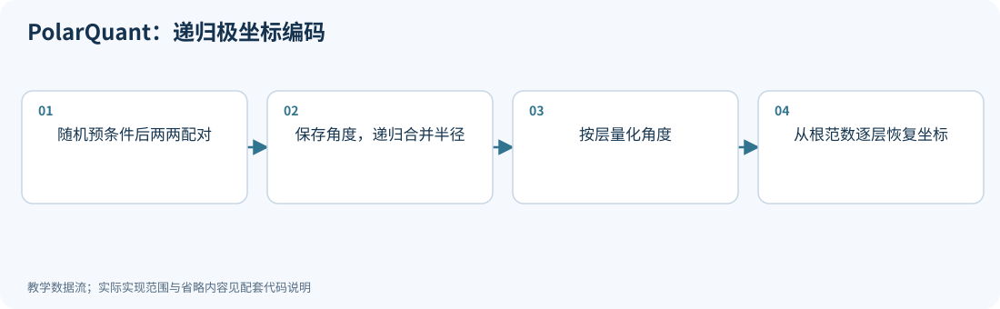
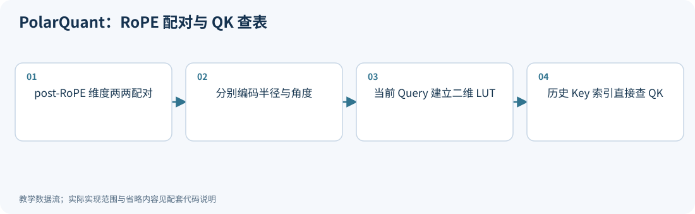
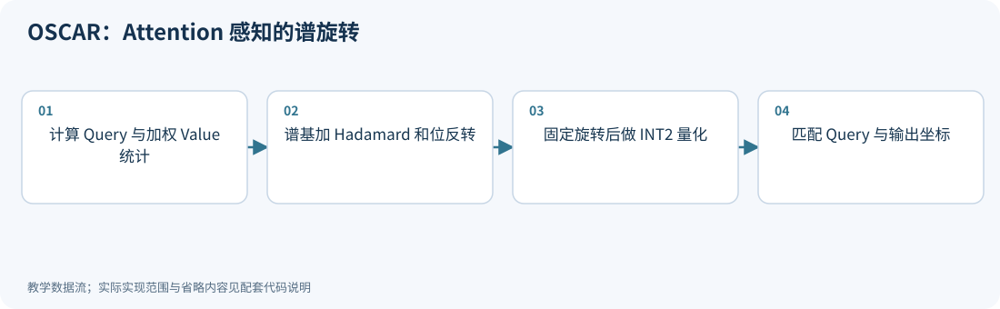
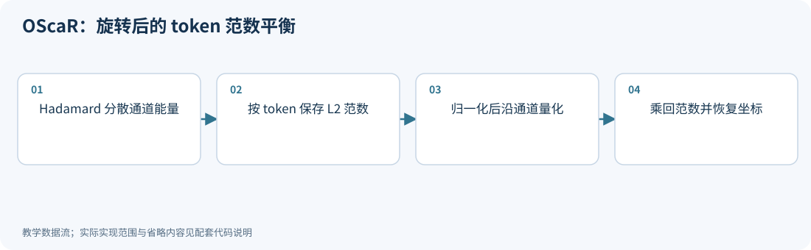
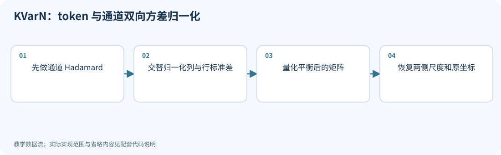
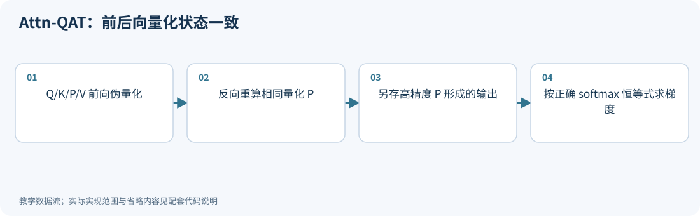
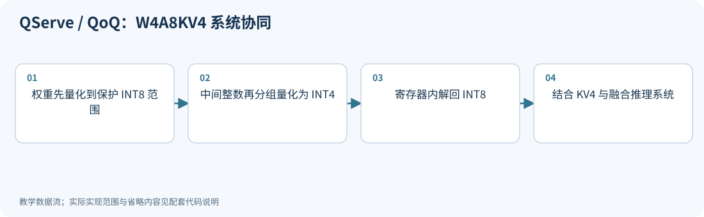

# 15｜新进展：KV 几何编码、Attention 与推理系统

<!-- course-objectives -->
**学习目标：** 区分同名工作及不同缓存对象；计算几何编码和元数据成本；检查前后向一致性与低比特服务路径。

**先修知识：** 第 08–09 章；第 14 章的状态与误差传播。 [进入本章测试](#chapter-assessment)；建议先独立作答，再展开答案。
<!-- /course-objectives -->

本章重点区分算法目标、实际存储和执行路径。尤其注意：**两篇 PolarQuant 和两篇 OSCAR/OScaR 是不同工作**，不能仅按名称或二手博客合并。它们各自的论文编号、日期和版本均在对应小节列明。

建议先读第 08、09 章。新增缓存尺度、码本、旋转和残留窗口都要计入内存；数值代理的改进不能直接换算成端到端加速。完整检索范围见[检索记录](../references/原始资料索引.md#search-method)。

<!-- chapter-overview -->
<a id="chapter-start"></a>

**阅读路线：** 从 K/V 几何编码与 Attention 量化进入窗口/位宽预算、MLA、循环状态与条件查找表，最后对照实际低比特服务路径。

<details><summary>本章目录（16 节）</summary>

- [15.1 PolarQuant：递归角度树（2502.02617）](#principle-15-1)
- [15.2 PolarQuant：RoPE 配对与内积查表（2502.00527）](#principle-15-2)
- [15.3 OSCAR：Attention 感知的谱旋转（2605.17757）](#principle-15-3)
- [15.4 OScaR：旋转与 token 范数平衡（2605.19660）](#principle-15-4)
- [15.5 KVarN：在 token 与通道两侧控制方差](#principle-15-5)
- [15.6 Attn-QAT：前向量化不够，反向状态也要一致](#principle-15-6)
- [15.7 QServe / QoQ：让低比特表示适合实际 GEMM](#principle-15-7)
- [15.8 缓存方法的比较顺序](#principle-15-8)
- [15.9 SKVQ 与 KVTuner：缓存表示之外，还要分配精度预算](#principle-15-9)
- [15.10 MLA：一个潜变量同时影响注意力匹配与值聚合](#principle-15-10)
- [15.11 循环状态：每步重新量化时，更新信息会反复丢失](#principle-15-11)
- [15.12 Fast QJL：单行无偏不保证增加投影行数就会集中](#principle-15-12)
- [15.13 模型内部条件查找表：压缩整张表，按需解码少量行](#principle-15-13)
- [15.14 Atom、QQQ 与 QServe：W4 标签下面的不同执行路径](#principle-15-14)
- [15.15 架构专用后端：相同位宽下的不同执行契约](#principle-15-15)
- [15.16 本章测试与参考答案](#principle-15-16)

</details>

每项技术的图示、代码和讲解紧跟原理。例子在项目根目录运行，只需 NumPy；长篇参考资料可在各节末尾展开。[按技术查找](技术图解与代码索引.md) · [查看实验输出](../experiments/results/逐项技术实验结果.md)。

[分章测试与参考答案](#chapter-assessment) · [课程考核与综合练习](11_练习与答案.md#course-assessment-guide)

[本章实操：完整逐步注释](#chapter-demo)

<!-- /chapter-overview -->

<a id="principle-15-1"></a>
<a id="polarquant_recursive"></a>

## 15.1 PolarQuant：递归角度树（2502.02617）

<!-- publication: polarquant_recursive -->
**文献时间：** 首次提交 2025-02-04；本次核对 2502.02617v1（版本日期 2025-02-04）。
<!-- /publication -->

这篇 PolarQuant 使用随机预条件与递归极坐标变换。首先将元素两两合并：

$$
r=\sqrt{x_1^2+x_2^2},\qquad\theta=\operatorname{atan2}(x_2,x_1).
$$

随后把相邻半径继续合并，直到留下一个根范数。$d$ 维向量可以表示为 $d-1$ 个角度和一个根范数。叶层角度覆盖完整圆，高层合并的是非负半径，分布和范围不同。

在论文的高斯投影分析假设下，各层角度分布可被推导，用来预先设计码本。省掉常规逐块归一化常数，不等于可以丢掉整个向量的幅度信息。角度量化后方向仍有误差，保持范数也不保证保持内积。

### 理论预条件与实际旋转的假设不同

原论文 §3.2 的分析使用独立高斯随机投影，范数与内积在相应条件下近似保持；§4.1 实现则用方阵正交旋转，
精确保范数但不再满足同一坐标独立假设。不能把两者的所有理论条件直接互换。
而且“原坐标独立”本身不足以推出任意联合量化器都没有收益；角度平方误差与笛卡尔重建误差也不是同一个目标。[PolarQuant 2502.02617v1，§3–4](https://arxiv.org/html/2502.02617v1)

工程配置还可只递归 4 层：每 16 个原值留下 1 个半径和 15 个角度。
论文示例首层 8 个角各 4 bit，其余 7 个角各 2 bit，配一个 FP16 半径，共
$8\times4+7\times2+16=62$ bit，即 3.875 bit/原值，另计码本等开销。
因此“无需传统 min/max 归一化参数”不等于“完全没有幅度元数据”。

<!-- inline-technique: polarquant_recursive -->

### 图解与代码



**运行：** `python experiments/technique_lab.py --technique polarquant_recursive`

<!-- executable: polarquant_recursive -->
```python
import numpy as np
x = np.array([1., -.3, .2, .7, -.5, .4, .8, -.1])
radii = x.copy(); exact_angles = []; quantized_angles = []
while len(radii) > 1:
    pairs = radii.reshape(-1, 2)
    angles = np.arctan2(pairs[:, 1], pairs[:, 0])
    lower, upper = (-np.pi, np.pi) if not exact_angles else (0., np.pi/2)
    step = (upper-lower)/16
    codes = np.clip(np.floor((angles-lower)/step), 0, 15)
    exact_angles.append(angles); quantized_angles.append(lower+(codes+.5)*step)
    radii = np.linalg.norm(pairs, axis=1)
def decode(levels):
    values = radii.copy()
    for angles in reversed(levels):
        values = np.column_stack([values*np.cos(angles), values*np.sin(angles)]).ravel()
    return values
exact, approximate = decode(exact_angles), decode(quantized_angles)
assert np.allclose(exact, x)
assert np.isclose(np.linalg.norm(approximate), np.linalg.norm(x))
assert sum(len(a) for a in exact_angles) == len(x)-1
print('angle count, root radius, MSE:', len(x)-1, radii[0], np.mean((approximate-x)**2))
```

**代码讲解**

1. 叶层角度允许正负坐标，范围是完整圆；更高层合并非负半径，角度范围变为第一象限。
2. 8 维向量只需 7 个树角度和一个根范数。量化角度保持重建范数，不表示方向无误差。

> **示例边界：** 省略随机预条件和按理论密度设计的分层码本，均匀角度仅用于解释递归结构；不是另一篇 RoPE 配对的同名 PolarQuant。

<details>
<summary>论文、博客与官方资料</summary>

- **论文**：[PolarQuant: Quantizing KV Caches with Polar Transformation](https://arxiv.org/abs/2502.02617)（[所读版本正文](https://arxiv.org/html/2502.02617v1)）。

本次核对了所列论文正文与方法，但未确认可访问的独立作者博客或项目入口；以论文公式和伪代码为依据，不用无关博客填充链接。

</details>

<!-- /inline-technique -->

<a id="principle-15-2"></a>
<a id="polarquant_rope"></a>

## 15.2 PolarQuant：RoPE 配对与内积查表（2502.00527）

<!-- publication: polarquant_rope -->
**文献时间：** 首次提交 2025-02-01；本次核对 2502.00527v2（版本日期 2026-06-05）。
<!-- /publication -->

另一篇同名工作利用 post-RoPE Key 的二维配对结构，对半径和角度分别量化，并为当前 Query 建立查找表。

对一组二维 Query $q$，半径码字 $r_a$ 和角度码字 $\theta_b$，可预计算：

$$
T_q[a,b]=r_a(q_1\cos\theta_b+q_2\sin\theta_b).
$$

历史 Key 保存 $(a,b)$ 后，直接查表得到该配对对 QK 内积的贡献。它不依赖上一节的递归角度树，也不能因为同名就继承其分布分析或存储结论。

实际配对必须与模型的 RoPE 布局一致；不同实现不一定是相邻两维。查表构建、表大小与历史长度决定摊销收益，仍要在目标内核上测量。

### 半径误差、角度误差与查表成本

令 $k=r(\cos\theta,\sin\theta)$、$\widehat k=\widehat r(\cos\widehat\theta,\sin\widehat\theta)$，则

$$
\|k-\widehat k\|^2=(r-\widehat r)^2+2r\widehat r[1-\cos(\theta-\widehat\theta)].
$$

小角误差时第二项约为 $r\widehat r(\theta-\widehat\theta)^2$，因此同样角度误差对大范数 Key 的绝对影响更大。
半径和角度各使用 $b_r,b_\theta$ bit 时，主体平均位宽为 $(b_r+b_\theta)/2$，再加分组尺度与 offset。

一个配对的联合 LUT 有 $2^{b_r+b_\theta}$ 个组合。若每组码本不同，表要按组构造；
其成本由组数、Query 头数和缓存长度共同决定。不能只比较一次 lookup 与一次乘法就宣称端到端加速。
角度采用 $\operatorname{atan2}\bmod2\pi$ 或加 $\pi$ 的编码约定时，解码必须使用匹配的相位；未量化往返应先恢复原向量。[PolarQuant 2502.00527v2，§3](https://arxiv.org/html/2502.00527v2)

<!-- depth-example: polar_error_geometry -->
```python
import numpy as np
r, rh, theta, th = 2., 1.8, .3, .4
k = r*np.array([np.cos(theta), np.sin(theta)])
kh = rh*np.array([np.cos(th), np.sin(th)])
magnitude = (r-rh)**2
direction = 2*r*rh*(1-np.cos(theta-th))
assert np.isclose(np.sum((k-kh)**2), magnitude+direction)
q = np.array([.7, -.2])
assert abs(q@(kh-k)) <= np.linalg.norm(q)*np.linalg.norm(kh-k)+1e-12
print('magnitude / direction error:', magnitude, direction)
```

<!-- inline-technique: polarquant_rope -->

### 图解与代码



**运行：** `python experiments/technique_lab.py --technique polarquant_rope`

<!-- executable: polarquant_rope -->
```python
import numpy as np
K = np.array([[1., .2], [-.4, .8], [.1, -.3]])
query = np.array([.7, -.2])
radius_grid = np.array([0., .5, 1., 2.])
angle_grid = np.arange(8)*2*np.pi/8
radii = np.linalg.norm(K, axis=1); angles = np.arctan2(K[:, 1], K[:, 0]) % (2*np.pi)
ri = np.argmin(abs(radii[:, None]-radius_grid), axis=1)
ai = np.rint(angles/(2*np.pi)*8).astype(int) % 8
lut = radius_grid[:, None]*(query[0]*np.cos(angle_grid)+query[1]*np.sin(angle_grid))
decoded = radius_grid[ri, None]*np.column_stack([np.cos(angle_grid[ai]), np.sin(angle_grid[ai])])
assert np.allclose(lut[ri, ai], decoded@query)
print('lookup QK, full-precision QK:', lut[ri, ai], K@query)
```

**代码讲解**

1. 角度索引用模运算处理圆周边界；半径与角度索引一起决定查表位置。
2. 断言比较查表与解码后内积，证明查表变换本身等价；它们均不同于原始未量化 Key 的内积。

> **示例边界：** 单个二维配对，码本为手工候选；实际模型必须遵守各自 RoPE 配对布局，量化器校准与 Triton 内核未复现。

<details>
<summary>论文、博客与官方资料</summary>

- **论文**：[PolarQuant: Leveraging Polar Transformation for Efficient Key Cache Quantization and Decoding Acceleration](https://arxiv.org/abs/2502.00527)（[所读版本正文](https://arxiv.org/html/2502.00527v2)）。

本次核对了所列论文正文与方法，但未确认可访问的独立作者博客或项目入口；以论文公式和伪代码为依据，不用无关博客填充链接。

</details>

<!-- /inline-technique -->

<a id="principle-15-3"></a>
<a id="oscar_spectral"></a>

## 15.3 OSCAR：Attention 感知的谱旋转（2605.17757）

<!-- publication: oscar_spectral -->
**文献时间：** 首次提交 2026-05-18；本次核对 2605.17757v1（版本日期 2026-05-18）。
<!-- /publication -->

这篇 OSCAR 使用不同的敏感性统计构建 Key 与 Value 的离线旋转。用 $P=\operatorname{softmax}(QK^T/\sqrt d)$ 表示注意力概率，其目标统计包括：

$$
C_Q=Q^TQ/N,\qquad C_V=V^TP^TPV/N.
$$

分别特征分解后，再组合 Hadamard 和 bit-reversal 置换。Key 的误差由 Query 放大，因此只对 K 做普通 PCA 不是同一设计；Value 的目标则包含被注意力读取后的影响。

论文的理论讨论使用冻结残差和对角误差等假设，不能据此声称任意实际 INT2 误差都达到全局最优。完整部署还包括裁剪、sink/recent 高精度区和分页缓存支持。

### 为什么 Key 与 Value 不能套同一敏感性矩阵

给定 Key 误差 $E_K$，logit 扰动为 $QE_K^T/\sqrt d$，因此 Query 二阶矩自然进入其误差度量。
但完整输出还经过 softmax Jacobian，Query 二阶矩只是其中一层代理。
对固定注意力 $P$，Value 误差直接产生 $PE_V$；原方法的 $V^TP^TPV$ 则进一步用于构造谱方向。
论文明确称这些为带假设的目标，并在其冻结残差代理下讨论最优性。[OSCAR v1，§3 与附录 A](https://arxiv.org/html/2605.17757v1)

量化残差实际依赖旋转和裁剪，不能在优化时一边改变旋转、一边把“残差与旋转独立”的假设当作实测事实。
建议同时报告原始 KV MSE、logit 误差和 Attention 输出误差；部署还要计 sink/recent 的高精度窗口，
短序列不能直接按全缓存 INT2 算压缩率。

<!-- inline-technique: oscar_spectral -->

### 图解与代码



**运行：** `python experiments/technique_lab.py --technique oscar_spectral`

<!-- executable: oscar_spectral -->
```python
import numpy as np
from experiments.quant_lab import hadamard, softmax, affine_qdq
rng = np.random.default_rng(1503)
Q = rng.normal(size=(3, 4)); K = rng.normal(size=(8, 4)); V = rng.normal(size=(8, 4))
P = softmax(Q@K.T/2)
CQ = Q.T@Q/len(Q); CV = V.T@P.T@P@V/len(Q)
permutation = np.eye(4)[:, [0, 2, 1, 3]]
def rotation(C):
    _, U = np.linalg.eigh(C)
    return U[:, ::-1]@hadamard(4)@permutation
RK, RV = rotation(CQ), rotation(CV)
assert np.allclose((Q@RK)@(K@RK).T, Q@K.T)
assert np.allclose((P@(V@RV))@RV.T, P@V)
Kq = affine_qdq(K@RK, bits=2, axis=1)[0]
Vq = affine_qdq(V@RV, bits=2, axis=1)[0]
output = (softmax((Q@RK)@Kq.T/2)@Vq)@RV.T
print('spectral INT2 attention MSE:', np.mean((output-P@V)**2))
```

**代码讲解**

1. Key 的敏感性统计来自 Query，而不是只对 K 本身做 PCA；Value 目标还包含注意力矩阵。
2. Key 旋转要同时作用于 Query，Value 的输出要逆旋转；两条浮点恒等式先分别验证。

> **示例边界：** 只展示谱目标和数值数据流，省略百分位裁剪、sink/recent 高精度区及分页缓存内核；理论最优性依赖冻结误差等假设。

<details>
<summary>论文、博客与官方资料</summary>

- **论文**：[OSCAR: Offline Spectral Covariance-Aware Rotation for 2-bit KV Cache Quantization](https://arxiv.org/abs/2605.17757)（[所读版本正文](https://arxiv.org/html/2605.17757v1)）。
- **作者项目、官方文档与规范**：[OSCAR — 2-bit KV Cache Quantization](https://oscar-quantize.github.io/)。

正文和代码演示范围见本节；项目可访问不等于已复现论文训练、模型评测或硬件性能。

</details>

<!-- /inline-technique -->

<a id="principle-15-4"></a>
<a id="oscar_token"></a>

## 15.4 OScaR：旋转与 token 范数平衡（2605.19660）

<!-- publication: oscar_token -->
**文献时间：** 首次提交 2026-05-19；本次核对 2605.19660v1（版本日期 2026-05-19）。
<!-- /publication -->

这篇 OScaR 是 Omni-Scaled Canalized Rotation，关注 Token Norm Imbalance。沿时间共享 per-channel 量化参数时，大小差异悬殊的 token 会互相污染量化范围。

其核心顺序是先分散通道能量，再进行 token 范数缩放：

$$
Z=KR,\quad a_t=\|Z_t\|_2,\quad U_t=Z_t/a_t,
\qquad\widehat K=\operatorname{diag}(a)Q(U)R^T.
$$

若直接放大小范数 token，可能制造新的通道伪离群值；旋转用于减轻这种问题。它不是上一节的 Query/Attention 协方差谱旋转方法。范数属于需要保留的元数据，零 token 也必须单独处理。

### K/V 的完整执行路径并不相同

原方法对 Query 在线做 Hadamard；Key 在线旋转、按 token 范数缩放，再按通道量化。
Value 采用可离线融合到投影与输出权重的旋转，随后按 token 量化，并非把 Key 的范数处理复制给 Value。[OScaR v1，§4.2–4.3](https://arxiv.org/html/2605.19660v1)

对 $K=\operatorname{diag}(a)UR^T$，有
$QK^T=(QR)U^T\operatorname{diag}(a)$。
历史 token 的范数 $a_t$ 应在 softmax 之前恢复到相应 logit；由于不同 token 的 $a_t$ 不同，
它不能被当作整行共同常数而省略。Value 的逆旋转则位于聚合输出一侧，并需与输出投影正确配对。

<!-- inline-technique: oscar_token -->

### 图解与代码



**运行：** `python experiments/technique_lab.py --technique oscar_token`

<!-- executable: oscar_token -->
```python
import numpy as np
from experiments.quant_lab import hadamard, affine_qdq
K = np.array([[12., .1, -.2, .3], [1., .2, .1, -.1], [.01, .02, -.01, .01], [0., 0., 0., 0.]])
R = hadamard(4); rotated = K@R
norms = np.linalg.norm(rotated, axis=1, keepdims=True)
safe = np.where(norms > 0, norms, 1.)
normalized = rotated/safe
assert np.allclose((normalized*safe)@R.T, K)
coded = affine_qdq(normalized, bits=2, axis=0)[0]
restored = (coded*norms)@R.T
assert np.array_equal(restored[-1], np.zeros(4))
print('token norms:', norms.ravel())
print('restored cache MSE:', np.mean((restored-K)**2))
```

**代码讲解**

1. 先旋转再归一化，避免简单放大小范数 token 后产生新的通道伪离群值。
2. 范数属于额外元数据，解码时必须乘回；零 token 单独处理，不能除以零。

> **示例边界：** 只处理一个 Key 块，省略多模态实现、完整 Value 路径、流式残留区和 CUDA 性能测量。

<details>
<summary>论文、博客与官方资料</summary>

- **论文**：[OScaR: The Occam's Razor for Extreme KV Cache Quantization in LLMs and Beyond](https://arxiv.org/abs/2605.19660)（[所读版本正文](https://arxiv.org/html/2605.19660v1)）。
- **作者项目、官方文档与规范**：[GitHub - ZunhaiSu/OScaR-KV-Quant: 🏆 OScaR: The Occam's Razor for Extreme KV Cache Quantization in LLMs and Beyond — redefining the accuracy-efficiency Pareto front for X-LLMs KV quantization. · GitHub](https://github.com/ZunhaiSu/OScaR-KV-Quant)；[OScaR — Extreme KV Cache Quantization](https://iridescent-gcrace.github.io/OScaR/)。

正文和代码演示范围见本节；项目可访问不等于已复现论文训练、模型评测或硬件性能。

</details>

<!-- /inline-technique -->

<a id="principle-15-5"></a>
<a id="kvarn"></a>

## 15.5 KVarN：在 token 与通道两侧控制方差

<!-- publication: kvarn -->
**文献时间：** 首次提交 2026-06-02；本次核对 2606.03458v1（版本日期 2026-06-02）。
<!-- /publication -->

长推理不仅受方向误差影响，也会受缓存向量幅度偏差的积累影响。KVarN 先做通道 Hadamard，再交替归一化 token 和通道维的方差，记录两侧尺度：

$$
Z=D_t^{-1}(KR)D_c^{-1},\qquad
\widehat K=D_tQ(Z)D_cR^T.
$$

有符号数据与均值偏移使方差统计不能直接被 absmax 或向量范数替代。单独进行一侧缩放也可能恶化另一侧的分布，原实现因此采用稳定的迭代方案。

额外尺度会增加元数据和解码操作。下面核对双侧变换的可逆性；是否减少长链推理退化仍须做模型级评估。

### 区分范数、方向与标准差

非零向量的总误差可以分成

$$
\|k-\widehat k\|^2=(\|k\|-\|\widehat k\|)^2
+2\|k\|\|\widehat k\|(1-\cos\theta).
$$

这与上一节二维极坐标公式同源，适用于任意维度；某一项占比大，是应增加诊断的证据，不是证明该项单独决定任务失败。
KVarN 使用双向**标准差**归一化，而 $\mathrm{RMS}(x)^2=\operatorname{Var}(x)+\operatorname{mean}(x)^2$，
所以存在均值偏移时，RMS、L2 范数和标准差不可替换。[KVarN v1，§3.1–3.3](https://arxiv.org/html/2606.03458v1)

对 $T\times d$ 的量化块，另存 $T$ 个行尺度和 $d$ 个列尺度；若都为 FP16，仅这两向量开销为
$16(T+d)/(Td)$ bit/值。常数行/列的标准差为零，需要有限下限，并在解码中使用同一记录尺度。
预填充整块拟合与逐 token 缓存追加也需要独立设计，不能每次追加后悄悄改变旧块的尺度。

<!-- inline-technique: kvarn -->

### 图解与代码



**运行：** `python experiments/technique_lab.py --technique kvarn`

<!-- executable: kvarn -->
```python
import numpy as np
from experiments.quant_lab import hadamard, symmetric_qdq
rng = np.random.default_rng(1505)
K = (rng.normal(size=(8, 8))+1)*np.arange(1., 9.)[:, None]
R = hadamard(8); Z = K@R
row_scale = np.ones((8, 1)); col_scale = np.ones((1, 8))
for _ in range(5):
    cols = np.maximum(Z.std(axis=0, keepdims=True), 1e-8)
    Z /= cols; col_scale *= cols
    rows = np.maximum(Z.std(axis=1, keepdims=True), 1e-8)
    Z /= rows; row_scale *= rows
assert np.allclose((row_scale*Z*col_scale)@R.T, K)
Q = symmetric_qdq(Z, bits=3)[0]
reconstructed = (row_scale*Q*col_scale)@R.T
print('dual-scale cache MSE:', np.mean((reconstructed-K)**2))
```

**代码讲解**

1. 左右尺度分别在 token 轴与通道轴广播；所有迭代的尺度乘积都要累积。
2. 先验证不量化时可恢复原矩阵，再加入量化，因此误差不会混入漏乘某轮尺度的实现问题。

> **示例边界：** 直接标准差迭代解释可逆缩放，省略论文对数域稳定更新、实际 KV 分块布局和长推理评估。

<details>
<summary>论文、博客与官方资料</summary>

- **论文**：[KVarN: Variance-Normalized KV-Cache Quantization Mitigates Error Accumulation in Reasoning Tasks](https://arxiv.org/abs/2606.03458)（[所读版本正文](https://arxiv.org/html/2606.03458v1)）。
- **作者项目、官方文档与规范**：[GitHub - huawei-csl/KVarN: KVarN is a native vLLM KV-cache quantization backend for your agents: 3-5x more context, throughput above FP16, and FP16-level accuracy. Calibration-free, one flag. · GitHub](https://github.com/huawei-csl/KVarN)。

正文和代码演示范围见本节；项目可访问不等于已复现论文训练、模型评测或硬件性能。

</details>

<!-- /inline-technique -->

<a id="principle-15-6"></a>
<a id="attn_qat"></a>

## 15.6 Attn-QAT：前向量化不够，反向状态也要一致

<!-- publication: attn_qat -->
**文献时间：** 首次提交 2026-02-09；本次核对 2603.00040v3（版本日期 2026-08-09）。
<!-- /publication -->

FlashAttention 反向会重算概率块。如果前向用了量化后的 $P_F$，反向相关路径也要重建同样的量化状态。另一方面，softmax 本身的导数仍基于高精度 $P$。

量化前向输出和辅助输出分别为：

$$
O=P_FV_F,\qquad O'=PV_F.
$$

softmax 梯度中需要的行缩减满足：

$$
\sum_jP_{ij}\,dP_{ij}=dO_i^TO'_i.
$$

把右侧的 $O'$ 换成量化前向输出 $O$ 一般不成立。Attn-QAT 因此显式处理这类前后向数值一致性问题。其训练与推理结果涵盖不同模型类型，不能全部视为自回归 LLM 的同一速度结论。

### 沿反向链逐项检查精度

在采用对应 STE 的简化链中，$O=P_FV_F$ 给出
$dV_F=P_F^TdO$、$dP_F=dOV_F^T$；通过概率量化器的替代梯度后，softmax 导数使用其输入所定义的高精度 $P$。
因此 $dV$ 路径需要重建前向的 $P_F$，softmax 行缩减则用 $P$ 与辅助输出 $O'=PV_F$。
这两个要求不能合并成“反向全部用低精度”或“反向全部用高精度”。[Attn-QAT v3，§2.3](https://arxiv.org/html/2603.00040v3)

这里的“高精度 $P$”是从该量化 Q/K 前向产生的分数计算出来的概率，并非原始全精度模型的教师概率。
分块重算还须固定 mask、log-sum-exp、尺度、舍入及随机状态。只检查 NumPy 等式不能验证整套 FlashAttention 反向 kernel。

<!-- inline-technique: attn_qat -->

### 图解与代码



**运行：** `python experiments/technique_lab.py --technique attn_qat`

<!-- executable: attn_qat -->
```python
import numpy as np
from experiments.quant_lab import softmax
from experiments.technique_kernels import micro_fp4
rng = np.random.default_rng(1506)
P = softmax(rng.normal(size=(3, 16))); V = rng.normal(size=(16, 8))
PF, _ = micro_fp4(P); VF, _ = micro_fp4(V.T); VF = VF.T
output = PF@VF; auxiliary = P@VF
dO = rng.normal(size=output.shape); dP = dO@VF.T
direct = P*(dP-np.sum(P*dP, axis=1, keepdims=True))
via_auxiliary = P*(dP-np.sum(dO*auxiliary, axis=1, keepdims=True))
wrong = P*(dP-np.sum(dO*output, axis=1, keepdims=True))
assert np.allclose(direct, via_auxiliary)
assert not np.allclose(direct, wrong, atol=1e-10)
assert np.array_equal(PF, micro_fp4(P)[0])
print('gradient mismatch from using low-precision output:', np.linalg.norm(direct-wrong))
```

**代码讲解**

1. O=PF*VF 是量化前向输出，但 softmax 梯度需要 Oprime=P*VF；两者不能混为同一张量。
2. 辅助输出让每行的缩减项由 dO 与 Oprime 内积获得，不必保存完整 P；这里用显式 P 作为参照。

> **示例边界：** 验证一个关键反向恒等式，未实现 FlashAttention 分块重算、完整反向 kernel 或模型级 QAT。

<details>
<summary>论文、博客与官方资料</summary>

- **论文**：[Attn-QAT: 4-Bit Attention With Quantization-Aware Training](https://arxiv.org/abs/2603.00040)（[所读版本正文](https://arxiv.org/html/2603.00040v3)）。

本次核对了所列论文正文与方法，但未确认可访问的独立作者博客或项目入口；以论文公式和伪代码为依据，不用无关博客填充链接。

</details>

<!-- /inline-technique -->

<a id="principle-15-7"></a>
<a id="qserve"></a>

## 15.7 QServe / QoQ：让低比特表示适合实际 GEMM

<!-- publication: qserve -->
**文献时间：** 首次提交 2024-05-07；本次核对 2405.04532v3（版本日期 2025-05-01）。
<!-- /publication -->

QServe 是此前教程的重要系统路线遗漏，首发于 2024 年。QoQ 将模型组织为 W4A8KV4，并让权重先进入每通道 INT8，再对中间整数进行分组 INT4 量化：

$$
\widehat W=s^{(0)}_{FP16}Q^{(0)}_{INT8},\qquad
Q^{(0)}_{INT8}\approx(Q_{UINT4}-z_{UINT4})s^{(1)}_{UINT8}.
$$

这样可以在寄存器内恢复整数并参与 INT8 GEMM。第二次舍入可能造成溢出，例如中间值 120 最终恢复成 128；QoQ 使用保护范围为这种重建留出余量。

这与 QLoRA 的 Double Quantization 目的不同：后者主要压缩量化常数，不自动让解码结果成为可直接参与 INT8 点积的整数。完整 QServe 还包括 SmoothAttention、KV4 和融合服务系统，因此格式标签不能替代执行路径分析。

### SmoothAttention 为什么约束 RoPE 配对尺度

对 $D=\operatorname{diag}(\lambda)$，有 $(QD)(KD^{-1})^T=QK^T$，可以把 Key 的范围转移给 Query。
要将该尺度融合到 RoPE 之前的投影，需要对每个位置旋转 $R_\theta$ 满足 $DR_\theta=R_\theta D$。
在二维旋转对内，对角尺度只有在两维相同（或退化旋转角）时才普遍可交换。
原方法因此让每个 RoPE 配对共享尺度；配对可能是前后半维对应，而非内存中相邻两维。[QServe v3，§4.2](https://arxiv.org/html/2405.04532v3)

<!-- depth-example: rope_scale_commutation -->
```python
import numpy as np
angle = .7
R = np.array([[np.cos(angle), -np.sin(angle)], [np.sin(angle), np.cos(angle)]])
shared, unequal = np.diag([2., 2.]), np.diag([2., .5])
assert np.allclose(shared@R, R@shared)
assert not np.allclose(unequal@R, R@unequal)
print('unequal-scale commutator norm:', np.linalg.norm(unequal@R-R@unequal))
```

W4A8KV4 中的 A8 主要描述线性 GEMM 激活；SmoothAttention 中 Query 的处理需按 Attention 路径单独说明。
应分别测渐进权重量化、SmoothAttention 与服务系统优化的贡献，避免把某一个步骤等同于完整 QServe。

<!-- inline-technique: qserve -->

### 图解与代码



**运行：** `python experiments/technique_lab.py --technique qserve`

<!-- executable: qserve -->
```python
import numpy as np
def group_encode(values):
    step = max(1, int(np.rint(np.ptp(values)/15)))
    zero = int(np.clip(np.rint(-values.min()/step), 0, 15))
    codes = np.clip(np.rint(values/step)+zero, 0, 15).astype(int)
    return (codes-zero)*step, codes, step, zero
unsafe = np.array([-113, 120])
decoded_bad, _, _, _ = group_encode(unsafe)
protected = np.clip(unsafe, -119, 119)
decoded_safe, codes, step, zero = group_encode(protected)
assert decoded_bad.max() == 128
assert decoded_safe.min() >= -128 and decoded_safe.max() <= 127
print('unprotected/protected intermediate INT8:', decoded_bad, decoded_safe)
print('INT4 codes, integer step, zero point:', codes, step, zero)
```

**代码讲解**

1. 第二次量化会再次舍入，中间重建值可能从 120 变成 128；不能仅凭最初张量属于 INT8 就假设不会溢出。
2. 保护范围为后续重建留出余量；整数尺度让权重恢复到 INT8，区别于只压缩浮点 scale 的双重量化。

> **示例边界：** 仅验证渐进式量化和保护范围反例；省略外层 FP16 scale、SmoothAttention、KV4 管理和融合 CUDA 内核。

<details>
<summary>论文、博客与官方资料</summary>

- **论文**：[QServe: W4A8KV4 Quantization and System Co-design for Efficient LLM Serving](https://arxiv.org/abs/2405.04532)（[所读版本正文](https://arxiv.org/html/2405.04532v3)）。
- **作者项目、官方文档与规范**：[GitHub - mit-han-lab/omniserve: [MLSys'25] QServe: W4A8KV4 Quantization and System Co-design for Efficient LLM Serving; [MLSys'25] LServe: Efficient Long-sequence LLM Serving with Unified Sparse Attention · GitHub](https://github.com/mit-han-lab/omniserve)；[QServe: W4A8KV4 Quantization and System Co-design for Efficient LLM Serving](https://hanlab.mit.edu/projects/qserve)。

正文和代码演示范围见本节；项目可访问不等于已复现论文训练、模型评测或硬件性能。

</details>

<!-- /inline-technique -->

<a id="principle-15-8"></a>

## 15.8 缓存方法的比较顺序

先固定模型与上下文能力，再确定 KV 头数、层数、缓存长度与并发；MLA 等结构按实际缓存张量重新统计。
随后说明量化发生在 RoPE 前还是后、K/V 各自分组轴、元数据、sink/recent 窗口和更新时机。

建议按下列顺序验证：无量化的编码往返与坐标等价 → 给定解码缓存的 Attention 正确性 →
数值量化误差 → 固定长度的端到端质量 → 同一显存预算下的延迟和并发吞吐。
其中，压缩段与高精度段的 softmax 合并见第 08 章；对多个片段独立归一化后平均输出会改变注意力。

对长推理还应固定最大生成长度并记录实际停止行为。仅证明缓存容纳更多 token，不能证明模型可以可靠使用更长历史；
仅提升 QK 内核速度，也不能直接推广到包括 prefill、KV 写入和输出投影的完整服务速度。

<a id="skvq-kvtuner"></a>

<a id="principle-15-9"></a>

## 15.9 SKVQ 与 KVTuner：缓存表示之外，还要分配精度预算

[SKVQ v3，§3](https://arxiv.org/html/2405.06219v3)（首发 2024-05-10；版本 2024-11-12）结合通道重排、分组动态裁剪、最近窗口与 sink 的高精度保留。
它在 prefill 先用高精度 K/V 算 Attention，再量化写缓存；decode 时处理滑出窗口的 token。这意味着相同缓存位宽但不同写入时机的实验，也可能有不同的误差传播。重排还必须与 Q、输出投影及 RoPE 位置相容。

[KVTuner v5，§5](https://arxiv.org/html/2502.04420v5)（首发 2025-02-06；版本 2025-11-20）离线选择逐层 K/V 精度对，先按局部误差与成本剪枝，再聚类减少组合搜索。层敏感性具有跨数据稳定性的经验结果，不是“与所有 prompt 无关”的普适保证；尤其不能要求每层都一定 K 比 V 更敏感。

在层数或 KV 维度不一致的架构中，简单平均位宽不等于内存成本。应实际求和：

$$
M=\sum_l\frac{N_{K,l}b_{K,l}+N_{V,l}b_{V,l}}8
+M_{scale}+M_{recent}+M_{sink}+M_{padding}.
$$

[MultiAlloc v1](https://arxiv.org/html/2610.18642v1)（2026-10-13）把层位宽与保留 token 预算联合分配；
[PN-Mix v1](https://arxiv.org/html/2610.19605v1)（2026-10-14）则在 prefill 按 Query–Key 的 RoPE 配对范数估计显著性，并在 decode 复用。前者的可加退化代理、后者的显著性稳定假设都需要独立验证，不能根据 Key 范数直接推断最终 Attention 误差。

对照至少包含统一位宽、固定最近窗口、仅层分配、联合分配；各组必须使用同一个完整缓存预算，而不是各自额外保留同样大小的高精度区后仍声称等容量。

<a id="mla-quantization"></a>

<a id="principle-15-10"></a>

## 15.10 MLA：一个潜变量同时影响注意力匹配与值聚合

在 [DeepSeek-V2 的 MLA](https://arxiv.org/abs/2405.04434) 类解耦 RoPE 表示中，可缓存内容潜变量
$C\in\mathbb R^{T\times d_c}$ 和 RoPE Key $K_R\in\mathbb R^{T\times d_r}$，而非每个头的完整 K/V。
吸收相应投影后，一个头可以写成

$$
Z_h=\tau(\bar Q_{C,h}C^T+Q_{R,h}K_R^T),\quad
P_h=\operatorname{softmax}(Z_h),\quad Y=\sum_hP_hCB_h.
$$

其中 $B_h$ 是已吸收的值—输出映射；省略 mask 的式子仅用于解释。纯 payload 的一层每 token 成本为
$(d_cb_C+d_rb_R)/8$ 字节，不能套第 08 章的两份完整 K/V 公式。

[QuantMLA v2，§2–3](https://arxiv.org/html/2609.36760v2)（首发 2026-09-29；版本 2026-09-30）据此区分内容与位置分支。
内容误差 $E_C$ 同时改变 logits 和取回的值；有限输出误差包括

$$
\Delta Y=\sum_h\bigl(\Delta P_hCB_h+P_hE_CB_h+\Delta P_hE_CB_h\bigr).
$$

位置分支误差只通过 $\Delta P_h$ 起作用。两者缓存 MSE 一样，不表示功能损害一样。
内容旋转/缩放要补偿所有消费者，RoPE 分支则受配对可交换条件限制。
比较时保持相同 MLA 架构与投影吸收方式；把 GQA 改造成 MLA 的结构压缩收益，应与在同一 MLA 上降低位宽的收益分开报告。

<a id="recurrent-state-quantization"></a>

<a id="principle-15-11"></a>

## 15.11 循环状态：每步重新量化时，更新信息会反复丢失

线性注意力与状态空间模型通常维护固定形状状态 $S_t=A_tS_{t-1}+B_t$。如果存储状态每步量化，

$$
\widehat S_t=Q_t(A_t\widehat S_{t-1}+B_t),\qquad
E_t=A_tE_{t-1}+R_t.
$$

最后一式假设两条路径的 $A_t,B_t$ 相同；若 gate 或更新依赖已经漂移的状态，还需加入其变化项。
展开后不同步的误差有交叉项，小而同向的误差可能持续累积，不能按独立白噪声估计总损失。

[Preserving Updates v1，§2–3](https://arxiv.org/html/2610.15709v1)（2026-10-11）用低秩旁路积累小更新，并处理重拟合网格导致的更新方向反转。
另一项[尺度—状态反馈研究](https://arxiv.org/html/2610.15139v1)表明动态范围也可能被自身的量化状态反馈放大；其结论依赖被测架构和策略，静态尺度并不自动保持模型功能。

<!-- depth-example: recurrent_update_loss -->
```python
import numpy as np
step = .1; exact = stored = 0.; buffered = residual = 0.
for _ in range(10):
    exact += .03
    stored = step*np.rint((stored+.03)/step)
    residual += .03
    next_value = step*np.rint((buffered+residual)/step)
    residual = buffered+residual-next_value
    buffered = next_value
assert np.isclose(exact, .3) and stored == 0.
assert np.isclose(buffered+residual, exact)
print('exact / repeated rounding / buffered:', exact, stored, buffered+residual)
```

这是标量误差反馈反例，不是论文完整低秩旁路：真实旁路本身占空间，截断、合并、衰减和读取均有成本。
评测应扫描连续更新步数、重置策略、批量、范数与任务指标；短序列局部 MSE 良好，不能替代长轨迹验证。

<a id="fast-qjl"></a>

<a id="principle-15-12"></a>

## 15.12 Fast QJL：单行无偏不保证增加投影行数就会集中

第 08 章的独立高斯投影可以通过独立样本平均减小方差，但直接改成共享随机数的快速变换可能破坏这一点。
[Fast Quantized Johnson–Lindenstrauss Transforms v1，§3](https://arxiv.org/html/2610.16289v1)（2026-10-12）研究 Gaussian–Hadamard 结构，并用 dither 或随机置换控制行间相关性。

一个直接反例是 $T_0=\sqrt d\,HD_g$、$q=k=e_1$：所有行贡献共享同一个随机变量，内积估计归约为
$\sqrt{\pi/2}|g_1|$，方差为 $\pi/2-1$，与取多少行无关。
因此不能只检查每一行满足高斯符号恒等式，就继承独立稠密投影的误差界。

该工作补充的是快速投影的理论与结构，不能由 $O(d\log d)$ 直接推出某个 Attention kernel 的速度；
还要计算范数、随机状态、查询变换与低比特码的总开销，并核对理论采样维度范围。

<a id="conditional-memory-quantization"></a>

<a id="principle-15-13"></a>

## 15.13 模型内部条件查找表：压缩整张表，按需解码少量行

[N-Gram Memories at Two Bits v1，§3](https://arxiv.org/html/2610.21810v1)（2026-10-15）针对学习得到的大型条件查找表，
每行保存短编码 $c_i$ 和局部尺度 $\alpha_i$，用共享解码函数恢复 $\widehat e_i=\alpha_i f(c_i)$。
主要设计约束是行记录独立寻址，只解码实际请求的行；整表量化后运行时全部展开，会丢掉这种访问优势。

若每行 $d$ 个值、主体每值 $b$ bit、每行一个 16-bit 尺度，不计对齐与共享解码器，成本为
$b+16/d$ bit/值。论文使用 trellis 与范数恢复；恢复原范数与最小化坐标 MSE 并不总一致。
这属于模型参数存储的新对象，而不是新的通用 KV 算法，也不等同于外部向量检索库的产品量化。

<a id="atom-qqq"></a>

<a id="principle-15-14"></a>

## 15.14 Atom、QQQ 与 QServe：W4 标签下面的不同执行路径

[Atom v3，§4](https://arxiv.org/html/2310.19102v3)（首发 2023-10-29；版本 2024-04-16）面向高吞吐服务，普通通道采用细粒度低比特表示，离群通道使用 INT8，并重排成规则尾部。
离群位置由校准确定，激活量化参数动态计算；在线重排与量化需要融合控制开销。它不同于 LLM.int8() 的 INT8 主体加高精度分支，也不同于 AWQ 通过缩放保护通道的 weight-only 路线。

[QQQ v3，§3](https://arxiv.org/html/2406.09904v3)（首发 2024-06-14；版本 2024-07-31）使用自适应平滑与 GPTQ 类补偿，设计 W4A8 的执行路径：
per-channel 权重可将 INT4 映到 INT8 后乘法；per-group 权重还需处理组尺度到通道尺度的转换，并融合解码和再量化。
这里的中间转换也可能带来误差，不能只用 W4A8 名称判断与其他方法的数值或速度完全相同。

| 方法 | 重点表示/执行选择 | 与相近路线的差别 |
|---|---|---|
| Atom | 低比特主体、INT8 离群尾部、细粒度动态激活 | 混合通道表示与服务内核一起设计 |
| QQQ | W4A8、平滑加补偿、INT4→INT8 路径 | 分组尺度转换与融合内核是关键 |
| QServe/QoQ | 渐进式整数表示、保护范围、KV4 | 中间整数范围、Attention 与服务系统共同设计 |
| 普通 GPTQ/AWQ W4A16 | 压缩权重、浮点激活与后端指定计算 | 不自动具有原生 W4A8/W4A4 GEMM |

比较先固定 batch、输入输出长度与延迟目标，再记录实际内核和高精度例外。
原论文的最大吞吐倍数来自各自设置，不能跨硬件或请求规模排序；作者项目中的后来扩展也应固定版本，避免将其当作原论文默认配置。

<a id="principle-15-15"></a>

## 15.15 架构专用后端：相同位宽下的不同执行契约

<a id="architecture-backends"></a>

### 从Hopper软件块缩放到Blackwell原生块缩放

[DeepSeek-V3 v2，§3.3](https://arxiv.org/html/2412.19437v2)在H800上使用激活1×128、权重128×128细粒度FP8缩放，并将Tensor Core部分和定期提升到CUDA Core的FP32累加，控制其被测路径的累加误差。该实现展示硬件约束如何影响量化设计；文中对当时GPU的限制不能当成Blackwell/CDNA4也没有原生块尺度支持的结论。

[DeepGEMM固定提交1fc9c66](https://github.com/deepseek-ai/DeepGEMM/blob/1fc9c66975ee322d628b3288534ca0e9ce12a64d/README.md)区分SM90的FP32尺度与SM100的打包UE8M0尺度。前者转为后者通常涉及尺度重新量化；随后字节repack才可能是数值无损。还须分别固定逻辑转置、尺度轴和后端要求的对齐。

对$A\in\mathbb R^{M\times K}$、$B\in\mathbb R^{N\times K}$，沿$K$分块时，

$$
C_{ij}=\sum_g s^A_{ig}s^B_{jg}\sum_{k\in g}q^A_{ik}q^B_{jk}.
$$

块尺度不能移到整段归约外。CUDA上能对这条式子做浮点模拟，仍不表示执行了`tcgen05`或AMD MFMA。

### FlashInfer与QuTLASS：接口名相同仍要检查布局与形状

[FlashInfer 0.7.2 MXFP8接口](https://docs.flashinfer.ai/generated/flashinfer.gemm.mm_mxfp8.html)要求特定swizzled尺度布局，不接受任意二维线性尺度。其[FP4接口](https://docs.flashinfer.ai/generated/flashinfer.gemm.mm_fp4.html)还区分16/32微块、8×4/128×4尺度布局、权重是否shuffle及后端。运行应固定显式backend、版本和形状，不用`auto`的名字代替实际执行证据。

[SM120 NVFP4 Attention](https://docs.flashinfer.ai/generated/flashinfer.nvfp4_attention_sm120.nvfp4_attention_sm120_fwd.html)要求与量化函数匹配的Q/K/V打包、转置V、修正项、mask和未padding长度。它是指定架构的算子接口，不是所有KV量化方法都能直接接入的通用开关。MXFP8×MXFP4 grouped GEMM也已有接口，但操作数格式与尺度布局仍须逐项匹配。

QuTLASS服务于FP-Quant/Quartet的融合变换和窄精度计算；其SM100与SM120支持范围、训练原型和生产推理路径不能混称。作者性能数字只属于相应版本及负载。[QuTLASS作者说明](https://github.com/IST-DASLab/qutlass)

<!-- demo-slot: scale_layout -->

<!-- chapter-demo: scale_layout -->
### 专题实操｜区分UE8M0重新量化和尺度字节repack

<a id="demo-scale_layout"></a>

**实践目的：** 先量化尺度，再改变物理布局并解码，核对微块部分和必须各乘对应尺度。

**环境：** Python 3.10+、NumPy、PyTorch；支持 CPU/CUDA，Colab 选择 GPU 运行时。无需下载模型。在项目根目录执行：

```bash
python experiments/chapter_demo_lab.py --chapter scale_layout --device cuda
# 没有GPU时显式使用CPU；auto在CUDA可用时优先使用GPU
python experiments/chapter_demo_lab.py --chapter scale_layout --device cpu
# 也可直接执行源码模块（同样在项目根目录）
python -m experiments.demos.scale_layout
```

**Colab：** 可直接上传[逐章 GPU Notebook](../experiments/notebooks/colab_chapter_demos.ipynb)，它自带所需源码；按单元选择本章运行。修改源码后将 `PRACTICE=True`，或命令行加 `--practice`；此模式跳过正文一致性检查，保留数值断言、设备核验及实际源码哈希。指定 `cuda` 后不可用会报错，不会静默退回 CPU。随机输入在 CPU 准备后一次搬到所选设备；矩阵、量化、训练和统计计算使用该设备的 PyTorch 张量。文件 I/O、Python 流程控制和打印在主机；默认 FP64 核验精度，不代表原生低比特 Tensor Core 性能。

**完整源码：** [带逐步注释的 demo](../experiments/demos/scale_layout.py)。默认只打印结果；保存命令与全部章节入口见[实操导航](../README.md#chapter-demos)。

<details><summary>展开完整代码：每一步的行为、计算逻辑与检查条件</summary>

<!-- chapter-demo-code: scale_layout -->
```python
"""尺度数值转换与字节布局分离：UE8M0、repack以及块缩放GEMM。"""
import torch
from experiments.demo_runtime import get_runtime, same, exact

# 第0步：有限UE8M0编码c映射为2^(c-127)，0xff保留为NaN，不能当普通指数。
rt = get_runtime()
scale = rt.tensor([.3, .7, 1.1, 3.1])
exponent = torch.ceil(torch.log2(scale)).to(torch.int64)
codes = exponent+127
assert torch.all((codes >= 0) & (codes < 255))
decoded = 2.**(codes.to(rt.dtype)-127)
assert not same(decoded, scale)  # FP32/64尺度转二次幂是重新量化，不是无损repack。

# 第1步：把四个尺度字节装入一个32-bit词的位模式，在int64容器中安全移位。
shifts = torch.arange(4, device=rt.device)*8
word = torch.sum(codes << shifts)
unpacked = (word >> shifts) & 255
assert exact(unpacked, codes)
assert same(2.**(unpacked.to(rt.dtype)-127), decoded)
print('尺度转换误差 / 打包词:', decoded-scale, word)

# 第2步：教学重排改变物理次序但不改变值；真实swizzle必须从后端源码读取。
order = rt.tensor([2, 0, 3, 1], dtype=torch.int64)
swizzled = codes[order]
restored_codes = swizzled[torch.argsort(order)]
assert exact(restored_codes, codes)

# 第3步：沿K切成两个块，每个部分和分别恢复尺度，再求总和。
A = rt.tensor([[1., 2., -1., .5], [.2, -.4, 1., 2.]])
B = rt.tensor([[1., .2, -.3, 2.], [.4, 1., 2., -.5], [-1., .5, 1., 1.]])
sa = rt.tensor([[.5, 2.], [1., .25]])
sb = rt.tensor([[2., .5], [.5, 1.], [1., 2.]])
full = (A*sa.repeat_interleave(2, dim=1))@(B*sb.repeat_interleave(2, dim=1)).T
parts = sum((A[:, 2*g:2*g+2]@B[:, 2*g:2*g+2].T)*sa[:, g, None]*sb[:, g][None, :]
            for g in range(2))
assert same(full, parts)
wrong = (A@B.T)*sa[:, :1]*sb[:, 0][None, :]
assert not same(wrong, full)
print('正确块缩放输出:', full)

# 第4步：只验证数值契约；这里不是DeepGEMM/FlashInfer的真实scale swizzle或原生GEMM。
rt.synchronize()
```

</details>

**运行后观察：** FP32→UE8M0有误差，字节打包往返无新增误差；块缩放乘法等于显式重建，整段外提尺度不等价。

**动手修改：** 更换尺度与矩阵形状；改变布局必须同时修改解码器，不能只reshape。

**适用边界：** 自定义4字节打包与重排，不是FlashInfer/CUTLASS真实swizzle；原生后端需另行验证。

<!-- /chapter-demo -->

### 在Colab区分模拟、原生API与指令实证

| 层级 | 运行入口 | 能证明什么 |
|---|---|---|
| CPU/CUDA数值模拟 | `chapter_demo_lab.py --chapter four_over_six --device cuda` 等 | 公式、码字、布局和条件期望的教学关系；T4/A100可运行 |
| 原生NVFP4 API探针 | [native_nvfp4_probe.py](../experiments/native_nvfp4_probe.py) | 匹配Blackwell与TE版本时，显式recipe前后向可执行；不自动证明所有指令或LLM质量 |
| 指令与收益实证 | 目标后端profiler、同负载重复计时和模型评测 | 实际Tensor Core路径、融合成本及完整收益；本轮尚未完成 |

原生探针对照TE 2.8，保守限定SM100/SM103；它先检查硬件、库版本及官方支持函数，再执行真实`NVFP4BlockScaling`的Linear前后向。SM120应按专属内核另行集成，不是被本探针拒绝就代表硬件没有FP4。依据为[TE 2.8源码](https://github.com/NVIDIA/TransformerEngine/blob/v2.8/transformer_engine/pytorch/fp8.py)与[固定文档](https://archive.docs.nvidia.com/deeplearning/transformer-engine-releases/release-2.8/user-guide/examples/fp8_primer.html)。

```bash
# 在已按官方安装说明配置好的匹配Blackwell/TE 2.8环境执行；不会自动安装或回退。
python experiments/native_nvfp4_probe.py --output-dir runs/native_nvfp4
```

默认Colab Notebook仍运行可跨CPU/CUDA执行的数值demo；新增原生探针单元默认关闭，可在获得匹配硬件后显式开启。当前本机只有CPU，原生探针未实测；GPU可用、检查通过和测得加速是三种不同结论。

探针结果按实际张量记录输入、权重、输出、损失与梯度的dtype/shape/device，同时保存随机种子、PyTorch/CUDA/TE版本及实际recipe标志。BF16输入不能标成教学demo默认的FP64。Colab每轮生成独立目录，下载ZIP包含逐章结果、源码快照、日志及已运行的原生探针JSON；失败状态和异常也保留。后续做原生验证时，可据此补充profiler、质量和计时证据，不能从API探针推断尚未测量的收益。

<!-- chapter-demo: 15 -->
## 本章实操｜分解 MLA 双路径误差与循环状态丢失

<a id="chapter-demo"></a>

**实践目的：** 分别量化内容/位置缓存，核验直接项和交叉项，再跟踪状态反复量化。

**环境：** Python 3.10+、NumPy、PyTorch；支持 CPU/CUDA，Colab 选择 GPU 运行时。无需下载模型。在项目根目录执行：

```bash
python experiments/chapter_demo_lab.py --chapter 15 --device cuda
# 没有GPU时显式使用CPU；auto在CUDA可用时优先使用GPU
python experiments/chapter_demo_lab.py --chapter 15 --device cpu
# 也可直接执行源码模块（同样在项目根目录）
python -m experiments.demos.ch15
```

**Colab：** 可直接上传[逐章 GPU Notebook](../experiments/notebooks/colab_chapter_demos.ipynb)，它自带所需源码；按单元选择本章运行。修改源码后将 `PRACTICE=True`，或命令行加 `--practice`；此模式跳过正文一致性检查，保留数值断言、设备核验及实际源码哈希。指定 `cuda` 后不可用会报错，不会静默退回 CPU。随机输入在 CPU 准备后一次搬到所选设备；矩阵、量化、训练和统计计算使用该设备的 PyTorch 张量。文件 I/O、Python 流程控制和打印在主机；默认 FP64 核验精度，不代表原生低比特 Tensor Core 性能。

**完整源码：** [带逐步注释的 demo](../experiments/demos/ch15.py)。默认只打印结果；保存命令与全部章节入口见[实操导航](../README.md#chapter-demos)。

<details><summary>展开完整代码：每一步的行为、计算逻辑与检查条件</summary>

<!-- chapter-demo-code: 15 -->
```python
"""第 15 章：MLA 内容/位置误差路径，以及循环状态反复量化。"""
import math
import torch
from experiments.demo_runtime import get_runtime, same, exact

# 第 0 步：auto优先CUDA；runner可用--device指定。所有计算张量在此设备创建。
rt = get_runtime()
device, dtype = rt.device, rt.dtype
from experiments.demo_torch_kernels import symmetric_qdq, softmax

# 第 1 步：构造一个吸收投影后的单头 MLA；C 同时用于匹配与聚合。
# KR只进入匹配，B负责把潜变量映射到最终输出，不保存完整K/V。
rng = rt.rng(1500)
C = rng.normal(size=(8, 4))
KR = rng.normal(size=(8, 2))
query_content = rng.normal(size=(1, 4))
query_rope = rng.normal(size=(1, 2))
B = rng.normal(size=(4, 3))
temperature = 1/math.sqrt(6)
def attention(content, position):
    logits = temperature*(query_content@content.T+query_rope@position.T)
    probabilities = softmax(logits)
    return probabilities, probabilities@content@B
P, reference = attention(C, KR)

# 第 2 步：按每token分别量化两份缓存，保持布局、查询和投影不变。
Cq = symmetric_qdq(C, bits=3, axis=1)[0]
KRq = symmetric_qdq(KR, bits=3, axis=1)[0]
for name, content, position in [('仅内容', Cq, KR), ('仅位置', C, KRq), ('两者', Cq, KRq)]:
    Pq, output = attention(content, position)
    delta_P, E_C = Pq-P, content-C
    # 内容误差有直接聚合项和交叉项；位置误差只通过 delta_P 传播。
    expanded = delta_P@C@B+P@E_C@B+delta_P@E_C@B
    assert same(output-reference, expanded)
    print(name, 'logit概率MSE / 最终输出MSE:', torch.mean(delta_P**2), torch.mean((output-reference)**2))

# 第 3 步：切换到循环状态这个不同对象；每步都覆盖量化会反复吞掉小更新。
step = .1
exact = rt.tensor(0.)
stored, buffered, remainder = rt.tensor(0.), rt.tensor(0.), rt.tensor(0.)
for t in range(10):
    update = .03
    exact += update
    stored = step*torch.round((stored+update)/step)
    # 高精度余数记录上次未保存的信息，再与本次更新一起量化。
    full_value = buffered+remainder+update
    buffered = step*torch.round(full_value/step)
    remainder = full_value-buffered
    assert same(buffered+remainder, exact)
# 第 4 步：与精确累积量比较；不要仅验证每步量化误差很小就推断长期正确。
assert stored == 0 and same(exact, .3)
print('精确状态 / 反复量化 / 量化主体+余数:', exact, stored, buffered+remainder)
# 余数自身占存储。真实低秩余数的截断和读取不是免费的，本例不证明长期任务无损。

# 收尾：等待本demo设备上的操作完成，方便Colab定位CUDA异步报错。
rt.synchronize()
```

</details>

**运行后观察：** 三种MLA扰动均满足完整误差展开；每步0.03更新在0.1网格上被吞掉，保留余数后可恢复。

**动手修改：** 单独提高KR或C位宽；给循环状态加入衰减后重新推导误差与余数更新。

**适用边界：** 吸收投影后的单头代数模型与标量状态，不含QuantMLA或低秩状态旁路完整实现。

<!-- /chapter-demo -->

<!-- chapter-assessment -->

<a id="principle-15-16"></a>

## 15.16 本章测试与参考答案

<a id="chapter-assessment"></a>

核心卷 10 题，仍按 100 分；另有原三档拓展题各 1 道及 1 道架构专题拓展题，均单独计分，不计入核心卷。难度相对于本章先修知识划分，题号保持原有顺序。核心卷建议 60–90 分钟，特别困难拓展可另留 30–60 分钟。

| 难度 | 按难度选题 |
|---|---|
| 简单 | [15-01](#exercise-15-01) · [15-02](#exercise-15-02) · [15-03](#exercise-15-03) · [15-E01](#exercise-15-e01) |
| 困难 | [15-04](#exercise-15-04) · [15-05](#exercise-15-05) · [15-06](#exercise-15-06) · [15-08](#exercise-15-08) · [15-09](#exercise-15-09) · [15-10](#exercise-15-10) · [15-E02](#exercise-15-e02)  · [15-E04](#exercise-15-e04) |
| 特别困难 | [15-07](#exercise-15-07) · [15-E03](#exercise-15-e03) |

每题提供至少三条参考路径，分别可能是解析解、等价推导、独立数值核验或满足条件的工程方案。固定条件下唯一的数值结果不因解法不同而改变；数值实验不能替代一般性证明。未明确要求比较多解时，可任选或组合路径回答全部子问；验证说明须补足题干要求的推导。开放题接受条件明确、证据充分的其他方案。

<a id="exercise-15-01"></a>

### 15-01｜同名方法如何核对（简单｜文献辨析，10 分）

两篇 PolarQuant、OSCAR 与 OScaR 是否可以按名称合并引用？列出至少四个必须核对的识别与技术维度。

<details><summary>参考答案与评分要点</summary>

**参考路径一：**

不能。核对论文标识/版本、作者或项目、量化对象、变换结构、编码与解码路径、目标统计和实验条件。递归角度树不同于RoPE配对LUT；谱统计旋转不同于token范数平衡，不能相互继承定理和性能。

**路径二：建立输入—表示—输出表。** 对每篇文献分别记录K还是V、在哪个坐标系、存什么索引/范数、怎样计算内积；同名但链路不同就不能合并。

**验证路径：回到主来源标识。** 用arXiv编号和固定版本匹配作者实现，排除题名缩写/大小写造成的混淆；性能与定理均按该版本条件引用。

**评分要点：** 识别维度4分；两组机制区别6分。

</details>

<a id="exercise-15-02"></a>

### 15-02｜递归极坐标成本（简单｜计算，10 分）

16个原值按正文示例表示为8个4-bit叶层角、7个2-bit高层角和1个FP16根半径。平均bit/value是多少？若一律把15个角视为2-bit会错多少bit？

<details><summary>参考答案与评分要点</summary>

**参考路径一：**

实际8×4+7×2+16=62 bit，平均3.875。错误账本为15×2+16=46 bit，少16 bit。角度不同层范围/精度不同，半径和码本等不能丢；实际字节对齐另计。

**路径二：每层角度计数。** 16叶合并需8+4+2+1=15角，首层8角位宽4，其余7角位宽2，另根范数16，不能一律按2bit。

**路径三：差额。** 错误方案只把8个叶角少算2bit，各少2，共16bit；正确62比46多16。

**评分要点：** 成本及平均5分；差值3分；范围/对齐2分。

</details>

<a id="exercise-15-03"></a>

### 15-03｜配对查表大小（简单｜计算，10 分）

每二维Key用3-bit半径和5-bit角度索引，当前query为每个配对建立FP16联合表。求主体bit/原值、每表项数与字节；64维query有多少配对、总表多大？

<details><summary>参考答案与评分要点</summary>

**参考路径一：**

主体(3+5)/2=4 bit/原值；表2⁸=256项、512字节；64维有32对，合计16384字节=16 KiB。还未计头/组数，query变化可能重建表；需用历史长度摊销构表成本。

**路径二：乘法计数。** 半径8选、角度32选，共8×32=256组合，每表2×256字节；32配对乘得16KiB。

**性能路径：构表与查询分开。** 当前query变化会改变表值，需按头/分组计算构表总成本，再按实际历史长度摊销。查表次数减少不自动超过构表和缓存成本。

**评分要点：** 主体和表6分；总表2分；摊销条件2分。

</details>

<a id="exercise-15-04"></a>

### 15-04｜幅度与角度误差（困难｜计算，10 分）

$r=2,\widehat r=1.5$，角度差为 $\pi/3$。用极坐标误差公式求平方距离；若只恢复正确半径，是否必然零误差？

<details><summary>参考答案与评分要点</summary>

**参考路径一：**

$(2-1.5)^2+2(2)(1.5)(1-\cos(\pi/3))=0.25+3=3.25$。半径正确但方向不同仍有方向项；内积还受query方向影响，保范数不等于无损Attention。

**解法二：余弦定理。** 两向量平方距离r²+rhat²−2r rhat cosθ，代入4+2.25−3=3.25。

**解法三：笛卡尔坐标。** 取原k=(2,0)，重建khat=(0.75,3√3/4)，直接距离平方(1.25)²+(3√3/4)²=3.25。

**评分要点：** 两项与总和6分；保范数限制4分。

</details>

<a id="exercise-15-05"></a>

### 15-05｜双侧尺度元数据（困难｜计算与概念，10 分）

一个缓存块形状32×128，每值2 bit，另存32个行尺度和128个列尺度，均FP16。求总字节和bit/value；为什么不能把标准差直接换成RMS？

<details><summary>参考答案与评分要点</summary>

**参考路径一：**

payload1024字节，尺度(32+128)×2=320字节，总1344字节，2.625 bit/value。RMS²=Var+mean²，非零均值时二者不同；常数行标准差可为零，但RMS非零，需明确尺度下限。

**路径二：每值位宽。** 尺度开销 $16(32+128)/(32\times128)=0.625$bit/值，加payload2得2.625。

**反例路径：** 常数向量(2,2)标准差0、RMS2，不能互换。两侧尺度数目由行/列布局决定，实际还需处理零方差和共享范围。

**评分要点：** 账本6分；二阶关系与常数边界4分。

</details>

<a id="exercise-15-06"></a>

### 15-06｜token 范数何时恢复（困难｜推导，10 分）

$K=\operatorname{diag}(a)UR^T$。写出 $QK^T$，说明为什么不能先对 $(QR)U^T$ softmax 再恢复 a。

<details><summary>参考答案与评分要点</summary>

**参考路径一：**

$QK^T=(QR)U^T\operatorname{diag}(a)$。a按历史token分别缩放logits，改变相对概率，必须在softmax前参与；softmax是非线性的，之后乘a不等价于此前恢复。零范数需单独定义编码。

**路径二：逐token内积。** 第t个logit为a_t乘旋转query与归一化key的内积；不同a_t改变概率比，所以不能在概率归一化后补乘。

**反例路径：** 归一化logits(1,1)，范数(1,2)恢复后为(1,2)；先softmax得均匀再乘范数并归一化得到(1/3,2/3)，仍不同于softmax(1,2)。

**评分要点：** 转置与公式5分；非线性位置4分；零向量1分。

</details>

<a id="exercise-15-07"></a>

### 15-07｜Attn-QAT 的两种概率（特别困难｜推导，10 分）

前向 $O=P_FV_F$，softmax概率为P。解释 $dV_F=P_F^TdO$，而softmax行缩减为何用辅助输出 $O_{aux}=PV_F$，不能直接用O。

<details><summary>参考答案与评分要点</summary>

**参考路径一：**

dV路径由实际前向乘法求得，故使用量化概率P_F；softmax导数基于其定义的P，行缩减∑ⱼPᵢⱼ(dOᵢᵀvⱼ)=dOᵢᵀ(PV_F)ᵢ。P_F一般不等于P，故替换成O改变梯度；还需匹配量化器替代梯度、mask和重算状态。

**解法二：索引链式法则。** dP_ij=dO_iᵀV_F,j，softmax导数减去∑P_ij dP_ij，因此行缩减必须对P加权，而dV的前向线性系数是P_F。

**验证路径：独立替代图。** 固定P_F的前向和明确的STE，分别检查dV与softmax梯度；重算P、P_F、mask、尺度和随机状态。原始round函数有限差分不能证明STE正确。

**评分要点：** 两路径推导7分；状态与STE条件3分。

</details>

<a id="exercise-15-08"></a>

### 15-08｜MLA 的缓存与双重误差路径（困难｜计算与推导，10 分）

一层每token缓存512维内容潜变量C（4 bit）和64维位置分支（16 bit），无元数据。求payload字节；为什么C的误差同时影响匹配和取回内容？

<details><summary>参考答案与评分要点</summary>

**参考路径一：**

每token为(512×4+64×16)/8=384字节。内容C参与内容logits和P C B形式的值聚合，扰动同时改变P和被加权的C；位置分支主要经logits影响P。不能按两份完整K/V容量或只按其中一条误差路径计算。

**路径二：按分支字节算。** 内容512×0.5=256字节，位置64×2=128字节，总384；一个内容潜变量同时被两处消费，并非两份独立KV。

**路径三：有限扰动展开。** 内容误差同时产生δP C B、P E_C B与δP E_C B；位置误差经δP作用。只统计缓存MSE会漏掉两分支功能差异。

**评分要点：** 字节4分；两条功能路径4分；容量与误差边界2分。

</details>

<a id="exercise-15-09"></a>

### 15-09｜重复量化为什么丢失小更新（困难｜计算与分析，10 分）

标量状态初始0，每步加0.04，每步以0.1为间距最近舍入，无饱和。10步后逐步量化状态与精确状态各是多少？误差反馈应保存哪部分？

<details><summary>参考答案与评分要点</summary>

**参考路径一：**

每次从0加0.04又舍回0，10步仍为0；精确状态0.4。误差反馈保存本次输入与量化状态之差，供后续累积；但保存、读取和合并残差也占资源。动态尺度并不自动解决反馈/舍入问题。

**路径二：固定点。** 更新映射Q(s+0.04)在s=0仍返回0，所以重复10次都停在那里；不是十次无关误差的随机抵消。

**方案三：高精度残差缓冲。** 保留累积舍入余量，使“存储值+余量”跟随精确状态。缓冲本身有精度和容量成本，不能宣称无开销恢复。

**评分要点：** 两状态4分；残差机制4分；成本2分。

</details>

<a id="exercise-15-10"></a>

### 15-10｜固定缓存位宽仍不能公平比较（困难｜实验设计，10 分）

两个方法都标注KV2：甲另保留最近256token高精度，乙保留64token且改用W4A8内核。如何比较缓存量化本身和整套服务？

<details><summary>参考答案与评分要点</summary>

**参考路径一：**

缓存机制比较固定权重/Attention路径、完整缓存预算、历史长度、K/V轴、页和尾部配置，分别评测误差与读取成本；系统比较允许各自最佳配置但固定总资源/质量门槛和请求分布，列出W/A/KV与内核。尾部、尺度、写入时机、长输出质量和TTFT/TPOT都需记录。

**方案二：字节预算归一化。** 先算不同长度下KV2主体、窗口、scale、分页总量，再选择同完整预算点比较；短历史时高精度窗口比例特别重要。

**方案三：分拆联合系统。** 先固定W/A/kernel只切KV，再固定KV测W4A8/服务路径；完整方案可另测，但其组合收益不能全归KV算法。

**评分要点：** 两类目标4分；完整缓存条件3分；质量/系统指标3分。

</details>

<a id="exercise-15-e01"></a>

### 15-E01｜位置分支的混合位宽（简单｜拓展题，单独计分）

一层MLA每token内容256值用4bit，位置32值用16bit，不计元数据。总payload多少字节？

<details><summary>参考答案与评分要点</summary>

**解法一：分支求和。** 128+64=192字节。

**解法二：总bit。** (256×4+32×16)/8=192。

**核对路径：** 不是把288值都按4bit，也不是为内容复制两份K/V；必须按实际缓存张量计数。

**评分要点：** 单独按 10 分评价：结论与条件 3 分、推理或设计过程 5 分、独立核验与边界 2 分。评分覆盖题干要求的全部子问；未要求比较多解时，可任选或组合参考路径完成作答。数值核验不能替代题干明确要求的证明，多解数量不额外加分。

</details>

<a id="exercise-15-e02"></a>

### 15-E02｜共享随机行不能获得独立平均的收益（困难｜拓展题，单独计分）

估计器每一行贡献都等于同一无偏随机变量Z，Var(Z)=σ²。取m行平均，求方差；与m个独立同分布贡献比较。

<details><summary>参考答案与评分要点</summary>

**解法一：直接相消。** 平均mZ/m=Z，方差σ²；独立均值为σ²/m。

**解法二：协方差和。** 完全相同贡献两两协方差σ²，m²项除m²仍为σ²；独立只剩m个对角项。

**检验方案：** 用独立随机种子重复整次估计，测不同m的误差方差与行间相关；同一运行增加共享行数不等于新增独立样本。

**评分要点：** 单独按 10 分评价：结论与条件 3 分、推理或设计过程 5 分、独立核验与边界 2 分。评分覆盖题干要求的全部子问；未要求比较多解时，可任选或组合参考路径完成作答。数值核验不能替代题干明确要求的证明，多解数量不额外加分。

</details>

<a id="exercise-15-e03"></a>

### 15-E03｜循环状态的误差能否长期有界（特别困难｜拓展题，单独计分）

两路径使用同一状态转移 $s_t=As_{t-1}+b_t$，量化误差递推 $e_t=Ae_{t-1}+r_t$，e₀=0且||r_t||≤ε。分别分析||A||≤a<1、A=I、以及A有大于1的实特征值时的确定性误差上界/反例；不要假设r_t独立无偏。

<details><summary>参考答案与评分要点</summary>

**解法一：展开递推。** $e_t=\sum_{k=1}^tA^{t-k}r_k$。若算子范数≤a<1，则 $\|e_t\|\le\epsilon(1-a^t)/(1-a)\le\epsilon/(1-a)$；A=I时≤tε，同向残差可达到。

**解法二：标量动力系统。** 在实特征向量方向选恒定同向残差，特征值λ>1时误差为 $\epsilon(\lambda^t-1)/(\lambda-1)$（单位向量归一化），展示指数增长反例。稳定情形也可用标量几何级数核对。

**应用边界：** 这些条件固定A与b；真实gate或尺度可能依赖量化状态，需新增转移差项。谱半径小于1与所选范数||A||<1也不是同一句条件，非正规矩阵可能暂态放大；不能仅从短序列MSE推断长期稳定。

**评分要点：** 单独按 10 分评价：结论与条件 3 分、推理或设计过程 5 分、独立核验与边界 2 分。评分覆盖题干要求的全部子问；未要求比较多解时，可任选或组合参考路径完成作答。数值核验不能替代题干明确要求的证明，多解数量不额外加分。

</details>

<a id="exercise-15-e04"></a>

### 15-E04｜尺度转换、repack与块缩放求和（困难｜架构专题，单独计分）

按ceil策略把尺度0.3转为UE8M0，编码$c=e+127$是什么？四个尺度字节重新排列是否会引入同类误差？两个归约块的裸点积都为1，激活尺度为1、2，权重尺度都为1，正确输出是多少，能否用首块尺度统一乘总点积？

<details><summary>参考答案与评分要点</summary>

**数值转换：** $e=\lceil\log_2 0.3\rceil=-1$，编码126，解码0.5，相对原尺度有0.2绝对误差。编码255保留为NaN，范围外输入应单独处理。

**布局往返：** 单纯字节置换与逆置换应精确保留编码，不应增加数值误差。转换到另一尺度格式需要重新量化，不能叫作无损repack；真实swizzle还须遵守后端契约。

**分块计算：** 正确值$1\times1\times1+1\times2\times1=3$，统一外提首块尺度会得2。只有满足共享乘积尺度等条件时才可外提。`scale_layout` demo分别验证转换、打包往返与块部分和；不能从教学重排推断真实内核布局正确。

**评分要点：** 编码与误差3分；转换和布局区分3分；分块公式及限制4分。

</details>

**复习建议：** 计算错误先回到本章的形状、单位与约定；工程判断缺少依据时，补写目标函数、对照配置和验证边界。建议达到 80 分后继续；这是一项自学建议，不是经教学验证的能力认证标准。

[课程考核与综合练习](11_练习与答案.md#course-assessment-guide) · [返回学习目录](../README.md)

<!-- /chapter-assessment -->

<!-- chapter-footer -->

---

[上一章](14_新进展_训练与MoE.md) · [本章目录](#chapter-start) · [下一章](16_未来趋势与研究路线.md) · [学习首页](../README.md) · [论文与博客](../references/论文与博客导航.md)

<!-- /chapter-footer -->
