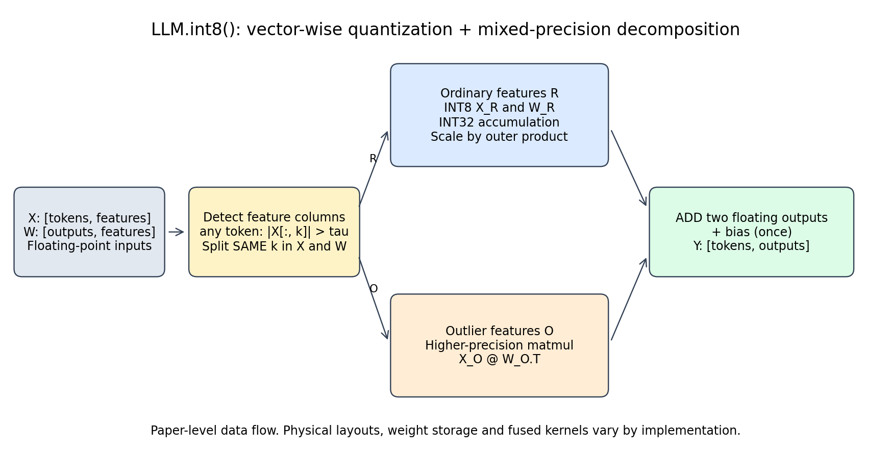
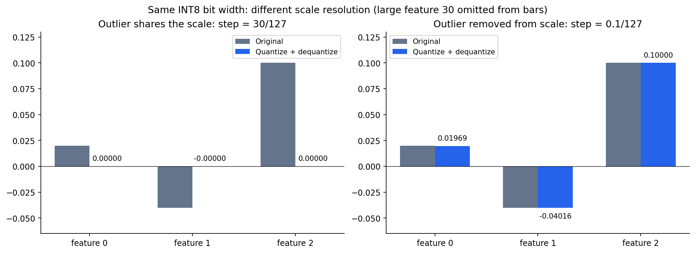
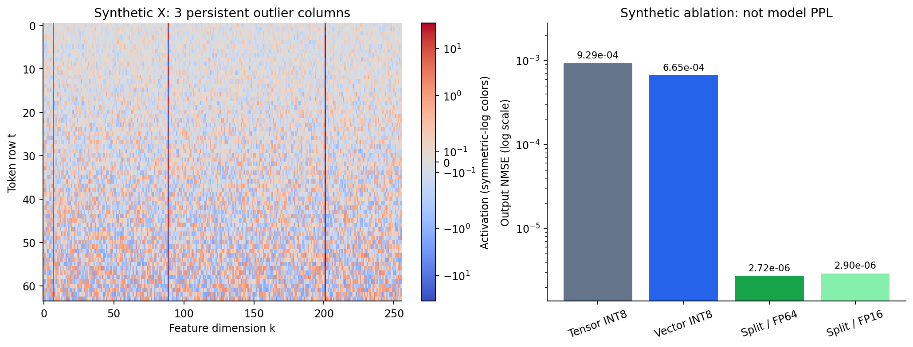
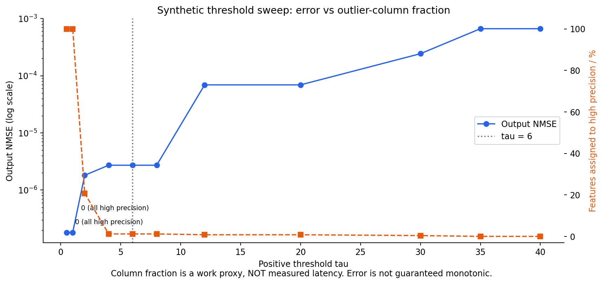
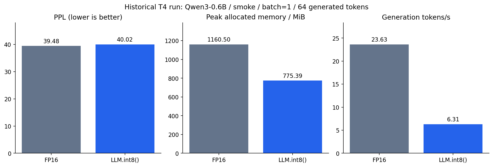

# LLM.int8()：从量化网格到混合精度矩阵乘

<!-- course-objectives -->
**学习目标：** 推导向量级尺度与混合分支；诊断阈值、精度和性能；正确解释本工程历史 T4 结果。

**先修知识：** 第 01、03、09–10 章；能够分清行、列与归约轴。 [进入本章测试](#chapter-assessment)；建议先独立作答，再展开答案。
<!-- /course-objectives -->

**LLM.int8() 的主要贡献，是让普通特征承担大部分低精度计算，同时保护少数难以量化、又影响输出的特征。** 它将两种设计组合起来：

1. **向量级量化**：输入每行和权重每个输出通道分别设置 scale，使一次矩阵乘中的每个内积都有合适的反量化系数。
2. **混合精度分解**：根据输入激活找出离群特征维度，把这些维度的贡献交给高精度矩阵乘，其余维度使用 INT8 乘法、INT32 累加。

理解这两点，就能解释为什么它能省显存、为什么不保证零误差，以及为什么你在 T4 上测到“PPL 只增加 1.37%，但速度显著下降”。

原理依据 [LLM.int8() 原论文 v2](https://arxiv.org/abs/2208.07339v2)，历史读取版本与哈希见[来源清单](../references/provenance/source_manifest.json)。2026-10-15 T4 实测使用 Transformers 5.19.0、bitsandbytes 0.50.2；早期接口检查使用本地 Transformers 5.12.1。下面的 NumPy 实现用于说明数学机制，未验证为 bitsandbytes 0.50.2 的逐位实现，也未通过 profiler 确认该次运行的 CUDA 内核。



图中蓝色分支是普通特征的整数计算，橙色分支保留离群特征贡献。两条分支都输出相同形状的浮点矩阵，最后相加；若 Linear 有 bias，只加一次。

**一、先明确它量化的是什么**

考虑一个线性层，采用 PyTorch 的权重存储方向：

$$
X\in\mathbb R^{T\times K},\qquad W\in\mathbb R^{N\times K},\qquad
Y=XW^T\in\mathbb R^{T\times N}.
$$

| 符号 | 含义 | 在实际模型中的对应 |
|---|---|---|
| $T$ | 本次矩阵乘的输入行数 | 常由 batch 与 token 维展平得到 |
| $K$ | 输入特征维度，也是内积求和轴 | 当前 Linear 的 `in_features` |
| $N$ | 输出特征维度 | 当前 Linear 的 `out_features` |
| $X_{t,:}$ | 一个 token 的输入向量 | 某层的激活，不是原始 token ID |
| $W_{n,:}$ | 一个输出通道对应的权重向量 | 原论文按 $W^T$ 记，所以称为权重的一列 |

LLM.int8() 主要处理 FFN 和 Attention 投影中的线性矩阵乘。`load_in_8bit=True` 不意味着 Softmax、LayerNorm/RMSNorm、RoPE、残差、所有 Attention 计算或 KV cache 都变成 INT8。

普通分支会量化**权重与激活**，因此它也不同于“只把权重存成 8-bit、激活一直保持高精度”的简单 weight-only 方案。线性层对外仍可接收、输出浮点张量。

它是一条训练后量化路线，不要求重新训练主模型。与 GPTQ 事先收集样本来优化权重不同，LLM.int8() 在推理时根据当前输入计算激活 scale 和离群特征，通常不需要独立的离线校准集。若人为搜索阈值，仍需用独立验证数据选参，避免在测试集上反复调优。

**二、普通 INT8 量化为什么会损失信息**

先用对称 absmax 量化。为避免 scale 的两种约定混淆，本篇一直令 $s$ 表示“一个整数刻度对应多大的实数”：

$$
s=\frac{\max_i|x_i|}{127},\qquad
q_i=\operatorname{clip}\left(\operatorname{round}\frac{x_i}{s},-127,127\right),\qquad
\widehat x_i=sq_i.
$$

INT8 数据类型可表示 −128 到 127；这里用 −127 到 127 的对称网格。原论文也使用这种 absmax 定义。对没有被裁剪的值，理想最近舍入误差满足：

$$
|x_i-\widehat x_i|\leq\frac{s}{2}.
$$

所以真正决定局部分辨率的，不仅是“8 位”，还有 scale。一个非常大的数会拉大 $s$，让很多正常小数挤在同一个整数格子里。

例如：

$$
x=[0.02,-0.04,0.10,30].
$$

如果这一行共享 scale：

$$
s=30/127\approx0.23622,\quad
q=[0,0,0,127],\quad
\widehat x=[0,0,0,30].
$$

前三个数都没消失于模型原始输入，却在量化近似中被舍入为零。单独删除 30 也不是解法，因为它可能是决定输出的真实信号。



左图仍受 30 的 scale 控制，三个普通值都变为零；右图只对普通部分求 scale，$s=0.1/127\approx0.0007874$，量化结果接近原值。图中为了看清小值，没有把 30 的柱子画出来。

**三、第一项设计：向量级量化，以及为什么 scale 能放到矩阵乘外面**

一个输出元素本来就是一个内积：

$$
Y_{tn}=\sum_{k=1}^{K}X_{tk}W_{nk}.
$$

给输入的每一行和权重的每一行分别设置反量化 scale：

$$
a_t=\frac{\max_k|X_{tk}|}{127},\qquad
b_n=\frac{\max_k|W_{nk}|}{127}.
$$

构造整数编码：

$$
Q^X_{tk}=\operatorname{round}(X_{tk}/a_t),\qquad
Q^W_{nk}=\operatorname{round}(W_{nk}/b_n).
$$

代回内积：

$$
Y_{tn}\approx\sum_k(a_tQ^X_{tk})(b_nQ^W_{nk})
=a_tb_n\underbrace{\sum_kQ^X_{tk}Q^W_{nk}}_{\text{整数乘法与累加}}.
$$

**$a_t$、$b_n$ 与求和索引 $k$ 无关，所以能拿到求和外。** 这正是向量级 scale 容易与矩阵乘配合的原因。

把所有输出合起来：

$$
C_{32}=Q^X_8(Q^W_8)^T,\qquad
\widehat Y=(ab^T)\odot C_{32}.
$$

这里 $ab^T$ 是外积，$\odot$ 是逐元素乘。只需存 $T+N$ 个 scale，就能生成 $T\times N$ 个输出的反量化系数；实际内核可以融合这个操作，不必显式生成完整外积。

| 方案 | 激活 scale | 权重 scale | 解决的问题 |
|---|---|---|---|
| 整张量 absmax | 一个 | 一个 | 最简单，但局部大值影响整个张量 |
| 向量级 absmax | 每个 token 一份 | 每个输出通道一份 | 不同 token、不同输出通道的幅度差异 |
| 向量级 + 混合精度分解 | 普通特征上的逐向量 scale | 普通分支的权重量化 scale | 再处理同一向量内部的极端输入特征 |

向量级量化限制了离群值的影响范围，但同一行中的 30 仍会影响该行其他维度。因此仅有它还不够。

INT8 乘法也不意味着 INT8 累加。两个最大正码值相乘是 $127^2=16129$，几项累加就会超过 INT8 范围。主路径通常使用 **INT32 累加**，再反量化回浮点。以最坏同号输入计算，$K\cdot127^2$ 应能放进 INT32；实际实现还需遵守其内核支持的维度和数据范围。

**四、第二项设计：沿输入特征轴做混合精度分解**

设一个正阈值 $\tau$，定义离群特征集合：

$$
\mathcal O=\{k:\max_t|X_{tk}|>\tau\},\qquad
\mathcal R=\{1,\ldots,K\}\setminus\mathcal O.
$$

要注意：判断来自 **Linear 的输入激活**，随后拆的是 **输入特征列**。如果某个 token 的第 $k$ 个激活超阈值，教学定义把该特征在本次矩阵中的所有 token 都分到高精度分支。

因为 $Y$ 沿 $k$ 求和，所以在同一个维度上拆 $X$ 和 $W$：

$$
\boxed{XW^T=X_{\mathcal R}W_{\mathcal R}^T+X_{\mathcal O}W_{\mathcal O}^T.}
$$

这一等式在实数算术下严格成立，**拆分本身不引入近似**。近似来自接下来的数值表示：

$$
\boxed{
\widehat Y=
(a_{\mathcal R}b_{\mathcal R}^T)\odot
\left[Q_8(X_{\mathcal R})Q_8(W_{\mathcal R})^T\right]_{32}
+\operatorname{Matmul}_{\rm high}(X_{\mathcal O},W_{\mathcal O}).
}
$$

原论文使用 FP16 高精度支路，并将两部分累加为 FP16 输出。这里“高精度”是相对 INT8 网格而言，FP16 也有舍入误差。

为什么选整列而不是逐元素修补？整列划分让每个分支仍是一个规则的稠密矩阵乘，同时保护该特征对所有输出通道的贡献。实现中可能采用置零、提取子矩阵、缓存或融合操作，不必真的把普通矩阵拼成新的连续数组。

**如何理解原论文关于离群值的发现**

原论文在其研究的模型家族中发现：极端激活会集中到少数特征维度，随模型规模增加而变得更系统；只占很少特征的这些维度，对模型预测可能很重要。因此应保护它们，而不是简单裁剪或删除。

论文中的“大约 0.1%”“特定规模开始明显”“阈值 6 有效”，都是对应实验的经验结果，**不是所有模型必然满足的定律**。你的 Qwen3-0.6B 不属于论文当时评测的模型，不能假定它恰好只有 0.1% 离群特征。

阈值 6 是激活数值阈值，既不是“6 个标准差”，也不是固定保留 6 个通道。不同层、输入长度和 batch 会改变本次离群集合。更多 token 一起参与 `any` 检测，可能扩大整列并集。

**五、完整手算：普通路径丢了什么，高精度路径补回什么**

取两个 token、四个输入特征、两个输出通道：

$$
X=\begin{bmatrix}0.02&-0.04&0.10&30\\0.08&-0.06&0.02&-25\end{bmatrix},\qquad
W=\begin{bmatrix}0.4&-0.7&0.2&0.05\\-0.3&0.1&0.8&-0.04\end{bmatrix}.
$$

浮点参考结果：

$$
Y=\begin{bmatrix}1.556&-1.130\\-1.172&0.986\end{bmatrix}.
$$

当 $\tau=6$，第 4 列属于离群特征（Python 索引为 3）。高精度支路的精确实数结果为：

$$
Y_{\mathcal O}=\begin{bmatrix}30\\-25\end{bmatrix}
\begin{bmatrix}0.05&-0.04\end{bmatrix}
=\begin{bmatrix}1.5&-1.2\\-1.25&1.0\end{bmatrix}.
$$

普通部分的整数码值是：

$$
Q_X=\begin{bmatrix}25&-51&127\\127&-95&32\end{bmatrix},\qquad
Q_W=\begin{bmatrix}73&-127&36\\-48&16&127\end{bmatrix}.
$$

其反量化 scale 为：

$$
a=\begin{bmatrix}0.1/127\\0.08/127\end{bmatrix},\qquad
b=\begin{bmatrix}0.7/127\\0.8/127\end{bmatrix}.
$$

整数累加得到：

$$
C=Q_XQ_W^T=\begin{bmatrix}12874&14113\\22488&-3552\end{bmatrix}.
$$

例如左上角的普通输出：

$$
\widehat Y_{\mathcal R,00}=12874\times\frac{0.1}{127}\times\frac{0.7}{127}
\approx0.05587327.
$$

加上高精度分支的 1.5：$\widehat Y_{00}\approx1.55587327$，接近参考值 1.556。

全部相加得到：

$$
\widehat Y\approx
\begin{bmatrix}1.555873&-1.129999\\-1.171922&0.985906\end{bmatrix}.
$$

| 教学算例 | 最大绝对输出误差 |
|---|---:|
| 只做向量级 INT8，不分离群列 | 0.0681575 |
| 分离后，高精度支路用 FP64 隔离量化误差 | 0.0001267 |
| 分离后，高精度支路用 NumPy FP16 | 0.0001947 |
| 直接删除离群列，不补回其贡献 | 1.5 |

这个例子特意构造了幅度悬殊的特征，它用于解释机制，不表示真实 LLM 必然获得相同比例的误差改善。

**六、误差推导：为什么处理大激活有效，但也不能保证无损**

设普通分支的反量化结果为：

$$
\widehat X_{\mathcal R}=X_{\mathcal R}+E_X,\qquad
\widehat W_{\mathcal R}=W_{\mathcal R}+E_W.
$$

忽略高精度分支自身的舍入，输出误差为：

$$
\widehat Y-Y=
E_XW_{\mathcal R}^T+X_{\mathcal R}E_W^T+E_XE_W^T.
$$

可以从两个方向理解分解的作用：

- 去掉离群特征后，普通激活的 absmax 变小，量化步长下降，$E_X$ 通常减小。
- 大激活乘上权重量化误差时会放大它。把相关维度交给高精度分支，能减轻这一项的影响。

但仍有几个误差来源：普通特征量化误差、scale 的存储舍入、FP16 乘加舍入、层间累积、后续非线性与自回归生成轨迹改变。

尤其要分清 **高精度计算** 与 **原始高精度权重仍然可用**。如果某实现为了省显存只保留 INT8 权重，并从中还原 $\widetilde W_{\mathcal O}=W_{\mathcal O}+E_{W,O}$，那么高精度分支还会有：

$$
X_{\mathcal O}\widetilde W_{\mathcal O}^T-X_{\mathcal O}W_{\mathcal O}^T
=X_{\mathcal O}E_{W,O}^T.
$$

把一个已经丢失信息的权重转成 FP16，不会自动恢复原值。本篇手算假设原始 $W_{\mathcal O}$ 可用；脚本另提供“从量化权重还原高精度分支”的假设实验来显示这项误差，**不把它冒充为你所用 bitsandbytes 0.50.2 的具体执行路径**。

“保留原始模型性能”通常指论文报告的任务分数接近浮点基线，不等于输出逐位相同、每个问题答案相同，或对所有新模型都无损。

**七、可运行的参考代码，逐步对应公式**

完整文件：[experiments/llm_int8_lab.py](../experiments/llm_int8_lab.py)。只依赖 NumPy；导出图表需要 Matplotlib。结果使用统一的运行时间、依赖版本、参数和源码 SHA-256 元数据，并原子保存。普通分支与基础实验共用量化器，避免边界行为分叉。

```bash
python experiments/llm_int8_lab.py
python experiments/llm_int8_lab.py --write-results
# 如需保存新参数实验而不覆盖本文图表：
python experiments/llm_int8_lab.py --write-results --output-dir /tmp/my-llm-int8-study
```

代码中的核心数据流如下；完整文件额外处理了零行、空分支、输入形状及 INT32 累加范围。

```python
import numpy as np

def quantize_rows(a):
    maximum = np.max(np.abs(a), axis=1, keepdims=True)
    scale = np.where(maximum == 0, 1.0, maximum / 127.0)
    q = np.clip(np.rint(a / scale), -127, 127).astype(np.int8)
    return q, scale

def ordinary_matmul(x, w):
    qx, sx = quantize_rows(x)
    qw, sw = quantize_rows(w)
    acc = qx.astype(np.int32) @ qw.astype(np.int32).T
    return acc.astype(np.float64) * (sx * sw.T)

def mixed_matmul(x, w, threshold=6.0):
    outlier = np.any(np.abs(x) > threshold, axis=0)
    normal = ~outlier
    result = np.zeros((x.shape[0], w.shape[0]), dtype=np.float64)
    if normal.any():
        result += ordinary_matmul(x[:, normal], w[:, normal])
    if outlier.any():
        # FP64 isolates the quantization mechanism; this is not a GPU kernel.
        result += x[:, outlier] @ w[:, outlier].T
    return result
```

对应关系：

1. `axis=1` 为每个输入行、每个权重输出行设置 scale；`keepdims=True` 保留广播形状。
2. `np.rint` 做最近舍入，`astype(np.int8)` 表示编码；不是单纯截断小数。
3. 转成 `int32` 再矩阵乘，模拟宽累加。NumPy 这里实际执行的是 INT32 算术，不是 Tensor Core INT8 GEMM，不能用此代码测速评价硬件性能。
4. `sx * sw.T` 的广播正好实现外积 scale。
5. `axis=0` 的 `any` 在 token 维取并集，得到输入特征的布尔掩码；随后 `x[:, mask]` 和 `w[:, mask]` 必须使用同一掩码。
6. 离群分支与普通分支相加，恢复完整的求和轴贡献；去掉分支或重复计入离群列都会得到错误结果。

本实验每次切片后重新计算普通权重的 scale，假设能访问原始离群权重，默认用 FP64 高精度支路。真正的推理实现可能缓存权重 scale，动态提取或置零离群列，使用特殊布局和融合内核。因此它是**算法机制参考**，不是 bitsandbytes 的逐位等价实现。

**八、合成实验：两项设计各自贡献了什么**

脚本构造 $X\in\mathbb R^{64\times256}$、$W\in\mathbb R^{48\times256}$，加入 3 个持续出现的大激活特征，同时让不同 token 和输出通道的幅度不同。固定随机种子 42。

输出 NMSE 定义为：

$$
\mathrm{NMSE}=\frac{\|\widehat Y-Y\|_F^2}{\|Y\|_F^2}.
$$

它衡量矩阵输出误差，既不是模型 PPL，也不是任务准确率。

| 合成实验配置 | 输出 NMSE ↓ |
|---|---:|
| 整张量 INT8 | 9.2875 × 10⁻⁴ |
| 向量级 INT8 | 6.6516 × 10⁻⁴ |
| 向量级 + 离群分解，FP64 参考分支 | 2.7190 × 10⁻⁶ |
| 向量级 + 离群分解，FP16 分支 | 2.9005 × 10⁻⁶ |



左图三条明显的竖线表示“少数输入特征反复出现大值”；它与随机散落的孤立异常点不同。右图显示向量级量化改善了不同向量的范围问题，但加入离群分解后才显著降低这一构造例子的输出误差。FP16 分支比 FP64 参考略差，说明高精度分支也不是数学上的精确实数运算。

**九、阈值如何影响精度与成本**

对正阈值而言，降低阈值一般会增加高精度特征列数；提高阈值一般会减少列数。这个集合大小的变化是可预测的，但最终任务精度与延迟未必单调。



蓝线是输出 NMSE，橙线是高精度分支的特征比例。这个比例只能粗略表示高精度工作量，不是实测时间。

- 很低的阈值把所有 256 列都送到高精度，FP64 教学参考下误差为零，同时也失去 INT8 的主体计算。
- 阈值 6 选中 3/256 列，约 1.17%。这个比例来自合成数据，和论文中的约 0.1%、你的模型真实比例都不同。
- 阈值超过较弱离群列的最大值后，它重新进入普通路径，量化误差随之变化。
- 即便列数随阈值单调变化，误差仍可能因舍入、不同 scale 和误差抵消而局部不单调；GPU 延迟还受矩阵形状、内核选择和调度影响。

本文参考函数只接受正阈值；不用 `0` 表示极端阈值。**库里的阈值零值可能有“关闭离群处理”的特殊语义，不能把它当作 $\tau\to0^+$**。需要以安装版本的实现或实验确认。

**十、在 Transformers 中，一行配置如何映射到模型层**

与当前 Notebook 等价的显式配置是（`llm_int8_has_fp16_weight=False` 为其默认值）：

```python
import torch
from transformers import AutoModelForCausalLM, BitsAndBytesConfig

config = BitsAndBytesConfig(
    load_in_8bit=True,
    llm_int8_threshold=6.0,
    llm_int8_has_fp16_weight=False,
)
model = AutoModelForCausalLM.from_pretrained(
    SOURCE_DIR,                       # Notebook 已下载的固定 revision 快照
    quantization_config=config,
    dtype=torch.float16,
    device_map={"": 0},
    local_files_only=True,
    token=False,
    attn_implementation="sdpa",
).eval()
```

在本地核对的 Transformers 集成中，适用的 `Linear` 被替换为 `bitsandbytes.nn.Linear8bitLt`，并传入：

```python
has_fp16_weights = config.llm_int8_has_fp16_weight
threshold = config.llm_int8_threshold
```

`Int8Params` 负责权重量化表示；`Linear8bitLt` 内部再负责相应前向计算。`dtype=torch.float16` 并不会把已量化权重重新变回完整 FP16，它还影响未量化模块与浮点计算部分。

`llm_int8_has_fp16_weight=False` 是用于压缩权重的配置，不代表把混合精度计算分支关掉；反过来，存在高精度分支也不代表内存里永久保存整份原始 FP16 权重。具体缓存、重建和前向策略属于 bitsandbytes 版本细节。

`llm_int8_skip_modules` 用于排除整个模块，与“某个模块内部按激活分离群特征”是不同层次。`llm_int8_enable_fp32_cpu_offload` 涉及 CPU/GPU 放置，也不等同于离群分支。

可以检查实际替换了哪些层：

```python
import bitsandbytes as bnb

layers = [(name, module) for name, module in model.named_modules()
          if isinstance(module, bnb.nn.Linear8bitLt)]
print("Linear8bitLt 层数：", len(layers))
for name, module in layers[:5]:
    print(name, module.weight.dtype,
          getattr(module.state, "threshold", None),
          getattr(module.state, "has_fp16_weights", None))
```

这能确认模块类型和状态，但不单独证明每次前向都执行了某个特定 Tensor Core kernel。想确认真正耗时在哪里，还需要 profiler。

**十一、怎样观测你的模型实际有多少离群列**

下面的前置 hook 记录每个 `Linear8bitLt` 输入中，超过正阈值的元素比例与特征列比例。它是诊断用的规则统计，不是对内部融合内核掩码的读取，也不应用于正式测速。

```python
import bitsandbytes as bnb
import torch

activation_stats = []
handles = []
threshold = 6.0

def make_hook(name):
    def hook(module, args):
        x = args[0].detach().reshape(-1, args[0].shape[-1]).float()
        exceeded = x.abs() > threshold
        columns = exceeded.any(dim=0)
        activation_stats.append({
            "layer": name,
            "tokens_in_call": x.shape[0],
            "input_features": x.shape[1],
            "outlier_elements_fraction": exceeded.float().mean().item(),
            "outlier_columns": int(columns.sum().item()),
            "outlier_column_fraction": columns.float().mean().item(),
        })
    return hook

try:
    for name, module in model.named_modules():
        if isinstance(module, bnb.nn.Linear8bitLt):
            handles.append(module.register_forward_pre_hook(make_hook(name)))
    with torch.inference_mode():
        output = model(**prompt_inputs, use_cache=False)  # 单次 prefill 诊断
    del output
finally:
    for handle in handles:
        handle.remove()

for row in sorted(activation_stats, key=lambda row: row["outlier_column_fraction"], reverse=True)[:10]:
    print(row)
```

`element fraction` 很低而 `column fraction` 较高是可能的：任一 token 超阈值就会选中整列。这也解释了为什么不能把“异常元素稀疏”直接换算成“高精度分支几乎没有代价”。

hook 中的归约、额外浮点张量以及 `.item()` 同步会拖慢执行。完成诊断后移除 hook，再做预热和计时。prefill 与逐 token decode 的输入行数不同，应分别观察。

**十二、回到你的 T4：为什么省显存却慢了**

你在 2026-10-15 的 `smoke` 实验中测到：

| 指标 | FP16 | LLM.int8() | 变化 |
|---|---:|---:|---|
| PPL | 39.479 | 40.018 | 增加约 1.37% |
| 模型占用估计 | 1136.9 MiB | 716.88 MiB | 减少约 36.9% |
| 生成阶段 allocator 峰值 | 1160.5 MiB | 775.39 MiB | 减少约 33.2% |
| 生成速度 | 23.627 token/s | 6.3122 token/s | 降至约 26.7% |



这些数字来自 [本轮提取指标](../experiments/archive/colab_t4_2026-10-15/metrics_from_notebook.csv)，与前面合成实验分开。PPL 增加 1.37% 不是准确率下降 1.37%。

**内存方面：** 如果只有一部分权重被量化，设其参数量为 $P_q$，其余 FP16 参数量为 $P_f$，只考虑参数主体：

$$
M_{16}\approx2(P_q+P_f),\qquad
M_8\approx P_q+2P_f+M_{\rm scales}+M_{\rm metadata}.
$$

因此整模减少一半是近似极限，不是必然结果。embedding、输出层、norm、bias、量化元数据及临时工作区都会影响实际比例；运行峰值还包含激活、KV 和其他分配。

**时间方面：** 一种有用的分解是：

$$
T_{\rm int8}=T_{\rm detect}+T_{\rm quantize}+T_{\rm GEMM8}
+T_{\rm high}+T_{\rm rescale/add}+T_{\rm launch/layout}.
$$

只有当矩阵乘和权重带宽节省超过额外开销时，整层才会更快。Qwen3-0.6B 的小矩阵、batch=1 的 decode、异常值检测与额外内核调度，可能使开销更突出；**你的日志没有 profiler，不能把具体 3.74 倍耗时全归因于某一个分支**。

原论文附录 D 本身也报告过小矩阵/小模型下量化及分解开销导致减速。那些历史测试的硬件、内核和临界尺寸不能直接套到今天的 T4，但机制与你的观察相容。LLM.int8() 的关键目标是让原先显存装不下的大模型可用，而不是承诺所有模型都更快。

继续排查时，优先保持模型和输入不变，比较正阈值 3、6、10，分别记录 PPL、离群列比例、prefill、decode 和显存。阈值扫描属于新的实验，不能预先断言越大越快或越小越准。正式运行前移除诊断 hook，固定输出长度，CUDA 同步，并保存每次计时而不只保留中位数。

原始实测详情见 [T4 分析报告](../experiments/archive/colab_t4_2026-10-15/analysis.md)。原论文中性能、离群特征与运行速度的依据分别见 §3、§4 和附录 D；数值示例与图表均可由本篇脚本重新生成。

<!-- chapter-demo: int8 -->
## 本章实操｜检查向量尺度、离群列与 batch 依赖

<a id="chapter-demo"></a>

**实践目的：** 从真实矩阵计算确认整列分流和两条支路，观察阈值与batch变化。

**环境：** Python 3.10+、NumPy、PyTorch；支持 CPU/CUDA，Colab 选择 GPU 运行时。无需下载模型。在项目根目录执行：

```bash
python experiments/chapter_demo_lab.py --chapter int8 --device cuda
# 没有GPU时显式使用CPU；auto在CUDA可用时优先使用GPU
python experiments/chapter_demo_lab.py --chapter int8 --device cpu
# 也可直接执行源码模块（同样在项目根目录）
python -m experiments.demos.int8
```

**Colab：** 可直接上传[逐章 GPU Notebook](../experiments/notebooks/colab_chapter_demos.ipynb)，它自带所需源码；按单元选择本章运行。修改源码后将 `PRACTICE=True`，或命令行加 `--practice`；此模式跳过正文一致性检查，保留数值断言、设备核验及实际源码哈希。指定 `cuda` 后不可用会报错，不会静默退回 CPU。随机输入在 CPU 准备后一次搬到所选设备；矩阵、量化、训练和统计计算使用该设备的 PyTorch 张量。文件 I/O、Python 流程控制和打印在主机；默认 FP64 核验精度，不代表原生低比特 Tensor Core 性能。

**完整源码：** [带逐步注释的 demo](../experiments/demos/int8.py)。默认只打印结果；保存命令与全部章节入口见[实操导航](../README.md#chapter-demos)。

<details><summary>展开完整代码：每一步的行为、计算逻辑与检查条件</summary>

<!-- chapter-demo-code: int8 -->
```python
"""LLM.int8 专题：手算分流、阈值扫描和拆分batch的数值差异。"""
import torch
from experiments.demo_runtime import get_runtime, same, exact

# 第 0 步：auto优先CUDA；runner可用--device指定。所有计算张量在此设备创建。
rt = get_runtime()
device, dtype = rt.device, rt.dtype
from experiments.demo_torch_kernels import int8_matmul, split_matmul, error_metrics

# 第 1 步：构造4维输入，第4列有离群值；权重按[输出,输入]排列。
X = rt.tensor([[.02, -.04, .10, 30.], [.08, -.06, .02, -25.]])
W = rt.tensor([[.4, -.7, .2, .05], [-.3, .1, .8, -.04]])
reference = X@W.T
ordinary, state = int8_matmul(X, W)

# 第 2 步：检查每token激活尺度与每输出通道权重尺度形成外积。
# helper在目标设备用FP64精确承载小维度整数点积，再转INT32记录。
# 这是兼容CUDA的数值模拟，不是INT8 Tensor Core性能实现。
rebuilt = state['accumulator']*(state['sx']*state['sw'].T)
assert exact(ordinary, rebuilt)
print('普通INT8 NMSE:', error_metrics(reference, ordinary)['nmse'])

# 第 3 步：阈值只决定列集合；使用原始权重的FP64支路隔离量化机制。
# 真实bitsandbytes会使用不同缓存、布局和分支精度，本例不声称逐位一致。
for threshold in (.01, 6., 40.):
    mixed, info = split_matmul(X, W, threshold=threshold)
    assert same(mixed, info['y_regular']+info['y_outlier'])
    print('阈值 / 高精度列 / NMSE:', threshold,
          torch.nonzero(info['outliers']).flatten().tolist(), error_metrics(reference, mixed)['nmse'])
    if threshold == 6.:
        assert exact(info['outliers'], [False, False, False, True])
    if threshold == 40.:
        assert same(mixed, ordinary)

# 第 4 步：同一列仅在某个token超阈值，整batch检测仍会保护该列的全部token。
batched = rt.tensor([[7., .2, -.3, .1], [.2, .7, .4, -.1]])
together, info = split_matmul(batched, W, threshold=6.)
separate = torch.cat([split_matmul(row[None, :], W, threshold=6.)[0] for row in batched])
assert exact(info['outliers'], [True, False, False, False])
print('一起处理与分开处理的最大差异:', torch.amax(abs(together-separate)))
# 浮点线性层逐行等价，但这里离群集合和权重尺度会随batch变化，量化输出可能不同。

# 收尾：等待本demo设备上的操作完成，方便Colab定位CUDA异步报错。
rt.synchronize()
```

</details>

**运行后观察：** 阈值6仅保护第4列；阈值40回到普通INT8；一起处理和逐行处理可能输出不同。

**动手修改：** 让更多token在不同列越过阈值，比较异常元素比例与异常列并集。

**适用边界：** PyTorch CPU/CUDA机制参考；INT8码的点积用FP64精确承载后记为INT32，高精度支路也为FP64；不是bitsandbytes或原生INT8性能实现。
真实模型/GPU流程继续使用 [Colab Notebook](../experiments/notebooks/colab_qwen3_quantization.ipynb)，执行范围见[模型实验验收](10_实验_评估与选型.md#model-validation-milestones)。

<!-- /chapter-demo -->

<!-- chapter-assessment -->
## 本章测试与参考答案

<a id="chapter-assessment"></a>

核心卷 8 题，仍按 100 分；另有简单、困难、特别困难拓展题各 1 道，不计入核心卷。难度相对于本章先修知识划分，题号保持原有顺序。核心卷建议 60–90 分钟，特别困难拓展可另留 30–60 分钟。

| 难度 | 按难度选题 |
|---|---|
| 简单 | [INT8-02](#exercise-int8-02) · [INT8-03](#exercise-int8-03) · [INT8-E01](#exercise-int8-e01) |
| 困难 | [INT8-01](#exercise-int8-01) · [INT8-04](#exercise-int8-04) · [INT8-05](#exercise-int8-05) · [INT8-06](#exercise-int8-06) · [INT8-07](#exercise-int8-07) · [INT8-08](#exercise-int8-08) · [INT8-E02](#exercise-int8-e02) |
| 特别困难 | [INT8-E03](#exercise-int8-e03) |

每题提供至少三条参考路径，分别可能是解析解、等价推导、独立数值核验或满足条件的工程方案。固定条件下唯一的数值结果不因解法不同而改变；数值实验不能替代一般性证明。未明确要求比较多解时，可任选或组合路径回答全部子问；验证说明须补足题干要求的推导。开放题接受条件明确、证据充分的其他方案。

<a id="exercise-int8-01"></a>

### INT8-01｜向量级尺度为何是外积（困难｜推导，10 分）

$X\in\mathbb R^{T\times K}$、$W\in\mathbb R^{N\times K}$，输入每行尺度a、权重每行尺度b。写出量化整数矩阵乘后的重建式，并说明为何只需T+N个尺度。

<details><summary>参考答案与评分要点</summary>

**参考路径一：**

$C=Q_XQ_W^T$，$\widehat Y=(ab^T)\odot C$；对元素(t,n)，aₜbₙ不随归约k变化，可提出求和。a/b各长T/N，可广播得到T×N缩放，而非必须保存完整外积。

**路径二：按输出元素。** $\widehat y_{tn}=a_tb_n\sum_kq^X_{tk}q^W_{nk}$，因a/b不含k才可提出；若沿归约维也分组就要分组缩放再求和。

**验证路径：对角矩阵写法。** $\widehat Y=\operatorname{diag}(a)C\operatorname{diag}(b)$，与外积逐元素乘等价，可用矩阵形状独立核验广播。

**评分要点：** 公式与形状5分；提出归约和尺度数量5分。

</details>

<a id="exercise-int8-02"></a>

### INT8-02｜删除异常值与保护异常列（简单｜概念判断，10 分）

LLM.int8() 找到大激活后，是把它们归零忽略，还是让相应特征走另一条计算路径？为什么前者一般错误？

<details><summary>参考答案与评分要点</summary>

**参考路径一：**

相应特征列贡献由高精度分支保留，普通列走INT8路径，两输出相加。异常值可能是重要信号，直接删除会改变原函数而非仅近似数值；分支划分要匹配输入和权重的同一归约轴，bias只加一次。

**路径二：集合分解。** 把归约列分为O与其补集，原乘积等于两子集乘积之和；量化只近似普通子集，异常子集仍有贡献。

**反例路径：** 若唯一非零输入在异常列，直接删除会把全部信号抹掉，而高精度分支可保留原输出。该例区分信号保护与裁剪丢弃。

**评分要点：** 分解机制5分；删除错误3分；配对/bias2分。

</details>

<a id="exercise-int8-03"></a>

### INT8-03｜手算混合精度的输出（简单｜计算，15 分）

$X=[0.1,10]$、$W=[2,3]$，阈值6，普通列以[-127,127]各自AbsMax量化，两侧各只有一个非零值。求两个分支和总输出，忽略高精度算术舍入。

<details><summary>参考答案与评分要点</summary>

**参考路径一：**

第1列（索引1）进入高精度，贡献10×3=30；普通列尺度0.1/127与2/127、编码均127，反量化点积为0.2；总30.2。这个构造恰可精确表示，不证明一般LLM.int8零误差。

**解法二：整数尺度相消。** 普通点积127²乘(0.1/127)(2/127)=0.2，异常点积30，两者和30.2。

**解法三：原浮点参考。** 一行两元素直接点积0.1×2+10×3=30.2；本例普通分支恰可重建，真实多元素共享范围可能产生误差。

**评分要点：** 列识别3分；尺度与普通贡献5分；高精度/合计4分；边界3分。

</details>

<a id="exercise-int8-04"></a>

### INT8-04｜异常列随 batch 变化（困难｜计算与分析，15 分）

100×4096 的输入中恰有100个超阈值元素，分别落在100个不同列。异常元素比例与被选列比例分别是多少？为何 prefill 和 decode 的分支成本可能不同？

<details><summary>参考答案与评分要点</summary>

**参考路径一：**

元素比例100/(100×4096)=1/4096≈0.024414%；列比例100/4096≈2.4414%。跨更多token取并集可能选中更多列，且两个阶段矩阵形状不同；成本不只由异常元素比例决定。

**路径二：按分母比较。** 元素分母是100×4096，列分母只有4096，所以同100个异常在各不同列时两个比例差100倍。

**方案三：batch拆分对照。** 每个token单独处理可能各只选1列，合batch后取并集选100列；因此改变批量不只是吞吐调度，也可能改变分支宽度。具体实现须检查。

**评分要点：** 两比例8分；并集机制4分；形状与成本3分。

</details>

<a id="exercise-int8-05"></a>

### INT8-05｜双分支 bias 重复添加（困难｜代码诊断，15 分）

实现分别计算“普通列矩阵乘+bias”和“异常列矩阵乘+bias”，最后相加。给出误差，并说明空分支应如何处理。

<details><summary>参考答案与评分要点</summary>

**参考路径一：**

最终为两乘积之和+2bias，相对正确输出多一个bias。应先加两分支再加一次bias，或只在一个明确位置加。无异常列时高精度分支应产生正确形状的零贡献；全异常时普通分支也需正确处理，不能对空张量求max。

**路径二：零输入单元测试。** X=0时正确输出应仅为bias；当前代码给2bias，单次测试立即暴露重复。

**验证路径：空/全异常三路对照。** 无异常、全异常与混合情况均与未拆分浮点参考比较；空分支返回同形状零贡献，不可调用空max或在分支中重复加bias。

**评分要点：** 重复bias5分；修正4分；两种空分支6分。

</details>

<a id="exercise-int8-06"></a>

### INT8-06｜阈值越小一定越快或越准吗（困难｜工程判断，15 分）

比较阈值3、6、10，能否预先断定哪个最快、哪个任务分数最好？请说明数值与执行上的影响。

<details><summary>参考答案与评分要点</summary>

**参考路径一：**

较小正阈值通常选中更多列，高精度成本可能增加，普通量化范围也可能改善；但分支形状、kernel、尺度统计与误差相互作用会影响最终结果，不能保证质量/速度单调。应固定模型输入与后端测阈值扫描，分开prefill/decode和独立任务；软件特殊阈值语义另核对。

**路径二：收益与开销分开。** 降阈值既可改善普通分支动态范围，也增加高精度工作；两作用方向相反，加上kernel形状不连续，速度不能简单单调推断。

**方案三：分布化扫描。** 在固定目标任务不同长度/batch上记录列比例、质量、prefill/decode，不用一个平均值替代。阈值选择用验证集，测试只做冻结配置评估。

**评分要点：** 数值影响5分；执行非单调5分；扫描与语义5分。

</details>

<a id="exercise-int8-07"></a>

### INT8-07｜历史 T4 结果能说明什么（困难｜证据分析，10 分）

本专题的历史测试出现显存下降、生成速度下降、PPL略增。没有profiler时，能否归因于某一个CUDA内核？PPL相对变化是否等于准确率变化？

<details><summary>参考答案与评分要点</summary>

**参考路径一：**

不能精确归因；量化、检测、布局、混合分支、调度等都是待验证原因。PPL与任务准确率不是同一指标，相对PPL变化不能直接换算准确率。结果只支持当时模型/协议/环境的观察，不能把后续修订Notebook当作已在GPU验证。

**路径二：可观测与不可观测清单。** 日志证明文件所记PPL、内存和时间；没有时间线就不能确定哪个kernel或数据搬运主导。推测原因应保留为假设。

**方案三：逐机制诊断。** 分别测普通分支、检测/量化、混合分支与整体，保持代表性shape；再同版本完整模型复测，不能用后来的修订结果覆盖历史证据。

**评分要点：** 归因边界4分；PPL区别3分；历史/当前版本3分。

</details>

<a id="exercise-int8-08"></a>

### INT8-08｜阈值诊断与正式计时如何分开（困难｜实验设计，10 分）

设计一轮离群列监测和性能测试，避免hook、同步与模型输出长度污染速度结论。

<details><summary>参考答案与评分要点</summary>

**参考路径一：**

诊断轮用hook按层和prefill/decode记录元素/列比例、输入形状及尺度，记录额外开销但不作正式速度。移除hook后在固定输入、输出token数、batch、后端与缓存状态下预热并正确同步，保留逐次时间。另做自然停止任务质量，校准阈值用验证集。

**方案二：离线回放激活。** 诊断时保存少量代表性输入形状与统计，正式微基准离线回放以避hook同步；仍需整模型服务验证，不能只报微基准。

**方案三：成对正常运行。** 先移除全部诊断hook，交替运行浮点和量化配置、控制热状态与输出量，保存每次计时。质量评估与速度评估使用各自明确的协议。

**评分要点：** 诊断/计时分离4分；固定条件4分；质量/隔离2分。

</details>

<a id="exercise-int8-e01"></a>

### INT8-E01｜bias只应该出现一次（简单｜拓展题，单独计分）

普通分支输出2，异常分支输出3，bias=0.5。正确结果是多少？若两分支各加bias再相加呢？

<details><summary>参考答案与评分要点</summary>

**解法一：原表达式。** 2+3+0.5=5.5。

**解法二：错误差值。** 两分支各加得2.5+3.5=6，误差恰多一个bias=0.5。

**验证路径：零输入。** 两分支贡献都0时应输出0.5，错误实现输出1；该测试不需要真实量化kernel。

**评分要点：** 单独按 10 分评价：结论与条件 3 分、推理或设计过程 5 分、独立核验与边界 2 分。评分覆盖题干要求的全部子问；未要求比较多解时，可任选或组合参考路径完成作答。数值核验不能替代题干明确要求的证明，多解数量不额外加分。

</details>

<a id="exercise-int8-e02"></a>

### INT8-E02｜异常元素少，异常列却可能很多（困难｜拓展题，单独计分）

假设仅为计算的独立模型：每个token的某一固定特征以概率p超阈值，不同token独立；batch含T行。求该列被并集选中的概率；取p=0.01、T=100估算。说明真实激活不独立时应怎样处理。

<details><summary>参考答案与评分要点</summary>

**解法一：补事件。** 所有T行都不超概率(1−p)^T，选中概率1−(1−p)^T≈0.633968。

**解法二：指示变量期望。** 列指示变量是T个异常指示的逻辑或，期望即上述概率；d列期望选中数为d乘此概率只需各列相同边缘概率，不要求列间独立。

**经验方案：** 真实时间/特征相关时直接按batch计算列并集分布，并与单token频率对照；独立模型可作解释假设，不应当实测预测或替代真实阈值扫描。

**评分要点：** 单独按 10 分评价：结论与条件 3 分、推理或设计过程 5 分、独立核验与边界 2 分。评分覆盖题干要求的全部子问；未要求比较多解时，可任选或组合参考路径完成作答。数值核验不能替代题干明确要求的证明，多解数量不额外加分。

</details>

<a id="exercise-int8-e03"></a>

### INT8-E03｜批处理拆分是否保持相同量化输出（特别困难｜拓展题，单独计分）

两输入行分别在不同特征列有离群值。LLM.int8风格算法按整个batch的列并集选择高精度分支。论证“先合batch再量化”与“逐行单独量化后拼接”未必相同；给出可测试的数值反例构造和两种部署取舍。

<details><summary>参考答案与评分要点</summary>

**机制证明：** 合batch后某列可能因另一行离群而对所有行采用高精度；单行时同列仍在普通共享量化范围内。分支集合、普通分支scale和舍入均可改变，所以不能仅凭浮点矩阵乘的可分行性推导量化相同。

**反例构造：** 取X行[10,0.11,1]与[0.11,10,1]、阈值6，W=[1,1,1]。合batch保护前两列，普通仅第三列可精确表示，输出每行11.11；单行保护一列，普通[0.11,1]按1/127量化得[14/127,1]，输出11+14/127≈11.110236。该教学规则下两者不同。

**工程方案：** 可固定每层离线异常集合使分支不随batch变，但可能增加成本或遗漏新异常；也可保留动态集合并接受声明容限，按不同batch回放验证质量和性能。反例只针对题设分支/尺度，不声称某版本bitsandbytes逐位采用同一实现。

**评分要点：** 单独按 10 分评价：结论与条件 3 分、推理或设计过程 5 分、独立核验与边界 2 分。评分覆盖题干要求的全部子问；未要求比较多解时，可任选或组合参考路径完成作答。数值核验不能替代题干明确要求的证明，多解数量不额外加分。

</details>

**复习建议：** 计算错误先回到本章的形状、单位与约定；工程判断缺少依据时，补写目标函数、对照配置和验证边界。建议达到 80 分后继续；这是一项自学建议，不是经教学验证的能力认证标准。

[课程考核与综合练习](11_练习与答案.md#course-assessment-guide) · [返回学习目录](../README.md)

<!-- /chapter-assessment -->

