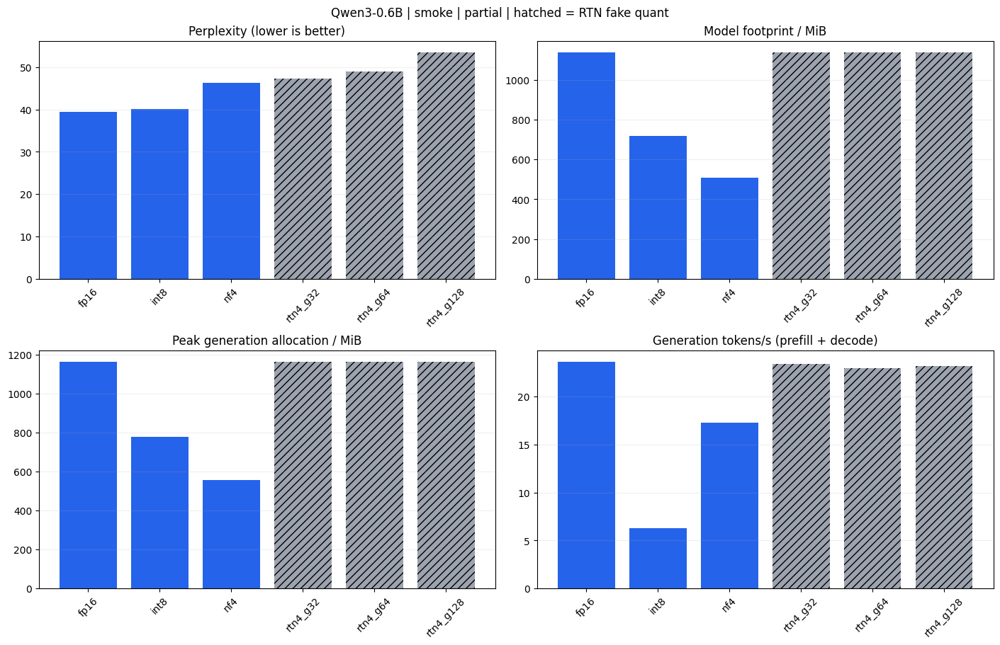
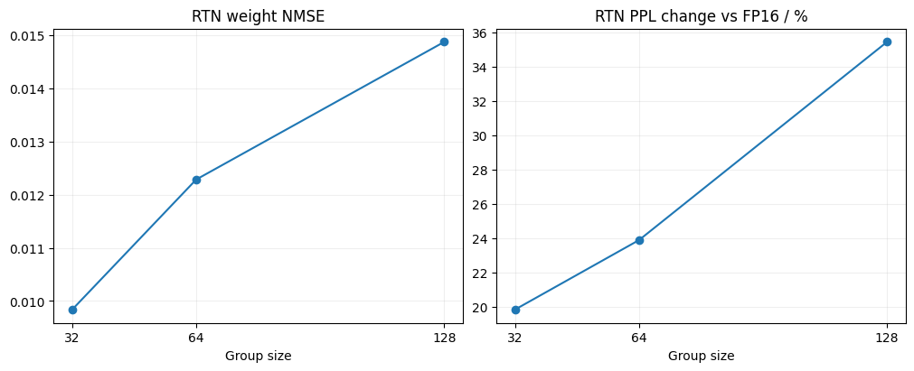

# Qwen3-0.6B：Colab T4 实验分析（2026-10-15）

本轮执行到了报告和下载单元，但实验状态为 **partial：6/8 个配置成功**。
FP16、LLM.int8()、NF4 和三种 RTN 分组均有结果；GPTQ、AWQ 在量化准备阶段失败，没有质量或性能数据。

对于这次 T4、Qwen3-0.6B、单请求短文本生成实验，**FP16 的 PPL 最低且速度最快；INT8 保持了更接近基线的分布但明显减速；NF4 节省显存最多，同时出现更大的 PPL 退化。**
RTN 的结果清楚展示了分组大小与误差的关系，但它仍以 FP16 存储和计算。

**实验条件与证据范围**

- 数据来自 [Notebook 保存的输出](notebook_executed.ipynb)，未重新运行模型。
- 运行 ID：`20261015T041306667650Z`，环境准备约始于北京时间 2026-10-15 12:13；这不是总耗时。
- GPU：Tesla T4，nvidia-smi 报告总显存 15360 MiB；PyTorch 2.11.0+cu130，Transformers 5.19.0，bitsandbytes 0.50.2，GPTQModel 7.6.0。
- `PROFILE="smoke"`：WikiText-2 test 前 2048 个输入 token，256-token 不重叠上下文；按保存的计分代码推算为 2040 个预测目标。不是完整 WikiText-2 基准。
- 速度：固定一个中文 prompt、batch=1、生成 64 token、贪心解码、关闭 thinking，预热后重复 3 次取中位数。统计包含 prefill 与 decode。
- logits KL：只在前 32 个评测 token 的分布上比较，不能当作整个测试集的分布距离。
- GPTQ/AWQ 的校准准备：train split、固定种子 42、32 条 × 512 token，共 16384 token；两种方法没有完成量化。
- 当前目录没有 Colab 下载的原始结果 ZIP。表中数据从 Notebook 的五位有效数字展示值提取，衍生比例取近似值；没有逐次计时，不能计算置信区间。

**数值对照**

| 配置 | PPL ↓ | 相对 FP16 | 模型占用 MiB | 生成峰值 MiB | 生成 token/s ↑ | 准备时间 s |
|---|---:|---:|---:|---:|---:|---:|
| FP16 | 39.479 | +0.00% | 1136.9 | 1160.5 | 23.63 | 1.59 |
| LLM.int8() | 40.018 | +1.37% | 716.9 | 775.4 | 6.31 | 2.20 |
| NF4 | 46.255 | +17.16% | 506.9 | 556.6 | 17.31 | 1.94 |
| RTN g32（伪量化） | 47.317 | +19.85% | 1136.9 | 1161.4 | 23.43 | 1.74 |
| RTN g64（伪量化） | 48.915 | +23.90% | 1136.9 | 1161.4 | 22.96 | 1.69 |
| RTN g128（伪量化） | 53.473 | +35.45% | 1136.9 | 1161.4 | 23.18 | 1.69 |

“模型占用”是框架的参数和 buffer 占用估计，“生成峰值”是 PyTorch allocator 记录，均不等于完整进程显存或 checkpoint 文件大小。
准备时间包含本地模型加载及该方法的准备操作，不是完整实验耗时；此处成功结果没有 GPTQ/AWQ 校准成本。

**FP16：本次实际使用的优先选择**

FP16 的 PPL 为 39.479，生成速度约 23.63 token/s，生成峰值约 1160.5 MiB（1.13 GiB）。
对 T4 的这组工作负载，基线已经能放入显存，且吞吐高于已成功的真实量化方案。生成 64 token 的计时区间约为 2.71 秒。
这支持在当前短文本实验中继续使用 FP16；不能外推到更大模型、长上下文或高并发。

**INT8：精度损失小，当前实现的速度代价大**

- PPL 从 39.479 到 40.018，相对增加 1.366%；这是 PPL 的变化，不是准确率下降 1.366%。
- logits KL 为 0.050949，是已完成量化方案中最接近 FP16 的。
- 模型占用减少约 36.9%，生成峰值减少约 33.2%。
- 吞吐只有 FP16 的 26.7%，下降约 73.3%；生成 64 token 约 10.14 秒，计时区间为 FP16 的 3.74 倍。

因此它在这里适合展示“较小分布变化下的显存收益”，没有体现推理加速优势。
可能原因是小模型下，量化、异常值处理和额外算子调度开销超过节省的权重读取成本；这是机制解释，当前输出没有 profiler 数据，不能确认各项开销比例。

**NF4：显存收益最大，质量与速度需要权衡**

- 模型占用约 506.9 MiB，比 FP16 少 55.4%；生成峰值约 556.6 MiB，比 FP16 少 52.0%。
- 生成速度约 17.31 token/s，比 FP16 慢 26.7%；64 token 约 3.70 秒。
- PPL 上升 17.163%，logits KL 为 0.33165；在这份短测试中，概率建模退化比 INT8 明显。
- 相比 INT8，NF4 更省显存、速度约为其 2.74 倍，但 PPL 更高。

NF4 是已成功方案中显存最紧张时的候选。若当前 T4 上没有显存压力，它没有在这次测量中提供足以替代 FP16 的明确优势。
模型总占用没有严格缩小至 FP16 的四分之一，与部分模块保留高精度及量化元数据开销的机制相符；要精确拆分占用，还需原始层记录。

**RTN：较小分组改善权重误差和 PPL，但不是实际加速测量**

| 分组大小 | 权重 NMSE ↓ | PPL ↓ | 相对 FP16 的 logits KL ↓ |
|---|---:|---:|---:|
| 32 | 0.0098389 | 47.317 | 0.39034 |
| 64 | 0.012287 | 48.915 | 0.34640 |
| 128 | 0.014878 | 53.473 | 0.57233 |

从 g128 改为 g32，NMSE 降低约 33.9%，PPL 降低约 11.5%；g32 的 PPL 相对 FP16 仍高 19.85%。
更小的分组让 scale 更贴合局部权重范围，是这一趋势的合理解释；真正打包时需要更多组级 scale，因此会增加额外存储和运行时处理。

g64 的 KL 小于 g32，但 PPL 更高。这两项测量的样本范围、目标不同：KL 只用 32-token 探针，PPL 用整个本轮评测片段。
因此不能要求它们单调一致，也不能用这一条小探针替代模型级评测。

三种 RTN 的模型占用都约为 1136.9 MiB，速度约为 23 token/s。这符合“量化后反量化回 FP16”的实现。
组间几个百分点的速度波动没有足够重复证据，不应解释成某个 group size 的真实 INT4 内核更快。

**中文回答：同时存在基线能力不足与评测设计问题**

完整回答保存在 [中文回答对照](quality_comparison.html)。需要区分内容正确性与格式遵循：

1. 算术题 `17 × 23`：FP16 输出 421，内容错误；其余五种配置都包含正确结果 391，但没有做到“只输出整数”，所以严格检查全部失败。
   这一个样例不能证明量化提升了数学能力；它说明微小分布改变可以让贪心生成走向不同答案，且当前基线本身也会出错。
2. JSON 题：六个配置的字段和值从展示内容看均正确，但只有 NF4 输出裸 JSON，其余套了 Markdown 代码块。
   因此 NF4 是 1/2，其余是 0/2；这不是综合能力分数，也不是纯内容正确率。
3. 模型量化解释：FP16 已把降低数值精度错说成“100 个参数变成 10 个”；RTN g32 声称转成整数会使精度更高，g128 混淆 64 bit 与 64 byte。
   这表明解释类能力仍不可靠，但不能把基线已有的错误全部算作量化带来的退化。NF4 的表述相对更接近权重数值表示的变化，但也把量化范围局限为整数格式。
4. “量化的收益与代价”提示没有明确说“大语言模型量化”，且每道题都是独立对话，没有前题上下文。
   FP16、INT8 和部分 RTN 答成投资或经济收益，存在提示歧义。下一轮应明确领域，再评价是否偏题。
5. 解释题生成上限只有 128 token，多个回答在例子中途结束。缺少完成标记时不能直接把截断解释为模型失去连贯性。

**GPTQ/AWQ 的失败不构成算法效果结论**

| 配置 | 日志中的失败 | 能确认的范围 |
|---|---|---|
| GPTQ g128 | `Virtual pool 'model_loader:cpu' requests 2 workers but parent 'cpu' only has 1` | 加载/校准线程池配额不匹配，在捕获校准输入阶段停止。这里的“1”是父线程池容量，不能据此推断机器只有一个 CPU 核。 |
| AWQ g128 | `AwqGEMMTritonLinear cannot pack quantized weights for format FORMAT.GEMM` | 当前所选后端无法完成该格式的权重打包。推理后端支持与量化打包支持需要分开验证。 |

这两项是 Notebook 新增后端的适配问题，没有产生可用的 PPL、速度或压缩率；不应列为“精度差”或“性能差”。
下一轮应先修复 CPU 线程池配置与 AWQ 打包路径，用 `smoke` 验证成功保存和重载，再加入完整对照；仅增加 GPU 档位或校准样本数量不直接解决这些错误。

**其他日志的含义**

- HF_TOKEN Secret 超时和匿名请求提示仍出现，但后续数据准备与六个配置均完成，本轮它们不是 GPTQ/AWQ 失败原因。
- “298938 token 超过模型上下文”的提示发生在整份语料分词阶段；本轮只取 2048 token，再按 256-token 窗口送入模型。保存的代码没有一次前向传入整个长序列。
- “校准样本建议大于 256，当前 32”是小规模排错配置的提示。样本不足可能影响完成量化后的质量，但本轮报错分别是线程池和打包适配。
- GIL、多 GPU 加速、磁盘吞吐提示本身不能解释这轮 INT8 减速，更不能代替性能分析。

**下一轮建议**

1. 先让 GPTQ/AWQ 的 `smoke` 成功，确认打包层、保存、重载与推理都通过。
2. 使用同一个 `full` 协议重新测所有待比较配置，保留新的 FP16 基线。新的上下文长度和滑窗条件改变后，不能把 `full` PPL 与本次 `smoke` 的 39.479 直接横比。
3. 中文任务明确写“大语言模型权重量化”，把内容正确率与严格格式遵循率分别统计；增加固定样例和允许完整作答的输出长度。
4. 保存完整结果 ZIP，用逐次计时评估波动。若要解释 INT8 为何慢，再测 prefill/decode、不同 batch 和上下文长度，必要时用 profiler。
5. 当前实验没有算力点数消耗率及完整总耗时，不能推算 400 点用了多少或哪种方法单位点数更划算。

本次最有价值的结论是：**压缩、质量和速度是三个独立指标；在这个 0.6B 模型的 T4 短请求场景里，量化确实省显存，但没有超过 FP16 的生成速度。**

来源与可复核数据：[提取指标 CSV](metrics_from_notebook.csv)、[证据与衍生计算 JSON](evidence_from_notebook.json)、[中文回答 JSON](quality_from_notebook.json)。
所有文件来自本轮保存的 Notebook 输出；原 Notebook 的代码和输出均保持不变。

归档说明（2026-10-18）：原执行 Notebook 已按原字节保存为 [notebook_executed.ipynb](notebook_executed.ipynb)，其 SHA-256 仍与分析时记录一致。当前开发 Notebook 已修订，不能用本报告作为修订代码的 GPU 验证。
