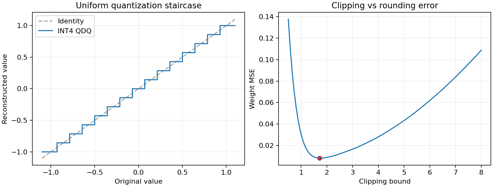
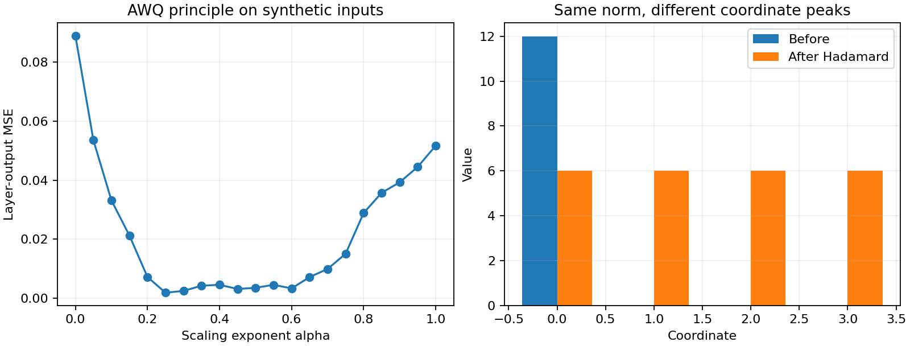

# 数值实验记录

运行命令：`python experiments/quant_lab.py --write-results --figures`。

固定随机种子：20261010；Python 3.12.7；NumPy 2.1.3。
共运行 14 组数值演示，38 项数学与边界检查全部通过。

这是 CPU 小矩阵实验，没有加载真实 LLM，也没有测量 GPU 加速或任务准确率。
AWQ、SmoothQuant、NF4 的误差比较只对本次构造数据成立；并非完整论文算法复现。

## 关键结果

| 项目 | 数值 |
|---|---:|
| 01_uniform / scale | 0.142857143 |
| 01_uniform / payload_bytes | 2 |
| 02_noise / observed_mse | 0.000834266593 |
| 02_noise / s2_over_12 | 0.000833333333 |
| 03_clipping_groups / best_bound | 1.71212121 |
| 03_clipping_groups / best_mse | 0.00809730735 |
| 03_clipping_groups / minmax_mse | 0.108861925 |
| 03_clipping_groups / one_group_mse | 0.035 |
| 03_clipping_groups / two_groups_mse | 0.0225510204 |
| 04_gptq / rtn_loss | 0.48 |
| 04_gptq / compensated_loss | 0.28 |
| 04_gptq / identity_loss | 0.16 |
| 06_transforms / rotation_identity_max_error | 7.10542736e-15 |
| 06_transforms / relu_commutation_gap | 2.87068974 |
| 07_scaling / awq_best_alpha | 0.25 |
| 07_scaling / awq_rtn_mse | 0.0890354774 |
| 07_scaling / awq_best_mse | 0.00186934387 |
| 07_scaling / w8a8_before_mse | 0.000913329062 |
| 07_scaling / w8a8_after_smoothing_mse | 4.90814316e-05 |
| 07_scaling / small_activation_alpha0 | 0.001 |
| 07_scaling / small_activation_alpha1 | 1 |
| 08_codebooks / weighted_center | 0.1 |
| 08_codebooks / gaussian_nf4_mse | 0.00873532558 |
| 08_codebooks / gaussian_symmetric_int4_15level_mse | 0.0118026314 |
| 08_codebooks / gaussian_uniform16_absmax_mse | 0.0102648602 |
| 08_codebooks / gaussian_affine_int4_16level_mse | 0.00835906911 |
| 09_loftq_principle / error_before | 0.268255717 |
| 09_loftq_principle / error_after_rank2 | 0.103637741 |
| 10_attention / first_order_relative_error | 4.70520259e-06 |
| 10_attention / key_centering_error | 1.11022302e-16 |
| 11_qjl / target_inner_product | 4.24394047 |
| 11_qjl / sample_mean | 4.21484037 |
| 11_qjl / standard_error | 0.0196450762 |
| 11_qjl / samples | 120000 |
| 12_hqq_subproblem / optimal_offset | 1.06666667 |
| 13_storage / kv_fp16_gib | 1 |
| 13_storage / kv_int4_payload_gib | 0.25 |
| 13_storage / int4_group128_fp16_scale_bpw | 4.125 |
| 13_storage / nf4_double_scale_overhead_bpw | 0.126953125 |
| 13_storage / mxfp4_bpv | 4.25 |
| 13_storage / nvfp4_block_bpv | 4.5 |
| 13_storage / ternary_ideal_bits | 1.5849625 |
| 13_storage / amdahl_60pct_4x | 1.81818182 |
| 14_lsq / ste_scale_gradient | 0.4 |
| 14_lsq / surrogate_finite_difference | 0.4 |

完整数组和检查名称见 [results.json](results.json)。

## NF4 对照条件

四种配置使用同一份高斯数组、每组 64 个元素。NF4 有 16 个代表值且包含零；
对称 INT4 使用 [-7,7]，有 15 个代表值；uniform16 在相同 absmax 范围内均匀放置 16 个点，但不包含零；
仿射 INT4 使用 16 个编码、包含零的 min/max 范围，并需要额外 zero point 元数据。
这里比较的是重建误差，不是相同总存储预算或真实模型质量。

## 已通过的检查

- INT4 手算编码
- 全零组
- 拒绝非法裁剪范围 0.0
- 拒绝非法裁剪范围 -1.0
- 拒绝非法裁剪范围 nan
- 拒绝非法裁剪范围 inf
- 显式正裁剪范围
- 仿射手算与整数零点
- 仿射全零组
- INT4 打包往返
- 无裁剪半步长界
- 均匀噪声的 s²/12 近似
- 输出误差等于二次型
- GPTQ 手算例子
- 受约束最小损失
- 逆 Hessian 消元
- 单位 Hessian 与输入一致
- 无耦合时补偿退化为 RTN
- 非对称重建约束解
- 缩放等价
- 旋转等价
- 平移缩放与偏置补偿
- 无逐通道增益的 RMSNorm 等价
- 非线性不能随意穿过旋转
- 独立输入列尺度可抵消 AWQ 缩放
- SmoothQuant 平衡范围
- SmoothQuant 绝对幅度非单调减小反例
- SmoothQuant 激活跨通道范围趋于均衡
- 加权码本中心
- 码本代表值数量及零值约定
- 低秩补偿的剩余奇异值能量
- Key 去中心不改变精确注意力
- KV 一阶误差传播
- QJL 内积无偏性的蒙特卡洛核对
- p=1 收缩子问题
- HQQ offset 二次子问题驻点
- GQA KV 缓存例子
- LSQ 的 STE 替代梯度

## 图表

同目录提供 SVG 矢量版本，可以缩放或导出。坐标使用英文以避免中文字体依赖。

运行时间、参数与完整源码指纹见 results.json。
图表已随本次结果重新导出。
