# 投机解码深度调研与实践：概率、模型、系统与研究路线

<a id="top"></a>

**文档更新日期：2026-10-25｜原调研截止：2026-10-20｜范围：公开论文、作者实现、框架文档与本仓库实验**

投机解码先用廉价程序提出候选，再由目标模型并行验证，以减少昂贵的串行调用。理解这一技术，需要同时回答三件事：**为什么输出分布仍正确，怎样利用候选复用计算，以及额外工作何时能换来真实时间和资源收益。**

全文按基础对象、概率校正、状态实现、草稿结构、验证算法、训练目标、系统成本、评测与研究依次展开。推导、反例、图表和代码放在对应知识点之后；共 22 章、32 张原创图和 47 段独立可运行示例。实验环境、全部命令、来源与维护说明也在文内。

**证据范围。** 框架支持与外部事实以各条资料注明的访问日期和版本为准；文档更新日期不代表所有滚动来源都在同一天重新核验。理论构造、论文报告和本仓库实验分别注明。第 21 章预测是有明确起算日的分析判断，不是已发生事实。

**实验范围。** 小词表有理数枚举验证联合分布；CPU 随机 Transformer 验证条件 logits、KV、树路径与层复用；训练梯度和合成成本实验解释目标与测量。它们不代表预训练模型的质量或生产 GPU 性能。代码标记为“结构伪代码”时需要对应模型或后端；标记“可运行示例”时可在仓库根目录独立执行。

## 阅读导航

| 学习阶段 | 章节 | 应能回答的问题 |
|---|---|---|
| 基础与正确性 | 1–4 | 自回归的瓶颈在哪里？接受与修正为何保持分布？真实 q 和状态如何对齐？ |
| 候选与验证结构 | 5–9 | 检索、独立草稿、EAGLE、MTP、并行块和树分别复用什么？ |
| 训练与成本 | 10–12 | 怎样训练长存活前缀？如何安排验证预算并核算收益？ |
| 接入与实验 | 13–16 | 哪些框架条件必须核对？如何运行实验并评价服务效果？ |
| 研究与证据 | 17–22 | 如何提出可证伪假设、追溯来源并跟踪前沿发展？ |

- [1. 问题定义与统一技术地图](#s1)
- [2. 经典单链投机采样：算法、耦合与完整序列证明](#s2)
- [3. Transformer 验证与 KV 状态机](#s3)
- [4. 实际提案概率、解码规则与误差边界](#s4)
- [5. n-gram、suffix 与检索草稿](#s5)
- [6. 独立草稿、多头与 EAGLE](#s6)
- [7. 自投机、MTP 与 UNO](#s7)
- [8. 并行与半自回归草稿](#s8)
- [9. 树验证、最优传输与块验证](#s9)
- [10. 草稿训练与接受长度目标](#s10)
- [11. 长上下文、批处理与因果调度](#s11)
- [12. 成本模型、预算选择与交互计算器](#s12)
- [13. 五个框架的接入证据与限制](#s13)
- [14. 性能证据：可比较的条件是什么](#s14)
- [15. 代码导读、实验结果与完整复现指南](#s15)
- [16. 正确性、性能与服务评测设计](#s16)
- [17. 研究切入点与实施顺序](#s17)
- [18. 常见混淆与证据边界](#s18)
- [19. 来源索引、阅读路线与资料维护](#s19)
- [20. 扩展公开检索：2026 年的新证据与研究缺口](#s20)
- [21. 未来 6–24 个月的技术预测](#s21)
- [22. 对本仓库下一阶段研究的建议](#s22)

初学者先读第 1–4 章，再按第 15 章运行概率与缓存实验；随后学习第 5–10 章的模型和验证结构。准备做性能研究时，按第 11–12、16 章核对成本与指标，再查第 13–14 章的接入和论文条件。完整复现入口在[第 15 章](#s15)，来源与资料边界在[第 19 章](#s19)。

<a id="s1"></a>
## 1. 问题定义与统一技术地图

<a id="s1-1"></a>
### 1.1 自回归的串行依赖在哪里

给定前缀 $s$，目标模型的序列分布为：

$$
P(x_{1:m}\mid s)=\prod_{i=1}^{m}p(x_i\mid s,x_{<i}).
$$

普通解码先生成 $x_1$，再计算条件于 $x_1$ 的下一步。Transformer 能并行处理已知 token 序列，但不能凭空消除未知 token 带来的条件依赖。投机解码先猜出这些 token，再一次计算“候选前缀成立时”的各位置目标分布，最终保留有效进展。[Leviathan 等](https://arxiv.org/abs/2211.17192)、[Chen 等](https://arxiv.org/abs/2302.01318)

小 batch 解码常受权重读取、KV 读取、kernel 启动和通信限制。多位置验证有机会摊薄这些成本，但会增加计算量和临时状态。投机解码不保证降低 FLOPs，也不保证降低首 token 延迟或提高任意并发下的吞吐。

| 阶段 | 输入已知程度 | 主要工作 | 评测时需关注 |
|---|---|---|---|
| Prefill | 整个提示已知 | 并行处理提示并建立状态 | 草稿额外 prefill、prefix cache 命中 |
| Draft | 历史已知，未来待猜 | 产生链、树或块 | 串行主干次数、LM head、检索成本 |
| Verify | 候选暂时已知 | 计算候选前缀下的目标分布 | 验证宽度、KV 读取、图形状 |
| Commit | 接受结果已知 | 输出、修正、回滚 | 实际提交数、采样和状态恢复 |

<a id="s1-2"></a>
### 1.2 五个可独立研究的部件

```text
已提交 token / 目标特征 / 历史索引
                  ↓
候选生成：小 LM、复制、特征草稿、MTP、并行块
                  ↓
候选组织：单链、分支树、候选格
                  ↓
目标前向：causal / tree mask + 正确位置和状态
                  ↓
验证算法：接受事件 + 修正分布 + 停止规则
                  ↓
提交与回滚 → 下一轮

资源调度贯穿全程：草稿深度、节点预算、batch、缓存、重叠执行
```

EAGLE-3 是草稿路线，动态树是候选组织方式，Block Verification 是接受算法，按 batch 改长度是资源策略。它们处于不同层次，不能视作四个互斥的模型；具体组合能否成立需要查看算法合同和后端实现。

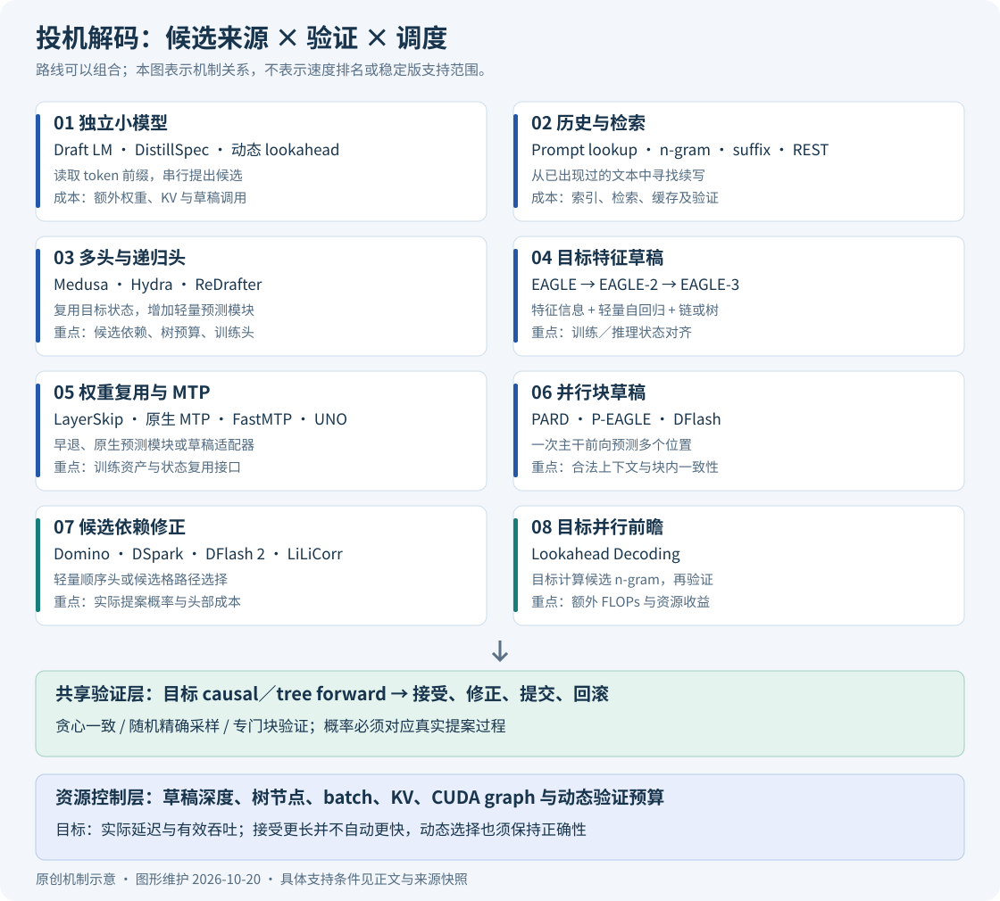

图示给出主要路线关系；SpecTr、Sequoia、SpecExec、TriForce 和近似验证分别在对应章节讨论。图中排列不表示性能或成熟度排名。

<a id="s1-3"></a>
### 1.3 四种不同的正确性声明

| 声明 | 含义 | 检查办法 |
|---|---|---|
| 贪心一致 | 固定目标、处理器和 tie-breaking，输出等于逐步 argmax | 比较完整 token 序列 |
| 分布一致 | 输出联合分布等于目标采样分布 | 证明、精确枚举、统计检验 |
| 质量接近 | 任务分数差异较小 | 足够样本的质量评测 |
| 数值／逐位一致 | 浮点运算和采样执行也相同 | 更严格的执行约束 |

分布一致通常不要求相同 seed 得到同一文本。不同 batch 形状和低精度算子可能改变 logits；量化或微调目标后，严格验证保持的是新目标的分布。近似接受、目标替换和算子数值变化应分开报告。[vLLM 无损保证](https://docs.vllm.ai/en/latest/features/speculative_decoding/#lossless-guarantees-of-speculative-decoding)


<a id="s1-4"></a>
### 1.4 从 token 到模型输出：先把基础对象分清

**Token 不是词。** tokenizer 把字符串映射为整数序列，一个词可能对应多个 token，一个 token 也可能包含空格、标点或字节片段。模型输出的是词表上每个 token 的分数 $z\in\mathbb R^{|V|}$，称为 logits；softmax 将它转换为概率。token ID 没有数值距离意义，ID 100 与 101 不一定语义相似。

**Hidden state 不是概率。** 每层把位置上的向量变换为另一向量 $h\in\mathbb R^d$；LM head 通过 $z=W_{head}h$ 投影到词表。EAGLE 复用 hidden state，是利用目标已计算的上下文表示；验证器使用概率，是校正候选选择过程。两者服务于不同步骤。

**自回归不等于 Transformer 只能一次看一个位置。** 如果输入 `[A,B,C]` 已知，训练时可以一次求出预测 B、C 和下一 token 的分布；但从未知输出开始，B 的取值会影响 C 的分布。投机的草稿先填入 B、C，使条件计算可以提前执行，然后证明哪些结果能提交。

| 对象 | 一个小例子 | 与代码的对应 |
|---|---|---|
| 文本 | `the cat` | tokenizer 的输入 |
| Token IDs | `[12,83]` | `torch.long` 输入张量 |
| Hidden states | `[序列长,隐藏维度]` | embedding、attention、MLP 的状态 |
| Logits | `[序列长,词表大小]` | `model.head(...)` |
| 实际概率 | softmax 后再经合法处理 | sampler 使用的 $p,q$ |
| 已提交前缀 | 用户最终收到的 token | `output` |
| 候选前缀 | 本轮暂时猜出的 token | `candidates`，不一定成为输出 |

<a id="s1-5"></a>
### 1.5 为什么“多算一些”反而可能更快

把模型权重想成一次计算要搬运的固定材料。一次只处理一个 token 时，搬运可能比乘加更慢；同一轮处理多个位置，可以用同一批权重做更多矩阵乘法。粗略 roofline 下界为：

$$
T\ge\max\left(\frac{F}{C},\frac{M}{BW}\right),
$$

$F$ 是运算量，$C$ 是有效算力，$M$ 是需要搬运的字节量，$BW$ 是有效带宽。它是下界而非完整延迟模型，实际还包括启动、同步、通信和非重叠部分。

例如假设权重搬运需 10 ms，单 token 算子需 1 ms，四位置算子需 4 ms，则两者下界都可能被 10 ms 的搬运主导。若平均提交 3 个 token，多位置计算才可能划算；如果 GPU 已经算力饱和或验证需 40 ms，收益会消失。这里所有时间都是教学假设。

<!-- runnable: roofline -->
```python
weight_bytes = 14e9
bandwidth = 3e12
single_flops = 14e9
compute = 100e12
for positions in [1, 4, 16]:
    lower_ms = 1000 * max(weight_bytes / bandwidth,
                         positions * single_flops / compute)
    print(positions, round(lower_ms, 3))
# 三行均约 4.667 ms：仅表示此假设中搬运仍占主导。
```

**自检。** “减少目标串行调用”为什么不必然减少总 FLOPs？因为被拒绝的候选、草稿本身和更宽的验证都增加了计算；速度取决于这些计算是否利用了原先闲置的资源。

<a id="s2"></a>
## 2. 经典单链投机采样：算法、耦合与完整序列证明

本章先用单个位置的概率质量证明接受—修正，再把同一构造写成联合分布和转移核，最后处理条件前缀、变长轮次与 EOS。数值例子用于逐项核算，模型状态与并行前向的实现放在[第 3 章](#s3)。

<a id="s2-1"></a>
### 2.1 符号、随机变量与条件前缀

| 符号 | 本文定义 |
|---|---|
| $p$ | 目标在实际解码规则下的概率分布 |
| $q$ | 候选生成程序真正使用的提案分布 |
| $s$ | 已提交前缀 |
| $\gamma$ | 新草稿 token 数，不含 anchor |
| $y_i$ | 第 $i$ 个候选 |
| $p_i,q_i$ | 条件于同一前缀 $s,y_{<i}$ 的分布 |
| $A$ | 接受的连续候选前缀长度 |
| $L$ | 实际新提交 token 数；无终止截断时 $L=A+1$ |

注意一些论文交换 $p,q$，另一些论文把 anchor 计入 block size 或 accepted length。本文所有公式统一采用上表。

固定已提交前缀 $s$，定义草稿 token $Y\sim q(\cdot\mid s)$、独立接受随机数 $U\sim\mathrm{Uniform}[0,1)$，以及最终输出 token $X$。在这里，“分布一致”是 $X$ 的边缘分布等于 $p$，不是 $X=Y$，也不是两次调用恰巧打印了相同字符串。

还可以把随机性分为三层：

| 随机对象 | 例子 | 正确性证明中的作用 |
|---|---|---|
| 输出历史 $S$ | 上一轮修正 token | 固定历史后证明下一步 |
| 草稿辅助状态 $Z$ | 随机路由、共享噪声、随机选择的草稿器 | 显式条件化，或求出边缘化后的条件分布 |
| 当前抽样 $Y,U$ | 候选、接受测试、修正采样 | 按所选解释执行同一套校正 |

给定 $s,Z$ 时，目标条件分布必须仍是同一个 $p(\cdot\mid s)$，草稿概率则必须是当前程序实际产生 $Y$ 的条件概率。把生成后择优的结果当成生成前分布的样本，正是混淆了这些条件。

<a id="s2-2"></a>
### 2.2 一轮算法：提出、验证、修正与 bonus

1. 草稿自回归生成 $y_i\sim q_i$，保存每步完整提案分布。
2. 目标对候选链一次因果前向，计算 $p_1,\ldots,p_{\gamma+1}$。
3. 从左到右，以 $a_i(y_i)=\min(1,p_i(y_i)/q_i(y_i))$ 接受。
4. 首次拒绝时，从 $r_i(v)\propto[p_i(v)-q_i(v)]_+$ 采样修正 token，丢弃后续候选。
5. 若全部接受，从 $p_{\gamma+1}$ 采样 bonus token。

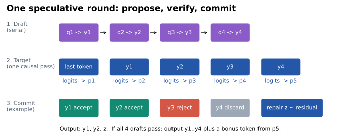

首个拒绝即停止，是这里的**逐 token 单链算法**的规则；[第 9 章](#s9)的块验证采用不同的接受事件，不能仅删除这里的停止语句就得到块验证。

<a id="s2-3"></a>
### 2.3 单步分布守恒

固定前缀，令 $Y\sim q$。候选被接受且等于 $v$ 的质量是：

$$
\Pr(Y=v,\mathrm{accept})=q(v)\min(1,p(v)/q(v))=\min(p(v),q(v)).
$$

因此总接受概率为：

$$
\alpha=\sum_v\min(p(v),q(v))=1-\operatorname{TV}(p,q),
\qquad \operatorname{TV}(p,q)=\frac12\sum_v|p(v)-q(v)|.
$$

因为 $p,q$ 均归一化，拒绝概率等于正残差质量：

$$
1-\alpha=\sum_v[p(v)-q(v)]_+.
$$

两条路径相加得到：

$$
\Pr(X=v)=\min(p(v),q(v))+(1-\alpha)\frac{[p(v)-q(v)]_+}{1-\alpha}=p(v).
$$

当 $p=q$ 时没有拒绝，不需要定义零质量残差。当 $q(v)=0$ 时不会从 $q$ 抽到 $v$，但它仍可通过修正分支输出。因此精确性不要求草稿覆盖目标的全部支撑。[两篇原始论文](https://arxiv.org/abs/2211.17192)、[独立提出的采样构造](https://arxiv.org/abs/2302.01318)

<a id="s2-4"></a>
### 2.4 从概率质量到一轮手工执行

设 $p=(0.5,0.3,0.2)$，$q=(0.2,0.5,0.3)$：

| token | $p$ | $q$ | 接受概率 | 接受质量 | 正残差 |
|---|---:|---:|---:|---:|---:|
| A | 0.5 | 0.2 | 1 | 0.2 | 0.3 |
| B | 0.3 | 0.5 | 0.6 | 0.3 | 0 |
| C | 0.2 | 0.3 | 2/3 | 0.2 | 0 |

总接受率为 0.7，所有修正质量补到 A。若错误地在拒绝后直接从完整 $p$ 重采样，最终分布变成：

$$
\min(p,q)+(1-\alpha)p=(0.35,0.39,0.26).
$$

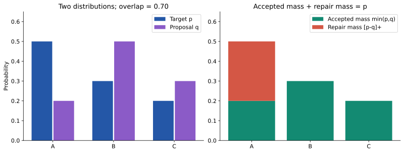

本仓库 [verify_candidates](../examples/speculative_sampling.py) 在 `p[y] >= q[y]` 时直接接受；否则比较 `u < p[y]/q[y]`，此时比值不超过 1，不会溢出。这种比较避免了乘法 `u*q[y]` 在 subnormal 极小概率下舍入到错误边界的问题，配套测试覆盖此数值边界。`p[y]=0` 时即使 `u=0` 也拒绝。

设候选是 B、A，第一位置 $p(B)=0.3,q(B)=0.5$，接受阈值为 0.6。若随机数为 0.8，第一位置拒绝，修正必为 A，第二候选不再使用。若随机数为 0.2，则接受 B，后续必须使用**条件于 B** 的 $p_2,q_2$，而非复用最初的分布。

下面强制在第一处拒绝，方便逐行观察。这种固定 RNG 只用于解释事件，不用于统计正确性实验。

<!-- runnable: one_round -->
```python
import numpy as np
from examples.speculative_sampling import verify_candidates
class DemonstrationRNG:
    def random(self): return .8
    def choice(self, size, p): return int(np.argmax(p))
p = np.array([.5,.3,.2])
q = np.array([.2,.5,.3])
step = verify_candidates([1,0], [q,q], [p,p,p], DemonstrationRNG())
print(step)  # tokens=[0], accepted=0, proposed=2, rejected=True
assert step.tokens == [0]
```

<a id="s2-5"></a>
### 2.5 联合概率表与最大耦合的单步上界

把一次采样写成二维随机变量：行表示草稿 $Y$，列表示最终输出 $X$。草稿决定行边缘必须是 $q$，正确输出决定列边缘必须是 $p$。我们希望尽量把概率放到对角线上，因为 $X=Y$ 就能复用草稿。

令 $J(y,x)=\Pr(Y=y,X=x)$。任何联合分布的对角元素都同时受行、列边缘限制：

$$
J(v,v)\le p(v),\quad J(v,v)\le q(v),\quad
\Pr(X=Y)\le\sum_v\min(p(v),q(v)).
$$

经典算法在每个对角元素放置 $\min(p(v),q(v))$，达到这个单步上界。由 $\min(a,b)=(a+b-|a-b|)/2$，上界就是 $1-\operatorname{TV}(p,q)$。每行多出的质量为 $[q-p]_+$，每列缺少的质量为 $[p-q]_+$，把剩余质量从多出的行运到缺少的列即可。一个显式构造是：

$$
J_{yv}=\mathbf 1[y=v]\min(p(y),q(y))+
\frac{[q(y)-p(y)]_+[p(v)-q(v)]_+}{1-\alpha}.
$$

$p=q$ 时第二项不需要计算。这不是把原文概率当作几何比喻，而是一个可直接验证行列边缘的联合分布。

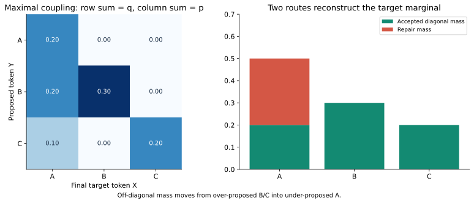

<!-- runnable: coupling -->
```python
import numpy as np
from examples.principle_lab import coupling_table
p, q = np.array([.5,.3,.2]), np.array([.2,.5,.3])
joint = coupling_table(p, q)
print(joint)
np.testing.assert_allclose(joint.sum(axis=1), q)  # 行边缘：草稿
np.testing.assert_allclose(joint.sum(axis=0), p)  # 列边缘：目标
# [[.2, 0, 0], [.2, .3, 0], [.1, 0, .2]]
```

`joint.sum(axis=0)` 精确说明修正为什么必须补剩余质量。拒绝后直接重新抽完整 $p$ 相当于把已经在对角线上使用过的目标质量再分配一次。

这个最优性只针对**一次候选与一次输出相同的概率**。它不意味着逐步最大耦合也使多位置的整轮接受长度最大；[第 9 章](#s9)的两 token 块验证例子将展示二者的区别。

<a id="s2-6"></a>
### 2.6 把接受—修正写成转移核

固定 $p,q$，令 $K_{p,q}(y,x)=\Pr(X=x\mid Y=y)$，则

$$
K_{p,q}(y,x)=a(y)\mathbf1[x=y]+(1-a(y))r(x),
\quad a(y)=\min\left(1,\frac{p(y)}{q(y)}\right),
$$

$$
r(x)=\frac{[p(x)-q(x)]_+}{\sum_v[p(v)-q(v)]_+},\qquad qK_{p,q}=p.
$$

这就是“从草稿分布经校正核映射到目标分布”。$q(y)=0$ 的行在精确提案下不可达，可任意补成归一化概率行；代码选择补成 $p$，便于核算矩阵。**实际采样器收到声称来自 q、却满足 q(y)=0 的候选时，应报错**，不能拿这个数学补全掩盖调用错误。

<!-- runnable: exactness_kernel -->
```python
from fractions import Fraction as F
from examples.exactness_lab import verification_kernel, one_step_law
p, q = (F(1,2), F(1,2)), (F(3,4), F(1,4))
K = verification_kernel(p, q)
assert K == ((F(2,3), F(1,3)), (F(0), F(1)))
assert one_step_law(p, q, q) == p
print(K)
```

第一行表示候选 A 有 $2/3$ 概率保留，有 $1/3$ 概率改为 B；第二行表示候选 B 总保留。计算列边缘：A 的输出质量为 $(3/4)(2/3)=1/2$；B 的输出质量为 $(3/4)(1/3)+1/4=1/2$。

<a id="s2-7"></a>
### 2.7 整条序列的联合分布为何正确

单步守恒要提升为序列正确性，必须始终对相同的真实前缀使用对应条件分布。接受时，后续候选沿同一前缀生成；拒绝并提交修正后，旧后缀条件失效，必须重新开始。

对序列证明，最稳妥的表述是：**对每个已输出历史，将尚未提交的候选、辅助随机变量和接受事件按其正确条件分布边缘化，下一输出 token 的分布恢复为目标条件分布；再应用链式法则。** 一种可用的分层证明是先固定采样前的辅助状态 Z，证明各个 Z 下完整校正都恢复 p，再对 Z 平均。不能额外固定已经抽出的候选 Y 后仍要求输出分布等于 p；给定 Y 时输出服从前面定义的校正核 K，通常不等于 p。

数学保证建立在实际提案、目标处理器、条件状态和采样规则都正确的前提下。下一节说明为什么只检查接受片段不足以验证这个保证。

<a id="s2-8"></a>
### 2.8 接受片段的条件分布为什么不同

在三词表例子中，接受总质量是 0.7。条件于接受事件，输出分布为：

$$
P(X=v\mid accept)=\min(p(v),q(v))/0.7=(2/7,3/7,2/7),
$$

而目标是 $(0.5,0.3,0.2)$。只有把接受与修正事件加在一起才恢复目标。观察日志时若只统计通过的草稿，会天然得到与目标不同的频率；这不是算法出错。

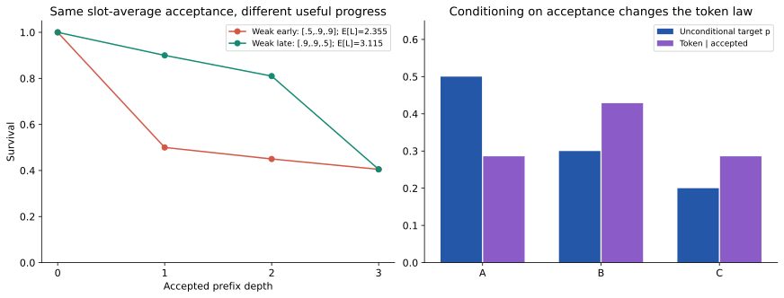

右面板说明本节的接受条件分布；左面板的存活次序与期望长度将在[第 12 章](#s12-2)推导。

联合序列证明也要保留这个区分。证明对象是最终输出的条件概率，不是“某一条接受路径上每个候选的条件频率”。测试中统计完整生成序列，而不是只收集 accepted token，就是为了检查正确对象。

假设候选最多两项，一轮可能输出一个修正 token、一个接受 token 加修正、或者两个接受 token 加 bonus。输出长度本身携带接受事件的信息。

因此，下列比较对象有不同含义：

| 统计对象 | 能否直接与固定长度目标联合分布比较？ | 原因 |
|---|---|---|
| 所有接受的 token | 不能 | 条件于通过事件，频率被重加权 |
| 一轮中“恰好长度为 3”的输出 | 不能 | 条件于前两个候选均通过 |
| 每次完整生成恰好 N 个 token | 可以 | 与目标采用同一输出长度边界 |
| 相同 EOS、最大长度规则下的完整输出 | 可以 | 两者有同一个停止映射 |
| 一轮输出后按目标补齐到 N | 可以 | 用目标 continuation 完成同一个联合事件 |

<a id="s2-9"></a>
### 2.9 贪心匹配与目标采样匹配

贪心模式保留与目标 argmax 一致的连续候选，在首个不匹配处输出目标 argmax。它不需要用草稿 softmax 解释随机接受。

另一种精确构造是先从目标 $p$ 抽样，命中候选就继续，否则输出该目标样本并结束本轮。单个随机候选的命中率为 $\sum_v p(v)q(v)$，通常低于最大耦合的 $\sum_v\min(p(v),q(v))$。当 $p=q=(0.5,0.3,0.2)$ 时，两者分别为 0.38 和 1。[第 9 章](#s9)会看到，目标采样匹配对确定性候选树尤其自然。

<a id="s2-10"></a>
### 2.10 EOS、长度边界与完整停止分布

EOS 是词表中的一个 token，但一旦提交就终止生成。要证明它不会破坏分布一致性，可以把停止规则写成对完整序列的共同映射。

先设想无限目标序列，再定义停止时刻

$$
T=\min\{\text{首个 EOS 的输出位置},N\}.
$$

如果两种生成程序在任意有限前缀上的联合分布相同，对序列施加同一个“保留到首个 EOS 或 N”映射后，分布仍相同。实际不需要生成 EOS 后的 token，这只是证明用的构造。

以目标每步 $P(A)=P(EOS)=1/2$、最大长度 3 为例：

| 完整输出 | EOS | A EOS | A A EOS | A A A |
|---|---:|---:|---:|---:|
| 概率 | $1/2$ | $1/4$ | $1/8$ | $1/8$ |

accepted EOS 后立即停止；拒绝了候选 EOS 就按修正后的真实输出继续；修正或 bonus 是 EOS 时也立即停止。将 EOS 当普通接受 token 后又添加 bonus，改变了这个分布。

<!-- runnable: exactness_eos -->
```python
from fractions import Fraction as F
from examples.exactness_lab import enumerate_sequences
target = lambda prefix: (F(1,2), F(1,2))
draft = lambda prefix: (F(4,5), F(1,5))
law = enumerate_sequences(target, draft, (0,), 3, 2, eos_id=1)
assert law == {(1,): F(1,2), (0,1): F(1,4),
               (0,0,1): F(1,8), (0,0,0): F(1,8)}
print(law)
```

接近最大输出长度时，预算需要为修正／bonus 留一个位置，本项目使用 `min(gamma, remaining-1)`。这也解释最后只剩一个 token 时为什么无需草稿。两种精确算法可以消耗不同数量的随机数，所以一般不要求相同 seed 产生逐字相同文本。

这里的 [exactness_lab.py](../examples/exactness_lab.py) 用标准库 `Fraction` 枚举完整生成程序；目标参照由独立的自回归概率乘积得到。计算量随词表和长度指数增长，只用于小规模数学核算，不是高效生成器。

**自检。** 若 $p=q$ 却仍有拒绝，应检查是否采用了独立目标采样匹配、处理器不一致或数值比较错误；两模型权重相同不足以确定实际采样规则相同。

<a id="s3"></a>
## 3. Transformer 验证与 KV 状态机

[第 2 章](#s2)规定了验证器需要哪些目标条件分布。本章把这些分布落实到 Transformer 的输入行、attention mask 和缓存状态：先保证每一行计算的是正确前缀，再保证拒绝后的下一轮仍读取正确历史，最后区分数学精确性与有限精度执行。

<a id="s3-1"></a>
### 3.1 logits 行、token ID 与逻辑位置

给定前缀 $x_{1:t}$，目标模型输出 $p(x_{t+1}\mid x_{1:t})$。输入 token $x_t$ 的最后一行隐藏状态负责预测下一 token，不能用这一行给 $x_t$ 自身评分，因为它已经看到了该 token。

若前缀长度为 $n$、草稿长度为 $\gamma$，不使用缓存的完整前向应取：

```python
logits = target(prefix + candidates)
verify_logits = logits[:, n - 1 : n + gamma, :]
```

前缀最后 token 的行给出 $p_1$；候选 $y_i$ 的行给出 $p_{i+1}$；最后候选的行给出全接受时的 bonus 分布。因此切片从 $n-1$ 开始，共包含 $\gamma+1$ 行。

以已提交前缀 `[1,2,3]`、草稿 `[4,5,6]` 为例，数字是 token ID，不是位置。本项目采用 pending-token 约定：KV 已缓存 `[1,2]`，最后一个已提交 token `3` 尚待送入模型，验证输入是 `[3,4,5,6]`：

| 新输入行 | token ID | 从 0 起的逻辑位置 | 此行可见前缀 | 此行预测对象 |
|---:|---:|---:|---|---|
| 0 | 3 | 2 | `[1,2,3]` | 候选 4 的目标分布 $p_1$ |
| 1 | 4 | 3 | `[1,2,3,4]` | 候选 5 的目标分布 $p_2$ |
| 2 | 5 | 4 | `[1,2,3,4,5]` | 候选 6 的目标分布 $p_3$ |
| 3 | 6 | 5 | `[1,2,3,4,5,6]` | 全接受时的 bonus 分布 |

后面的候选虽然还没有提交，其条件分布仍可提前计算。第一次拒绝以后，相关行只是无效计算，不能拿来修正另一个前缀。并行来自“候选 token 已经给定”，语言模型的条件依赖仍然存在。

<a id="s3-2"></a>
### 3.2 从 attention 公式到 Q/K/V 与缓存张量

设批大小为 $B$，新输入数为 $N$，历史缓存长为 $S$，hidden width 为 $d$，head 维度为 $d_h$。每层对当前输入 $X\in\mathbb R^{B\times N\times d}$ 计算：

$$
Q=XW_Q,\quad K_{new}=XW_K,\quad V_{new}=XW_V,
$$

$$
K=[K_{past};K_{new}],\quad V=[V_{past};V_{new}],
$$

$$
A=\operatorname{softmax}\left(\frac{QK^\top}{\sqrt{d_h}}+\mathcal M\right),
\qquad O=AV.
$$

其中 $\mathcal M$ 在可见位置为 0，在不可见位置为 $-\infty$。本仓库对 $X$ 先做 LayerNorm；上述公式省略该预处理，以突出注意力维度。候选输入已知时，同层多个位置可并行计算，各层仍顺序执行。

| 张量 | 标准 MHA 形状 | 含义与 GQA 差异 |
|---|---|---|
| $Q$ | $[B,H_Q,N,d_h]$ | 当前新 query；GQA 仍有 $H_Q$ 个 query heads |
| 新 $K,V$ | 每个 $[B,H_Q,N,d_h]$ | 当前输入产生的键和值；GQA 将 head 数改为 $H_{KV}$ |
| 历史 $K,V$ | 每个 $[B,H_Q,S,d_h]$ | 历史位置状态；GQA 为 $[B,H_{KV},S,d_h]$ |
| 拼接后 $K,V$ | 每个 $[B,H_Q,S+N,d_h]$ | 历史缓存与本轮暂存；GQA 每组 query 读取对应 KV head |
| attention scores | $[B,H_Q,N,S+N]$ | 新 query 对所有可见 key 的相关度 |
| 拼接后的 attention 输出 | $[B,N,H_Qd_h]$ | 交给输出投影 |
| logits | $[B,N,\lvert V\rvert]$ | 每个新输入位置对应的下一 token 分数 |

过去位置的 Q 通常无需保留，因为只为当前新 query 计算输出；过去 K/V 会被未来 query 重复读取。每层缓存不同，后一层 K/V 来自该层的输入状态，不能把第一层缓存复用到所有层。

GQA 的逻辑共享不意味着必须在内存中把 KV 复制到 query head 数。高效内核会利用共享关系；若教学实现简单 `repeat`，其显存和带宽不能代表优化内核。[第 11 章](#s11)会将 $H_Q$ 与 $H_{KV}$ 分别放入计算量和存储量模型。

<a id="s3-3"></a>
### 3.3 因果 mask 必须包含历史偏移

不带历史缓存时，加性因果 mask 为 $\mathcal M_{ij}=0$（$j\le i$），否则为 $-\infty$。带 $S$ 行缓存时，新 query 第 $i$ 行位于逻辑位置 $S+i$，布尔可见矩阵应为：

$$
M_{ij}=\mathbf 1[j\le S+i],\qquad M\in\{0,1\}^{N\times(S+N)}.
$$

布尔 $M$ 与加性 $\mathcal M$ 表达同一个可见性规则：$M_{ij}=1$ 时 $\mathcal M_{ij}=0$，否则 $\mathcal M_{ij}=-\infty$。上例 $S=2,N=4$，第一行已可读 3 个 key；直接对矩形张量套不带偏移的 $j\le i$ 下三角规则，会屏蔽大部分合法历史。

<!-- runnable: systems_cached_mask -->
```python
import numpy as np
from examples.systems_lab import cached_causal_mask

mask = cached_causal_mask(2, 4)
np.testing.assert_array_equal(mask.sum(axis=1), [3, 4, 5, 6])
print(mask.astype(int))
```

不同 attention API 对布尔 mask 的解释可能不同。这里 `True` 表示可见；[AttentionBlock](../examples/tiny_transformer.py) 使用 `masked_fill(~mask, -inf)`。移植内核时，应核对 API 语义和矩形因果对齐规则，不能只核对 tensor shape。

<a id="s3-4"></a>
### 3.4 逐行对照完整前缀，比只比较最终文本更强

在正确 mask 与位置下，每行 logits 在数学上对应同一前缀的串行计算。对每个候选深度 $i$，独立执行 `model(prefix + candidates[:i])`，取最后一行为参照，能同时发现 mask、位置偏移、缓存遗漏与 logits 行号错误。只比较最终文本可能因为 argmax 恰好没变而遗漏概率错误。

<!-- runnable: logits_alignment -->
```python
import torch
from examples.tiny_transformer import TinyTransformer, token_tensor

torch.manual_seed(8)
model = TinyTransformer(width=8, heads=2, layers=2).double().eval()
prefix, draft = [1,2,3], [4,5]
with torch.inference_mode():
    _, cache = model(token_tensor(prefix[:-1], model))
    parallel, _ = model(token_tensor([prefix[-1], *draft], model), cache)
    for i in range(len(draft)+1):
        serial, _ = model(token_tensor(prefix + draft[:i], model))
        torch.testing.assert_close(parallel[0,i], serial[0,-1], atol=1e-12, rtol=1e-12)
print("p1、p2、bonus 均与各自真实条件前缀一致")
```

该示例的验证输入有三个 token，第 0 行预测的是候选 4，而不是前缀最后 token 3。[cache_transaction_demo()](../examples/systems_lab.py) 对更长的候选执行相同逐行对照；保存的 float64 CPU 结果最大差异约 $3.3\times10^{-16}$。这只是该次运行的数值结果，不是所有 dtype 或 backend 的误差上限。

<a id="s3-5"></a>
### 3.5 pending token、已提交输出与临时 KV

[小型 Transformer](../examples/tiny_transformer.py) 的非终止轮次采用统一约定：目标 KV 对应 `output[:-1]`，最后一个已提交 token 尚未入缓存；启用神经草稿时，其 KV 也在轮边界对应相同前缀。`gamma=0` 走目标生成路径，lookup 只有目标 KV。

| 状态 | token 流 | KV 覆盖 | 可以发送给用户吗 |
|---|---|---|---|
| 轮次开始 | $x_{1:t}$ 已确定 | $x_{1:t-1}$ | 可以，$x_t$ 虽无 KV 但已提交 |
| 临时验证后 | 候选还未提交 | $x_{1:t},y_{1:\gamma}$ | 候选不可以 |
| 接受前 $a$ 个并修正为 $z$ | $x_{1:t},y_{1:a},z$ | 只保留 $x_{1:t},y_{1:a}$ | 新输出均可发送；$z$ pending |

“token 已提交”与“token 的 KV 已计算”是不同状态。修正 token 的概率已经合法，因此可以输出；其 K/V 要等下一次前向才产生。对没有终止截断的普通轮次：

```text
轮开始：输出长 n，KV 长 n−1
草稿：读取最后 token，提出 γ 个候选
目标：一次读取 [最后 token, y1, …, yγ]
验证：接受 A 个候选，补一个修正或 bonus token
回滚：目标和草稿 KV 均裁剪至 n+A
轮结束：输出长 n+A+1，最后 token 留待下一轮
```

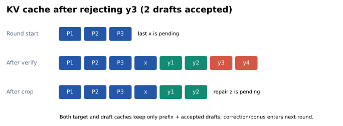

全部接受时，最后候选的 KV 已保留，bonus 尚未处理；拒绝时，被拒绝 token 及其后缀的 KV 都无效，修正 token 需要重新计算。神经草稿必须同步恢复，否则下一轮会读取错误历史。

普通拒绝或全接受加 bonus 时，新输出数 $m=a+1$；接受 EOS 时立即终止，没有补充 token，可能 $m=a$。因此实现从实际输出数推导缓存边界：

$$
\boxed{\text{cache\_length}=\text{prefix\_length}+\text{len(emitted)}-1.}
$$

`accepted` 只计实际提交的草稿 token，`stop_reason` 区分 EOS 与长度停止；验证长度不等于实际输出长度。即使终止后缓存不再使用，也应让统计遵守同一含义。

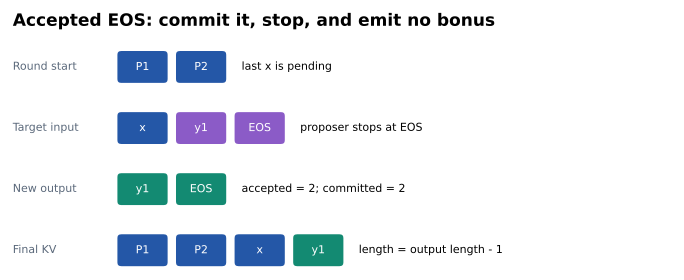

这个等式依赖 pending 约定。其他引擎可以缓存完整已提交前缀并另存 next-token logits；两种设计都可行，但缓存长度、位置编号和 logits 起点不能混用。

<a id="s3-6"></a>
### 3.6 提交、回滚和错误历史的可观察对照

设前缀 `[1,2,3]`、草稿 `[4,5,6]`，只接受 4，拒绝 5 并修正为 7。临时 KV 含 `[1,2,3,4,5,6]`，正确保留 `[1,2,3,4]`，7 的 KV 尚未计算：

```text
开始：输出 [1,2,3]            KV [1,2]              pending 3
暂存：输出 [1,2,3]            KV [1,2,3,4,5,6]      候选未提交
提交：输出 [1,2,3,4,7]        KV [1,2,3,4]          pending 7
续算：输入 7，读取上行 KV     应等价于完整计算 [1,2,3,4,7]
```

下面是生成循环的核心顺序；`step` 由概率验证器返回。这是需要 `_generate()` 上下文的代码阅读片段：

```python
output.extend(step.tokens)                 # 提交真实输出，已处理 EOS
crop_to = len(output) - 1                  # 最后一 token 留作 pending
cache_t = crop_cache(cache_t, crop_to)      # 目标不得读取拒绝后缀
draft_length = proposer.commit(crop_to) if depth else None
```

第一行确定可见输出；第二行从真实输出反推逻辑缓存，避免对 EOS 错套 `accepted+1`；后两行恢复目标和神经草稿的合法前缀。lookup 只读取已提交 token 快照，没有神经 KV。

本项目的神经 proposer 每生成一个候选，都会立即把它再次送入草稿模型，所以最后候选的 KV 也已计算，全接受时可直接裁剪到同一边界。这多做了一次可能无需立即执行的草稿前向，便于解释状态，不应把这段 Python 实现当作生产延迟下界。

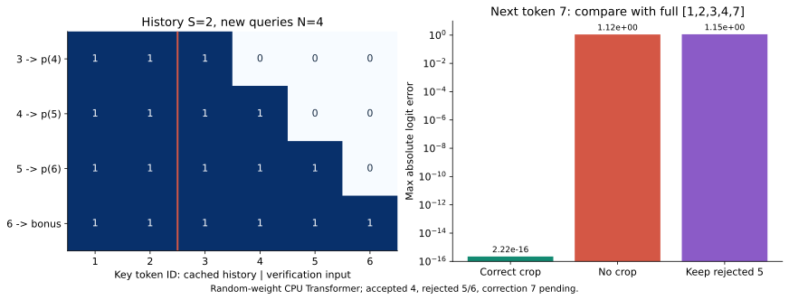

使用同一组随机权重，正确裁剪后输入 7，与完整计算 `[1,2,3,4,7]` 的 logits 误差约 $2.2\times10^{-16}$；完全不裁剪误差约 1.12；多保留一个拒绝 token 的误差约 1.15。后二者同时污染历史内容与下一 token 的位置。误差数值仅属于这个教学模型，对照的作用是让错误可被直接观察。

<a id="s3-7"></a>
### 3.7 逻辑裁剪、物理存储与生产状态事务

`k[..., :length, :]` 一般返回共享底层存储的视图。虽然逻辑上只保留前 `length` 行，旧分配仍可能被该视图引用；回滚要求未来计算不读取拒绝后缀，不要求所有旧内存立即清零。

<!-- runnable: systems_cache_transaction -->
```python
from examples.systems_lab import cache_transaction_demo

result = cache_transaction_demo()
assert result['next_logits_errors']['correct_crop'] < 1e-12
assert result['next_logits_errors']['no_crop'] > 1e-3
print(result['logical_cache_bytes'], result['retained_storage_bytes'])
```

保存实验中，4 行有效 KV 的逻辑数据为 2048 字节，切片仍保留 6 行对应的 3072 字节底层分配。统计按底层 storage 去重，不是进程内存或显卡 allocator 的总保留量。`clone()` 可让切片独立拥有较小存储，却增加复制与分配开销；分页缓存通过 block table 和空闲页管理作不同权衡。

生产状态也不止 K/V。早退网络有分层状态，混合 attention／SSM 模型有递归状态；grammar、重复惩罚和停止字符串匹配同样可能携带历史：

| 状态 | 拒绝后需要恢复的含义 |
|---|---|
| position / cache position | 下次输入位于真实提交前缀之后 |
| 分页 block table / slot map | 新 query 只能寻址合法历史 |
| repetition / grammar / 停止匹配状态 | 只推进已提交 token，不能包含拒绝后缀 |
| 草稿侧特征、MTP 与分层／递归状态 | 对应各模型定义的真实条件输入 |
| 引用计数与共享前缀 | 不能回收其他请求仍引用的页 |
| 用户输出与长期索引 | 只提交有效前缀，不写入临时候选 |
| RNG | 满足概率算法所需的条件随机性；无需与普通 AR 消耗相同随机数 |

一轮应被理解为“暂存候选 → 验证 → 提交有效前缀”的事务。缓存长度相同仍可能含不同 token、错误层状态或错误路径；长度只是必要检查之一。

<a id="s3-8"></a>
### 3.8 层间复用、位置编码与树路径提交

每层先执行 $x\leftarrow x+Attention(LN(x))$，再执行 $x\leftarrow x+MLP(LN(x))$。草稿若跳过中间层，后续层的输入与 K/V 也改变；共享权重不能抵消输入差异。修正 token 与拒绝 token 的 ID 不同时，即使位置相同，也不能直接复用拒绝 token 的 KV。

TinyTransformer 使用学习式位置 embedding，现代模型常用作用于 Q/K 的 RoPE。两者不同，但都要求逻辑位置一致。树中兄弟节点应拥有相同深度位置，不能因展平数组下标不同而被当成相邻时间步。

例如 parent 数组 `[-1,0,0,1,1,2]` 中，节点 4 的路径是 `[0,1,4]`。节点 0 若代表 pending token，公共缓存为 `prompt[:-1]`，提交时应保留公共缓存与该路径；直接取展平数组前 5 行会带入兄弟节点。

树执行必须同时满足三项条件：attention 只看祖先；position ID 为公共前缀长度加深度；提交时按真实路径 gather K/V。[第 9 章](#s9)进一步展开树 mask 与路径计算；[principle_lab.py](../examples/principle_lab.py) 的 `tree_forward()`、`ancestor_path()`、`gather_tree_cache()` 提供实际多层前向。

可以独立改变兄弟分支 token，检查本分支 logits 不变，再比较选定路径 gather 后续算与完整路径 forward。这比只检查 mask 图更强，能覆盖后续层和位置编码。

<a id="s3-9"></a>
### 3.9 算法精确性以哪个目标分布为对象

概率证明假设验证器得到目标条件分布 $p$。实际执行得到的是 dtype、kernel、处理器顺序和 softmax 共同定义的 $\widetilde p$。正确拒绝校正重建 $\widetilde p$，不会自动修复目标 forward 与参照执行之间的数值差异。

数学上相同的批量运算与逐个切片运算，可能采用不同求和顺序或底层算法；PyTorch 不承诺二者逐位相同。比较前应声明对象：实数运算语义、指定 dtype/backend 的分布，还是指定贪心执行的 token 序列。[PyTorch 官方数值精度说明](https://github.com/pytorch/pytorch/blob/main/docs/source/notes/numerical_accuracy.md)

| 声明 | 有效检查 | 无法单独支持该声明的证据 |
|---|---|---|
| 条件 logits 与真实前缀对齐 | 每个位置独立完整 forward | 最终文本看起来合理 |
| 贪心轨迹相同 | 所有 token ID 相同；分歧处检查 top-2 | 全局平均 logits 误差小 |
| 随机输出分布正确 | 概率证明、枚举、小词表联合分布 | 两次使用同一 seed |
| 任意生产配置无损 | 每个 sampler/backend/processor 组合的契约和验证 | 一个 CPU float64 示例通过 |

<a id="s3-10"></a>
### 3.10 top-2 margin 与贪心轨迹稳定性

参照 logits 为 $z$，验证 logits 为 $\widetilde z$。假设每个词表位置均满足 $|z_v-\widetilde z_v|\le\epsilon$，参照最大与次大值的差为 $m=z_{(1)}-z_{(2)}$。若

$$
m>2\epsilon,
$$

则第一名最坏下降 $\epsilon$、第二名最坏上升 $\epsilon$ 后仍不逆转，argmax 保持不变。margin 很小时，微小浮点差异即可改变 token；一旦 token 变化，后续条件前缀也改变，长文本差异会扩大。

top-k、top-p 等包含排序或阈值的不连续处理器，还需要关注临界 token 与阈值距离。平均 logits 误差不足以判断支撑集是否改变；实际概率与处理器规则将在[第 4 章](#s4)展开。

<a id="s3-11"></a>
### 3.11 极小温度下如何稳定计算 softmax

先执行 `logits.double() / temperature` 再做 softmax，对 `[2,1,-1]` 与有限正温度 `1e-320` 会先产生 `+inf`；softmax 内部减最大值时出现 `inf-inf`，得到 NaN。因此验证温度为有限正数还不足以保证输出是概率分布。

softmax 对共同平移不变：

$$
\operatorname{softmax}(z/T)
=\operatorname{softmax}((z-\max z)/T).
$$

在小温度分支中，先减最大值再除温度，至少保留一个零分数；大负差值即使变成 $-\infty$，也只对应下溢到零的概率。并列最大值仍有相同概率，不会变成随意挑一个的贪心输出。对于 $T\ge1$，实现先缩放再减最大值，避免正负极端 float64 值相减时溢出；两个分支表达同一个 softmax。

<!-- runnable: systems_temperature -->
```python
import numpy as np
import torch
from examples.tiny_transformer import probabilities

p = probabilities(torch.tensor([2., 2., -1.]), 1e-320)
np.testing.assert_allclose(p, [.5, .5, 0.])
assert np.isfinite(p).all() and abs(p.sum()-1) < 1e-12
```

实现拒绝 NaN、正无穷和没有任何有限 logit 的行，允许用 $-\infty$ 屏蔽部分 token。这避免了上述溢出，但不保证极低温的有限精度运算保留任意微小概率。[第 4 章](#s4)会把提案、校正核和目标概率的误差分别分析。

**自检。** 一个已提交 token 为什么可以没有 KV？因为输出合法性来自上一步概率分布，它自己的 K/V 要在作为下一次输入时产生。只要 pending 约定、位置和缓存内容一致，就不会遗漏对它的条件依赖。

<a id="s4"></a>
## 4. 实际提案概率、解码规则与误差边界

第 2 章的证明要求分母 q 就是程序实际用于抽取候选的分布。本章依次分析解码处理器、确定性复制、选择器、混合草稿和跨 tokenizer，并用转移核说明保存概率或改变验证器会引入什么误差。模型内部得分、选择后的概率与目标条件分布需要始终分清。

<a id="s4-1"></a>
### 4.1 实际提案分布由生成程序决定

以下过程产生不同的 $q$：

| 生成过程 | 验证时的概率解释 |
|---|---|
| 按 softmax 抽样 | 该 softmax，包含实际温度 |
| 按 top-k／top-p 截断后抽样 | 截断并重新归一化后的分布 |
| 总取 argmax 或固定复制 | 点质量 $\delta_y$ |
| 先生成多个样本再择优 | 经过选择后的真实分布 |
| 从候选格按前驱条件抽样 | 每个实际前驱下的条件分布 |
| 随机多轮去噪后选块 | 完整生成程序诱导的分布，未必可直接读取 |

检索分数、模型置信度和真实提案概率是不同量。网络共享 hidden state，不意味着最终独立抽出的 token 已有随机依赖。

<a id="s4-2"></a>
### 4.2 从 logits 到温度、截断与合法分布

温度改变分布锐度：$q_T(v)\propto\exp(z_v/T)$。$T$ 较小时高分 token 更集中；top-k 保留分数最高的 k 项；top-p 保留累计质量首次达到阈值的最短前缀，包括跨过阈值的那个 token。每次删除概率都必须重新归一化。

grammar mask 将不合法 token 的概率设为零。处理顺序有意义：若先选 top-1 再删除唯一候选，可能剩空集；先应用合法 mask 再选 top-1 则得到最高分的合法 token。本教学代码明确采用 `mask → temperature → top-k → top-p`，不是宣称所有引擎都采用该顺序。

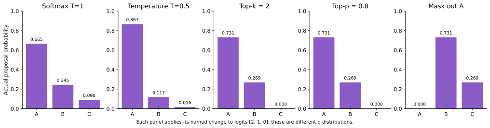

<!-- runnable: processors -->
```python
import numpy as np
from examples.principle_lab import processed_distribution
q = processed_distribution(np.log([.5,.3,.2]), top_p=.6)
print(q)  # [0.625, 0.375, 0.0]：A 单独未达 .6，必须保留 B
np.testing.assert_allclose(q, [.625,.375,0])
masked = processed_distribution([2,1,0], top_k=1, allowed=[False,True,True])
assert masked.tolist() == [0,1,0]
```

如果从这里的 q 抽样，却把处理前的 `[.5,.3,.2]` 交给验证器，接受质量不再是证明中的 $q(v)a(v)$，所以正残差也无法补对。

<a id="s4-3"></a>
### 4.3 逐位置处理器与 grammar 状态

目标 $p_i$ 要等于正常目标解码在 $s,y_{<i}$ 上应用 temperature、top-p、top-k、repetition penalty、grammar 等后的分布。不能让整块都使用块开始时的惩罚状态。

目标和草稿可使用不同的温度或截断，只要分别保存真实分布。草稿支撑集外概率为零不妨碍残差恢复；给概率统一加 epsilon 然后宣称仍严格精确则没有依据。

假设规则禁止重复 token，前缀中只有 A：第一位置 B 合法。若草稿第一项是 B，第二位置的合法集合必须排除 A、B；若所有行都使用块开始时的历史，只排除 A，就改变了第二位置目标分布。

```python
# 结构伪代码：每个目标位置使用对应候选前缀。
for i in range(len(candidates)+1):
    history_i = committed_prefix + candidates[:i]
    p_i = target_processors(logits[i], history_i)
# 拒绝后，processor 的状态也只能对应已提交前缀。
```

有状态 JSON grammar 可能需要复制解析器状态，依次推进候选，失败后恢复。重复惩罚也可能定义在 logits 而非概率上；不得把一种引擎规则随意换成另一个“看起来相近”的公式。

<a id="s4-4"></a>
### 4.4 确定性候选的精确校正

固定提案 $b$ 时：

$$
q(v)=\delta_b(v),\qquad a(b)=p(b),\qquad
r(v)=\begin{cases}0&v=b\\p(v)/(1-p(b))&v\ne b.\end{cases}
$$

对 $p=(0.5,0.3,0.2)$ 固定复制 B，接受率是 0.3，修正分布为 $(5/7,0,2/7)$。这与“计数模型认为 B 的概率是 0.5”没有直接关系。[vLLM 采样源码](https://github.com/vllm-project/vllm/blob/main/vllm/v1/sample/rejection_sampler.py) 的无草稿概率路径也按确定性候选处理；本项目在 [verify_copied_tokens](../examples/ngram_speculation.py) 中显式构造 one-hot $q$。

**自检。** 一个确定性选择器输出 B，但它的内部得分为 0.5，验证时 $q(B)$ 是多少？若整个输入状态固定且选择确定，答案是 1，而不是内部得分。

<a id="s4-5"></a>
### 4.5 选择器如何改变提案分布

一个模型给 A/B 各 0.5，如果实际做两次独立抽样并“只要出现 A 就选 A”，最终 $q'(A)=1-(1-.5)^2=.75$。模型原 softmax 是 0.5，但程序的提案已经是 0.75。beam、best-of-N、rerank 和树剪枝都可能有类似改变。

先从多个生成器各抽一批再择优，同样会引入样本依赖选择。原始分量概率通常不再适用；必须描述选择后的提案程序。动态长度也有类似风险，见[第 11 章](#s11)。

<a id="s4-6"></a>
### 4.6 混合草稿的两种一致构造

可以先根据已知前缀选定一个生成器，再对它完整校正。也可以定义混合提案：

$$
q_{mix}=\lambda(s)q_{lookup}+(1-\lambda(s))q_{neural}.
$$

若先随机选分量 $Z$ 再抽单个候选，可按混合 $q_{mix}$ 校正；也可条件于 $Z$，用该分量的 $q_Z$ 完整校正。后者是多个输出均为 $p$ 的算法的混合。接受比与残差必须使用同一种解释。

条件于分量分别校正的前提，是给定分量后目标仍为同一个 p。若先看候选再选择分量，原始混合证明通常不再成立。下一步要区分每个位置重新选分量，与整个块共享同一个分量。

<a id="s4-7"></a>
### 4.7 共享潜变量：固定分量后的完整校正

设目标每个位置独立均匀：$p(A)=p(B)=1/2$。草稿先等概率抽取一个 $Z\in\{0,1\}$，整块共用这个 Z；给定 Z 后，两槽独立：

$$
q_0=(9/10,1/10),\qquad q_1=(1/10,9/10).
$$

每个槽位的无条件边缘确实都是 $(1/2,1/2)$。但草稿联合分布为：

| 草稿块 | AA | AB | BA | BB |
|---|---:|---:|---:|---:|
| $Q(Y_1,Y_2)$ | $41/100$ | $9/100$ | $9/100$ | $41/100$ |
| 目标两 token 分布 | $1/4$ | $1/4$ | $1/4$ | $1/4$ |

共享 Z 产生相关性；忽略 Z 的槽位独立性不成立。

条件于 Z，每个位置的提案分布都可直接读取。对该分量分别进行接受与残差修正，下一输出恢复为 $p$；后续如果同轮继续，仍在同一个 Z 下使用正确 q。完整续写分布对每个 Z 均为目标分布，对 Z 混合后仍为目标。

这个例子中两分量均有 $\alpha=3/5$，两候选的期望接受数为

$$
\mathbb E[A]=\frac35+\left(\frac35\right)^2=\frac{24}{25}.
$$

这一构造实现简单，尤其适合“给定噪声容易读取概率，但把噪声积分掉很困难”的提案。它并不自动保证最佳接受长度。

<a id="s4-8"></a>
### 4.8 消去潜变量：随候选前缀更新的 Bayes 混合

若不对 Z 条件化，必须使用联合 Q 的链式分解。对一般依赖前缀的分量模型：

$$
q_i(v\mid s,y_{<i})=\sum_z w_i(z)q_{z,i}(v\mid s,y_{<i}),
$$

$$
w_i(z)=P(z\mid s,y_{<i})
=\frac{P(z\mid s)\prod_{j<i}q_{z,j}(y_j\mid s,y_{<j})}
{\sum_{z'}P(z'\mid s)\prod_{j<i}q_{z',j}(y_j\mid s,y_{<j})}.
$$

这里 $w_i$ 是观察**候选前缀**后的 Bayes 后验，不能每一步都沿用块开始时的固定权重。在当前 iid 槽位例子中，$q_{z,j}$ 不随前缀或位置改变，乘积简化成 $\prod_{j<i}q_z(y_j)$。

第一候选的 q 等于 p，必然接受。观察 $Y_1=A$ 后：

$$
\Pr(Z=0\mid Y_1=A)=9/10,\quad
q_2(A\mid A)=(9/10)^2+(1/10)^2=41/50.
$$

于是第二位置重叠为 $\min(1/2,41/50)+\min(1/2,9/50)=17/25$，期望接受数为

$$
\mathbb E[A]=1+17/25=42/25.
$$

<!-- runnable: exactness_bayes -->
```python
from fractions import Fraction as F
from examples.exactness_lab import mixture_conditional
parts = ((F(9,10), F(1,10)), (F(1,10), F(9,10)))
posterior, q2 = mixture_conditional(parts, (F(1,2),)*2, (0,))
assert posterior == (F(9,10), F(1,10))
assert q2 == (F(41,50), F(9,50))
print(posterior, q2)
```

单位置上，$\min(p,\cdot)$ 的凹性给出

$$
\sum_v\min\left(p(v),\sum_z w_zq_z(v)\right)
\ge\sum_z w_z\sum_v\min(p(v),q_z(v)).
$$

这解释了边缘化为什么可能获得更大的局部重叠。但是后验计算、多个分量求值及不同的存活前缀分布都有成本；这个单步不等式不能直接证明任意多步方案的墙钟性能排序。

<a id="s4-9"></a>
### 4.9 错误边缘校正：单 token 正确而联合分布错误

如果两槽都用 $(1/2,1/2)$ 验证，验证器会“全部接受”，错误相关性原封不动地进入输出。最迷惑的一点是：每个位置的 token 直方图仍然完全正确。

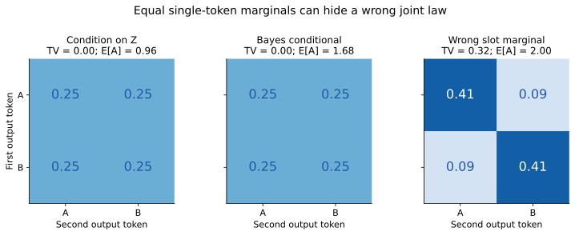

图中分布是每轮生成后补齐到三 token，再边缘化得到的前两 token 分布；不是把长短不一的接受片段混在一起。

<!-- runnable: exactness_latent_joint -->
```python
from fractions import Fraction as F
from itertools import product
from examples.exactness_lab import latent_block_experiment, tv
target = {s: F(1,8) for s in product(range(2), repeat=3)}
for mode in ('component', 'posterior', 'wrong_marginal'):
    law, accepted = latent_block_experiment(mode)
    print(mode, 'TV =', tv(law, target), 'E[A] =', accepted)
    if mode != 'wrong_marginal':
        assert law == target
    else:
        assert tv(law, target) == F(8,25)
```

这一结论适用于明确的潜变量生成程序。若先生成多个 Z 对应的块再择优，选择过程又会改变 Q，不能继续直接使用上述两个未包含选择事件的概率解释。

<a id="s4-10"></a>
### 4.10 跨 tokenizer 的概率空间与状态边界

相同词表大小不代表同一概率空间；应检查 token→ID 映射、normalization、特殊 token、chat template 和编码方式。本仓库 HF 示例检查映射、特殊 token ID 和当前提示的编码相等；有限提示检查仍不能证明所有文本上的 tokenizer 等价，因此要求已知兼容的模型对。

[Universal Assisted Generation](https://huggingface.co/blog/universal_assisted_generation) 通过文本解码／重编码与上下文对齐连接不同 tokenizer；[vLLM 的 Token-Level Intersection](https://docs.vllm.ai/en/latest/features/speculative_decoding/#cross-vocabulary-draft-models-tli) 使用可映射 token 交集。两者的候选处理、概率支持和回滚成本不同，不能当作同一个开关。实际随机模式是否可用应以指定版本为准。

假设目标把 `unhappy` 切成 `[un,happy]`，草稿切成 `[unh,appy]`。它们描述同一文本，但“第一个 token”不在同一事件空间：`P_target(un)` 与 `P_draft(unh)` 不能直接相除。文本转码需要找到一致的已确认边界，并回退可能被重新切分的尾部 token 与缓存。

因此跨 tokenizer 的解码／重编码既是成本问题，也是概率空间和状态对齐问题。词表交集路线避免部分文本重新切分，但可能牺牲覆盖；其概率保证依赖实际映射和提案方式。本教程不把示意映射当作通用 UAG 随机采样实现。

<a id="s4-11"></a>
### 4.11 近似放在哪里，决定保持哪个目标

| 实现改动 | 可以保持相对什么分布精确？ | 必须满足的条件 |
|---|---|---|
| 草稿量化、剪枝、减少层数 | 原目标 p | 从修改后的实际 q 抽样，验证使用同一个 q |
| 保存草稿概率时做近似，抽样仍用原 q | 一般不能直接声称精确 | 分析保存分布与实际抽样分布的差异 |
| 目标量化 | 量化后目标 $\tilde p$ | 不能将其自动称为相对原全精度 p 无损 |
| 对残差加 epsilon 或零残差回退 p | 需要单独界定误差 | 修正核已经被改变 |
| 只改变目标 forward 的并行方式 | 数学模型中的 p | 实际浮点路径还需验证数值偏差与 argmax 边界 |

<a id="s4-12"></a>
### 4.12 保存的提案概率不准确：单步 TV 收缩界

设实际抽样分布是 q，但校正器使用保存分布 $\tilde q$，并按它正确构造 $K_{p,\tilde q}$。因为 $\tilde qK_{p,\tilde q}=p$，随机转移核的 TV 收缩性给出

$$
\operatorname{TV}(qK_{p,\tilde q},p)
=\operatorname{TV}(qK_{p,\tilde q},\tilde qK_{p,\tilde q})
\le\operatorname{TV}(q,\tilde q).
$$

可直接展开证明：

$$
\frac12\sum_x\left|\sum_y(q(y)-\tilde q(y))K(y,x)\right|
\le\frac12\sum_y|q(y)-\tilde q(y)|\underbrace{\sum_xK(y,x)}_{1}.
$$

核必须在实际可能抽到的所有 y 上有合法定义；若校正器遇到 $\tilde q(y)=0$ 直接报错，就不能拿“数学补全后的核”替实际程序声称这个保证。若 q 和 $\tilde q$ 支撑一致且保存误差可界定，上式才有直接工程解释。

界可以取等号。取 $p=\tilde q=(1/2,1/2)$，实际 $q=(3/4,1/4)$，校正器认为每项都该通过，输出就还是 q，TV 恰好为 $1/4$。

<!-- runnable: exactness_probability_mismatch -->
```python
from fractions import Fraction as F
from examples.exactness_lab import one_step_law
p = saved_q = (F(1,2), F(1,2))
actual_q = (F(3,4), F(1,4))
output = one_step_law(p, actual_q, saved_q)
assert output == actual_q
assert sum(abs(a-b) for a,b in zip(output,p))/2 == F(1,4)
print(output)
```

如果实现还使用近似核 $\widehat K$、近似目标 $\tilde p$，在相同概率空间和合法核的前提下，可进一步按三角不等式分解：

$$
\operatorname{TV}(q\widehat K,p)
\le\operatorname{TV}(q,\tilde q)
+\sup_y\operatorname{TV}(\widehat K(y,\cdot),K_{\tilde p,\tilde q}(y,\cdot))
+\operatorname{TV}(\tilde p,p).
$$

三项分别对应“实际提案与保存概率不符”“校正与数值采样核有误差”“目标本身改变”。这个界是分析工具；测试没有测出差异，不等于已经给这三项建立了统一上界。

<a id="s4-13"></a>
### 4.13 从单步误差到整条序列的误差界

假设对每个可达的相同输出前缀，第 t 步近似生成的条件分布与目标条件分布 TV 均不超过 $\epsilon_t$。逐步构造最大耦合：只要前面的输出还一致，下一步继续一致的条件概率至少为 $1-\epsilon_t$。于是长度 N 的联合分布满足

$$
\operatorname{TV}(P_{1:N},\widetilde P_{1:N})
\le1-\prod_{t=1}^N(1-\epsilon_t)
\le\sum_{t=1}^N\epsilon_t.
$$

这是**所有相关前缀上都成立的上界**，不能把有限数据上的平均 KL、平均 TV 或平均 logits 误差直接代入。若算法有内部随机状态，需要先对状态正确取条件或边缘化，得到这里的下一输出条件分布。

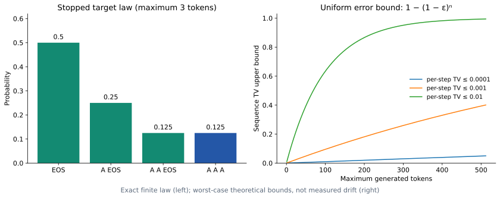

左面板对应[第 2 章](#s2-10)的 EOS 停止分布；右面板对应本节的误差传播界。

右图是最坏情形上界，不是实测偏差。以每步统一界 $\epsilon=0.01$ 为例，N=128 时界约为 0.724；这表示仅凭该局部保证无法推出很小的序列误差，并不声称实际模型的 TV 就达到这个数值。

该界确实能取等号：目标永远输出 A，近似程序每步以 $\epsilon$ 输出 B；“N 个输出里至少出现一个 B”的概率就是 $1-(1-\epsilon)^N$，目标对该事件的概率为零。配套测试精确核算这个反例。

<a id="s4-14"></a>
### 4.14 残差与浮点采样的数值边界

[第 2 章](#s2)已解释 `p(y)/q(y)` 的分支比较为什么能避免比值上溢和 subnormal 乘法边界错误。除接受测试之外，还要区分下面三个数值边界：

1. $p=q$ 时拒绝事件不存在，不应无条件计算零除零残差。
2. 非零残差很小时，归一化会放大相对误差；增加精度与稳定求和有帮助，任意平滑则改变分布。
3. softmax 在低精度下下溢成零时，必须明确比较的是浮点程序产生的概率，还是理想实数模型；二者不能混为一个“严格相等”声明。

本仓库的 Fraction 实验验证代数逻辑，已有 float64 测试覆盖实现边界，两者承担不同职责；它们都不能替代某个 GPU fused sampler 的独立审计。

<a id="s5"></a>
## 5. n-gram、suffix 与检索草稿

第 4 章已经说明确定性复制的点质量提案；本章将它实现为 lookup、n-gram 与检索草稿，并通过第 3 章的目标验证／提交状态机保持正确性。

<a id="s5-1"></a>
### 5.1 查找复制与统计语言模型

推理框架中的 n-gram 常表示 prompt lookup：在当前已提交历史中寻找与末尾相同的片段，再复制已存在的续写。它通常不训练神经网络，也不按计数分布随机采样。

```text
历史：the cat sat on the mat and the cat
末尾：                                the cat
命中：the cat
草稿：        sat on the mat
```

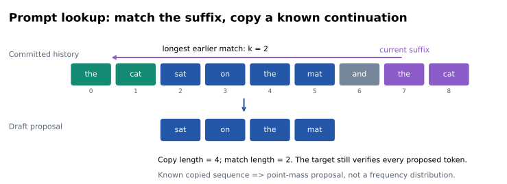

匹配长度 $k$ 和草稿长度 $\gamma$ 是不同参数：匹配两个 token，可以复制四个 token。最长匹配、最近匹配、最早匹配和最高频续写是不同选择策略；它们的成本和覆盖不同，没有通用最优者。

本项目 `prompt_lookup()` 按最长上下文优先，默认最近命中，允许重叠但不读出历史快照边界。扫描切片实现最坏可到 $O(Tk_{max}^2)$；生产中常用哈希、trie、后缀结构或向量化降低查询开销。没有匹配时应走正常目标生成。

<a id="s5-2"></a>
### 5.2 真正的概率 n-gram

统计模型保存 $C(c,v)$，使用条件计数：

$$
q(v\mid c)=\frac{C(c,v)+\beta}{\sum_w C(c,w)+\beta|V|}.
$$

这里 $c$ 是前面若干 token，$\beta\ge0$ 为平滑。最长上下文未见时回退到更短上下文，最终到 unigram；空语料可使用明确的默认分布。两 token 上下文加一个结果通常称 trigram，不能把上下文长度与完整 n-gram 阶数混用。

[CountNGramLM](../examples/ngram_speculation.py) 按文档独立计数，避免前一文档结尾与后一文档开头构成虚假转移。草稿下一步上下文要包含已提出候选；若在线更新计数，验证必须使用采样时那一版 $q$。

在第 2 节例子中，真正从 $q=(0.2,0.5,0.3)$ 抽样的接受率为 0.7，固定取其 argmax B 只有 0.3。这说明随机目标采样下，更贪心的草稿未必接受更多；是否值得保存完整概率还要计入采样与残差成本。

<a id="s5-3"></a>
### 5.3 SuffixDecoding 的价值在索引和任务重复

[SuffixDecoding](https://arxiv.org/html/2411.04975) 用后缀结构保存当前请求和历史输出，结合匹配长度、续写频率和候选预算动态决定猜多远。其典型负载是反复修改、Agent 子任务、自一致采样和重复 rollout，而非任意长输入。

论文区分每请求和全局历史缓存，实验也研究链式与树式候选。**索引是树，不意味着推理验证一定用树。** 本文读取 [vLLM suffix 适配器](https://github.com/vllm-project/vllm/blob/main/vllm/v1/spec_decode/suffix_decoding.py) 确认其调用 Arctic 缓存、追加已提交 token，返回 `draft.token_ids` 候选链；它不是论文所有变体的统一实现。

需要同时记录冷／热缓存、跨请求重复率、索引查询和更新成本、淘汰策略、CPU 内存。共享缓存可能改变提案质量和数据复用范围；概率精确性与缓存隔离是两个独立问题。

<a id="s5-4"></a>
### 5.4 REST、Token Recycling 与 RAG

[REST](https://arxiv.org/html/2311.08252) 从外部 token 数据库检索可能续写，再由目标验证。普通 RAG 把检索内容加入目标提示，改变回答的条件；检索式投机通常只改变候选来源。语义检索召回高，不等于能命中目标将要输出的连续 token。

Token Recycling 等方案复用历史预测及候选结构；prefix caching 复用已知输入的 KV，主要减少 prefill。它们可以与投机组合，但复用对象和收益来源不同。TensorRT-LLM 的 Suffix Automaton 增强也不应直接等同为 Arctic 的后缀树实现。[TensorRT-LLM 官方说明](https://nvidia.github.io/TensorRT-LLM/features/speculative-decoding.html)

<a id="s5-5"></a>
### 5.5 从重复文本到混合路由

固定规则“有可靠 lookup 就复制，否则使用神经草稿”容易解释；复杂混合可让查询长度、重复频次和历史接受率共同决定路线。研究时至少比较：查询本身的成本、无匹配退化、冷启动、长续写浪费、与神经草稿同时计算的额外成本。

在代码编辑或反复修订任务中，这是一条低训练成本的研究路线。它仍需要完整的目标验证和状态恢复，不能凭复制内容来自历史就直接提交。


<a id="s5-6"></a>
### 5.6 lookup 的查询、候选和验证怎样衔接

查找程序只读取**已提交历史快照**。先枚举匹配长度，再枚举历史位置；一旦命中，复制紧随其后的 token，但不能超出快照。下一轮必须重新查询，因为修正 token 可能让后缀发生变化。

<!-- runnable: lookup_components -->
```python
from examples.ngram_speculation import prompt_lookup, CountNGramLM
hit = prompt_lookup([1,2,3,4,1,2], max_context=3, max_draft=2)
assert hit.matched_length == 2
assert hit.candidates == [3,4]
print(hit)
# 同样的上下文，还可以训练真正的概率模型。
lm = CountNGramLM(vocab_size=5, max_context=2, add_k=0).fit(
    [[1,2,3], [1,2,4], [1,2,4]])
q, context = lm.distribution_with_context([1,2])
print(context, q)  # (1,2), [0,0,0,1/3,2/3]
```

第一部分“复制 `[3,4]`”是一条确定性候选链；第二部分 q 是下一个 token 的随机分布。即使它们来自相同语料，也不能把第二部分的频率填进第一部分的验证器。

<a id="s5-7"></a>
### 5.7 计数模型为什么要 backoff 与平滑

长上下文更具体，但样本更少。若查询上下文未出现，回退到短上下文可以获得有效计数；如果所有上下文未见，就需要明确默认分布。加 $\beta$ 平滑把每个 token 看成多出现 $\beta$ 次，避免零概率，但会削弱高频续写的峰值。

平滑的目的不是满足投机正确性的支撑要求。即使 q 只覆盖一个 token，残差也能恢复目标；平滑改变的是候选质量与计算成本。平滑很大时 q 接近均匀，可能更差；不能把“没有零概率”当作“高接受率”。

训练时文档边界独立，避免把 `文档1结尾 → 文档2开头` 当成真实转移。在线缓存则应标明当前请求、共享域及淘汰策略，以免把来自不同条件的数据误当作同一续写机制。

<a id="s5-8"></a>
### 5.8 后缀树、trie、哈希与后缀自动机各解决什么

| 结构 | 简化理解 | 更新／检索代价及取舍 |
|---|---|---|
| 固定 k 的哈希表 | `k-token片段 → 后继位置或计数` | 查询快；多个 k 要维护多个窗口，哈希碰撞需核查 |
| Trie | 相同 token 前缀共享路径 | 容易枚举续写树；大量独特路径会增加节点 |
| 压缩后缀树 | 将整段历史后缀压缩组织 | 支持可变长匹配；实现、更新和内存常数复杂 |
| 后缀自动机 | 把等价子串结束状态合并 | 适合在线子串查询；位置、频率等仍需额外信息 |

这些结构解决“如何快地找到续写”，不决定最终 token 概率。索引中的边频率可以用于确定性排序，也可以用于随机抽样，验证必须跟随实际选择过程。

一种可解释的动态深度策略是 $\gamma=\min(\gamma_{max},\lfloor\rho k\rfloor)$，匹配更长时允许猜更远。它是启发式：重复的长前缀后仍可能出现分叉，最终由目标验证。

<a id="s5-9"></a>
### 5.9 检索草稿为何不等于语义搜索

普通检索希望找“与问题相关的材料”；草稿检索希望找“目标接下来将输出的 token”。一篇语义高度相关的文章可能使用完全不同措辞，导致连续接受长度很短。REST 式实验应测 token 续写命中和验证成本，而不仅是检索召回率。

重复负载中，冷缓存和热缓存反映不同能力：前者考察已有索引覆盖，后者考察历史请求复用。把测试答案预先写进缓存会人为提高命中，不能当作正常在线改进。

<a id="s5-10"></a>
### 5.10 在真实注意力上运行 lookup

<!-- runnable: lookup_transformer -->
```python
import torch
from examples.tiny_transformer import TinyTransformer, lookup_generate, autoregressive_generate

torch.manual_seed(3)
model = TinyTransformer(vocab=3, width=8, heads=2, layers=1).double().eval()
prompt = [0,1,0,1]
output, trace = lookup_generate(model, prompt, max_new_tokens=12, gamma=4)
assert output == autoregressive_generate(model, prompt, 12)
print([(r['proposed'], r['accepted'], r['emitted']) for r in trace[:3]])
```

这里没有预训练文本能力，实验目的仅是检查“历史候选 → 目标批量打分 → 提交 → KV 恢复”的连接。不能据随机模型的命中率判断 lookup 的业务收益。

<a id="s6"></a>
## 6. 独立草稿、多头与 EAGLE

前面的检索草稿从历史中寻找候选；神经草稿则用参数化模型预测未来。本章按可用条件信息、计算图与训练接口解释独立 LM、递归头和 EAGLE，再把模型预测与严格目标验证分开。

<a id="s6-1"></a>
### 6.1 先按条件信息与执行路径比较草稿

记已提交前缀为 $s=x_{1:t}$，本轮草稿为 $y_{1:\gamma}$。目标在第 $i$ 步需要的是

$$
p_i(v)=p(v\mid s,y_{<i}).
$$

记 $g(s)$ 为已算出的目标前缀特征，$a_{<i}$ 为草稿自己的递归状态。草稿可以不读取全部前缀信息，但验证分母必须对应实际生成 $y_i$ 的分布。下表把昂贵主干的执行次数与随机 token 之间的依赖分开：

| 结构 | 实际提案分解 | 依赖在哪里 | 额外代价 |
|---|---|---|---|
| 独立自回归 LM | $\prod_i q_\phi(y_i\mid s,y_{<i})$ | 每步 LM 的 attention/KV | 约 $\gamma$ 次主干和自己的历史状态 |
| EAGLE 式特征自回归 | $\prod_i q_\phi(y_i\mid g(s),a_{<i},y_{<i})$ | 目标特征与草稿递归状态 | 顺序草稿层、目标特征接口 |
| 独立多头／块槽位 | $\prod_i q_{\phi,i}(y_i\mid s)$ | 表示可交流，最终抽样仍独立 | 一次主干，多个词表投影 |
| 条件头 | $q_1(y_1\mid s)\prod_{i>1}q_i(y_i\mid s,y_{i-1})$ | 便宜头读取刚选出的 token | 头、softmax、抽样仍有关键路径 |
| 共享潜变量块 | $\int\prod_iq_i(y_i\mid s,z)\,d\mu(z)$ | 同一随机 $z$ 引入相关性 | 概率校正需条件于固定 $z$，或求真实条件混合 |

表中是用于分析的模型族，不是各论文全部实现合同。EAGLE 与 DSpark 的结构依据分别见 [EAGLE-3 §3](https://arxiv.org/html/2503.01840v2#S3)、[DSpark 的半自回归架构](https://arxiv.org/html/2607.05147)。目标特征是前缀的确定性函数时，读取它不会赋予草稿访问未来的能力；它改变的是相同参数预算下能否有效利用信息。

<a id="s6-2"></a>
### 6.2 独立小模型：计算图、蒸馏与部署成本

独立草稿只读 token 前缀，部署接口相对清晰；代价是第二套权重、KV、prefill 和逐步草稿调用。最好的通用小模型未必是最好的 drafter，应联合比较其目标分布匹配、实际耗时和显存占用。

[DistillSpec](https://arxiv.org/html/2310.08461) 的重要结论是草稿蒸馏必须匹配数据与解码策略，尤其研究草稿 on-policy 数据和不同散度目标。目标生成数据与草稿自己到达的前缀分布不同。论文中结合更换／蒸馏目标或近似接受的结果，不能被记作“原目标下精确投机”的同类收益。

独立 LM 输入 token embedding，通过较少层的 Transformer 得到状态，再输出 $q_\phi$。参数更少通常降低成本，但草稿仍需重新理解前缀、维护自己的 KV、执行词表投影。与目标共享 tokenizer 只保证输出空间相同，不保证分布接近。

蒸馏的软标签 CE 为 $-\sum_v p(v)\log q_\phi(v)$；因为 $p$ 固定，它与前向 KL 只差目标熵常数。硬标签 CE 只提升一个参考 token，软标签则表达目标对多个可行续写的权重。两者可以同时使用，但要区分目标。

```python
# 结构伪代码：teacher 冻结，student 沿指定前缀分布训练。
with torch.no_grad():
    p = teacher(prefix).logits.softmax(-1)
log_q = student(prefix).logits.log_softmax(-1)
loss = -(p * log_q).sum(-1).mean()
loss.backward()
```

训练前缀取自真实语料、目标 rollout 或草稿 rollout，都会改变优化分布；静态验证集困惑度不足以决定部署效果。损失梯度与数据分布的进一步区分见[第 10 章](#s10)。

<a id="s6-3"></a>
### 6.3 Medusa、Hydra 与 ReDrafter：头之间如何传递条件

| 方法 | 候选依赖与结构 | 训练／执行重点 |
|---|---|---|
| Medusa | 多个未来位置头，组合候选树 | 主干冻结与联合微调分开；typical acceptance 单独评价 |
| Hydra | 后部草稿头依赖前序候选 | 用轻量条件依赖改善独立多头 |
| ReDrafter | 目标状态条件化的 RNN 草稿，beam 候选 | 合并重复前缀、动态树 attention、蒸馏 |

[Medusa](https://arxiv.org/html/2401.10774) 的 Medusa-1 冻结目标，Medusa-2 联合训练会改变目标。typical acceptance 依据概率／熵阈值接受“合理”候选，通常不能保证原目标随机分布。主干冻结本身也不足以证明采样精确。

[Hydra](https://arxiv.org/html/2402.05109) 与 [ReDrafter](https://arxiv.org/html/2403.09919) 都在轻量头里引入顺序依赖，但训练配方、候选搜索与后端不同。ReDrafter 的 PyTorch、MLX 或 TensorRT 实现结果应各自对应硬件与运行时，不能拼成统一收益。

Medusa 式多个头可以写成 $q_i=softmax(W_i f_i(h_t))$，每个头预测不同未来位置。因为每个头都只读取当前目标状态，后一个头不知道前一个头最后选了什么。用多个 top-k 分支可以增加覆盖，但节点数很快膨胀。

Hydra 显式将前面候选 token 信息输入后面的头。ReDrafter 用 RNN 状态递推：$a_i=F(a_{i-1},e(y_{i-1}),h_t)$，然后输出 $q_i$；beam 候选的共同前缀合并成树，可以避免重复验证。

```text
独立多头：h_t ─→ head1 ─→ y1
             └→ head2 ─→ y2      y2 不读取实际 y1

递归头：  h_t + state0 ─→ y1 ─→ state1 ─→ y2
                               ↑ 条件依赖
```

提高候选间一致性需要付出顺序头成本。树更宽也增加 KV 与验证量。因此要比较“每轮有效进展／实际成本”，不能只比较草稿 token accuracy。

<a id="s6-4"></a>
### 6.4 EAGLE 三代：特征预测、动态树与自由草稿状态

| 版本 | 主要变化 | 解决的问题 |
|---|---|---|
| EAGLE | 目标高层特征，加已选 token 信息，学习后续特征与 token | 尚未确定 token 时，下一特征有不确定性 |
| EAGLE-2 | 随上下文置信度展开动态候选树 | 静态树预算分配不合理 |
| EAGLE-3 | 多层特征融合，取消特定特征回归约束，training-time test | 表示约束与训练／滚动推理差异 |

[EAGLE](https://arxiv.org/abs/2401.15077)、[EAGLE-2](https://arxiv.org/abs/2406.16858)、[EAGLE-3](https://arxiv.org/html/2503.01840v2)

早期 EAGLE 可抽象为：已知目标状态 $h_{\le t}$ 与已选 token $x_{t+1}$，预测 $\hat h_{t+1}$，再预测更后的 $x_{t+2}$。已选 token 解除“cat 还是 dog”这类分支不确定性；不能把未来真实目标特征偷偷当作推理输入。

EAGLE-3 融合低、中、高层特征：

$$
g_t=W_f[h_t^{low};h_t^{mid};h_t^{high}].
$$

它继续使用目标信息，但草稿状态服务于 token 预测，不必复刻目标某一层。训练时让草稿接触自身滚动状态，减少推理时误差累积。这里的“取消特征预测”不等于“不再使用 hidden state”。

<a id="s6-5"></a>
### 6.5 已选 token 为什么能降低下一特征的不确定性

目标已经处理前缀 $s$，有特征 $H_t$；接下来抽到 $X_{t+1}$，再处理它才有 $H_{t+1}$。即使模型本身无 dropout、对固定输入完全确定，$X_{t+1}$ 的随机性仍会让“尚未选词时的下一特征”不确定。

假设用平方误差从 $H_t$ 预测下一特征，最优预测是条件均值：

$$
f^*(H_t)=\mathbb E[H_{t+1}\mid H_t].
$$

把向量条件方差理解为条件协方差的迹，最小风险可分解为

$$
\mathbb E\|H_{t+1}-f(H_t)\|^2
=\mathbb E\operatorname{tr}\operatorname{Cov}(H_{t+1}\mid H_t)
+\mathbb E\|f(H_t)-f^*(H_t)\|^2.
$$

第一项不是增加训练步数就能消掉的拟合误差：相同上下文可能接 “cat” 或 “dog”，对应不同特征。加入实际已选 token 可以减少这种不确定性。这是解释 EAGLE 设计动机的平方损失教学推导，不声称原实现只用 MSE。[EAGLE 原论文](https://arxiv.org/abs/2401.15077)

更精确地说，单个 $H_t$ 未必充分概括目标全部 KV；给定 $H_t,X_{t+1}$ 也未必能恢复唯一未来特征。EAGLE 的实际输入包含特征序列及其上下文结构。不要把“加入 token 消除一个分支不确定性”夸大成“一个 hidden vector 是完整目标状态”。

<a id="s6-6"></a>
### 6.6 对齐目标特征、pending token 与草稿状态

假设目标已处理 `How can`，并采出 anchor `I`，但还没有处理 I。目标特征 $g_{can}$ 描述 `How can`，草稿结合已选的 `e(I)` 产生状态 $a_I$，再预测 `do`。下一步不能使用目标 $g_I$，因为目标尚未验证／处理 I；草稿只能反馈自己的 $a_I$ 并结合 `e(do)`。

这说明三种状态必须区分：已计算的目标状态、已选但未进目标的 token、草稿预测的状态。没有这层区分，很容易把训练时可获得的未来目标特征错误地放进推理输入。

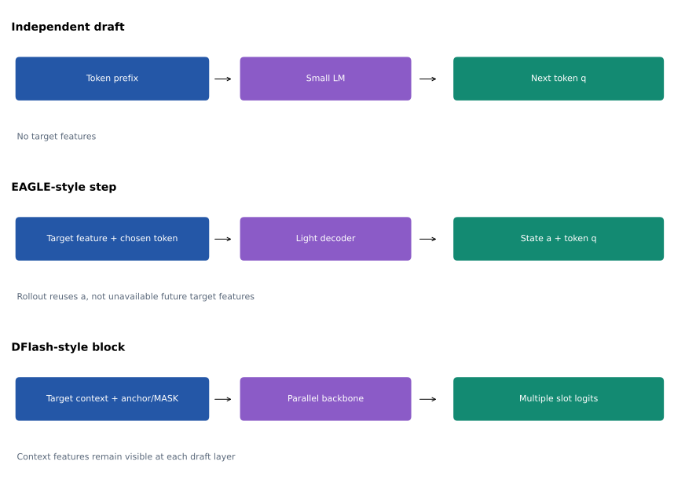

| 时刻 | 已有目标信息 | 草稿可用输入 | 输出 |
|---|---|---|---|
| 目标处理 `How can` 后 | 到 `can` 的特征与 KV | 融合特征 $g_{can}$，已选 anchor `I` | 状态 $a_I$，关于 `do` 的分布 |
| 草稿选 `do` 后 | 目标仍未处理 `I do` | 草稿自己的 $a_I$ 与 `do` embedding | 状态 $a_{do}$，下一词分布 |
| 目标验证后 | 只有保留路径对应有效状态 | 更新到真实已提交前缀的特征 | 下轮 anchor 和草稿上下文 |

这里的 $a_I$ 是“处理 `I` 后用于预测下一词”的草稿状态，不能拿还未计算的目标 $g_I$ 替代。原 EAGLE 还让草稿状态拟合目标特定层；EAGLE-3 去掉这个回归约束，用低／中／高层融合提供输入，把状态容量留给 token 预测。[EAGLE-3 §3.1–3.2](https://arxiv.org/html/2503.01840v2#S3)

<a id="s6-7"></a>
### 6.7 多层融合的张量形状与可运行代码

<!-- runnable: feature_fusion -->
```python
import torch
from torch import nn

torch.manual_seed(1)
B, T, d_target, d_draft = 1, 5, 16, 8
features = [torch.randn(B,T,d_target) for _ in range(3)]
fuse = nn.Linear(3*d_target, d_draft)
g = fuse(torch.cat(features, dim=-1))
embedding = nn.Embedding(20, d_draft)
shifted_ids = torch.tensor([[2,3,4,5,6]])
combine = nn.Linear(2*d_draft, d_draft)
x = combine(torch.cat([g, embedding(shifted_ids)], dim=-1))
assert x.shape == (B,T,d_draft)
print(x.shape)
```

代码只说明拼接、投影和已选 token 对齐；随机参数没有训练，也未包含完整 EAGLE cache、attention 或树搜索。实际模型融合层、特征层号和归一化由 checkpoint 定义。

<a id="s6-8"></a>
### 6.8 training-time test 的状态反馈与分支 mask

普通 teacher forcing 总能拿到目标特征 $g_t$；草稿推理的第二、三步只能拿到自己产生的 $a_t$。如果训练从不使用 $a_t$，后续步会落在训练未覆盖的状态区域。

training-time test 在训练时把输出状态反馈到下一模拟步。但是不同 anchor 的模拟 rollout 是不同分支：`位置1的第二步` 不能看到 `位置2的第二步` 中不属于自己的未来信息。需要为每个模拟分支定义可见历史，而不能把所有 rollout 状态简单拼成长序列套普通下三角 mask。

```python
# 结构伪代码：真实实现还需正确组织 rollout 分支 mask 和监督位置。
state = fused_target_features
loss = 0
for depth in range(training_depth):
    state, logits = draft(state, shifted_tokens[depth], rollout_mask[depth])
    loss += position_weight[depth] * token_loss(logits, labels[depth])
```

HASS 的上下文对齐与此有相关动机，但具体蒸馏目标和特征约束不同，不能因都做 rollout 就视作同一算法。

<a id="s6-9"></a>
### 6.9 特征反馈与离散 token rollout 的监督条件

训练中反馈草稿自己的 hidden state，解决的是**特征状态**偏移；让后续输入 token 真正来自当前草稿，解决的是**离散前缀**偏移。这两者可以分别开关，不能看到一个 `for depth` 就认为训练已经完整 on-policy。至少应记录：

| 训练维度 | teacher forcing | rollout 方案要写明什么 |
|---|---|---|
| 递归 hidden state | 每步喂目标／参考状态 | 反馈草稿状态；是否跨步保留梯度 |
| 输入 token | 参考轨迹 token | 草稿采样、argmax、参考 token 混合及比例 |
| 监督前缀 | 参考轨迹上的目标分布 | 是否重新查询偏离后的真实目标条件分布 |
| attention 可见性 | 参考序列因果 mask | 每个 anchor 的分支只读祖先与合法历史 |

离散采样不是常规可微运算；“反馈状态可微”不表示“采样 token 的路径可微”。具体训练会选择 stop-gradient、固定采样数据或其他估计器。下方仅给出正确分工的伪代码，不能直接作为 EAGLE 的论文复现：

```python
# 结构伪代码：状态反馈和离散 token 的采样策略分别指定。
state = fuse(target_features_at_anchor)
branch = committed_prefix + [anchor_token]
for depth in range(train_depth):
    state, logits = draft_step(state, branch[-1], legal_branch_mask)
    target_probs = teacher_at_exact_prefix(branch)  # 冻结目标；可离线准备
    loss += loss_at_depth(logits, target_probs)
    chosen = choose_training_token(logits, reference, policy=token_policy)
    branch.append(chosen)
```

如果 `chosen` 已偏离参考轨迹，却继续使用旧参考后缀的 teacher logits，就在不同条件前缀之间偷换了监督目标。DistillSpec 强调数据分布与部署解码策略匹配；不等于任何使用更多 rollout 的配方都会获益。[DistillSpec](https://arxiv.org/html/2310.08461)

<a id="s6-10"></a>
### 6.10 特征接口与候选组织的部署选择

草稿通常绑定目标层选择、hidden size、词表和模型版本。目标升级、量化或微调后，旧草稿即使还能被严格验证，其接受率也可能下降。需要测更新后的分布和缓存接口，而非只看权重能否加载。

EAGLE-3 不要求一定用树。其论文中的单 H100、SGLang v0.4.4、Llama-3.1-8B、batch 64 结果使用长度 3 的链；这说明候选组织属于独立决策。低并发树的最佳配置不能直接移到高并发服务。

<a id="s6-11"></a>
### 6.11 HASS：上下文与蒸馏目标对齐

[HASS](https://arxiv.org/html/2408.15766) 同时处理特征上下文和训练目标与解码需求不一致，包含上下文对齐和重点候选的蒸馏。它与 EAGLE-3 有共同动机，但具体目标和结构不同。

<a id="s6-12"></a>
### 6.12 FR-Spec：词表投影节省与完整目标修正

[FR-Spec](https://arxiv.org/html/2502.14856) 针对大词表中 LM head 的开销，用频率子集压缩草稿输出空间。草稿网络再小，词表投影、softmax 和 top-k 仍可能成为瓶颈。严格验证需要使用子集上实际归一化的 $q$，修正仍允许目标输出子集外 token。共享 LM head 参数并不等于省掉其每次计算。

LM head 的矩阵约为 $|V|\times d$。当草稿层很少但词表十几万时，只投影频率子集 $S$ 能节省的主要是词表侧工作。

省的是草稿投影，不是目标词表计算，也不是验证规则。若频率表与任务域失配，目标常输出的 token 不在 S 中，接受长度下降；目标新增词表或 tokenizer 更新后映射也要重建。

**自检。** 草稿 head 与目标共享参数，为什么仍可能昂贵？共享省的是存储或训练参数，并没有自动省掉每次矩阵乘法、归约和采样。

<a id="s7"></a>
## 7. 自投机、MTP 与 UNO

神经草稿也可以复用目标模型的权重、部分层激活或原生预测头。复用是否成立取决于前缀、层、位置和状态是否一致，本章将每条路线的训练资产与实际执行路径放在一起分析。

<a id="s7-1"></a>
### 7.1 权重、激活与状态：复用对象先分清

| 路线 | 复用对象 | 不能直接假定复用的对象 |
|---|---|---|
| 跳层草稿 | 目标的一部分权重 | 跳层后状态与完整目标状态通常不同 |
| LayerSkip | 前层权重、前层激活与相同前缀 KV | 验证后层仍需计算；拒绝后状态仍需修复 |
| 原生 MTP | 目标训练出的附加模块、部分 embedding／head／状态 | 所有深度预测不一定可并行，依具体结构 |
| UNO | 同一主干与内部适配器路由 | 草稿行与验证行不能混用适配器状态 |

自投机不是“所有模型只跑半层就无损”。必须让完整目标最后决定提交，并处理不同层在不同时刻推进的缓存。

<a id="s7-2"></a>
### 7.2 跳层与 LayerSkip 的早退计算模型

[Draft & Verify](https://arxiv.org/abs/2309.08168) 用跳过部分层的目标提出草稿，再用完整模型验证。跳层改变后续 hidden state，所以共享权重不意味着草稿 KV 可直接用作完整目标 KV。

[LayerSkip](https://arxiv.org/html/2404.16710v3) 配合层 dropout 和早退监督，使前若干层可解码；草稿运行前层，验证复用前层激活并执行后层。其成本更接近：

$$
T_{round}\approx\gamma T_{early,1}+T_{late,verify}(\gamma)+T_{sync}.
$$

这要求早期层计算、位置与状态一致。任意普通 checkpoint 不能仅指定一个早退层号就获得相同效果；精确性相对于训练后的完整 LayerSkip 模型。[HF 自投机说明](https://huggingface.co/blog/layerskip)

<a id="s7-3"></a>
### 7.3 LayerSkip 前层激活复用的独立验证

对一组已经知道的 token，可以先逐 token 运行前 E 层、缓存其 KV 并保存输出激活；再一次把这些激活送入后 L−E 层。只要早层计算与完整目标一致，这与完整因果前向相同。

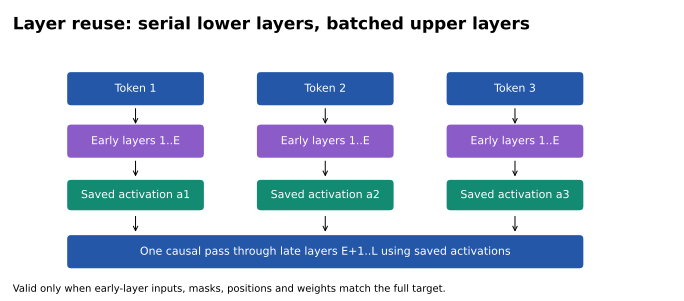

<!-- runnable: layer_reuse -->
```python
import torch
from examples.tiny_transformer import TinyTransformer, token_tensor
from examples.principle_lab import split_layers_forward

torch.manual_seed(5)
model = TinyTransformer(width=8, heads=2, layers=3).double().eval()
ids = [1,2,3,4]
with torch.inference_mode():
    full, _ = model(token_tensor(ids, model))
    reused = split_layers_forward(model, ids, early_layers=1)
torch.testing.assert_close(full, reused, atol=1e-12, rtol=1e-12)
```

这个实验验证**计算复用的恒等关系**，没有证明随机普通模型的中间层能提出高质量草稿。LayerSkip 的早退训练正是为解决中间层直接解码质量不足。

<a id="s7-4"></a>
### 7.4 MTP 的训练结构与可部署资产

[多 token 预测论文](https://arxiv.org/html/2404.19737) 在共享主干上设置未来位置头，研究训练效率与能力；[DeepSeek-V3](https://arxiv.org/html/2412.19437v2) 的 MTP 则沿预测深度串接模块，加入对应 token embedding：

$$
\tilde h_i^k=M_k[\operatorname{RMSNorm}(h_i^{k-1});\operatorname{RMSNorm}(e(t_{i+k}))],
\quad h_{1:T-k}^k=\operatorname{TRM}_k(\tilde h_{1:T-k}^k).
$$

预测深度之间有依赖，不能统称为完全并行。训练时存在未来标签，推理时必须输入实际已选择 token；目标仍负责验证。检查 checkpoint 是否含可用头、引擎可否加载、共享哪些状态，以及多步递归的接受率。

MTP 资产可能与目标一起发布，也可能单独打包为 assistant checkpoint。文件独立并不能证明它是通用独立 LM；例如所阅 vLLM 文档把特定 Gemma assistant 作为 MTP 处理。[vLLM MTP](https://docs.vllm.ai/en/latest/features/speculative_decoding/mtp/)

<a id="s7-5"></a>
### 7.5 MTP 递归条件对齐与 FastMTP 多步训练

普通未来头可从同一状态分别预测 $t+1,t+2$；DeepSeek 式模块将上一深度状态和对应 token embedding 结合，再运行下一深度模块。因此目标训练时给出的 token 条件、推理时草稿选出的 token 条件必须对齐。

```python
# 结构伪代码：训练使用对齐标签；推理使用实际选中的 token。
state = target_hidden
for depth in range(mtp_depth):
    state = mtp_block[depth](merge(norm(state), norm(embed(chosen_token))))
    q = lm_head(state).softmax(-1)
    chosen_token = sample(q)
```

单个原生头可能只在一步条件下训练，递归时会接触自身误差状态。

[FastMTP](https://arxiv.org/html/2509.18362) 对共享权重的单 MTP 头做多步训练，使用目标自生成数据并结合语言相关词表压缩。原生头训练一步好，并不意味着递归后续位置也好；应先测一个候选，再增加深度。

论文表格同时显示：词表压缩可能略降接受长度，却提高速度。这正好说明优化目标不是单独最大化接受率。其报告的平均 2.03× 有明确模型和硬件条件，百分比描述存在算术冲突，见第 18 节。

<a id="s7-6"></a>
### 7.6 UNO：扩散参数、目标定义与特定验证路径

[UNO](https://arxiv.org/abs/2609.04010) 提出 diffusion-augmented LLM：保留 AR 参数，增加轻量扩散参数，并定义 Ψ-Spec 采样家族。SGLang 的集成按 token 行路由内部 LoRA：噪声草稿行使用适配器，seed、prefill 和验证行采用目标参数。

它共享同一主干，但仍有专门训练资产、状态和验证构造；不能把 LoRA 全程开启。Ψ-Spec 一般族应按其路径与采样构造核对；其中论文 §4.2 的单步线性路径明确归约到固定槽位提案上的标准投机拒绝校正，而树路径仍需另外核对多候选验证。[论文 §4.2](https://arxiv.org/pdf/2609.04010)

所阅官方文档的集成限制包括 CUDA／FA3、TP=PP=1、无 DP attention／context parallelism，并由 UNO 自行处理随机验证。[SGLang UNO](https://docs.sglang.io/advanced_features/speculative_decoding.html#uno-decoding)

<a id="s7-7"></a>
### 7.7 UNO 行级 LoRA 路由与缓存状态隔离

将一个基线线性层写为 $Wx$，LoRA 可写为 $Wx+BAx$。UNO 风格的路由可以直观表示为：

$$
y=Wx+m_{row}BAx,
$$

草稿噪声行 $m_{row}=1$，目标验证行 $m_{row}=0$。这只是单层的路由示意，完整 UNO 还有扩散训练与 Ψ-Spec 采样结构。

<!-- runnable: row_lora -->
```python
import torch

torch.manual_seed(6)
x = torch.randn(4,8)
W, A, B = torch.randn(8,8), torch.randn(2,8), torch.randn(8,2)
is_draft = torch.tensor([0.,1.,1.,0.])[:,None]
base = x @ W.T
routed = base + is_draft * ((x @ A.T) @ B.T)
torch.testing.assert_close(routed[[0,3]], base[[0,3]])
```

如果验证行读取了由错误适配器路径产生的缓存，即使当前行关闭 LoRA，也不一定等于基线目标。因此复用同一权重与复用同一状态是两件事，具体采样合同需按原方法处理。

**自检。** “只增加少量可训练参数”能否推出“每轮额外算力很少”？不能，新增参数可能触发整套主干额外运行，实际成本要看计算图。

<a id="s8"></a>
## 8. 并行与半自回归草稿

自回归草稿的顺序主干有时成为瓶颈。并行方法先批量产生状态，再决定怎样连接各位置的随机 token；本章从联合概率出发，分析并行主干、训练 mask、低秩条件头和候选格各自改变什么。

<a id="s8-1"></a>
### 8.1 昂贵主干并行不等于 token 抽样相互独立

自回归草稿要运行约 $\gamma$ 次主干；并行草稿一次输出多个位置。在网络对固定前缀确定、没有未条件化的共享随机变量、且最终各槽独立抽样时：

$$
Q(y_{1:\gamma}\mid s)=\prod_i q_i(y_i\mid s).
$$

即使 hidden states 在块内互相 attention，独立抽样仍没有使用先前实际抽到的 token；两槽情况下可写为 $Y_1\perp Y_2\mid s$。可能出现各槽位分别合理、拼起来不一致的结果，如 `two cat is`。改进方向是保留昂贵主干并行，用便宜的条件头协调实际 token。

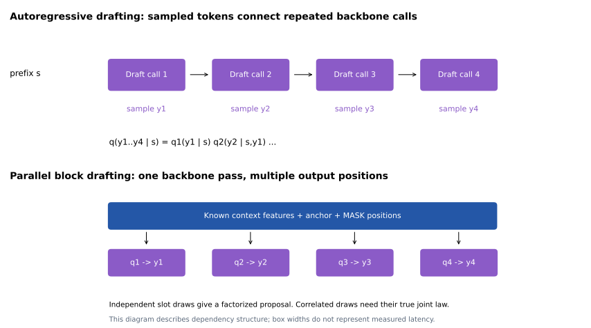

判断的关键是选出 $Y_1$ 后，生成 $Y_2$ 的分布是否随实际 $Y_1$ 改变。共享随机变量还可以在边缘上引入相关性；此时给定该变量的独立性不等于只给定前缀的独立性，真实条件 q 的构造见[第 4 章](#s4)。

<a id="s8-2"></a>
### 8.2 边缘正确仍可联合错误：整块重叠的反例

考虑两 token 的目标：只允许 `a cat` 与 `two cats`，概率各 0.5。第一个位置边缘是 a/two 各 0.5，第二位置边缘是 cat/cats 各 0.5。独立按这两个边缘抽样，会产生四种组合各 0.25，其中一半是 `a cats` 或 `two cat`。

因此“每个位置分布都学对了”不代表联合分布学对了。并行网络的各位置 hidden state 可以互相交流，但在最终抽样时如果没有依据已抽到 token 条件化，仍可能得到独立联合分布。

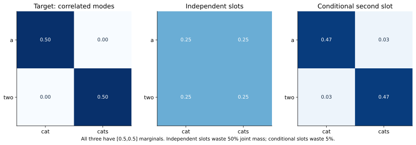

<!-- runnable: joint_dependence -->
```python
import numpy as np
from examples.principle_lab import factorized_joint, conditional_joint, joint_divergences
p = np.diag([.5,.5])
independent = factorized_joint([.5,.5], [.5,.5])
conditional = conditional_joint([.5,.5], [[.95,.05],[.05,.95]])
assert joint_divergences(p, independent)['overlap'] == .5
assert abs(joint_divergences(p, conditional)['overlap'] - .95) < 1e-12
print(independent, conditional)
```

这里的 0.5 和 0.95 是**整块联合分布的重叠**，不能直接当作任意单链验证器的平均每位置接受率。例子只隔离候选依赖问题；真实成本与验证仍需分别分析。

<a id="s8-3"></a>
### 8.3 从联合依赖到接受长度与成本上限

前一例考察整块联合重叠；下面换一个目标分布，直接核算经典单链验证的前缀存活，二者的数值不能互换。

考虑二词表 A/B，目标第一步均匀，第二步以 0.9 概率重复第一词。独立草稿每槽都均匀。两者每个位置的边缘分布完全相同，联合分布却不同：

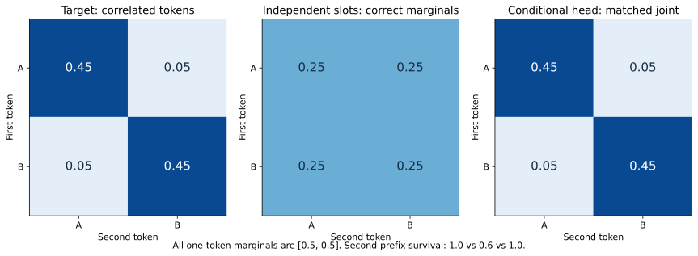

经典验证第一步总能接受。第二步在任一实际前缀下的重叠为 $\min(.9,.5)+\min(.1,.5)=.6$，因此

$$
P(A\ge1)=1,\quad P(A\ge2)=.6,\quad \mathbb E[L]=1+1+.6=2.6.
$$

$A$ 是接受的候选数，$L$ 在无 EOS／输出预算截断时包含 correction 或 bonus。条件头若恢复正确转移，两步都接受，$\mathbb E[L]=3$。这最多允许本例**整轮成本**增加 $3/2.6-1\approx15.38\%$，超过就没有时间收益；不是允许头自身增加 15.38%，因为它只是整轮成本的一部分。

<!-- runnable: training_review_dependence -->
```python
import numpy as np
from examples.training_objectives_lab import two_token_survival

first = np.array([.5, .5])
p_next = np.array([[.9, .1], [.1, .9]])
q_independent = np.full((2, 2), .5)
np.testing.assert_allclose(first @ p_next, first @ q_independent)
s_ind = two_token_survival(first, p_next, first, q_independent)
s_cond = two_token_survival(first, p_next, first, p_next)
np.testing.assert_allclose(s_ind, [1., .6])
np.testing.assert_allclose(s_cond, [1., 1.])
print(1 + s_ind.sum(), 1 + s_cond.sum())  # 2.6, 3.0
```

`first_mass = minimum(p_first, q_first)` 是“第一词取某值且被接受”的**未归一化质量**；再乘相同前缀下的第二步重叠并求和，得到二词前缀存活率。若先把第二步接受率在普通训练前缀上平均，再与第一步平均相乘，通常会丢掉接受事件对前缀分布的选择作用。

<a id="s8-4"></a>
### 8.4 PARD、P-EAGLE 与 Conditional Drop-token

[PARD](https://arxiv.org/abs/2504.18583) 把自回归小 LM 适配成 mask 位置并行预测器，强调同模型家族内复用。COD 的正确名称是 **Conditional Drop-token**，利用合法前缀 KV 结构减少适配训练开销。论文报告的约 3× 是训练效率，不是推理加速。[vLLM PARD](https://docs.vllm.ai/en/latest/features/speculative_decoding/parallel_draft_model/)

[P-EAGLE](https://arxiv.org/html/2602.01469) 使用目标特征和共享可学习状态进行并行多位置预测，同时处理 mask 预计算、序列分段及长上下文训练扩展。它也使用 COD，但不是“把前一步概率分布求期望 embedding”的同义词。公开专题与 README 对 COD 名称、权重可用性仍有冲突；已保存的模型配置明确声明 `PEagleDraftModel`，见第 18 节。

并行预测 K 个深度时，朴素训练为每个原始位置复制 K 个预测位置，总规模约 nK。COD 按深度保留率 $r^d$ 选择训练位置，使总量近似：

$$
N_{positions}=n\sum_{d=0}^{K-1}r^d=n\frac{1-r^K}{1-r}.
$$

此闭式用于 $0\le r<1$；$r=1$ 时不丢弃位置，总量回到 $nK$。这些不是把词表概率变成软 embedding，而是减少训练位置，并维持合法的跨深度条件。若随机删掉依赖所需位置或错误地让后深度可见未来标签，就会破坏训练模拟的推理场景。

P-EAGLE 中，第一个预测位置可以用目标特征，后面缺失的前序状态用共享可学习状态替代，未知 token 用 MASK embedding 替代。模型必须通过位置和 attention 学会区分各深度。共享输入不表示各位置输出相同，因为位置和可见上下文不同。

```python
# 结构示意，省略 mask 的真实跨深度构造。
first_state = projected_target_feature
future_states = shared_state.expand(num_future_slots, -1)
future_tokens = mask_embedding.expand(num_future_slots, -1)
# 之后还要结合位置编码和合法 attention，不能仅靠 expand 预测未来。
```

mask 预计算减少重复构造开销；序列分段减少峰值激活，但分段必须保留跨深度依赖。普通随机 micro-batch 切分不自动保证这一点。

<a id="s8-5"></a>
### 8.5 DFlash：特征上下文、anchor 与两套 mask

[DFlash](https://arxiv.org/html/2602.06036v1) 使用已确认的 anchor 和多个 mask 位置，通过目标多层特征条件化，一次主干前向生成块草稿：

```text
目标上下文特征：g1 … gt
草稿输入：     [anchor, MASK, MASK, MASK]
新候选：                y1,   y2,   y3
目标验证输入： [anchor,   y1,   y2,   y3]
```

目标特征经投影进入草稿各层可读取的 K/V 上下文，不等同于直接复制目标原始 KV。特征可以缓存复用；草稿块内 mask 与目标验证的 causal mask 承担不同职责。

训练在不同位置抽取 anchor，并隔离不同块。目标特征的可见范围必须截止于合法上下文，否则目标自己使用 causal attention 也无法阻止未来特征泄漏。块大小常含 anchor，`block_size=16` 往往对应 15 个新候选，具体仍看模型合同。

“扩散”是草稿结构与训练的设计来源；采样精确性来自相配的目标验证。多轮随机去噪不能未经推导就把最终槽位边缘概率当作经典条件 $q_i$。

草稿训练块中的 MASK 位置可相互读取，因为其输入尚未包含真实未来 token。决定是否泄漏的是这些位置能否读到目标根据真实未来 token 计算出的特征。

目标验证则读取真实候选 token，所以必须使用 causal mask。草稿双向块输入与目标严格因果验证不是矛盾：它们可访问的信息对象不同。

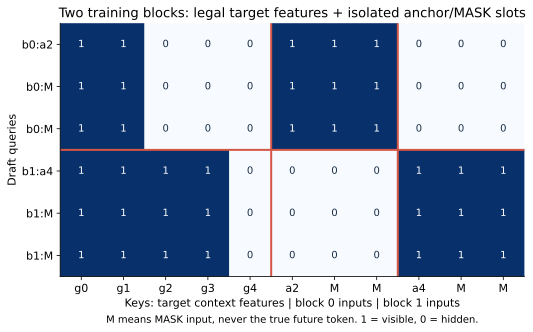

<!-- runnable: block_mask -->
```python
from examples.principle_lab import block_context_mask
mask = block_context_mask(context_length=5, anchors=[2,4], block_size=3)
# 列：g0..g4 | anchor2,MASK,MASK | anchor4,MASK,MASK
assert mask[:3,:2].all()       # anchor=2 的块可读 g0,g1
assert not mask[:3,2:5].any()  # 不能读未来目标特征
assert mask[:3,5:8].all()      # 可读自己块的 MASK 输入
assert not mask[:3,8:].any()  # 不能串到另一训练块
print(mask.astype(int))
```

实际 DFlash 的特征选择、投影、缓存和多 anchor 组织按模型实现；这里固定一个清晰的“目标特征截止于 anchor 之前”的约定，展示如何检测泄漏。

<a id="s8-6"></a>
### 8.6 Domino 与 DSpark：把顺序依赖留在轻量头

[Domino](https://arxiv.org/html/2605.29707) 在并行主干后增加递归修正头，将昂贵的状态计算与 token 条件依赖解耦。

[DSpark](https://arxiv.org/html/2607.05147) 的默认 Markov 头让并行产生的基座 logits 接收前一实际 token 的低秩转移偏置，RNN 变体则可携带更长历史。DSpark 还训练置信头并按硬件成本分配验证预算，故其完整系统收益不能全部归因于 Markov 头。

理论调度与生产异步调度不同，尤其要检查当前随机候选是否影响自身准入。论文的生产报告是作者在特定系统中的证据，非本仓库独立复现，见第 11、14 节。

<a id="s8-7"></a>
### 8.7 低秩 Markov 头：参数、运算与实际 q

令并行主干产生 $\ell_i\in\mathbb R^{V}$。一阶条件头可写为

$$
q_i(v\mid s,y_{i-1})
=\operatorname{softmax}_v\left(\ell_i(v;s)+U[y_{i-1}]^\top W[v]\right),
\qquad U,W\in\mathbb R^{V\times r}.
$$

完整转移表有 $V^2$ 个参数，低秩分解约 $2Vr$。已选前驱后只取 $U[y_{i-1}]$ 一行，再与全部输出向量计算偏置，每步约 $O(Vr)$。目标或基座词表投影的 $O(dV)$ 仍可能存在；小 rank 没有消除 softmax、归约、抽样或跨卡同步。DSpark 使用这类低秩 Markov 头，论文还包含 RNN 变体与置信调度。[DSpark 架构部分](https://arxiv.org/html/2607.05147)

<!-- runnable: markov_head -->
```python
import torch

torch.manual_seed(7)
vocab, rank, slots = 6, 2, 3
base_logits = torch.randn(slots, vocab)  # 昂贵主干可一次产生
U, V = torch.randn(vocab,rank), torch.randn(vocab,rank)
previous = 0
chosen, actual_q = [], []
for i in range(slots):
    q = (base_logits[i] + U[previous] @ V.T).softmax(-1)
    previous = int(torch.multinomial(q,1))
    chosen.append(previous)
    actual_q.append(q)  # 必须保存用来抽出当前 token 的条件分布
assert len(chosen) == slots
```

代码中的 `V` 对应公式中的后继矩阵 $W$；批处理时，主干 logits 为 `[B, gamma, V]`，选定前驱后的转移偏置为 `[B, V]`，每步保存加入偏置并经过实际处理后的 q。这里 $i+1$ 的 `U[previous]` 必须等 $i$ 的 token 出来，轻量阶段仍串行。可以预先计算候选格全部边得分，再顺序选路径，但格是另一个提案机制：截断 top-k、局部归一化、随机选路径都会改变 $q$。全局最高分路径也不必最大化首段存活，因为后部得分不能补偿第一处拒绝后被丢弃的工作。[LiLiCorr](https://arxiv.org/html/2608.20530)

这段随机参数实验只检查条件生成与概率保存的计算顺序。DSpark 的置信头、训练配方和融合实现仍需按其具体模型核对；Domino 的递归头也可以携带超过一个 token 的状态。

<a id="s8-8"></a>
### 8.8 DFlash 2 与 LiLiCorr：候选格和训练合同

[DFlash 2](https://inco.ai/blog/dflash2/) 结合块内局部动态卷积和低秩候选选择器，草稿主干保持并行，候选路径上的轻量选择顺序执行。公开推理合同不等于原始训练配方完整公开：Speculators 明确把自己的 split objective 标记为实验实现，其自由 codebook 参数化也不能直接复现作者所报训练参数量。[训练实现说明](https://docs.vllm.ai/projects/speculators/en/latest/user_guide/algorithms/dflash2/)

[LiLiCorr](https://arxiv.org/html/2608.20530) 先取各位置 top-k 构成候选格，通过轻量网络输出节点 in/out 向量，批量计算相邻候选的兼容性。最终按已选择前驱做局部归一化和条件选择。**它不是默认求整条路径的全局最优解**：论文说明整链最优可能牺牲早期 token 来换后部得分，但首部失败后尾部没有贡献。

候选格中缺失正确 token，选择器无法凭空恢复；训练覆盖前缀、候选召回和评分质量需分别评价。候选格可读取全块候选信息，这与目标验证读取未确认未来 token 是不同问题：前者影响提案，后者会破坏目标条件分布。

vLLM 已区分 greedy 条件路径与 probabilistic 条件抽样，并向 sampler 传递实际提案分布；LiLiCorr 与 block／adaptive verification 的专门端到端验证仍待完成。[vLLM LiLiCorr](https://docs.vllm.ai/en/latest/features/speculative_decoding/lilicorr/)

<a id="s8-9"></a>
### 8.9 候选格的低秩选择器与局部卷积分工

DFlash2 选择器保留每位置少量候选，用前驱、后继与当前 hidden state 的低秩得分协调路径；LiLiCorr 先共同处理候选格，再用 in/out 向量评价相邻组合。共同目标是：避免每个位置都重新跑昂贵主干，同时利用实际前驱约束。

```python
# 结构伪代码：所有配对得分可批量计算，路径选择仍有条件依赖。
scores = pair_scores(candidate_in_vectors, candidate_out_vectors)
previous_index = anchor_index
for slot in range(num_slots):
    conditional_q = softmax(scores[slot, previous_index, :])
    selected_index = sample(conditional_q)
    save_realized_proposal(conditional_q)
    previous_index = selected_index
```

如果确定性 argmax 选路径，真实提案是点质量；如果抽样，验证需要沿实际前驱得到的条件 q。不能继续用选择器之前的原始 DFlash 槽位分布。

局部卷积主要改善每个位置的表示和候选召回；选择器主要解决已有候选如何组合。两者可以互补：如果正确 token 没进 top-k，任何只在候选格上重排的选择器都无法找回它。

<a id="s8-10"></a>
### 8.10 为什么最高整链分数未必最利于投机

假设路径甲前两 token 很可靠，尾部一般；路径乙第一个 token 稍差但后面得分很高。整链得分最大化可能选乙，但第一个 token 拒绝会让后续优势完全作废。经典首拒绝规则更关注前缀生存，而不是所有位置得分总和。

这解释 LiLiCorr 的局部前驱归一化及 oracle-prefix 监督，也解释 D-PACE 为什么从前缀接受代理推导训练权重。方法之间可以分享动机，却仍有不同参数、概率合同和成本。

<a id="s8-11"></a>
### 8.11 统一比较并行与半自回归路线

| 路线 | 目标 hidden state | 主干后的顺序工作 | 主要研究变量 |
|---|---|---|---|
| PARD | 通常不依赖 | 可独立选槽位 | 家族复用、适配训练 |
| P-EAGLE | 使用 | 并行多位置输出 | 特征接口、长序列训练 |
| DFlash | 使用 | 基础路径可独立选择 | anchor、块长、特征 KV |
| Domino | 使用 | RNN 修正 | 递归头成本与依赖 |
| DSpark | 使用 | Markov／RNN 头 | 条件依赖、置信校准、预算 |
| DFlash 2 | 使用 | 小候选集条件选择 | 卷积、选择器、训练合同 |
| LiLiCorr | 使用 | 格评分后的条件路径 | top-k 覆盖、相关评分、局部选择 |

研究“并行”应报告主干调用、head 调用、采样和同步的真实关键路径。它不意味着所有步骤都不再有序列依赖。

**自检。** “主干一次前向”为什么不等于“块生成时间与块长完全无关”？更宽 attention、词表投影、候选格、顺序选择和内存访问都会随块长变化。

<a id="s9"></a>
## 9. 树验证、最优传输与块验证

单链以外的结构需要分别回答三个问题：并行前向是否得到合法路径的目标 logits，验证器怎样提交保持目标分布的输出，以及给定硬件预算应计算哪些候选。树 attention 处理第一项，耦合与目标采样匹配处理第二项，树预算和成本模型处理第三项。块验证则可以保留单链候选，但改变接受事件。

<a id="s9-1"></a>
### 9.1 Tree attention 保证哪些条件 logits

候选树共享公共前缀，节点只能读取公共历史、自身与祖先，不能读取兄弟分支。相同深度通常对应相同逻辑位置，展平存储下标不能直接当作 RoPE position。

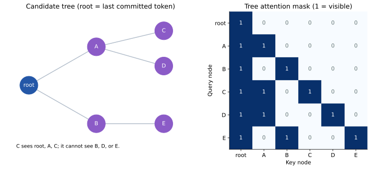

[SpecInfer](https://arxiv.org/html/2305.09781) 将树状候选及其并行验证纳入服务系统。但正确的 tree mask 只保证各节点目标分布正确，路径选择仍需独立证明。对各分支分别做单链概率比、再任意选最长通过路径，会引入选择偏差。

<a id="s9-2"></a>
### 9.2 从 parent 数组到 mask、position 与 KV gather

把树展平成 `parents=[-1,0,0,1,1,2]`：0 是根，1/2 是根的孩子，3/4 属于 1，5 属于 2。节点 4 只能看 0、1、4 及公共历史，不能看下标更小但属于另一分支的 2。

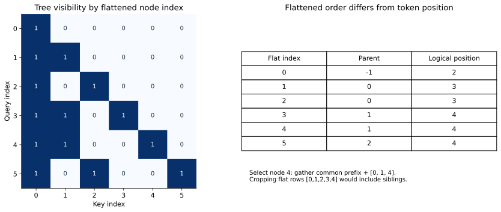

depth 为 `[0,1,1,2,2,2]`，若根位于绝对位置 2，则位置为 `[2,3,3,4,4,4]`。展平下标 4 的位置是 4，但这只是碰巧相同；节点 5 的逻辑位置仍是 4。

<!-- runnable: tree_forward -->
```python
import torch
from examples.tiny_transformer import TinyTransformer, token_tensor
from examples.principle_lab import tree_forward, ancestor_path, gather_tree_cache

torch.manual_seed(9)
model = TinyTransformer(width=8, heads=2, layers=2).double().eval()
prompt, nodes = [1,2,3], [3,4,5,6,7,8]
parents = [-1,0,0,1,1,2]
logits, tree_cache = tree_forward(model, prompt, parents, nodes)
path = ancestor_path(parents, 4)  # [0,1,4]
linear_ids = prompt[:-1] + [nodes[i] for i in path]
with torch.inference_mode():
    serial, _ = model(token_tensor(linear_ids, model))
    torch.testing.assert_close(logits[0,4], serial[0,-1], atol=1e-12, rtol=1e-12)
    cache = gather_tree_cache(tree_cache, len(prompt), parents, 4)
    continued, _ = model(token_tensor([9], model), cache)
    reference, _ = model(token_tensor(linear_ids+[9], model))
    torch.testing.assert_close(continued, reference[:,-1:], atol=1e-12, rtol=1e-12)
```

这个实验真正执行多层树 attention 和路径 KV gather，但尚未实现完整树候选生成与随机树采样器。证明节点 logits 正确，只完成了树推理的一部分。

<a id="s9-3"></a>
### 9.3 目标采样匹配：先证明选路正确

先固定候选树，再用独立于建树随机性的目标采样随机数从根分布抽 z；如果树里有 z 对应孩子，就沿孩子继续抽；若没有，就提交 z 并退出这一轮。每次提交都来自当前真实前缀的目标分布，所以正确性直接成立。树只是提前计算了部分可能用到的概率。

```python
# 结构伪代码：target_probs[node] 必须对应根到 node 的合法路径。
node = root
while True:
    z = sample(target_probs[node])
    emit(z)
    if z == eos or z not in children[node]:
        break
    node = children[node][z]
```

增加分支覆盖可以提高缓存命中，但多节点前向有成本。SpecExec 把这个思想用于目标搬运极昂贵的环境；它不要求把确定性搜索得到的候选树当作“从原 softmax 随机采样”的树。

贪心模式则沿目标 argmax 分支前进。重复 token 的子分支应合并，或采用与实际后续条件一致的处理；节点目标 logits 相同不代表任意后续路径选择都已获得证明。

<a id="s9-4"></a>
### 9.4 SpecTr：候选集合耦合与近似最优接受

单候选最大耦合优化 $\Pr(X=Y)$；多候选集合 $S$ 的问题变成：能否让 $P(X\in S)$ 尽量大，同时目标输出 X 的边缘仍为 p，候选集合 S 仍来自规定的提案过程？SpecTr 将这个问题描述为带 membership cost 的最优传输，候选数量和生成机制都是耦合约束的一部分。

精确最优 transport plan 的直接求解随候选数变得昂贵；论文给出有近似最优接受概率保证的有效选择算法。这里的近似指**接受效率没有保证达到全局最大值**，不是允许目标边缘分布发生偏移。最优耦合、求解成本和树规模是三个独立问题。[SpecTr 原文，编号 2310.15141](https://arxiv.org/html/2310.15141)

如果候选生成改成无放回、先重排或另行择优，仍使用针对原独立提案构造的 transport plan，就改变了约束对象。一个没有达到最大 $P(X\in S)$ 的算法可以仍然精确；一个使用错误提案分布的算法则不能靠“近似优化”来解释其分布误差。

<a id="s9-5"></a>
### 9.5 Sequoia：接受模型、树预算与动态规划

Sequoia 在指定的 positional acceptance 假设下，用动态规划搜索预算内使期望提交数最大的树；再结合不同硬件上的草稿／验证成本选择树形。接受向量按子节点排名建模，不是对任意真实上下文都精确成立的事实。

其抽象目标可写为：

$$
\max_{\mathcal T}\ \frac{\sum_{v\in\mathcal T}\Pr(v\text{ 位于有效路径})}{T_d(\mathcal T)+T_v(\mathcal T)}.
$$

论文还通过无放回提案及配套残差更新避免反复提出已失败的高概率 token。不能只把采样改成无放回、仍沿用原有独立提案概率。[Sequoia](https://arxiv.org/html/2402.12374)

教学模型规定：已经走到某节点后，以概率 $b_k$ 进入第 k 个孩子，这些事件互斥，$\sum_k b_k\le1$。根贡献 1 次目标采样机会，分配给孩子 k 的子树预算为 $n_k$，则：

$$
F(n,d)=1+\max_{\sum_k n_k\le n-1}\sum_k b_kF(n_k,d-1),
$$

$n_k=0$ 表示不建该子树，贡献为零；$F(1,d)=F(n,0)=1$。动态规划枚举各孩子分到多少节点，避免枚举每一棵具体树。这是 Sequoia positional acceptance 思路的简化，不含论文所有约束或真实上下文变化。

<!-- runnable: tree_budget -->
```python
from examples.principle_lab import optimal_tree_score
chain = optimal_tree_score([.6], node_budget=4, max_depth=4)
assert abs(chain - (1+.6+.6**2+.6**3)) < 1e-12
wide = optimal_tree_score([.6,.3], node_budget=3, max_depth=1)
assert abs(wide - 1.9) < 1e-12
print(chain, wide)
```

深度成本来自草稿串行展开，宽度成本来自目标验证和 KV。最大期望提交数的树不一定有最大速度；需要把 $F$ 除以实际成本，再在不同预算／深度之间比较。

<a id="s9-6"></a>
### 9.6 SpecExec：把目标计算当作前缀概率缓存

SpecExec 为强烈受参数搬运限制的 offloading 场景构建大规模高概率前缀树，然后从目标分布逐步抽样，命中已计算前缀时复用缓存。候选树是计算计划，不必解释为从神经 softmax 随机抽出的单条草稿。

其树构建与最可能路径搜索有关；目标每轮可能评估大量节点，适用于目标权重搬运极昂贵、额外验证位置相对便宜的设置。论文还讨论在相同随机数流和一致计算条件下的 seed 输出一致性，这强于一般经典投机的分布保证，但不能推广到任意数值后端。[SpecExec](https://arxiv.org/html/2406.02532)

<a id="s9-7"></a>
### 9.7 Block Verification：重设计接受事件与残差

“一次前向算一块”是经典投机已有的执行方式。Block Verification 修改的是**接受事件及修正分布**，不是给同一批前向换名字。

沿草稿链定义本节辅助量 $\rho_i$，避免与目标 $p_i$ 混淆：

$$
\rho_0=1,\qquad
\rho_i=\min\left(1,\rho_{i-1}\frac{p_i(y_i)}{q_i(y_i)}\right),\quad i=1,\ldots,\gamma.
$$

对于 $0\le i<\gamma$，定义下一位置的缩放残差质量：

$$
D_i=\sum_v[\rho_i p_{i+1}(v)-q_{i+1}(v)]_+.
$$

对 $1\le i<\gamma$，前缀测试概率为：

$$
h_i=\frac{D_i}{D_i+1-\rho_i},\qquad h_\gamma=\rho_\gamma.
$$

独立抽取各测试随机数，取**通过测试的最长前缀** $\tau$；若没有则 $\tau=0$。当 $\tau<\gamma$ 时，从

$$
r_\tau(v)=\frac{[\rho_\tau p_{\tau+1}(v)-q_{\tau+1}(v)]_+}{D_\tau}
$$

采一个修正 token；若 $\tau=\gamma$ 则从目标 bonus 分布采样。公式中的零质量与 $0/0$ 边界需要按概率事件处理，不能直接除零；不可达修正分支无须抽样。这些是论文 Algorithm 2、Eq. 4–5 的统一符号表达，本仓库通用 sampler 仍采用经典逐 token 算法。[Block Verification](https://arxiv.org/html/2403.10444)

直观上，较短前缀一次测试失败并不表示已经提交了另一个 token，因此后续较长前缀仍可通过。只删除经典算法中的 `break` 会丢失与这些事件匹配的残差构造。

<a id="s9-8"></a>
### 9.8 块验证的两 token 完整枚举

设每个位置目标 $p=(1/3,2/3)$，草稿 $q=(2/3,1/3)$，$\gamma=2$。四条草稿路径、每个接受事件和修正结果均可枚举：

$\rho_i$ 是沿候选路径递推的前缀保留量；$h_i$ 是算法对长度 i 前缀做独立测试的概率。二者不是同一量，因为最后选择最长通过的前缀，后续较长测试通过也会保留短前缀。

记 token 为 A/B，完整列举两候选：

| 草稿 | $Q(草稿)$ | $\rho_1$ | $\rho_2$ | $h_1$ | $h_2$ | 关键现象 |
|---|---:|---:|---:|---:|---:|---|
| AA | 4/9 | 1/2 | 1/4 | 0 | 1/4 | 一 token 测试不通过，两 token 仍可通过 |
| AB | 2/9 | 1/2 | 1 | 0 | 1 | 整个 AB 总能保留 |
| BA | 2/9 | 1 | 1/2 | 1 | 1/2 | 失败时至少保留 B |
| BB | 1/9 | 1 | 1 | 1 | 1 | 整块通过 |

于是块验证平均接受 $2\times(4/9\times1/4)+2\times2/9+(1.5)\times2/9+2\times1/9=11/9$。经典逐 token 的两个条件接受率均为 2/3，平均候选接受数为 $2/3+4/9=10/9$。

这不是“无视第一次拒绝仍使用错误后缀”。短前缀测试失败时尚未提交另一个 token，块验证保留事件与修正分布是共同设计的。若已经真的提交了不同的修正 token，旧后缀仍然无效。

<!-- runnable: block_enumeration -->
```python
from examples.check_block_derivations import check
r = check()
assert r['token']['expected_accepted'] == '10/9'
assert r['block']['expected_accepted'] == '11/9'
assert r['token']['law'] == r['block']['law']
print(r['token']['expected_emitted'], r['block']['expected_emitted'])
# 19/9 与 20/9：包含 correction/bonus
```

将完整枚举结果汇总：

| 验证器 | 期望接受草稿数 | 含修正／bonus 的期望提交数 |
|---|---:|---:|
| 经典逐 token | $10/9$ | $19/9$ |
| Block Verification | $11/9$ | $20/9$ |

本文用有理数精确计算，再将不足三 token 的输出按目标分布补齐，得到两者完全相同的目标联合分布。结果见[核算 JSON](../data/block_derivation_checks.json)。这是对公式和例子的独立检查，不是生产块验证器或 GPU 加速测试。

论文的最优性有明确限定：沿候选路径可获取的分布、固定外层循环、输出候选前缀再加一个 token 的有效验证器。它不证明所有硬件上墙钟时间最优，也不直接覆盖任意候选树。额外词表规约、概率存储和 kernel 成本仍可能吞掉接受收益。

<a id="s9-9"></a>
### 9.9 Lookahead：固定点候选与最终验证

[Lookahead](https://arxiv.org/html/2402.02057) 从固定点迭代产生候选 n-gram，再用验证分支确认进展。贪心直觉是并行更新 $x_i^{(k+1)}=\operatorname{argmax} p(\cdot\mid s,x_{<i}^{(k)})$；随机精确性需要相应采样构造，不能仅靠 Jacobi 迭代式证明。多 GPU 强扩展数字要与资源变化一起解释。

若目标贪心转移是“下一个 token = 前一个 token 加 1 模 3”，给定起点 0，正确输出应为 1、2、0。Jacobi 更新让所有位置根据上一轮猜测的前驱同时更新，第一轮只保证最前位置正确，随后正确前缀逐步传播。

<!-- runnable: jacobi -->
```python
guess = [0,0,0]
for _ in range(3):
    previous = [0] + guess[:-1]
    guess = [(token+1) % 3 for token in previous]
    print(guess)
assert guess == [1,2,0]
```

这只解释并行迭代的贪心直觉。Lookahead 实际还管理候选 n-gram 与验证分支；随机采样不能从这个确定性迭代式直接推出正确性。

<a id="s9-10"></a>
### 9.10 近似验证与严格分布保证的分界

所阅 vLLM 文档中的 [FLy](https://docs.vllm.ai/en/latest/features/speculative_decoding/fly/) 会在满足熵条件和后续对齐条件时延后原生拒绝，官方明确标注不保持目标分布。这与 Medusa typical acceptance 都应进入“质量—效率折中”实验组，不能混入严格分布一致的结果。官方有限任务质量测量也不构成分布证明。

FLy 或 typical acceptance 主动放松原验证条件，需要独立质量评测，不能引用精确块验证证明。近似作用在提案侧、目标侧还是采样核，会导致不同的分布声明与误差分析，参见[第 4 章](#s4)。

<a id="s10"></a>
## 10. 草稿训练与接受长度目标

模型结构决定提案能够表达哪些条件依赖，训练目标决定有限容量用于拟合哪些误差。本章依次从单步分布、前缀存活走到跨轮收益，并说明每一层代理目标的梯度、数据条件和成本边界。

<a id="s10-1"></a>
### 10.1 目标层次：分布误差、前缀接受与生成时间

经典单步重叠为 $\alpha=1-\operatorname{TV}(p,q)$。因此通用语言模型能力、KL 和 token accuracy 都只是部分代理。前向 KL 有界时，Pinsker 不等式给出：

$$
\alpha\ge1-\sqrt{\tfrac12 D_{KL}(p\Vert q)}.
$$

下界可能很松，也不能预测草稿时间或长前缀存活。实际部署采样若是点质量 argmax，接受目标又与随机提案重叠不同。

训练目标可以依次逼近单 token 分布、连续候选前缀、完整生成轮数和实测时间；越靠后越需要说明状态分布与成本假设。在贪心参考轨迹上，$q_i^*$ 表示草稿给目标 argmax token 的概率，可作为训练代理；随机精确接受率仍取决于全词表重叠 $\sum_v\min(p_i(v),q_i(v))$。

<a id="s10-2"></a>
### 10.2 CE 与前向 KL：梯度、无偏标签和排序反例

固定目标分布 $p$，草稿 $q=\operatorname{softmax}(z)$：

$$
\operatorname{CE}(p,q)=-\sum_vp_v\log q_v
=H(p)+D_{KL}(p\Vert q),\qquad
\frac{\partial\operatorname{CE}}{\partial z_v}=q_v-p_v.
$$

因为 $H(p)$ 不依赖草稿，两者对固定样本的梯度相同。若只抽一个目标 token $X\sim p$，硬标签 CE 的随机梯度 $q-e_X$ 在**同一前缀且按 $p$ 采样**时是该软标签梯度的无偏估计。离线标签来自别的模型、greedy 解码或不同前缀时，这个无偏关系不再自动成立。

有限容量下，较低 KL 不保证较高接受率。下面两份草稿对同一 $p=(.6,.25,.15)$ 的排序正好相反：

| 草稿 | 分布 $q$ | 前向 KL，越小越好 | $\alpha=\sum_v\min(p_v,q_v)$，越大越好 |
|---|---|---:|---:|
| A | $(.33,.36,.31)$ | 0.15865 | 0.73 |
| B | $(.52,.46,.02)$ | 0.23565 | 0.79 |

这不反驳两者在无约束下都于 $q=p$ 取最优，只说明在受限可行集合里不能用一种损失排序替代另一指标。

<!-- runnable: training_gradients -->
```python
import torch
p = torch.tensor([.8,.15,.05], dtype=torch.float64)
z = torch.zeros(3, dtype=torch.float64, requires_grad=True)
q = z.softmax(-1)
kl = (p*(p.log()-z.log_softmax(-1))).sum()
kl.backward()
torch.testing.assert_close(z.grad, q.detach()-p)
print(z.grad)  # A 为负：梯度下降会提升 A 的 logit
```

代码中目标给 A 的质量比草稿大，A 的梯度为负，梯度下降会提升它的 logit。这个局部方向正确，不等于部署时的草稿耗时、接受长度或整体速度已经改善。

<a id="s10-3"></a>
### 10.3 TV 的 softmax 梯度与大词表弱信号

写 $s_v=\operatorname{sign}(q_v-p_v)$，在不等点处链式求导：

$$
\frac{\partial\operatorname{TV}}{\partial z_j}
=\frac12q_j\left(s_j-\sum_vq_vs_v\right).
$$

在相等点应理解为次梯度，不能声称处处可微。直观地，TV 在概率空间主要区分“给多了／给少了”，经 softmax 映射还会乘 $q_j$，初始很小的概率可能造成弱梯度。[LK Losses §4.1](https://arxiv.org/html/2602.23881)

取可完全手算的特例：目标集中在词 $c$，草稿在 $V$ 词上均匀。此时

$$
\operatorname{TV}=1-q_c,\qquad
\nabla_z\operatorname{TV}=q_c(q-e_c)=\frac1V\nabla_z\operatorname{CE}.
$$

这是这个特例的精确恒等式；一般软目标的梯度缩放不会恰好都是 $1/V$。

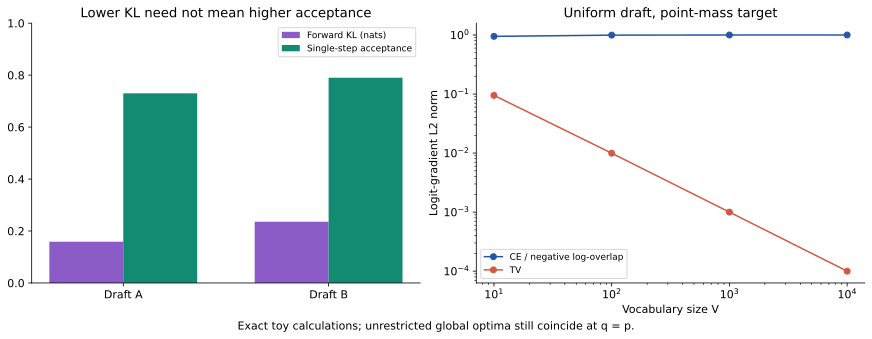

<a id="s10-4"></a>
### 10.4 LK：负对数重叠与自适应 KL／TV 混合

LK 的两条路线应分开介绍。第一条直接优化

$$
\mathcal L_{\log\alpha}=-\log\alpha,
\qquad\alpha=\sum_v\min(p_v,q_v),
\qquad\nabla_z\mathcal L_{\log\alpha}=\frac1\alpha\nabla_z\operatorname{TV}.
$$

当 $p=e_c$，$\alpha=q_c$，它恰好等于普通 CE。第二条将 KL 与 TV 混合，论文采用基于接受率的动态权重，而不只是常数 $\lambda$：

$$
\mathcal L=\lambda D_{KL}(p\Vert q)+(1-\lambda)\operatorname{TV}(p,q),
\qquad\lambda=\exp(-\eta\,\operatorname{stopgrad}(\bar\alpha)),\quad\eta>0.
$$

$\bar\alpha$ 按草稿位置在序列／batch 上汇总；初期低重叠更依赖 KL，后期提高 TV 比重。有限 $\eta$ 下 $\alpha\to1$ 时 $\lambda\to e^{-\eta}$，不严格等于零。负对数目标还要求 $\alpha>0$；截断支持导致零重叠时要明确数值策略。[LK Losses §4.2–4.3，式 4–6](https://arxiv.org/html/2602.23881)

<!-- runnable: training_review_log_overlap -->
```python
import torch

z = torch.zeros(100, dtype=torch.float64, requires_grad=True)
q = z.softmax(-1)
p = torch.zeros_like(q); p[0] = 1
tv = .5 * (p - q).abs().sum()
ce = -z.log_softmax(-1)[0]
negative_log_overlap = -torch.minimum(p, q).sum().log()
g_ce = torch.autograd.grad(ce, z, retain_graph=True)[0]
g_tv = torch.autograd.grad(tv, z, retain_graph=True)[0]
g_overlap = torch.autograd.grad(negative_log_overlap, z)[0]
torch.testing.assert_close(g_tv, g_ce / 100)
torch.testing.assert_close(g_overlap, g_ce)
```

这解释了“直接优化正确指标”也不一定最好训练。实验应控制草稿结构、数据、训练量和推理提案方式，不能用 greedy drafter 的结果直接评价针对随机重叠优化的损失。[LK Losses](https://arxiv.org/html/2602.23881)

<a id="s10-5"></a>
### 10.5 训练温度、部署处理器与实际提案的一致性

若训练用了 $p^{(\tau)},q^{(\tau)}$，部署使用其他温度、top-p 或 greedy，优化的重叠对象就改变了。常见蒸馏中的 $\tau^2\operatorname{CE}$ 缩放也要明确：目标冻结且草稿 logits 先除 $\tau$ 时，对原始 $z$ 的梯度为 $\tau(q^{(\tau)}-p^{(\tau)})$。这条代数公式不意味着高温蒸馏必然提高低温投机接受率。

如果实际候选采用 argmax，$q$ 是点质量而不是 softmax。保留 softmax 作为训练代理合理，验证时沿用该 softmax 充当实际提案概率则是另一回事。

<a id="s10-6"></a>
### 10.6 前缀存活的尾和与 D-PACE 代理

定义 $\alpha_i=P(E_i\mid E_1,\ldots,E_{i-1})$，其中 $E_i$ 是第 i 个候选通过事件，条件中还包括起始前缀／策略。则

$$
\mathbb E[A]=\sum_{k=1}^{\gamma}P(A\ge k)
=\sum_{k=1}^{\gamma}\prod_{i=1}^{k}\alpha_i.
$$

乘积来自概率链式法则，不是“接受事件独立”的假设。若 $\alpha_i$ 是不同数据分布测得的平均值，直接代入不再有这个保证。特别地，较早 token 通过重叠质量 $\min(p,q)$ 被选择，幸存前缀一般不同于普通目标 rollout 前缀。

D-PACE 用草稿在目标参考 token 上的概率 $q_i^*$ 代替难以直接获得的实际接受概率，构造可微代理：

$$
\widetilde S=\sum_{k=1}^{\gamma}P_k,\qquad P_k=\prod_{i=1}^{k}q_i^*.
$$

这里的 $\widetilde S$ 是候选接受数的代理，不含 correction／bonus；它不会因名称带有接受长度就自动等于真实运行时间收益。[D-PACE](https://arxiv.org/abs/2605.18810)

<a id="s10-7"></a>
### 10.7 无平滑 D-PACE：detach 加权 CE 的梯度恒等式

一个位置 j 影响所有长度不小于 j 的前缀，因此

$$
\frac{\partial\widetilde S}{\partial\log q_j^*}=\sum_{k=j}^{\gamma}P_k=:w_j,
\qquad
\nabla\widetilde S=\sum_jw_j\nabla\log q_j^*.
$$

把这个权重停止梯度，定义

$$
\mathcal L_0=-\sum_j\operatorname{stopgrad}(w_j)\log q_j^*,
\qquad\boxed{\nabla\mathcal L_0=-\nabla\widetilde S}.
$$

这是当前前向点上的梯度恒等式，损失数值并不相等。不 detach 会多出 $-\sum_j(\nabla w_j)\log q_j^*$，不再只是原代理的梯度。权重表示“从该位置开始的所有前缀收益之和”，不只是当前位置的预测误差。[D-PACE §3.1–3.2，式 4–6](https://arxiv.org/html/2605.18810)

同一块中的权重仍不递增，因为早位置影响更多前缀；动态性体现在不同样本、不同训练阶段的相对权重变化，而不是后位置一定比前位置更大。

<a id="s10-8"></a>
### 10.8 平滑权重后的优化方向与代码验证

低置信度的早位置可能把所有后续权重压低。D-PACE 在权重中使用 $\widetilde q_i=(1-\epsilon)q_i^*+\epsilon$，但 CE 仍基于未平滑的 $q_i^*$：

$$
\widetilde w_j=\sum_{k=j}^{\gamma}\prod_{i=1}^{k}\widetilde q_i,
\qquad
\mathcal L_\epsilon=-\sum_j\operatorname{stopgrad}(\widetilde w_j)\log q_j^*.
$$

如果真正优化平滑代理 $\widetilde S_\epsilon=\sum_k\prod_{i\le k}\widetilde q_i$，链式求导会额外产生一个因子：

$$
\nabla\widetilde S_\epsilon=
\sum_j\widetilde w_j\underbrace{\frac{(1-\epsilon)q_j^*}{\widetilde q_j}}_{\text{额外链式因子}}\nabla\log q_j^*.
$$

加权 CE 没有该因子，因此 $\epsilon>0$ 时通常既不等于 $-\nabla\widetilde S$，也不等于 $-\nabla\widetilde S_\epsilon$。这是保留原 CE 梯度强度的设计选择，不能再称作“对平滑存活目标的精确梯度”。平滑只参与训练权重，既不修改推理提案的概率，也不替代验证器。[D-PACE §3.3，式 7–9](https://arxiv.org/html/2605.18810)

下面先验证实现产生的梯度确实是 detached 权重乘 CE 梯度，再比较它与两个代理目标的差别。

<!-- runnable: dpace -->
```python
import torch
from examples.principle_lab import dpace_loss
z = torch.tensor([[1.,0.],[0.,.2],[.1,0.]], dtype=torch.float64, requires_grad=True)
labels = torch.tensor([0,1,0])
loss, weights = dpace_loss(z, labels, smoothing=.1)
loss.backward()
expected = weights[:,None]*(z.detach().softmax(-1)-torch.nn.functional.one_hot(labels,2))
torch.testing.assert_close(z.grad, expected)
assert not weights.requires_grad
print(weights)
```

<!-- runnable: training_review_weight_identity -->
```python
from examples.training_objectives_lab import weighted_ce_gradients

plain = weighted_ce_gradients(smoothing=0.)
smooth = weighted_ce_gradients(smoothing=.1)
assert plain['unsmoothed_gradient_max_error'] < 1e-14
assert smooth['unsmoothed_gradient_max_error'] > 1e-3
assert smooth['smoothed_gradient_max_error'] > 1e-3
print(smooth)  # 本例两个最大差值约 0.03241、0.04370
```

实现顺序为 `log_softmax → gather → exp → cumprod → 反向cumsum → detach → 加权CE`。`gather` 只取参考标签概率；完整词表仍通过 softmax 的分母参与梯度。平滑提高有限长度下的权重下界，但 $\epsilon^j$ 仍随深度指数衰减，不能在任意长块上宣称数值上永不下溢。

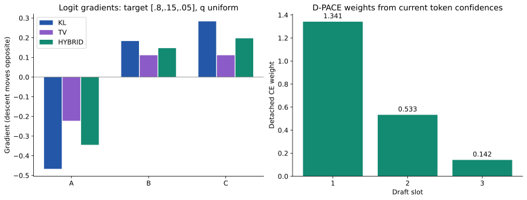

图将概率空间的损失梯度与块内位置权重放在一起：前者影响单步拟合，后者分配多步学习资源，两者都只是完整生成成本的部分代理。

<a id="s10-9"></a>
### 10.9 轮起点会改变后续机会：局部长度与总轮数反例

目标固定生成四词 $x_1,x_2,x_3,x_4$，$x_4$ 是终止 token，每轮最多两候选。草稿在不同 round start 可以不同：从零开始的槽位 2 与重新从 $x_1$ 开始的槽位 1，不必有相同分布。

让两策略只在最初草稿上不同，其余各起点能力相同：从 $x_1$ 起草两个词都正确；从 $x_1x_2$ 或 $x_1x_2x_3$ 起草首词都错。

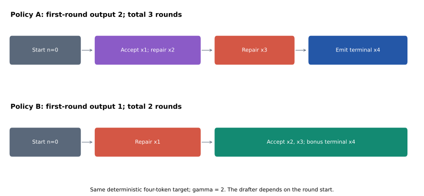

策略 A 首轮接受 $x_1$、拒绝第二候选并修正为 $x_2$，一次输出 2；之后各需一轮产生 $x_3,x_4$，总计 3 轮。策略 B 首轮就拒绝、修正为 $x_1$，只输出 1；下一轮接受 $x_2,x_3$，bonus 生成终止词，总计 2 轮。输出目标完全相同，较低局部进展换到了更有利的未来状态。

这个原创反例不表示应该故意降低接受率，而是说明逐块最优化可以忽略未来访问哪个起点。EDR 将这类跨轮耦合显式写进目标。[EDR §3–4](https://arxiv.org/html/2610.10411)

<!-- runnable: training_review_round_starts -->
```python
import numpy as np
from examples.training_objectives_lab import finite_horizon_rounds

a = np.zeros((4, 2))
a[0] = [1., 0.]  # 首轮接受一词，再修正
a[1] = [1., 1.]  # 如果从 x1 后重启，两个候选都正确
b = a.copy()
b[0] = [0., 1.]  # 首词拒绝，第二个槽位不会到达
assert finite_horizon_rounds(a, 4) == 3
assert finite_horizon_rounds(b, 4) == 2
```

代码中 `value(n)` 是已提交 $n$ 词后剩余轮数期望。`survival` 追踪前面候选全接受的概率；每个首拒绝分支输出 correction 后转到 `n+d+1`，全接受分支输出 bonus 后前进。`n >= length` 的零值处理终止边界，避免 EOS 后凭空再计一轮。这个程序是确定性目标上的有限时域教学计算，完整随机目标还需要对目标轨迹及其条件接受事件积分。

<a id="s10-10"></a>
### 10.10 EDR 的反向条件概率与状态占用

生成时给定草稿 $Y_t=v$，接受概率为 $\min(1,p_t(v)/q_{n,t}(v))$。EDR 固定**最终目标输出** $X_t=x_t$，用 $E_t$ 表示它经候选接受路径产生的事件。此时 Bayes 分母变成 $p$：

$$
P(E_t\mid X_t=x_t,n,t,x_{<t})
=\frac{P(E_t,X_t=x_t\mid n,t,x_{<t})}{p_t(x_t)}
=\frac{\min(p_t(x_t),q_{n,t}(x_t))}{p_t(x_t)}.
$$

要求 $p_t(x_t)>0$，且 $n<t\le n+\gamma$；bonus 位置没有草稿接受事件，$E_t$ 不发生，其指示量为 0，不能继续套用该比值。固定目标序列后，状态 $(n,t)$ 记录 round start 和当前验证位置，接受留在本轮，拒绝在当前修正词之后开新轮，EOS 直接终止。[EDR 式 3–4](https://arxiv.org/html/2610.10411)

这层条件化让目标 rollout 可以用于离线核算轮数。它与“只在一条 teacher-forced 轨迹上平均 TV”不同，因为每个状态要乘真实到达概率。固定轨迹的条件估计与使用完整目标分布的训练损失，也不必逐样本数值相等。

<a id="s10-11"></a>
### 10.11 轮数目标、墙钟时间与训练回本的边界

跨轮目标比单步重叠更直接，仍不能自动解决执行成本。如果策略每轮成本不同，目标需要考虑 $\mathbb E[\sum_r C_r]$；实际 $C_r$ 还受 batch、KV 长度、头计算、验证形状和通信影响。即使每轮成本相同，完整请求也可能受 prefill／排队主导。

训练与特征生成成本还需要在实际部署周期内回本。若准备成本为 $C_{train}$ GPU 秒、每请求净省 $\Delta c>0$ GPU 秒，至少约需 $C_{train}/\Delta c$ 次请求覆盖成本；$\Delta c\le0$ 时没有该回本点。目标升级和领域漂移都会缩短部署周期。[第 12 章](#s12)进一步按每 token 成本展开数值示例。

**不要把训练损失变小直接解释为速度提高。** 有限容量、部署温度、前缀分布、选择器成本和硬件验证形状都会改变结果；按[第 16 章](#s16)固定比较条件后才能归因。

<a id="s10-12"></a>
### 10.12 置信头：接受标签、排序与数值校准

草稿 softmax 最大值高，可能只是自信地偏离目标。理想置信标签是当前实际前缀下的接受概率或前缀存活概率；DSpark 的单步软标签与 $1-TV(p,q)$ 有关。

若预测 0.8 的候选中只有 0.5 真正存活，调度会过度分配验证预算。排序只需要相对次序对，预算计算需要数值本身校准。校准集必须与温度、领域和目标版本匹配，否则即使训练时准确，部署时仍可能失效。

<a id="s10-13"></a>
### 10.13 训练数据管线：前缀分布、特征版本与泄漏

训练数据应明确来自真实语料、目标生成还是草稿 on-policy rollout。teacher forcing 中每步都看到真实前缀，推理却沿草稿自己的候选滚动，会造成 exposure bias。EAGLE-3 training-time test、HASS 对齐、FastMTP 多步训练和块草稿的随机 anchor 各自处理不同层面的失配。

离线保存目标特征便于多次训练，但需要记录 checkpoint、层号、dtype、tokenizer、模板与位置。在线生产特征节省磁盘，增加训练与服务协调成本。未来位置特征、未隔离训练块或错位标签可能制造虚假的高接受率。

```text
固定目标/tokenizer/template
 → 生成与业务一致的回答
 → 保存 token、层特征、位置、采样配置和 revision
 → 划分训练/校准/测试
 → 训练草稿主干/头/置信模块
 → 用实际验证器测各位置存活和成本
```

目标特征数据可很大。离线方案易复用和审计，在线方案节省存储但增加传输和故障恢复。目标服务输出 tokens 与特征批次必须对应同一序列和版本；错位特征可能不报 shape 错，却使训练学错条件。

特征反馈、离散 token rollout 与偏离后重算 teacher 监督是三个不同开关；具体计算图与可见性见[第 6 章](#s6)。把 rollout、训练损失和验证器分开做消融，才能判断哪一项带来收益。

<a id="s10-14"></a>
### 10.14 训练成本清单、工具接口与实验范围

| 项目 | 为什么要记 |
|---|---|
| 目标生成 token 数与特征提取时间 | 可能远大于小草稿反向传播成本 |
| 数据与目标 revision | 目标变化会改变最优草稿 |
| 草稿训练步数、token 数、GPU 时 | 约束不同方案的公平性 |
| 各位置存活率与校准误差 | 揭示后缀失效和置信调度偏差 |
| LM head／选择器／主干耗时 | 高接受率不等于低延迟 |
| 冷域与目标升级后的退化 | 评价维护成本与复用范围 |

可查的训练工具包括 [Speculators](https://github.com/vllm-project/speculators)、[SpecForge](https://github.com/sgl-project/SpecForge)、[DeepSpec](https://github.com/deepseek-ai/DeepSpec)。它们列出算法、训练格式和特征工具，不意味着任意训练变体都能直接在任意服务引擎部署。

所阅 SpecForge 的支持表还出现 **EAGLE3.1**，描述为带 attention drift 的特征自回归草稿；对应示例配置仍采用 `training.strategy: eagle3` 并加载独立的 3.1 模型配置。这里仅确认训练入口，尚未逐项审计其模型代码或独立性能证据，不能凭版本名称推断优于 EAGLE-3。[官方配置](https://github.com/sgl-project/SpecForge/blob/main/examples/configs/online/disaggregated/external/qwen3-30b-a3b-eagle3.1.yaml)

**自检。** 为什么不能只报告“小草稿训练用了两小时”？目标生成、特征提取、格式转换和多次调参可能是主要成本，应一起记录。

本章的独立核算位于 [training_objectives_lab.py](../examples/training_objectives_lab.py)，涵盖条件依赖、梯度与有限状态动态规划；运行 `python -m examples.training_objectives_lab` 可更新[保存结果](../data/training_objectives_results.json)，图由 [make_training_review_figures.py](../examples/make_training_review_figures.py)读取结果生成。这些实验不下载模型，也不证明预训练草稿的质量或 GPU 性能。

<a id="s11"></a>
## 11. 长上下文、批处理与因果调度

第 3 章解决状态是否正确；本章进一步分析维护和读取这些状态的代价，并给出不改变输出分布的动态预算条件。如何把预算变成时间收益见[第 12 章](#s12)，客户端等待与服务统计见[第 16 章](#s16)。

<a id="s11-1"></a>
### 11.1 历史 KV 的容量与 GQA 因子

标准 KV 的字节数为 $M_{KV}=2BSL H_{KV}d_hb$，其中2 表示 K 与 V；B 是请求数；S 是每请求历史长；L 是层数；$H_{KV}$ 是 KV head 数；$d_h$ 是每 head 维度；b 是每元素字节。GQA 用较少 KV heads 服务更多 query heads，所以不能把 query head 数直接代入缓存公式。

<!-- runnable: kv_memory -->
```python
def kv_gib(batch, context, layers, kv_heads, head_dim, bytes_per_value):
    return 2*batch*context*layers*kv_heads*head_dim*bytes_per_value/(1024**3)
print(kv_gib(1, 32768, 32, 32, 128, 2))  # MHA: 16 GiB
print(kv_gib(1, 32768, 32, 8, 128, 2))   # GQA: 4 GiB
```

这是标准 KV 表示的解析大小，不含分配碎片、临时 buffer、权重与激活。MLA、压缩 KV、SSM 混合模型有不同表示，不能直接套用。存储字节减少也不自动等于同幅度延迟减少，还受访存布局和 kernel 影响。

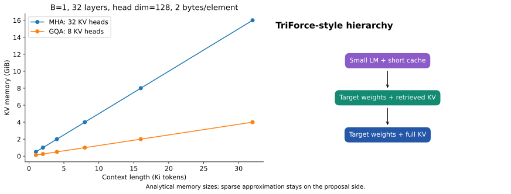

<a id="s11-2"></a>
### 11.2 长上下文怎样改变计算瓶颈

GQA 使用实际 KV head 数，MLA／SSM 等采用自身状态模型。随着上下文与 batch 增长，瓶颈可从权重访问转向 KV 访问；草稿参数小并不意味着其 KV 同样便宜。

[MagicDec](https://arxiv.org/html/2408.11049) 分析长上下文下 KV 带宽使高 batch 投机仍可能获益，并研究压缩／固定预算草稿 KV。由此不能简单断言“小 batch 有效，大 batch 无效”；需要测目标单步、验证与草稿在实际长度和 batch 下的成本。

短上下文时，增大 batch 提高权重矩阵利用率，线性层可能变成算力瓶颈，额外验证位置会竞争已有计算。长上下文时，每个请求还需要读大量 KV，验证多个 query 可以复用部分相同历史读取，瓶颈可能重新偏向带宽。

MagicDec 的分析强调这种转换及草稿 KV 预算。如果草稿也逐 token 重读完整长历史，它会抵消目标节省；稀疏或固定预算草稿 KV 可以降低这一成本。临界点依硬件、模型、batch 和 attention 实现变化，不能用单一上下文长度概括。

<a id="s11-3"></a>
### 11.3 权重、KV 与 FLOPs 的统一账本

设参数规模为 $P$，层数为 $L$，请求数为 $B$，历史长为 $S$，每请求验证输入数为 $N$。这里 $N$ 包括 pending token，不等于候选数。以稠密计算为近似：

$$
F_{linear}\approx2PBN,
\qquad F_{attn,history}\approx4LBN S H_Qd_h.
$$

矩阵乘一个乘加按 2 FLOPs；注意力的 $QK^\top$ 和 $AV$ 各贡献一份。第二式只计历史部分，不含验证块内部的三角注意力、归一化或其他操作。

模型权重若在一次批量前向中读取一遍，字节数约 $Pb_w$。历史 KV 的表示大小为：

$$
M_{KV}=2LBSH_{KV}d_hb_{KV}.
$$

注意计算量使用 query heads $H_Q$，存储量使用 KV heads $H_{KV}$。把二者都写成同一个 $H$，会掩盖 GQA 对带宽瓶颈的影响。

<a id="s11-4"></a>
### 11.4 历史 KV 复用与 roofline 成本界

用 $\rho\in[0,1]$ 表示每增加一个 query 引入的额外完整历史读取比例，得到教学模型：

$$
D\approx Pb_w+[1+\rho(N-1)]M_{KV}+2LBNH_{KV}d_hb_{KV}.
$$

$\rho=0$ 表示 query 间理想复用历史 KV；$\rho=1$ 表示每个 query 都重新读取完整历史。真实传输量受 tile 大小、片上缓存、occupancy、分页布局和 kernel 影响，不会只由算法公式决定。模型还忽略激活读写等开销。

给定带宽 $\beta$ 与算力 $\pi$，roofline 下界为：

$$
T\gtrsim\max(D/\beta,F/\pi).
$$

取最大值是因为计算和访存可能重叠；两者相加对应另一种串行模型。现实还有启动、同步、通信等成本，因此该式是解释瓶颈的乐观下界，不是完整延迟预测。这里将吞吐的 roofline 上界改写为时长下界；带宽界、算力界与计算强度的官方解释见 [NVIDIA Nsight Compute 的 Roofline 指南](https://docs.nvidia.com/nsight-compute/ProfilingGuide/index.html#roofline-charts)。

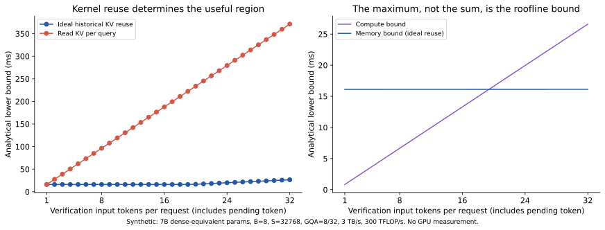

图中硬件参数为人为设置的 3 TB/s、300 TFLOP/s，不能对应成某块显卡的实测性能。左图改变的只有历史 KV 复用假设；右图展示理想复用下，增加 query 后计算界何时赶上带宽界。由此可解释为何草稿很准却没有加速：有效提交增加的同时，验证可能已跨入算力瓶颈。

<a id="s11-5"></a>
### 11.5 投机暂存与并发机会成本

设每请求暂存 K 个验证位置，标准 KV 额外占用大致为 $2LBK H_{KV}d_hb_{KV}$；树应使用实际节点数替换链长，并额外考虑路径索引、mask、padding。神经草稿还需要自己的权重、KV 和工作区；共享目标层不自动共享全部状态。

如果投机占用了原本可用于更多请求的内存，同并发的单请求加速与同硬件的最大服务吞吐可能指向不同结论。公平报告至少区分固定 batch 的效果、满足 SLO 的最大到达率，以及两种方法各自优化后的容量。

<a id="s11-6"></a>
### 11.6 TriForce：两类瓶颈与三层概率合同

[TriForce](https://arxiv.org/abs/2404.11912) 使用小模型辅助“目标权重＋检索出的稀疏 KV”生成中间草稿，再由“目标权重＋完整 KV”验证。层次包括小草稿、检索缓存草稿和完整目标，旨在同时降低权重与长历史 KV 的反复读取。

稀疏上下文的近似放在提案侧，完整上下文仍定义最终目标分布。这与直接永久丢弃目标 KV 后继续宣称原模型无损不同。额外层级也带来多套状态、同步和预算，必须测总成本，不能只数最外层目标调用。

逐层校正时，中间模型先充当目标、再充当最外层提案；两层使用的分布不能混淆：

```text
小 LM 提案 q_small
  → 对稀疏 KV 模型 p_sparse 做精确校正
  → 得到服从 p_sparse 的中间草稿及相应条件概率
  → 对完整目标 p_full 再做精确校正
  → 最终服从 p_full
```

每层都必须传递实际条件分布，不能把下层原始 q 当作中间校正后的分布。稀疏缓存可以近似，因为它只定义提案；最外层完整目标的上下文不能被替换掉。

<a id="s11-7"></a>
### 11.7 三种动态控制信号

| 机制 | 输入信号 | 决策对象 |
|---|---|---|
| 草稿置信度早停 | 当前前缀预测难度 | 是否继续串行草拟 |
| batch／历史反馈调节 | 并发、EMA 接受长度 | 下一轮长度档位 |
| 自适应验证 | 前缀存活率、硬件 shape 成本 | 各请求进入目标的验证长度 |

[HF 动态长度](https://huggingface.co/blog/dynamic_speculation_lookahead)、[vLLM Dynamic SD](https://docs.vllm.ai/en/latest/features/speculative_decoding/dynamic_speculative_decoding/)、[SGLang 自适应策略](https://docs.sglang.io/docs/advanced_features/adaptive_speculative_decoding) 分别体现不同控制信号。它们不是同一种调度算法。

<a id="s11-8"></a>
### 11.8 采样前准入：保持经典证明的充分条件

用 $\mathcal F_{i-1}$ 表示抽取第 i 个候选前可用的信息：已提交历史、既定辅助状态、先前候选和调度历史。经典单链证明的一个充分条件是：第 i 个候选是否加入待验证链的决策 $I_i$，在抽取 $Y_i$ 前由 $\mathcal F_{i-1}$ 决定。

注意，这不要求整轮长度在第一步前就固定。可以保留已经生成的第 i 个候选，再根据它或生成它后的状态决定是否抽取第 i+1 个候选。此时改变的是下一步工作量，并没有选择性取消第 i 个样本。

| 操作顺序 | 对经典证明的影响 |
|---|---|
| 计算当前位置分布，先根据它的熵决定是否抽取该位置 | 准入先于该位置抽样，可按通常证明处理 |
| 抽出 A，保留 A，再决定不抽下一位置 | 当前候选未被筛选，下一位置成为 target bonus |
| 抽出 A 则保留；抽出 B 则取消该位置并改从 p 抽 | 当前样本被筛选，需要重新证明或重新校正 |
| 看整块结果，挑最长、最高分或最好接受的一块 | 选择改变真实提案，原 q 通常不再适用 |

最后一个“不安全”意味着旧证明失效，不意味着永远不能构造正确算法。若能算出选择后的真实提案并执行匹配校正，仍可能恢复精确性。

**一行反例与一个安全的递归接口**

取 $p(A)=7/10,q(A)=1/2$。看见 A 则保留；看见 B 则放弃投机，从 p 重新抽样，得到

$$
P(X=A)=1/2+(1/2)(7/10)=17/20\ne7/10.
$$

相比之下，枚举实验的接口 `continue_before_draw(prefix, candidates)` 只接收已有候选，不接收下一随机样本。停止时保留已有候选并使用正确的目标 bonus；从而可做逐位置归纳。

<!-- runnable: exactness_predictable_budget -->
```python
from fractions import Fraction as F
from examples.exactness_lab import enumerate_sequences, target_sequence_law
p = ((F(1,3), F(2,3)), (F(3,4), F(1,4)))
q = ((F(4,5), F(1,5)), (F(1,2), F(1,2)))
target, draft = lambda s: p[s[-1]], lambda s: q[s[-1]]
# 抽出 0 后保留它，但不再增加下一候选。
admit_next = lambda prefix, candidates: not candidates or candidates[-1] != 0
actual = enumerate_sequences(target, draft, (0,), 4, 3,
                             continue_before_draw=admit_next)
assert actual == target_sequence_law(target, (0,), 4)
print(len(actual), '个完整序列的概率全部一致')
```

这也给代码审查一个直接问题：早停判断是作用于“刚抽出的 token 是否保留”，还是“是否继续抽下一个 token”？两种代码只差一次列表 append 的位置，概率含义可能完全不同。

<!-- runnable: selection_bias -->
```python
p_A, q_A = .7, .5
biased_A = q_A + (1-q_A)*p_A
safe_mixture_A = .5*p_A + .5*p_A  # 采样前选两条各自精确的算法
assert abs(biased_A-.85) < 1e-12
assert abs(safe_mixture_A-.7) < 1e-12
```

[DSpark 原文附录 A](https://arxiv.org/html/2607.05147)及其生产方案用滞后历史预测决定容量，以适配异步调度和不平滑成本，同时使用当前置信度分配预算。其正确性声明有具体信息时序前提；自行实现全局 top-k 时，仍需检查跨请求排序有没有让当前样本反过来影响自身准入，不能仅凭“使用历史统计”就自动认定无损。

<a id="s11-9"></a>
### 11.9 按前缀存活率分配验证预算

设请求 $r$ 的条件接受估计为 $c_{r,i}$，存活概率 $a_{r,j}=\prod_{i\le j}c_{r,i}$。分配 $\ell_r$ 个新候选时，预计新提交数为：

$$
N(\ell)=\sum_r\left(1+\sum_{j=1}^{\ell_r}a_{r,j}\right),\qquad
B_{verify}=\sum_r(1+\ell_r).
$$

若成本暂以验证 token 总数为主，可优化 $N(\ell)/T(B_{verify})$。真实成本还可能依赖上下文分布、attention backend、MoE 路由和通信，不能无条件压缩成一个 batch 参数。

DSpark 使用启动时测量的成本曲线；vLLM 自适应验证专题已扩展到有置信头及在线估计器的多类模型草稿。早停式搜索只有在相应目标形状假设下才保证全局最优；真实 CUDA graph、padding 和算子档位会产生不平滑成本。[DSpark](https://arxiv.org/html/2607.05147)、[vLLM 自适应验证](https://docs.vllm.ai/en/latest/features/speculative_decoding/adaptive_verification/)

假设请求 A 各位置条件接受率为 `[.9,.9,.9]`，请求 B 为 `[.6,.4,.2]`，存活率分别为 `[.9,.81,.729]` 和 `[.6,.24,.048]`。A 的第三个位置仍比 B 的第二个位置更值得验证，但还要考虑总 batch 成本。

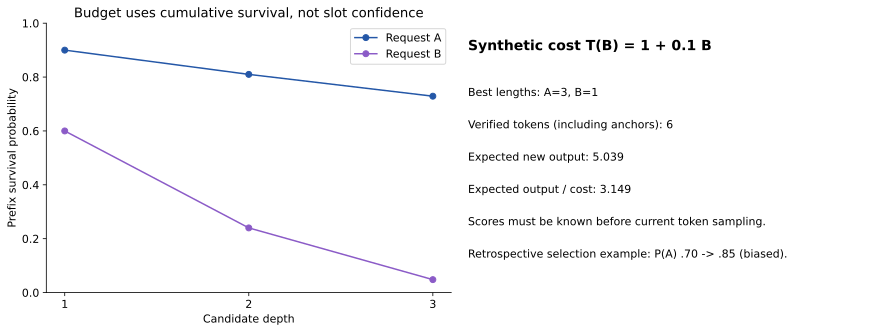

<!-- runnable: budget_allocation -->
```python
from examples.principle_lab import allocate_budget
cost = [1+.1*b for b in range(9)]  # 教学成本，不是 GPU 测量
best = allocate_budget([[.9,.9,.9],[.6,.4,.2]], cost)
print(best)
assert best['lengths'] == [3,1]
# 两个 anchor + 四个候选 = 6 个验证 token；预计输出 5.039。
```

该穷举程序只适合小规模教学，所有接受率必须在当前随机候选采样前已知。它给出指定成本表下的最优分配，不是可直接用于线上 DSpark 的因果调度器。

<a id="s11-10"></a>
### 11.10 连续 batching、图形状与分布式通信

连续 batching 允许请求进出同一批次，投机使每请求本轮新增长度不同。运行时通常要构造各请求 query 长度、slot 映射和有效输出边界；padding 虽使形状统一，却可能浪费大量无效位置。

CUDA graph 通过重放预先捕获的计算减少主机启动成本，但通常对内存地址和图结构有约束。动态候选长度可能需要多个图档位、padding 或专门支持动态有效长度的后端，所以“算法想调到 7”不意味着硬件成本平滑落在 6 与 8 之间。

TP 将同一模型算子切到多设备，DP 复制模型处理不同请求，PP 将不同层放到不同阶段。它们同步的对象不同：不同 DP rank 选了不同 K 时，如果实现仍要求一致的 collective 形状，可能失败；PP 下前层草稿与后层验证的时序也更复杂。框架限制表正是在回答这些具体执行条件。

**自检。** 置信预测更准为什么仍可能更慢？计算预测、传输、排序、图切换和碎片化验证的成本可能大于少验证的收益。

<a id="s11-11"></a>
### 11.11 服务组合限制与已提交输出

连续 batching 中各请求每轮前进长度不同，调度要同时处理有效 token、暂存节点、KV 容量和后续图形状。更宽验证可能挤压其他请求，额外草稿权重也可能降低可容纳并发。

TP、DP、PP、prefill/decode 分离、LoRA、grammar、logprobs 和混合架构的组合必须按版本核对。流式输出只能发送已提交 token；每轮提交一批会改变 token 间隔分布，因此平均 TPOT 之外还应测静默间隔和尾部延迟。

<a id="s12"></a>
## 12. 成本模型、预算选择与交互计算器

一个系统要分别回答分布是否正确、生成是否更快、完成同一任务是否更省资源。本章把前缀存活转换为可比较的成本，再讨论预算、长期状态和训练回本；所有教学时间曲线均为合成情景。

<a id="s12-1"></a>
### 12.1 从条件接受事件到尾和公式

设经典单链最多提出 $\gamma$ 个候选，连续接受数为 $A_\gamma$。无 EOS 或长度截断时，实际提交数 $L_\gamma=A_\gamma+1$。令

$$
s_0=1,\quad s_j=\Pr(A_\gamma\ge j),\quad
\alpha_j=\Pr(\text{第 j 项通过}\mid\text{前 j-1 项通过}).
$$

由概率链式法则，$s_j=\prod_{i=1}^j\alpha_i$，无需位置独立。又因非负整数 $A=\sum_{j\ge1}\mathbf1[A\ge j]$，取期望可得尾和公式：

$$
E_\gamma=\mathbb E[L_\gamma]=1+\sum_{j=1}^{\gamma}\Pr(A_\gamma\ge j)=\sum_{j=0}^{\gamma}s_j.
$$

这里的 $\alpha_j$ 对**实际存活到第 j 项的前缀分布**平均，不能在任意参考前缀上求平均 TV 后代入。只有进一步假设所有条件接受概率相同，才得到

$$
E_\gamma=\sum_{j=0}^{\gamma}\alpha^j=
\begin{cases}(1-\alpha^{\gamma+1})/(1-\alpha)&\alpha\ne1\\\gamma+1&\alpha=1.\end{cases}
$$

树、块验证和提前终止使用各自的实际提交数；“平均接受率乘草稿长度再加一”没有计入后部必须以前部成功为条件的约束。

代码 [progress_curve](../examples/cost_aware_lab.py) 中 `cumprod(alpha)` 计算存活率，外层 `cumsum` 计算尾和。前置的 1 代表空前缀存活及零预算下的一次目标输出。两次累积的概率意义不同。

<!-- runnable: cost_tail_sum -->
```python
import numpy as np
from examples.cost_aware_lab import progress_curve
s, expected = progress_curve([.9, .8, .5])
np.testing.assert_allclose(s, [1, .9, .72, .36])
np.testing.assert_allclose(expected, [1, 1.9, 2.62, 2.98])
# gamma=3: L=1,2,3,4 的概率分别为 .1,.18,.36,.36。
law = np.array([.1, .18, .36, .36])
assert abs(np.arange(1, 5) @ law - expected[-1]) < 1e-12
```

**适用边界。** 如果预算改变了候选生成，例如重新归一化候选集、改用另一种块长的 checkpoint，或者深树导致不同剪枝，则不同预算不能共用同一组 $\alpha_i$。应为每个完整配置独立记录 $E_\gamma$。动态预算和 EOS 还需要记录“这一深度是否存在且未终止”，不能将缺失项当成拒绝项。

<a id="s12-2"></a>
### 12.2 相同平均接受率为何有不同进展

前部失配会压低所有后缀的存活率。下面两组条件接受率的算术平均相同，却有不同的期望提交数：

<!-- runnable: survival_order -->
```python
from examples.principle_lab import expected_progress
_, weak_early = expected_progress([.5,.9,.9])
_, weak_late = expected_progress([.9,.9,.5])
assert abs(weak_early-2.355) < 1e-12
assert abs(weak_late-3.115) < 1e-12
print(weak_early, weak_late)
# 两组条件接受率算术平均相同，期望提交却不同。
```

[第 2 章图 21](#s2-8)的左面板展示这一差异；它连接候选依赖、位置加权训练和动态预算。

<a id="s12-3"></a>
### 12.3 在存活前缀上平均：一个上下文相关反例

固定前缀 $u$ 的局部接受率是 $\alpha(u)=\sum_v\min(p(v\mid u),q(v\mid u))$，而位置接受率还要对“已经通过前面位置”的前缀分布取期望。该测度通常既不是普通目标 rollout，也不是未经筛选的草稿 rollout。

第一位置 $p=(1/2,1/2),q=(9/10,1/10)$，接受质量为 $(1/2,1/10)$，总量 $3/5$。条件于第一步通过，前缀 A/B 的概率为 $(5/6,1/6)$。

第二位置若前缀 A，令 $p=(1/10,9/10),q=(9/10,1/10)$，重叠为 $1/5$；若前缀 B，令两者均匀，重叠为 1。因此

$$
\alpha_2=(5/6)(1/5)+(1/6)1=1/3,
\qquad s_2=(3/5)(1/3)=1/5.
$$

期望提交数为 $1+3/5+1/5=9/5$。若错误地按目标第一 token 的 $1/2,1/2$ 频率平均，会得 $\alpha_2=3/5$，高估为 $1+3/5+9/25=49/25$。

`acceptance_survival` 直接传播未归一化的存活质量：每条前缀边乘 $\min(p,q)$，同一深度的质量相加就是 $s_j$。它同时说明为什么先累积 mass、最后再归一化往往更容易审计。

<!-- runnable: exactness_survival_measure -->
```python
from fractions import Fraction as F
from examples.exactness_lab import acceptance_survival
target = lambda s: ((F(1,2), F(1,2)) if len(s)==1 or s[-1]==1
                    else (F(1,10), F(9,10)))
draft = lambda s: ((F(1,2), F(1,2)) if len(s)>1 and s[-1]==1
                   else (F(9,10), F(1,10)))
survival = acceptance_survival(target, draft, (0,), 2)
assert survival == (F(1), F(3,5), F(1,5))
assert sum(survival) == F(9,5)
print(survival)
```

动态长度还需要把“第 i 个候选存在”计入存活事件。如果使用每位置尝试计数估计接受率，分母必须清楚记录候选准入与前序通过次数；不能把不同请求混成一个无条件平均再填入固定长度公式。

<a id="s12-4"></a>
### 12.4 从 trace 区分三种接受统计

假设三轮分别提出 4、4、2 个候选，实际接受 0、2、2 个，且都没有 EOS。候选利用率是 $4/10=0.4$；每轮平均接受为 $4/3$；每轮平均提交为 $(1+3+3)/3=7/3$。这三个数不是同一个统计量。

如果记录每个位置获得有效尝试的次数，可以估计条件接受率：第一位置 3 次尝试中 2 次通过；第二位置只有前面通过的 2 轮有资格尝试，2 次都通过；第三位置只在有足够候选且前两步通过的轮次统计。可变长度还带来“哪些请求会生成到该深度”的选择差异，应记录分母。

`summary.proposal_utilization` 有助于衡量浪费，但不能直接填入常数 alpha 的理论公式。实际总提交／总验证轮数更直接连到目标调用摊销。

<a id="s12-5"></a>
### 12.5 整轮成本与理论 decode 加速

令 $T_1$ 为同模型、相同上下文与执行配置下目标单 token decode 的基线耗时；$T_d,T_v,T_{sample},T_{schedule}$ 分别为草稿、目标验证、采样与调度的耗时。

$$
S_{decode}\approx\frac{\mathbb E[L]T_1}{\mathbb E[T_d+T_v+T_{sample}+T_{schedule}]}.
$$

草稿、验证或通信有重叠时，分母应使用实测关键路径，不能机械相加。稳定态评测取总输出／总时间，逐轮速度的简单平均可能有偏。

串行草稿单步相对成本为 $c$，验证相对成本为 $v(\gamma)$，额外开销为 $o$ 时：

$$
S\approx\frac{\sum_{j=0}^{\gamma}\alpha^j}{\gamma c+v(\gamma)+o}.
$$

例如 $\alpha=0.8,\gamma=4,c=0.1,v=1,o=0$，预期提交 3.3616，模型速度约 2.40×；若 $v=1.6,o=0.1$，下降到约 1.60×。这些是理论情景。

<a id="s12-6"></a>
### 12.6 总有效输出除以总时间

若一轮提交 1 个 token 用 1 ms，另一轮提交 9 个用 100 ms，逐轮速度简单平均为 $(1+0.09)/2=0.545$ token/ms；实际共 10 token 用 101 ms，仅约 0.099 token/ms。简单平均给了短轮次过大权重。

<!-- runnable: rate_aggregation -->
```python
emitted = [1,9]
time_ms = [1,100]
actual_rate = sum(emitted)/sum(time_ms)
wrong_average = sum(n/t for n,t in zip(emitted,time_ms))/2
assert abs(actual_rate-10/101) < 1e-12
assert wrong_average > 5*actual_rate
print(actual_rate, wrong_average)
```

比较端到端倍数时也需同一计时边界和相同工作量。prefill 时间不同、EOS 输出长度不同或请求失败被丢弃都会改变分母。

跨请求的平均倍率与池化速率仍需区分，具体定义与配对区间见[第 16 章](#s16)。

<a id="s12-7"></a>
### 12.7 边际收益、成本档位与预算扫描

令 $C_\gamma$ 为实测整轮关键路径时间，$\Delta C=C_{\gamma+1}-C_\gamma$，$s=E_{\gamma+1}-E_\gamma$ 为新增预算带来的期望进展。只有提案分布不随预算改变、且无 EOS 或截断时，$s$ 才等于该位置的存活率 $s_{\gamma+1}$。比较 $E_\gamma/C_\gamma$ 与 $(E_\gamma+s)/(C_\gamma+\Delta C)$，在两种配置成本均为正时：

$$
C_\gamma s>E_\gamma\Delta C.
$$

这个形式比 $s/\Delta C>E_\gamma/C_\gamma$ 更一般：$\Delta C=0$ 时无需除零；候选成本因更合适的 kernel 而下降时也可直接判断。但它仍只比较两个配置，不保证从小到大遇到第一次下降便可停止搜索。

**反例。** $\alpha_1=\alpha_2=0.9$，预算 0、1、2 的成本分别为 1、2、2 ms。预算 1 只有 $1.9/2=0.95$ 倍速度，预算 2 却有 $2.71/2=1.355$ 倍速度。第一次扩大形状需要付固定成本，第二个位置可以利用已经付出的成本。

<!-- runnable: cost_shape_cliff -->
```python
from examples.cost_aware_lab import compare_budgets
r = compare_budgets([.9, .9], [1., 2., 2.])
assert r['speedup'][1] < 1
assert r['best_gamma'] == 2
print(r['speedup'])  # [1.0, 0.95, 1.355]
```

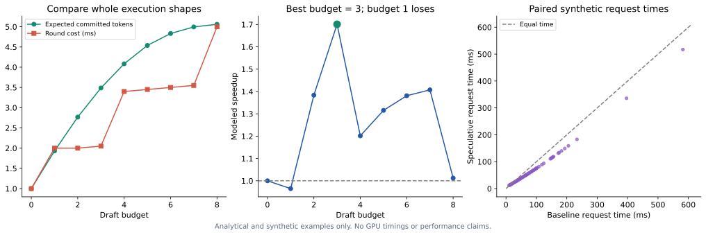

图左在一组更长的合成场景中比较期望输出与整轮成本；中图最优预算为 3，继续增长反而受成本档位影响。右图每一点是一对相同任务的合成运行时间，虚线表示等时，其配对统计方法见[第 16 章](#s16-14)。所有结论都来自 [cost_aware_results.json](../data/cost_aware_results.json)，可由 [make_cost_figures.py](../examples/make_cost_figures.py)重建。

当 $\Delta C>0$，该条件等价于 $s/\Delta C>E_\gamma/C_\gamma$：比较新增位置的进展／成本与当前整体速率。并行主干已算好的候选可能草稿边际成本很小，但目标验证、词表采样和图档位仍需计费。高接受率、空闲算力与低边际成本有利于长候选；不平滑成本应比较完整配置。

<a id="s12-8"></a>
### 12.8 草稿、验证、提交与重叠怎样计费

| 部分 | 容易遗漏的成本 | 正确的记录边界 |
|---|---|---|
| 草稿 | prefill、LM head、特征传输、CPU 查找 | 草稿为该轮准备候选的全部工作 |
| 验证 | pending token、额外 logits、临时 KV、attention | 后端实际执行的 shape 和节点数 |
| 提交 | rejection sampling、索引压缩、设备同步 | 从验证完成到下一轮可启动 |
| 重叠 | 异步草稿、通信、其他请求 | 用事件时间线的关键路径；不要把重叠阶段重复相加 |
| 系统 | graph warmup、内存容量、排队 | 分别报告稳态与端到端，不把一次性初始化混入每轮 |

`compare_budgets` 不擅自假设 $C_\gamma=1+c\gamma$，调用者必须传入整个成本数组；`gamma=0` 也必须有真实基线成本。代码 `argmax(E/C)` 给出的是**被扫描配置集合内**的最优预算，并不声称对未尝试预算、未来负载或不同候选结构全局最优。

<a id="s12-9"></a>
### 12.9 Prefill、Amdahl 上限与服务排队

若基线 prefill 占比为 $f$，其耗时不变，decode 加速为 $S_d$：

$$
S_{e2e}=\frac{1}{f+(1-f)/S_d}.
$$

例如 $f=0.4,S_d=3$，端到端约 1.67×；草稿额外 prefill、排队和冷启动会进一步改变结果。长输入短输出尤其不能仅用 decode token/s 选型。

当 $\alpha=0$，草稿工作几乎全浪费；当 $\alpha=1$，仍有草稿和验证成本；当 $\alpha<1$ 且无限加深，提交收益趋于饱和。理论 $\gamma=0$ 表示关闭投机，而具体代码是否真的跳过草稿要检查实现。

当 $f>0$ 且 $S_d\to\infty$ 时，加速上限为 $1/f$。服务侧还包括排队：额外草稿占用或验证波动可能减少容量并增加等待，即使单请求 decode 更快。相关时间线与排队反例见[第 16 章](#s16)。

<a id="s12-10"></a>
### 12.10 动手计算接受率与成本的影响

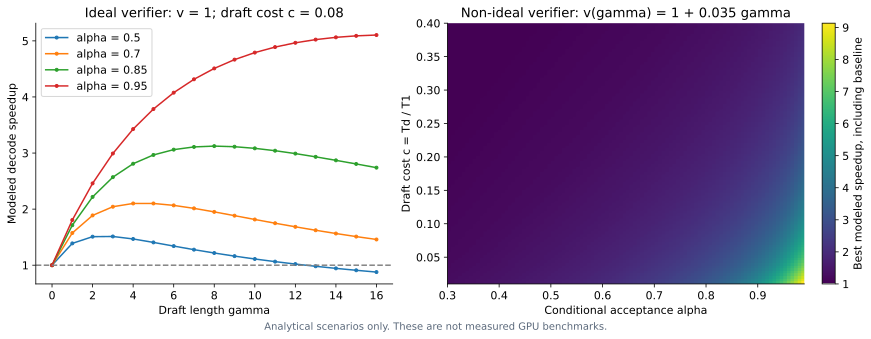

<div id="speculative-calculator"></div>

导出 HTML 后可调整条件接受率、草稿长度、验证成本、额外开销与 prefill 占比。曲线采用常数条件接受率及给定成本函数，gamma=0 表示关闭投机；它们是理论情景，不包含 EOS、batch 变化或实测 GPU 数据。

<a id="s12-11"></a>
### 12.11 从局部速率到剩余请求时间

把系统状态记为 $h$，包括已提交文本、batch、上下文长度、可用内存和目标版本。动作 $g$ 决定本轮候选预算。更完整的剩余时间递推是：

$$
V(h)=\min_g\left\{C(h,g)+\mathbb E[V(H')\mid h,g]\right\}.
$$

终止状态 $V=0$。这是有限生成任务的 Bellman 视角：动作同时改变本轮耗时以及进入哪些下一轮状态。最大化当前 $E[L]/C$ 是实用近似；只有当后续机会、负载和单位输出价值足够稳定时，才接近长期目标。

这里有两类不同的改变。精确验证可以保持最终 token 分布，但不同预算会使“在哪些位置重新启动草稿”不同；这一**轮边界分布**可以改变训练目标和成本。另一些动作改变 batching 或内存占用，进而影响其他请求，单请求的收益比也不能代表服务总目标。此处递推是状态价值的统一解释，不是对任何具体论文实现最优调度器的复现。

**研究设计。** 先测几个固定预算建立曲线，再用历史状态选择预算，最后与最好的固定预算和关闭投机比较。若动态方法只优于一个随意选的固定深度，无法证明其调度价值。使用当前候选内容来决定是否回退目标采样还会带来选择偏差，概率条件见[第 11 章的因果准入条件](#s11)。

<a id="s12-12"></a>
### 12.12 草稿训练的资源回本

用同一种可加单位计费，训练／特征准备总成本为 $C_{train}$，基线和投机每 token 成本分别为 $c_b,c_s$。当 $c_b>c_s$：

$$
N_{break-even}=\frac{C_{train}}{c_b-c_s}.
$$

如果训练花了 100 GPU 小时，即 360000 GPU 秒，每 token 从 0.010 降至 0.007 GPU 秒，需要约 1.2 亿 token 才覆盖训练成本。这里是资源账本，**不能用多 GPU 训练的 GPU 小时除以单请求墙钟延迟差**。

<!-- runnable: cost_amortization -->
```python
from examples.cost_aware_lab import break_even_tokens
n = break_even_tokens(360000, .010, .007)
assert abs(n - 120_000_000) < 1e-6
assert break_even_tokens(360000, .010, .012) is None
```

若目标频繁升级、每次必须重训，累计部署量要按每个兼容周期计算。若额外 drafter 让可容纳 batch 降低，每 token 成本应包含容量变化。特征缓存、调参、失败训练和硬件异构都需同口径入账，不能只报最终一次训练的反向传播时间。

<a id="s13"></a>
## 13. 五个框架的接入证据与限制

候选、验证、状态与预算确定以后，部署还要满足具体引擎的模型格式和执行组合。本章是所注访问日期的支持快照；HF 入口的完整测量合同见[第 16 章](#s16)。

<a id="s13-1"></a>
### 13.1 支持矩阵的阅读方式

下表记录 2026-10-20 访问时的官方文档／源码入口。“未确认”表示本次未取得足够证据，不等于不支持；训练库提供模型格式也不等于推理框架所有组合已经验证。这里没有把滚动文档转换成稳定版承诺。

| 方法 | vLLM | SGLang | TensorRT-LLM | Transformers | llama.cpp |
|---|---|---|---|---|---|
| 独立小 LM | `draft_model` | `STANDALONE` | Draft/Target 路径 | `assistant_model` | `draft-simple` |
| n-gram／lookup | `ngram` | `NGRAM`，trie 参数 | NGram 配置 | prompt lookup | 多种 n-gram 后端 |
| suffix | Arctic 适配器 | 独立 Arctic 路径未确认 | SA 增强 | 专用路径未确认 | 不等同于所有 n-gram 名称 |
| EAGLE-3 | 有 | 有 | 新 PyTorch 接口 | 第三方实现另看 | `draft-eagle3` |
| 原生 MTP | 依模型 | 依模型，常走 NEXTN 等路径 | 依模型 | 逐模型核对 | `draft-mtp` |
| PARD | parallel drafting | 独立接入路径未确认 | PARD 配置 | 作者实现另看 | 未确认 |
| P-EAGLE | Speculators 路径 | SpecForge 训练，部署格式另核对 | 未确认 | 未确认 | 未确认 |
| DFlash | 有 | `DFLASH` | DFlash 配置 | 作者独立后端 | `draft-dflash` |
| DSpark | 相关草稿／训练入口 | 相关采样／训练入口 | 专用配置未确认 | 作者实现另看 | `draft-dspark` |
| DFlash 2／LiLiCorr | 有专题，组合有边界 | 有相关说明 | DFlash 2 有；LiLiCorr 未确认 | 专用实现另看 | 家族支持逐版本核对 |
| LayerSkip | 原生早退未确认 | 原生早退未确认 | 原生早退未确认 | `assistant_early_exit` | 未确认 |
| Medusa／ReDrafter | 不由旧文档推定 | 当前标准路径未确认 | 旧 TensorRT engine 文档 | 非通用 assisted 接口 | 未确认 |
| UNO | 未确认 | 有专用路径 | 未确认 | 作者自定义实现 | 未确认 |

主要依据：[vLLM](https://docs.vllm.ai/en/latest/features/speculative_decoding/)、[SGLang](https://docs.sglang.io/advanced_features/speculative_decoding.html)、[TensorRT-LLM 新接口](https://nvidia.github.io/TensorRT-LLM/features/speculative-decoding.html)、[旧 engine](https://nvidia.github.io/TensorRT-LLM/advanced/speculative-decoding.html)、[HF generation](https://huggingface.co/docs/transformers/main/en/generation_strategies)、[llama.cpp](https://github.com/ggml-org/llama.cpp/blob/master/docs/speculative.md)。各入口按来源索引所列访问日期核对，实际部署仍需固定版本。

<a id="s13-2"></a>
### 13.2 所阅版本的组合限制

| 组件 | 需核对的条件 |
|---|---|
| vLLM Dynamic SD | 已测 EAGLE／EAGLE-3／DFlash；full CUDA graph 与 runner 相关；DP 下关闭动态 batch 长度映射并回退静态值 |
| vLLM Adaptive Verification | attention backend 要支持设备决定的查询长度；LoRA、PP 不支持；无置信头时依赖完整草稿 logits 的估计路径 |
| vLLM LiLiCorr | 匹配块长与 head 几何；通常建议新候选数为训练 block size−1；block／adaptive 组合尚无专门端到端验证 |
| SGLang NGRAM | CUDA；不支持 DP attention；宽树加分页缓存对 attention backend 有要求 |
| SGLang UNO | 专用 LoRA 路由、FA3、TP=PP=1；不能套通用 rejection-sampling 开关 |
| TensorRT-LLM 动态树 | 滑窗 attention 或 MLA 模型存在限制；旧 engine 与新 PyTorch API 分开 |

这些条件来自具体专题：[动态长度](https://docs.vllm.ai/en/latest/features/speculative_decoding/dynamic_speculative_decoding/)、[自适应验证](https://docs.vllm.ai/en/latest/features/speculative_decoding/adaptive_verification/)、[LiLiCorr](https://docs.vllm.ai/en/latest/features/speculative_decoding/lilicorr/)、[SGLang](https://docs.sglang.io/advanced_features/speculative_decoding.html)、[TensorRT-LLM](https://nvidia.github.io/TensorRT-LLM/features/speculative-decoding.html)。它们是本次快照，不应永久套到未来版本。

另一个值得跟进的接口是 vLLM MTP 的 `draft_lm_head_quantization`：为草稿生成量化的 head 副本，而目标仍使用自己的 head 验证。这把近似放在提案侧，代价是额外权重副本；其性能取决于大词表投影是否为瓶颈，不能视为免费共享。[MTP 专题](https://docs.vllm.ai/en/latest/features/speculative_decoding/mtp/)

<a id="s13-3"></a>
### 13.3 可复用的配置起点

这些是文档形态示例，并非本仓库完成的服务复现。路径需要匹配目标与草稿，运行时应固定具体 revision。

```python
# Hugging Face：同 tokenizer 的贪心 assisted generation
assistant.generation_config.num_assistant_tokens = 4
assistant.generation_config.num_assistant_tokens_schedule = "constant"
assistant.generation_config.assistant_confidence_threshold = 0.0
outputs = target.generate(
    **inputs, assistant_model=assistant,
    do_sample=False, num_beams=1, max_new_tokens=128, use_cache=True,
)
```

完整本地入口为 `python -m examples.hf_assisted --target /path/to/target --draft /path/to/draft`。它预热并交替测量两种路径，每次输出都与固定目标基线比较，同步 CUDA 后报告中位端到端耗时，包含 prefill。`--output` 可保存逐次时间、模型 revision、实际输出长度和环境；两套模型始终驻留，不代表独立 AR 服务的最大容量。[HF 动态投机说明](https://huggingface.co/blog/dynamic_speculation_lookahead)

```bash
# vLLM：无需附加神经权重的 lookup 起点
vllm serve /path/to/target \
  --speculative-config '{"method":"ngram","num_speculative_tokens":4,"prompt_lookup_min":2,"prompt_lookup_max":5}'

# SGLang：匹配 EAGLE-3 草稿的浅链起点
python -m sglang.launch_server \
  --model-path /path/to/target \
  --speculative-algorithm EAGLE3 \
  --speculative-draft-model-path /path/to/matching-eagle3 \
  --speculative-num-steps 3 \
  --speculative-eagle-topk 1 \
  --speculative-num-draft-tokens 4
```

MTP 的 vLLM 配置形式为 `{"method":"mtp","num_speculative_tokens":1}`，前提是目标支持该模块；DFlash 通常指定 `method`、匹配草稿路径和新候选数；PARD 使用 `draft_model` 配合 `parallel_drafting`。参数口径和 runner 不完全相同，不能在方法之间机械复用数字。[vLLM 示例](https://docs.vllm.ai/en/latest/features/speculative_decoding/)、[SGLang 参数](https://docs.sglang.io/advanced_features/speculative_decoding.html)

<a id="s13-4"></a>
### 13.4 源码阅读顺序

先看候选程序实际怎么选择 token，再看 sampler 接收的 $q$，随后跟踪 logits 行号、状态裁剪和预算决策。推荐顺序：本项目 `verify_candidates` → `tiny_transformer` → 已保存的 Transformers candidate／sampling → vLLM sampler → 具体 proposer／runner。

训练 checkpoint 能加载、文档有参数、某一个测试通过，分别是不同证据；研究记录应保留真实日志、版本、模型配置及失败组合。


<a id="s13-5"></a>
### 13.5 框架参数分别落在哪个部件

| 配置类别 | 改变的部件 | 需要联动检查 |
|---|---|---|
| `method`、草稿 checkpoint | proposer 与模型加载 | 架构、tokenizer、特征层、共享参数 |
| speculative steps／tokens | 草稿展开与验证预算 | 是否包含 anchor、长度尾部、graph 档位 |
| tree top-k／节点数 | 候选树组织 | 深度、宽度、mask、KV gather |
| draft sample mode | 实际提案 q | greedy 点质量或概率分布、验证器输入 |
| rejection method | 接受／修正算法 | 标准、块验证、有损规则不可混同 |
| attention backend／runner | 实际执行和缓存 | 变长、分页、混合架构、graph 支持 |

SGLang 的树分支 top-k 是候选组织参数；用户采样 top-k 是词表概率截断。它们都叫 top-k，但作用于不同对象。图中多保留四个分支也不等于随机 sampler 截断到四个 token。

<a id="s13-6"></a>
### 13.6 checkpoint 兼容性需要逐层排查

先检查 token→ID 和特殊 token，再看目标 hidden size、特征层号、位置编码、草稿结构、block size 与 head 权重。仅权重张量能加载不代表语义合同一致：错误特征层可能 shape 相同却让分布严重失配。

```python
# 结构伪代码：具体字段名由模型格式决定。
assert draft_config.target_hidden_size == target_config.hidden_size
assert draft_config.block_size - 1 >= requested_new_candidates
assert all(layer < target_config.num_hidden_layers for layer in feature_layers)
# 还需验证 tokenizer、LM head、适配器路由、cache 和 sampler 合同。
```

不同论文模型卡可能用不同 block size 定义。配置“8”究竟表示八个新候选、一个 anchor 加七候选，还是验证总节点数，要从实际实现判断。

<a id="s13-7"></a>
### 13.7 服务接入为什么要先建立最小闭环

建议先固定同一目标、相同模板和采样，完成 AR 与最短草稿对照；确保输出正确、模型 revision 清晰、停止规则相同，再增加块长、动态预算、LoRA 或分布式组合。一次开启多个特性后输出分叉，很难定位是模型、状态、采样还是调度问题。

本仓库 HF 示例比较每一次生成输出，保存每次时间；但仍是单请求 end-to-end 演示，无法替代真实到达率与连续 batching 的服务压测。原理代码也不意味着已获得 EAGLE／DFlash 的生产后端。

<a id="s14"></a>
## 14. 性能证据：可比较的条件是什么

第 12 章给出了收益的成本模型；阅读论文数字时，还须固定目标、硬件、任务、工作量与计时边界。请求平均倍率、总时间比和服务吞吐的统计定义见[第 16 章](#s16)。

下表精选可以明确定位实验条件的结果，均为来源报告。它们用于说明机制与适用区域，不能跨行排序。

| 来源 | 模型、硬件与实验条件 | 报告结果 | 解释边界 |
|---|---|---|---|
| 经典投机 | T5-XXL，论文 T5X 基线 | 约 2–3× | 早期特定系统，非任意 decoder 服务。[原文](https://arxiv.org/abs/2211.17192) |
| EAGLE-3 服务实验 | Llama-3.1-8B-Instruct，单 H100，SGLang v0.4.4，MT-Bench，batch 64，链长 3 | 吞吐约 +38% | 与论文最高 6.5× 的单场景指标不同。[§4.4](https://arxiv.org/html/2503.01840v2) |
| FastMTP | MiMo-7B-RL，A10 24GB，SGLang，贪心 batch 1，七任务，K=3 | 平均 2.03× AR | 包含多步训练、自生成数据与词表压缩。[表 1](https://arxiv.org/html/2509.18362) |
| SuffixDecoding | Llama-3.1-8B-Instruct，单 H100，batch 1，AgenticSQL 请求轨迹 | 平均约 5.3× AR 的每输出 token 墙钟速度 | 强依赖重复；SWE-Bench 完整 Agent 测试是另一套资源与计时边界。[图 4、6](https://arxiv.org/html/2411.04975) |
| DFlash | Llama／Qwen 多任务，主实验 H200；另有单 B200、FA4、SGLang 实验 | 部分配置超过 6× | 主实验、服务实验、训练数据对照不能混用；早期服务实验启用过 overlap。[原文](https://arxiv.org/html/2602.06036v1) |
| DSpark | 作者 DeepSeek-V4 preview 服务，线上流量，完整草稿＋调度系统，对 MTP-1 | 同等总吞吐下，Flash 用户速度约 +60%–85%，Pro 约 +57%–78% | 作者生产报告；不是公开统一 GPU 基准，也不是单独 Markov head 的收益。[§5](https://arxiv.org/html/2607.05147) |
| Block Verification | PaLM-2-S／XXS，γ=8，多任务，同一草稿对比 token verification | 平均墙钟增量约 +6.49% | 指验证器增量；另有 Vicuna／H100 实验，不能把两套硬件混写。[表 1、§6.2](https://arxiv.org/html/2403.10444) |
| TriForce | Llama2-7B-128K，A100，长上下文 | 最高约 2.31× | offloading 多 GPU 结果需另列，不能据此推一般短上下文优势。[原文](https://arxiv.org/abs/2404.11912) |
| SpecExec | 50B+ 目标，消费 GPU＋RAM offloading，量化另分组 | 4-bit 场景约 4–6 token/s，16-bit 约 2–3 token/s | 高倍率来自极重搬运瓶颈，不可迁移到全驻留高并发服务。[原文](https://arxiv.org/html/2406.02532) |

LiLiCorr 的论文比较使用单 H100、SGLang、block 16、不同并发和温度；其 DFlash2 对照是统一训练协议的第三方实现。选择器耗时、接受长度和端到端速度分别报告，不能把某一维优势写成所有公开 checkpoint 上的普遍胜出。[LiLiCorr 实验](https://arxiv.org/html/2608.20530)

**比较时先统一分母。** 对 AR 的倍数、对上一代投机的增量、每轮提交数、每用户速度、总吞吐、Agent 完成时间都是不同量。基线已接近不可用时，相对百分比可能很大，应同时给绝对 token/s、请求数和时延。

官方文档也提供了一些模型与评测展示；未取得足够可复核原始配置的结果没有被加入统一表格。近期网页不自动比原论文更可靠，实验条件才决定能否采用其数字。


<a id="s14-1"></a>
### 14.1 倍数、相对提升和绝对差值怎样换算

若 AR 用 100 ms，方案甲用 50 ms，方案乙用 40 ms：甲是 2× 加速，乙是 2.5×；乙相对甲的速度提升是 25%，而耗时下降是 20%。二者分母不同，都可以正确，但不能互换。

<!-- runnable: speedup_units -->
```python
ar_ms, a_ms, b_ms = 100, 50, 40
speed_gain = (ar_ms/b_ms)/(ar_ms/a_ms)-1
latency_drop = 1-b_ms/a_ms
assert speed_gain == .25
assert abs(latency_drop-.20) < 1e-12
print('速度提升', speed_gain, '耗时下降', latency_drop)
```

类似地，平均接受长度提高 20% 只有在整轮成本不变等条件下才近似提高速度 20%。添加选择器可能同时提高分子和分母；需要分阶段 profile。

<a id="s14-2"></a>
### 14.2 读论文表格时固定四个参照

第一是**目标模型**：是否相同权重、量化和模板；第二是**执行系统**：引擎、kernel、硬件和并行策略；第三是**任务与生成规则**：长度、温度、EOS、数据集；第四是**指标与计时边界**：decode、端到端、吞吐或任务完成时间。

EAGLE-3 的低并发最高倍率与 batch 64 服务吞吐来自不同条件；SuffixDecoding 的单请求 token 速度与完整 Agent 完成时间也不同。论文报告的有效结论应写成“在这些条件下提升多少”，而非抽出一个最大数当成方法固有属性。

<a id="s14-3"></a>
### 14.3 正确性证据为何需要分层

数学证明说明理想算法；小词表枚举检查代码是否实现该数学；随机统计检查有限样本输出；真实模型逐 token 检查状态和数值；服务压测检查实际成本。它们互补而不能互相替代。

一份论文所有 benchmark 得分相近，不能证明概率分布一致；一个 rejection sampler 单元测试通过，也不能证明 CUDA graph 和分页缓存集成正确。研究文档应明确“这条证据支持了哪个层次”。

<a id="s15"></a>
## 15. 代码导读、实验结果与完整复现指南

本章把理论对象对应到函数、数据与运行命令。概率恒等式、真实 CPU attention、训练梯度和合成系统实验承担不同验证职责；任何教学运行都不应当作预训练模型或生产 GPU 的性能复现。

<a id="s15-1"></a>
### 15.1 环境、安装与快速验证

建议使用 Python 3.10 或更新版本，在仓库根目录建立虚拟环境：

```bash
python -m venv .venv
source .venv/bin/activate
python -m pip install -r requirements.txt
python -m unittest discover -s tests -v
python -m examples.check_tutorial_snippets
python -m examples.validate_artifacts
```

Windows 可用 `.venv\Scripts\activate`。默认实验无需 GPU、checkpoint 或 API key；标记的 Python 片段可从仓库根目录独立运行，结构伪代码不作为完整复现程序。

默认测试不下载模型或资料，也不要求生成 HTML。验收扫描本文的本地链接、SVG、预测台账、引用元数据和实验 trace；存在可选 HTML 时，还会核对代码块、内嵌图片和 MathML，并检查主文章节导航。Node.js 可选，用于验收 HTML 内嵌计算器；缺失时会明确跳过 JavaScript 动态检查。

保存的基础结果使用 Python 3.12.7、NumPy 2.1.3、PyTorch 2.11.0+cpu 和 Matplotlib 3.10.0。依赖文件给出最低版本，不是完整 lockfile。跨版本微小浮点差异可能存在，判断应结合误差容忍度及概率分布。

<a id="s15-2"></a>
### 15.2 文件职责与实现范围

| 文件 | 实现职责 | 边界 |
|---|---|---|
| [speculative_sampling.py](../examples/speculative_sampling.py) | 概率合法性、单链验证、Markov LM、生成、理论提交长度 | 共享词表；不是 GPU sampler |
| [tiny_transformer.py](../examples/tiny_transformer.py) | causal attention、双 KV、统一神经／lookup 验证循环、随机／贪心 AR 基线 | 随机权重、单请求生成、默认位置表 512，支持配置上限 |
| [ngram_speculation.py](../examples/ngram_speculation.py) | 历史 lookup、点质量验证、计数 n-gram | 扫描参考实现；经 `lookup_generate()` 接入完整 Transformer 生成 |
| [hf_assisted.py](../examples/hf_assisted.py) | 兼容模型对的真实 generation 入口 | 可选入口；未提供真实 checkpoint 复现结果 |
| [测试](../tests/test_speculative.py) 与 [n-gram 测试](../tests/test_ngram_speculation.py) | 分布、联合序列、缓存、停止边界 | 不能替代生产引擎和 GPU 测试 |
| [build_html.py](../examples/build_html.py) | 可选导出 HTML、MathML、内嵌 SVG、计算器 | 依赖 `requirements-html.txt`；导出文件不随源码提交 |
| [run_experiments.py](../examples/run_experiments.py) | 显式更新概率、Transformer、lookup 与 n-gram 结果 | 图像构建只读取结果，不隐式运行实验 |
| [validate_artifacts.py](../examples/validate_artifacts.py) | Markdown 链接、SVG、trace、引用元数据；存在 HTML 时一并验收 | 不发网络请求；HTML 的 JS 动态检查需要 Node.js |
| [principle_lab.py](../examples/principle_lab.py) | 树前向、路径 gather、层复用、训练损失和预算核算 | 局部机制实验 |
| [exactness_lab.py](../examples/exactness_lab.py) | Fraction 完整序列、潜变量和 EOS 枚举 | 指数复杂度、小词表 |
| [training_objectives_lab.py](../examples/training_objectives_lab.py) | 目标梯度、联合依赖、跨轮动态规划 | 确定性／有限状态教学例子 |
| [systems_lab.py](../examples/systems_lab.py) | CPU 缓存对照、合成 roofline／流式／排队 | 不含 GPU 性能数据 |
| [cost_aware_lab.py](../examples/cost_aware_lab.py) | 预算比较、配对区间与资源回本 | 合成成本与请求样本 |

现有完整生成循环使用独立小 Transformer 或 lookup；配套原理实验实际实现多层树前向、路径 gather、分层激活复用与训练 loss。EAGLE／MTP／DFlash 预训练模块、完整树／块采样器、训练管线与高并发服务仍未实现。论文与官方实现通过外部链接引用，不作为本项目运行时后端分发。

<a id="s15-3"></a>
### 15.3 实验命令与数据产物

| 命令 | 产物或用途 |
|---|---|
| `python -m examples.speculative_sampling` | 概率校正和错误对照，打印结果 |
| `python -m examples.tiny_transformer` | 随机权重模型的贪心一致、KV 回滚演示 |
| `python -m examples.ngram_speculation` | 更新 `data/ngram_results.json` |
| `python -m examples.run_experiments` | 更新基础、神经草稿与 lookup 结果 |
| `python -m examples.principle_lab` | 更新 `data/principle_results.json` |
| `python -m examples.check_block_derivations` | 更新二词表块验证有理数核算 |
| `python -m examples.check_probability_claims` | 更新条件概率、潜变量提案和速度单位核算 |
| `python -m examples.exactness_lab` | 更新完整联合分布、混合提案、EOS 与动态预算的精确枚举 |
| `python -m examples.training_objectives_lab` | 更新训练目标、梯度与跨轮反例核算 |
| `python -m examples.systems_lab` | 更新缓存污染对照、理论 roofline、流式与排队反例 |
| `python -m examples.cost_aware_lab` | 更新合成预算曲线、配对区间与回本核算 |
| `python -m examples.check_tutorial_snippets` | 运行主文的全部标记代码块，报告写入 `build/snippets.json` |
| `python -m examples.make_figures` | 读取结果，生成所有 SVG；加 `--png` 可导出 PNG |
| `python -m examples.build_html` | 可选：导出一份内嵌公式和图表的离线 HTML |

图像和 HTML 构建不应改变实验 JSON。数学核算示例不是通用生产块采样器；树前向示例不包括完整候选树搜索和随机树验证服务。

各原理模块有独立测试入口，例如 `python -m unittest discover -s tests -p 'test_cost_aware_lab.py' -v`；`test_exactness_lab.py`、`test_systems_lab.py` 与 `test_training_objectives.py` 分别覆盖概率、系统和训练核算。只重建某一实验的图时，可运行 `python -m examples.make_cost_figures`、`python -m examples.make_systems_figures` 或 `python -m examples.make_training_review_figures`；这些命令只读取保存的 JSON。

成本测试用显式轮长度概率分布核对尾和公式，用固定成本台阶验证预算搜索反例，用严格比例的配对样本检查重采样是否保留相关性。它们检查公式和程序合同，不能替代真实服务性能评测。

<a id="s15-4"></a>
### 15.4 无状态接口与 Transformer 生成循环

`speculative_sampling.generate()` 是无状态概率接口：草稿用 `next_probs(prefix)` 逐步给 q，目标用 `verify(prefix,candidates)` 一次返回 gamma+1 行 p。Markov 模型可以用矩阵行索引实现 verify；真正 Transformer 则用因果前向。

`tiny_transformer._generate()` 管理目标 KV 和轮次。proposer 只负责候选与实际 q，目标循环负责 logits 对齐、调用 `verify_candidates()`、提交和回滚。`_NeuralProposal` 有自己的 KV，`_LookupProposal` 读取已提交历史，不持有神经缓存。

```text
speculative_generate / lookup_generate
  → 参数与位置容量检查
  → 选择 proposer
  → _generate
       propose → target forward → verify_candidates
       → output.extend → crop target/draft cache → trace
  → summarize_trace
```

普通 AR 和 gamma=0 共用 `_target_generate()`；零输出预算直接返回。因此“不开启投机”的实验不会隐含执行另一套模型。

<a id="s15-5"></a>
### 15.5 实现约定与统计合同

- **关闭投机真正跳过草稿。** `gamma=0` 与 `autoregressive_generate()` 共用目标路径；零输出预算不做 prefill，只请求一个 token 也不调用草稿。
- **EOS 在验证器中处理。** 提案遇到 EOS 不再追加，接受 EOS 后不采 bonus；拒绝的草稿 EOS 不终止真实生成。`accepted`、`emitted` 和缓存长度对应实际提交。
- **随机与贪心分开处理。** 贪心直接使用 logits argmax，temperature 不影响决策；随机模式要求有限正温度，在极小温度下先减去最大 logit 再缩放，避免制造正无穷与 NaN；并列最大项仍保持对称概率。目标基线也支持随机生成和 EOS。
- **概率与 token 输入显式校验。** 拒绝负索引、非整数、越界、NaN、非法长度以及不同词表大小的概率行；n-gram 拟合失败保留原计数模型。
- **统一统计。** `summarize_trace()` 报告实际提交数、每轮提交均值、候选利用率与停止原因；候选利用率仍不等于条件接受概率。
- **参考执行的性能边界仍在。** 概率搬到 CPU NumPy、Python 验证循环及末尾草稿 KV 同步保留，便于检查；没有实现分页缓存、CUDA sampler、完整训练管线、生产 grammar 或服务调度；原理模块中的 loss／掩码／预算例子仅演示对应局部机制。

神经和 lookup 共用目标前向／提交／回滚循环，便于公平比较机制，尚不构成通用推理后端框架。逐轮统计还满足以下合同：

- `accepted`：实际提交的草稿数量。
- `emitted`：本轮实际新 token，包含适用的修正／bonus／EOS。
- `cache_length = prefix_length + len(emitted) - 1`。
- 接受 EOS 后没有 bonus，允许 `accepted == len(emitted)`。
- 候选利用率不等于各位置条件接受概率；吞吐应使用总有效输出／总时间。
- `gamma=0` 共用目标生成路径；零输出预算不做 prefill。

测试独立对照目标完整前缀 forward、完整联合分布、树分支隔离、路径 gather、梯度与成本恒等式。运行日志由使用者在自己的环境中生成。

<a id="s15-6"></a>
### 15.6 逐行解释 trace

假设记录 `prefix_length=8, proposed=[4,5,6], accepted=1, emitted=[4,7], rejected=True, cache_length=9`：原来有 8 个已提交 token，候选 4 被接受，5 被拒绝并修正为 7，6 丢弃；新输出长 10，KV 长 9，最后 token 7 留待下轮。

若 `emitted=[4,EOS], accepted=2, rejected=False`，则本轮没有修正／bonus。不能强制所有轮次满足 `emitted=accepted+1`，终止 EOS 是明确例外。

<!-- runnable: trace_contract -->
```python
import torch
from examples.tiny_transformer import TinyTransformer, speculative_generate, summarize_trace

torch.manual_seed(4)
model = TinyTransformer(width=8, heads=2, layers=1).double().eval()
output, trace = speculative_generate(model, model, [1,2], max_new_tokens=8, gamma=3)
for row in trace:
    assert row['cache_length'] == row['prefix_length'] + len(row['emitted']) - 1
stats = summarize_trace(trace)
assert stats['committed'] == 8
print(stats)
```

<a id="s15-7"></a>
### 15.7 基础采样与随机 Transformer 结果

固定 seed=2026，单 token Monte Carlo 20 万次：

| token | 目标 | 正残差实现 | 错误地从完整目标修正 |
|---|---:|---:|---:|
| A | 0.500000 | 0.500255 | 0.351175 |
| B | 0.300000 | 0.300410 | 0.390015 |
| C | 0.200000 | 0.199335 | 0.258810 |

经验接受率 0.701345，理论值 0.7。固定复制 B 的 10 万次实验得到输出 $(0.49832,0.30376,0.19792)$，接受率 0.30376，对应理论 0.3。[基础结果](../data/experiment_results.json)、[n-gram 结果](../data/ngram_results.json)

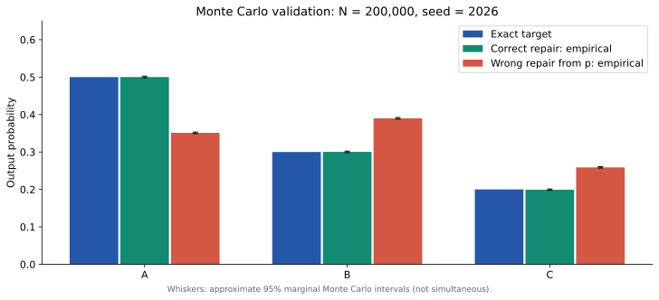

测试覆盖概率质量恒等式、三 token 联合分布、非法输入与数值边界、EOS、KV／树路径、训练梯度、lookup、逐次 benchmark 输出和预测合同检查。运行 `python -m unittest discover -s tests -v` 可查看全部测试结果。

随机 Transformer 演示生成 24 个新 token：神经草稿使用 21 轮、接受 3 个候选；lookup 使用 20 轮、接受 4 个候选，二者均等于目标贪心输出。随机权重上的这个差异没有任务代表性，轮数减少也不是墙钟加速结论。trace 及汇总见 [experiment_results.json](../data/experiment_results.json)。采样图误差线为各类别近似 95% Monte Carlo 区间，不是同时置信区间。

块验证有理数枚举见[核算脚本](../examples/check_block_derivations.py)与[核算结果](../data/block_derivation_checks.json)。该脚本检验一个可枚举例子，不宣称已实现可用于任意模型的块验证器。

<a id="s15-8"></a>
### 15.8 树、层复用与训练局部实验

[principle_lab.py](../examples/principle_lab.py) 把复杂机制缩小到可检查范围：

| 函数 | 原理对象 | 不能据此宣称 |
|---|---|---|
| `coupling_table` | 草稿与输出的联合概率边缘 | 任意树验证已实现 |
| `processed_distribution` | mask／温度／top-k／top-p 后的真实 q | 与所有框架 processor 顺序一致 |
| `tree_forward`、`gather_tree_cache` | 多层树条件 logits 与路径 KV | 完整高性能树采样器 |
| `split_layers_forward` | 前层串行、后层批量的激活复用 | 普通模型具备训练过的早退能力 |
| `block_context_mask` | anchor 合法上下文与训练块隔离 | DFlash 完整训练 mask 实现 |
| `conditional_joint` | 并行边缘与候选依赖差异 | 真实语法任务接受率 |
| `dpace_loss` | 位置权重、stop-gradient 与 CE 梯度 | 训练某个 checkpoint 的收益 |
| `allocate_budget` | 小规模、采样前估计的预算最优解 | 可直接部署的在线因果调度器 |
| `optimal_tree_score` | 固定子节点概率下的 DP | Sequoia 所有实现细节 |

`python -m examples.principle_lab` 输出数值 JSON；图 11–21 读取保存结果或明确的解析假设构建；`python -m examples.make_principle_figures` 可只重建这一组。正文可运行代码通过独立代码块检查，伪代码则明确标注未连接的论文模块。

<a id="s15-9"></a>
### 15.9 从候选概率到完整联合序列

| 要回答的问题 | 核心对象 | 对应可执行函数 |
|---|---|---|
| 为什么能保留草稿并保持目标分布？ | 联合分布与条件转移核 | `verification_kernel` |
| 一个随机变量控制整块时用什么 q？ | 潜变量后验与链式分解 | `mixture_conditional` |
| 变长一轮如何检查精确性？ | 多轮完整序列或相同 EOS 停止序列 | `enumerate_sequences` |
| 接受率应该在哪些前缀上平均？ | 存活事件下的前缀分布 | `acceptance_survival` |
| 概率保存不准确会怎样？ | TV 的转移核收缩与逐步耦合 | `one_step_law` |

全部函数位于 [exactness_lab.py](../examples/exactness_lab.py)，使用标准库 Fraction 做有理数计算；词表与长度增大时计算量指数增长。

数据输出是 [exactness_results.json](../data/exactness_results.json)。构图程序只读取这个文件，绘制两张 SVG，不重新抽样或覆盖概率结果。对应命令为 `python -m examples.make_exactness_figures`。

| 函数 | 输入与输出 | 应沿着哪条概率质量核对 |
|---|---|---|
| `draft_paths` | 已提交前缀 → 候选链、每位置 q、链概率 | 每条候选边乘以实际 q；所有终止路径总量为 1 |
| `verify_events` | 候选链和 p/q → 输出片段、接受数、事件概率 | 拒绝质量为 `alive*(1-a)`；存活质量更新为 `alive*a` |
| `enumerate_sequences` | 目标/草稿接口 → 完整输出到概率的字典 | 将候选质量、验证事件质量相乘，再递归下一轮 |
| `target_sequence_law` | 目标接口 → 目标自回归字典 | 独立实现直接乘目标概率，避免用同一校正逻辑自证 |
| `latent_block_experiment` | 三种概率解释之一 → 三 token 联合分布 | 条件 Z 的生成质量保持不变，只替换校正器使用的 q |
| `verification_kernel` | 固定 p/q → 小矩阵 | 每行和为 1，q 加权列和等于 p |

`verify_events` 中最关键的代码对应四种事件：

```python
# 结构摘录：省略残差展开与零质量分支，完整代码见 exactness_lab.py。
rejected_mass = alive * (1-a)   # 先前均通过，当前拒绝
alive *= a                     # 先前与当前均通过
if accepted_token_is_eos:
    emit(accepted_prefix)      # 不再补 bonus
else:
    continue_verification()    # 没有拒绝时才继续原候选链
```

`alive` 不等于“当前 token 的接受率”，而是**给定整条已采样候选链时，验证随机数使前缀仍存活的概率**。再乘 `candidate_mass`，才是原概率空间里的联合质量。搞清楚这两个条件层次，代码和公式就能逐项对应。

实验共有 16 组上下文／停止／预算组合：三词表、四输出上限，$\gamma\in\{0,1,2,3\}$，有无 EOS，有无可预测早停；每组对所有完整输出进行有理数比较。有 EOS 时支持集有 31 条序列，没有 EOS 时有 81 条。另有支撑不重叠、零输出预算、错误槽位边缘、核收缩与序列误差取等反例。

<a id="s15-10"></a>
### 15.10 缓存、数值与服务实验的代码地图

[systems_lab.py](../examples/systems_lab.py) 使用随机权重 CPU Transformer 检查缓存；流式时间线、排队与 roofline 使用明确的合成输入。结果保存在 [systems_results.json](../data/systems_results.json)，[make_systems_figures.py](../examples/make_systems_figures.py) 读取结果重建图像。它们用于验证机制，不能作为真实模型的 GPU 加速证据。


| 学习或研究问题 | 先读函数 | 独立验证的结果 |
|---|---|---|
| 每一行在预测谁 | `AttentionBlock.forward`、`cached_causal_mask` | block 行与完整前缀行一致 |
| 接受/拒绝后保留什么 | `_generate`、`crop_cache` | 修正后续算与真实历史一致 |
| 树是否泄漏兄弟分支 | `tree_forward`、`gather_tree_cache` | 改变兄弟不影响本分支；gather 后续算一致 |
| 错误是否来自数值边界 | `probabilities` | 极小正温度仍合法；并列最大值保留对称性 |
| 理论带宽复用有多重要 | `roofline_bound` | 改变 KV 复用假设后成本界变化 |
| 一批提交如何影响体验 | `streaming_metrics` | 相同平均 TPOT 仍可产生更长静默 |
| 接受率波动如何影响等待 | `fcfs_queue` | 平均服务时长不能决定排队分布 |
| 单请求加速证据是否充分 | `benchmark`、`timing_summary` | 每次输出和时长都保留，指标单位明确 |

下一步最有信息量的 GPU 实验，是固定模型与工作负载，仅改变验证输入数，测 `T_verify(B,S,N)`、KV 流量和实际提交前缀分布；再在固定到达率下观察 TTFT 与静默间隔。这样可以分清瓶颈究竟在草稿质量、内核复用，还是服务调度。

引用的 PyTorch 与 Transformers `main` 文档可滚动变化；源码行为应结合实际安装版本核对，实验 JSON 记录了使用环境。

<a id="s15-11"></a>
### 15.11 自包含 HTML、图表与环境版本

正文 Markdown 是唯一维护入口，SVG 由代码生成；HTML 是可重新生成的阅读产物。

```bash
python -m pip install -r requirements-html.txt
python -m examples.build_html
python -m examples.validate_artifacts --require-html
```

输出 `docs/投机解码深度调研与实践.html`，内嵌全部公式、SVG 与理论计算器，可离线阅读或打印。更新 Markdown 或图像后必须重建；`--require-html` 要求导出存在。默认验收在 HTML 存在时同时检查源文件指纹、代码块、内嵌图片、MathML 与章节导航。Node.js 可选，用于执行内嵌计算器检查，缺失时明确跳过。HTML 不随源码提交。

结果 JSON 保留相关环境字段。图构建只读取保存结果，不隐式改写实验 JSON；实验需要更新时显式运行对应命令。

<a id="s15-12"></a>
### 15.12 可选的真实模型实验入口

```bash
python -m examples.hf_assisted \
  --target /path/to/target --draft /path/to/compatible-draft \
  --tokens 128 --gamma 4 --repeats 3 --output build/hf_result.json
```

需要额外安装 Transformers 并准备兼容模型；目标和草稿 revision、tokenizer、dtype 和硬件应记录。该示例报告包含 prefill 的端到端单请求时间，两套模型均驻留。它不测服务并发容量，也不替代独立 GPU 性能复现。

完整的采样配置、GPU 同步和统计口径见[第 16 章](#s16)。

<a id="s16"></a>
## 16. 正确性、性能与服务评测设计

接受长度、token 速率、请求延迟与服务 goodput 回答不同问题。本章先定义工作量和观测边界，再用合成反例与可执行统计代码说明如何建立有效证据；真实模型入口仅提供实验起点。

<a id="s16-1"></a>
### 16.1 先固定指标、模型和比较对象

单请求延迟、固定并发吞吐、给定到达率下尾延迟、SLO 内 goodput、Agent 任务完成时间与训练 ROI 是不同目标。先选主指标，再决定负载，而不是测完后挑最好看的百分比。

固定目标权重、量化、tokenizer、模板、处理器、长度上限和停止规则。比较目标是否被更换、微调、量化，必须单独列出；baseline 要经过同等合理优化。

<a id="s16-2"></a>
### 16.2 负载与配置的最小实验矩阵

| 维度 | 初始设置 |
|---|---|
| 方法 | AR、lookup、可用的独立草稿／MTP、匹配 EAGLE-3／DFlash |
| 草稿预算 | 0、1、2、4、8；树另记深度和节点数 |
| 并发 | 1、4、16、64，按显存和业务收敛 |
| 输入／输出 | 短入长出、长入短出、长入长出 |
| 任务 | 聊天、代码编辑、数学、重复 Agent／rollout |
| 采样 | greedy 和实际温度／top-p；记录 proposal mode |
| 缓存 | 冷／热，prefix cache 与 suffix cache 分开控制 |
| 执行 | 预热、重复、交替基线顺序，固定资源 |

不必穷举所有组合。先定位有效区域，再围绕目标负载加密。同 batch 的延迟比较与同硬件下各自调优的容量比较分别报告。

<a id="s16-3"></a>
### 16.3 必须保存的原始结果字段

```text
run_id,target_revision,draft_revision,tokenizer_revision,engine_commit,
hardware,gpu_count,tp,dp,pp,dtype,quantization,attention_backend,graph_mode,
dataset_revision,prompt_template,concurrency,request_rate,input_tokens,
actual_output_tokens,stop_reason,temperature,top_p,top_k,proposal_mode,
method,draft_tokens,tree_nodes,cache_state,verification_rounds,
accepted_draft_tokens,committed_tokens,ttft_ms,decode_ms,e2e_ms,
draft_ms,verify_ms,sampler_ms,scheduler_ms,peak_memory_gb
```

汇总需保留 p50/p95/p99、失败与超时、重复间方差或区间。流式时间戳、整批 rollout 完成时间和冷启动可另记。EOS 使实际长度变短时，不能统一除以请求的最大输出长度。

<a id="s16-4"></a>
### 16.4 正确性与效率分别建立证据

贪心先比 token 序列，再定位 logits、position、mask、处理器与数值误差。随机算法先用小词表枚举或统计测试；相同 seed 文本不同不自动表示错误。带候选选择器、无放回提案和动态调度时，增加实际 $q$ 和准入信息边界检查。

有效覆盖包括零接受、全接受、草稿 EOS、拒绝 EOS、修正 EOS、长度尾部、重复节点、树路径切换和有状态处理器回滚。高吞吐 GPU sampler 需要独立数值与分布验证。

<a id="s16-5"></a>
### 16.5 数据污染、缓存与重复负载

检索草稿天然利用重复，评测必须明确重复来自真实业务还是提前把测试答案放进索引。冷缓存测试、在线逐步积累和预建外部库是三种不同条件。

训练集、目标生成数据、调参样本和评测集要分开；同一题目改写也可能泄漏。Spec-Bench 提供跨任务视角，但现代长推理和 Agent 重复轨迹还需要补充自己的真实负载。[Spec-Bench 所在综述](https://arxiv.org/abs/2401.07851)

<a id="s16-6"></a>
### 16.6 TTFT、TPOT 与 chunk 静默间隔

```text
客户端发出 ─ 传输/排队/prefill ─ 收到首 token ─ 后续 token/chunk ─ 收到末 token
           └────────── TTFT ──────────┘
           └──────────────────── E2E ──────────────────────┘
```

这里采用客户端同一单调时钟：TTFT 从发送请求到收到首 token，E2E 从发送请求到收到最后 token，包含传输、排队和模型执行。服务器内部指标需另用服务器上的到达与完成时间戳；不能将不同机器的未同步时钟直接相减。下文排队模型的到达时刻则是服务器队列入口，与客户端指标分开。

对 $n>1$ 个输出 token，常见请求平均值为：

$$
TPOT=\frac{t_{last}-t_{first}}{n-1}.
$$

如果一个网络 chunk 含 4 个 token，客户端只知道这 4 个 token 一起到达，并不知道服务内部各自何时完成。把它们分配同一个接收时间戳，可以计算客户端观察到的 token 间隔，但不能把这个间隔冒充 GPU 解码耗时。

下面两条合成轨迹 TTFT 都为 100 ms，最后 token 都在 380 ms，输出都为 8 个 token，因此平均 TPOT 都是 40 ms：

| 轨迹 | 接收方式 | 最大可见静默间隔 |
|---|---|---:|
| 平滑输出 | 100、140、180…380 ms，每次 1 token | 40 ms |
| 成批输出 | 100 ms 收 4 个，380 ms 再收 4 个 | 280 ms |

<!-- runnable: systems_streaming -->
```python
from examples.systems_lab import streaming_metrics

a = streaming_metrics([(.1+i*.04, 1) for i in range(8)])
b = streaming_metrics([(.1, 4), (.38, 4)])
assert abs(a['tpot_seconds']-b['tpot_seconds']) < 1e-12
assert b['max_token_gap_seconds'] > 6*a['max_token_gap_seconds']
```

服务评测可同时保留 TTFT、平均 TPOT、chunk 间隔 p95/p99 和最长静默间隔；对只输出一个 token 的请求，TPOT 应标为未定义，不能除以零或当作零延迟。

<a id="s16-7"></a>
### 16.7 平均服务时间、方差与排队

在单服务器先来先服务模型中，请求 $i$ 的到达时间为 $a_i$，服务时长为 $s_i$。递推为：

$$
b_i=\max(a_i,d_{i-1}),\quad d_i=b_i+s_i,
\quad W_i=b_i-a_i,
\quad R_i=d_i-a_i.
$$

`fcfs_queue()` 直接实现这四个量，其中 $b_i$ 为开始服务，$d_i$ 为完成，$W_i$ 为排队，$R_i$ 为端到端响应。固定相同到达序列，再替换服务时长，即可隔离波动影响。

实验让 40 个请求每隔 100 ms 到达。第一种服务每次 80 ms；第二种循环采用 `[20,20,20,260]` ms，平均也为 80 ms。前者无排队，响应 p95 为 80 ms；后者平均排队 54 ms，响应 p95 为 260 ms。

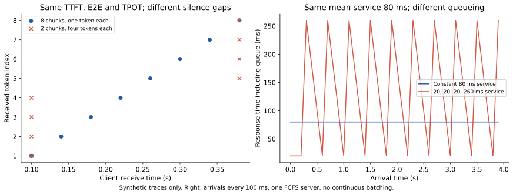

这不是投机服务调度器的仿真：真实连续 batching 会让请求服务时长依赖同批其他请求，也可能在草稿与验证阶段交错执行。该反例只说明，平均 token/s 或平均单请求耗时不足以决定尾延迟。

在更严格的 M/G/1 模型中，假设到达为速率 $\lambda$ 的 Poisson 过程，服务时长 $S$ 独立同分布且二阶矩有限，单服务器按 FCFS 执行。稳定条件是 $\rho=\lambda E[S]<1$，平均排队时长满足：

$$
E[W_q]=\frac{\lambda E[S^2]}{2(1-\rho)}
=\frac{\lambda(\operatorname{Var}(S)+E[S]^2)}{2(1-\rho)}.
$$

这说明服务时间的方差会影响平均等待，且接近饱和时 $1/(1-\rho)$ 会放大影响。它不能直接代入上面的确定间隔到达实验，更不能未经检验套用到连续 batching；价值在于揭示均值之外必须测量的量。[MIT《Urban Operations Research》M/G/1 推导](https://web.mit.edu/urban_or_book/www/book/chapter4/4.7.html)

<a id="s16-8"></a>
### 16.8 开环、闭环、失败和超时

闭环客户端通常等待上一请求完成后再发下一请求，或始终维持固定并发。系统变慢时，它也会自动降低实际到达率。开环测试独立于响应按预定时间发送请求，可以观察队列在给定到达率下是否积累。

因此比较结果必须记录负载模型。固定并发提高吞吐，不等于面对相同外部请求率一定满足尾延迟 SLO。还要声明请求失败和超时是否被排除；如果慢请求被丢弃后不计入统计，剩余请求的 p99 会显得更好。

<a id="s16-9"></a>
### 16.9 吞吐、goodput 与统计窗口

例如定义 $I_i=1$ 当请求 $i$ 同时满足 TTFT 和 E2E 限制，则窗口 $T$ 上的请求 goodput 为 $\sum_iI_i/T$。若报告 token goodput，应说明分子是合格请求的全部 token，还是逐 token 满足间隔 SLO 的 token。两者不是同一个指标。

端到端测量要固定窗口边界处理方式：窗口内到达的请求是否等到完成、只统计窗口内完成的请求，或采用稳态窗口。冷启动与 drain 阶段的处理也应保持一致。

总输出吞吐的分母为共同观测窗口；满足预设 SLO 的请求 goodput 也应使用相同窗口。

<!-- runnable: metrics -->
```python
requests = [
    {'ttft':.2, 'e2e':1.1, 'tokens':10},
    {'ttft':.3, 'e2e':2.2, 'tokens':20},
]
for r in requests:
    r['tpot'] = (r['e2e']-r['ttft'])/(r['tokens']-1)
assert all(abs(r['tpot']-.1)<1e-12 for r in requests)
window_seconds = 3.0
throughput = sum(r['tokens'] for r in requests)/window_seconds
slo_goodput = sum(r['e2e'] <= 1.5 for r in requests)/window_seconds
print(throughput, slo_goodput)
```

<a id="s16-10"></a>
### 16.10 均值、中位数、总量比的不同含义

对配对请求 $i$，记基线时间 $b_i$、投机时间 $t_i$、相同的输出工作量 $n_i$：

| 量 | 定义 | 回答的问题 |
|---|---|---|
| 请求速度比的算术平均 | $\frac1m\sum_i b_i/t_i$ | 一个等权随机请求的速度比均值 |
| 总时间比 | $\sum_i b_i/\sum_i t_i$ | 串行完成整个相同任务集合节省多少时间 |
| 池化 token 速率 | $\sum_i n_i/\sum_i t_i$ | 这组串行工作实际处理 token 的速率 |
| 服务吞吐 | 完成工作量／服务观测窗口 | 包含并发重叠和排队的系统处理能力 |

它们都可以有用，不能互相改名。并发请求的 `sum(request_latency)` 会重复计算重叠时间，不能拿它作服务吞吐分母。输出长度改变时，token 速率也可能鼓励生成更长的回答，因此还需固定任务集合、比较完成率和任务耗时。

[hf_assisted.py](../examples/hf_assisted.py) 的 `e2e_speedup` 是两组中位时长之比，适合描述典型请求延迟。它不是总 token 吞吐的估计；总量比及逐次配对结果由不同字段记录：

| 字段 | 定义 | 用途 |
|---|---|---|
| `e2e_speedup` | median(AR 时长) / median(SD 时长) | 典型请求时长对比 |
| `aggregate_speedup` | sum(AR 时长) / sum(SD 时长) | 本组相同输出量的串行总耗时对比 |
| `paired_speedups` | 每一配对的 AR 时长 / SD 时长 | 保留重复间波动 |
| `pooled_*_tokens_per_second` | 总生成 token / 总测量秒数 | 连续串行测量速率，不是服务吞吐 |

反例：AR 时长 `[1,1,10]` 秒，SD 为 `[1,2,3]` 秒。中位比为 $1/2=0.5$，总量比为 $12/6=2$。两者描述不同问题，不应只选数值更大的作为“加速”。

<!-- runnable: systems_timing_units -->
```python
from examples.hf_assisted import timing_summary

result = timing_summary({False: [1., 1., 10.], True: [1., 2., 3.]}, 12)
assert result['e2e_speedup'] == .5
assert result['aggregate_speedup'] == 2.
assert result['pooled_baseline_tokens_per_second'] == 3.
```

默认 3 次重复只能检查入口，不能稳定估计 p99 或可靠置信区间。延迟推断还应增加重复、覆盖多 prompt，并在独立测试集上确认预算选择；不要把同一请求中相关的 token 当成大量独立样本。

<a id="s16-11"></a>
### 16.11 HF assisted 示例的测量合同

[hf_assisted.py](../examples/hf_assisted.py) 预先加载目标与草稿，再用同一个输入交替执行普通生成和 assisted generation。它验证每次输出都与同一贪心参照一致；计时覆盖每次 generation 中的 prefill 和 decode，不含模型加载。两套权重在两条路径中都驻留，因此该对照没有测普通 AR 释放草稿权重后可获得的额外容量。

固定草稿预算同时设置 `num_assistant_tokens`、`num_assistant_tokens_schedule="constant"` 和 `assistant_confidence_threshold=0.0`，避免长度启发式或正置信阈值把配置的最大预算误解为每轮实际长度保证；EOS 和剩余输出预算仍会缩短草稿。参数定义以安装版本为准。[Transformers 官方 generation 参数](https://huggingface.co/docs/transformers/main/en/main_classes/text_generation)

只比较 vocabulary 字典仍不足以证明 tokenizer 完全相同。脚本额外比较 special IDs 与本次 prompt 编码，但 normalization、decode、模板和其他输入的行为仍需由已知兼容模型对保证。跨 tokenizer 是单独算法问题。

脚本记录 Python、CUDA 与框架版本、设备名、设备总内存、输入 token 数、生成参数以及原始重复时长；对非正或非有限时长直接报错，避免产生无意义倍率。GPU 总内存是硬件容量，不能当成进程峰值显存。

配套离线实验不下载 checkpoint，也不提供 GPU 性能数据。真实部署仍需记录权重与 tokenizer revision、量化、attention backend、graph 模式、TP/PP/DP、实际停止原因以及服务请求时间戳。脚本记录的本地路径若没有版本 hash，也不能唯一标识权重。

<a id="s16-12"></a>
### 16.12 GPU 异步执行与计时边界

GPU 调用通常异步排队。计时 Python 发起调用后立即返回，只得到提交时间。当前脚本在整次 generation 前后做 CUDA 同步，因此得到这个串行单请求场景的端到端墙钟时间。设备事件适合测已定义 stream 上的 GPU 区间；多 stream 需要明确依赖关系。[PyTorch 官方 CUDA 执行说明](https://github.com/pytorch/pytorch/blob/main/docs/source/notes/cuda.md)

不要把微基准同步照搬到每个服务 token：全设备同步可能阻断其他请求，改变本来要测的并发执行。上线测试应使用请求级时间戳，组件分析则用 profiler 或设计好的事件区间。

模型加载、首次编译、graph capture 与稳定态生成应分开报告；两条路径都需预热，并保留原始重复结果。

<a id="s16-13"></a>
### 16.13 配对设计与独立统计单位

同一 prompt 的难度同时影响基线与投机时间，配对能够保留这个相关性。按配置先跑完 A 再跑 B 则可能把热降频、后台负载或缓存热度误当成方法差异；应交错或随机顺序，并保存每次原始结果。真正随机采样时，相同 seed 不保证相同输出，所以“相同任务”与“完全相同 token 工作量”须分开说明。

统计单位要对应泛化对象。若关心新 prompt 的表现，应按 prompt 重采样；同一个 prompt 的几十个重复运行不是几十个独立任务。同一会话中的多个轮次也往往相关，适合按会话聚类。若只对一个固定 prompt 反复计时，得到的是该 prompt 上运行噪声的估计。

<a id="s16-14"></a>
### 16.14 配对 bootstrap 怎样估计不确定性

[paired_speed_interval](../examples/cost_aware_lab.py)每次抽一组请求索引，用同一组索引重采样两种方法，然后重新计算总时间比：

```python
# 核心实现摘录；参数校验与结果字段见源码。
indices = rng.integers(0, len(base), size=(draws, len(base)))
ratios = base[indices].sum(axis=1) / spec[indices].sum(axis=1)
low, high = np.quantile(ratios, [.025, .975])
```

`indices` 每一行代表一份重采样的数据集；两种方法共享它，配对关系才不会被破坏。先逐项相除再平均会改成另一个估计量。2.5% 和 97.5% 分位数得到的是简单 percentile bootstrap 区间，它依赖采样代表性和独立统计单位，并非分布无关的保证。[SciPy bootstrap 官方说明](https://docs.scipy.org/doc/scipy/reference/generated/scipy.stats.bootstrap.html)也区分配对重采样与不同区间方法；本例未引入 SciPy 依赖。

<!-- runnable: cost_paired_bootstrap -->
```python
from examples.cost_aware_lab import paired_speed_interval
r = paired_speed_interval([10., 100., 1000.], [5., 50., 500.], draws=1000)
assert r['aggregate_speedup'] == 2
assert r['percentile_95_interval'] == [2., 2.]
# 三个样本总是精确两倍：这里只验证配对和估计量，不是性能证据。
```

实验使用 80 对独立合成请求；投机请求总时间由本请求的基线时间和预先固定的 500 ms 尺度生成，没有用整批样本统计量耦合各请求。运行实验可查看总时间比及其区间。对这份已测语料，两个总时长和它们的比值已经确定；重采样估计的是请求总体或重新抽取语料时的统计不确定性，不是给已知总和制造误差条。这说明代码怎样保留配对关系，不证明真实系统获得这些收益。区间跨 1 表示数据与“无收益”相容；不跨 1 也不能补救不公平基线、输出质量变化或遗漏硬件成本。

<a id="s16-15"></a>
### 16.15 统计误差与系统性分布偏差

独立采样下，某 token 经验频率 $\hat p$ 的标准误差近似为 $\sqrt{\hat p(1-\hat p)/N}$。N 增大，随机误差约按 $1/\sqrt N$ 缩小；系统性错误修正造成的偏差不会随样本数消失。

图 06 的误差线是各类别的近似边缘区间，不是所有类别同时覆盖的保证。固定 seed 有助复现，但不能代替多个随机输入／参数配置或数学证明。联合序列测试比单 token 频率更能暴露“某一步概率对，但历史条件错”的问题。

<a id="s16-16"></a>
### 16.16 公平消融与可发表实验的闭环

比较选择器时固定主干、数据、训练量与引擎；比较验证器时固定草稿分布；比较动态预算时固定到达过程、硬件和模型。若同时换模型、量化、batch 和 kernel，无法把速度变化归因到某个投机创新。

训练／调参／测试严格分离；重复任务中还要控制缓存初始状态。检索方法使用真实历史复用是合理条件，预先装入测试答案是另一个条件，必须明示。

| 要回答的问题 | 固定什么 | 改变什么 | 至少记录什么 |
|---|---|---|---|
| 条件头是否值得 | 同目标、数据、主干、验证预算 | 无头／Markov／RNN | 各位置存活、头耗时、整轮时间 |
| 损失是否有收益 | 同模型容量、数据、训练 token/算力 | CE/KL、TV、LK、D-PACE | loss、真实提案模式、接受与时间 |
| 改善是否来自 rollout | 固定结构与损失 | 状态反馈、token来源、监督前缀 | 三者独立开关后的结果 |
| 跨轮训练是否更直接 | 同草稿及采样规则 | 局部长度目标／跨轮目标 | 原始长度、轮数、配对时间、训练开销 |
| 学会的置信度能否调度 | 同成本表、部署温度 | 原始／校准置信度 | reliability、存活误差、预算浪费与时间 |

先运行 `python -m examples.training_objectives_lab` 和 `python -m unittest discover -s tests -p 'test_training_objectives.py' -v`，确认推导对应的有限例子。它们验证的是数学区分与程序边界，不验证任何实际模型的质量或加速倍数。


最小闭环应能回答以下相互独立的问题：

1. **正确性。** 小词表精确枚举或贪心全序列对照是否通过？目标处理器、EOS 和状态提交是否一致？
2. **机制。** 提升来自更好的前缀存活，还是更低的草稿／验证成本？记录每个有效深度的分子分母。
3. **系统。** 关闭投机、最佳固定预算和动态方法是否在相同模型／显存／设备数量下比较？图编译与 warmup 是否单列？
4. **统计。** 保存原始配对记录，按正确统计单位做区间估计，同时给出正收益和负收益负载。
5. **任务。** 生成总长度、任务质量、成功率和 goodput 是否变化？是否包含 prefill、工具与排队？

<a id="s17"></a>
## 17. 研究切入点与实施顺序

第 12 章的成本条件与第 16 章的评测设计，可以把“提高接受率”转成可证伪的时间、资源与质量假设。研究路线应由已有资产和实际瓶颈共同决定。

<a id="s17-1"></a>
### 17.1 按已有资产选择起点

| 已知条件 | 优先验证 | 主要未知量 |
|---|---|---|
| 重复代码编辑／Agent 轨迹 | lookup、suffix、神经回退 | 重复率、索引成本、冷启动 |
| 目标已有 MTP | 一步 MTP，再扫多步 | 递归失配与 head 成本 |
| 固定目标且有匹配草稿 | EAGLE-3 与 DFlash | 草稿关键路径、接受前缀、验证宽度 |
| 经常更换同家族目标 | 独立 LM、PARD | 复用收益与再训练成本 |
| 长上下文 KV 占主导 | 稀疏草稿 KV、TriForce／MagicDec 思路 | 完整目标与近似草稿的成本比例 |
| 目标需要 RAM offloading | 大候选树、SpecExec／Sequoia 思路 | 搬运摊销、树覆盖、内存 |
| 有训练资源 | LK／D-PACE／轻量依赖头 | 同预算下的速度增量 |
| 并发变化大 | 浅草稿、EMA／置信预算、关闭投机档位 | SLO goodput、切换和因果性 |

这些是由机制得到的实验候选，不是未经本平台测量的部署保证。

<a id="s17-2"></a>
### 17.2 五个可检验的研究问题

1. **接受收益是否抵得过选择器成本？** 同 DFlash 主干上比较独立槽位、Markov 头与候选格，控制训练量和块长，分解主干／head／verify 时间。
2. **lookup 与神经草稿如何路由？** 用已知前缀信号选择，比较查询开销、重复覆盖与总提交率；随机路由单独证明校正。
3. **接受导向训练何时有效？** 固定结构、数据和预算，对比 CE／KL／LK／D-PACE，同时检查随机提案和确定性提案。
4. **动态预算能否提高真实服务收益？** 比静态档位、batch 映射、EMA 和置信调度，报告 SLO goodput，并验证选择偏差。
5. **验证器优化是否更便宜？** 同一随机草稿对比 token／block verification，量化接受增量和词表规约、kernel、显存成本。

<a id="s17-3"></a>
### 17.3 本仓库的合理推进顺序

第一步固定真实目标、GPU 环境、引擎 commit 与任务集，建立 AR 和最小投机基线；第二步统一逐轮输出、停止规则和计时字段；第三步测接受与成本曲线，识别主瓶颈；第四步只对一个部件做对照改进，再扩展并发和领域。

目前适合作为算法正确性基准的是已有 `verify_candidates` 和 KV 测试；真实服务实验适合通过固定版本引擎适配层接入。是否进一步训练草稿，应由现成资产和 profile 结果决定，避免把训练、验证器、引擎升级同时改动而无法归因。


<a id="s17-4"></a>
### 17.4 把研究问题写成可证伪假设

“增加一个候选相关头会更快”过于模糊。更可检验的表述是：“固定 DFlash 主干、相同训练 token 与 H100 后端，在指定任务和并发下，相关头增加的平均提交量足以抵消 head 和验证开销。”如果提交增长但墙钟时间更差，假设就没有成立。

| 假设 | 最小对照 | 支持它需要看到什么 |
|---|---|---|
| 后缀失配主要来自候选独立性 | 独立槽位 vs 条件头，同主干 | 后部条件存活提高，且额外时间可接受 |
| 大词表 head 是主要瓶颈 | 完整 head vs 子集／量化 head | head profile 降低，接受损失未抵消收益 |
| 当前草稿太深 | 同请求扫不同 gamma | 总输出／总时间在较浅处达到峰值 |
| lookup 可节省重复任务时间 | 冷／热缓存与神经基线 | 命中带来的目标摊销超过查询维护成本 |
| 预算预测改善高负载 | 静态 vs 因果动态策略 | SLO goodput 提高，输出分布测试不变 |

<a id="s17-5"></a>
### 17.5 从本仓库教学实验走向真实研究

第一层是数学：先复现 q、接受质量、残差和联合分布；第二层是状态：用 TinyTransformer 验证 logits、KV、树路径和分层复用；第三层是实际模型：固定 checkpoint 与引擎运行闭环；第四层是系统：真实长度与请求到达下测 profile。

每一层都产出能检查的结果。不要用随机权重小模型的低接受率否定某种方法，也不要用真实模型某个任务的速度掩盖验证器的概率错误。

<a id="s18"></a>
## 18. 常见混淆与证据边界

| 问题 | 本文处理 |
|---|---|
| SpecTr 名称与论文编号混淆 | 采用正确原文 2310.15141，避免把同名或错误编号作为证据 |
| PARD／P-EAGLE 的 COD 被混称 | 采用原论文 Conditional Drop-token；保留 README 与专题冲突说明 |
| P-EAGLE 专题称无权重，但仓库提供模型链接 | 已保存配置声明 `PEagleDraftModel`；模型卡文字仍须区别对待 |
| DFlash2 推理公开被当作完整训练公开 | 明确原作者训练目标与第三方实验 split objective 的边界 |
| LiLiCorr 被泛称“全局最优路径” | 说明局部前驱条件归一化；整链目标可能牺牲早期位置 |
| vLLM 总览与 adaptive 专题支持范围不同 | 以具体专题描述范围，保留跨页面不同步的事实 |
| 当前 vLLM 新增 FLy | 单独标注有损验证，排除严格分布一致组 |
| 新出现的 EAGLE3.1 和草稿 head 量化入口 | 记录实际读到的配置与限制，不补造独立效果结论 |
| FastMTP 正文百分比与表格不符 | 采用 2.03、1.21、1.67、1.81 等原始倍数；不照抄冲突百分比 |
| 理论 gamma=0 与代码执行混用 | 实现共用目标路径，调用计数测试验证不运行草稿 |
| EOS 截断后仍用原 trace 统计有效接受 | 已在验证阶段停止，trace 与实际提交及缓存一致 |

FastMTP 原文把 2.03× 相对于 1.21×、1.67×、1.81× 的提升写为约 82%、36%、22%；按这些显示值直接计算分别约 **67.8%、21.6%、12.2%**。即使考虑四舍五入也不能解释差距，本文不替作者猜测其他分母。[原文](https://arxiv.org/html/2509.18362)、[算术核算](../data/block_derivation_checks.json)

其他不确定性仍包括：滚动文档与稳定版差异、开发分支支持、未公开训练细节、厂商／作者性能报告的独立复现、未检索到的最新论文，以及具体硬件组合是否可运行。下载成功或内容哈希匹配不代表已经完整审查一篇论文。


<a id="s18-1"></a>
### 18.1 证据冲突如何追溯到原始对象

当论文、README、模型卡和框架专题不一致时，先问自己要确认什么。算法名称和概率规则优先回原论文；权重类型看实际配置与张量；部署限制看匹配版本源码和测试；性能看实验表格、硬件与计时边界。

下载成功表示拿到文件，哈希匹配表示文件与已记录快照一致；二者都不证明其中每句话正确。原文数字算术不一致时，可以独立核算并明确差异，不能猜测作者没有给出的分母。

<a id="s18-2"></a>
### 18.2 概念错误与实现错误的排查顺序

| 现象 | 先核查 |
|---|---|
| 接受率异常接近 100% | logits 行号、是否看到了候选自身或未来特征 |
| 第一轮正确，拒绝后分叉 | 双 KV、position、processor 状态、修正 token 是否重复入缓存 |
| 单 token 分布对，长序列错 | 条件前缀、后缀丢弃、联合提案和动态选择 |
| 贪心一致但随机有偏 | 实际 q、top-p 归一化、残差、随机树路径选择 |
| 接受长度增加但更慢 | 草稿 head、CPU/GPU 同步、验证宽度和图档位 |
| 单请求快但吞吐差 | 显存容量、有效 batch、排队、共享索引和请求长度分布 |

这些排查顺序把“模型预测差”和“程序校正错”分开。精确验证允许草稿不好，但不能允许错误的条件概率和状态被当作目标分布。

<a id="s18-3"></a>
### 18.3 概率与实现条件自检

下面几个问题可以检验是否掌握了相关条件：

| 问题 | 核对答案 |
|---|---|
| 草稿概率与目标相同，是否允许丢掉所有 q，只保留 argmax 候选？ | 候选机制改成确定性，实际 q 变为点质量，需要重新解释校正 |
| 混合模型每槽边缘均匀，是否代表块内独立？ | 不代表；共享潜变量例子有 $P(AA)=41/100$ |
| 接受 EOS 后 A+1 公式仍成立吗？ | 不成立；没有额外修正或 bonus，应使用实际提交数 |
| 看到某个已生成 token 后能否停止草拟？ | 可保留该 token 并决定不抽下一项；取消该样本是另一个问题 |
| 单位置统计完全正确能否证明序列无损？ | 不能；错误槽位边缘例子的所有单位置统计均正确 |
| 用近似草稿是否必然使目标输出近似？ | 不必然；真实 q 与校正一致时只影响接受与成本 |
| 更高接受率是否证明算法更好？ | 先核对联合正确性，再比较包含概率求值与系统开销的总成本 |

<a id="s19"></a>
## 19. 来源索引、阅读路线与资料维护

原论文、作者实现、框架支持和独立性能复现是不同层次的证据。以下索引便于追溯方法与版本；引用元数据不是性能背书。

<a id="s19-1"></a>
### 19.1 理论、候选结构与系统原文

| 主题 | 原始资料 |
|---|---|
| 奠基 | [Leviathan et al.](https://arxiv.org/abs/2211.17192)、[Chen et al.](https://arxiv.org/abs/2302.01318) |
| 多候选与树 | [SpecInfer](https://arxiv.org/abs/2305.09781)、[SpecTr](https://arxiv.org/abs/2310.15141)、[Sequoia](https://arxiv.org/abs/2402.12374)、[SpecExec](https://arxiv.org/abs/2406.02532) |
| 验证 | [Block Verification](https://arxiv.org/abs/2403.10444)、[Lookahead](https://arxiv.org/abs/2402.02057) |
| 免神经草稿 | [REST](https://arxiv.org/abs/2311.08252)、[SuffixDecoding](https://arxiv.org/abs/2411.04975) |
| 长上下文 | [TriForce](https://arxiv.org/abs/2404.11912)、[MagicDec](https://arxiv.org/abs/2408.11049) |
| 评测 | [Speculative Decoding Survey / Spec-Bench](https://arxiv.org/abs/2401.07851) |

<a id="s19-2"></a>
### 19.2 模型结构与训练原文

| 主题 | 原始资料 |
|---|---|
| 独立草稿蒸馏 | [DistillSpec](https://arxiv.org/abs/2310.08461) |
| 多头／递归头 | [Medusa](https://arxiv.org/abs/2401.10774)、[Hydra](https://arxiv.org/abs/2402.05109)、[ReDrafter](https://arxiv.org/abs/2403.09919) |
| 特征草稿 | [EAGLE](https://arxiv.org/abs/2401.15077)、[EAGLE-2](https://arxiv.org/abs/2406.16858)、[EAGLE-3](https://arxiv.org/abs/2503.01840)、[HASS](https://arxiv.org/abs/2408.15766)、[FR-Spec](https://arxiv.org/abs/2502.14856) |
| 权重与头复用 | [Draft & Verify](https://arxiv.org/abs/2309.08168)、[LayerSkip](https://arxiv.org/abs/2404.16710)、[MTP](https://arxiv.org/abs/2404.19737)、[DeepSeek-V3](https://arxiv.org/abs/2412.19437)、[FastMTP](https://arxiv.org/abs/2509.18362)、[UNO](https://arxiv.org/abs/2609.04010) |
| 并行与半自回归 | [PARD](https://arxiv.org/abs/2504.18583)、[P-EAGLE](https://arxiv.org/abs/2602.01469)、[DFlash](https://arxiv.org/abs/2602.06036)、[Domino](https://arxiv.org/abs/2605.29707)、[DSpark](https://arxiv.org/abs/2607.05147)、[DFlash 2 作者说明](https://inco.ai/blog/dflash2/)、[LiLiCorr](https://arxiv.org/abs/2608.20530) |
| 接受导向目标 | [LK](https://arxiv.org/abs/2602.23881)、[D-PACE](https://arxiv.org/abs/2605.18810) |

arXiv 编号反映首次提交月份，内容可能来自较新修订版；访问日期不是发表日期。公开来源索引记录 URL、访问日期和原文指纹，重现时仍应记录明确版本。EAGLE-1/2、Draft & Verify 等机制依据索引中注明日期的资料，不将所有来源描述为同日完整审阅。

<a id="s19-3"></a>
### 19.3 证据类型与版本信息

本文引用原始论文、作者实现、模型配置和推理框架官方资料。公开的 [references.json](references.json) 保留标题、URL、类型、访问日期及部分所阅版本的 SHA-256 指纹；不包含下载文件本体、搜索响应、完整论文或第三方源码。

- 原论文支持方法、证明与特定实验条件，不直接证明所有引擎已经支持。
- 作者代码／模型配置支持某种可用实现或资产，不保证任意目标兼容。
- 框架 `main/latest` 表示访问时材料，不自动等同稳定发行版。
- 作者或厂商报告不是独立复现；同一团队的论文、README、博客不能算多次独立验证。
- SHA-256 仅用于识别所阅内容，公开包不含对应原文，不能离线复验这些来源指纹，也不能据指纹判断结论正确。
- 未来预测保存在 [forecasts.json](forecasts.json)，含基线、具体范围、评估窗口、成功条件及反证条件，信心是定性判断而非校准概率。

<a id="s19-4"></a>
### 19.4 检索范围与不确定性

原检索截止 2026-10-20，正文包含截至 2026-10-25 的部分来源更新，具体以各条资料注明的日期和版本为准。通过学术索引和官方链接按多个主题筛选；多数主题只读取首批结果，没有穷尽分页。因此这是发现性调研，不是系统性综述或技术采用率调查。

部分资料存在日期、标题或接口说明冲突，正文在对应位置标明。版本变化较快，部署时应重新核对实际 release/commit、模型合同和运行日志。

<a id="s19-5"></a>
### 19.5 第三方内容与更新要求

论文、网页及外部实现保留在其原始站点，通过参考链接访问。项目只分发自行整理的说明、图像及教学代码；运行示例使用随机权重，不包含第三方预训练 checkpoint、业务数据或论文图表拷贝。每条外部资料仍受其自身许可约束，项目未来选择的许可证不覆盖外部链接内容。

提交资料更新时，补充来源 URL、访问日期、明确版本及影响的结论；性能数字同时注明模型、硬件、任务、采样、计时边界和基线。修订预测时保留原起算日，区分未达到、出现反证和证据不足。

<a id="s19-6"></a>
### 19.6 本地资源与维护入口

- [来源索引](references.json)：一手资料链接、访问日期与阅读版本指纹。
- [实验数据](../data/README.md)：原创离线实验数值与各自生成命令。
- [预测台账](forecasts.json)：判断起算日、证据 ID、成功标准与反证条件。

正文由这一份 Markdown 维护；完整运行、构图与 HTML 导出命令见[第 15 章](#s15)。实验代码与 SVG 随仓库提供，第三方论文和作者实现通过原始链接访问。

<a id="s19-7"></a>
### 19.7 从知识单元到实验和图表

| 学习单元 | 先读章节 | 配套执行／图 |
|---|---|---|
| 概率与计算瓶颈 | 1、2 | roofline 例子、耦合表、图 11／21 |
| Transformer 状态 | 3 | logits 对齐、KV 回滚、图 05／10 |
| 真正的提案 q | 4 | `processed_distribution`、图 12 |
| 免训练候选 | 5 | lookup、计数模型、完整 `lookup_generate`、图 07 |
| 特征与神经草稿 | 6 | 融合张量例子、图 13 |
| 权重和激活复用 | 7 | `split_layers_forward`、LoRA 行路由、图 14 |
| 并行候选依赖 | 8 | 联合分布、训练 mask、Markov 头、图 15／16 |
| 树与块验证 | 9 | `tree_forward`、gather、DP、Fraction 枚举、图 17 |
| 训练目标 | 10 | KL 梯度、`dpace_loss`、图 18 |
| 长上下文与调度 | 11 | KV 公式、`allocate_budget`、选择偏差、图 19／20 |
| 成本与统计 | 12、14、16 | 前缀存活、总量比、计时和 goodput 例子 |
| 接入、代码与研究 | 13、15、17–19 | trace 合同、配置解释、证据判断 |

原理核算分布在各章对应的可运行片段；`check_tutorial_snippets` 一次执行全部 47 段。结构伪代码明确注明模型与后端缺口，不作为已完成的论文复现。

<a id="s20"></a>
## 20. 扩展公开检索：2026 年的新证据与研究缺口

<a id="s20-1"></a>
### 20.1 检索范围与证据等级

**原检索截止：2026-10-20；部分来源更新至 2026-10-25，各条资料以所注日期和版本为准。** 本文使用 arXiv 搜索/API、Hugging Face 论文索引、作者仓库及官方框架资料，按训练与验证、长上下文、混合状态、异步／编译、RL／Agent、多模态和端侧等主题筛选。

候选发现采用部分结果页，没有系统地遍历全部分页，因此存在时效和入口选择偏差。正文以实际核对的机制、实验条件和限制为依据，不声称穷尽全网或提供采用率统计。公开的[来源索引](references.json)仅保留引用元数据和版本指纹，不分发论文全文、模型代码快照或搜索响应。

个别资料存在元数据异常：PolyGraph 的编号为 2610，但查询时 API 和 PDF 记录 8 月提交，原因未能确定。本文不使用这一日期作为“最近才出现”的趋势证据，读者应在引用时进一步核对原始记录。

论文、作者仓库和同作者博客通常属于同一研究团队，不能计作多次独立验证。预印本、可下载权重、框架接口和生产报告分别说明不同成熟度；文件可获取或哈希一致不等于所有主张正确。更多说明见 [第 19 章的资料说明](#s19)。

<a id="s20-2"></a>
### 20.2 训练目标开始从单步重叠走向跨轮成本

已有 CE／KL／LK／D-PACE 主要处理 token 或块内的分布匹配、位置权重。新工作 **Expected Decoding Rounds（EDR）** 指出：并行草稿同一个输出位置的分布，还依赖这一轮从哪里开始；而下一轮起点又由之前接受多少决定。因此，最大化某个孤立块的接受长度，不一定最小化整段生成轮数。[EDR 原文](https://arxiv.org/abs/2610.10411)

[第 10 章](#s10)已用 round-start 动态规划解释局部接受与跨轮收益，并推导给定最终目标输出时的反向条件概率 $\min(1,q/p)$。EDR 将固定轨迹上的状态转移与每轮成本写成马尔可夫奖励过程（Markov reward process），再以状态 $(n,t)$ 的到达概率加权局部拒绝成本，处理 bonus 不属于候选、EOS 不开启新轮的边界，并给出 TD 形式梯度。精确条件轮数评估与完整目标分布的训练损失不必对单条 rollout 相等，在目标轨迹上取期望后才一致。

证据边界：实验为 Qwen3-4B／DSpark、Qwen3-8B／DFly，块长 7、指定采样规则，在 H100 或 H200 上微调；作者仓库提供目标和离线 evaluator，并明确当前从已发布草稿继续训练。**轮数最优不等于墙钟最优**，成本随硬件、batch 或草稿结构变化时仍须测实际时间。[作者实现](https://github.com/y-x-zhao/AngelSpec-EDR)

相关工作包括 DScout 的监督“纳入位置、位置权重、预测损失”分解与部署预算选择；TreeSpark 在训练中回放实际树展开、裁剪和装填；ALR／IRA 用目标 rollout 修复外部语料导致的后续标签失配。三者分别改变训练分配、训练候选策略和监督来源，不能只因都“感知接受”就当作同一目标。[DScout](https://arxiv.org/abs/2610.23935)、[TreeSpark](https://arxiv.org/abs/2610.20175)、[ALR／IRA](https://arxiv.org/abs/2609.38795)

<a id="s20-3"></a>
### 20.3 长上下文正在拆分“历史信息”与“草稿历史开销”

近期至少有四种不同选择，目标都是减少草稿重复处理历史的代价，但不能混称为“无上下文”：

| 路线 | 草稿如何读取历史 | 主要收益来源 | 需要保留的限制 |
|---|---|---|---|
| 冻结短草稿＋窗口／位置重定位 | 仅读固定近邻，但输入含目标整段上下文特征 | 限制草稿 attention 与位置范围 | RoPE 共同平移不变性有条件；跨重定位边界不自动等价 |
| LongSpark／DLite | 固定大小的目标上下文视图、局部表示或末端特征 | 避免不断增长的草稿持久状态 | 信息压缩会影响接受；特征收集成本要算入 |
| H-Spec | 原位读取目标 KV，再加入最后位置 hidden state | 删除独立草稿侧 KV 写入与存储 | 仍可能扫描目标 KV；“没有自己的 cache”不等于历史读取为常数 |
| FOLD | 保留近邻相对位置；远历史条目共用一个位置编码，内容条目仍逐项保留 | 缓解位置外推与远记忆 attention 稀释 | 额外保存未旋转 K/V，内存随上下文线性增长；不是把远历史压成单个条目 |

来源：[冻结短草稿](https://arxiv.org/abs/2610.20865)、[LongSpark](https://arxiv.org/abs/2609.37029)、[DLite](https://arxiv.org/abs/2610.23787)、[H-Spec](https://arxiv.org/abs/2609.24197)、[FOLD](https://arxiv.org/abs/2610.20392)。

这些工作共同支持“目标负责准确读取完整上下文，草稿可以只保留廉价近似”的设计空间，却尚未证明所有长距离任务都能用同一种压缩。H-Spec 的“无独立 KV”和 FOLD 的“位置折叠”也不属于同一种常数成本机制。冻结短草稿论文自己限定：收益首先要求整轮成本／实际提交数低于匹配 AR 基线；曾出现仅改变验证 kernel 就让速度结论反转的例子。H-Spec 需要草稿和目标的 K/V 维度匹配，低并发短输入时还可能更慢。DLite 部分比较引用了外部报告结果，不能把它们视作全套同平台重测。

**指标区分。** 草稿 KV 容量、草稿历史读取量、目标 KV 容量、目标信息覆盖是四个不同指标。后续实验应分别记录，不能只报告“草稿 cache 减少若干倍”。

<a id="s20-4"></a>
### 20.4 混合模型的状态既是新瓶颈，也是新信息源

对 SSM／Gated DeltaNet 等递归状态，拒绝后的回滚不再只是裁剪 token KV。直接在每个候选位置保存整个状态，会放大显存与写入成本。**ReplaySSM** 将状态写为“检查点＋最近输入缓冲”，大多数步骤只读出输出，周期性更新检查点；拒绝后可以丢弃尚未提交的输入记录。[论文](https://arxiv.org/abs/2610.13778)

对于简单递归 $S_t=a_tS_{t-1}+u_t$，展开为

$$
S_t=\left(\prod_{i=c+1}^{t}a_i\right)S_c+
\sum_{j=c+1}^{t}\left(\prod_{i=j+1}^{t}a_i\right)u_j.
$$

它说明“计算输出”与“每步写回完整状态”可以分离。GDN 的实际推导和 kernel 更复杂，浮点数值也需独立检查；低精度读出状态与高精度递归状态分开，可降低误差进入后续更新的机会，但仍不等于所有低精度结果与 FP32 分布相同。

可用证据包括论文、作者 fork 及 vLLM `main` 的相关 output-only kernel，NVIDIA 技术说明提供了框架 PR 与部署报告。证据已经超出摘要，但支持范围仍须区分 Mamba2／GDN、标准 decode／speculative decode、Triton／FlashInfer 和稳定版本。论文在小 batch 的部分设置没有收益，标准解码个别端到端数字受 B300 功耗上限影响，也明确标注。[作者仓库](https://github.com/Johnny-Liou/ReplaySSM)、[NVIDIA 说明](https://developer.nvidia.com/blog/replayssm-rethinking-state-storage-for-faster-hybrid-model-decoding/)、[vLLM 源码](https://github.com/vllm-project/vllm/blob/main/vllm/model_executor/layers/mamba/ops/selective_state_update_replayssm_output_only.py)

另外，TreeWY 和 LumoTree 研究树状候选的递归状态验证／提交，强调跨分支临时状态与持久状态隔离；ReaDy 则让草稿不同位置主动查询目标已提交递归状态，补充 hidden features 未强调的信息。前两类优化验证执行，后一类优化提案条件，属于可组合但不同的层次。[TreeWY](https://arxiv.org/abs/2608.20961)、[LumoTree](https://arxiv.org/abs/2609.23900)、[ReaDy](https://arxiv.org/abs/2610.20503)

<a id="s20-5"></a>
### 20.5 联合提案、并行树与被拒绝状态复用

**候选依赖仍在分化。** DCOCO、LiLiCorr、DFlash2 使用候选格和轻量配对打分；JetSpec、TreeSpark 结合并行主干与候选树；FlashMap 用共享高斯噪声条件化的 flow map 产生相关块。它们追求相同的成本／一致性折中，但没有足够证据确定一个通用赢家。[DCOCO](https://arxiv.org/abs/2610.12570)、[JetSpec](https://arxiv.org/abs/2606.18394)、[FlashMap](https://arxiv.org/abs/2610.24365)

本文读取 FlashMap 的公开模型代码后，可以把其随机提案解释得更精确：先固定噪声 Z，网络给出各槽位分布 $q_i(\cdot\mid Z,s)$，再按这些条件分布抽 token；给定 Z 后可做完整精确校正，每个 Z 对应的固定长度完整续写均服从目标序列分布，再对 Z 混合仍保持该分布。一轮输出长度本身依赖接受结果，不能将变长的单轮输出直接当成固定长度目标样本。因此

$$
Q(y_{1:K}\mid s)=\int \prod_i q_i(y_i\mid Z,s)\,dP(Z)
$$

可以有槽位相关性，虽然给定 Z 后独立。**不能把混合后的单槽边缘概率直接当成校正所用 q**。这也是已有“条件于混合分量分别校正”原理的扩展。[作者仓库](https://github.com/al-jshen/flashmap)、[模型实现](https://huggingface.co/j-shen/FlashMap-Qwen3-8B/blob/main/modeling_flashmap.py)

这一推理还要求：Z 在本轮候选抽样前确定，目标分布不因 Z 改变；验证与修正均使用同一个 Z 下、同一采样处理后的实际 q；不能先生成多个噪声对应的候选块再择优，却继续使用择优前的 q。这里讨论的是理想数学构造，不是对整份模型实现的认证。

[概率核算示例](../examples/check_probability_claims.py)用二元潜变量、两候选有理数枚举验证了该构造：按分量条件 q 完整校正，补齐至三 token 后恢复目标联合分布；若误用混合后的单槽边缘 q，联合分布 TV 为 8/25。该检查支持概率说明，未执行 FlashMap 模型。

公开源码还有零残差时回退完整目标概率的数值防护；若因浮点误差真实触发，该回退没有严格分布保证，应另做数值测试。作者插件不等同于框架原生稳定支持。[本文数学核算](../data/claim_checks.json)

**ReAnchor** 引入另一个容易误解的方向：复用首拒绝之后已经算过的 verifier hidden states，作为下一批草稿的条件来扩大候选覆盖。这些状态不能当作已提交目标 KV；新候选必须在真实前缀下重新验证。论文 §2.2 使用目标采样匹配验证，不依赖草稿 q；Table 2 同时报告 T=0 与 T=1，同温度比较目标基线。因此其结果覆盖特定随机验证路径，但不能推广成任意随机路径选择都已证明精确。[ReAnchor](https://arxiv.org/abs/2610.26531)

另一个新增证据是 **Attention Drift**：论文把部分自回归草稿的后续退化与残差状态幅度增长、attention 从目标历史转向自身候选联系起来，提出训练配套的 post-norm 和特征 RMSNorm。仅推理时强制缩放状态可能降低接受，说明它不是可随意套用的免训练补丁。作者仓库提供模型及 nightly SGLang 条件，为 attention-drift／EAGLE3.1 类入口提供了具体机制参照；仍不能把某个版本标签与所有论文配置直接等同。[论文](https://arxiv.org/abs/2605.09992)、[作者仓库](https://github.com/Dogacel/Attention-Drift)

<a id="s20-6"></a>
### 20.6 异步、动态图与跨模型联合编译

SSD／Saguaro 在目标验证当前轮时，用独立硬件预先猜测若干可能的验证结果，并为这些结果准备下一轮草稿。命中时隐藏草稿等待，未命中需要回退。它猜的不仅是接受长度，还包括修正／bonus token，因此高温度、大 batch 与通信都可能影响命中成本。[SSD 论文](https://arxiv.org/abs/2603.03251)

作者示例中，70B 目标用 4 张 H100，异步草稿另用 1 张，AR／同步示例用 4 张。论文报告的是解码速度平均提高约 30%，且计时不含 prefill；它不是延迟降低 30%。在固定工作量的一次对照中，1.30× 速度对应延迟下降 $1-1/1.30\approx23.1\%$；但不能把跨配置的平均速度比直接取倒数，当作平均延迟下降。作者还给出考虑额外硬件的吞吐–延迟比较，应与绝对速度结果一起读，不能因多一张卡直接否定收益，也不能把隐藏草稿延迟描述为计算免费。[SSD 实现](https://github.com/tanishqkumar/ssd)

PolyGraph 用固定图和 GPU plan buffer 控制各 kernel 的实际有效范围，减少 shape 枚举或最大 padding；Conjugate Compilation 联合优化同 GPU 上草稿与目标的布局和算子计划。前者是单 H800 合成 trace 的自定义 Triton 原型，要求相关 kernel 读取 plan 并屏蔽无效 tile；opaque cuBLAS 或第三方调用不能自动套用。其日期异常尚待解释。后者报告的是 B300／RTX 5090 上的每轮共同执行收益，二者均不能直接外推完整生产请求 p99。[PolyGraph](https://arxiv.org/abs/2610.23861)、[Conjugate Compilation](https://arxiv.org/abs/2610.25012)

这组工作支持的趋势是：未来预算不只是模型选择，还会影响内存、图形状、并行重叠和编译边界。实现必须保持因果准入与目标状态一致，不能用回看候选带来的选择偏差换取漂亮的性能数字。

<a id="s20-7"></a>
### 20.7 MoE 的验证成本需要考虑专家集合

稠密模型中，增加一个候选可能复用同一批权重；offloaded MoE 中，不同候选可能触发不同专家，树越宽，专家并集和 H2D 搬运可能越大。节点成本因此非独立、非固定：已经被另一节点加载的专家可以共享，新专家则引入额外成本。

SpecFit 按预测提交收益／节点与专家并集成本选择合法子树，保留完整目标专家执行。它与直接丢弃部分目标专家的 MoE-Spec 不同：后者改变目标验证计算，论文明确允许质量／速度折中，不能列为原目标严格无损优化。[SpecFit](https://arxiv.org/abs/2610.15417)、[MoE-Spec](https://arxiv.org/abs/2602.16052)

**重要限制：** SpecFit 的主实验使用预收集 route atlas，路由信息取得不计入请求时间；真实部署还需专家预测器、误差与开销评估。其 40 篇待摘要文章和 80 个数学题上的结果支持成本模型研究，但不是无 oracle 的完整部署收益证明。

词表投影同样需要精细计费。SlimSpec 通过低秩 LM head 保留全词表支持，区别于直接裁剪词表；它报告的 4–5× 是 head 局部加速，不能写成整个推理系统 4–5×。[SlimSpec](https://arxiv.org/abs/2605.10453)

<a id="s20-8"></a>
### 20.8 RL rollout：保持的是一组训练样本的分布

RL 中 policy 不断更新，静态 drafter 可能失配；rollout 到后半程只剩少数长尾请求，batch 和最佳预算也改变。GrowMTP 直接利用 RL 中产生的监督从零训练草稿头；在线 co-training 工作扩展了 branch attention 的 CP 和跨 PP 阶段特征传输；EfficientRollout 用量化自投机并按系统负载开关投机。[GrowMTP](https://arxiv.org/abs/2609.16648)、[在线 co-training](https://arxiv.org/abs/2609.07108)、[EfficientRollout](https://arxiv.org/abs/2606.18967)

S³R 进一步指出 group-relative 优化中每个响应的 advantage 依赖组内其他响应，因此仅对单条 sparse-policy 响应做重加权，通常不足以恢复 dense-policy 期望更新。其组分布结论要求固定 rollout policy 快照与目标采样规则，各响应使用独立随机流，并对每条响应执行精确校正；共享了某个随机选择、筛掉慢响应、提前停止一部分组成员或异步切换 policy，都需要重新检查联合分布。只有每条响应的边缘分布正确并不充分。S³R 在这些前提下将稀疏 attention 留在提案侧，由完整 policy 验证，恢复 dense 响应组分布。[S³R](https://arxiv.org/abs/2610.13202)

评测应报告包含草稿更新、权重同步、奖励与优化的端到端训练时间，以及匹配训练进度的学习曲线。4× rollout 提速并不代表 4× RL 提速；论文中的 from-scratch 草稿冷启动收益也依赖训练持续时间是否足以回本。

<a id="s20-9"></a>
### 20.9 Agent、多模态和端侧需要不同的候选与指标

AgSpec 将会话轨迹、已打开仓库文件与全局语料按 Agent 实际输出格式建索引，并按 Agent／轮次接受反馈调长度；SchemaFill 利用工具 schema 提前提出槽位值，但仍在实际序列前缀下验证结构和参数 token。它们保留 token 验证，与直接认可“语义相似工具调用”的协作不是同一种保证。[AgSpec](https://arxiv.org/abs/2610.01108)、[SchemaFill](https://arxiv.org/abs/2610.07086)

SpecAgent 的 trajectory-level semantic verification 让强模型审核弱模型生成的动作片段，关注任务成功率与成本。即便成功率接近强模型，也不能推出强模型 token 或动作分布完全相同；只读工具预执行和有副作用动作提交还需要不同控制。[SpecAgent](https://arxiv.org/abs/2610.21463)

多模态方面，MMSpec 提供 600 样本、六类任务与十类算法的比较；HAWK 让草稿读取压缩视觉 hidden states 并训练偏离参考轨迹后的预测变化；EAGLE-ASR 将声学与 decoder 状态用于语音草稿。其收益不能由纯文本榜单直接预测。[MMSpec](https://arxiv.org/abs/2603.14989)、[HAWK](https://arxiv.org/abs/2610.00623)、[EAGLE-ASR](https://arxiv.org/abs/2610.13506)

Tandem 则把移动 NPU 的 prompt 分叉检查点、回滚状态、验证权重读取和空闲功耗作为同一任务链优化。论文延迟测量排除了应用执行，主设备部分测量采用外部散热；能耗与空闲功耗有各自边界。它说明端侧应测每动作／每任务能量和等待，而不是只追求 decode token/s。[Tandem](https://arxiv.org/abs/2610.26660)

<a id="s20-10"></a>
### 20.10 最新证据进一步削弱“接受率就是速度”的判断

《When Does Better Acceptance Pay?》对六种草稿配方做同引擎重测和同数据重训，发现一些原始差距明显收窄。其 DCore 组合低额外成本的上下文和训练目标变化；结论是先比较成本，再判断是否值得更复杂的条件头。研究只覆盖同家族两个目标规模。截至 2026-10-25，作者仓库已提供训练脚本、评测入口、SGLang 适配目录和公开权重链接。本仓库尚未安装运行这些模型，完整独立复现仍待完成。[控制研究](https://arxiv.org/abs/2610.24993)、[DCore 仓库](https://github.com/ernie-research/DCore)

《Acceptance Is Not Speed》在五类 training-free 有损规则、十二组 target/drafter、六数据集上发现：最宽松测试设置平均每轮输出约为严格验证的 1.34×，但完成长度约为 1.54×。这两个数是论文跨实验单元汇总的指标，不能用 1.34/1.54 反推出整组实验的平均速度。正文还报告长度比中位数约 1.08、轮数比均值约 1.10 而中位数约 0.93，说明分布与聚合口径会影响结论。

其范围是单一 vLLM 0.26.0 栈，主采样配置 T=1、top-p=1，每请求 batch 1；作者重实现五类规则，只检查严格极限，未逐一对照原作者代码；时间主要分析部分配对，重复种子有限，并受预算截断影响。不能将结果直接归到本文介绍的所有 FLy、NSD 或 typical acceptance 上。它提供的是将完成长度纳入评测的证据，不是“所有近似方法无收益”的定理。[长度膨胀研究](https://arxiv.org/abs/2610.23818)

对单个请求的一次串行 decode，令第 r 轮实际提交 $L_r$ 个 token、耗时 $C_r$，轮数为 R，则有：

$$
N=\sum_{r=1}^{R}L_r,\qquad T_{decode}=\sum_{r=1}^{R}C_r=R\overline C=\frac{N}{\overline L}\overline C.
$$

这是同一次运行、同一计时边界的总量恒等式；跨请求一般不能将 $\mathbb E[N/\overline L\cdot\overline C]$ 换成三个均值的乘除。多轮 Agent 需累加每次模型调用的 prefill、decode、工具和排队；存在重叠时应使用实测关键路径，不能将所有阶段时间直接相加。

如果完成长度变了，$\overline L$ 增长并不足以判断总时间。即使严格精确、长度分布不变，草稿／验证时间仍会变化，也不能把接受增长直接等同速度增长。SPEED-Bench 增加语义多样性和 1K–32K 输入桶的吞吐负载，适合补充当前仓库已有的最小正确性实验。[SPEED-Bench](https://arxiv.org/abs/2604.09557)、[公开数据集](https://huggingface.co/datasets/nvidia/SPEED-Bench)

<a id="s20-11"></a>
### 20.11 哪些新结果现在可以用于决策

| 证据 | 本文确认的条件 | 可以支持什么 | 不能据此推断 |
|---|---|---|---|
| ReplaySSM | 论文、作者 fork、NVIDIA 说明、vLLM main 局部源码 | 递归状态 IO／回滚有明确优化空间 | 任意 hybrid、dtype 和稳定版组合都已验证 |
| EDR | 论文定理、两模型实验、训练与 evaluator 仓库 | 跨轮目标值得与 LK／D-PACE 对照 | 对任意 batch 的墙钟全局最优 |
| ReaDy | Qwen3.8-27B、B200、T=0；作者实现 | 已提交递归状态可作为有用草稿条件 | 所有模型和随机模式普遍收益 |
| ReAnchor | H100、batch 1、T=0/1，目标采样匹配，多目标／任务 | 被拒绝状态可用于提案侧再利用 | 被拒绝 KV 可以作为目标真实历史 |
| PolyGraph | 单 H800、自定义 kernels、合成 trace | bounded shape 的 plan-buffer 可行 | 已完成 production engine 接入 |
| SpecFit | offloaded Qwen3-30B-A3B、A100／4090、route atlas | 专家并集是关键成本变量 | 路由预测与取数无成本 |
| SSD | 目标 TP4＋独立草稿设备，作者 engine | 草稿和验证可通过预猜重叠 | 同设备数下必然优于全部其他策略 |
| DCore 控制研究 | 同数据／引擎、两目标规模、十任务；10-25 已有作者代码及权重入口 | 训练和系统条件能改变方法排序；可开展作者实现复现 | 已在本仓库完整运行或得到独立性能验证 |

新论文不等于新增稳定版支持。这里的 vLLM／SGLang／TensorRT-LLM 主入口及 SpecForge／Speculators 材料以所列访问日期为准，不能据此指定当前最新稳定版本。

<a id="s21"></a>
## 21. 未来 6–24 个月的技术预测

<a id="s21-1"></a>
### 21.1 预测口径与中心判断

**以下是基于截至 2026-10-20 公开证据的分析判断，不是已发生事实，也不是有校准概率的统计预测。** 信心针对下表具体、限时事件，而非仅评价机制潜力；它不是校准概率。预测基准日为 2026-10-20，不随文档更新延长。图中窗口是评估范围，不表示技术只能从起始月份开始出现。

我的中心判断是：**投机解码会从单一草稿模型竞赛，走向成本受控的提案、面向目标状态的验证和资源调度的联合设计。** 一种草稿统一所有模型、任务、并发和硬件的可能性较低。理由是最新实验不断显示接受、历史开销、专家搬运、状态写入和执行形状会交替成为瓶颈。

该判断既受并行候选和状态复用的正面证据支持，也受控制实验、低 batch 无收益和有损长度膨胀等反例约束。它不是根据论文数量直接预测市场采用率。

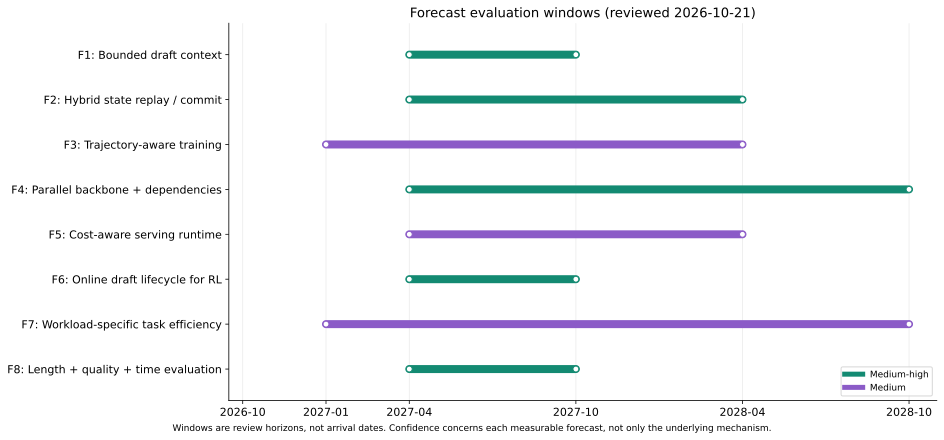

<a id="s21-2"></a>
### 21.2 八项可追踪预测

<!-- forecast-table:start -->
| 编号／方向 | 评估窗口 | 信心 | 应发生的新增事件 | 判定要点 |
|---|---|---|---|---|
| F1 成本有界的草稿上下文 | 2027-04 至 2027-10 | 中高 | 到 2027-10，在至少两个不同目标模型家族上出现完整可运行的受限/复用草稿历史方案，并在长上下文同资源基线下获得净吞吐收益。 | 公开 checkpoint/代码 revision；分别测草稿持久状态、上下文读取和整轮时间；计入特征提取后在预先声明的负载点仍有可重复净收益。 |
| F2 混合模型的回滚与状态接口 | 2027-04 至 2028-04 | 中高 | 到 2028-04，至少两个主流开源推理引擎提供有版本标识和状态正确性测试的递归回滚优化，总体覆盖至少两种递归状态更新族。 | 可核对 release/commit、正确性测试和高/低并发内存与吞吐结果；区分临时验证、选中路径提交与低精度。 |
| F3 从局部损失到轨迹成本训练 | 2027-01 至 2028-04 | 中 | 到 2028-04，至少一项独立复现能在两个目标家族上证明跨轮/占用感知训练相对匹配局部损失同时改善轮数与实测生成时间。 | 同时报告目标轮数、生成时间、草稿训练及特征成本；显式成本加权目标作为研究假设，暂不预测其必然出现。 |
| F4 并行主干加廉价依赖与有限树 | 2027-04 至 2028-10 | 中高 | 到 2028-10，至少两项独立同协议比较在两个目标家族上确认一种或多种轻量依赖机制，相对匹配独立槽位草稿具有净时间收益。 | 按实际 q 验证贪心/随机声明；给出 head/树/采样成本和对照，在预先选定受益点有可重复时间改善。 |
| F5 调度与编译面向实际成本 | 2027-04 至 2028-04 | 中 | 到 2028-04，至少一个可公开复现的服务引擎集成显式执行成本调度，并在无 oracle、同设备预算的真实请求轨迹中改善 p95 时延或 SLO goodput。 | 同目标质量、同输出规则、同资源和同到达过程；计入在线估计、路由、通信、padding、graph 与排队成本。 |
| F6 RL rollout 的在线草稿生命周期 | 2027-04 至 2027-10 | 中高 | 到 2027-10，至少两个公开 RL 训练栈出现新增独立复现，在计入草稿训练/更新和权重同步后降低达到预定质量所需的总 GPU 时。 | 报告草稿冷启动、更新、目标特征、同步、奖励和优化阶段成本，以及相同质量下的训练曲线和 GPU 时。 |
| F7 Agent/多模态的场景化候选 | 2027-01 至 2028-10 | 中 | 到 2028-10，至少两个不同场景出现可重复的专用提案组合，且在完整任务边界上降低时间或能耗，而非仅提升 decode token/s。 | 包含 prefill、工具与错误恢复或完整设备能耗；报告任务成功、失败和未完成，并区分 token 分布与语义效果。 |
| F8 质量、长度与速度分开报告 | 2027-04 至 2027-10 | 中高 | 到 2027-10，至少两个不同维护团队的公开评测或框架新增完整的质量、长度、轮数与时间联合报告，并明确区分精确和有损结果。 | 发布原始记录、同资源基线和失败/超时统计；不由跨配置平均比值倒推单一速度改善。 |
<!-- forecast-table:end -->

台账记录当前基线、具体适用范围、可判定成功条件和信心依据。同一团队的论文、README、博客不算独立复现；已有功能不能重复计为未来新增采用。到期时区分“已支持”“期限未达到”“出现反证”与“证据不足”，不把缺少材料当作机制被证伪。每项预测对应的来源 ID、判断日期、确认信号和反证条件保存在[预测台账](forecasts.json)，便于半年后复查。

<a id="s21-3"></a>
### 21.3 可能推翻这些预测的反证

**F1/F2 的反证**是信息压缩明显损害长距离接受，或重放／状态读取的额外计算持续抵消节省；低 batch 与短输出已有这样的局部信号。无独立草稿 cache 也可能只是把访问成本移到目标 KV，并未真正降低关键路径。

**F3/F4 的反证**是匹配数据和训练预算后复杂目标／选择器优势消失，或者只在 batch 1 获益；额外梯度计算、全词表存储、条件头和树 mask 都可能成为新瓶颈。控制研究已经提示方法名差异可能大于同协议下的实际差异。

**F5/F6 的反证**是调度依赖 oracle、异步需要额外设备却未提升单位资源收益，或 policy 更新／通信使 rollout 局部加速无法转为训练总时间下降。需要端到端 GPU 时，而不只生成阶段 tokens/s。

**F7/F8 的反证**是实际工作负载主要被 prefill、工具调用或错误恢复主导，领域化候选收益很小；至于评测字段未被采用，只表示 F8 的期限内采用预测未达到，不是质量／长度测量原则被推翻。

<a id="s21-4"></a>
### 21.4 三种发展情景

| 情景 | 成立前提 | 更可能受益的路线 | 需要观察的信号 |
|---|---|---|---|
| 基准情景 | AR／hybrid 目标继续占据重要部署，负载多样 | 固定成本草稿、状态复用、动态浅链／小树、在线适配 | 多引擎兼容和同资源真实负载结果 |
| 加速情景 | 模型发布时配套可用草稿与标准状态接口，编译器支持变长验证 | 原生 MTP／专用块草稿、共享状态、成本感知训练 | checkpoint 与框架版本同步发布，集成维护成本下降 |
| 受限情景 | 高并发算力饱和、长上下文质量敏感、状态重放困难 | 简单 lookup、浅草稿、部分负载关闭投机 | 大量负载最优 gamma 为 0／1，复杂方法难以回本 |

这些情景可以同时出现在不同产品。聊天低延迟、长推理训练、移动 GUI Agent 和 offloaded MoE 不应共享一套默认配置。

<a id="s21-5"></a>
### 21.5 哪些方向我暂不作强预测

我不会断言 flow／diffusion 草稿必然取代自回归草稿；不会把某次 6× 或 15× 上限作为未来普遍速度；不会将“原生 MTP 越来越多”推成全部模型均带成熟头；也不会预测严格 token 投机会自然升级成严格语义动作保证。

SDSL 的“草稿比目标小约 200 倍”来自其训练与 token/FLOP 建模条件，不能当作特征草稿、长上下文或新硬件上的通用尺寸定律。[SDSL](https://arxiv.org/abs/2603.11053)

新型并行生成模型也可能改变目标本身，而非只改变草稿。那时比较对象应包括输出质量、采样分布和生成算法，不再完全是现有 AR 目标上的无损投机。现有资料不足以可靠预测哪种生成范式在两年后占主导。

<a id="s21-6"></a>
### 21.6 未来评测应优化什么

更稳妥的研究目标是：**在固定目标质量或明确质量容忍度、相同硬件预算下，降低达到给定成功率所需的总时间、GPU 时或能耗。** 所有尝试、失败、超时及恢复都必须计入资源分子，另报成功数／尝试数；只对成功任务取平均会有幸存者偏差。 对严格投机同时验证目标分布；对近似方法报告质量／长度变化；对 RL 保留响应组分布与学习曲线；对 Agent 纳入工具和副作用控制。

“每轮多接受一个 token”仍是有用的机制指标，但未来方法的价值将更多取决于它如何影响完整任务成本。图 23 用同一运行口径的提交均值比 g、轮时均值比 c 和输出长度比 λ，计算串行生成速度比 $S=g/(c\lambda)$。提交数包含实际发出的 correction、bonus 和 EOS，并非只计 accepted drafts；它是情景计算，不是总体均值预测或新 GPU 实测，也不包含 prefill、重叠执行、工具与排队。

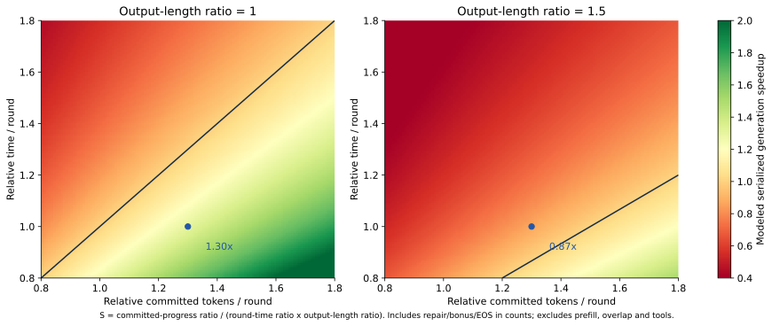

<a id="s22"></a>
## 22. 对本仓库下一阶段研究的建议

<a id="s22-1"></a>
### 22.1 优先做能区分竞争解释的实验

| 优先级 | 实验问题 | 最小对照与产物 |
|---|---|---|
| P0 | 真实成本到底在哪 | 固定目标／引擎／GPU；记录 prefill、draft、verify、sampler、状态读写及输出长度 |
| P1 | 长上下文收益来自少存还是少读 | full-context、固定窗口、目标 KV 复用三组；测草稿状态、访问时间、接受和 TPOT |
| P1 | 训练目标的跨轮收益是否真实 | 同草稿、数据和训练预算，KL／LK／D-PACE／EDR；同时测轮数、墙钟和训练开销 |
| P1 | 混合状态回滚能否降低高并发成本 | snapshot 与 replay／reconstruct；检查每步 logits、提交后状态和峰值显存 |
| P2 | 检索与块草稿能否互补 | 代码编辑／重复 Agent；冷／热缓存、lookup-only、neural-only、采样前路由 |
| P2 | 候选相关性值得多少额外计算 | 独立槽位、Markov、候选格、共享噪声；固定验证节点与训练数据 |

当前仓库已有可检查的单链／lookup、树前向、KV gather、D-PACE 梯度和预算教学实验，可作为正确性基准；真实引擎性能仍未建立。这一阶段应首先补齐固定硬件的 baseline 和原始 trace，避免继续只扩展方法名称。

<a id="s22-2"></a>
### 22.2 新增评测字段

在现有记录上增加：`completed_task`、`completion_tokens`、`reasoning_tokens`、`verifier_rounds`、`draft_state_bytes`、`draft_context_read_ms`、`state_write_ms`、`expert_union_size`、`H2D_bytes`、`graph_padding_tokens`、`draft_training_gpu_hours`、`total_gpu_seconds`。

并非所有后端能直接提供全部字段；缺失应标 null 并说明测量方法，不用估计冒充实测。先针对假设选择必要字段，减少 profiling 对正常运行的干扰。

<a id="s22-3"></a>
### 22.3 一个明确的研究边界

本文整理公开文献与可检查的教学实验，不提供第三方模型 checkpoint、插件安装结果或 GPU 性能复现。相关数字按原文实验条件引用，预测不等于已证实结果。

复现新增方法时，先确认作者代码／权重及版本，再做小规模正确性与匹配条件性能检查，最后扩展到真实请求和硬件预算。作者 README、框架 main 和生产报告分别是证据，不自动互相替代。

<a id="s22-4"></a>
### 22.4 半年后的复查清单

于 **2027-04** 复查 F1–F8 的源码接入、独立复现和失败案例；于 **2027-10** 检查一年窗口是否实现；两年情景于 **2028-10** 重新评估。优先记录不符合预测的结果，而不是只搜支持材料。

若某方向仅增加论文数量、没有可运行资产和同资源收益，降低信心；若跨家族、跨后端重复得到净收益，才提高信心。数值核算见[公开实验数据](../data/claim_checks.json)，判定约束见[预测台账](forecasts.json)。这些日期是后续人工复查建议，不代表已创建自动跟踪任务。
