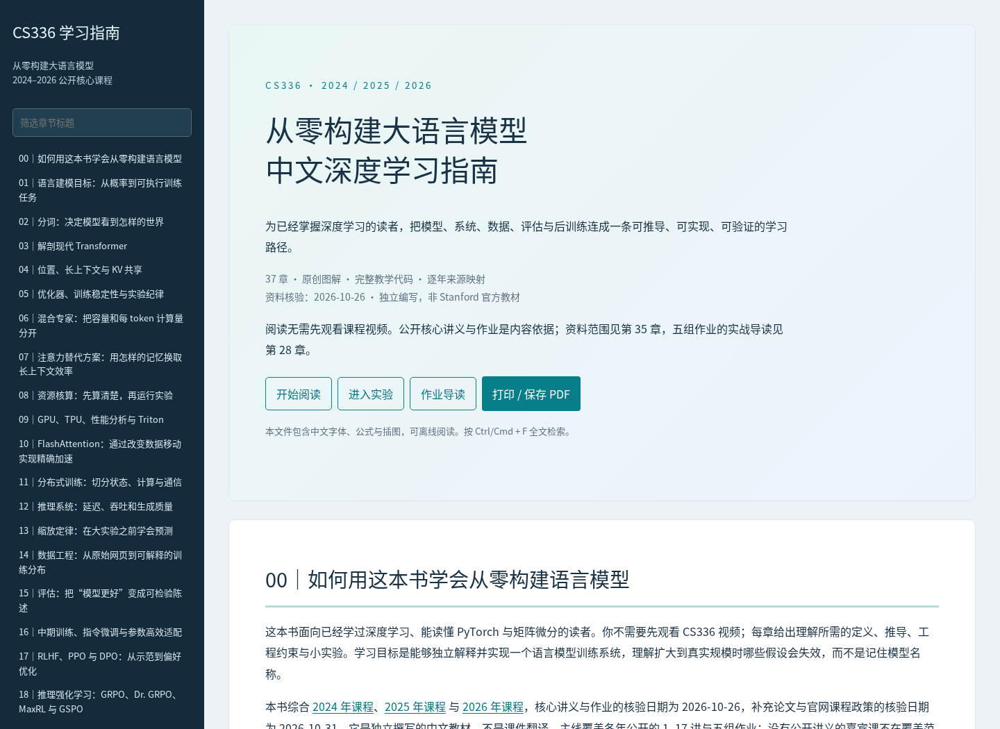

# 从零构建大语言模型：CS336 中文学习指南

面向**已经学过深度学习、希望深入研究大模型**的读者，综合 Stanford CS336 的 [2024](https://cs336.stanford.edu/spring2024/)、[2025](https://cs336.stanford.edu/spring2025/)、[2026](https://cs336.stanford.edu/) 年公开核心课程资料。核心归档核验于 2026-10-26，补充论文与官方文档核验于 2026-10-31。

**建议直接打开 [离线阅读版 HTML](book/guide.html)**，也可阅读 [PDF 版](book/CS336中文学习指南.pdf) 或 [完整 Markdown](book/学习指南.md)。HTML 内含中文字体、公式、图和全部教学代码，无需联网。

全书 37 章：原理解释与推导、按 2026 年作业组织的实战导读、2024–2025 年社区进展专题、28 个可运行的教学代码模块，以及在 CPU 上实际跑出来的实验结果（TinyStories 训练与消融、小模型上的 GRPO、在线 softmax 与优化器状态分片的正确性检查、14 个开源模型的参数精确复算）。

深度推导与可运行对照包括词表分块交叉熵、MLA 投影吸收、仿射扫描、LoRA 更新尺度、GAE/重要性采样、检索、验证器、低秩压缩与低精度舍入。运行 `python scripts/run_mechanism_experiments.py` 可复算，原始依据见 [资料索引](sources/research-sources.json)。

分块注意力合并、Delta rule 稳定步长、CLIP 跨批负例、MoE 路由和优化器梯度语义可用 `python scripts/run_chapter_review.py` 复算；[跨章自测](book/chapters/21-review.md) 与 `python -m unittest tests.test_chapter_invariants -v` 对照手算、自动微分和枚举结果。

流式 UTF-8 解码、packing 标签边界、线性注意力低精度、GAE 的终止/截断和按簇配对评估也有对应实现；运行 `python -m unittest tests.test_learning_interfaces -v` 核对。第 04、30 章的 packing 和 RoPE 图分别展示目标边界与逐频段缩放，Transformer 图明确标出两条残差旁路。

测试、公式渲染、PDF 页数和字形检查的记录见 [validation.json](book/validation.json)、[render-check.json](book/render-check.json) 和 [pdf-audit.json](book/pdf-audit.json)；它们是否与当前源码对应，以 `python -m unittest tests.test_artifacts` 的结果为准。

统一验收入口为 `python scripts/rebuild.py`：执行语义测试、重建附录/图表/字体/HTML、文本与公式检查、PDF 导出和版本核对，全程默认不截图。逐阶段结果写入 `book/rebuild-check.json`，详细日志在 `outputs/build-logs/`；任何必需步骤失败都不会报告完整成功。



## 内容

| 阅读阶段 | 章节 |
|---|---|
| 模型与训练 | [00 阅读路线](book/chapters/00-reading-map.md)、[01 语言建模目标](book/chapters/01-objective.md)、[02 分词](book/chapters/02-tokenization.md)、[03 Transformer](book/chapters/03-transformer.md)、[04 位置与上下文](book/chapters/04-position-context.md)、[05 优化](book/chapters/05-optimization.md) |
| 架构与系统 | [06 MoE](book/chapters/06-moe.md)、[07 注意力替代](book/chapters/07-alternative-attention.md)、[08 资源核算](book/chapters/08-accounting.md)、[09 GPU/TPU/Triton](book/chapters/09-hardware-kernels.md)、[10 FlashAttention](book/chapters/10-flashattention.md)、[11 分布式](book/chapters/11-distributed.md)、[12 推理服务](book/chapters/12-inference.md) |
| 数据与证据 | [13 缩放定律](book/chapters/13-scaling.md)、[14 数据工程](book/chapters/14-data.md)、[15 评估](book/chapters/15-evaluation.md) |
| 后训练与多模态 | [16 SFT/LoRA/QLoRA](book/chapters/16-sft-peft.md)、[17 RLHF/PPO/DPO](book/chapters/17-preferences.md)、[18 推理 RL 及变体](book/chapters/18-reasoning-rl.md)、[19 多模态](book/chapters/19-multimodal.md) |
| 实践与自测 | [20 贯穿实验](book/chapters/20-laboratory.md)、[21 推导与自测](book/chapters/21-review.md) |
| 研究与应用扩展 | [22 研究设计](book/chapters/22-research-design.md)、[23 数据适配](book/chapters/23-data-adaptation.md)、[24 RAG](book/chapters/24-retrieval.md)、[25 推理时计算](book/chapters/25-test-time-compute.md)、[26 压缩](book/chapters/26-compression.md)、[27 机制可解释性](book/chapters/27-interpretability.md) |
| 社区进展（2024–2025） | [29 开源模型架构解剖](book/chapters/29-open-models.md)、[30 长上下文](book/chapters/30-long-context.md)、[31 推理模型的 RL](book/chapters/31-reasoning-rl-2025.md)、[32 Agent 与工具使用](book/chapters/32-agents.md)、[33 合成数据与蒸馏](book/chapters/33-synthetic-data.md)、[34 低精度训练](book/chapters/34-low-precision.md) |
| 作业与附录 | [28 五组作业实战导读](book/chapters/28-assignments.md)、[35 年份覆盖与来源](book/chapters/35-sources.md)、[36 完整教学代码](book/chapters/36-code.md) |

第 22–27 章与第 29–34 章是扩展内容，不属于课程原有讲义。第 29–34 章的模型数字直接从固定版本的 `config.json` 计算（保存在 [sources/model-configs](sources/model-configs/index.json)），技术报告中的数字均对照原文核对，论文清单见 [frontier-sources.json](sources/frontier-sources.json)。

## 运行代码

需要 Python 3.9 及以上（构建脚本用到 `str.removeprefix`）与 `requirements.txt` 中的依赖；本书结果在 Python 3.12、PyTorch 2.11（CPU）上生成。文件读写显式使用 UTF-8，PDF 通过 Python 文件接口读写以支持中文路径。GBK 区域设置的检查覆盖编码问题；Windows 上的 PyTorch 分布式后端、可选 Triton 和 Chromium 系统依赖仍需分别验证，不能仅从编码检查推断全部功能跨平台可用。

```bash
python -m pip install -r requirements.txt
python scripts/run_checks.py            # 全部测试 + 双进程分布式检查（Linux 上默认绑定回环网卡），写出 book/validation.json
python -m examples.tokenizer            # 复现作业讲义的 BPE 示例
python -m examples.posttrain            # 125K 参数模型上的完整 GRPO 循环
TRITON_INTERPRET=1 python -m examples.attention   # 在 CPU 上运行 Triton 行 softmax kernel（需另装 triton）
```

所有模块的命令与预期结果见第 20 章。较长的实验：

| 脚本 | 内容 | 用时（16 核 CPU） | 结果文件 |
|---|---|---|---|
| `scripts/run_core_experiments.py` | 算术小模型 120/1000 步、缩放设计（含边缘补点）、资源核算、推理 demo | 约 30 秒 | `book/experiment-results.json` |
| `scripts/run_grpo_demo.py` | 三种 advantage × 3 个种子的 GRPO，记录每次更新的梯度范数与裁剪次数 | 约 3 分钟 | `book/grpo-results.json` |
| `scripts/run_tinystories.py --download` | 200 MiB TinyStories、10K BPE、6 个学习率的扫描与 7 个消融配置（共 13 次运行，另有基线重复种子） | 约 1 小时 | `book/tinystories-results.json` |
| `scripts/run_advanced_experiments.py` | 第 22–27 章的小实验 | 数秒 | `book/advanced-experiments.json` |
| `scripts/run_frontier_experiments.py` | 第 29–34 章：模型配置复算、YaRN、DAPO/CISPO、agent 掩码、低精度量化、合成数据蒸馏（5 个种子） | 约 1 分钟 | `book/frontier-results.json` |

所有实验都在 CPU 上运行，验证的是算法正确性与小规模趋势。GPU 内核性能、多机扩展、真实大模型 RLVR 和多模态训练没有运行；Triton kernel 只在解释器模式下验证了正确性。

**关于作业。** 截至 2026-10-31，[课程官网](https://cs336.stanford.edu/)允许用 LLM 提问基础编程和高层概念问题，禁止用它直接解决作业题，并强烈建议关闭 AI 自动补全；完整政策以官网链接文档为准。本书的 demo 用于理解原理和核对思路，不是作业答案：作业书面计算题的数值答案不在书中，资源核算、混合精度累加、baseline 方差等例子换成了作业没有考的设定；FlashAttention-2 的分块前向、反向与 Triton kernel 不提供实现；与作业接口对应的函数也改了接口。

## 资料与覆盖范围

三年 1–17 讲、五组主作业与安全补充资料已下载核对，共 71 条来源记录。2025 年失效的作业链接通过官方仓库历史恢复并固定 commit。来源、哈希、页数与恢复说明见 [manifest](sources/manifest.json)，方法见 [sources/README.md](sources/README.md)。

本书可独立阅读，覆盖公开核心知识。没有公开讲义的嘉宾课不在覆盖范围内。本书不是 Stanford 官方教材。

## 重建文档

已有图、字体和公式资源时：

```bash
python scripts/build_book.py
```

完整重建（代码附录、图表、字体子集、PDF）：

```bash
python -m pip install -r requirements-build.txt
python scripts/run_checks.py
python scripts/run_core_experiments.py
python scripts/run_advanced_experiments.py
python scripts/run_frontier_experiments.py
python scripts/run_review_update_experiments.py
python scripts/run_chapter_review.py
python scripts/run_mechanism_experiments.py
python scripts/make_appendices.py
python scripts/make_figures.py
python scripts/prepare_assets.py
python scripts/build_book.py
python -m playwright install chromium
python scripts/render_pdf.py
```

日常修改后无需重跑较长的训练实验，推荐安装构建依赖与 Node.js 后直接运行 `python scripts/rebuild.py`。Node.js 用于在本地调用随书提供的 KaTeX 做纯文本公式检查。只检查现有 HTML/Markdown 可用 `python scripts/check_book.py --without-pdf`；显式使用 `python scripts/rebuild.py --without-pdf` 可在无浏览器环境生成阅读版，但会标记 PDF 未运行并返回非零状态，避免被发布流程误认为完整验收。若单元测试通过、但双进程分布式检查或 Triton 检查失败（例如沙箱禁止网络套接字），`rebuild.py` 默认不重建任何成品，以免第 35 章写入"检查未通过"；应换到能运行这些检查的环境，确需在受限环境发布时加 `--allow-failed-environment-checks`，此时第 35 章会如实写明失败。`--skip-checks` 仅复用源码、Python/依赖版本及相关运行环境一致的既有测试记录；空测试集、损坏报告或重建期间源码变化都不能被认定为验收成功。

`tests/test_artifacts.py` 检查章节、代码附录、构建脚本、嵌入图表、KaTeX 与字体是否和构建记录一致，同时检查 HTML、合并 Markdown 和 PDF 的哈希。输入变化但没有重建，或 PDF 不是从当前 HTML 导出时，它会失败并提示该重跑哪一步。`run_checks.py` 不包含这些成品检查（它写出的验证记录本身就是重建的输入），完整重建后单独运行 `python -m unittest tests.test_artifacts`。各构建输入的哈希保存在 `book/build-stats.json`。

Chromium 默认带沙箱运行；容器内没有用户命名空间时可设 `CHROMIUM_NO_SANDBOX=1`。若缺少系统库，可在 Playwright 支持的发行版上运行 `python -m playwright install-deps chromium`（需要系统安装权限）。发行版支持和包名随 Playwright 版本变化；衍生发行版识别错误时应依据系统版本和 `ldd` 的实际缺项处理，不能假定补两个库就足够。若宿主环境禁止创建浏览器所需的进程或套接字，关闭 Chromium 自身沙箱也不能解除该限制。

PDF 导出会自动检查全页字形、空白页和页面边界：缺字、替换字符、未嵌入字体、空白页或页面越界都会使检查失败，报告保存在 `book/pdf-audit.json`。检查时逐页在内存中渲染，默认不导出全书页面图片或拼图；先查看 JSON 中的问题页码，需要目视复核时再导出指定页：

```bash
python scripts/audit_pdf.py                        # 重新校验现有 PDF，输出文本报告
python scripts/audit_pdf.py --proof-pages 7,12-14   # 校验全书，只导出指定页
# 如需拼图，在指定页命令后加 --contact-sheets；render_pdf.py 也支持这两个选项
```

KaTeX 与 Noto 字体的许可证位于 [vendor](book/assets/vendor/README.md)。

导出默认不截图，先在临时目录生成 PDF 和检查报告，全部校验通过后再替换成品；页码参数错误、浏览器渲染失败或校验失败时会保留原有成品。README 预览保留原图，只有显式传入 `--preview` 才重新截图。可选拼图每 12 页生成一张，检查期间只保留当前一组缩略图。

HTML/Markdown/PDF 的多文件发布在普通写入异常时回滚已经替换的文件；它不声称具备断电时的文件系统事务保证，发布与阅读工具仍应核对清单哈希。导出期间源文件发生变化时会中止，避免给旧页面内容贴上新版本哈希。

验证本地来源缓存：`python scripts/verify_sources.py`；按固定版本补下载：`python scripts/verify_sources.py --download`。

## 公开仓库中的文件

公开目录保留指南章节、PDF/HTML/Markdown 成品、教学代码、测试、构建脚本、来源清单、固定模型配置与 `book/*-results.json` 中的实验汇总。图表重建读取这些汇总文件，不需要训练 checkpoint 或原始 token 数组。

`outputs/` 中的训练权重、tokenizer、token 数组和日志，`sources/cache/` 中的下载字体、课程资料和 PDF 页面缓存，以及 Python 的 `__pycache__/`，都是本地运行产物，不随公开仓库发布。`.gitignore` 同时排除这些目录和构建中断后可能遗留的临时文件。需要时由对应实验、下载或构建命令重新生成。

离线阅读和 `python scripts/build_book.py` 使用保留在 `book/assets/vendor/` 中的 WOFF2 字体与 KaTeX，不依赖下载缓存。完整重建重新制作字体子集时，会按需联网下载完整字体。TinyStories 的原始数据和训练权重也需重新下载或训练；现有实验汇总仍可直接阅读和用于重建图表。名称含 `review` 的测试是实际回归测试，`sources/` 下的审阅清单记录原始依据与核验范围，均属于项目内容。

实验汇总文件保留各自的运行日期与环境；较长的训练实验不会随每次文字或边界修复自动重跑。随机数精度、裁剪和采样顺序的细微差异可能改变 RL 轨迹，历史表格不保证由当前源码逐值重现；复核时应同时记录源码、依赖、数据和完整配置。

实验脚本的新结果在 `provenance` 中保存 Python、PyTorch、NumPy 的版本，以及源码和固定模型配置的哈希（TinyStories 脚本改用下面的数据与基线契约）。TinyStories 的数据与运行缓存还会核对输入数据、tokenizer、超参数及输出文件哈希；旧缓存缺少这些信息时重新计算，不按同名目录直接复用。

TinyStories 下载在原文旁保存 `*.download.json`，记录来源、请求字节上限与内容哈希。改变上限或来源时重新下载，并校验响应长度；失败时保留旧文件和记录。已有原文没有下载记录时，用 `--train-text`/`--valid-text` 指定路径并省略 `--download`，或选择新的下载路径。预处理数据和训练缓存都将结果文件及元数据成组发布，输入在处理期间变化则中止，避免留下来源不符的缓存。
