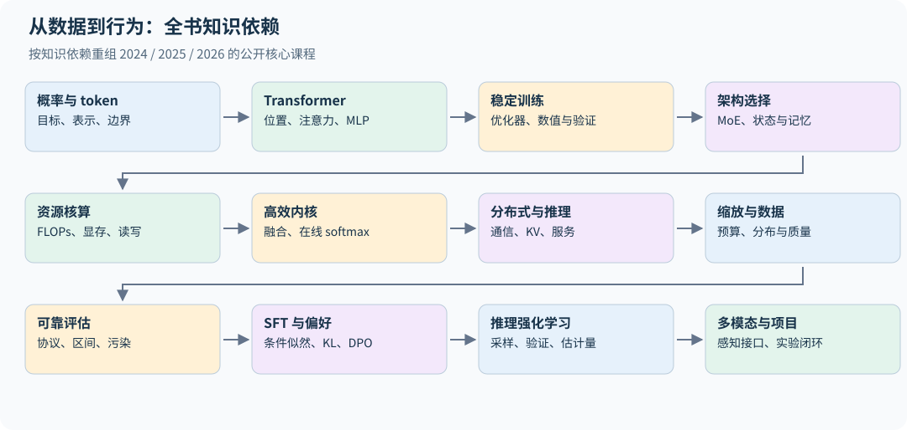

# 00｜如何用这本书学会从零构建语言模型

这本书面向已经学过深度学习、能读懂 PyTorch 与矩阵微分的读者。你不需要先观看 CS336 视频；每章给出理解所需的定义、推导、工程约束与小实验。学习目标是能够独立解释并实现一个语言模型训练系统，理解扩大到真实规模时哪些假设会失效，而不是记住模型名称。

本书综合 [2024 年课程](https://cs336.stanford.edu/spring2024/)、[2025 年课程](https://cs336.stanford.edu/spring2025/) 与 [2026 年课程](https://cs336.stanford.edu/)，核心讲义与作业的核验日期为 2026-10-26，补充论文与官网课程政策的核验日期为 2026-10-31。它是独立撰写的中文教材，不是课件翻译。主线覆盖各年公开的 1–17 讲与五组作业；没有公开讲义的嘉宾课不在覆盖范围内，见第 35 章。

全书结构：第 01–19 章是课程主线；第 20 章把所有可运行实验串起来；第 21 章是推导与自测；第 22–27 章是面向研究与应用的扩展（实验设计、数据适配、检索增强、推理时计算、压缩、机制可解释性），不属于课程原有内容；第 28 章按五组作业组织要点与常见错误；第 29–34 章整理 2024–2025 年社区进展（开源模型架构、长上下文、推理 RL、agent、合成数据、低精度），每章配有可在 CPU 上运行的 demo，同样不属于课程原有内容；第 35、36 章是来源索引与完整代码。

## 0.1 一门课真正要解决的问题

假设你有一批原始网页、一组加速器和一个总预算，要交付一个可评估的语言模型。你需要同时决定：

1. **表示**：哪些字节组成一个 token？上下文长度在不同语言中意味着多少内容？
2. **函数**：模型如何根据前缀产生分布？参数如何分配给注意力、MLP 和专家？
3. **优化**：损失、更新规则和学习率如何对应到有效训练 token？
4. **资源**：每个训练步需要多少运算、显存和网络通信？
5. **证据**：怎样证明提升来自方法，而不是更多算力、数据泄漏或评估模板变化？
6. **行为**：怎样把预测器变成能遵循指令、完成推理任务的系统？

这些决定彼此耦合。更大的词表缩短序列，却增大输出层；更多专家增加容量，却增加通信；长推理提高某些任务的成功率，却占用更多 KV cache 并降低服务吞吐。

## 0.2 本书的三种阅读动作

遇到公式，先检查每个量的单位和张量形状，再读推导。遇到实验，先写下预期结果，再运行代码。遇到经验结论，追问比较是否固定了数据、参数、训练计算量和推理预算。一个知识点直到你能预测它在哪些条件下失效，才算真正掌握。

例如，“FlashAttention 更快”不是完整知识。你应该能解释它为什么减少 HBM 读写、为什么不改变精确注意力的数学结果、为什么 FLOPs 不一定减少，以及为什么很小的矩阵可能无法体现收益。

## 0.3 学习顺序与可验收成果

| 阶段 | 章节 | 必须产出的证据 | 对应作业 |
|---|---|---|---|
| 做对一个模型 | 01–05 | BPE 与讲义示例一致、因果不变性、梯度对照、能下降的验证损失 | A1 |
| 理解架构取舍 | 06–07 | 专家利用率、长序列状态与 KV 大小计算 | — |
| 做快与做大 | 08–12 | 理论资源账、正确计时、内核数值对照、分布式梯度等价 | A2 |
| 做可信实验 | 13–15 | 缩放预测留出误差、数据消融、带区间的评估 | A3、A4 |
| 改善行为 | 16–19 | 正确 response mask、偏好目标、可验证奖励、模态接口 | A5 |
| 独立完成项目 | 20–21、28 | 一份可复现报告和误差分析 | 全部 |
| 研究与应用扩展 | 22–27 | 预算对齐的干预实验、知识更新方案、验证与压缩对照 | — |
| 跟上社区进展 | 29–34 | 从 config.json 精确复算参数与 KV、读懂 YaRN 配置、对照 DAPO/CISPO 梯度、构造 agent 损失掩码、测量合成数据与低精度误差 | — |

## 0.4 没有大 GPU 能做到哪一步

| 硬件 | 能完成的 | 参考数字 |
|---|---|---|
| 普通 CPU | 必需依赖下的测试与 demo；Triton 等可选检查按报告单列；10K 词表的 BPE 训练；8M 参数模型的 TinyStories 训练和生成样例（质量见第 20.4 节） | 每个运行用 8 个 CPU 线程，1,500 步约 16 分钟（第 20.4 节） |
| Apple Silicon（MPS） | A1 的低资源路径：4,000 万 token，目标损失 2.00 | 讲义参考实现在 M4 Max 上约 36 分钟，损失 1.80 |
| 单张消费级 GPU | A1 完整 TinyStories 配置；A2 能放入实际显存的基准与 Triton kernel；先按 dtype、batch 和上下文核算容量 | — |
| 课程集群（B200） | A1 排行榜与 OpenWebText；A2 大尺寸与多卡；A5 的 1B 模型 GRPO | A1 基础配置约 20–30 分钟；作业为 A5 标准 GRPO 实验分配 2 B200-小时 |

CPU 实验验证的是算法与数值关系；真实吞吐、长上下文峰值显存和多机扩展需要对应硬件，不能由 CPU 结果外推。

**课程政策与本书代码。** 截至 2026-10-31，官网允许用 LLM 回答基础编程问题或高层概念问题，禁止用它直接解决作业题，并强烈建议关闭 AI 自动补全。详细政策应以课程官网及其链接文档为准。[课程官网](https://cs336.stanford.edu/)

A1 还规定不能使用 `torch.nn`、`torch.nn.functional` 和 `torch.optim` 中的定义，`nn.Parameter`、容器类和 `Optimizer` 基类除外。本书的 `examples/` 是讲解用的参考实现：为了简洁直接用了 `nn.Linear`、`F.cross_entropy` 等，函数接口也与作业不同；作业的书面计算题，本书换用作业没有考的模型或设定演示方法。如果你在修这门课，请先独立完成作业，再用本书对照原理。

## 0.5 符号统一

| 符号 | 意义 | 常见混淆 |
|---|---|---|
| $B,T$ | batch 中序列数、序列长度 | batch token 数是 $BT$ |
| $d,L$ | 隐藏宽度、Transformer 层数 | $L$ 不表示序列长度 |
| $h_q,h_{kv},d_h$ | query 头数、KV 头数、头宽 | 通常 $d=h_qd_h$，但并非定义要求 |
| $V,f$ | 词表大小、MLP 中间宽度 | $V$ 同时可能表示 value，依语境区分 |
| $N,D,C$ | 参数量、训练 token 数、训练 FLOPs | 重复数据也消耗 $D$，不等于独立信息量 |
| $P$ | 并行进程数 | 不与参数量 $N$ 混用 |
| $\pi_\theta,\pi_{old},\pi_{ref}$ | 当前策略、采样策略、参考策略 | 后两者角色不同 |

字母有限，下面几处局部符号会与上表重名，以所在小节的定义为准：第 10 章的 $L_i$ 是第 $i$ 行的 logsumexp，不是层数；$P$ 在第 03、08、10 章表示注意力概率矩阵，不是进程数；$M$ 在第 01 章是被计损失的 token 数，在第 10 章先表示片上容量、后表示 $BT$；$s$ 在第 8.5、12.8 节是每个元素的字节数，在第 8.8 节引用的 Korthikanti 激活显存公式中是序列长度。

默认自然对数；交叉熵单位为 nats/token。一次乘加按两次 FLOPs 计算。GB 使用 $10^9$ bytes，GiB 使用 $2^{30}$ bytes。代码默认张量布局为 `[batch, time, width]`，注意力内部为 `[batch, heads, time, head_dim]`。

## 0.6 三年合并的方法

2024 年更细的 Bloom filter、后缀数组、数据选择、人工偏好和 PEFT 内容保留。2025 年的独立推理服务课、FlashAttention 作业、SFT→专家迭代→GRPO 路线补入主线。2026 年的线性注意力与混合架构、TPU、FSDP、更细的 RL 估计量及多模态单独展开。哪些内容是课程要求、哪些是教学补充，见逐讲与作业覆盖表（第 35 章）。

原始资料并不能替你形成理解。本书也不能替代动手验证。若仅阅读、不运行任何实验，你可能会懂术语，却仍难以定位一个 loss 正常下降但模型偷看未来的训练 bug。

本书区分四类证据：解析推导、教学代码实测、原始论文报告、尚待验证的解释。每次复算时先确认所属类型；不把 CPU 数值对照等同于 GPU 性能或工业能力复现。

## 0.7 深入研究时，用三个问题贯穿一章

先写出本章优化或计算的对象：是字符串概率、固定数据上的 loss、策略期望奖励，还是服务延迟。再写出保证等价的条件：相同 mask、采样分布、参数、精度或通信归约。最后设计一个能让错误实现暴露的反例。只观察最终 loss 下降，通常无法区别目标变了、实现错了和真正改善了模型。

新增的推导实验集中在 `examples/mechanisms.py`：词表分块交叉熵、虚拟词表并行、仿射扫描、MLA 投影吸收、重要性权重诊断、验证器基率与随机舍入。第 20.14 节把它们连成“先手算—再验证梯度—最后测资源”的路线；它们与课程主线相连，适合已学过深度学习、希望进一步研究大模型的读者。
