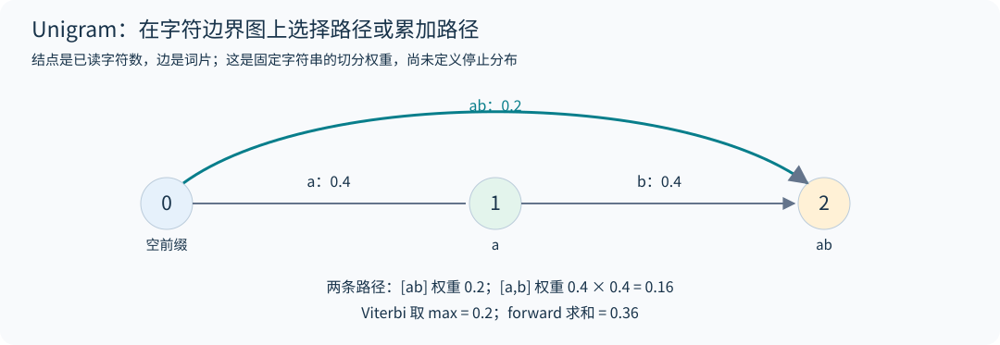

# 02｜分词：决定模型看到怎样的世界


## 2.1 tokenizer 同时改变统计问题和系统成本

字节词表只有 256 个基本单位，可表示任意 UTF-8 文本；代价是多字节字符及常见单词会占用多个位置。词级词表压缩常见词，却难以覆盖新词、拼写变化、代码和不同语言。子词分词在二者之间：常见片段成为一个单位，不常见片段回退成更小单位。

必须区分 Unicode code point、UTF-8 byte 和视觉字符。一个 emoji 可能由多个 code point 组成，一个 code point 又可能需要多个字节：`len("🙂")` 是 1，`len("🙂".encode())` 是 4，一个汉字通常是 3 个字节。若 token 保存的是任意字节片段，单个 token 不一定能独立解码成合法 Unicode；应该拼接所有 bytes 后再解码，遇到非法序列用替换字符 U+FFFD 表示，而不是抛异常中断生成。

## 2.2 BPE 训练：预切分、计数、合并

现代 byte-level BPE 的训练分三步。

**第一步，按特殊 token 切段。** `<|endoftext|>` 这类标记是硬边界：先用它把语料切成文档，标记本身不参与任何 pair 计数。否则 GPT-2 正则会把 `<|endoftext|>` 拆成 `<|`、`endoftext`、`|>` 三个普通 pre-token，它们是语料中出现最多的片段之一（本书下载的 TinyStoriesV2 完整训练集约 270 万次，第 20.4 节实际使用的前 200 MiB 约 26 万次），白白消耗 merge；在分隔符紧贴标点的语料中，上一篇的结尾标点还会和 `<|` 落进同一个标点 pre-token（例如 `."<|`），产生跨文档的 pair。TinyStoriesV2 的分隔符总是单独成行，不会出现这种合并，但网页抓取等语料没有这样的保证。

**第二步，正则预切分。** 每段文本再按 GPT-2 风格的正则切成 pre-token，merge 只在 pre-token 内部发生：

```python
PAT = r"""'(?:[sdmt]|ll|ve|re)| ?\p{L}+| ?\p{N}+| ?[^\s\p{L}\p{N}]+|\s+(?!\S)|\s+"""
```

它把英文缩写、带前导空格的单词、数字串、标点串和空白分开。注意 `\p{L}` 包含汉字，所以连续中文会成为一个很长的 pre-token。`\s+(?!\S)` 让一串空格的最后一个留给下一个单词，于是 `"  words"` 切成 `" "` 和 `" words"`。预切分规则直接影响代码缩进、数字和中文的压缩方式。

**第三步，迭代合并。** 统计所有 pre-token 内相邻 pair 的频次（按 pre-token 出现次数加权），选最高频者合并为新 token。并列时需要确定规则：CS336 作业约定选择**字节串字典序更大**的 pair，即 `max` 而不是 `min`。用 Sennrich 等人的经典例子验证，语料按空白切分后为 `{low:5, lower:2, widest:3, newest:6}`：

```text
第一轮 pair 频次：es 9、st 9、we 8、lo 7、ow 7 ……
es 与 st 并列，字典序 ('s','t') > ('e','s')，所以合并 s t
后续合并顺序：s t, e st, o w, l ow, w est, n e, ne west, w i, wi d, wid est, low e, lowe r
只取前 6 个 merge 时，newest 编码为 [ne, west]
```

本书 [tokenizer.py](../../examples/tokenizer.py) 的 `train_bpe` 逐项复现上述 12 个 merge，测试直接对照作业讲义。若把并列规则写成 `min`，第一个 merge 会变成 `es`，后面整张 merge 表随之改变，官方测试会失败。`aaaa` 中相邻 `aa` 计数为三，但一轮从左到右的非重叠替换只能合并两次；"频次统计"与"执行替换"不要混淆。

## 2.3 让训练快到可以实际使用

朴素实现每次 merge 都重扫整个语料，若有 $K$ 轮合并、$M$ 个初始 token，成本约 $O(KM)$。两个优化把它变成几秒钟的事：

1. **先聚合 pre-token。** 数百万篇故事里 `" the"` 出现上百万次，只需保存 `{(32,116,104,101): 次数}` 一份。之后所有计数都在去重后的词表上进行。
2. **增量更新 pair 计数。** 合并 `(A,B)` 只会改变包含它的那些 pre-token 的相邻 pair。维护 `pair → 出现在哪些词` 的倒排索引；合并时对这些词先减去旧 pair 计数、执行替换、再加回新 pair 计数。选最高频 pair 用带惰性失效的最大堆：每次计数改变就压入新条目，弹出时若计数与当前值不符就丢弃。

预切分是另一个瓶颈，但它可以并行：把文件按字节切块，每个块的边界向后移动到下一个 `<|endoftext|>` 处，保证不会把一篇文档切开，各进程独立计数后相加。merge 循环本身有全局依赖，在 Python 中难以并行。

这里要求分隔符是独立边界：若特殊 token 同时有 `x` 和 `axb`，在 `axb` 中间的 `x` 处分块，就会把原本应整体跳过的特殊 token 变成普通的 `a`、`b`。匹配还可能跨越读文件的缓冲区边缘。`count_pretokens_file` 在分隔符可能与其他特殊 token 重叠时回退到单块计数；安全分隔符的扫描保留缓冲区后缀，保证并行结果与整段计数一致。进程数不应改变训练得到的频数。

**实测。** 在 TinyStories 训练集前 200 MiB（209.7 MB）上训练 10K 词表：16 进程预切分加上增量合并共 5.8 秒；10 MB 文本编码约 2 秒/进程。验证集上压缩率为 **4.117 bytes/token**，最长的 token 是 `" enthusiastically"`，最后几个 merge 是 `" disagre"`、`" differently"`、`" current"`、`" crosses"`、`" cooled"`。到 10K 词表的末尾，BPE 已经在合并儿童故事里频次不高的完整单词。`" disagree"`、`" disagreed"` 早已经由其他合并路径各自成为一个 token；末尾的 `" disagre"` 是为剩下的词形补上的，例如 `" disagrees"` 编码为 `disagre`+`es`、`" disagreement"` 编码为 `disagre`+`ement`。同一个字符串可以经不同的合并路径到达，这也是 merge 顺序决定编码结果的原因。学到的单位直接反映语料分布。运行方式见第 20 章的 `scripts/run_tinystories.py`。

## 2.4 编码为什么依赖 merge rank

训练产物不仅是最终词表，还包含有序的 merge 规则。编码新文本时，先做同样的特殊 token 切段与正则预切分；然后在每个 pre-token 内反复寻找**当前存在的、训练时最早学到的** pair 并合并，直到没有可用规则。用"找到词表中最长的字符串"代替这一过程，会在部分输入上得到不同结果。

```python
while len(ids) > 1:
    pair = min(zip(ids, ids[1:]), key=lambda p: ranks.get(p, inf))
    if pair not in ranks:
        break
    ids = merge_pair(ids, pair, merged[pair])
```

同一个 pre-token 反复出现时可以缓存其编码结果，TinyStories 这种重复度高的语料上收益很大。

## 2.5 特殊 token 与流式编码的边界

特殊 token 表示文档终止、聊天角色、工具调用等结构语义。编码时先按已注册的特殊 token 切段：若两个特殊 token 有重叠（例如 `<|a|>` 与 `<|a|><|a|>`），应优先匹配更长者。处理不可信文本时，是否允许字面字符串被解释成控制 token 必须由调用方决定。

大文件无法一次读入内存，需要 `encode_iterable` 逐块产出 token ID。难点在块边界：

- 块末的最后一个 pre-token 可能还会增长，例如块以 `"  "` 结尾，下一块以 `"words"` 开头，整体切分是 `" "` + `" words"`，提前编码就会出错。
- 块末可能是某个特殊 token 的前缀（`"<|endo"`），也可能是一个更长特殊 token 的开头。
- 缩写的正则分支需要看到撇号后的两个字符：块以 `"we'r"` 结尾时会被切成 `we`、`'`、`r`，下一块的 `"e"` 到达后整体应是 `we`、`'re`。所以不仅最后一个 pre-token 不确定，倒数第二个也可能变。

正确做法是只编码"后续输入不可能改变"的部分：对本书固定的 GPT-2 正则，保留末尾至少两个字符及未完成匹配，用于覆盖上述缩写与前瞻依赖；其余部分和可疑的特殊 token 前缀留到下一块。本书实现对短字符串穷举了所有三段切分，对长文本用 1、3、7、13 个字符的固定宽度切块对照，流式结果与一次性编码完全相同。只保留最后一个 pre-token 的写法会在缩写处出错，所以测试文本一定要包含缩写和连续空白。

这不是任意正则的通用流式定理：例如 `a(?=.{5}z)|a.` 的匹配需要更远的前瞻。本书对已核验的 GPT-2 与 `\S+` 模式增量编码，其他自定义模式先收齐输入再编码，保证结果而不承诺流式内存。即使默认模式也可能遇到无限增长的 pre-token，且编码缓存随独特片段增大，不能宣称严格有界内存。`encode(text, allow_special=False)` 与 `encode_iterable(chunks, allow_special=False)` 将控制标记字面串作为普通内容；默认 `True` 保留已注册结构标记的旧行为，调用方要按输入来源选择。

流式**解码**是另一个方向的边界问题。`中` 的 UTF-8 字节为 `E4 B8 AD`，若模型分三次输出，逐 token 调用 `decode([id])` 再拼接会得到三个替换符，无法恢复原字符。`Tokenizer.decode_iterable(ids)` 使用增量 UTF-8 解码器，保留未完成的码点，等后续字节到达后才输出；只在整个流结束时刷新末尾残片。其输出拼接应等于一次性 `decode(ids)`，测试同时覆盖合法汉字/emoji、非法字节和流末截断。它保证字节到文本一致，不保证每个输出块都是完整的视觉字符：组合音标与 ZWJ emoji 还可能跨块。

## 2.6 词表大小是一道资源题

输入 embedding 需要 $Vd$ 个参数；若输出头不共享权重，再增加 $Vd$。输出 logits 的张量大小为 $BTV$，计算量约为 $2BTdV$。大词表能减少 $T$，但增大 $V$。主体模型很小时，词表参数可能占比很高：第 20 章的 TinyStories 模型共 8.33M 参数，其中 embedding 与输出头占 5.12M。

公开模型的经验是：单语模型多用 30K–50K 词表（GPT-2/3 为 50,257，LLaMA 为 32,000），多语言与生产系统多用 100K–250K（Qwen 约 152K；Gemma 3/4 为 262,144，略超出这一区间）。比较两个 tokenizer 应固定同一份原始文档，报告 bytes/token、不同语言的 token 分布、编码吞吐，以及下游模型在固定训练 FLOPs 下的结果。只看英文压缩率会把中文、代码或数学符号的成本隐藏起来。

中文"同样 8K 上下文"不意味着与英文承载相同长度的信息。上下文长度是 token 数，不是字数。在 TinyStories 上训练的 10K 词表几乎没有中文 merge，汉字会退回到逐字节编码，一个字占 3 个 token。

## 2.7 Unigram 与 SentencePiece：另一个分词目标

2024 年架构讲义专门比较了 BPE 与 Unigram。**SentencePiece 是工具库，不是一种等同于 Unigram 的算法**；它既支持 BPE，也支持 Unigram，并把规范化、空白表示、特殊符号与模型文件一起管理。[2024 第三讲第 51–58 页](https://github.com/stanford-cs336/spring2024-lectures/blob/2eab561d4fc5f0bd77ab68afc85dd563a0b107ba/nonexecutable/Lecture%203%20-%20architecture.pdf)

Unigram 给每个词片 $s$ 一个概率 $p(s)$。字符串 $x$ 可能有多种合法切分 $z=(s_1,\ldots,s_m)$，模型为每条路径赋予 $p(z)=\prod_jp(s_j)$，训练考虑所有能拼回 $x$ 的路径之和：

$$p(x)=\sum_{z\in\mathcal S(x)}\prod_{s\in z}p(s).$$

这与 BPE 按固定 merge rank 编码不同。设 $V[j]$ 是前 $j$ 个字符的最佳切分 log probability，则 Viterbi 递推为

$$V[j]=\max_{i<j,\,x_{i:j}\in\mathcal V}\{V[i]+\log p(x_{i:j})\},\qquad V[0]=0.$$

把 max 换成 logsumexp，就得到对所有切分路径求和的 forward 动态规划。最优路径的概率不等于全部路径概率。例如 `ab` 可以切为 `[ab]` 或 `[a,b]`，若三种词片概率分别为 0.2、0.4、0.4，所有切分的边缘路径权重是 $0.2+0.4^2=0.36$，最佳路径概率只有 0.2。



训练通常从较大候选词片集合开始，估计各路径的后验使用次数、更新词片概率，再逐步剪掉对语料似然影响较小的词片，同时保留基本字符保证可编码。对同一字符串采样不同切分可形成 subword regularization。[Subword Regularization](https://arxiv.org/abs/1804.10959) `tokenizer.py` 的 `unigram_segment` 同时返回最佳切分与边缘 log probability，用于把"搜索切分"和"学习词表"两个问题分开检查。

上述 $p(x)$ 是固定字符串上的切分边缘权重。若把它解释成跨所有有限字符串的归一化生成分布，还需要定义 EOS 或长度/停止分布；仅让词片概率和为 1，不会自动让所有不同长度路径的总质量为 1。本章动态规划比较路径、计算切分后验，不实现这个完整停止模型。

## 2.8 可逆性的对象必须说清楚

byte-level BPE 对原始 UTF-8 字节往返可逆。若在编码前使用 NFKC，把全角 `Ａ` 规范化成 `A`，解码最多恢复规范化后的文本。空白折叠、大小写转换也一样。因此"tokenizer 可逆"需说明是否包含规范化步骤、是否有 unknown token，以及空白是否被完整保存。

数字预切分影响进位模式和位值表示：逐位数字更容易把每位对齐到相似的 token 角色；多位数字片段压缩更好，但从左还是从右分组会影响长数对齐。训练 tokenizer 应只用训练数据，不能先利用测试领域特有词片优化压缩。

## 2.9 社区进展：词表与对话格式

第 29 章的 14 个开源模型中，词表从 OLMo 2 的 100,352 到 gpt-oss 的 201,088 不等，Qwen3 系列为 151,936，DeepSeek-V3 为 129,280，Kimi K2 为 163,840。较大词表可能提高压缩率，但不同训练语料、规范化或预切分的 tokenizer 没有 token 数单调关系；应在同一原始文本上实测。输出头则随实际词表大小增大：gpt-oss 的输出头有 0.58B 参数，占其 5.13B 激活参数的 11%（第 29 章练习 4）。

对话与工具调用的格式也固化在 tokenizer 里。gpt-oss 的 harmony 格式用特殊 token 标出消息边界，用关键字参数标明作者与接收者，并用"通道"区分思维链、工具调用和最终回答（第 32.1 节）。环境返回的文本可能包含看起来像控制标记的字符串，必须按普通文本编码。第 2.5 节"是否允许字面字符串被解释成控制 token 必须由调用方决定"，在 agent 场景中答案几乎总是"不允许"。

## 2.10 免固定分词器的字节级架构：BLT 与 H-Net

普通 byte Transformer 虽然词表只有 256 个元素，但每个中文字符可占多个字节，全部大模型计算都在长字节序列上进行，代价很高。“免分词器”的新路线通常不是把 BPE 换成 byte embedding 就结束，而是在模型内部学习/构建可变长度计算单元。

| 路线 | 字节到大模型计算单元 | 核心区别 |
|---|---|---|
| 普通 byte Transformer | 每个字节都经过大主干 | 无压缩层，序列更长 |
| BLT（2024 首发） | 根据 next-byte 熵形成 patch，局部编码→latent Transformer→局部解码 | 熵驱动可变 patch，把较重计算放在 patch 级 |
| H-Net（2025） | 端到端学习上下文依赖的动态 chunk，层级编码/解码 | 分块与主干联合学习，可堆叠多层抽象 |

BLT 使用局部模块处理字节和恢复预测，重主干处理较短 patch 序列；patch 大小随可预测性变化。熵模型也消耗算力，切块不能偷看未来答案。H-Net 学习边界/压缩并还原序列，需控制压缩率和训练稳定性。二者避免固定外部子词词表，仍需要 UTF-8、字节编码、结构标记和动态分块；不能称为完全没有表示或边界机制。[BLT](https://arxiv.org/abs/2412.09871)、[H-Net](https://arxiv.org/abs/2507.07955)

评估应固定原始文本、总 FLOPs 与输入信息量，报告 bits/byte、平均/分位 patch 长度、主干调用数、长尾字符与代码质量，以及真实 prefill/decode 性能。不同方法的“token 数”不具有同一单位，不能把 byte 数与 BPE token 数直接相除比较缩放律。


本节给出论文架构和计算取舍，没有实现完整 BLT/H-Net 或重跑其规模化实验。它补的是固定 tokenizer 之外的设计空间，不建议读者仅凭新论文名就替换已经验证的数据与模型管线。

## 2.11 动态字节分块必须满足增量因果性

BPE 可把 `a` 编成一个 token，却在续写 `b` 后把 `ab` 合成另一个 token；因此“同一前缀的切分不受未来影响”不是普通离线 tokenizer 的性质。字节级模型在生成过程中决定是否调用重主干时，却必须当场做决定。设 $b_{<t}$ 为已知字节、$c_t$ 为是否在下一字节前开新 patch，合法决策只能依赖 $b_{<t}$ 和由它生成的状态，不能用尚未生成的 $b_t$。

BLT 用预测分布的熵 $H_t=-\sum_{v=0}^{255}p(v\mid b_{<t})\log p(v\mid b_{<t})$ 判断下一个位置有多不确定。它与实际读到 $b_t$ 后计算的 surprisal $-\log p(b_t\mid b_{<t})$ 不同：后者会偷看当前答案。局部 encoder、全局 patch 主干和局部 decoder 还需正确移位，不能让已包含待预测字节的 patch 表示回流到该位置。[BLT 的 incremental patching 与架构](https://arxiv.org/html/2412.09871v1)

H-Net 的边界由可学习 router 决定，压缩后还要因果地还原长度。离散选点、平滑/代理梯度和压缩率辅助目标共同影响训练；不能仅把 hard threshold 的梯度设为零，就期待主任务自动学会分块。[H-Net 的动态分块与因果扩展](https://arxiv.org/html/2507.07955v1)

验收时比较逐字节生成与整序列 teacher forcing：在同一已知前缀上，边界决策、局部状态与 next-byte logits 应按约定一致。另记录 patch 长度分布和最坏长度；平均压缩率相同的两个方案，尾部延迟和高熵文本的计算成本仍可能不同。

## 练习

**1．** 用 `max` 和 `min` 两种并列规则分别处理 `{low:5, lower:2, widest:3, newest:6}`，第一个 merge 各是什么？哪种符合作业约定？

**解答。** 第一轮 `es` 与 `st` 都是 9。`max` 选 `('s','t')`，`min` 选 `('e','s')`。作业约定字典序更大者，即 `s t`。

**2．** 为什么不能任意把一篇文档切成两个字节块，分别编码后直接拼接 token ID？

**解答。** 一个 pre-token 可能跨越切块点，被切成两半后会得到不同的 merge；UTF-8 字符本身也可能跨块。并行训练应把块边界对齐到特殊 token；流式编码要把末尾未定型的 pre-token 留给下一块。

**3．** TinyStories 验证集 22.5 MB，编码后 5.47M token。若模型验证损失为 2.33 nats/token，换算成 bits per byte 是多少？

**解答。** 先由数据算压缩率：$22{,}502{,}601/5{,}466{,}407\approx4.117$ bytes/token。于是 $\mathrm{BPB}=2.33/(4.117\times\ln2)\approx0.816$。这是用验证 loss 与平均压缩率作的估计；本书的 loss 来自抽取窗口，压缩率来自整个文件，两者不自动构成精确的全语料 BPB。严格比较时应在同一批原始文档上汇总实际 NLL 和字节数，并固定上下文重置及特殊 token 计分规则（第 1.4 节）。

**4．** `ab` 的最佳切分概率是 0.2，为什么不能把 $-\log0.2$ 当作对所有 Unigram 切分求和后的 NLL？

**解答。** `[a,b]` 路径也贡献 0.16，总概率为 0.36，边缘 NLL 为 $-\log0.36$。Viterbi 解码与似然训练使用不同的动态规划归约。

本章对应各年第一讲与基础作业的分词部分，见 [2026 第一讲源码](https://github.com/stanford-cs336/lectures/blob/de53a9f979a6ee35f7d13a5e1aadee5ea1afc58e/lecture_01.py) 与 [2026 基础作业](https://github.com/stanford-cs336/assignment1-basics/blob/a158843b20107949f1a8d7df1b05cd33b9166712/cs336_assignment1_basics.pdf)。
