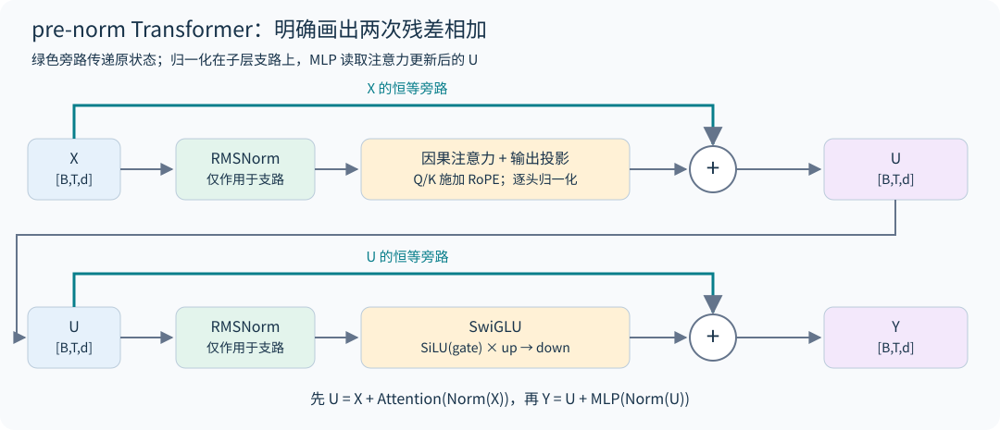

# 03｜解剖现代 Transformer

## 3.1 先沿着形状走一遍

token ID `[B,T]` 经 embedding 变成 $X\in\mathbb R^{B\times T\times d}$。一个 pre-norm block 为

$$U=X+\operatorname{Attn}(\operatorname{Norm}(X)),\qquad Y=U+\operatorname{MLP}(\operatorname{Norm}(U)).$$

堆叠 $L$ 层，末尾再做归一化与词表投影。残差流是所有层共享的宽度为 $d$ 的通信通道，注意力和 MLP 分别计算要写回该通道的增量。

原始 Transformer 与现代解码器有不同的常见选择，不能把某一配置当成定义。现代设计中的 pre-norm、RMSNorm、SwiGLU、RoPE 和无 bias 是一组经验组合。本书的模型实现采用这一组合；各年第三讲讨论了它们与 post-norm、LayerNorm、ReLU/GELU、并行子层等替代方案的对照。[2026 架构讲义](https://github.com/stanford-cs336/lectures/blob/de53a9f979a6ee35f7d13a5e1aadee5ea1afc58e/lecture_03.pdf)

## 3.2 自注意力到底在计算什么

对于单个头，$Q=XW_Q,K=XW_K,V=XW_V$，每个投影有 $d_h$ 个通道。

$$S_{ij}=\frac{q_i^\top k_j}{\sqrt{d_h}}+M_{ij},\quad P_{ij}=\operatorname{softmax}_j(S_{ij}),\quad o_i=\sum_jP_{ij}v_j.$$

query 表示当前位置需要检索什么，key 表示每个来源位置如何被匹配，value 表示实际搬运什么信息。这是有用的功能解释，不代表训练后每个维度都具有可命名语义。

若 $q,k$ 各维近似独立、零均值、单位方差，则点积方差约为 $d_h$。除以 $\sqrt{d_h}$ 使初始尺度不随头宽迅速增大，避免 softmax 过早饱和。训练后独立单位方差假设未必成立，因此仍可能需要 QK normalization 或 logit soft-capping。

多个头提供分别归一化的检索分布；拼接后用 $W_O$ 写回残差流。头之间通常读取相同的可见 token 范围，区别在于各自的 Q/K 分数及归一化分母。把两组通道拼成一个更宽的头，会先将两组点积相加、按新头宽缩放，再做一次 softmax；这不同于原来分别归一化的两个检索分布，因此多头不等于把一个头随意分块。

## 3.3 MLP 与 SwiGLU

普通 MLP 为 $\phi(XW_1)W_2$，参数量约 $2df$。SwiGLU 为

$$\operatorname{SwiGLU}(X)=\big[\operatorname{SiLU}(XW_g)\odot(XW_u)\big]W_d,$$

其中 $W_g,W_u\in\mathbb R^{d\times f}$，$W_d\in\mathbb R^{f\times d}$，参数量约 $3df$。gate 支路决定每个特征的连续通过程度，另一支路提供被调制的内容。门控不是二值开关。

若普通 MLP 取 $f=4d$，参数为 $8d^2$。要让 SwiGLU 保持近似相同预算，可取 $f=8d/3$，实际再对齐硬件友好的整数倍。若不匹配参数量就比较两种激活，观察到的改进可能部分来自新增容量。

注意力混合位置，MLP 在每个位置独立变换特征，但多层组合使 MLP 也能影响上下文行为。把 MLP 简化为“只存知识”、注意力简化为“只推理”，不足以指导架构设计。

## 3.4 为什么 pre-norm 有利于深层优化

对简化残差块 $y=x+F(N(x))$，Jacobian 为 $I+J_FJ_N$。存在一条恒等梯度路径，梯度不必每层都穿过归一化。post-norm 的 $y=N(x+F(x))$ 则是 $J_N(I+J_F)$，每一层的主路径都受到归一化 Jacobian 作用。

这解释了深层训练稳定性的一个机制，但不是所有训练配置的定理。残差方差可能随深度增长，更新尺度与初始化仍要控制。双归一化、子层输出归一化等设计试图在保持残差路径和控制子层尺度之间取得平衡。

RMSNorm 的计算为

$$r=\sqrt{\frac1d\sum_jx_j^2+\epsilon},\qquad y_i=g_i\frac{x_i}{r}.$$

它不减均值，参数 $g$ 为逐通道可学习缩放。忽略 epsilon 时，对正数缩放 $x\mapsto cx,c>0$ 不变；负数缩放会翻转符号。当输入均方远小于 epsilon 时，近似缩放不变性也不成立。它对平移不具有不变性。省略均值相关运算可简化内核；实际速度取决于融合、读写和硬件，不应只数标量运算。

## 3.5 数值尺度与稳定性设计

QK norm 在形成注意力 logits 前控制 query/key 尺度；soft-capping 可用 $c\tanh(z/c)$ 限制极值；z-loss 可惩罚 $\lambda(\log\sum_j e^{z_j})^2$。三者施加的位置和约束不同，不能互换。

softmax 对整体平移不变，但浮点计算的动态范围不是无限的。z-loss 约束了这种“概率看起来相同、内部数值却越漂越大”的自由度。归一化、损失和优化器状态通常优先采用 FP32 归约，即便矩阵乘使用 BF16。

## 3.6 从推导到代码

阅读 [model.py](../../examples/model.py)，依次定位 `RMSNorm`、`Attention`、`FeedForward`、`Block` 和 `TinyLM`。代码刻意显式产生注意力矩阵，便于理解 shape 和 mask；真正的高效内核在第 10 章解释。

`Config` 里有三个开关对应基础作业的消融：`norm`（`"pre"`、`"post"`、`"none"`）、`position`（`"rope"` 或 `"none"`，即 NoPE）、`ffn`（`"swiglu"` 或不门控的 `"silu"`）；第四个开关 `tie_embeddings` 对应讲义排行榜部分建议的权重共享。测试对每个单项变体都检查因果性与 KV cache 一致性，第 20.4 节给出它们在 TinyStories 上的真实对比。`model.py` 为简洁直接用了 `nn.Linear`、`nn.Embedding` 和 `F.silu`，A1 不允许这样做，要从 `nn.Parameter` 自己搭（第 0.4 节）。

**初始化。** 作业给出的近似方案：线性层权重 $\mathcal N\big(0,\frac{2}{d_{in}+d_{out}}\big)$，截断在 $\pm3\sigma$；embedding $\mathcal N(0,1)$，截断在 $\pm3$；RMSNorm 增益初始化为 1。pre-norm Transformer 对初始化相当鲁棒，但这个尺度仍要匹配：embedding 用 $\sigma=1$ 是因为它的输出直接进入 RMSNorm，传入子层的正比例尺度近似被归一化；但 embedding 仍沿残差主干传递，因此整个网络并不对该尺度严格不变；共享输入/输出 embedding 时，这个矩阵同时充当读出层，应改用线性层的较小尺度，否则这组配置的初始 logits 可能过大。`model.py` 的 `init_linear` 与作业一致。

## 3.7 超参数的"共识区间"

2026 年第三讲统计了大量公开模型，发现几个超参数出奇地一致。它们不是定理，但可以作为起点：

| 超参数 | 常见取值 | 讲义中的例子与例外 |
|---|---|---|
| $d_{ff}/d$ | 普通 MLP 取 4；GLU 类取 $8/3\approx2.67$ | LLaMA 65B 2.69（讲义幻灯片标作"LLaMA 70B"）、Qwen 14B 2.67；PaLM 4，Mistral 7B 与 LLaMA 2 70B 3.5；T5 11B 曾用 64 倍 |
| 头宽 × 头数 | 等于 $d$ | 大多数模型比值约为 1，头宽多为 128 |
| $d/n_{layer}$（宽深比） | 约 100–200 | GPT-3/OPT/Mistral/Qwen 为 128，LLaMA 为 102，BLOOM 205；过深的模型难并行、延迟高 |
| 词表 | 单语 30K–50K；多语言 100K–250K | GPT-2/3 50,257，LLaMA 32,000，Qwen 约 152K，Gemma 4 约 262K |
| 正则化 | 预训练基本不用 dropout，用 weight decay | weight decay 同时影响优化轨迹与正则化，作用取决于数据重复和日程 |

Kaplan 等人的实验显示，$d_{ff}/d$ 在 1 到 10 之间都接近最优，宽深比也有很宽的平坦区；这些"共识"更多反映工程习惯和硬件效率，而不是精确的最优值。

## 3.8 解码：温度与 top-p

训练好的模型给出下一个 token 的分布 $p$，生成时还要选一个解码规则。温度 $\tau$ 把分布改为 $\mathrm{softmax}(z/\tau)$：$\tau<1$ 更集中，最大 logit 唯一时 $\tau\to0^+$ 集中到该 argmax。若多个 logits 恰好并列最大，极限是在它们之间均匀分配，固定 argmax 的并列规则则只选一个。代码的 temperature=0 是明确的贪心分支，不能直接除以零。top-p（nucleus）采样把 token 按概率从大到小排序，保留累积概率首次达到阈值的最小前缀，重新归一化后再采样；它在分布集中时只留少数候选，在分布平坦时留很多。

`model.py` 的 `sample_next` 先做温度、再做 top-p，`generate` 遇到 `eos_id` 停止。测试检查了 $p=(0.5,0.3,0.15,0.05)$、top-p 0.75 时只会采到前两个 token。基础作业要求至少生成 256 个 token（或到第一个 `<|endoftext|>`），并讨论影响流畅度的因素。

## 3.9 串行与并行子层为什么不是同一函数

标准串行块先更新注意力，再让 MLP 读取更新后的状态：$u=x+A(N_1(x))$、$y=u+F(N_2(u))$。并行子层则常写成

$$y=x+A(N_1(x))+F(N_2(x)).$$

并行版本中，两条支路都读取原始 x，有机会共同计算投影、复用归一化输入或重叠执行，但 MLP 在这一层不能直接利用注意力刚写入的信息。即便参数量相同，它们也不是重排计算顺序得到的等价实现。若共享 $N_1,N_2$ 又增加了一项约束，需要单独消融。2024 基础作业的 parallel-layers 实验正是要比较这种取舍。[2024 基础作业](https://github.com/stanford-cs336/spring2024-assignment1-basics/blob/dae79d035bf866a71d81a02b0c023980d537b16d/cs336_spring2024_assignment1_basics.pdf)

## 3.10 深宽比、无 bias 和正则化怎样一起比较

忽略词表头，常见 dense 模型参数近似为 $N\propto Ld^2$。固定参数下把层数乘 4、宽度约除以 2，可以保留相近参数量，却增加串行深度、改变矩阵形状和每层通信次数；相同 FLOPs 不保证相同延迟。更宽模型可能让矩阵乘效率更好，更深模型提供更多迭代计算步骤；二者谁更好需要匹配预算和充分调参的实验。

去掉线性层 bias 可简化参数、广播与融合，但不是因为所有 bias 都能被 RMSNorm 抵消：RMSNorm 没有中心化操作。dropout 为隐藏表示加入随机性，weight decay 直接改变参数轨迹，二者不是同一种正则化。大数据、少重复预训练中有些配方不用 dropout，领域微调和重复数据训练却可能呈现不同权衡。

做归一化、激活、位置或并行层消融时，应明确固定的是参数、token、FLOPs 还是训练时间；有的消融改变了多个成本项。至少比较训练稳定性、验证损失和吞吐，不仅比较同 step 下的一条曲线。课堂经验配方提供候选起点，不能代替本任务下的对照。

## 3.11 社区进展：2025 年开源模型的默认配置

第 29 章从固定版本的 `config.json` 精确复算了 14 个开源模型的参数量，与官方 safetensors 元数据逐个相等。其中五个 dense 模型的骨架已高度一致：RMSNorm、SwiGLU、RoPE、无 bias、GQA 或 MHA（MoE 模型里 gpt-oss、GLM-4.5 的 QKV 投影仍带 bias）。变化集中在稳定性细节上：

- QK-Norm 很常见但不是默认：Qwen3、OLMo 2、GLM-4.5 采用（Qwen3 用它替代了 Qwen2 的 QKV bias），SmolLM3、Mistral Small、gpt-oss 和 MLA 模型没有；
- OLMo 2 把归一化移到子层输出上，残差主干上不再有归一化；
- 宽深比因团队而异：OLMo 2、Mistral Small、DeepSeek-V3 落在第 3.7 节的 100–200 区间内，Qwen 的 MoE 系列（约 43）、GLM-4.5（56）、SmolLM3-3B（57）明显更深更窄。

详见第 29.2 节。

## 3.12 把注意力拆成“选哪里”与“写什么”

采用行向量、暂略位置和归一化，一颗头写回残差的量为

$$\Delta x_i=\sum_j a_{ij}\,x_jW_VW_O,\qquad a_{ij}=\operatorname{softmax}_j(x_iW_QW_K^\top x_j^\top/\sqrt{d_h}).$$

QK 路径决定路由权重，OV 路径决定被搬运的内容。即使 $a_{ij}$ 很大，若 $x_jW_VW_O$ 很小或被别的头抵消，最终影响也可能很小；反过来，小注意力权重乘很大的 value 也能显著写回。单头 OV 的秩最多为头宽，但多头相加、跨层与非线性 MLP 组合后，不再受一个头的秩约束。

这也解释几种稳定化为何不等价。QK norm 改变路由分数的尺度；输出门控直接改变 OV 写回强度；z-loss 对 $Z=\log\sum_ve^{z_v}$ 的梯度为 $2\lambda Zp_v$，约束 softmax 归一化常数，不能代替控制残差或 value 范数。记录 attention entropy 时应同时看 value/output RMS，才可能定位“分布很尖但写回很弱”与“分布平坦但残差爆炸”的不同问题。

**自测。** 能否只凭一个头总把注意力放在 BOS，就判定它没用？

**解答。** 不能。应检查其 OV 写回及后续利用，再做控制消融；BOS 的高权重本身只说明路由现象，第 27 章讨论干预边界。

## 练习

**1．** 宽度 $d=512$、SwiGLU 中间宽度 $f=1360$，MLP 有多少权重？若改成 $f=2048$，比较时改变了什么？

**解答。** 前者为 $3\times512\times1360=2,088,960$。后者为 3,145,728，参数和主要 FLOPs 同时增大约 50.6%。单看验证损失更低不能证明新宽度配置在固定计算预算下更优。

**2．** 作业的 TinyStories 配置为 $d=512$、$d_{ff}=1344$、4 层、16 头、词表 10,000。不计 embedding 和输出头，参数约多少？加上它们呢？

**解答。** 每层 $4d^2+3dd_{ff}+2d=1{,}048{,}576+2{,}064{,}384+1{,}024\approx3.11$M，4 层约 12.5M。作业在一处把这个配置描述为"约 17M 非 embedding 参数"，另一处又称"约 17M 总参数"，两处口径本身不一致。17.6M 恰好等于 4 层加上输出头（$Vd=5.12$M），可能是只排除输入 embedding 的口径，但讲义没有说明。三者全算约 22.7M。不同资料对"非 embedding 参数"的口径不一致，报告时要写清楚。

**3．** 共享输入/输出 embedding 时，为什么不能沿用 $\sigma=1$ 的 embedding 初始化？

**解答。** 共享矩阵同时是读出层，logits 为 $h^\top W_e$。在坐标方差约为 1、近似独立且忽略共享权重相关性的量级估算中，logit 方差约为 $d$；真实 $h$ 与共享 $W_e$ 存在相关性，不能当作精确方差公式。这提示 logits 可能过大，需实测初始 NLL 与 logit 分布。本书采用读出层的较小尺度；也可设计额外输出缩放，但要重新验证激活、更新与 logits。

本章原始架构背景可参见 [Attention Is All You Need](https://arxiv.org/abs/1706.03762)；课程中的模型选择与工程取舍以上述三年讲义为主要依据。
