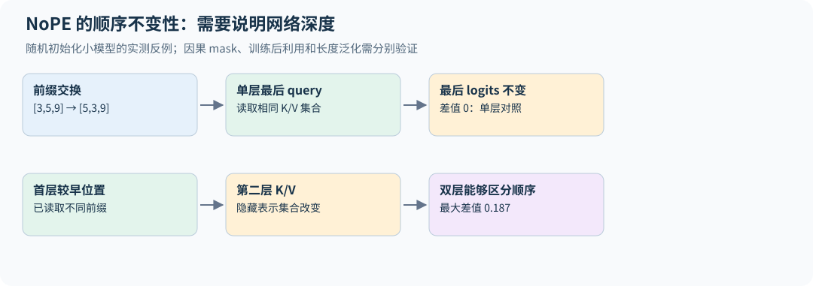
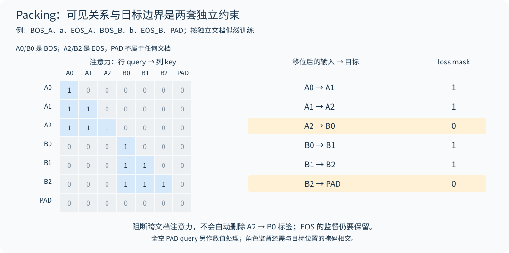

# 04｜位置、长上下文与 KV 共享

## 4.1 为什么注意力本身不知道顺序

如果对一组输入同时置换 token，并忽略因果 mask，自注意力的输出会按相同方式置换。矩阵乘和逐行 softmax 没有内建“这是第几个词”的坐标。因果 mask 提供了可见性顺序，但通常仍需要显式位置机制表达距离和相对结构。

绝对位置 embedding 把位置向量加到输入；正弦位置编码用固定频率生成位置向量；相对位置 bias 直接修正 attention score。RoPE 则旋转 query 和 key，使它们的内积依赖相对位移。

**完全不加位置编码（NoPE）也能训练。** 带因果 mask 的 decoder 并非对位置完全无知：第 $t$ 个位置能看到恰好 $t$ 个 token，可辨认的开头标记等内容结构能经因果注意力形成随位置变化的信号。基础作业要求做这个消融。在第 20.4 节的 TinyStories 实验中，NoPE 的验证损失比 RoPE 高 0.14。一个简单的检查是：取单层模型，把最后一个位置之前的两个不同 token 对调。不带位置编码时，最后一个位置的 query 面对的是同一组 key 和 value，只是顺序变了，输出不变；带 RoPE 时则可改变。测试 `test_nope_last_position_ignores_order_of_earlier_tokens` 对两种设置都做了检查。这个不变性仅针对固定参数、无随机扰动的单层最后位置，不能推广到多层：第一层较早位置已经读入不同前缀，第二层面对的 key/value 集合不再相同，因此能够区分排列。配套双层反例和因果/cache 测试展示了这种区别。因果结构提供顺序线索，但可表示位置、训练后会利用位置和能向更长序列泛化是三种不同结论。[NoPE 的理论与实验](https://arxiv.org/html/2305.19466v2)



一个具体的位置线索构造是：第一位置的 value 在某通道为 1，其余位置为 0，Q/K 分数全为零。第 t 个位置的因果均匀注意力输出就是 $1/t$，有限长度下可以区分位置。这里用到了可辨认的开头标记；一般的“内容有差异”并不足以保证位置可恢复，而且相邻位置的信号差约为 $1/t^2$，长序列与有限精度下越来越难区分。这个构造说明表示能力，不能代替训练是否学会或能否外推的实验。

## 4.2 RoPE 的核心推导

在二维平面定义旋转矩阵

$$R(\theta)=\begin{bmatrix}\cos\theta&-\sin\theta\\\sin\theta&\cos\theta\end{bmatrix}.$$

把位置 $m$ 的 query 旋转为 $R(m\omega)q$，位置 $n$ 的 key 旋转为 $R(n\omega)k$。因为旋转是正交变换，

$$[R(m\omega)q]^\top[R(n\omega)k]=q^\top R((n-m)\omega)k.$$

位置只通过差值 $n-m$ 进入这个内积。对更高维向量，把坐标分成多个二维平面，各自使用 $\omega_j=\theta_{base}^{-2j/d_h}$。高频刻画近距离变化，低频提供更长的变化尺度。[RoFormer](https://arxiv.org/abs/2104.09864)

旋转不改变每一对坐标的范数，不代表注意力结果不变：query 与 key 的相对旋转改变了夹角。RoPE 通常施加于 Q/K 而非 V。相邻配对与前后半维配对都能实现旋转，但加载已有权重时必须与原模型约定一致。

## 4.3 长上下文外推为什么会失败

公式在任意 $m$ 上都可计算，不意味着模型在未训练过的距离上能正确利用信息。旋转相位、注意力距离分布、干扰 token 数量以及训练任务分布都改变了。

一种直观方法是位置插值：把目标上下文位置除以扩展倍数 $s$，让相位范围接近训练范围。它降低长距离外推压力，却压缩短距离分辨率。改变 RoPE base 或分频段缩放试图兼顾两者；不同方法的最佳设置依赖模型和训练过程。

因此扩长上下文应同时检查短文本能力、长文档检索、多处信息聚合、远距离推理，以及真实任务性能。只在一个“针在草堆”位置成功不能证明模型能可靠理解整篇长文。长上下文微调通常还要调整数据混合、序列 packing 与 batch token 数。

## 4.4 MHA、MQA 与 GQA

标准 MHA 每个 query 头有自己的 key/value 头，即 $h_{kv}=h_q$。MQA 令所有 query 共享一个 KV 头。GQA 取中间值，例如 32 个 query 头分为 8 组，每组共享一套 KV。

$$Q:[B,h_q,T,d_h],\qquad K,V:[B,h_{kv},T,d_h].$$

GQA 不减少 query 头数，因此 score 计算仍涉及 $h_q$ 个头；它减少 K/V 投影和缓存大小。每层注意力权重数在无 bias 时为

$$d(h_qd_h)+2d(h_{kv}d_h)+(h_qd_h)d.$$

当 $d=h_qd_h$ 时，等于 $2d^2+2dd_{kv}$，其中 $d_{kv}=h_{kv}d_h$。把 GQA 的所有层仍按 $4d^2$ 计算，会高估参数量。

本书代码通过 `repeat_interleave` 把 KV 展开到 query 头数以方便验证。它保留小 KV cache，却会产生额外临时张量；生产内核应直接复用共享 KV，避免物理复制。

## 4.5 cache 的位置与 mask 必须一起改变

已缓存前 $S$ 个 token，新输入长度为 $t$，它们的位置应是 $S,\ldots,S+t-1$。第 $i$ 个新 query 能看见 key 位置 $j\le S+i$。对于单 token 解码，这意味着它能看见全部已有缓存与自身。

如果对 `[1,S+1]` 的 score 直接使用左上角的普通下三角 mask，会只允许第一个 key，导致看起来“有 cache”，生成却错误。不同框架对于非方阵 `is_causal` 的对齐约定可能不同，使用前必须验证；本书显式构造位置比较避免歧义。

RoPE 后的 K 可以直接缓存，不应在下次调用中再次旋转。prefill、单 token decode 和多 token 分块 decode 的 logits 应与一次完整前向一致，这比观察生成文字是否合理更强。

## 4.6 三种 mask 和两个位置坐标

因果 mask 回答“能否看未来”，padding mask 回答“这个 token 是否真实存在”，packing 的文档 mask 回答“能否读取相邻但无关的文档”。loss mask 则控制监督项，属于另一个维度。把它们都叫作 `mask` 而没有 shape 和语义，是常见错误源。

以 `[A0,A1,B0,B1,PAD]` 为例，若 A/B 是独立文档、token 不能跨文档读取，可见矩阵为：

```text
         A0 A1 B0 B1 PAD
A0        1  0  0  0  0
A1        1  1  0  0  0
B0        0  0  1  0  0
B1        0  0  1  1  0
PAD       0  0  0  0  0
```

最后一行不能直接做普通 softmax；应剔除 padding query，或给其临时安全 key 并在输出后置零。`examples/objectives.py` 生成的是“1 表示允许读取”的矩阵，没有替调用方掩盖全空行。

独立文档的**目标边界**还要单独处理。对 `[BOS_A,a,EOS_A,BOS_B,b,EOS_B,PAD]` 整串移位，会产生 `EOS_A → BOS_B` 这个跨文档监督项；阻断 attention 并没有删除它。若要等价于逐文档条件似然，该项应屏蔽，`a → EOS_A` 和 `b → EOS_B` 则保留。无 BOS 时，各文档首 token 仍没有对应预测项；需要补 BOS 或明确采用“条件于首 token”的目标。



`packed_next_token_mask(document_ids, supervised)` 接收未移位的文档 ID 与可选角色掩码，返回相邻两位置属于同一有效文档、且目标位置需监督的 `[B,T-1]` mask。EOS 的文档 ID 属于它结束的文档；PAD 用 −1；每个独立段使用唯一 ID。它与 `packed_causal_mask` 配合使用，不会自动插 BOS 或重置位置。配套小网络对照逐文档与 packing 的 loss、全部参数梯度及文档间扰动隔离，避免只验证了 attention 矩阵就宣布训练目标等价。

PyTorch SDPA 的布尔 mask 中 `True` 表示允许参与注意力，而 `nn.MultiheadAttention` 的某些布尔 mask 参数中 `True` 表示屏蔽；不能跨 API 直接照搬。非方阵 causal 对齐也必须与缓存坐标核对。[PyTorch 2.11 注意力源码与接口说明](https://github.com/pytorch/pytorch/blob/v2.11.0/torch/nn/functional.py)

position ID 是模型语义位置，cache slot 是物理存储位置，两者不必相同。左 padding 的变长 batch 中，每条样本有效前缀长度不同，不能统一用 padded width 当作 RoPE 起点。滑动窗口丢弃旧缓存后，也不能自然把绝对位置重置为零。教学 `TinyLM` 只接受等长、无 padding、连续增长的缓存；服务系统需要逐请求位置、有效长度和页表管理。

**练习。** 已有 7 个缓存 token，一次送入 3 个新 token。三个 query 的绝对位置和可见 key 数是多少？

**解答。** 位置为 7、8、9，可见 key 数分别为 8、9、10。比较必须基于绝对位置；把它们当作 0、1、2 会同时破坏 RoPE 和因果 mask。

GQA、位置机制和长短注意力混合（滑动窗口与全局层交替见第 7 章与第 30 章）对应 [2026 第三讲](https://github.com/stanford-cs336/lectures/blob/de53a9f979a6ee35f7d13a5e1aadee5ea1afc58e/lecture_03.pdf) 与 [第十讲](https://github.com/stanford-cs336/lectures/blob/de53a9f979a6ee35f7d13a5e1aadee5ea1afc58e/lecture_10.py)。

## 4.7 社区进展：从 4K 到 128K

RoPE base 从 $10^4$ 增大到 Qwen3 的 $10^6$、Mistral Small 的 $10^8$。DeepSeek-V3 与 Kimi K2 在 4K 上下文上完成主体预训练，再用 YaRN（factor 40 与 32）扩展到 128K（配置上限分别为 163,840 与 131,072）；gpt-oss 的模型卡写明用 YaRN 把全注意力层扩展到 131,072，配置中的原始长度为 4,096、factor 为 32。SmolLM3 每 4 层去掉一层 RoPE，是 NoPE 思路的工程化变体。gpt-oss 给每个头加了一个可学习的 sink logit，让注意力可以"不关注任何 token"。

第 30 章从 RoPE 的波长出发推导 PI、NTK 与 YaRN，并讨论注意力汇点和长上下文评估。`long_context.py` 的 YaRN 实现与 transformers 参考实现在这三个模型的真实配置上逐元素一致（最大相对误差约 $10^{-7}$）。

## 4.8 cache 一致性还要求位置规则固定

RoPE 内积依赖相对位置的推导，假定同一频率表用于两边。若动态扩长时把频率由 $\omega$ 改为 $\omega'$，旧 cache 的 K 仍按 $\omega$ 旋转，新 Q 却按 $\omega'$ 旋转，两者不再等价于新规则下完整重算。实现可以固定整次请求的规则，或按算法要求重建/转换旧 key；不能只改配置后继续拼接旧缓存。

只改变旋转、原始 key 固定时，可写 $k_j^{new}=R_j(\omega')R_j(\omega)^\top k_j^{old}$。但在多层 Transformer 中，改位置规则也会改变较早层的 attention 输出，后续层的原始 K 和 V 随之变化；逐层给旧 K 再转一次并不能恢复新规则下整网重算的结果。该转换只说明局部线性关系，是否必须重建整个前缀仍取决于模型计算图。

相对旋转也不证明任意整网平移都严格不变：绝对 embedding、窗口边界、BOS、位置相关缩放与截断都可能破坏这个条件。测试应覆盖不同前缀长度、一次输入多个新 token，以及越过扩长阈值的情形。

换到框架 SDPA 时还有一个独立陷阱：其 dropout 由函数参数决定，模块 `.eval()` 不会自动替你将 `dropout_p` 改为零。典型调用是：

```python
output = F.scaled_dot_product_attention(
    q, k, v, attn_mask=allowed_mask,
    dropout_p=(dropout if training else 0.0),
)
```

这里 `allowed_mask` 必须与 cache 的绝对位置一致；非方阵的 `is_causal=True` 不应未经验证替代它。布尔 mask 语义、GQA 是否展开及实际选中的后端，都应按对应版本核对。[PyTorch v2.11 SDPA 定义](https://github.com/pytorch/pytorch/blob/v2.11.0/torch/nn/functional.py)
