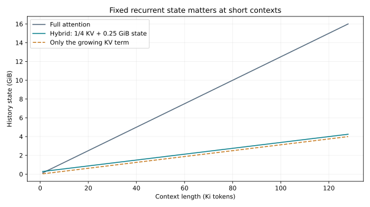
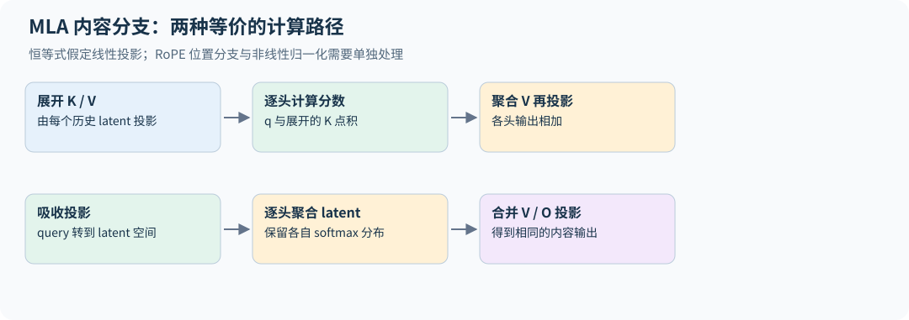

# 07｜注意力替代方案：用怎样的记忆换取长上下文效率

## 7.1 精确注意力昂贵在哪里

全注意力为每个 query 比较每个 key，score 数量为 $T^2$。FlashAttention 可以避免保存完整矩阵，但仍计算这些配对。要进一步改变复杂度，需要改变连接结构、核函数或历史状态的表示。

本章重点来自 [2026 第四讲前半部分](https://github.com/stanford-cs336/lectures/blob/de53a9f979a6ee35f7d13a5e1aadee5ea1afc58e/lecture_04.pdf)，是相对 2024/2025 年 MoE 主题的重要扩充。

滑动窗口只看最近 $w$ 个位置，将每层计算降低到 $O(Twd_h)$，但远处信息需要经过多层中间位置传递。混合局部层与全局层保留周期性的直接长距离访问。稀疏检索式注意力先用廉价索引选候选 key，再计算较贵匹配；收益取决于候选选择开销与召回率。

## 7.2 线性注意力的结合律

若暂时移除 softmax，则

$$QK^\top V=Q(K^\top V).$$

左式形成 $T\times T$ 矩阵，右式先形成 $d_h\times d_v$ 状态。对因果版本可递推

$$S_t=S_{t-1}+k_tv_t^\top,\qquad y_t=q_t^\top S_t.$$

每步只更新一个固定大小状态。对归一化核注意力，用特征映射 $\phi$ 替代 key/query，并维护

$$S_t=\sum_{i\le t}\phi(k_i)v_i^\top,\quad z_t=\sum_{i\le t}\phi(k_i),\quad y_t=\frac{\phi(q_t)^\top S_t}{\max(\phi(q_t)^\top z_t,\epsilon)}.$$

正分母下不加保护项才是精确的归一化核平均；上式按教学代码采用下限保护。它与“分母加 epsilon”不同：后者即使分母很大也改变数值，下限保护只在小分母区改变结果。两种稳定化都需明确约定；比较显式矩阵与递推时必须使用同一种。

这里不能把 softmax 任意搬进搬出矩阵乘。普通 softmax attention 并不等于这个表达式，除非使用特定近似和对应误差分析。线性复杂度来自改变算子，也可能牺牲精确检索能力。

配套 [extensions.py](../../examples/extensions.py) 用 $\phi(x)=\operatorname{ELU}(x)+1$，分别显式形成因果核矩阵和递推 $S_t,z_t$，对照输出与梯度。两者相等说明递推正确实现了该核注意力，不说明它与 softmax 注意力相等。

数学上的正特征也会在浮点实现里丢失。对负 x，直接先算 $e^x-1$ 再加 1，会在 x 足够负时消减为零；应按 $\phi(x)=e^x$（$x<0$）、$x+1$（$x\ge0$）计算。示例还把 FP16/BF16 的特征、状态和分母提升到 FP32，最后再转回输入 dtype；相关矩阵乘显式关闭外层 autocast，否则 `.float()` 后仍可能再次降精度。$10^{-8}$ 在 FP16 中也可能变成零，原本的分母保护退化为 0/0。输出与梯度测试同时覆盖负值、半精度、autocast 和不同的 value 宽度，并拒绝不等长 Q/K/V，避免 `zip` 静默丢掉尾部。

“线性”指固定特征宽度下对序列长度的增长：递推每步仍要做约 $d_kd_v$ 的状态更新，状态存储约 $d_kd_v+d_k$ 个数。训练反向的激活可随长度增长，chunk 算法和重计算决定峰值；固定 decode 状态不等于训练显存固定。

## 7.3 固定状态不是免费的无限记忆

所有历史被压进固定大小 $S_t$，序列越长，不同信息越可能相互干扰。全注意力保留所有 key/value，允许对个别历史位置重新查询；递归状态无法任意恢复已经被混合或遗忘的细节。

加入门控 $S_t=\gamma_t S_{t-1}+k_tv_t^\top$ 可主动遗忘。更一般的状态空间模型写成

$$s_t=A_ts_{t-1}+B_tx_t,\qquad y_t=C_ts_t.$$

选择性状态空间模型让部分系数依赖输入，决定保留与写入什么。若只逐 token 执行，训练并行度有限；结构化扫描与分块算法利用递推的可组合性恢复高效并行。Mamba 与 Mamba-2 分别提供了选择性状态建模和状态空间对偶视角。[Mamba](https://arxiv.org/abs/2312.00752)、[Mamba-2](https://arxiv.org/abs/2405.21060)

## 7.4 Delta rule：先纠正旧记忆，再写新记忆

用 $S\in\mathbb R^{d_k\times d_v}$ 存储 key→value 映射，预测 $\hat v=S^\top k$。对平方误差 $\frac12\|S^\top k-v\|^2$ 做一步梯度下降：

$$S'=S+\beta k(v-S^\top k)^\top.$$

它不只是不断叠加新关联，还减去当前 key 方向上旧预测的错误。加入遗忘可先置 $\widetilde S=\gamma S$，再执行

$$S'=\widetilde S+\beta k(v-\widetilde S^\top k)^\top.$$

这是理解 gated delta 类方法的简化形式；完整模型还包含归一化、投影、门控约束和适合硬件的 chunk 算法。稳定步长受 key 范数影响，所以归一化并非可有可无的小修饰。

稳定条件可从同一个关联的残差直接看出。令 $e=v-S^\top k$，不加遗忘时更新后 $e'=v-S'^\top k=(1-\beta\|k\|^2)e$。对非零 k 和非零残差，单次关联误差严格缩小需 $0<\beta\|k\|^2<2$；等于 1 时该关联一次写准，超过 2 时重复写入会放大误差。单位范数 key 把阈值简化为 $0<\beta<2$。这只针对固定 k、v 的局部更新，不保证不同关联互相干扰时整条序列稳定。

## 7.5 MLA 是压缩缓存的另一条路线

Multi-head Latent Attention 把 K/V 的生成建立在较低维 latent $c_t$ 上，例如 $k_t=W_Kc_t,v_t=W_Vc_t$。若只缓存 $c_t$，解码时可用投影重建，或通过矩阵代数把部分投影吸收到 query/输出变换中。

难点是位置编码与这些代数变换未必交换；因此实际架构会把位置相关与内容相关分量作专门设计。缓存大小应包含 latent 和额外位置分量，不能只数 $c_t$ 就声称完整节省。[DeepSeek-V2](https://arxiv.org/abs/2405.04434)

## 7.6 公开模型怎样混合两类层

纯线性注意力或纯状态空间模型在精确检索类任务上通常吃亏，因此采用线性注意力或状态空间层的近期大模型几乎都做成**混合**结构（多数大模型仍然只用 softmax 注意力，见第 29 章）：大部分层是固定状态的线性层，少数层保留全注意力。2026 年第四讲列举了几种配比：MiniMax-M1 与 MiniMax-Text-01 是 7 层线性注意力配 1 层全注意力；Qwen 3.5 / Qwen-Next 是 3 层 gated delta net 配 1 层注意力；Nemotron 3 是大约 3:1 的 Mamba 与注意力混合。讲义也指出，这方面的受控消融并不多，现有证据只说明较低的全注意力比例下损失仍可接受。

另一条路线是**稀疏注意力**而不是换算子：DeepSeek Sparse Attention（DeepSeek-V3.2、GLM-5 使用）用一个很轻的索引器为每个 query 选出少量候选 key，再只在这些 key 上做精确注意力。它可以在短上下文稠密预训练之后再适配，不必从头训练。收益取决于索引器的召回率：漏掉的关键 token 无法再被注意到。

混合比例、哪几层放全注意力、全注意力层是否也用滑动窗口，都是架构超参数。比较时要固定训练 token 与 FLOPs，并同时报告长上下文检索与普通语言建模两类指标。

## 7.7 如何比较替代方案

| 方案 | 历史状态 | 主要收益 | 必须验证 |
|---|---|---|---|
| 全注意力 | 每个 token 的 KV | 精确逐位置访问 | 长序列计算与缓存 |
| 窗口注意力 | 最近窗口 KV | 有界局部成本 | 远距离依赖 |
| 线性/递归状态 | 固定矩阵或向量 | 解码状态不随长度增长 | 关联记忆与检索干扰 |
| 混合架构 | 两类状态 | 平衡能力与资源 | 混合比例与跨层配合 |
| latent KV | 压缩历史 latent | 较小 KV 存储 | 投影开销、位置处理 |

**练习。** 将上下文从 4K 增到 64K，固定状态模型的缓存不变，是否证明它更好？

**解答。** 只证明某个资源维度更有利。需要同时比较训练预算、有效信息保留、任务准确率、实际延迟及状态更新成本。相同参数量不保证相同 active FLOPs，更不保证相同检索能力。

**练习 2．** 一个 32 层模型采用 3:1 的线性注意力与全注意力混合，上下文从 8K 增到 128K。与全注意力模型相比，KV cache 大约缩小多少？

**解答。** 在相同 KV 头宽和精度下，仅随长度增长的 KV 部分为全注意力的 1/4；总历史状态为 $M_{hybrid}(T)=M_{full}(T)/4+M_{state}$，比值为 $1/4+M_{state}/M_{full}(T)$，随 T 增长才趋近 1/4。例如全注意力 8K 时为 1 GiB、线性层固定状态合计 0.25 GiB，则混合总量为 0.5 GiB、比值 1/2；128K 时全注意力为 16 GiB，混合为 4.25 GiB、比值约 0.266。固定状态不能在短上下文自动忽略。

## 7.8 社区进展：混合层已经进入大模型

本章讨论的混合方案在 2025 年的开源模型中都有了实例：

- Qwen3-Next：每 4 层只有 1 层全注意力，其余 36 层是 Gated DeltaNet，全注意力层的输出再乘一个 sigmoid 门；
- MiniMax-M1：80 层中只有 10 层是 softmax 注意力；
- gpt-oss：一半层是 128 token 的带状窗口，一半是全注意力。

32K 上下文下，Qwen3-Next 每请求的 KV 只有 0.75 GiB，激活参数相近的 Qwen3-30B-A3B 是 3.0 GiB。见第 29.4 节与第 30.4 节。

## 7.9 从递推到并行扫描：结合律在哪里

考虑 $h_t=A_th_{t-1}+b_t$，把一步表示成仿射变换 $(A_t,b_t)$。先做 1 再做 2 的组合是

$$(A_2,b_2)\circ(A_1,b_1)=(A_2A_1,\ A_2b_1+b_2).$$

组合满足结合律但一般不交换。因此可用树状前缀扫描求所有累积变换，依赖深度由 T 降至 $\log T$；不能把它理解为所有时间步本来互不依赖。若 A 是稠密状态矩阵，组合本身很贵；对角、标量或其他结构化 A 才使扫描经济。若 A 还依赖尚未算出的旧状态，也不能先把整列 A 并行准备好。[Mamba-2 的递推、矩阵与结构化状态空间对偶](https://arxiv.org/html/2405.21060v1)

`affine_scan` 用对角 A 和倍增扫描，对照串行递推的输出及全部梯度，包含非 2 次幂长度。它使用 $O(T\log T)$ 工作量来展示结合律；生产算法的 work-efficient scan、chunk 内 GEMM、跨 chunk 传状态是另一个优化层次。SSM 与注意力的对偶针对特定结构算子，不表示任意 softmax attention 都可无损压成固定状态。

## 7.10 MLA 投影吸收：把“省 KV”真的写出来

对一个头采用列向量，$k_j=W_Kc_j,v_j=W_Vc_j$。定义 $\widetilde q=W_K^\top q$，则

$$q^\top k_j=\widetilde q^\top c_j,\qquad W_O\sum_ja_jv_j=(W_OW_V)\sum_ja_jc_j.$$

第一式让 query 直接与缓存 latent 比较；第二式先按注意力权重聚合 latent，再投影回输出。多头必须分别算各自的 $a_j$ 与 latent 加权和，不能把多个头的 softmax 合为一个。推理权重固定时，投影乘积可预先合并；训练中仍需正确传回每个原矩阵的梯度。[DeepSeek-V2 §2.1.2–2.1.3](https://arxiv.org/html/2405.04434v5)

若完整 key 还经过位置相关的 $R_j$，分数变成 $q^\top R_i^\top R_jW_Kc_j$，中间旋转依赖 j，一般无法预先吸收到单个 query 矩阵。解耦 RoPE 把内容内积与独立的位置内积相加，所以缓存要包含 latent 和 RoPE key；非线性 key norm 也会改变吸收条件。

`mla_content_output` 对展开 K/V 与投影吸收两条路径检查输出和 Q、latent、K/V/O 投影的全部梯度。只验证内容分支的恒等式，不复现完整 MLA kernel；省缓存也可能增大吸收后点积维度，真实性能依赖 head/latent 形状与实现。
