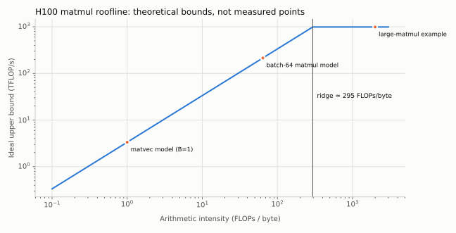

# 09｜GPU、TPU、性能分析与 Triton


## 9.1 GPU 为什么需要不同的编程思路

CPU 擅长少量复杂控制流，GPU 通过大量并行工作隐藏延迟。GPU 中线程组成 warp，多个 warp 组成 thread block，在 SM 上执行。线程拥有寄存器，同 block 可共享片上 shared memory，跨 block 通常通过全局内存通信。

global memory 容量大但访问昂贵；寄存器和 shared memory 快但容量有限。Tensor Core 对特定形状和 dtype 的矩阵运算吞吐极高，标量运算不能简单按同样峰值估算。block 太小缺少工作，太大又可能因寄存器/shared memory 占用降低同时驻留的 block 数。

TPU 同样围绕大型矩阵计算单元、片上内存和高速互连设计，但执行组织、编译栈和网络拓扑与 GPU 不同。不能把 GPU 的 warp 数和 block size 调参原样搬到 TPU。几个对应关系值得记住：TPU 的矩阵单元（MXU）是脉动阵列，按固定的大块形状（如 128×128）吞吐，维度不是这个块的整数倍时同样会浪费算力（对应 9.5 节末尾练习中的 tile 量化）；片上向量内存（VMEM）对应 GPU 的 shared memory/寄存器，HBM 的角色相同，roofline 分析照样适用；芯片之间用 ICI 组成 2D/3D 环面（torus），集合通信的拓扑与 GPU 的 NVLink 交换网络不同（第 11 章）；编程上通常不手写线程调度，而是由 XLA 编译整张计算图，用 sharding 注解声明张量怎样切分，需要手写内核时用 Pallas。本章其余部分以 GPU 为主。2026 年课程把 TPU 及加速器互连纳入硬件与并行讨论。[第五讲](https://github.com/stanford-cs336/lectures/blob/de53a9f979a6ee35f7d13a5e1aadee5ea1afc58e/lecture_05.pdf)、[第八讲](https://github.com/stanford-cs336/lectures/blob/de53a9f979a6ee35f7d13a5e1aadee5ea1afc58e/lecture_08.pdf)

## 9.2 Roofline 把两个限制放在一张图上

定义算术强度 $I=\mathrm{FLOPs}/\mathrm{bytes\ moved}$。若硬件计算峰值为 $F$，可用内存带宽为 $W$，理想性能上界为

$$\mathrm{throughput}\le\min(F,WI).$$

两条线的交点 $F/W$ 称为 ridge point。课程使用的 H100 数字是 BF16 稠密峰值 989 TFLOP/s、HBM 带宽 3.35 TB/s，ridge point 约 **295 FLOPs/byte**：在理想 roofline 模型中，低于它时带宽项给出更低上界，高于它才有机会接近 Tensor Core 算力上界。B200 的 BF16 峰值约 2.5 PFLOP/s（2026 系统作业引用的规格），不经 Tensor Core 的 FP32 只有 80 TFLOP/s，相差 30 倍，这也是混合精度几乎是必选项的原因。FP32 矩阵乘也可以走 TF32 Tensor Core，峰值约为 BF16 的一半（H100 的约 495 TFLOP/s 属于 TF32 Tensor Core 口径），但要在 PyTorch 里显式允许。



对矩阵乘 $C=AB$，若每个元素理想情况下只从 HBM 读写一次，

$$I\approx\frac{2mnk}{s(mk+kn+mn)}.$$

方阵增大时计算量立方增长，最少数据移动平方增长，因此更可能受计算限制。对 $[B,D]\times[D,F]$ 的 BF16 矩阵乘，若 $B\ll D,F$，算术强度约为 $B$：在这个近似下，batch 中的 token 数超过约 295，H100 的带宽上界才不再低于 Tensor Core 算力上界。矩阵向量乘（$B=1$）的强度约为 1，这解释了预填充和单 token 解码的一项主要性能差异。逐元素操作每读写几个字节只做几次运算，强度在 0.25–5 FLOP/byte 之间（讲义按 ReLU 约 0.25、GELU 约 5 计，BF16），比 ridge point 低两个数量级，对足够大的工作量常受数据移动限制，融合既可能少搬数据，也可能减少小 kernel 的启动开销。

Roofline 是上界模型，不包含所有现实开销。内核启动、通信、同步、控制分歧、非合并访存、cache 行为和低占用率都可能让实际点远低于曲线。

因此“位于 ridge 左侧”严格表示带宽项给出更低的理想上界，不能仅凭算术强度宣布实测瓶颈一定是 HBM；小 kernel 也可能受启动或延迟限制。上面的矩阵乘强度假定每个矩阵只读写一次，是乐观值；重复读块会降低实际强度，缓存复用则可能减少设备外存流量。

BF16 Tensor Core 的 ridge point 适用于对应矩阵算子；逐元素标量运算需要自己的算力上界，不能用 989 TFLOP/s 预测 ReLU 能达到的吞吐。CUDA event 衡量相应流的依赖区间，其他流若不在事件依赖中可能不被计入；完整训练与多卡步时应另用同步后的墙钟窗口和最慢 rank。

## 9.3 四种关键优化

**融合。** `x→bias→activation` 如果分别执行，会重复读写 HBM 并多次启动内核。融合把中间值留在片上，少搬数据。过度融合也可能增加寄存器压力，必须测量。

**合并访存。** 相邻线程访问相邻地址更容易合并成少量内存事务。张量的 stride 会决定逻辑上相邻的元素在物理内存中是否相邻。

**tiling。** 把大矩阵划为块，加载到片上后反复使用。块大小控制数据复用、尾部 padding、寄存器需求和并行任务数。较大的 tile 不一定更快。

**减少非矩阵操作与同步。** 当 Tensor Core 很快，重复归约、标量除法、跨 warp 通信和 barrier 可能变成瓶颈。FlashAttention-2 的改进就不能只用“少读内存”解释。

## 9.4 计时首先要确保测到了执行

GPU 操作通常异步提交。用 CPU 时钟包裹调用而不同步，测到的可能只是排队时间。可用 CUDA events，或在墙钟计时两端同步。warmup 要涵盖编译、内存分配和库算法选择，编译耗时应单独报告。

```python
# GPU 实验示意，需 CUDA 环境；本书 CPU 环境没有实测这段。
for _ in range(10):
    y = operation(x)
torch.cuda.synchronize()
start, end = torch.cuda.Event(enable_timing=True), torch.cuda.Event(enable_timing=True)
start.record()
for _ in range(100):
    y = operation(x)
end.record()
end.synchronize()
milliseconds = start.elapsed_time(end) / 100
```

分别测前向、前向+反向和完整训练步。报告形状、dtype、warmup、重复次数、中位数或分位数、峰值 allocated/reserved memory。用 profiler 找到主要耗时再优化，防止把只占 1% 的算子加速十倍后误以为能显著改善全程。`triton.testing.do_bench` 会自动处理 warmup、同步和多次重复，适合给单个 kernel 计时。

上面的 event 循环得到的是 100 次执行的平均时间，不能从一个平均值算出单次延迟的 p95/p99。要研究尾部，应记录多个独立窗口或逐次样本，同时报告计时工具自身开销、缓存是否预热及是否存在其他负载。吞吐基准与交互延迟基准可以使用不同测量设计，但必须明确各自测到的对象。

**三个必备的观测工具。** 系统作业要求熟练使用它们：

- **Nsight Systems（nsys）**：`nsys profile --trace=cuda,nvtx,osrt --pytorch=functions-trace python bench.py` 记录 CPU 提交、kernel 执行、内存复制与同步的完整时间线。用 `torch.cuda.nvtx.range("attention scores")` 给代码段加 NVTX 标签，就能把 kernel 归属到源码位置；仅截取预热后的具名范围时，需要一起使用 `--capture-range=nvtx --nvtx-capture=measure`，并在代码中用 `torch.cuda.nvtx.range("measure")` 包住测量窗口；单独写 `--nvtx-capture` 缺少范围参数。默认捕获可能只匹配已注册字符串；使用 PyTorch 普通字符串范围时按版本设置 `NSYS_NVTX_PROFILER_REGISTER_ONLY=0`，并先用短运行确认范围被识别。[Nsight Systems CLI](https://docs.nvidia.com/nsight-systems/UserGuide/index.html)
- **torch.profiler**：在 Python 内部按算子汇总 CPU/CUDA 时间、调用次数和输入形状，适合快速判断"哪类算子占了大头"。
- **显存快照**：`torch.cuda.memory._record_memory_history(max_entries=1_000_000)` 开始记录，跑若干步后 `torch.cuda.memory._dump_snapshot("snap.pickle")`，拖进 PyTorch 的在线可视化页面，可以看到每次分配来自哪行代码、峰值发生在前向末尾还是优化器首步。

读时间线时先问：GPU 是否一直在忙？空白处 CPU 在做什么？矩阵乘占总时间多少，softmax、归一化等"小算子"又占多少？在注意力层里，softmax 的 FLOPs 远少于两个矩阵乘，耗时却可能相当，因为它是带宽受限的。

## 9.5 一个 Triton 行归约的思路

Triton 的一个 program 处理一组元素，`tl.arange` 生成索引，`tl.load`/`tl.store` 带 mask 处理尾部。下面是教学骨架，不是完整可运行 benchmark：

```python
@triton.jit
def rms_kernel(X, G, Y, stride, D: tl.constexpr, BLOCK: tl.constexpr):
    row = tl.program_id(0)
    col = tl.arange(0, BLOCK)
    x = tl.load(X + row * stride + col, col < D, other=0).to(tl.float32)
    inv = tl.rsqrt(tl.sum(x * x, axis=0) / D + 1e-6)
    g = tl.load(G + col, col < D, other=0)
    tl.store(Y + row * D + col, x * inv * g, col < D)
```

这个骨架假设最后一维连续，输出连续，`BLOCK` 覆盖整行；对巨大 $D$ 可能寄存器不足，需要分块归约。编写内核前先有 PyTorch 参考，逐个检查非整齐维度、低精度、大幅值输入和 backward。

2024 系统作业以 RMSNorm 为主要自定义内核；2025/2026 转为 FlashAttention-2。前者仍然适合作为理解归约、读写、融合和反向的第一步。Triton API 以运行环境和[官方教程](https://triton-lang.org/main/getting-started/tutorials/index.html)为准。

**练习。** 为什么矩阵维度从 1792 增加到 1793 可能导致时间明显跳变？（讲义的例子：A100 有 108 个 SM，tile 为 256×128，每个 SM 一次跑一个 block。）

**解答。** 1792 = 7×256 = 14×128，正好切成 $7\times14=98$ 个 tile，一轮就能跑完。多一行一列后要切成 $8\times15=120$ 个 tile，新增的 tile 几乎全是 padding；108 个 SM 跑完第一轮后，剩下 12 个 block 还要单独跑一轮，耗时接近翻倍。这叫 wave quantization。维度更大不仅增加乘法次数，还可能改变硬件利用率；同一现象在 1024→1025 上不一定出现（256×128 的 tile 下从 32 个变成 45 个，都不到一轮），那时的变慢主要来自对齐和 padding。

## 9.6 `torch.compile`、Triton 与自定义反向的边界

`torch.compile` 尝试捕获张量计算图，利用编译后端做融合、调度和代码生成；它与手写 Triton 内核是不同层次的控制。张量值驱动的 Python 分支、频繁 `.item()` 或不支持的调用可能引起 graph break，动态 shape 还可能触发新编译或 shape guard。第一次调用的编译成本必须与稳定运行时间分开。

“编译后更快”要分开检验：输出与梯度是否一致、图是否覆盖热点、重编译次数、峰值显存、稳态 step 时间和端到端训练时间。小输入时启动开销可能主导；长序列时内存或通信可能主导。课堂用朴素、内置和编译后的 GELU，以及朴素与 Triton 版的 softmax 对照说明这一点；系统作业再对注意力做编译前后的对照。[2026 第六讲](https://github.com/stanford-cs336/lectures/blob/de53a9f979a6ee35f7d13a5e1aadee5ea1afc58e/lecture_06.py)

自定义 `torch.autograd.Function` 的 forward 输出张量，同时用 `save_for_backward` 保存反向真正需要的张量；backward 接收输出梯度，必须按 forward 输入顺序返回对应梯度，非张量参数一般返回 `None`。PyTorch Tensor 操作组成的 forward 不会因为被放进自定义 Function 就自动替你构造内部 backward。

`systems.py` 将第 21 章的 RMSNorm 导数写成完整的一阶自定义反向：保存 x、gain 与归一化倒数，按行求输入梯度，对所有 token 求 gain 梯度。测试检查它的前向与参考表达式一致，并在 FP64 上用有限差分通过 gradcheck；明确不支持二阶导数。GPU 版本还要解决跨行归约、临时缓冲和并行写入，不能把 CPU 验证等同于 Triton 性能验证。

## 9.7 低精度累加：一个几行就能复现的实验

系统作业的第一个混合精度练习考的就是累加精度，那道题请自己做。这里换一个设定：把 0.001 累加 10,000 次（真值 10）。`python -m examples.systems` 在 CPU 上的结果：

| 累加器 dtype | 每次加数 dtype | 结果 |
|---|---|---:|
| FP32 | FP32 | 10.0004 |
| BF16 | BF16 | **0.5** |
| FP32 | BF16 | 9.9945 |
| BF16，Kahan 补偿求和 | BF16 | 9.9375 |

BF16 只有 8 位有效位。和到 0.5 时，相邻可表示数的间距是 $2^{-8}\approx0.0039$，0.001 小于间距的一半，每次加法都被舍入掉，总和停在 0.5，只累加了二十分之一。第三行用 FP32 累加器，误差只剩 0.001 在 BF16 中无法精确表示（存成 0.000999），$10^4$ 个这样的数之和恰好是 9.9945。这里累加没有引入新误差，是因为 BF16 加数只有 8 位有效位，每个部分和在 FP32 的 24 位有效位中都能精确表示；第一行（FP32 加 FP32，得 10.0004）说明 FP32 累加在一般情况下仍有舍入误差，只是比 BF16 小得多。第四行的 Kahan 求和仍用 BF16 存总和，但用第二个 BF16 变量记下每次加法被舍掉的部分，下一次再补回去：累加不再停滞，结果 9.9375 与 10 只差 BF16 在这个量级的一个间距（0.0625）。

结论限定为这组朴素逐次舍入的加法：低精度累加可能停滞，高精度或补偿能改善。具体矩阵乘与归约的内部精度由算子、硬件及后端配置决定，不能只从 `autocast` 推出所有累加都为完整 FP32；第 34.3 节给出内部累加受限的实例。优化器更新保持 FP32 则靠 FP32 主权重与优化器状态，与 autocast 无关（第 5.4 节）。纯 BF16 参数配合纯 BF16 更新时，就近舍入会把小于半个间距的更新直接舍掉，原理与这里相同。

## 9.8 FP8 和 block scaling 为什么不仅是换 dtype

FP8 的 E4M3、E5M2 分别为指数范围与有效数字分配不同位数；它们并非仅有位数不同的 BF16。数值范围不足时，常把一组值写成 $x\approx s\,q$，低精度 q 保存局部量化结果，s 保存尺度，计算时还需考虑累加精度和转换开销。[FP8 Formats for Deep Learning](https://arxiv.org/abs/2209.05433)

单 tensor scale 被少量 outlier 支配时，会浪费大多数值的分辨率；按通道或小块设置 scale 缩小局部动态范围，但增加元数据和布局约束。2026 讲义介绍的 microscaling 用小块共享 scale；转置后原来一块中的元素可能被重新分组，原 scale 未必仍适用，因此 forward、输入梯度和权重梯度所需矩阵布局可能要分别量化。[2026 第五讲第 27–29 页](https://github.com/stanford-cs336/lectures/blob/de53a9f979a6ee35f7d13a5e1aadee5ea1afc58e/lecture_05.pdf)

要同时记录 saturation 比例、量化误差、scale 更新方式、哪些层仍用高精度，以及端到端收敛。更小字节数节省带宽，但 scale 计算、重排、cast、无法使用匹配矩阵内核等开销，可能抵消收益。这里没有承诺教学代码已复现 FP8 训练。

## 9.9 occupancy 与带宽之外的限制

同一 warp 内不同线程走不同分支，可能需要分支掩码下依次执行；合并访存改善 global memory 事务，shared-memory bank conflict 则是另一层争用。提高 occupancy 可以隐藏延迟，却可能减少每个 block 可用的寄存器或 tile 大小，因此不是越高越好。

读 profiler 时先确认是在 CPU 提交、kernel 执行、同步、内存复制还是 collective 上等待。GPU timeline 上出现空白不一定缺 FLOPs，可能是数据没到或等待另一 rank。为实现优化，应该提出可被测量推翻的假设，如“融合减少两次 HBM 中间写读”，再核对实际 kernel 数和时间。

## 9.10 社区进展：FP8 与 MXFP4 已经落地

第 9.7 节的低精度累加问题在真实训练中同样存在。DeepSeek-V3 报告 H800 上 FP8 矩阵乘的累加器只保留约 14 位精度，它的解法是每累加 128 个元素就把部分和提升到 FP32。配合激活 1×128、权重 128×128 的分块缩放，它用 FP8 完成了 671B 模型的预训练；在两个较小规模、各约 1T token 的对照实验中，FP8 相对 BF16 的损失误差低于 0.25%。

gpt-oss 以 MXFP4 发布 MoE 权重：每 32 个数共享一个 8 位的 2 的幂缩放，每个数 4.25 位，120b 模型因此能放进一张 80 GB 显卡。第 34 章按规范实现了这两种格式，并测量了异常值、截断和缩放粒度的影响。

## 9.11 性能实验要报告哪一种“快”

至少区分首次调用（编译、算法搜索、分配）、预热后的算子时间、完整训练步、从启动到目标 loss 的总时间。CUDA event 的循环平均适合稳定 kernel；有 shape 重编译、动态路由、取数和 checkpoint 时，还要用墙钟分位数。先固定输入张量/权重比较数值，再换真实数据评估端到端，才能定位收益来自哪里。

显存有三个口径：活跃张量 allocated、分配器持有的 reserved、设备总占用。缓存池、NCCL、CUDA context 和第三方 workspace 不一定都出现在 PyTorch allocated 中；`empty_cache()` 只处理未使用的缓存块，不会释放仍被引用的计算图。测峰值先预热并初始化 optimizer state，再在同步点重置 peak stats；冷启动峰值另报。

例如热点占完整训练时间 40%，加速两倍后总加速最多为 $1/(0.6+0.4/2)=1.25$。若实测超过它，可能同时改善了内存导致 batch 增大，也可能基线/计时范围不同；应解释新增变化。较低精度如果增加失败重跑，稳态 tokens/s 上升也不意味着达到目标的 GPU 小时下降。

## 练习

**1．** 在 H100 上，BF16 的 $[B,4096]\times[4096,4096]$ 矩阵乘，batch $B$ 至少多大才可能进入计算受限区？

**解答。** 强度 $I=2B\cdot4096^2/[2(4096B+4096^2+4096B)]$。$B=295$ 时 $I\approx258$，$B=350$ 时约 $299$，$B=400$ 时约 $335$。阈值约在 $B\approx350$，量级与"约等于 ridge point"一致；小 batch 推理远在其下。

**2．** RMSNorm 对 $[B,T,d]$ 的 BF16 张量做一次前向，每个元素约几次运算、读写几个字节？受什么限制？

**解答。** 忽略每行的低阶归约开销，平方、求和、乘倒数、乘 gain 约 4 次运算/元素。若输入只读一次、输出只写一次，且 gain 在多行间复用，主流量约 4 bytes/元素，强度约 1 FLOP/byte；gain 若每行重新从 HBM 读取还要另计。它是低算术强度算子，融合通常优先减少读写，但不能拿 BF16 Tensor Core 的 ridge point 直接断言它的实测瓶颈：标量算力上界、寄存器溢出和小张量的启动延迟都需检查。

**3．** 用 nsys 测得一个训练步里 GPU 有 30% 的时间空闲。至少列出三种可能原因，以及分别怎样确认。

**解答。** 数据加载跟不上（看时间线上 CPU 线程与 H2D 复制）；Python 端频繁 `.item()` 或打印造成同步（看 CUDA API 行里的 synchronize）；kernel 太小、启动开销主导（kernel 数量多、单个很短，考虑融合或 `torch.compile`）；多卡时等待其他 rank 的 collective（看 NCCL kernel 的等待时间）。
