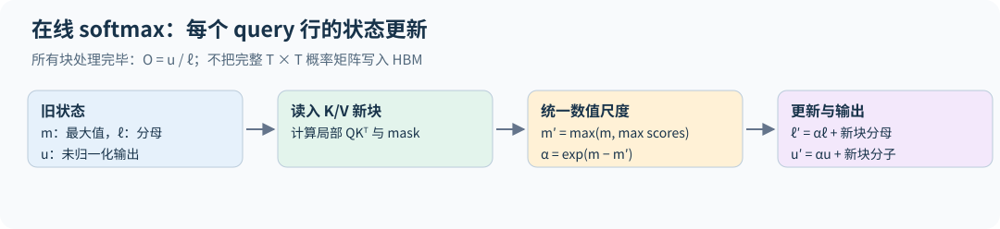
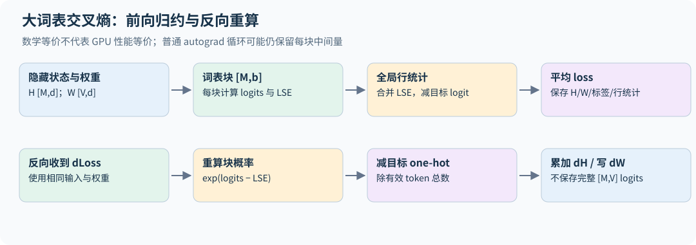

# 10｜FlashAttention：通过改变数据移动实现精确加速

## 10.1 问题不是不会算注意力

普通实现先写出 $S=QK^\top/\sqrt{d_h}$，再写出 $P=\mathrm{softmax}(S)$，最后算 $PV$。$S,P$ 的大小随序列长度平方增长，反复在 HBM 读写很昂贵。目标是分块计算最终 $O$，避免把整个 $T\times T$ 中间矩阵存到 HBM。

不能独立 softmax 每个 key block 后把结果相加，因为每块分母不同。FlashAttention 的数学关键是在线维护全局 softmax 的归一化信息。[FlashAttention](https://arxiv.org/abs/2205.14135)

## 10.2 在线 softmax 的不变量

对一个 query，已处理的一组 logits $s_j$ 维护

$$m=\max_js_j,\quad \ell=\sum_j e^{s_j-m},\quad u=\sum_je^{s_j-m}v_j.$$

加入新块 $s^{new}$，令 $m'=\max(m,\max s^{new})$、$\alpha=e^{m-m'}$，则

$$\ell'=\alpha\ell+\sum_j e^{s_j^{new}-m'},$$

$$u'=\alpha u+\sum_j e^{s_j^{new}-m'}v_j.$$

最后 $o=u/\ell$。乘 $\alpha$ 是把旧块从旧参照最大值改写到新参照最大值。旧信息没有丢失，也没有做低秩近似。

一个数值例子：旧 logit 为 2，新 logit 为 4，旧 $m=2,\ell=1,u=v_1$。更新后 $m'=4$，$\ell'=e^{-2}+1$，$u'=e^{-2}v_1+v_2$，与一次完整 softmax 完全相同，只有浮点计算顺序可能造成舍入差异。

也可以独立处理两个互不重叠的 key 集合 A、B，再合并。若局部输出为 $o_A,o_B$、局部 logsumexp 为 $L_A,L_B$，则 $L=\operatorname{logaddexp}(L_A,L_B)$，全局输出为 $o=e^{L_A-L}o_A+e^{L_B-L}o_B$。权重由各块的总概率质量决定，不能简单平均局部输出。这同时解释了 split-KV 和跨设备分块合并；空集合取质量零，两个集合都空时不定义普通 softmax 输出。



通用稀疏/padding mask 下，早期 key block 可能对某行全空，初始 $m=m^\prime=-\infty$ 会使指数更新出现 NaN。空块应保持该行旧状态不变；第一次遇到有效块时再初始化有限最大值。最终仍全空的行要剔除或按协议处理。教学代码的方阵 causal 路径从每行都有至少一个可见 key 的首块开始，不覆盖任意 mask 的这一边界。

## 10.3 从一行到 query/key tile

取一块 $Q_i$（$B_q$ 行）放入片上内存，遍历所有 $K_j,V_j$（每块 $B_k$ 行），计算局部 scores，应用 mask，更新该 query 块每一行的 $m,\ell,u$。结束后只写出输出 $O_i$ 和每行的 logsumexp

$$L_i=m_i+\log\ell_i=\log\sum_j e^{S_{ij}}.$$

对于 causal attention，可跳过完全位于未来的 key tile；边界 tile 内仍需逐元素 mask。不同的 $(Q_i,\text{batch})$ 之间完全独立，这就是 GPU 上的并行维度。

[attention.py](../../examples/attention.py) 只实现这条思路中不属于作业的部分：

| 函数 | 做什么 | 用途 |
|---|---|---|
| `online_attention` | 全部 query 一次处理，key 分块流过 | 看在线 softmax 的状态更新，与稠密实现一致到 $10^{-16}$（FP64） |
| `softmax_backward` | softmax 的向量—Jacobian 积 | 10.5 节反向公式的核心恒等式，与 autograd 对照 |
| `triton_softmax` | 行 softmax 写成一个 Triton kernel，按列块流式读取 | 熟悉 Triton 的编程模型 |

二维分块前向、基于 $L$ 的反向和 Triton 注意力 kernel 是 2026 年系统作业的评分内容，本书只讲原理，不提供实现；课程作业的独立完成要求见第 28 章。

## 10.4 一个 Triton kernel 的基本要素

作业讲义规定了 FlashAttention kernel 的骨架（launch grid、kernel 内的循环、片上统计量的 dtype、mask 约定），照讲义写即可。这里用一个更简单的 kernel 说明同样的编程要素。`triton_softmax` 对二维张量逐行做 softmax：

- launch grid 为 `(行数,)`，每个 program 用 `tl.program_id(0)` 找到自己负责的那一行；
- `tl.arange(0, BLOCK)` 生成一块列下标，`mask=cols < n_cols` 处理行宽不是块宽整数倍的情况，越界位置用 `other=-inf` 填充，使它们对最大值和求和都没有贡献；
- 第一遍循环按列块读取，用 10.2 节的递推维护 $m$ 和 $\ell$（这里没有 $V$，所以没有 $u$）；第二遍再读一次，写出 $e^{x-m}/\ell$。整行不必一次放进片上内存；
- $m,\ell$ 用 `tl.float32`，输出再转回输入 dtype。

FlashAttention 前向在此基础上多了三样东西：每个 program 负责一块 query 而不是一行；每个 key 块要先用 `tl.dot` 算出 score 块；递推里多一个输出累加器 $u$。

没有 GPU 也能检查逻辑：Triton 提供解释器模式，在导入 triton 之前设置环境变量即可在 CPU 上逐元素执行 kernel。

```bash
TRITON_INTERPRET=1 python -m examples.attention
TRITON_INTERPRET=1 python -m unittest discover -s tests -p test_course.py
```

解释器很慢，也不反映任何性能，但能抓住下标、mask 和指针偏移错误。`triton_softmax` 在解释器下与 `torch.softmax` 的误差约 $5\times10^{-10}$（FP32），测试覆盖了行宽 1、16、37 和需要减去最大值才不溢出的大 logit。解释器本身也有缺陷，作业讲义就提醒过它有 bug。本书在 Triton 3.6 上实测：16×16 的 `tl.dot` 在 FP32 和 FP16 输入下结果精确，在 BF16 输入下误差达到 $10^{10}$ 量级。所以 BF16 路径只能在 GPU 上验证，解释器下的 BF16 错误不一定是你的 kernel 的错。

## 10.5 反向也无需保存整个概率矩阵

已知上游梯度 $dO$，对 $O=PV$ 有

$$dV=P^\top dO,\qquad dP=dOV^\top.$$

softmax 的逐行反向为

$$dS=P\odot\big(dP-\operatorname{rowsum}(P\odot dP)\big).$$

利用 $O=PV$，行归约可改写为

$$D_i=\sum_jP_{ij}dP_{ij}=\sum_rO_{ir}dO_{ir}.$$

在反向仍可访问输入 $Q,K,V$ 的前提下，额外保存 $O$ 与每行 logsumexp $L_i$ 就足以避免保存完整 $P$；$Q,K,V$ 必须保留或从其他 checkpoint 重算，不能当成零成本。反向重新计算 score tile，再用 $P_{ij}=\exp(S_{ij}-L_i)$ 恢复概率块。接着

$$dQ=dSK/\sqrt{d_h},\qquad dK=dS^\top Q/\sqrt{d_h}.$$

在 Q/K/V 头宽相同、计入三个输入梯度且按相同有效注意力配对计数时，可以比较主要矩阵乘的 FLOPs。普通反向做 4 次同等量级的矩阵乘（$dV=P^\top dO$、$dP=dOV^\top$、$dQ$、$dK$）；FlashAttention 的反向还要重算一次 $S=QK^\top$，共 5 次，约为前向注意力（2 次）的 2.5 倍，前向加反向的主要矩阵乘约为前向的 3.5 倍，而不重算时约为 3 倍。这是注意力核心算术的近似账，不含投影、softmax、归约和通信，也不等于整层或实测耗时之比。这多出来的一次就是第 8.4 节 HFU 高于 MFU 的来源之一，换来的是免去保存巨大的 $P$。实现时要追踪缩放因子是否已包含在 $S$，否则反向容易漏乘或重复乘 $1/\sqrt{d_h}$。`softmax_backward` 验证了其中的 softmax 恒等式。

要分清两种"省显存"。保存 $O$ 和 $L$ 而不是 $P$，省的是前向到反向之间要保留的张量。如果反向一次性重建整块 $P$（作业允许的普通 PyTorch 加 `torch.compile` 写法就是这样），反向时的峰值仍随 $T^2$ 增长：$T=65{,}536$ 时，一个头的 FP32 $P$ 就有 16 GiB。只有分块反向才去掉这一项。

以上推导假定没有 attention dropout、可学习 attention bias 或额外 logit 变换。若有 dropout，需要重现相同随机 mask 并纳入链式法则；有 soft-capping 就需乘其导数；有 GQA 则来自共享 KV 的多个 query 头梯度要累加到同一个 K/V。若内部用 `exp2`，保存的 logsumexp 也必须与自然对数或以 2 为底的约定一致。

## 10.6 FlashAttention-2 改进的不只是算法公式

FlashAttention-2 优化了非 matmul 操作数、并行任务划分与 warp 内工作分配，降低 shared memory 通信，并提高长序列、小 batch 等情形的占用率。在线 softmax 仍是核心，但“有相同递推公式”并不等于达到相同速度。[FlashAttention-2](https://arxiv.org/abs/2307.08691)

写内核时，前向每个 query tile 的输出可以独立计算。反向哪个梯度需要跨块累加，取决于怎样划分并行任务：FlashAttention-2 按 K/V 列块分配线程块，dK、dV 留在块内，dQ 用原子加累加；作业讲义的分块反向算法则把 $P$ 算两遍，一遍按 K/V 块求 dK、dV，一遍按 Q 块求 dQ，从而完全避免原子操作。寄存器资源、head dimension、causal 与否和 dtype 都影响最佳 tile 设置。

## 10.7 从正确性到性能的验证顺序

先在 float64 小矩阵上对照输出与 Q/K/V 梯度，再覆盖非整块维度、长度 1、因果边界和数值极值。低精度比较用合理容差，记录误差随规模的变化。之后再在 GPU 上测峰值显存与执行时间。作业的基准协议值得照搬：batch 1、causal，序列长度取 128 到 65,536 的 2 的幂，头宽取 16 到 128，dtype 取 BF16 与 FP32，分别报告前向、反向和前向加反向的延迟，并与不使用 FlashAttention 的 PyTorch 实现对比。长序列下朴素实现会因 $T^2$ 显存而 OOM，这本身就是要记录的结果。

逐元素接近不保证索引完全正确，所以还要加入结构性检查：未来 value 被任意替换后，过去输出应不变；对所有 score 加相同常数，输出应不变；单 key 行的输出应恰好等于该 value。

**练习。** 在线 softmax 处理新块时若忘记给旧分母乘 $\alpha$，有什么后果？

**解答。** 当新块最大值高于旧最大值时，旧分母仍以旧尺度计量、新分子却以新尺度计量，破坏同一归一化基准。分块顺序或块大小一变，输出就会变化；这是很有辨识力的测试。

## 10.8 精确、低显存和少 IO 是三个不同结论

“精确注意力”表示没有用低秩、稀疏或核近似替代原算子；不同浮点归约顺序仍会产生误差，不能要求与任意 dense 内核逐位一致。固定 head dim 时，不存储完整概率矩阵可以把辅助存储由随 $T^2$ 增长降到随 $T$ 增长，但不能由此推出总 HBM 访问只有 $O(T)$。

为了复用有限片上容量，Q/K/V tile 可能多次读入。在原始论文的标准 IO 模型与容量范围内，单头头宽为 $d_h$、片上可容纳 $M$ 个标量时，其 HBM 访问分析出现 $O(T^2d_h^2/M)$ 的主项，另有输入输出的必要读写。把片上容量增大，或改变 tile 与循环次序，都能改变复用程度。[FlashAttention 的 IO 分析](https://arxiv.org/abs/2205.14135)

这也是为什么仅用 Python 循环“分块”不自动得到同样收益：autograd 可能保存各块中间张量，循环可能多次启动内核，tile 不一定停留在片上。应分别验证数学结果、峰值存储、实际数据移动和墙钟时间。

**练习。** $T=8192$、32 个头、BF16，朴素实现为保存一层的概率矩阵 $P$ 需要多少显存？FlashAttention 为同一层额外保存的 $L$ 需要多少？

**解答。** $P$：$32\times8192^2\times2$ 字节 = 4 GiB（每个样本）。$L$：$32\times8192\times4$ 字节 = 1 MiB。两者相差 $T\times2/4=4096$ 倍：一个按 $T^2$ 增长，一个按 $T$ 增长，再乘以 BF16 与 FP32 的字节比。

## 10.9 社区进展：FlashAttention-3

FlashAttention-3 论文所测的部分 H100 配置中，FlashAttention-2 的利用率约为 35%；这不是所有形状和版本的硬上限。FlashAttention-3 利用 Hopper 的异步特性，让数据搬运与 Tensor Core 计算重叠，并把分块矩阵乘与 softmax 交错执行。FP16 达到 740 TFLOP/s（75% 利用率），FP8 接近 1.2 PFLOP/s。

FP8 版本还用随机正交矩阵同时旋转 $Q$ 和 $K$，注意力分数不变，但异常值被摊开，数值误差降低 2.6 倍。在线 softmax 的数学（10.2 节）没有变，变的是它在硬件上的调度。见第 34.5 节。

## 10.10 把在线归约用于大词表交叉熵

令隐藏状态 $H\in\mathbb R^{M\times d}$、输出权重 $W\in\mathbb R^{V\times d}$，$z_{iv}=h_i^\top w_v$。对目标 $y_i$，

$$\ell_i=\operatorname{LSE}_v(z_{iv})-h_i^\top w_{y_i}.$$

无需保存全部 $M\times V$ logits：每次计算一个词表块，合并各块 logsumexp；目标项只读取对应权重行。反向重算块概率 $p_{iv}=e^{z_{iv}-L_i}$，有

$$G_{iv}=\frac{p_{iv}-\mathbf1[v=y_i]}M,\qquad dH=\sum_bG_bW_b,\quad dW_b=G_b^\top H.$$

`tiled_linear_cross_entropy` 用自定义一阶 autograd 保存 H、W、labels 与每行 LSE，重算每块梯度，不筛掉小概率。测试对照完整交叉熵、所有输入梯度、有限差分，并检查没有保存完整 logits。它只支持 FP32/FP64、无 bias、无 label smoothing，padding 先筛掉；没有融合 GPU kernel 或二阶导数。

前向与反向重算还要使用一致的精度。外层 autocast 可能把 `H @ W.T` 降为 FP16，却让逐元素相乘后归约的目标 logit 仍为 FP32，导致 LSE 与目标项不再对应同一组 logits。该参考实现为前向和自定义反向都显式关闭 autocast，按声明的 FP32/FP64 计算；生产低精度内核则需另外规定输入量化、累加和目标项的共同精度，不能只在 loss 输出处转 FP32。



Cut Cross-Entropy 的系统实现还涉及 SRAM tiling、梯度累加精度、排序与小梯度过滤。**分块精确算法**和**近似筛除梯度的优化**要分开：官方实现提供不同过滤/累加配置，不能把所有模式统称为数学逐项完全相同。[论文](https://arxiv.org/html/2411.09009v1)、[作者实现](https://github.com/apple/ml-cross-entropy)

**自测。** 将每块 loss 分别除以词表块大小再相加，能得到原始 CE 吗？

**解答。** 不能。分母需要所有词表项的全局 logsumexp；块内独立 softmax 改变了概率模型，与注意力块不能独立归一化的原因相同。
