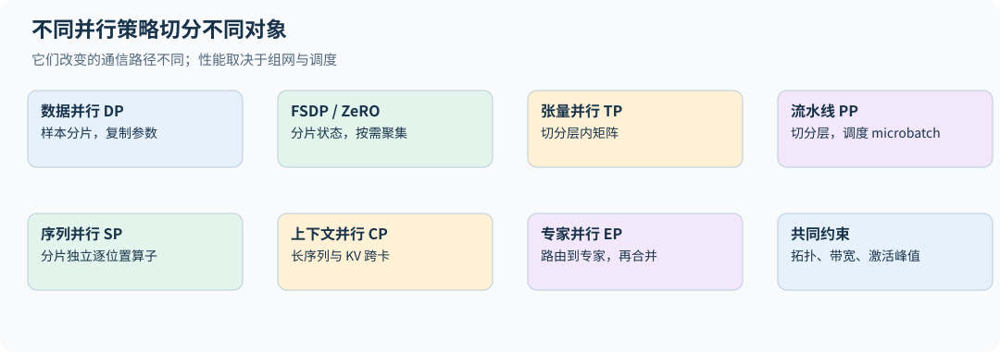

# 11｜分布式训练：切分状态、计算与通信

## 11.1 collective 是并行策略的基本词汇

all-reduce 让每个进程得到所有输入的和；all-gather 把分片收集到所有进程；reduce-scatter 先求和再让每个进程持有一个结果分片；all-to-all 让每个进程向其他进程发送不同部分。

all-reduce 可以由 reduce-scatter 加 all-gather 实现。对大小 $S$ bytes、$P$ 个进程的理想 ring，每个进程发送数据约为 $2(P-1)S/P$。粗略时间模型为

$$t\approx2(P-1)\alpha+\frac{2(P-1)S}{PW},$$

$\alpha$ 是每阶段延迟，$W$ 是有效链路带宽。它假设均衡链路与理想调度，不等同于任意拓扑下的最优算法。很多小通信受延迟限制，一个大通信可能受带宽限制。

## 11.2 数据并行：同一模型，不同样本

每个进程持有相同参数，对本地数据计算梯度，然后平均梯度并各自更新。若所有本地 batch 有相同有效样本/有效 token 权重，平均梯度与单机全局 batch 梯度等价。

若每个进程的有效 token 数 $M_r$ 不同，本地 loss 应按全局分母处理。假设框架最终对梯度除以 $P$，本地可用 $P\times\mathrm{NLLsum}_r/\sum_rM_r$。直接平均各 rank 的 token mean，会让短样本进程权重过大。

本书 [distributed.py](../../examples/distributed.py) 用两个 CPU/Gloo 进程做三项检查：等长 `[4,4]` 与不等长 `[3,5]` 本地 batch 的梯度都与单进程全局目标一致；reduce-scatter 后接 all-gather 等于 all-reduce；ZeRO-1 分片优化器的更新与不分片完全相同（见 11.4）。它验证通信语义和梯度归一化，不涉及 NCCL 性能或多机吞吐。

## 11.3 bucket 与通信重叠

反向从最后层往前进行，一旦某些参数的梯度算完，就可以启动异步 all-reduce，与剩余反向重叠。每个参数单独通信会产生大量延迟；全部梯度一个 bucket 又会等到最后才开始。bucket 大小决定折中。

必须确保参数更新前所有通信完成，也不能在异步通信尚未读取完毕时修改缓冲。所有 rank 必须以兼容顺序调用 collective，否则可能死锁。梯度累积时只在最后一次 microbatch 同步可节省通信，但需要遵循框架对应机制。

## 11.4 ZeRO 与 FSDP：消除重复存储

在“参数 BF16 2、梯度 BF16 2、master+Adam 12 bytes/参数”的假设下，每卡模型状态近似为：

| 方式 | 每卡 bytes/参数，不含激活与临时全量层 |
|---|---:|
| 普通数据并行 | $16$ |
| ZeRO-1：切优化器状态 | $4+12/P$ |
| ZeRO-2：再切梯度 | $2+14/P$ |
| ZeRO-3：再切参数 | $16/P$ |

ZeRO-3/FSDP 在计算某层前 all-gather 该层参数，反向后 reduce-scatter 梯度并释放不再需要的完整参数。理想状态存储近似线性下降，但峰值仍包括当前层、可能预取的下一层、激活和通信缓冲。[ZeRO](https://arxiv.org/abs/1910.02054)

通信量方面，2026 年第八讲的结论是：ZeRO-1 与 ZeRO-2 把梯度 all-reduce 换成 reduce-scatter，再 all-gather 更新后的参数，在参数/梯度同通信精度与理想布局下，归约和聚集的逻辑元素量约为 $2\Psi$（$\Psi$ 为参数量），与 DDP 同阶；这表示理想字节量相近，不保证消息延迟、调度与真实步时没有代价。ZeRO-3/FSDP 在前向和反向都聚集参数的日程下约为 $3\Psi$，精度不同应分别换算字节。

包装粒度太粗会临时聚集过多参数，太细会产生大量小通信。前向后是否立刻 reshard、反向预取距离、梯度累积期间保留什么状态，都在内存与通信之间交换成本。

**优化器状态分片的最小实现。** 一般流程是每个 rank 持有完整参数，反向后同步梯度，只为自己“拥有”的参数建 Adam 状态和执行更新，再由拥有者广播新值。本书 `zero1_check` 为隔离状态分片的作用，让所有 rank 使用相同数据，因此梯度本已相同，省略了这一步梯度 all-reduce；不同本地数据的同步与权重归一化由独立的 `ddp_check` 验证。分配所有权时要平衡元素数：按张量轮流分配可能得到 160 对 24 个状态元素，按大小贪心分配后为 96 对 88。三步更新与不分片 AdamW 一致，验证的是这个简化设定的更新语义，不能当作完整 ZeRO-1 通信性能结果。真实数据并行若采用完整梯度 all-reduce 再广播参数，通信又多于优化后的 reduce-scatter/all-gather 路径。

## 11.5 张量并行：切一个矩阵乘

对 MLP $Y=\phi(XW_1)W_2$，把 $W_1$ 按输出列切为 $W_1^{(r)}$，各卡得到独立中间特征，再把 $W_2$ 按相应输入行切为 $W_2^{(r)}$：

$$Y=\sum_r\phi(XW_1^{(r)})W_2^{(r)}.$$

中间激活不必全量 gather，最后求和即可。对 SwiGLU，gate 与 up 必须使用匹配分片。注意力可以按头切分，但 GQA 头组和 KV 复制策略要单独考虑。[Megatron-LM](https://arxiv.org/abs/1909.08053)

张量并行每层频繁通信，适合高带宽连接域。不能不看硬件拓扑就把 TP 随意跨慢网络扩展。

## 11.6 流水线并行：切层

不同设备持有不同层，batch 被拆成多个 microbatch 以填满流水线。对 $p$ 个 stage、$m$ 个 microbatch，简化均衡调度下 bubble 占总时间的比例约为 $(p-1)/(m+p-1)$；讲义用的是 bubble 与有效计算时间之比 $(p-1)/m$，两者分母不同，比较时要看清。增加 microbatch 可减少气泡，却会影响激活保存、batch 设计与调度开销。

1F1B 在 warmup 后交替一个前向和一个反向以控制激活内存：每个 stage 同时保存的 microbatch 激活从 $m$ 份降到最多 $p$ 份。在 stage 均衡、前后向耗时固定且忽略通信的非交错调度模型里，它与 GPipe 的气泡比例相同，主要收益是激活内存；真实时间仍取决于调度和通信。要缩小气泡，可以用交错（interleaved/virtual stage）调度：每个设备持有 $v$ 段不相邻的层，气泡近似降到 $(p-1)/(vm)$（按与有效计算之比），代价是点对点通信增加约 $v$ 倍。进一步调度可把反向拆成输入梯度和权重梯度，尝试填补气泡；真实收益受 stage 不平衡与通信限制。

## 11.7 sequence、context 与 expert 并行

sequence parallel 通常配合 TP，把 LayerNorm、dropout 等沿序列独立的算子及激活分片，减少那些原本在 TP 设备间重复的部分。在常见的 Megatron 式 TP+SP 配置下，相关 all-reduce 可拆成 reduce-scatter 与 all-gather，理想 ring 算法的总通信字节相同，中间激活以分片形式存放。但调用时机、延迟、重叠和反向重算可能改变，不能据此断言实际通信时间不增加。context parallel 则把一个长序列分布到多设备，主要有两类做法。环形注意力（ring attention）让每个设备保留自己那段 Q，KV 块沿环点对点传递，配合在线 softmax 逐块累加（第 10 章），通信可与计算重叠。Ulysses 式做法则用 all-to-all 把"按序列切分"换成"按头切分"，每个设备对部分头做完整长度的注意力，再 all-to-all 换回来；它要求头数能被设备数整除，GQA 的 KV 头少时受限。两者名称相似，通信需求不同。

expert parallel 按专家分片，需 dispatch/combine；注意力部分不一定采用同样的分组。最终训练系统可能组合 DP、TP、PP、CP、EP，各并行组大小的乘积需与实际设备映射一致，但某些策略可共享或重组通信组，不能机械相乘所有缩写。

## 11.8 可复现与故障恢复

数据 sampler 应确保不同 rank 不意外读到相同样本，并在每个 epoch 正确推进状态。checkpoint 写入需要一致的全局 step 与分片元数据；恢复时世界大小变化还涉及 reshard 与数据位置处理。随机种子相同不保证跨 GPU 数严格逐位一致，浮点归约顺序本身会改变舍入。

**练习。** 从 1 卡扩到 8 卡，单步时间变长了一点，是否说明分布式失败？

**解答。** 要看全局 batch 与 token 吞吐。如果每步处理 8 倍 token，稍慢的 step 仍可能显著提高吞吐。另一方面，不能只报告吞吐而隐瞒更大 batch 导致达到同一验证损失需要更多 token。

三年并行讲义与 2026 年系统作业共同支持本章；2026 作业明确包含 FSDP 实作，见 [2026 系统作业](https://github.com/stanford-cs336/assignment2-systems/blob/ca8bc81a59b70516f7ebb2da4808daade877c736/cs336_assignment2_systems.pdf)。

## 11.9 把 FSDP 的一个训练步按时间展开

假设每张卡只保存本层参数的一个分片，并在前向后 reshard。开始前向时，all-gather 得到该层完整权重；用本地样本计算该层输出；释放完整权重而保留本地分片。反向到该层时，再 all-gather 一次完整权重，计算本地梯度，然后 reduce-scatter 出本卡负责的平均梯度分片，释放全量临时权重，最终只更新本地 optimizer state。

若同一层完整权重共 $S$ bytes，按理想 ring、同精度近似，每个 all-gather 或 reduce-scatter 的每卡发送量为 $(P-1)S/P$。这个简化 FSDP 日程的两次 gather 加一次 scatter 约为 $3(P-1)S/P$，普通 DDP 梯度 all-reduce 约为 $2(P-1)S/P$。实际梯度与参数精度不同时应分别计字节；保留全量参数跨越前后向会减少 gather，却增加驻留显存。

所以“ZeRO-3 理想状态只有 $16N/P$ bytes”不能直接用作峰值。至少还要加正在计算的层、预取层、重算激活和通信 workspace。模型只有一个巨大 embedding/head 时，这个单层峰值可能成为主要限制。

## 11.10 一个不等长 batch 的算例

两卡分别有 2 和 6 个有效 token。若平均各自 mean loss，每个短卡 token 权重为 $1/4$，长卡 token 权重为 $1/12$，短卡 token 被放大三倍。正确全局权重都是 $1/8$。当 DDP 最终对梯度除以 2 时，两卡分别反向 $2\,\mathrm{NLLsum}_r/8$ 即可。

梯度累积跨越多个 microbatch 时，分母应是**所有卡、本次 optimizer update 的全部有效 token 数**，而不是当前 microbatch 数。若某卡没有有效 token，不能直接跳过该卡的 collective；要用可微零贡献保持通信调度一致，或在数据层保证各卡有效工作。mask 修正的是统计权重，不会替你解决 collective 死锁。[PyTorch DDP 源码说明](https://github.com/pytorch/pytorch/blob/v2.11.0/torch/nn/parallel/distributed.py)

全局梯度裁剪还要先判断参数是分片还是复制。对互不重叠的梯度分片，可将各 rank 的平方范数求和；对 DDP 中已同步的完整梯度，每张卡已持有同一个全局向量，再把 P 份平方范数相加会把范数放大 $\sqrt P$。混合 TP/FSDP/复制参数时，要让每个逻辑参数恰好计一次，不能对所有张量统一套一次跨卡 sum。

## 11.11 张量并行反向通信不能从前向猜

把两层 MLP 切成各卡的 $H_r=\phi(XW_{1,r})$、$Y_r=H_rW_{2,r}$，前向总输出为 $Y=\sum_rY_r$。上游总梯度 $G=\partial L/\partial Y$ 对每个 $Y_r$ 的梯度都是 G，不需要再把同一个 G 求和 P 次。

各卡先算 $dW_{2,r}=H_r^\top G$、$dH_r=GW_{2,r}^\top$，再乘激活导数得到 $dZ_r$。输入梯度则是

$$dX=\sum_rdZ_rW_{1,r}^\top.$$

所以这里需要在反向归约的是各分片对共享输入 X 的贡献。这就是 Megatron 风格“前向恒等/反向归约”与“前向归约/反向恒等”映射的来由；它建立在特定复制张量和 loss 语义上，不能把任意原始 all-reduce 调用都当成相同自动微分节点。[2026 第八讲第 39–41 页](https://github.com/stanford-cs336/lectures/blob/de53a9f979a6ee35f7d13a5e1aadee5ea1afc58e/lecture_08.pdf)

`systems.py` 用虚拟分片计算两层 MLP 的各卡输入梯度，并检查求和后与未分片结果一致。真实多进程实现还要检查参数梯度所在分片、复制参数的同步与并行组，不能在最后一层又额外除/乘 P。

## 11.12 把网络拓扑放进并行决策

节点内高带宽互连与节点间网络可能相差很大。TP 每层频繁交换激活，PP 更多沿相邻 stage 传递 microbatch，FSDP 搬权重，EP 产生动态多目标流量。相同总字节数在不同链路布局、争用和消息大小下也会有不同时间。

环、网格/环面、树和交换网络各有度数、路径长度与二分带宽取舍。规则通信更容易预规划，MoE 的非均衡 all-to-all 更依赖路由与热点处理。不能把某年的“TP 只在 8 卡节点内”记成永远有效的硬件定理；应该依据当前连接域与实际 collective 性能布置并行组。[2026 第八讲第 9–13 页](https://github.com/stanford-cs336/lectures/blob/de53a9f979a6ee35f7d13a5e1aadee5ea1afc58e/lecture_08.pdf)

粗略比较时用 $t=\alpha+S/W$，多条链路共享资源时 W 应是有效而非标称带宽。即使计算与通信理论可重叠，也只有在依赖允许、资源不互相争抢时才接近完全隐藏。用时间线测量暴露在关键路径上的通信，才知道下一步该缩小通信还是增大计算块。

## 11.13 词表并行的交叉熵无需聚集全词表

将 V 按 rank 切成互不重叠的集合 $\mathcal V_r$，每卡保留本地 logits。对一个 token，先归约全局最大值，再归约平移后的指数和与目标 logit：

$$m=\max_r\max_{v\in\mathcal V_r}z_v,\quad Z=\sum_r\sum_{v\in\mathcal V_r}e^{z_v-m},\quad \ell=m+\log Z-z_y.$$

只有目标 y 所属的 rank 提供 $z_y$，其他 rank 提供零；按每个 token 通信行统计，不必聚集全部 $BT\times V$ logits。各分片仍需对隐藏状态产生梯度贡献，并按张量并行语义归约。`sharded_cross_entropy` 是单进程虚拟分片对照，覆盖不等长词表分片、极大 logits 与分片边界标签；其 autograd 不是实际 collective 的自动反向。[Megatron-LM 的输出词表并行](https://arxiv.org/html/1909.08053v4)

## 11.14 累积梯度时，DDP 与 FSDP 的内存代价不同

DDP 可以在前几次 microbatch 暂停梯度同步，在最后一次一起归约；其 `no_sync` 应包住对应前向和反向。FSDP 暂停 reduce-scatter 时，具体实现可能保留完整未分片梯度，省通信却提高峰值。是否前向后重分片、是否在反向后重分片和是否同步梯度是不同控制，不能只设一个“累积次数”就推断内存仍为 $N/P$。[FSDP2 官方教程](https://docs.pytorch.org/tutorials/intermediate/FSDP_tutorial.html)

AMP 也要按完整更新边界工作：所有 microbatch 使用一致 loss scale，累积结束后 `unscale_` 一次、全局裁剪、step，再更新 scale。若某步因溢出跳过更新，scheduler 的推进规则需要明确。把每个 microbatch 的缩放梯度先分别 unscale 后再与新缩放梯度相加，会混合单位。[PyTorch AMP 累积示例](https://github.com/pytorch/pytorch/blob/v2.11.0/docs/source/notes/amp_examples.rst)

## 练习

**1．** 一个 10B 参数模型，BF16 参数与梯度、FP32 主权重与 Adam 状态，在 8 卡上分别用 DDP、ZeRO-1、ZeRO-2、ZeRO-3 训练，每卡的模型状态各是多少（不含激活）？

**解答。** 按 11.4 节的表：DDP $16\times10=160$ GB；ZeRO-1 $4\times10+12\times10/8=55$ GB；ZeRO-2 $2\times10+14\times10/8=37.5$ GB；ZeRO-3 $16\times10/8=20$ GB。80 GB 卡上只有后三种的理想状态账低于容量，且还要为激活和当前层的全量参数留空间。

**2．** 同一个 10B 模型用 ZeRO-3 在 8 卡上训练，单层 BF16 权重 400 MB。按 11.9 节的简化日程，每层每步每卡要发送多少数据？若有效带宽 100 GB/s，这部分通信需要多久？

**解答。** 两次 all-gather 加一次 reduce-scatter，约 $3\times(P-1)/P\times400\,\mathrm{MB}=1.05$ GB，约 10.5 ms。这只是忽略延迟的通信量/带宽估计；是否暴露还取决于依赖与预取。如果可用于重叠的计算窗口小于通信需求，此时需要预取或更大的 batch 来隐藏它。

**3．** 张量并行把整个 Transformer 块（注意力与 MLP）切到 4 卡上，序列 $B\times T=8192$ token、$d=4096$、BF16。每层前向需要几次 all-reduce？每次多大？

**解答。** 按 11.5 节的列/行切分，MLP 前向末尾一次 all-reduce，注意力输出投影后再一次，每层共两次。每次张量为 $8192\times4096\times2$ 字节 = 64 MiB；用 ring all-reduce 时每张卡发送约 $2\times\frac34\times64=96$ MiB，接收也为 96 MiB；若报告收发之和则为 192 MiB。反向对称地再有两次。每层四次 64 MiB 的同步通信，这就是 TP 只适合高带宽连接域的原因。
