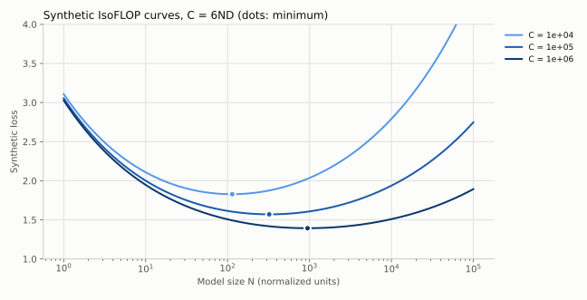

# 13｜缩放定律：在大实验之前学会预测

## 13.1 “定律”是条件性的经验模型

常见拟合形式为

$$\mathcal L(N,D)=E+AN^{-\alpha}+BD^{-\beta}.$$

$E$ 是不可由这两个尺度继续消除的渐近损失项，$A,B,\alpha,\beta$ 依赖数据、架构、优化方案和拟合范围。它不是对任意任务都成立的物理定律。把训练分布或 tokenizer 换掉，拟合参数也可能改变。

幂律的直觉之一是：数据不断覆盖更罕见模式，模型不断表示更细结构，新增资源的边际收益逐渐降低。经典均值估计的均方误差是 $\sigma^2/n$，提供一个简单幂律例子；神经模型指数通常不能靠这个玩具推导直接预测。

## 13.2 固定训练计算预算的最优分配

使用近似 $C=6ND$，代入 $D=C/(6N)$：

$$\mathcal L(N)=E+AN^{-\alpha}+B(6N/C)^\beta.$$

求导设零，得到

$$\alpha AN^{-\alpha}=\beta BD^{-\beta},$$

$$N_* = \left(\frac{\alpha A}{\beta B}\right)^{1/(\alpha+\beta)}(C/6)^{\beta/(\alpha+\beta)},$$

$$D_*\propto C^{\alpha/(\alpha+\beta)}.$$

这要求 $A,B,\alpha,\beta>0$，并假设 N、D 可以连续选择且没有数据或部署上限。令 $u=\log N$ 后，二阶导数为 $A\alpha^2e^{-\alpha u}+B\beta^2(6/C)^\beta e^{\beta u}>0$，所以这个理想模型只有一个内部最优点。若要求用满固定 C、可用独立数据上限为 $D_{max}$ 且不允许重复，则可行 N 至少为 $C/(6D_{max})$；部署又可能要求 $N\le N_{max}$。应在可行区间内找最优点，区间为空时说明预算、数据和部署约束不能同时满足，而不是继续使用无约束公式。

若两个指数近似相等，则参数和 token 数都随计算预算的平方根增长。Chinchilla 的拟合给出 $N_*\propto C^{0.5}$、$D_*\propto C^{0.5}$。指数相等只说明 token 与参数之比不随预算变化，这个比值本身来自拟合系数，约为**每个参数 20 个训练 token**；Kaplan 等人早先得到的 $N_*\propto C^{0.73}$、$D_*\propto C^{0.27}$ 则意味着预算越大、每参数 token 越少。但"每参数固定训练多少 token"不是脱离条件的常数。数据质量、重复、推理成本和真实架构都会改变最优点。[Chinchilla](https://arxiv.org/abs/2203.15556)

## 13.3 三种拟合方式回答同一问题

第一种，对大量不同规模模型的训练曲线取计算预算下的最佳包络。必须控制中途 checkpoint 尚未完成退火的偏差。

第二种，固定多个计算预算，每个预算下改变 $N,D$，得到 IsoFLOP 曲线并找最低点，再拟合最佳 $N_*(C)$。它直接服务“有限预算怎么分配”的决策。

第三种，对 $N,D$ 网格的最终损失做联合参数拟合。它利用更多数据，却面临参数可辨识性问题：$E$ 与指数互相补偿，不同初始化可能得到近似相同误差却截然不同的远距离外推。

Chinchilla 论文第三种方法报告的拟合值是 $E=1.69$、$A=406.4$、$B=410.7$、$\alpha=0.34$、$\beta=0.28$，由 13.2 节的公式得到 $N_*\propto C^{0.45}$。把这组常数代入 Chinchilla 自己的训练预算（约 $5.8\times10^{23}$ FLOPs），最优约为 32B 参数、3T token，即每参数约 90 个 token，与前两种方法给出的约 20 对不上。Besiroglu 等人（2024）从论文图中重建数据重新拟合，认为原报告的第三种方法拟合有误，重拟合后的结果与每参数约 20 个 token 一致。[Chinchilla Scaling: A replication attempt](https://arxiv.org/abs/2404.10102) 这个例子正好说明本节的可辨识性问题：同一份数据，联合拟合的常数稍有偏差，外推出的分配就差几倍。

Kaplan 与 Chinchilla 的不同结论与训练设置、学习率、预算范围和参数核算等因素有关，不能简单理解成一篇“错”、一篇“永远对”。后续工作把差距拆到了具体因素上：Kaplan 统计的是非 embedding 参数，且在小规模上进行，Pearce 与 Song（2024）指出，差距的大部分来自"只算非 embedding 参数"加上"小规模实验"这两点，在这两个条件下模拟 Chinchilla 的实验会得到接近 Kaplan 的有偏指数；Porian 等人（2024）进一步把差距归到最后一层计算的计入方式、warmup 长度和随规模调整的优化器超参数上，逐项修正后两者可以对齐。[Reconciling Kaplan and Chinchilla](https://arxiv.org/abs/2406.12907)、[Resolving Discrepancies in Compute-Optimal Scaling](https://arxiv.org/abs/2406.19146) 课程三年都保留了对这些差异的分析。[Kaplan 等](https://arxiv.org/abs/2001.08361)、[2026 第九讲](https://github.com/stanford-cs336/lectures/blob/de53a9f979a6ee35f7d13a5e1aadee5ea1afc58e/lecture_09.pdf)

## 13.4 怎样用有限实验避免自欺

先覆盖数量级，再在可能的最优区附近加密。每个预算至少有几个位于最优点两侧的模型，否则只能证明你测试区间里的某个端点最好。用对数坐标检查残差结构，而不是只报告 $R^2$。

预留一两个较大预算作真正的外推验证，不能拟合后再把它们也当训练点。用 bootstrap 或多随机种子评估拟合不确定性。预测应是一个范围，附上最大外推倍数和失效条件。

**一个能检验答案的模拟。** `python -m examples.scaling` 在一个已知真值的损失曲面 $L=1+2N^{-0.35}+D^{-0.3}$（加噪声）上做 IsoFLOP 实验，7 个预算，外推到比最大预算大 1000 倍的目标，真实指数为 $0.3/0.65\approx0.4615$。它比较密集网格、预算受限网格和边缘补点三种设计、两种"找最低点"的方法，并用 20 个噪声种子重复整个流程：

| 设计 | 查询次数 | 指数（均值±标准差） | 目标处 $N_*$ 误差中位数 | 最差 |
|---|---:|---:|---:|---:|
| 密集网格，取最低点 | 287 | $0.459\pm0.029$ | 22% | 108% |
| 密集网格，抛物线顶点 | 287 | $0.460\pm0.000$ | 6% | 8% |
| 预算受限，取最低点 | 35 | $0.416\pm0.030$ | 41% | 60% |
| 预算受限，抛物线顶点 | 35 | $0.466\pm0.005$ | 4% | 21% |
| 预算受限 + 边缘补点，抛物线顶点 | 36 | $0.462\pm0.003$ | 3% | 9% |

"预算受限"的设计每个预算只跑 5 个模型，以上一预算的最优点按 $C^{0.5}$ 外推为中心，左右各放到 4 倍；第一个预算没有上一个点可用，以 $\sqrt{C/6}\approx12.9$ 为中心。"边缘补点"在最低点落在网格边缘时，沿同样的对数间距向外加点，直到最低点落在内部或达到每个预算最多 4 个补点的上限。几点读法：

- 只取最低的那次运行，会把 $N_*$ 量化到网格点上，噪声还会让它在相邻点之间跳；网格稀疏时误差可达 40%。
- 第一个预算放大了粗网格误差：真实 $N_*\approx39$ 位于网格范围内，但相邻候选是 25.8 与 51.6，20 个种子的最低观测点都选在右端 51.6。这里是最小预算的 $N_*$ **被高估**，把 log-log 拟合左端抬高，斜率因此变小。去掉第一个预算后，取最低点的指数均值从 0.416 回到 0.447。这支持检查边缘命中的做法，但不意味着真最优点一定在范围之外，也不能把所有偏差归给这一个点。
- 在 $\log N$ 上拟合抛物线取顶点（Chinchilla 的做法），用的是曲线形状而不是单个点。35 次查询的中位误差就与 287 次相当，但最差情况（21%）仍明显差于密集网格（8%）；在这个设置下，边缘补点只多花 1 次查询，把最差情况降到 9%。粗网格的最低观测点落在端点、拟合顶点落在网格外是两件事，应分别记录；补点后仍可能有网格量化误差或拟合偏差。
- 密集网格加抛物线的约 6% 误差几乎全是偏差：种子间标准差约为 0，无噪声重跑仍是 +6%。原因是在跨 4 个数量级的范围上，IsoFLOP 曲线关于 $\log N$ 并不对称，整段拟合抛物线会把顶点拉偏；应只用最低点附近的一段来拟合。
- 单个种子的结果可能很好也可能很差，重复整个设计才看得出方法本身的方差。

**自适应设计也要报告成本分布。** 默认噪声下，补点设计的 20 个种子都是 36 次查询；把噪声标准差改为 0.04，抛物线补点设计的查询次数变为 35–39 次。只写第一个种子的次数会掩盖这种变化。`seed_study` 同时报告查询数与计算量的最小值、均值、最大值，以及补点前/后的边缘命中率；计算量为各次查询预算之和，不能把一个小预算补点和一个大预算补点等价计价。达到补点上限后仍在边缘的曲线应标记为证据不足，而不是宣布找到了内部最优点。

A3 讲义在第一部分（给定的数据）建议直接取最低点，但没有说明理由。给定数据每个预算 8 个点、相邻 $N$ 约差 1.6 倍，取最低点会把 $N_*$ 量化到这个步长，可以和抛物线顶点的结果对照。自己用有限预算设计实验时，网格要么足够密，要么改用拟合。

搜索网格也属于实验设计：真实实验中不知道最优点在哪，只能根据上一个预算的结果放置候选。demo 中的解析最优点只用于事后核验。

## 13.5 课程中的两份缩放配方

2026 年第十一讲比较了几家公开细节较多的做法：

- **MiniCPM**：用 μP 让最优学习率在不同宽度间大致稳定，固定宽深比后整体放大；用 WSD 学习率日程，在稳定阶段的不同位置分叉退火，一次训练就能得到多个预算下"完成退火"的点；最优 batch 随目标损失下降而多项式增长。
- **DeepSeek**：不用 μP，直接在小规模上拟合最优学习率和 batch 随计算量的变化，再外推；同样使用分段衰减的 WSD 式日程。

两者共同点是：先把学习率、batch 这些超参数随规模的变化弄清楚，再拟合 $N_*,D_*$；否则小模型调参不足会人为制造对某种方法有利的趋势。

**A3 的设定。** 2026 年作业不让学生自己训练，而是通过一个训练 API 提交配置（层数、宽度、头数、batch、学习率、训练 token 等）和最长运行时间，API 在 B200 上真实训练并返回验证损失序列。拟合缩放律的总预算是 12 B200-小时，目标是为 48 B200-小时的最终训练选出最优配置并预测其损失。提交的运行在排队时就按最长运行时间预扣预算，完成后按实际用时返还；超时按上限计费。非 embedding 参数按 $12n_{layer}d^2$ 估算。这道题本质上就是上面的"预算受限设计"：每一次查询都有成本，怎么分配查询比拟合公式本身更重要。还有两点和本节的 demo 不同。第一，A3 的预算按 B200 墙钟时间计，不是按 FLOPs 计；不同形状、batch 和精度的吞吐不同，要用实测运行时间把"等成本"换算成 FLOPs 或 token，等 FLOPs 不等于等成本。第二，API 只提供 warmup 加余弦的学习率日程，一次运行中途记录的 `val_losses` 不是"完成退火"的短训练，不能当作额外的 IsoFLOP 点；13.5 节 MiniCPM 用 WSD 日程从一次训练分叉出多个预算的技巧，在这里用不上。

## 13.6 有限数据、重复训练与混合数据

第二次看到同一个 token 仍消耗算力，但新增信息通常少于第一次。可以把有效数据量建模成随重复次数逐渐饱和的函数，但饱和速率必须由实验确定。高质量小数据重复可能优于低质量新数据，不能只按独立 token 数排序。

不同领域损失对数据混合比例的响应也不相同。按域分别拟合缩放曲线，再优化加权目标是一个思路；跨域迁移和竞争使简单可加模型可能失效。混合比例应通过小规模消融和目标评估验证。

## 13.7 训练最优与部署最优

若模型将生成 $Q$ 个输出 token，总成本粗略为

$$C_{total}\approx C_{train}(N,D)+Q\,C_{infer/token}(N,T,B).$$

训练最优模型可能太大、推理太贵。让较小模型训练更久，常能在部署总成本下更合算。Sardana 等人把推理需求直接加进 Chinchilla 的目标函数，推理请求量大时最优模型更小、训练 token 更多；Gadre 等人则研究了远超每参数 20 token 的"过度训练"区间，发现损失随训练 token 的缩放仍可预测。这也是 2024–2025 年开源小模型普遍用数千、上万 token/参数训练的原因（第 29 章）。[Beyond Chinchilla-Optimal](https://arxiv.org/abs/2401.00448)、[Language models scale reliably with over-training](https://arxiv.org/abs/2403.08540)真正目标还包括延迟、显存与请求长度，不能用一个静态 $2N$ 的推理 FLOPs 估计覆盖所有服务条件。

MoE 的缩放还需区分总参数、active 参数、专家粒度和稀疏度。优化器、batch 和学习率也随规模变化；不充分调参的小模型可能人为制造有利于某方法的缩放趋势。

**练习。** 若 $\alpha=\beta$，计算预算增加 16 倍，理想训练最优 $N,D$ 各增加多少倍？如果推理预算占主导，还会照做吗？

**解答。** 两者各约 4 倍。若推理占主导，则应重新优化总成本，往往更偏向较小模型和更多训练数据；具体取决于服务量与性能要求。

## 13.8 如何拟合联合幂律而不把参数“拟合成故事”

令 $A=e^a,B=e^b$，并约束 $E,\alpha,\beta>0$。对每次运行 $i$，可在 log-loss 空间定义残差

$$r_i=\log(E+e^aN_i^{-\alpha}+e^bD_i^{-\beta})-\log\widehat L_i.$$

对这些残差最小化平方损失或 Huber 损失，是一种可执行选择；它与在原始 loss 空间做最小二乘不同，前者更看重相对误差。Huber 能减少偶发失稳运行的影响，却不能让本来有偏的实验设计变得可信。应记录被剔除的失败运行，避免只选好看的曲线。

改变参数单位也会改变 $A,B$。若 N 从“参数个数”改为“百万参数”，指数不变，系数会相应缩放；将一个单位下的系数带入另一个单位会得到荒谬预算。$C=6ND$ 只有在 N、D、C 的单位配套时才成立，教学合成数据使用的是归一化单位。

用多个初始化重启拟合，保存多组接近最优的参数。如果这些参数在观测区内预测相近、在目标预算处差别很大，说明现有数据不足以确定外推，而不是挑一个最顺眼的指数就结束。bootstrap 还应按独立训练运行或 seed 抽样；同一次训练的多个 checkpoint 彼此相关，不能当作独立重复来缩小区间。

## 13.9 有限数据的饱和模型

设独立数据量为 U，完成首轮后又重复 R 轮，可用一个经验性有效数据模型

$$D_{eff}=U+UR_*(1-e^{-R/R_*})$$

代替把所有曝光都当新数据。它满足 R=0 时为 U，初期额外一轮近似贡献 U，而长期趋近 $U(1+R_*)$；其边际收益 $\partial D_{eff}/\partial R=Ue^{-R/R_*}$ 逐渐减少。$R_*$ 必须由真实数据和训练设置拟合，不是普遍常数。[Scaling Data-Constrained Language Models](https://arxiv.org/abs/2305.16264)

若过滤使质量提高但 U 显著减少，在小预算下可能更好，在大预算下则可能过早进入重复饱和。固定过滤阈值不一定跨预算最优。应同时记录 U、实际消费 token 数 $U(1+R)$ 与验证损失，不能只报告有效数据的拟合值。

有效数据只用于拟合收益，实际训练账仍由消费量决定：$C\approx6N\,U(1+R)$，不能把 $D_{eff}$ 放进成本分母后宣称重复 token 免费。若最优点要同时选择过滤阈值与重复次数，应联合记录质量、独立数据 U 和真实 FLOPs。

## 13.10 平滑 loss 与突然变化的任务分数

连续预测损失平滑下降时，离散指标仍可能跳变。一个模型给正确选项的概率由 0.49 增到 0.51，在二选一 argmax 指标上从错变对；一串答案若必须全部正确才得分，还会放大多个子步骤的联合影响。这种测量效应不证明所有“涌现能力”都是假象，也不证明模型内部一定发生了离散相变。

因此应同时看连续 loss、准确率、部分分数、题目分层和不确定性。不能由整体 token loss 的幂律直接推导某个 benchmark 的最佳 scaling 指数，也不能把下游曲线短暂变陡当成无上限收益。[2026 第九讲的下游缩放讨论](https://github.com/stanford-cs336/lectures/blob/de53a9f979a6ee35f7d13a5e1aadee5ea1afc58e/lecture_09.pdf)

## 13.11 社区进展：稀疏度与精度也是缩放变量

Kimi K2 做了稀疏度缩放实验：固定激活参数，提高总专家数与激活专家数之比。在相同验证损失下，稀疏度 48 相对稀疏度 8、16、32 分别节省 1.69、1.39、1.15 倍 FLOPs（第 29.3 节）。

"Scaling Laws for Precision"用 465 次预训练实验拟合，并在最大 1.7B 参数的模型上验证，结论是低精度训练相当于减少有效参数量；训练后量化的损失随预训练数据量增大，数据多到一定程度后，继续预训练反而让量化后的模型变差（第 34.6 节）。这对"过度训练小模型再量化部署"的做法是一个直接的提醒，但它的结论来自小规模实验，外推需要验证。

## 13.12 预测区间之外，还要分析决策敏感性

由 13.2 节公式，固定指数时，系数比改变对最优规模的影响为

$$\frac{\partial\log N_*}{\partial\log(A/B)}=\frac1{\alpha+\beta}.$$

若 $\alpha=\beta=0.3$，$A/B$ 只偏 10%，最优 N 就约偏 $1.1^{1/0.6}-1\approx17.2\%$。指数估计误差还会乘上外推距离的 $\log C$，所以观测范围内拟合很好也可能远期选错模型。

最优 N 不确定大，不代表附近配置的 loss 必然差很大。令 $u=\log N$，固定 C 的曲率为 $A\alpha^2e^{-\alpha u}+B\beta^2(6/C)^\beta e^{\beta u}$；在平坦谷底，较宽的 N 区间都接近最优。应报告候选的预测损失差、区间、吞吐及失败风险，不只报告一个“最优参数量”。当误差范围内近似同分，可优先选择已验证稳定且部署成本合适的配置，再用新实验缩小不确定性。

## 练习

**1．** 按 Chinchilla 的 20 token/参数经验，$C=10^{21}$ FLOPs 下最优 $N$ 与 $D$ 约多少？

**解答。** $C=6ND=6N\cdot20N=120N^2$，$N=\sqrt{10^{21}/120}\approx2.9\times10^9$，$D\approx5.8\times10^{10}$。这只是数量级参考，真实最优比例依赖数据和架构。

**2．** 你只有 30 次查询预算，要拟合 5 个计算预算的 IsoFLOP 曲线。每个预算 6 个点、均匀撒在 $N$ 上 100 倍的范围，与每个预算 6 个点、集中在上一预算预测值附近 8 倍范围，各有什么风险？

**解答。** 宽范围不容易漏掉最优点，但点稀，顶点估计误差大，且大量预算花在离最优点很远、对拟合帮助小的位置。窄范围精度高，但若上一预算的预测偏了，真实最优点可能落在网格之外，此时要检查最低点是否在网格边缘，并补点。
