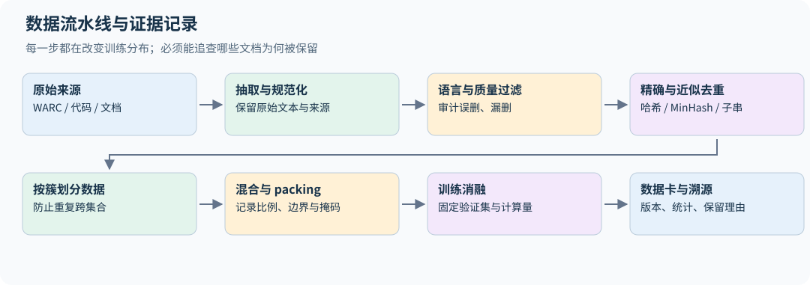

# 14｜数据工程：从原始网页到可解释的训练分布

## 14.1 数据流水线也是模型设计

训练数据决定模型会把哪些表达、语言、任务和知识看作常见。大规模数据工程不是简单“下载→去重→训练”，而是在可追溯记录下定义训练分布。

原始来源包括网页、百科、书籍、代码、论文、论坛和人工/合成指令。Common Crawl 的 WARC 包含抓取记录与响应内容，WET 提供抽取文本，WAT 提供部分元数据；具体下载格式应以相应数据发行说明为准。原始 HTML 需要编码检测、正文提取和错误处理，不能只用一个正则删标签。

为每个文档保留来源 ID、抓取时间、处理版本、语言、质量分数、去重簇、许可证/使用条件记录与最终保留原因。可访问不等于已确认适合所有训练与再分发用途；本书不替读者对具体数据集作法律结论。

## 14.2 质量过滤不等于真理检测

**抽取。** Common Crawl 自带的 WET 文本是用一套通用规则从 HTML 抽出来的，导航栏、版权尾注、cookie 提示都会混进去。数据作业要求自己用 Resiliparse 从 WARC 的 HTML 抽取正文（先检测编码，UTF-8 失败时回退），并与 WET 对比。抽取质量直接决定后续所有过滤器看到什么；DCLM 的实验显示，换一个抽取器就能让同一批网页训练出的模型分数明显变化。

**规则过滤。** Gopher 论文给出了一组简单、可解释的规则，作业要求实现其中四条，删除满足任一条件的文档：

- 少于 50 或多于 100,000 个词；
- 平均词长不在 3 到 10 个字符之间；
- 超过 30% 的行以省略号结尾；
- 含字母的词少于 80%。

它们针对的是菜单页、代码转储、数字表格、截断的摘要列表这类明显不适合语言建模的页面。规则对中文等不以空格分词的语言并不适用，"词"的定义要按语言调整。[data.py](../../examples/data.py) 的 `rule_quality_check` 返回触发的规则名，便于统计每条规则各删了多少文档。本章 `data.py` 的函数只用于理解原理，接口也与作业不同；课程作业的独立完成要求见第 28 章开头。

**模型过滤。** 语言识别通常用 fastText 的 `lid.176` 模型给出语种和置信度，阈值要在抽样审计后决定。质量分类器则需要正负样本：一个常见做法是把 Wikipedia 引用的外部链接页面当作"高质量"正例、随机 Common Crawl 页面当作负例，训练 fastText 二分类器，用其分数排序或设阈值。KenLM 等小语言模型的困惑度也可用于筛除异常文本，但低困惑度可能偏爱模板化或重复内容。

公开数据集在这里分成两派：C4、Gopher、RefinedWeb、FineWeb、Dolma 在**质量**过滤上刻意不用模型打分（语言识别、毒性过滤等环节仍用 fastText 之类的分类器，例如 FineWeb 的英文阈值 0.65、Dolma 的 Jigsaw 毒性分类器；FineWeb-Edu 则是在 FineWeb 上再加模型打分，见 14.11 节）；GPT-3、LLaMA、DCLM 使用基于模型的质量过滤，DCLM 的固定协议对照支持模型过滤的收益（第 33.1 节）；不同领域和预算未必沿用同一选择。规则过滤更可解释、更不容易把某种风格当成"质量"，这是本书的判断。

过滤器的正例定义了“好”的方向。用百科当正例，可能保留百科风格却压低对话、方言和代码的比例。毒性词表也可能把引用、学术讨论或某些群体的语言误删。要按语言、来源和任务分层抽样审计误删与漏删，而不只看整体保留率。

个人信息处理是三年数据作业的一项明确任务。邮件、电话号码和 IP 地址可用规则检测后替换为类型标记，并返回命中数量供统计。IPv4 不能只匹配"四段数字"，还应验证每段在 0–255，`999.1.1.1` 和版本号 `1.2.3.4.5` 都不应命中；边界条件要单独想清楚，例如排除"更长的点分数字"时，不能把句末的句号也当成数字的一部分，否则 `My IP is 10.0.0.1.` 会漏掉。电话号码需要考虑国家区号与分隔符；邮件规则也不等于证明某字符串对应真实个人。`redact_contacts` 实现了这三类规则（占位符为 `<EMAIL>` 等），测试覆盖了上面三个反例。

这些规则会误伤代码示例、版本号、数学表达和公开联系方式，且无法找出所有隐含身份信息。合理流水线保留文档级计数、按域抽查，并决定替换片段还是删除整个文档。若把所有格式都替换成同一个高频占位符，模型可能学会大量输出占位符；因此还应监测替换比例及对任务的影响。[2026 数据作业 §2.4](https://github.com/stanford-cs336/assignment4-data/blob/0555bea66369872d912652debf10b115ca0688c8/cs336_assignment4_data.pdf)

DSIR 类方法用轻量特征空间估计目标分布与候选分布的密度比 $w(x)\propto p_{target}(\phi(x))/p_{raw}(\phi(x))$，再重要性重采样。它选择“更像目标”的样本，不保证直接最大化最终模型性能；特征映射和目标集代表性决定效果。2024 年第二节数据课对这类方法有较细展开。[2024 第十二讲](https://github.com/stanford-cs336/spring2024-lectures/blob/2eab561d4fc5f0bd77ab68afc85dd563a0b107ba/lecture_12.py)

## 14.3 精确去重：先决定何为相同

**行级去重。** 网页之间大量重复的是模板行：导航、页脚、"分享到"按钮。作业的做法是两遍扫描：第一遍统计所有文件中每一行的出现次数（用行的哈希作键，内存不随行长增长）；第二遍重写每个文件，只保留在整个语料中只出现一次的行。这样 StackOverflow 页面的头尾菜单被删掉，问题和回答保留下来。`drop_repeated_lines` 在内存中的文档列表上演示这个两遍过程。注意它会把合法的重复行（例如两篇文章都引用同一句话）也删掉，这是有意的取舍。

对规范化文本计算稳定哈希，相同哈希进入同组，再按需要核对原文。Python 默认 `hash()` 可能因进程随机化而变化，不适合持久化去重键。SHA-256 等稳定哈希更适合实验记录。

规范化也可能损失信息：大小写、空白、全半角转换对普通 prose 可能合理，对代码缩进、标识符和数学符号则可能改变语义。因此应分域设计，原始文本保留以便追查。

Bloom filter 用 $m$ 位、$k$ 个哈希记录已见元素，插入 $n$ 项后假阳性概率近似为

$$p_{fp}\approx(1-e^{-kn/m})^k,\qquad k_*\approx(m/n)\ln2.$$

标准插入/查询下不会漏掉已插入元素，但可能误报未插入元素已存在。如果“命中就丢弃”，会损失少量独特文档。它适合节省内存，不能替代精确相等判断的定义。

## 14.4 MinHash：把集合相似度压成签名

把文档变成字符或词的 n-gram 集合 $A$，Jaccard 相似度为 $J(A,B)=|A\cap B|/|A\cup B|$。对一个随机排列，取集合中排序最小的元素作为签名。两集合签名相同，当且仅当并集里最小元素落在交集，因此

$$\Pr[h_{min}(A)=h_{min}(B)]=J(A,B).$$

用 $k$ 个独立签名估计相似度，其标准差约为 $\sqrt{J(1-J)/k}$。签名数越多越准确，也需要更多内存与计算。实际哈希族只是对理想随机排列的近似。

LSH 将签名分成 $b$ 个 band，每个 band 有 $r$ 行。任一 band 全部相同就生成候选，相似度为 $s$ 的文档对成为候选的概率为

$$1-(1-s^r)^b.$$

这是一条概率曲线，不是硬阈值。以 16 个 band、每 band 8 行（共 128 个签名）为例，相似度 0.5、0.7、0.8、0.9 的文档对成为候选的概率分别约为 0.06、0.61、0.95、1.00；调整 $b,r$ 可以移动曲线的陡峭位置。候选对还应计算真实 Jaccard 复核。聚类若用连通分量，A≈B、B≈C 不保证 A≈C；保留代表文档时要意识到传递闭包可能扩大删除范围。

`near_duplicate_clusters` 把完整流程串起来：词级 5-gram 集合、MinHash 签名、按 band 分桶找候选、复核真实 Jaccard、并查集聚类，返回每簇保留的第一篇的下标。demo 中一篇新闻与"加了一句分享提示"的副本 Jaccard 为 0.875，被合并；另一篇无关文章保留。

Jaccard 还会受到文档长度影响。若一篇 100-shingle 文档被完整包含在另一篇 1000-shingle 文档中，Jaccard 仅为 0.1，但短文档的 containment $|A\cap B|/|A|$ 为 1。想找整段复制时，应该用段落/子串方法或明确的包含率目标，不能仅提高 MinHash 签名数就解决度量不匹配。

空文档没有最小哈希值，应在进入 MinHash 前过滤；极短文档也可能因常用短语而看起来相同。签名碰撞、哈希 seed、shingle 边界与中文按字/按词的选择都要固定。字符级方法不依赖分词器，词级方法可能更贴近语义，但“语义相同”与“字符串重复”仍是不同定义。

## 14.5 子串重复与后缀数组

整篇文档不相似，也可能共享大量长段落，例如导航、版权尾注和重复文章片段。把文档连接成序列并加入不可混淆的边界，后缀数组按字典序排列各后缀；相邻后缀的最长公共前缀能暴露重复子串。

实现时要避免跨文档边界形成伪重复，处理重叠匹配，并决定删除整文还是只删片段。大规模后缀结构对内存和外存算法要求高，不能把玩具 `sorted(all_suffixes)` 当成可扩展实现。这是 2024 年去重讲义中值得保留的细节。[2024 第十三讲](https://github.com/stanford-cs336/spring2024-lectures/blob/2eab561d4fc5f0bd77ab68afc85dd563a0b107ba/lecture_13.py)

## 14.6 划分、混合、packing 与污染

去重簇应整体分入 train/validation/test，避免同一内容不同拷贝跨集合。时间、来源域和作者也可能构成相关性，应根据评估目的选择更严格的划分。benchmark 去污染需要考虑答案、题目改写、翻译和解释文本，精确字符串匹配只能发现部分问题。

若域 $i$ 有 $n_i$ token，可用 $p_i\propto n_i^\tau$ 调整采样：$\tau=1$ 按规模，$\tau<1$ 提高小域权重。它也会增加小域重复次数，要同时记录独立文档量和实际训练曝光次数。

packing 把短文档拼接以减少 padding。用 EOS 分隔不等于阻止跨文档注意力，block-diagonal attention 也不会自动屏蔽跨文档的下一 token 目标。是否保留这种监督、是否重置 position ID，必须与训练目标一致；第 4.6 节给出独立文档目标的边界图与代码。长上下文训练与代码 infilling 的 FIM 变换也应记录各自采样比例。

## 14.7 合成数据不是无条件的信息增益

教师能生成更多示范，但如果没有新问题、可靠筛选或外部验证，只重复教师的高概率输出可能缩窄分布。有效合成流程通常包含多样的 seed、难度控制、事实/代码/数学验证、重复检测，以及与真实数据混合。

Self-instruct 扩展指令形式，self-distillation 迁移教师行为，STaR/专家迭代利用可验证成功轨迹。每一步都要防止测试题被用于生成训练答案，并把教师与验证器版本纳入元数据。

## 14.8 用公开数据配方理解设计空间

课程介绍多个数据集不是为了记年份和 TB 数，而是为了识别可重复的选择。下表概括它们在课程中的教学角色；它不代替各发行版的数据卡，也不暗示不同版本使用完全相同的流水线。

| 数据配方 | 主要选择 | 学习时追问 |
|---|---|---|
| WebText 类 | 用社区链接信号选择网页 | 社区选择了哪些人、语言和主题？ |
| C4 类 | 大规模网页文本与启发式清洗 | 规则删除了什么，保留了什么模板？ |
| CCNet 类 | 语言识别、去重与语言模型评分 | 评分模型如何塑造语言和风格分布？ |
| The Pile 类 | 多来源显式混合 | 学术、代码、书籍等比例如何决定能力？ |
| RefinedWeb 类 | 精心清理的大规模网页 | 强清洗网页可替代多少人工组合来源？ |
| Dolma 类 | 公开数据与可追溯处理工具 | 能否复现每阶段统计和去重决策？ |
| DCLM 类 | 固定训练/评估协议研究数据选择 | 数据收益是否在固定模型与算力下仍成立？ |
| The Stack 类 | 代码来源与许可相关元数据 | 仓库分叉、重复文件和测试污染如何处理？ |

比较配方应看最终模型在一致协议下的表现，而不是“过滤越多越高级”。课程的来源追溯还覆盖百科、书籍、StackExchange、GitHub、arXiv 及许可明确的数据集合，强调不同来源的质量、覆盖与使用条件。[2026 第十三讲](https://github.com/stanford-cs336/lectures/blob/de53a9f979a6ee35f7d13a5e1aadee5ea1afc58e/lecture_13.py)

评估过滤器时至少区分两个实验：固定最终训练 token/FLOPs，衡量保留样本的价值；固定原始数据池与处理预算，衡量整条流水线可交付多少有效数据。强过滤若只留下很小子集，前一种实验可能表现好，却需要更多重复或原始抓取才能支撑大规模训练。记录“被保留文档上的平均分”不足以评估此取舍。

FIM（fill-in-the-middle）是把代码前缀、中间段、后缀按特殊标记重排，让 decoder 在已知前后文时生成缺失片段。例如从 `prefix + middle + suffix` 构造 `PRE prefix SUF suffix MID middle`。它仍然使用自回归目标，却通过数据变换改变条件信息。特殊 token、重排概率、截断和文件边界必须一致，否则模型可能只学会标记格式。

## 14.9 质量分类器的分数为什么随来源漂移

假设用高质量来源作正例、随机网页作负例，训练二分类器输出 q。它学到的可能是内容质量，也可能是来源风格、语言、模板或领域差异。把 classifier score 当成事实正确率没有依据；把所有语言统一用同一阈值，也可能改变语言混合比例。

若分类器给出的恰是训练分布下的逐输入后验 $q(x)=P(y=1\mid x)$，训练先验为 $\pi=P(y=1)$，则在分母非零处，由 Bayes 公式有

$$\frac{p(x\mid y=1)}{p(x\mid y=0)}=\frac{q(x)}{1-q(x)}\frac{1-\pi}{\pi}.$$

普通校准只要求 $P(y=1\mid q(X)=s)=s$，比“每个 x 的后验正确”弱。一个对所有输入都预测 0.5 的分类器，在正负各半的数据上可以完全校准；若两类输入的真实后验分别为 0.9、0.1，它仍无法区分密度比 9 与 1/9。因此可靠性图或 ECE 很好，不足以证明重要性权重正确，还需检验特征覆盖、逐域区分能力和目标/候选支持。

但数据选择需要的 target/raw ratio 未必就是这两个类条件密度之比，且高分区的小校准误差会被 odds 放大。分类器排序、概率校准和重要性权重是不同用途。将权重截断能控制方差，也会改变目标分布，应该写进实验条件。

审计样本应同时抽取高分保留、低分删除和阈值附近样本，按语言/域分层查看精度与召回。域内 train/validation 划分还不够：同站点模板或近重复页面若跨集合，会夸大泛化。最好在来源域或时间上再设留出组，观察 score 分布漂移。三年数据作业中的 quality classifier、过滤消融和样本检查共同覆盖这个主题。

## 14.10 数据作业的完整闭环

2026 年数据作业把上述工具串成一个优化问题：起点是已经按 fastText `lid.176` 英文概率不低于 0.7 预过滤过的 WET 文件（原始为 2,500 个），自由组合过滤、去重和其他方法，产出训练数据；用 GPT-2 tokenizer 编码（每篇文档后加 `<|endoftext|>`，存为 `uint16` 数组），在固定的模型与训练脚本下训练（8 卡、每卡 batch 128、16,384 步、上下文 512，约 $2^{33}\approx8.6$B token），目标是最小化 Paloma 基准中 C4 100 个域子集上的验证损失。过滤后的数据若少于 8.6B token，训练时就会重复多轮（第 13.9 节）。训练配置不能改，能改的只有数据。可以利用 Paloma 验证数据来构造过滤器或分类器，但不能把验证文本直接放进训练集。

这个设定逼着你回答本章的所有问题：每个过滤器各删了多少（作业要求报告），删掉的文档是否该删（抽样检查被删与被保留的各五篇），处理全部 Common Crawl 需要多长时间。目标是 C4 风格的网页，所以"质量"在这里有明确的操作定义：像目标分布。换一个目标（代码、数学、对话），最优流水线可能完全不同。

作业允许用指定验证集指导过滤，不表示同一集合仍能作为独立最终测试。它在这个研究流程中承担开发集角色；若要声称对新网站或新时间段泛化，仍需另留不参与分类器训练、阈值选择和流水线迭代的集合（第 15.10 节）。

## 14.11 社区进展：从过滤到改写

2024–2025 年的公开数据配方有三个明显的方向，第 33 章逐一展开：

- **大模型标注、小模型打分。** FineWeb-Edu 用 Llama-3-70B-Instruct 标注约 46 万个网页，训练小分类器跑遍 15T token，花了 6,000 H100 小时，最后保留 1.3T。
- **中期训练换数据。** OLMo 2 在学习率退火阶段改用高质量与合成数学数据。
- **合成数据以改写为主。** Phi-4 的合成数据占训练 token 的 40%、重复约 14 轮；Kimi K2 改写知识文本，同样看 10 遍，"改写 10 次各看一遍"比"原文看 10 遍"在 SimpleQA 上高 5 个点。

第 14.9 节关于分类器分数漂移的提醒，对这些做法全部适用。

## 14.12 把过滤器的误差换算成训练分布

设某域原始占比为 $w_i$，保留概率为 $a_i$，过滤后该域占比为

$$w'_i=\frac{w_ia_i}{\sum_jw_ja_j}.$$

这里 $w_i$ 与 $a_i$ 必须以同一种单位计量。若 $w_i$ 是文档占比、$a_i$ 是文档保留概率，上式得到文档占比；训练 token 占比还应乘保留文档的平均长度 $\bar\ell_{i,keep}$，即 $w^{token}_i\propto w_i a_i\bar\ell_{i,keep}$。两域文档数各半、保留率相同，但保留长度分别为 100 和 1000 token，最终 token 比例就是 1:10。仅报告“每域保留一半”不足以确定训练混合。

例如按文档数计两域各占一半，过滤器分别保留 80% 和 20%，最终文档比例变为 80%:20%。即使过滤器整体“精度提高”，它也改变了语言/来源分布；整体验证收益不能独立归因于域内质量。需同时做固定最终域比例和自由比例两组对照，记录保留量、重采样曝光及域内验证表现。[DSIR 的目标分布视角](https://arxiv.org/abs/2302.03169)

流水线顺序也不交换：先去重再打分，与先打分再按首个样本去重，可能保留同簇中的不同代表；先按域采样再全局去重，又改变不同来源的存活率。应保留每一步的输入数、输出数、操作版本和关联文档 ID，使最终模型的训练分布可追溯到过滤决策。

一份实用审计表应按“来源/语言 × 长度 × 保留/删除/阈值附近”分层，抽取人工样本检查误删与漏删。若只抽保留样本，无法估计丢掉了多少有效内容；若每层同样抽 100 条，汇总时需按各层总体规模加权，不能直接平均抽样比例。

## 练习

**1．** 去重后训练 loss 变高但验证 loss 变低，是否说明流水线出错？

**解答。** 不一定。重复内容原本更容易记住并被多次计入训练均值。去重改变了训练分布和有效样本权重，训练 loss 上升可以伴随泛化改善。应在同一固定验证集、同等计算预算下比较。

**2．** 用 Gopher 规则过滤中文网页会发生什么？应该怎样调整？

**解答。** 中文不以空格分词，整段文字常被当成一个"词"：词数远少于 50、平均词长远超 10，几乎所有中文页面都会被删掉。应先用分词器或按字切分，再按中文语料的统计分布重新设定阈值，并抽样审计。

**3．** MinHash 用 20 个 band、每 band 5 行。相似度 0.8 的文档对成为候选的概率是多少？若想让 0.5 的对很少成为候选，应调大 $b$ 还是 $r$？

**解答。** $1-(1-0.8^5)^{20}\approx0.9996$。增大 $r$ 让曲线在高相似度处才陡峭上升，减少低相似度候选；增大 $b$ 则相反，提高召回。$r=5$ 时 0.5 的对成为候选的概率约 $1-(1-0.5^5)^{20}\approx0.47$，太高。

本章综合 2024 四节数据课与 [2026 第十三讲](https://github.com/stanford-cs336/lectures/blob/de53a9f979a6ee35f7d13a5e1aadee5ea1afc58e/lecture_13.py)、[第十四讲](https://github.com/stanford-cs336/lectures/blob/de53a9f979a6ee35f7d13a5e1aadee5ea1afc58e/lecture_14.py)。
