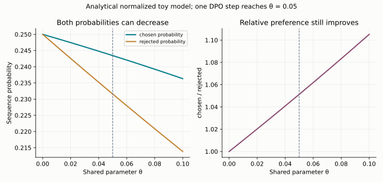

# 17｜RLHF、PPO 与 DPO：从示范到偏好优化

## 17.1 偏好数据告诉我们的是什么

一个偏好样本包含相同 prompt $x$、较优回答 $y_w$ 与较差回答 $y_l$。它没有直接给出绝对质量，也不保证两个回答之一真的正确。评审者的知识、文化、风格偏好、长度偏好与题目分布都会影响标签。

Bradley–Terry 模型假设

$$P(y_w\succ y_l\mid x)=\sigma(r_\phi(x,y_w)-r_\phi(x,y_l)).$$

奖励模型最小化 $-\log\sigma(r_w-r_l)$。奖励只有差值可辨识，给同一 prompt 的所有奖励加一个常数不改变偏好概率。训练/验证应按 prompt 分开，防止同一题的不同候选泄漏。

## 17.2 为什么需要参考策略约束

直接最大化奖励模型可能钻它的漏洞。常见目标为

$$J(\pi)=\mathbb E_{x,y\sim\pi}[r(x,y)]-\beta\,\mathbb E_xD_{KL}(\pi(\cdot|x)\Vert\pi_{ref}(\cdot|x)).$$

参考策略通常是固定的 SFT 模型，限制偏离它的程度。奖励尺度与 $\beta$ 的相对关系决定约束强度。奖励模型升高而人工评价下降，是奖励过优化的重要信号。

对自回归序列，KL 可按期望分解成各 token 条件分布的 KL。采样 log ratio $\log\pi(y_t|s_t)-\log\pi_{ref}(y_t|s_t)$ 是相关期望的估计，单个样本可以为负；“每个 token 的 KL 都非负”只适用于对该位置所有 token 求期望后的真正 KL。

展开时还需说明状态分布：序列 KL 等于在**当前策略产生的前缀**下，对各位置条件 KL 累加后求期望。若前缀来自固定数据集或旧策略，即使在每个前缀上精确遍历词表计算 KL，也是在度量另一种上下文加权的距离。

## 17.3 从 policy gradient 到 PPO

对轨迹 $y$，$\nabla_\theta\pi_\theta(y)=\pi_\theta(y)\nabla_\theta\log\pi_\theta(y)$，所以

$$\nabla_\theta\mathbb E_{y\sim\pi_\theta}r(y)=\mathbb E[r(y)\nabla_\theta\log\pi_\theta(y)].$$

减去不依赖当前动作的 baseline 不改变期望，因为 $\mathbb E[\nabla\log\pi]=0$，选择合适时可以降低方差。PPO 常用价值模型估计未来回报，再构造 advantage。

时序差分为 $\delta_t=r_t+\gamma V(s_{t+1})-V(s_t)$，GAE 为

$$\hat A_t=\sum_{l\ge0}(\gamma\lambda)^l\delta_{t+l}.$$

终止状态的 bootstrap 应为零；长度截断是否视为终止要与任务定义一致。序列结尾奖励加每 token KL shaping，是语言模型 PPO 的一种常见构造。

对采样时的旧策略 $\pi_{old}$，令 $\rho_t=\pi_\theta(a_t|s_t)/\pi_{old}(a_t|s_t)$，PPO 最大化

$$\mathbb E\left[\min(\rho_t\hat A_t,\operatorname{clip}(\rho_t,1-\epsilon,1+\epsilon)\hat A_t)\right].$$

若 $A>0$，超过上界后继续增大概率不再获得该项收益；若 $A<0$，低于下界后继续降低概率也不再获得额外收益。clip 并不把参数更新严格限制在某个 KL 球内，需要实际监控 KL、clip fraction、熵和奖励。

`old` 用来定义采样分布与比率，`ref` 用来定义行为约束。它们可以来自不同 checkpoint，不能混成一个对象。

## 17.4 DPO 的闭式推导

固定 $x$，在所有分布上优化前述 KL 正则奖励目标，用拉格朗日乘子约束概率和为一，可得

$$\pi^*(y|x)=\frac{\pi_{ref}(y|x)\exp(r(x,y)/\beta)}{Z(x)}.$$

整理后

$$r(x,y)=\beta\log\frac{\pi^*(y|x)}{\pi_{ref}(y|x)}+\beta\log Z(x).$$

将这个隐式奖励代入 pairwise 偏好模型，$\log Z(x)$ 相消，得到

$$L_{DPO}=-\log\sigma\left(\beta\left[\log\frac{\pi_\theta(y_w|x)}{\pi_{ref}(y_w|x)}-\log\frac{\pi_\theta(y_l|x)}{\pi_{ref}(y_l|x)}\right]\right).$$

这提供了直接用偏好对训练策略的目标，无需在每步显式训练奖励模型并在线采样。该推导要求 $\beta>0$、归一化常数有限，且待优化策略只能在参考分布非零的支持上分配质量：若 $\pi(y)>0$ 而 $\pi_{ref}(y)=0$，$KL(\pi\Vert\pi_{ref})$ 为无穷。它从非参数最优分布出发；有限模型、离线数据覆盖和实际优化不保证达到该理想最优点。[DPO](https://arxiv.org/abs/2305.18290)

## 17.5 DPO 实现最容易出错的五处

序列 log probability 是 response token log probability 的**和**。随意换成均值会改变隐式奖励与目标，不再是原始 DPO。

张量形状也是目标定义的一部分：四组序列 log-prob 都应为同一批次的 `[B]`。若 chosen 是 `[B]`、rejected 是 `[B,1]`，广播会产生 `[B,B]`，把配对偏好变成所有样本交叉比较；loss 仍是有限标量，单看训练曲线不容易发现。教学实现显式拒绝这类错配，并在 FP32 或 FP64 中计算 margin。若输入已经是有限的 FP16 log-prob，单个差值 policy−ref 的绝对值不超过 65504，因为二者都在 [−65504,0] 内。但 margin 的第二次相减 $(\log\pi_c-\log\pi^{ref}_c)-(\log\pi_r-\log\pi^{ref}_r)$ 可能溢出：例如策略的 chosen/rejected 为 −40000/−1，参考为 −1/−40000，真实差值为 −79998，FP16 无法表示。相近的两组比率则可能相互抵消，因此不能仅从单条序列的 log-prob 幅度推断一定溢出。更常见的损失发生在上游：序列 log-prob 若在 BF16 中累加，数值在 1000 附近的间距已是 4.0，进入 `dpo_loss` 后再升精度也无法恢复，所以 token log-prob 的求和本身就应在 FP32 中进行。

参考模型应冻结且关闭训练随机性，输出不参与梯度。若预计算 reference logps，必须固定模板、tokenizer、EOS 和截断策略。

chosen/rejected 必须对应相同 prompt。若用户回合不同，prompt 的概率不再自然抵消。超长截断还可能把两回答的关键差别截没。

“奖励准确率”应检查 $\log\pi_\theta/\pi_{ref}$ 的 chosen-rejected margin，而不是只比较当前模型的两条原始 log probability。长回答原始概率更低不代表隐式奖励更差。示例函数见 [posttrain.py](../../examples/posttrain.py)。

## 17.6 PPO 与 DPO 的选择是数据与系统问题

PPO 可利用当前策略产生的新行为，但在线采样、奖励、价值模型和多轮更新复杂且昂贵。DPO 易于利用静态偏好数据，训练较简单，但难以纠正数据覆盖之外的失败，也可能过拟合标签偏差或长度模式。

二者都需要独立评估。更高隐式奖励准确率、更低 DPO loss 或更高代理 reward，都不是人工偏好或任务正确率提升的充分条件。

2026 年讲义提醒了两种典型失败。一是**奖励过优化**：沿着代理奖励一直优化，真实偏好先升后降；这在人类偏好和带噪声的 AI 偏好上都会出现，只有在无噪声的合成偏好上不明显。二是**模式坍缩**：熵持续下降、回答越来越单一，模型也不再是校准良好的概率模型（讲义的原话是 no calibration by default）。另外，PPO 与 DPO 孰优孰劣的公开结论高度依赖实验设定，很多结果难以复现；Tulu 3 等开放项目在 DPO 之外还比较了长度归一化 DPO 和 SimPO。看到"某方法更好"的结论时，先问基础模型、数据、调参预算是否对齐。

**练习。** 初始策略与参考策略完全相同，任意偏好对的 DPO loss 是多少？梯度是否为零？

**解答。** margin 为零，loss 为 $\log2$，梯度通常不为零。把两条 log probability 当作独立变量时，loss 鼓励 chosen 上升、rejected 下降；实际模型共享参数，不能由此保证 chosen 的绝对概率提高。单步 SGD 对相对 log probability 差的局部影响及反例见 17.12 节。

## 17.7 “无偏 KL 估计”为什么可能给出错误梯度

固定上下文，令当前分布为 $p$、参考分布为 $q$，从 $p$ 采样动作 $a$，并假定所需支持与期望有限。最直接估计量是 $k_1=\log(p(a)/q(a))$。另一种常见非负量为

$$k_3=\frac{q(a)}{p(a)}-1-\log\frac{q(a)}{p(a)}.$$

因为 $\mathbb E_p[q/p]=1$，有 $\mathbb E_p[k_3]=D_{KL}(p\Vert q)$。非负来自 $u-1-\log u\ge0$。若实际上从 $\pi_{old}$ 采样，而没有分布校正，上述相等不再自动成立。课程 2025 年 RL 代码讲义给出了这类数值估计。[2025 第十七讲](https://github.com/stanford-cs336/spring2025-lectures/blob/b98b08a98d9d47a69bbdcb4e96a58aa48ee4d13b/lecture_17.py)

但对参数 $\theta$，一个依赖当前策略的期望满足

$$\nabla_\theta\mathbb E_{a\sim p_\theta}f_\theta(a)=\mathbb E_{p_\theta}[f_\theta(a)\nabla_\theta\log p_\theta(a)+\nabla_\theta f_\theta(a)].$$

把采样动作当常量直接反向，只得到右边第二项。对 $k_1$，该项的期望甚至是 $\mathbb E_p\nabla\log p=0$，而真实 KL 梯度一般不为零。对 $k_3$ 也不能仅凭其数值期望正确就声称自动得到了正确目标梯度。精确的结论可以用小分布枚举验证：在 on-policy 采样下，把 $k_3=\frac{\pi_{ref}}{\pi_\theta}-\log\frac{\pi_{ref}}{\pi_\theta}-1$ 直接放进 loss 反传，得到的是 $\nabla_\theta KL(\pi_{ref}\Vert\pi_\theta)$的无偏路径梯度估计；$k_2=\frac12(\log\frac{\pi_\theta}{\pi_{ref}})^2$ 的路径梯度期望才等于 $\nabla_\theta KL(\pi_\theta\Vert\pi_{ref})$；$k_1$ 的为 0。DeepSeekMath 的 GRPO 和 2025 年讲义代码都把 $k_3$ 直接加进 loss，因此在固定前缀、on-policy 动作采样且仅对该估计量反传的条件下，正则路径梯度对应 $KL(q\Vert p)$；旧前缀、离策略权重、共享参数与轨迹状态依赖会改变完整训练目标，不能由此概括所有 GRPO 为严格优化全序列的 $KL(\pi_{ref}\Vert\pi_\theta)$。

因此要区分三种用法：用于日志的估计量可以 `no_grad`；固定上下文的精确 KL 正则可以遍历词表直接求导；用 KL 作为轨迹奖励时，需按选定 policy-gradient 目标处理采样依赖与 stop-gradient。固定 rollout 上的 KL surrogate 也可以有工程价值，但必须按 surrogate 描述。本书 `sampled_kl_metric` 明确只作诊断，测试还枚举两动作分布比较了“数值相等”和“梯度不同”。

这里的 k3 数值等式还要求参考 q 在 p 的支持内；只有 $\mathbb E_p[q/p]=1$ 才能消去常数项。硬 top-p 截断可能破坏此条件。有限词表 softmax 在数学上有全支持，也可能在浮点中下溢；全词表枚举可把 $p\,k_3$ 改写为 $q-p+p(\log p-\log q)$，用稳定 log-softmax 计算，避免先造出 q/p 的 Inf。该改写只用于完整枚举，不能代替 rollout 单样本的重要性加权。

两个支持方向不要混淆。有限 $KL(p\Vert q)$ 要求 p 不越过 q 的支持；k3 恒等式还要求 q 的全部质量能被 p 采样覆盖。若 q 在 p 的支持 S 内只有质量 $q(S)<1$，则 $\mathbb E_p[k_3]=KL(p\Vert q)+q(S)-1$。例如 p=(1,0)、q=(1/2,1/2)，k3 期望为 $\ln2-1/2$，真实 KL 为 $\ln2$；每个采样项仍非负，却已经不是同一个期望。

## 17.8 DPO 的 beta 和偏好覆盖

在原始正则奖励问题中，固定奖励函数时，更大的 $\beta$ 意味着更强的 KL 约束；但实际 DPO 中隐式奖励也随策略改变，$\beta$ 同时缩放分类 margin 和梯度，不能直接把一次参数增大解释为训练后 KL 一定按比例减小。应测量真实策略漂移与任务指标。

偏好标签也可能非传递：评审可能在不同维度下偏爱 A 胜 B、B 胜 C、C 胜 A。单标量奖励把多维偏好压缩为一维，是建模假设。保留评审分歧、任务分层和不同质量维度，有助于识别一个高偏好分模型究竟改善了正确性、风格还是其他行为。

## 17.9 RLAIF 与 Constitutional AI 的监督从哪里来

RLAIF 使用 AI 产生比较反馈，降低大量人工逐条标注的成本，但偏好仍由模型、提示、原则和输入分布定义。Constitutional AI 的典型流程包括按原则批评并修订回答、对修订结果做监督学习，再依据原则产生偏好对并进行偏好优化。生成器与评审器可能共享系统性盲点，不能把反馈来自 AI 等同于反馈没有人为选择。[Constitutional AI](https://arxiv.org/abs/2212.08073)

评审原则需要说明相互冲突时怎样权衡，保留不确定、平局和分歧信息。评审器能被长度、风格或答案中的指令影响，因此应隐藏来源、交换顺序、限制评审器对被评内容的指令解释，并抽样人工复核。训练代理奖励与最终独立评估应分开。该主题来自 2024/2026 年偏好与自训练部分。

## 17.10 长度归一化偏好目标与 SimPO

原始 DPO 使用序列 log probability 的和及参考策略比率。若改为长度平均，或删除参考模型，就改变了目标，不能继续沿用原始 KL 正则最优策略推导。

SimPO 的典型隐式分数为 $s_\theta(x,y)=\beta\log\pi_\theta(y|x)/|y|$，对偏好对最小化

$$L_{SimPO}=-\log\sigma(s_\theta(x,y_w)-s_\theta(x,y_l)-\gamma).$$

这里 $\gamma$ 是希望 preferred 超过 rejected 的目标 margin；没有显式 reference logps，可省去参考模型前向。但长度平均不保证完全消除长度偏好，margin、beta 与训练数据仍会影响行为。`posttrain.py` 的教学实现检查合法长度，测试 chosen/rejected 梯度方向，并与 DPO 的初始行为区分。[SimPO](https://arxiv.org/abs/2405.14734)、[2026 第十五讲第 60 页](https://github.com/stanford-cs336/lectures/blob/de53a9f979a6ee35f7d13a5e1aadee5ea1afc58e/lecture_15.pdf)

**练习 2．** 偏好对的策略与参考 log probability 分别为：chosen $-40$ 与 $-42$，rejected $-50$ 与 $-49$，$\beta=0.1$。DPO 的 margin 与 loss 是多少？

**解答。** chosen 的 log ratio 为 $+2$，rejected 为 $-1$，margin $=0.1\times(2-(-1))=0.3$，loss $=-\log\sigma(0.3)\approx0.554$，低于初始的 $\ln2\approx0.693$。

**练习 3．** 两个回答在 Bradley–Terry 模型下的奖励差为 1.0，偏好概率是多少？若要让偏好概率达到 0.9，奖励差需要多大？

**解答。** $\sigma(1)\approx0.731$；$\sigma(\Delta r)=0.9$ 需要 $\Delta r=\ln9\approx2.20$。

2024 年 RLHF 讲义与 2025 安全补充作业保留了完整偏好学习主线，见 [2024 第十六讲](https://github.com/stanford-cs336/spring2024-lectures/blob/2eab561d4fc5f0bd77ab68afc85dd563a0b107ba/nonexecutable/Lecture%2016%20-%20Alignment%20by%20RLHF.pdf)、[2025 安全补充](https://github.com/stanford-cs336/assignment5-alignment/blob/eb2c562e05802d3c9ee4c4ec2eec43b104d77e9e/cs336_spring2025_assignment5_supplement_safety_rlhf.pdf)。

## 17.11 社区进展：奖励的三种来源

Qwen3 的通用 RL 阶段同时使用三类奖励：

- 规则奖励：用于指令遵循和格式；
- 有参考答案的模型奖励：让 Qwen2.5-72B-Instruct 对照参考答案打分，避免纯规则造成的误判；
- 无参考答案的奖励模型：用人类偏好数据训练，覆盖开放式问题。

Kimi K2 把可验证奖励与模型对自身输出按 rubric 自评的奖励结合起来，把对齐从有标准答案的任务扩展到开放任务。这些做法让本章的偏好学习与第 18 章的可验证奖励在同一个 RL 阶段里共存；推理 RL 的 2025 年进展见第 31 章，agent 的奖励设计见第 32.2 节。

## 17.12 DPO 为什么可能把 chosen 的概率也压低

令 $a=\log\pi_\theta(y_w|x)$、$b=\log\pi_\theta(y_l|x)$，参考模型固定，DPO margin 为 $z=\beta[(a-a_{ref})-(b-b_{ref})]$。对单个偏好对，

$$\frac{\partial L}{\partial a}=-c,\quad\frac{\partial L}{\partial b}=c,\qquad c=\beta\sigma(-z)>0.$$

这是对两个中间标量的偏导，不能当成两个独立概率旋钮。令 $g_w=\nabla_\theta a,g_l=\nabla_\theta b$，一次 SGD 更新为 $\Delta\theta=\eta c(g_w-g_l)$。一阶展开得到

$$\Delta a\approx\eta c(\|g_w\|^2-g_w^\top g_l),\qquad\Delta b\approx\eta c(g_l^\top g_w-\|g_l\|^2).$$

当交叉项大于 $\|g_w\|^2$，chosen 的 log probability 就会下降。相对差却满足 $\Delta(a-b)\approx\eta c\|g_w-g_l\|^2\ge0$。后一个结论限定于单个偏好对、小步长 SGD 和固定参考；batch 中其他偏好、Adam 预条件、weight decay、有限步长都要另行分析。[DPO 目标的原始定义](https://arxiv.org/abs/2305.18290)

**一个完整概率模型的反例。** 两条回答共享第一个 token，其概率为 $\sigma(-2\theta)$；之后 chosen/rejected 的条件概率分别为 $\sigma(\theta)$、$\sigma(-\theta)$。还有一个补齐归一化的其他回答。于是

$$\pi(y_w)=\sigma(-2\theta)\sigma(\theta),\qquad\pi(y_l)=\sigma(-2\theta)\sigma(-\theta).$$

从 $\theta=0$、$\beta=1$、$\eta=0.1$ 开始一次 DPO 更新，得到 $\theta=0.05$：chosen 从 0.25 降至约 0.24345，rejected 从 0.25 降至约 0.23157，比率从 1 升至约 1.05127。共享前缀概率下降覆盖了 chosen 后缀的收益。`numerical_tools.py` 用可微模型复算并检查两条概率与剩余质量相加为 1。

训练时应同时记录 chosen/rejected 的原始序列 log probability、相对 reference 的 margin、长度与独立行为指标。偏好分类准确率提高只说明相对区分更好；如果两者都下降且回答行为恶化，应检查数据覆盖、梯度干扰和正则强度。加入 SFT/NLL 锚定是一种可对照的改动，不能宣称是所有 DPO 的必需修复。

## 17.13 GAE：把价值误差与采样方差分开

有限轨迹上可反向递推 $A_t=\delta_t+\gamma\lambda A_{t+1}$，其中 $\delta_t=r_t+\gamma V(s_{t+1})-V(s_t)$。$\lambda=0$ 使用一步 TD；$\lambda=1$ 时望远镜相消，得到 Monte Carlo 回报减去 $V(s_t)$（若不是终止点，还带末端 bootstrap）。中间值用更短目标减少采样波动，却可能引入价值估计误差，不能只说 lambda 是一个“稳定性参数”。[GAE 原论文](https://arxiv.org/abs/1506.02438)

例如 $\gamma=1,r=[0,0,1]$，$V(s_0),V(s_1),V(s_2),V(s_3)=[0.2,0.4,0.7,0]$，TD 残差为 $[0.2,0.3,0.3]$；lambda=1 的 advantage 为 $[0.8,0.6,0.3]$，正是最终奖励 1 减各状态价值。若 s3 是超时截断却仍有后续回报，设 V(s3)=0 就额外改变了目标。

PPO 的 policy、value、entropy/KL 是不同损失项：对 policy surrogate 的 advantage 通常停止梯度，value 分支用自己的回归目标训练。共享主干也不意味着可以让 policy loss 任意穿过 advantage 计算图，否则与原策略梯度估计量不同。

实现时用两个边界开关更清楚。令 $b_t$ 表示允许从实际后继状态 bootstrap，$c_t$ 表示 GAE 递推可继续进入下一条记录，则

$$\delta_t=r_t+\gamma b_tV(s_{t+1})-V(s_t),\qquad A_t=\delta_t+\gamma\lambda c_tA_{t+1}.$$

真正终止时两者均为 0；仅因采样时限截断时，可取 $b_t=1,c_t=0$，保留末态价值却不串入重置后新 episode 的奖励。此时 $V(s_{t+1})$ 必须来自截断前的最终观测，不能用自动 reset 后的初态代替。`posttrain.generalized_advantages` 接收逐转移的 reward、当前/后继 value 及 `terminated/truncated`，返回已停止梯度的 advantage 和 $A_t+V(s_t)$ 价值目标；测试对照有限和、lambda 两个端点及相邻 episode 隔离。它不含价值网络训练或完整 PPO trainer。

## 17.14 DPO 中共享前缀能省什么、不能证明什么

对相同 prompt 和共同回答前缀 u，令 $y_w=uw,y_l=ul$，则

$$\log\pi(y_w\mid x)-\log\pi(y_l\mid x)=\log\pi(w\mid x,u)-\log\pi(l\mid x,u).$$

共同前缀的直接 log-prob 项精确抵消，梯度也抵消；但它的隐藏表示仍影响后缀预测，参数共享仍可令两条完整回答的绝对概率同时下降（17.12 节）。“前缀抵消”不能证明前缀表示对训练无关。

reference logps 可离线缓存，但应绑定基础权重、adapter、模板、tokenizer、EOS/截断和 loss mask 的身份。同样文本在模板或边界改变后可能不是同一事件；继续用旧缓存会把数据处理差异当成偏好更新。chosen/rejected 分开截断尤其可能改变共同前缀，需先核对实际 token 序列。
