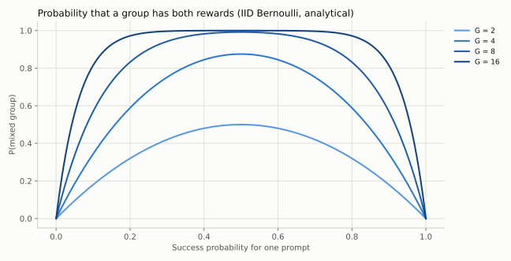

# 18｜推理强化学习：GRPO、Dr. GRPO、MaxRL 与 GSPO

## 18.1 可验证奖励改变了反馈来源

在数学和代码任务中，可以用答案检查或程序测试对完整回答评分。RLVR 用这种验证反馈训练策略，避免为每条轨迹人工排序。但验证器可能不完备、奖励稀疏，且只检查最终答案不一定检查中间推理正确性。

2025 年作业以 Qwen2.5-Math-1.5B 和 MATH 为实验对象，比较 SFT、专家迭代与 GRPO；2026 年作业改为 OLMo-2-0425-1B 与 GSM8K，展开 advantage 归一化及离策略估计量对比。它们是两套不同实验，不能混用默认超参数和基线结果。

**2026 作业的具体设定**，读懂它就知道一个能跑通的 RLVR 系统需要哪些部件：

- 提示词：`r1_zero` 模板要求模型在 `<think>` 中推理、在 `<answer>` 中作答；用 vLLM 采样，温度 1.0、top-p 1.0、最长 512 token，遇到 `</answer>` 停止并保留停止串。
- 奖励：格式奖励（是否按模板输出）与答案奖励（解析出的答案是否正确）分开记录。先用基线评估把输出分成"格式对且答案对""格式对答案错""格式错"三类，并人工查看"格式错但其实答对了"的样本，判断解析器有没有冤枉模型。
- 建议超参数：学习率 $10^{-5}$；每步 256 条 rollout，即 32 道题、每题 8 条（group size 8）；训练 batch 等于 rollout batch，梯度累积 32 次；梯度裁剪 1.0；AdamW $\beta=(0.9,0.95)$、无 weight decay；共 200 个 rollout 步，每 10 步在至少 1,024 道验证题上评估。
- 验收：标准 on-policy GRPO 用 4 个随机种子训练，验证准确率均值至少 25%；画出 loss、梯度范数、token 熵、训练奖励（总计与格式）、验证奖励与平均回答长度随步数的变化，并标出种子间方差。[2025 作业](https://github.com/stanford-cs336/assignment5-alignment/blob/eb2c562e05802d3c9ee4c4ec2eec43b104d77e9e/cs336_spring2025_assignment5_alignment.pdf)、[2026 作业](https://github.com/stanford-cs336/assignment5-alignment/blob/c2734a26308710949fe13226960a1e8cece94b7e/cs336_spring2026_assignment5_alignment.pdf)

## 18.2 先从一个 Bernoulli 任务理解方差

假设一题成功概率为 $p$，奖励 $r\in\{0,1\}$。每题采样 $G$ 个回答，既有成功又有失败的概率为

$$1-p^G-(1-p)^G.$$

当 $p$ 非常接近 0 或 1，小 group 常得到相同奖励。组内相对方法此时没有差异信号。扩大 group、调整题目难度或使用课程式数据选择，都可能比单纯加训练步更有效，但也消耗推理预算。

## 18.3 GRPO 用组内对照代替价值模型

同一 prompt 采样 $G$ 条轨迹，奖励为 $r_i$，均值 $\bar r$，标准差 $s_r$。常见组 advantage 为

$$A_i=\frac{r_i-\bar r}{s_r+\epsilon}.$$

它用同题其他回答作为基线，不需要独立价值模型。轨迹级 advantage 可以赋给每个 response token，再用 token-level clipped surrogate；原始配方还可包含参考策略 KL，但许多实验变体省略或改变它，必须明确写出目标。DeepSeekMath 的完整目标是

$$\begin{aligned}\mathcal J_{GRPO}&=\mathbb E\Big[\frac1G\sum_{i=1}^G\frac1{|o_i|}\sum_{t=1}^{|o_i|}\Big(\min\big(r_{i,t}A_i,\ \mathrm{clip}(r_{i,t},1-\epsilon,1+\epsilon)A_i\big)\\&\qquad\qquad-\beta\,\mathbb D_{KL}[\pi_\theta\|\pi_{ref}]_{i,t}\Big)\Big],\qquad r_{i,t}=\frac{\pi_\theta(o_{i,t}|q,o_{i,<t})}{\pi_{old}(o_{i,t}|q,o_{i,<t})},\end{aligned}$$

其中 KL 用逐 token 的 k3 估计（第 17 章）。三处选择都值得单独审视：先在回答内按 $1/|o_i|$ 平均再在组内平均（18.5 节、第 31.2 节的 DAPO 改成对全部 token 平均）、组标准差归一化（18.6 节）、KL 项（许多 RLVR 配方直接去掉）。[DeepSeekMath](https://arxiv.org/abs/2402.03300)

均值和标准差必须只在同一 prompt 的 group 内计算，不能把整个 batch 的不同题混在一起。sample 排列、mask、padding、EOS 和截断都会改变归一化。标准差用总体估计（除以 $G$）还是样本估计（除以 $G-1$）也会差一个因子 $\sqrt{G/(G-1)}$：2026 年作业的公式写的是总体标准差，但要求实现时用 `torch.std` 的默认值，也就是样本估计；本书代码用总体标准差（`correction=0`），18.10 节的数值也按总体标准差算。对照作业测试时要注意这一点。

## 18.4 组均值 baseline 有一个有限样本偏差

考虑没有标准差归一化的估计量 $\frac1G\sum_i(r_i-\bar r)\nabla\log\pi(y_i)$。因为 $\bar r$ 包含 $r_i$ 自身，baseline 并非独立于当前动作。对独立同分布采样，有

$$\mathbb E[\widehat g]=(1-1/G)\nabla J.$$

推导：$\bar r$ 中与当前 score function 相关的只有 $r_i/G$，其他项期望为零。若用 leave-one-out baseline

$$b_i=\frac{\sum_{j\ne i}r_j}{G-1},$$

则可恢复无偏期望，且 $r_i-b_i=\frac G{G-1}(r_i-\bar r)$。再除以由同一组估计的标准差后，相关性更复杂，不能继续宣称无偏。

## 18.5 长度归一化改变了奖励分配

序列归一化目标对每条回答使用 $\frac1{|y_i|}\sum_t$，使长短轨迹总权重相似，但每个 token 的权重与长度相关。固定归一化目标使用统一常数，如 $L_{max}$，则每条轨迹的总贡献随有效 token 数增长。

这里没有“随便平均一下”的自由。若一个 loss 的目的本来是完整轨迹 reward 的 policy gradient，score function 是 $\sum_t\nabla\log\pi(y_t|\cdot)$；再除以随机轨迹长度会改变该目标。长度还与正确性相关时，偏置会体现在生成长度变化上。

Dr. GRPO 讨论取消组标准差与逐序列长度归一化，使用组中心化 reward 和固定分母，以隔离难度与长度造成的偏置。[Understanding R1-Zero-Like Training](https://arxiv.org/abs/2503.20783)

## 18.6 MaxRL：把难题重新加权

2026 年作业讨论的 MaxRL 变体用 $A_i=(r_i-\bar r)/\bar r$，并在比较中使用固定分母。全零组的均值为 0，必须有数值保护：作业要求给分母加 `advantage_eps`，本书代码用 $\max(\bar r,\epsilon)$，两者在全零组都给 0，非零组仅在 $\epsilon\ll\bar r$ 时近似相同；稀疏奖励或较大 epsilon 下差别不能忽略。

在大 group/总体近似下，除以组标准差或组均值可以看作按该题成功率 p 重加权；有限 group 的随机分母与同组奖励相关，不能视为确定权重。MaxRL 论文第 5 节用这种“权重函数”的视角统一了 REINFORCE、GRPO 与 MaxRL。[Maximum Likelihood Reinforcement Learning](https://arxiv.org/abs/2602.02710) 作业的 `derive_difficulty_reweightings` 一题要求自己推导这些权重，这里只给定性结论：除以组均值倾向于提高低成功率题的相对权重；除以总体标准差的因子在成功率接近 0 和接近 1 的两端较大。有限 group 中的零成功组仍没有正例，随机除法还可能放大噪声。

## 18.7 拒绝采样微调与专家迭代

RFT 采样回答，只保留通过验证者，再做似然训练。对 on-policy 二值 reward、以原始采样数为固定分母的单步更新，$r\nabla\log\pi$ 就是无 baseline policy gradient 的估计。

但若先按成功率筛题、把保留集重新均匀采样、按成功条数归一化或多 epoch 重放，prompt 权重和采样分布发生变化，不再简单等价。RFT 不显式压低失败轨迹，方差和数据效率也与带 baseline 方法不同。

专家迭代是“采样→验证→学习成功轨迹→更新采样策略”的循环。冷启动 SFT 可提高初始成功率，给稀疏奖励创造可学习信号；它也可能把教师的风格和错误模式带入学生。

## 18.8 离策略复用：省采样成本，增加估计难度

完整序列的重要性权重为

$$w(y)=\frac{\pi_\theta(y|x)}{\pi_{old}(y|x)}=\exp\left(\sum_t\log\pi_\theta(y_t|\cdot)-\log\pi_{old}(y_t|\cdot)\right).$$

它能进行分布转换，但长序列乘积的方差可能极大。PPO/GRPO 常使用单 token 比率与 clipping，这是实用 surrogate；它没有完整修正前缀和整条轨迹分布变化，不能称为严格无偏的完整离策略估计。

精确分布转换需要目标策略有概率的轨迹也在采样分布支持内。如果采样用了 top-k/top-p，把一些 token 概率硬设为零，而目标仍是未截断策略，那么这些未采到轨迹没有有限重要性权重能补回来。采样协议应被视为概率模型的一部分。

GSPO 使用序列几何平均比率

$$s(y)=\exp\left(\frac1{|y|}\sum_t[\log\pi_\theta(y_t|\cdot)-\log\pi_{old}(y_t|\cdot)]\right),$$

再对序列级 $sA$ 做 clipping。几何平均降低长乘积的极端幅度，也引入偏差；它的导数自然包含 $1/|y|$ 的长度归一化。比率的定义变了，裁剪范围的量级也随之改变：GSPO 论文实验中左右裁剪范围取 $3\times10^{-4}$ 和 $4\times10^{-4}$，对照的 GRPO 取 0.2 和 0.27，相差约三个数量级，不能把 token 级的 $\epsilon$ 直接搬过来。GSPO 不是“把完整重要性采样稳定实现了一遍”，而是改变了 surrogate。[GSPO](https://arxiv.org/abs/2507.18071)

## 18.9 训练系统中的实际难点

超参数应在解释公式的同一范围内验证。本书 PPO/DAPO 接口选用正的比率下界，要求 $0\le\epsilon_{low}<1$、有限的 $\epsilon_{high}\ge0$。这不是所有论文的数学限制：若 $\epsilon_{low}\ge1$，对非负概率比率相当于不再施加下界裁剪，第 31.6 节引用的 R1 大 epsilon 就属于这种情况，不能直接传给本书的较窄接口。CISPO 的上界 $1+\epsilon_{high}$ 也按包含 on-policy 比率 1 的约定要求 $\epsilon_{high}\ge0$；负 epsilon 会改变这一语义，上界为负时甚至反转正优势项的方向。NaN 不能只用大小比较过滤，因为 `NaN < 0` 为假。测试应包含非法边界、shape 错配和有效 token 上的非有限值，同时保证 padding 的无效值不会进入统计。

rollout 引擎与训练引擎必须同步同一版本权重，old logps 对应真实采样策略。模板、temperature、截断和特殊 token 处理应一致。异步采样会带来 policy lag，需要跟踪样本版本和更新间隔。

日志除了平均 reward，还应包含组内全对/全错比例、长度分布、截断率、格式奖励与正确性奖励、KL、熵、clip fraction 和不同难度组的成功率。熵下降不一定等于更会推理；可能只是模式坍缩。

长链思考、自一致性、多候选搜索与验证器筛选都消耗 test-time compute。比较时用成功率—总生成 token/延迟曲线，而不是只对比“开启思考”后的单个分数。agent RL 把轨迹扩展到工具动作、环境反馈与多步终止，信用分配和奖励投机更复杂。

18.16 节给出一个在 CPU 上几分钟就能跑完的完整 GRPO 循环，包含采样、打分、组内 advantage、微批累积、clipping 与上述部分日志（混合奖励组比例、格式与正确性奖励、熵、梯度范数、准确率；没有记录长度、KL 和裁剪比例）。

**练习。** 某组奖励为 `[0,0,0,0]`，标准 GRPO 的 advantage 应是什么？直接除以标准差会怎样？

**解答。** 合理带 epsilon 实现得到全零，代表该组没有相对信号。直接除以零会产生 NaN。给它们任意设成正奖励不属于数值修复，而是在改变学习目标。

零 advantage 只让这组的策略梯度 surrogate 贡献为零，不保证整次训练更新为零。其他 prompt、KL/熵损失仍可能贡献梯度；即使当前梯度张量全零，已有 Adam 动量和 weight decay 也可能改变参数。若希望整个无信号 batch 不执行更新，需要明确跳过 optimizer/scheduler，而不是把它与零梯度 step 混用（第 5.1 节）。

## 18.10 一个 prompt 的数值算例

设同一题有四条回答，奖励 `[1,0,0,0]`，均值 $1/4$，总体标准差 $\sqrt3/4$。则：

| 方法 | 成功回答 advantage | 每条失败回答 advantage |
|---|---:|---:|
| 组中心化 / Dr. GRPO | $3/4$ | $-1/4$ |
| 标准差归一化 GRPO | $\sqrt3$ | $-1/\sqrt3$ |
| MaxRL（忽略 epsilon） | $3$ | $-1$ |
| RLOO | $1$ | $-1/3$ |
| 二值 RFT | $1$ | $0$ |

表中按总体标准差计算；若按作业要求用 `torch.std` 的默认样本估计，标准差归一化一行变为 $1.5$ 与 $-0.5$。这些数值只是 reward 权重，尚未乘每条轨迹的 score function。再选择逐序列长度或固定分母，就又改变了一次加权。如果成功回答长 100 token、失败回答长 10 token，“先按序列平均”和“所有轨迹统一除以 100”不是只差一个全局常数。

图中是 Bernoulli 独立采样的解析概率，不是大模型实训结果。它说明难题与易题都可能在有限 group 下缺少对照，且 group 增大并不创造模型完全无法产生的正确解。

## 18.11 PyTorch 计算图中的三条边界

`old_logp` 必须 detach；如果 `ratio = exp(logp - logp)`，分子分母一起变化，梯度为零。数值上当前与旧策略相同不妨碍学习：使用 `old_logp = logp.detach()`，此时 ratio 为 1，但对当前 logp 的导数仍为 1。测试已将这一点与直接 on-policy loss 的梯度对照。

优势估计也应按所选估计量 detach，不能让梯度反向穿过 reward、均值或标准差。否则你同时在优化 advantage 构造过程，而不是原先写下的 score-function 估计量。

padding 要在危险运算之前处理。`exp(logp-old_logp)*mask` 可能先产生 Inf，而 `Inf*0` 仍是 NaN；`(NaN-(-Inf))*0` 也不是零。本书先把无效位置设为安全值，再计算差值、指数或 softmax，最后按明确分母归约。有效位置的非有限值会报错，不会被伪装成正常零贡献；整条回答无有效 token 也要求调用方明确剔除或纠正数据。

## 18.12 推理预算、蒸馏与在线系统的共同约束

先用强教师成功轨迹做 SFT，再做 RLVR，是把更高初始成功率换成更容易利用的奖励信号；直接从基础模型做 RL 则更能暴露初始探索与稀疏反馈的问题。最后把成功行为蒸馏到小模型，又改变部署成本。这些训练阶段不能靠“是否用了 RL”一个标签概括。

比较推理训练方案至少分开三个预算：教师产生示范的成本、训练期间 rollout 成本、测试期间搜索/长输出成本。大 group、多候选验证、长 CoT 和模型规模都会消耗这些预算。还应检查截断答案是否被错误记成普通失败、超长输出是否占用大部分训练 token，以及 verifier 是否误把格式正确当内容正确。

## 18.13 三个课程案例应读出的不同设计问题

2025/2026 讲义用 R1、Kimi k1.5、Qwen 3 说明了 RLVR 的不同训练选择。本书不重复排行榜分数，而把案例转成可检查的决策：

| 案例 | 课程讨论的关键选择 | 对读者实验的启发 |
|---|---|---|
| R1-Zero 与 R1 | 基础模型直接 RL 对比冷启动 SFT、多阶段 RL/SFT 与蒸馏 | 分开验证初始探索、可读性和后续通用行为 |
| Kimi k1.5 | 难度过滤、长上下文训练、课程安排与长度控制 | reward 增长要与总生成量、困难题比例、截断率一起看 |
| Qwen 3 | reasoning RL 后叠加通用对齐，混合 thinking/non-thinking 模式 | 训练阶段可能互相影响，模式控制需成对评估 |

冷启动可能提高成功轨迹密度，也会缩窄探索；长输出可能帮助搜索，也可能只是重复；通用偏好优化可能改善交互，却改变特定数学指标。应在每个阶段保存固定评估结果，而不是只评估流水线末端，就把所有收益归因于最后一个算法。[2026 第十六讲](https://github.com/stanford-cs336/lectures/blob/de53a9f979a6ee35f7d13a5e1aadee5ea1afc58e/lecture_16.pdf)

## 18.14 Agent RL：生成 token 与环境动作之间的边界

工具环境轨迹可写成 $(s_t,a_t,o_{t+1},r_t)$。语言模型生成的工具调用 token 属于 action；工具执行返回的 observation 是状态的一部分，通常不应作为 policy-gradient 的动作 token 计入 log probability。把整段 transcript 无差别加权会让模型“学习提高环境输出概率”，偏离原策略目标。

训练环境要可重置、可验证，工具版本和依赖要固定。最终测试通过与否是 outcome reward；步骤评分可帮助信用分配，却可能引入代理漏洞。如果修改环境、额外重试或调用外部模型，也要计入预算。测试用例不充分时，环境通过率不等于真实任务完成率。

长轨迹中的失败可能来自规划、工具参数、环境不稳定或最后答案格式。记录分阶段状态和终止原因，比只看平均 reward 更能定位原因。2026 课程增加了编码 agent 环境构造与专家数据路线，但没有公开所有实现细节；这里给出可核验的方法框架，不声称复现这些工业系统。

## 18.15 熵指标不是抽中 token 的负 log probability

给定前缀，策略完整 next-token 分布的熵为

$$H(p)=-\sum_vp_v\log p_v=\log\sum_ve^{z_v}-\sum_vp_vz_v.$$

抽样 token 的 $-\log p(a)$ 是 surprisal；当 $a\sim p$ 时其期望等于熵，但一个样本可能远离这个期望。如果 token 来自数据集或旧策略，平均 surprisal 还不再是当前分布的熵。记录 RL 熵应说明是完整词表计算、采样估计还是经过 top-p 后的分布。

`posttrain.py` 的 `token_entropy` 计算完整词表熵：低精度输入在 FP32 计算 log-softmax，padding 先安全处理后归零。均匀 V 类的熵应为 $\log V$，极集中的分布接近零。熵下降可能表示更确定的正确策略，也可能是过早坍缩，需要与成功率和答案多样性一起分析。这里实现的是诊断指标，不自动添加 entropy bonus；把熵作为正则项会再次改变训练目标。

## 18.16 一个能在 CPU 上跑完的 GRPO 循环

把上面的部件全部接起来，最小的可验证版本是这样的：策略是第 20 章那个 125K 参数的 TinyLM，先在合成算术文本上预训练 120 步，它学会了 `a+b=` 后接一个数字和换行，但答案基本靠猜（100 道题答对 10%，与第 20.3 节是同一个 checkpoint）。RL 任务是让它答对 $(a+b)\bmod10$。`examples/posttrain.py` 的 `grpo_arithmetic_demo` 每一步：

1. 从 80 道训练题中有放回地抽 32 道（平均约 27 道不同的题），每道采样 8 个两字节回答（温度 1.0）；
2. 打分：格式奖励看是否为"一个数字加换行"，总奖励还要求数字正确；
3. 按组计算 advantage（`grpo`、`dr_grpo` 或 `maxrl`）；
4. 用当前策略在这批 rollout 上算 old log-prob，然后做两轮 clipped surrogate 更新：第一轮 ratio 恰为 1（on-policy），第二轮复用已经变旧的 rollout（off-policy），每轮把 256 条分成 4 个微批累积梯度，按序列归一化加权后裁剪到 1.0 再更新；
5. 每 10 步记录训练奖励、格式奖励、混合奖励组比例、token 熵、80 道训练题和 20 道留出题上的贪心准确率，以及这 10 步内**每一次**更新的裁剪前梯度范数（最大值与超过 1.0 的次数）。只记录第 10 步那一次的范数会漏掉裁剪事件。

20 道留出题从不作为 RL 提示，但它们在预训练文本中出现过。三种 advantage、各 3 个种子、学习率都取 $10^{-3}$、200 步后的结果（`python scripts/run_grpo_demo.py`）：

| advantage | 训练题准确率（3 个种子） | 留出题准确率 | 最终 token 熵 |
|---|---|---|---|
| 初始策略 | 0.11–0.13 | 0.00–0.05 | —（第 10 步时 0.76–1.16） |
| GRPO（除以组标准差） | 0.75、0.90、0.86 | 0.40、0.10、0.10 | 0.04–0.09 |
| Dr. GRPO（只中心化） | 0.49、0.54、0.71 | 0.15、0.05、0.05 | 0.04–0.17 |
| MaxRL（除以组均值） | 0.96、0.96、0.96 | 0.50、0.35、0.25 | 0.02–0.04 |

每个种子共 400 次更新（200 步 × 2 轮）。裁剪前梯度范数超过 1.0、因而触发裁剪的次数：GRPO 9、21、9 次（最大范数 2.2–5.9），Dr. GRPO 1、0、0 次，MaxRL 16、6、15 次（最大 9.3）。

这张表应该怎样读：

- **学习确实发生了**：训练题准确率从约 0.1 升到 0.49–0.96，熵降到接近 0。混合奖励组比例在训练后期都降到 0–0.12，与 18.2 节的分析一致：题目被学会（或放弃）后，组内不再有信号。前期走势因种子而异：MaxRL 三个种子和 GRPO 的两个种子先升到 0.5–0.8 再下降，GRPO 另一个种子和 Dr. GRPO 大体从一开始就在下降，3 个种子不足以把这种差别归到方法上。
- **留出题也有提升，但远小于训练题**：说明 RL 主要强化了被奖励的那些提示的答案，只有一小部分迁移。留出题只有 20 道，准确率的粒度是 0.05、标准误约 0.1，Dr. GRPO 的一个种子在留出题上没有提升。在大模型上，这对应"RL 是在激发已有能力还是在记住训练集"的问题，必须用独立验证集回答。
- **不能把方法差别单独归因于 advantage 的整体尺度，也没有排除全部尺度效应**。demo 用 AdamW：把所有 advantage 乘一个常数，一阶矩与二阶矩的平方根同比例变化，更新量基本不变。但梯度裁剪是一条尺度通道：上面的计数显示，advantage 最大的 MaxRL 和 GRPO 都有数十次更新被裁剪，Dr. GRPO 几乎没有，裁剪会改变 Adam 看到的梯度历史。另一个明确差异是题与题之间的相对权重；Adam 对固定正比例的抵消仅在整个梯度历史同比例且 epsilon 可忽略时近似成立，逐步变化的尺度、两轮比率更新和数值误差仍会影响轨迹。三种 advantage 给难题和易题的相对权重不同（18.6 节的定性结论；具体权重函数是作业 `derive_difficulty_reweightings` 一题的内容，请自己推导）。这种权重与固定学习率、两轮复用 rollout 相互作用：Dr. GRPO 在第 10 步的熵最低（0.76–0.82，GRPO 为 0.91–1.05，MaxRL 为 1.13–1.16），但最终熵并不最低（0.04–0.17，与 GRPO 相当，高于 MaxRL），准确率也最低。但高熵与低准确率不足以区分探索不足、错误偏好或有效更新量的差别；需要按题记录正确答案概率、答案多样性，并做学习率与裁剪的受控对照。这些日志只是 3 个种子的现象，不支持单一机制归因。
- **作业的比较协议只能给出单向结论**。2026 年作业只为标准 GRPO 扫学习率，各变体沿用同一学习率。讲义明确说明：变体更好，可以视为它调优后性能的下界；变体更差，则不能断言它更差，因为它的超参数没有调过；较好也应在多 seed、独立测试与预算对齐后再归因，不能把未充分调优的基线当作算法上界。
- **3 个种子的离散度较大**（Dr. GRPO 从 0.49 到 0.71，GRPO 的留出题从 0.10 到 0.40），单种子不足以稳定判断方法排序。

这个 demo 的回答只有两个字节，没有思维链，也没有长度归一化带来的问题；它验证的是 RL 循环的每个部件和日志，而不是推理能力。

## 18.17 baseline 不一定降低方差

作业用一个两动作的例子，要求推导不同 baseline 下策略梯度估计量的方差，那道题请自己完成。这里换一个三动作的例子说明同一个现象。策略为 softmax，三个动作的概率 $\pi=(0.05,0.05,0.9)$，奖励 $r=(0,0.5,1)$；只看第三个动作的 logit $\theta$ 这一个方向，score function $\partial_\theta\log\pi(a)=\mathbf 1[a=3]-\pi_3$，即 $(-0.9,-0.9,0.1)$。单样本估计量 $Z=(r-b)\,\partial_\theta\log\pi(A)$ 的期望与 $b$ 无关（都是 0.0675），方差却随 $b$ 变化：

| baseline | 方差 |
|---|---:|
| $b=0$ | 0.0146 |
| $b=\mathbb E[r]=0.925$（平均奖励） | 0.0375 |
| $b_*=\mathbb E[rs^2]/\mathbb E[s^2]=0.325$（21.3 节） | 0.0051 |

平均奖励反而把方差放大了约 2.6 倍。原因是高概率动作的 score 很小、罕见动作的 score 很大：减去接近 1 的平均奖励后，罕见动作上的 $(r-b)s$ 变大，而它们正是 score 大的那些。21.3 节的最优 baseline 按 $s^2$ 加权，所以偏向罕见动作的奖励。`posttrain.py` 的 `pg_estimator_variance` 对任意小动作空间精确枚举这个方差，测试用蒙特卡洛估计对照，并检查 $b_*$ 处方差最小。

**练习。** 在 18.16 节的设定下，一道题的成功率是 $p=1/8$，group size 8。这组恰好有一个成功回答的概率是多少？此时 GRPO、Dr. GRPO、MaxRL 给这个成功回答的 advantage 各是多少？

**解答。** 恰好一个成功：$8\times\frac18\times(\frac78)^7\approx0.39$。组均值 $1/8$，总体标准差 $\sqrt{7}/8$。Dr. GRPO：$7/8=0.875$；GRPO：$(7/8)/(\sqrt7/8)=\sqrt7\approx2.65$（按 `torch.std` 的样本标准差则是 2.47）；MaxRL：$(7/8)/(1/8)=7$。单看这一题的 advantage 幅度可相差 8 倍；Adam 的尺度抵消只是固定全局倍数且 epsilon 可忽略时的近似，不能由此排除全部尺度效应。还应比较题与题之间的相对权重，见 18.16 节。

## 18.18 社区进展：2025 年的 RLVR 经验

第 31 章整理了大模型 RLVR 的公开经验，都可以用本章的估计量直接对照：

- **DAPO**：把裁剪上界单独放宽到 0.28，丢弃全对或全错的组，按 batch 内全部 token 平均，对超长回答线性加罚；
- **CISPO**：裁剪重要性权重并停止梯度，而不是裁剪更新，让被裁剪的低概率反思 token 仍有梯度；
- **熵坍缩**：论文在其假设下用协方差解释熵的变化；通用 logit 微分与共享参数边界见第 31.4 节；
- **RL 的边界**：RL 是否只提高了采样效率、没有扩展能力，三篇论文给出了不同的结论。

`rl_objectives.py` 与本章的 `posttrain.py` 使用同一套张量约定。多轮工具使用的 RL 见第 32 章。

## 18.19 完整重要性权重为何迅速失效

令每 token 的 log-ratio 为 $\delta_t$，完整轨迹权重 $w=e^{\sum_t\delta_t}$。在简化的弱相关近似中，若每项方差为 $\sigma^2$，总 log-weight 方差随 T 约为 $T\sigma^2$；有相关性时还要加协方差项。指数把波动转成重尾，因此平均 log-ratio 很小不保证长轨迹权重温和。

常用的有效样本数近似（这里仅作为权重集中度诊断）为

$$ESS=\frac{(\sum_iw_i)^2}{\sum_iw_i^2}=\frac1{\sum_i\bar w_i^2},\qquad \bar w_i=\frac{w_i}{\sum_jw_j}.$$

应在 log 空间稳定归一化，再看 ESS、最大归一化权重和 log mean weight。16 条样本的权重相同时 ESS=16；其中一条 log-weight 为 20、其余为 0 时 ESS 约为 1。这个诊断不保证无偏或支持覆盖：所有权重都错乘同一个常数，ESS 也不变；样本完全没覆盖某个高奖励模式，ESS 甚至仍可很好看。[ESS 近似的假设与局限](https://arxiv.org/abs/1809.04129)

普通 IS 使用 $n^{-1}\sum_iw_if_i$，自归一化 IS 使用 $\sum_i\bar w_if_i$，裁剪再归一化又是另一估计量。稳定实现只解决溢出，不能把有偏 surrogate 变成完整无偏校正。第 31.8 节把这一点放回异步 rollout 的版本管理中。

## 18.20 终止、截断和奖励的位置

模型生成 EOS、工具任务成功、用完 token/调用预算、采样服务报错是不同事件。若任务定义就是预算内成功，超时可以是终止失败；若预算只是数据采集截断，value-based 目标可能需要末端 bootstrap。把二者都叫 done 会混淆目标。纯 outcome GRPO 通常没有价值 bootstrap，但仍需明确截断样本是否计奖、是否进入 loss、是否触发长度惩罚。

一次工具动作可能由多 token 组成，工具观察本身不进入动作 log-prob，但后续动作受它影响。最终 reward 可以作为整条轨迹的 score-function 权重；过程奖励若直接叠加，改变的是回报，不能称为无影响的“日志增强”。潜势塑形在特定条件下保留最优策略，推导见第 32.7 节。
