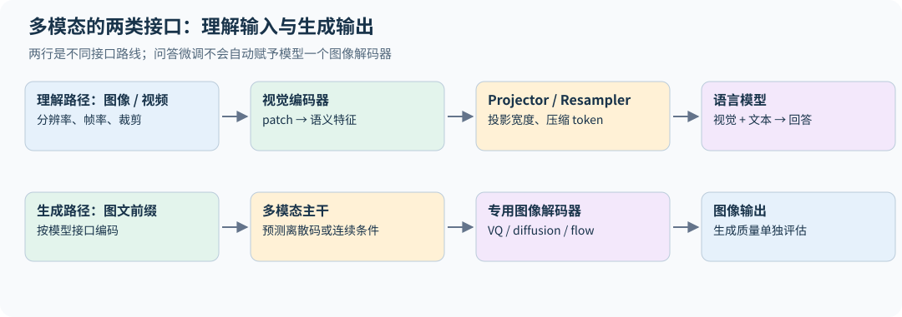

# 19｜多模态：把感知、语言与生成接到一起

## 19.1 非文本输入也需要表示接口

Transformer 接收向量序列，文本 token 只是其中一种来源。图像可划成 patches，再投影并送入视觉编码器；音频可表示成连续特征或离散 codec token；视频增加时间维度和大量冗余帧。

例如 $224\times224$ 图像切成 $14\times14$ patch，得到 $16\times16=256$ 个 patch token，不含额外特殊 token。输入高宽都翻倍，patch 数变四倍，若对所有 patch 做全注意力，score 项可能变十六倍。高分辨率感知是一道信息质量与资源的共同问题。

## 19.2 CLIP：用文本监督语义对齐

给一批配对图文，编码并归一化为 $u_i,v_j$，相似度 $s_{ij}=u_i^\top v_j/\tau$。CLIP 的对称对比损失为

$$L=\frac1{2B}\sum_i\left[-\log\frac{e^{s_{ii}}}{\sum_je^{s_{ij}}}-\log\frac{e^{s_{ii}}}{\sum_je^{s_{ji}}}\right].$$

每张图的正确文本是正例，同 batch 其他文本是负例，反方向也类似。它学习语义对齐，便于零样本分类和检索，但不保证保留所有像素级细节。batch 构成决定负例分布，大规模训练需要跨设备特征聚合及正确梯度处理。[CLIP](https://arxiv.org/abs/2103.00020)

这里“其他配对均为负例”是一种训练假设：同 batch 两张相似图都可能匹配同一 caption，形成假负例。一图多 caption、重复图片和相似文本需要去重或多正例目标等处理。跨卡 all-gather 特征时，还应明确哪些远端特征保留梯度、loss 按本卡还是全局 batch 平均；错误地 detach 全部聚合特征可能让部分 encoder 没有预期梯度。

[extensions.py](../../examples/extensions.py) 提供对称 CLIP loss，并检查正确配对的损失低于错配、同时重排图文对不改变损失。它只演示已经得到 feature 后的对齐目标，不包含训练好的图像编码器，也不能用于真实图像问答。

CLIP 的梯度累积不能仅靠除以累积次数模拟更大的对比 batch：拆成几个 microbatch 后，每个 softmax 分母缺少其他 microbatch 的负例，目标本身已经变化。要恢复全局目标，需要让对应的跨批特征参与分母，并正确保留或重算其梯度；这与普通逐 token 可加的交叉熵不同。

## 19.3 SigLIP：从多类归一化到成对二分类

SigLIP 用 $z_{ij}\in\{-1,+1\}$ 标记是否配对，对每对图文使用 logistic loss：

$$L\propto\sum_{i,j}\log\left(1+\exp[-z_{ij}(a\,u_i^\top v_j+b)]\right).$$

它不需要对每一行/列做完整 softmax 分母，训练可以更灵活地组织成对样本。SigLIP 论文给出的对比是：从头训练的 SigLIP 用 32 块 TPUv4 芯片 5 天达到 ImageNet 零样本 73.4%，而它估计 CLIP 级别的训练约需 256 个 TPUv3 核训练 10 天（CLIP 原论文报告的最大 ViT 在 256 块 V100 上训练了 12 天）；在 batch 小于 16K 时 SigLIP 优于 CLIP。但负例远多于正例，缩放、bias 与采样权重仍然重要；“不需要全局 softmax”不等于没有跨设备数据或通信问题。[SigLIP](https://arxiv.org/abs/2303.15343)

## 19.4 视觉编码器 + projector + LM

常见 VLM 把视觉特征投影到语言模型宽度，再与文本 embedding 一同送入 decoder。projector 可以是线性层、MLP 或 cross-attention/resampler，用来调整维度和视觉 token 数。

一种训练路线先冻结视觉编码器与 LM，只训练 projector，使接口对齐；随后训练 projector 与 LM 做视觉指令微调。也有方案进一步训练视觉编码器、使用多阶段分辨率与数据课程。冻结策略不是普遍固定规则。[LLaVA](https://arxiv.org/abs/2304.08485)

生成回答时通常仍只在文本输出上算语言建模损失。视觉 token 可以参与注意力却不作为离散文本标签。这和 SFT 中 prompt 的角色类似。

文字模板里的一个 `<image>` 占位符可能会展开成数百个视觉 embedding。展开后 attention mask、position ID、labels 和 loss mask 必须同时重排，不能仍沿用展开前的文本长度。连续视觉 embedding 不是“某个词表 ID 的答案”，这些位置通常使用忽略标签；第一个回答 token 仍由前一位置的输出预测。

## 19.5 分辨率、视频和位置编码

中心裁剪可能删除边缘文字，小图缩放也可能丢失 OCR 所需细节：LLaVA-1.5 使用的 CLIP ViT-L/14@336px 把图像缩放裁剪到 336×336（这是在 224 分辨率训练后多训一个 epoch 得到的版本，其他 CLIP 模型用 224）。AnyRes（LLaVA-NeXT 引入；团队更新的 LLaVA-1.5 报告也介绍该路线）把高分辨率图像切成与编码器分辨率匹配的 $a\times b$ 块，分别编码后拼接，token 太多时再插值压缩；LLaVA-OneVision 进一步按场景分配预算：单图用高分辨率，多图每张用基础分辨率，视频每帧用更低分辨率。Qwen2-VL 的动态分辨率方案以 14×14 patch 编码，再把每 2×2 个相邻 patch 合并为一个 token，讲义给出一个 224×224 区域约 66 个 token（$16\times16$ 个 patch 合并后为 64 个，另加起止标记）；讲义示例的视频采样配置为每秒 2 帧、总量上限 16,384 个 token；它是预处理预算，并非所有版本的固有限制。

视频不仅需要“图像 token 更多”，还需要时间顺序、采样帧率、跨帧关联和显式时间信息。降低帧率可能漏掉短暂事件，提高分辨率却未必修复时间缺失。数据设计要区分空间细节任务和时间推理任务。

多维 RoPE 可把旋转维度分配给时间、高度、宽度轴，避免把所有空间结构压成单一文本位置。不同频段如何分配、是否交错、视频时间戳是否作为独立 token，都是架构选择。[Qwen2-VL](https://arxiv.org/abs/2409.12191)

若每帧保留 $K$ 个视觉 token、视频采样 $F$ 帧，直接送入 LM 的视觉 token 数近似 $FK$。翻倍帧数后，全注意力配对项可能约变四倍，KV 约变两倍；若文本长度也很长，应使用总长度而非只用视觉 token 估算。视觉压缩器用更少 token 换取成本，可能损失小字、短事件或精细空间关系，要按任务验证。

AnyRes 的归属以 [LLaVA-NeXT 官方说明](https://llava-vl.github.io/blog/2024-01-30-llava-next/) 为依据；固定分辨率裁剪、动态分辨率与分块拼接不是同一个流程。需要把视觉 token 数、实际裁剪覆盖和 OCR 质量一起报告，不能只从输出 token 数推断保留了全部视觉信息。

## 19.6 理解图像与生成图像要求不同

CLIP 式表示优先保留可与文本匹配的语义，可能丢失纹理、精确颜色和布局。重建或生成图像需要更细的信息。VQ-VAE 类方法用 codebook 把图像表示离散化，让自回归模型生成图像 token；另一条路线让语言模型与连续 latent 上的 diffusion/flow 生成器配合。

离散 codebook 可用最近邻选择 $k=\arg\min_j\|z-e_j\|^2$，配合重建损失、codebook 更新与 commitment 约束。离散选择的梯度处理需专门方法；码本大小、压缩率和重建质量决定语言模型要处理多少视觉 token。

Chameleon 类统一离散序列体现了“所有模态放进同一自回归接口”的路线；它与仅接视觉编码器的 VLM 有不同的生成能力与训练稳定性问题。课程 2026 年最后一节常规讲（第 17 讲）讨论了这些方向，包含 CLIP、SigLIP、LLaVA、Qwen-VL 系列与 Chameleon。[2026 第十七讲](https://github.com/stanford-cs336/lectures/blob/de53a9f979a6ee35f7d13a5e1aadee5ea1afc58e/lecture_17.py)

音频与 diffusion 的详细建模不属于该公开讲义的完整推导范围；本章给出接口层认识，不把本书扩充为整门语音或扩散模型课程。

## 19.7 多模态评估与损失平衡

长视频样本的输入 token 很多，首先影响计算与上下文预算；是否主导损失还取决于哪些 token 受监督。仅对文字回答计损失时，同样长的答案不会因视觉 token 更多就自动获得更大权重；若视觉输出也被预测，或分母使用总输入长度，权重才会相应改变。应明确 modality mix、分辨率分布与监督长度，并用模态分项指标验证。

视觉问答正确可能来自语言先验而非图像。可遮挡图像、替换相似图像、改变空间关系进行反事实检查。OCR、计数、图表、跨图比较和时间关系应分别评估，不能以单一总分代表所有感知能力。

**练习。** 把 projector 从线性层改成更大 MLP 后分数提高，如何验证它学到了更好的视觉接口？

**解答。** 固定数据、训练预算、冻结策略和分辨率，比较多种视觉任务，并增加无图/错图对照。如果不看图也同样提升，改进可能来自语言适配而不是视觉利用。

## 19.8 多层视觉注入与多维位置的频段分配

早期 VLM 常把视觉特征只作为输入序列的一段。DeepStack 类思路把多个视觉层级的信息注入语言模型不同深度，减少所有感知信息都必须经过同一个输入接口压缩的限制。要明确每一层投影后的宽度、token 对齐关系与残差缩放；不能把不同空间粒度的 feature 未经重采样直接相加。

2026 年课程还讨论了 interleaved MRoPE：把时间、宽度、高度轴交错分配到不同旋转频段，而不是让某个轴只占一整段频率。直觉是避免某个轴只能使用偏高或偏低频率；实际效果需在长视频、空间关系与时间定位任务上消融。显式时间戳 token 又提供另一种时间信息，和旋转位置编码并非重复的同一机制。[2026 第十七讲的 Qwen3-VL 与 DeepStack 部分](https://github.com/stanford-cs336/lectures/blob/de53a9f979a6ee35f7d13a5e1aadee5ea1afc58e/lecture_17.py)

## 19.9 不同模态的长度权重怎样落到损失上

文本、图像、视频样本长度差异很大，可以用一族明确目标分析归一化：

$$L_\alpha=\frac1B\sum_i\frac1{n_i^\alpha}\sum_{t=1}^{n_i}\ell_{it}.$$

$\alpha=0$ 时长样本总权重随 token 数增长，$\alpha=1$ 时每个样本平均后再平均，$\alpha=1/2$ 介于两者。这里 $n_i$ 应明确是参与 loss 的 token 数还是全部模态 token 数；只对文字答案监督时，这两种定义可能差得很大。Qwen3-VL 报告说明，它把逐样本损失改为"平方根归一化的逐 token 损失"，以平衡文本与多模态数据的贡献，对应上式 $\alpha=1/2$ 的思路；报告没有给出精确的归一化常数。[Qwen3-VL](https://arxiv.org/abs/2511.21631)

先固定模态采样比例，再改变长度归一化，能区分“长视频数量更少”和“每条长视频被降权”两种效应。报告分模态质量、训练 token 和有效损失权重，避免一个总 loss 隐藏了某模态被忽略。

## 19.10 从码本选择到可训练的 VQ 接口

设编码器连续输出为 $z_e(x)$，最近码本向量为 $e_k$。一个典型 VQ-VAE 训练目标包含重建、码本与 commitment 三部分：

$$L=L_{recon}+\|\operatorname{sg}[z_e]-e_k\|^2+\beta\|z_e-\operatorname{sg}[e_k]\|^2.$$

`sg` 表示停止梯度。码本项把被选向量拉向编码器输出，commitment 项限制编码器远离所选码本，离散最近邻路径通常用 straight-through 近似让重建梯度传回编码器，或对码本采用 EMA 等替代更新。码本长期只有少量条目被使用，说明离散表示可能坍缩；需监测利用率和重建错误。

统一文本/图像离散词表后，图像序列可能长、熵高，不同模态的 logit 与 norm 尺度会影响训练稳定性。这连接了第 3.5 节的 QK norm、z-loss 和 19.9 节的长度加权。高效重建也不保证 OCR 或精细感知最佳，因此理解任务与生成任务仍要分别评估。[2026 第十七讲的 Chameleon/VQ-VAE 部分](https://github.com/stanford-cs336/lectures/blob/de53a9f979a6ee35f7d13a5e1aadee5ea1afc58e/lecture_17.py)

**练习 2．** $448\times448$ 的图像用 $14\times14$ patch 切分得到多少个视觉 token？若 projector 把每 $2\times2$ 个相邻 patch 合并为一个 token 呢？30 帧视频按后者处理，共多少 token？

**解答。** $32\times32=1024$；合并后 256；30 帧为 7,680 个，相当于一篇不短的文章。视频理解的上下文成本主要来自这里。

## 19.11 SigLIP 的负例比例为什么需要 bias

在 $B>1$ 对图文中共有 $B^2$ 个 pair、只有 B 个正例；若每对等权且相似度全相同，常量匹配概率的最优值是 $1/B$，对应的总 logit 为

$$z_*=\log\frac{1/B}{1-1/B}=-\log(B-1).$$

若共同的相似度项 $a\,u_i^\top v_j=c$，则 $z=c+b$，最优偏置是 $b_*=-\log(B-1)-c$；只有 $c=0$ 或已吸收进偏置时，才直接写作 $b_*=-\log(B-1)$。

论文的实际初始化正是这个思路：$t'=\log10$（乘性 logit 尺度 $t=10$，对应前文 $1/\tau$）、$b=-10$。$B=8192$ 时 $-\log(B-1)\approx-9.0$，$-10$ 与这个先验同量级；论文表 4 在 8K batch 上的消融显示，$b=-10$ 的零样本 ImageNet 为 63.0%，$b=0$ 为 61.7%，乘性尺度初值更小时差距更大（61.0% 对 53.7%）。

这只是等分数、全 pair 目标下的先验算例，不是要求训练 bias 固定在此。相似度贡献接近零时，从 b=0 开始会给大量负例预测约 50% 匹配，早期梯度被纠正先验主导。原论文使用可学习温度/bias，并按 B 而不是 $B^2$ 归一化 pair loss；给全部 pair 同乘一个正的常数只改变 loss/梯度尺度，不改变这个最优常量 bias。改变正负样本比例、相对权重，或跨卡聚合后实际加入更多负例，才会改变最优先验。[SigLIP §3 与算法 1](https://arxiv.org/html/2303.15343v3)

文本相同的两张图、一图多 caption 和重复样本可能产生假负例；增加 batch 既增加负例信息，也改变这类碰撞概率。对照应报告有效全局 pair 数、是否多正例、哪些远端特征保留梯度，不能只比较“每卡 batch 一样”。

## 19.12 视觉利用需要分层的干预评估

同题可构造原图、无图、错图、只遮关键区域、只改变文字/数值的版本。记录答案变化与是否依赖真正相关的视觉信息；遮掉全图后的下降也可能来自输入分布异常，单个消融不足以证明因果定位。OCR 题、空间关系、计数和跨帧时序应分别测，因为压缩视觉 token 可能只伤其中一类。

评估还要固定实际像素、裁剪、tile 上限、帧时间戳和视觉 token 预算。同样“32K 上下文”，更高分辨率图像可能占去更多文本位置；性能变化既来自感知信息，也来自文本被截断。只对回答 token 监督时，损失长度是有效回答长度，不能把所有视觉输入 token 自动算进平均分母。
