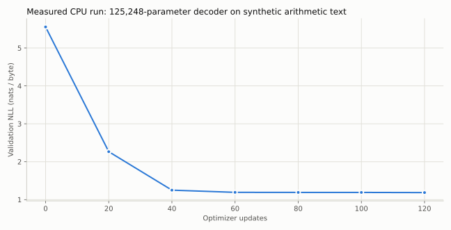
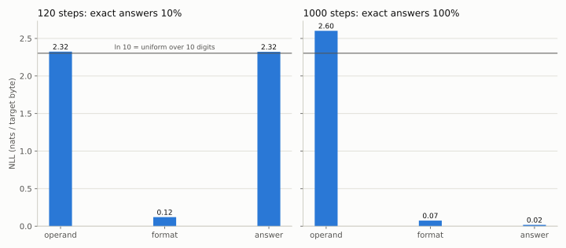
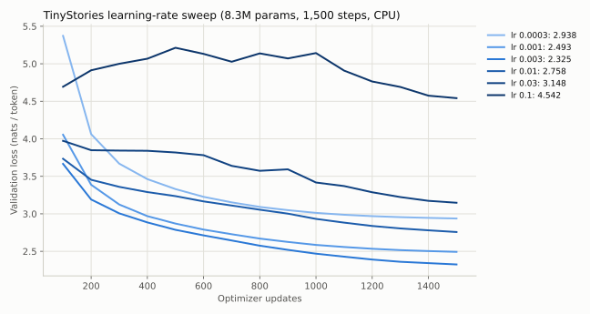
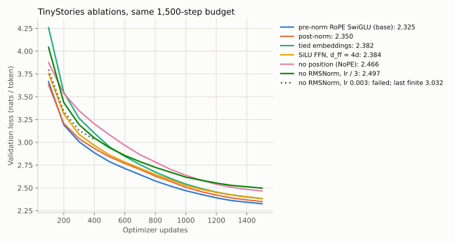
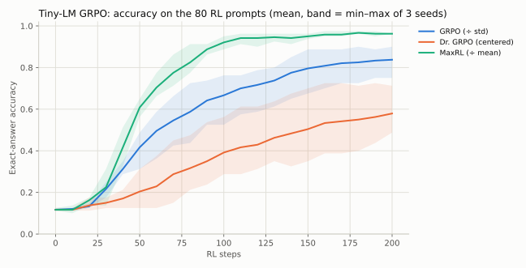

# 20｜贯穿实验：从正确代码到可信结论

本章把前面的知识连成可执行的实验路线。代码独立编写，规模适合 CPU，不是官方作业答案，也不复现课程的模型分数。实测结果来自随书脚本和结果文件；理论下界、数量级计算及作业参考分数分别标明，不把它们当成本书实测。GPU 内核与大模型后训练部分给出实验规格；真实性能结论必须在对应硬件上测量。

## 20.1 环境与第一轮运行

在仓库根目录执行：

```bash
python -m pip install -r requirements.txt
python -m unittest discover -s tests -v       # CPU 测试；可选依赖会按报告跳过
python -m examples.tokenizer                   # 复现作业的 BPE 示例
python -m examples.train --steps 120           # 合成算术小模型
python -m examples.attention                   # 在线 softmax、softmax 反向恒等式
python -m examples.accounting                  # Llama 2 资源核算
python -m examples.distributed                 # 双进程 DDP、collective、优化器状态分片
python -m examples.inference                   # speculative decoding、分页 KV
python -m examples.scaling                     # 预算受限的 IsoFLOP 设计
python -m examples.data                        # 规则过滤、联系方式替换、MinHash 去重
python -m examples.posttrain                   # 小模型上的完整 GRPO 循环
python scripts/run_checks.py                   # 写出 book/validation.json
```

较长的实验各有脚本：`scripts/run_core_experiments.py`（约 30 秒，写出 `book/experiment-results.json`）、`scripts/run_grpo_demo.py`（9 个并行进程约 3 分钟）、`scripts/run_tinystories.py`（下载约 220 MB 数据；默认 6 个运行并行、每个 8 线程，在 48 线程以上的机器上约 1 小时，16 核机器建议用 `--parallel 2`，预计要 2–3 倍时间）。`requirements.txt` 里的 `regex` 是 tokenizer 必需的依赖；要在 CPU 上跑 Triton kernel，还需另装 `triton`。

不同 PyTorch 版本、CPU 指令与线程设置会带来数值差异，CPU 多线程归约的顺序也不固定：同一种子重跑 TinyStories，最终验证损失可差约 0.003。GRPO 这类反复采样的过程，微小差异可能在几十步后放大成不同的轨迹，结果文件里的数字要在脚本的线程设置下才能逐值复现。

后面的 TinyStories/GRPO 完整训练表是带固定协议的历史运行记录；浮点累积顺序和软件版本变化可能改变逐值结果，尤其是反复采样的 RL 轨迹。复现实验应另存版本、线程、dtype 与完整日志。

训练入口保存的 checkpoint 包含模型、优化器、配置、步数、完整学习率日程终点、seed、日志与 RNG 状态，支持 `--stop-after` 与 `--resume`，测试验证中断恢复与连续训练逐值相同。

## 20.2 实验 A：BPE 与讲义逐项对照

`python -m examples.tokenizer` 首先用作业讲义里的经典例子（`low`、`lower`、`widest`、`newest`）训练 6 个 merge，输出必须是 `st, est, ow, low, west, ne`；然后在一段中英混合文本上训练 300 词表并验证往返。

**验收。** 讲义示例的 12 个 merge 与 `newest → [ne, west]` 一致；特殊 token 不参与计数、不被拆分，重叠时取最长；默认预切分保留合法 Unicode 的往返，非法字节解码为 U+FFFD；`encode_iterable` 应与一次性编码相同，并行预切分应与串行同频数。这些契约由 `test_course.py`、`test_regressions.py`、`test_statistical_contracts.py` 等测试覆盖缩写、连续空白、重叠标记和多种切块；有限测试不是对任意输入已经穷尽的证明。

**规模实验。** 在 TinyStories 200 MiB 上训练 10K 词表用时 5.8 秒，验证集压缩率 4.117 bytes/token（第 2.3 节）。

## 20.3 实验 B：一个小模型从"学会格式"到"学会加法"

模型为 2 层、宽度 64、4 个 query 头、2 个 KV 头、SwiGLU 宽度 176、256 字节词表，共 125,248 参数。训练文本是独立随机生成的 `a+b=c\n` 行，$c=(a+b)\bmod10$，训练集只有 1,500 行（9 KB），1000 步（batch 16、上下文 32）约看 57 遍；训练集与验证集是不同的随机序列，但 100 个算术事实在两边都会出现，所以这是同分布建模实验，不是泛化测试。



120 步时验证损失从 5.55 降到约 1.19，但贪心输出 `2+3=7`：模型学会了格式，没学会加法。只看总损失看不出这一点，因为每行 6 个字节里有两个随机输入数字，它们本来就不可预测。`python -m examples.evaluation --checkpoint ...` 把损失按目标字节的角色拆开，并在全部 100 道题上测答案准确率：



| 训练步数 | 输入数字 NLL | 格式 NLL | 答案 NLL | 100 道题答对 |
|---|---:|---:|---:|---:|
| 120 | 2.32 | 0.12 | 2.32 | 10% |
| 1000 | 2.60 | 0.07 | 0.02 | 100% |

120 步时答案 NLL 接近 $\ln10\approx2.30$，与在 10 个数字上均匀猜的 NLL 同量级；接近该值不证明每条预测分布严格均匀；训练到 1000 步，答案 NLL 降到 0.02，100 道题全对。总损失只从 1.19 降到 0.92，变化并不显眼，变化主要发生在答案位。输入数字的 NLL 反而从 2.32 升到 2.60，高于均匀分布的 $\ln10$，说明对本应独立的随机操作数预测变差；这与过拟合有限训练样本中的偶然关联相容，但仅凭 NLL 不能确定模型记住了哪些具体顺序。整体验证损失在第 480 步附近达到最低（0.845），之后回升到 0.919，是这个同分布小数据实验中的过拟合信号。

对于无限 IID 算术事实流、完整边界约定和完美答案模型，每行的理想熵率为 $2\ln10/6\approx0.768$ nats/byte。这是生成分布上的期望下界，不是有限验证样本每次必然不低于的硬阈值；本书无 BOS 的窗口还省略首 token 目标，角色比例也略有变化。要研究真正的算术泛化，应留出一部分 $(a,b)$ 组合完全不进训练集，或改变位数与进位模式。

## 20.4 实验 C：TinyStories 上的学习率扫描与架构消融

这是基础作业第 7 节实验的 CPU 缩小版，由 `python scripts/run_tinystories.py --download` 一键运行。脚本会在原文旁写 `*.download.json` 记录来源与哈希；若 `outputs/tinystories/` 里已有更早下载、没有该记录的原文，改用 `--train-text`/`--valid-text` 指定这两个文件并省略 `--download`。下文的种子重复（`--seed-repeats`）要求结果文件记录了所用 token 数据的哈希，本书现存结果早于该机制，需先完整重跑一次基础实验。

若已选好学习率，可用 `--best-lr` 跳过扫描。此时运行记录里的 `base_run` 为 `base`，图表据此读取真正的基线，并注明“扫描已跳过”；训练步数、学习率和失败标记也应来自该记录，不能写死成历史实验的设置。指定基线若发散、未完成或没有有限验证损失，脚本会在生成样例和覆盖实验汇总之前停止。绘图保留非有限点的断口，避免把失败前后的曲线连成连续训练轨迹。

**设置。** TinyStories 训练集取前 200 MiB（约 5,100 万 token），完整验证集 22.5 MB（547 万 token）；10K 词表 BPE；模型 4 层、$d=256$、8 头、$d_{ff}=704$，共 8.33M 参数，其中 embedding 与输出头占 5.12M；上下文 128、batch 32、1,500 步，共处理 614 万 token；AdamW $(0.9,0.95)$、weight decay 0.1、余弦日程（warmup 75 步，末端为峰值的 10%）、梯度裁剪 1.0。验证损失在验证集上 512 个固定的等间距窗口上计算。每个运行占 8 个 CPU 线程，6 个运行并行，单个运行约 11–18 分钟。与作业的完整配置（上下文 256、$d=512$、3.3 亿 token）相比，模型约小 3 倍、训练 token 少 50 多倍（这里只有约 0.7 token/参数），绝对损失不可比，趋势也只能谨慎参考。

**学习率扫描。**



$3\times10^{-3}$ 最优（验证损失 2.325），相邻的 $10^{-3}$ 与 $10^{-2}$ 分别差 0.17 和 0.43。0.03 和 0.1 没有出现 NaN，但损失长时间停在 3.8 以上，最终 3.15 和 4.54。这次扫描没有做去掉梯度裁剪的对照，不能把"没有发散"归因于裁剪；扫描到最优值的 33 倍仍未发散，说明发散边界还没找到（第 5.11 节）。

**消融。** 都用最优学习率 $3\times10^{-3}$、同样 1,500 步：



| 变体 | 参数量 | 1,500 步验证损失 | 相对基线 |
|---|---:|---:|---:|
| 基线：pre-norm、RoPE、SwiGLU | 8.33M | 2.325 | — |
| post-norm | 8.33M | 2.350 | +0.025 |
| 共享输入/输出 embedding | 5.77M | 2.382 | +0.057 |
| 不门控 SiLU，$d_{ff}=4d=1024$ | 8.27M | 2.384 | +0.058 |
| 去掉位置编码（NoPE） | 8.33M | 2.466 | +0.141 |
| 去掉全部 RMSNorm，学习率 $3\times10^{-3}$ | 8.33M | 在第 484 步发散 | — |
| 去掉全部 RMSNorm，学习率 $10^{-3}$ | 8.33M | 2.497 | +0.172 |
| 去掉全部 RMSNorm，学习率 $3\times10^{-4}$ | 8.33M | 2.888 | +0.563 |

读这张表时注意：

- **归一化的作用首先是让大学习率可用。** 没有 RMSNorm 时，原来的最优学习率在第 484 步损失突然跳到 1,794，训练崩溃。降低学习率后可以训练，但"相对基线"一列混合了两个因素：学习率和归一化。在同一学习率下比较，去掉 RMSNorm 几乎不吃亏：$10^{-3}$ 时为 2.497 对 2.493，$3\times10^{-4}$ 时甚至略好（2.888 对 2.938）。它比基线差，主要是因为用不了最优的大学习率。
- **post-norm 在这个浅模型上只差 0.025。**post-norm 的问题主要出现在深层网络和大学习率下（第 3.4 节），4 层模型不足以暴露它；不要从这个结果推断"post-norm 和 pre-norm 一样好"。
- **NoPE 能学，但此配置的 loss 更高。** 因果 mask 和不同的前缀内容可提供顺序线索，但“看见 t 个 token”不自动保证模型能数到 t；若所有 token 表示相同，归一化平均仍可能完全相同。较差分数与额外学习位置线索的解释相容，不能仅由这个消融唯一确定原因（第 4.1 节）。
- **SwiGLU 对比参数量匹配的 SiLU 好约 0.06**，与 Shazeer（2020）观察到的方向一致。
- **共享 embedding 省了 31% 参数，只差 0.057。** 小模型上 embedding 占比很高，共享的性价比可观。
- 每个消融只跑了一个种子。基线用 4 个种子（7–10）重复（`python scripts/run_tinystories.py --seed-repeats 8 9 10`），验证损失为 2.325、2.337、2.326、2.316，标准差 0.009、极差 0.021。post-norm 的 +0.025 约为种子标准差的 3 倍；但比较的是两个单次运行，差值的标准差约为 $\sqrt2\sigma\approx0.012$，只有约 2 倍，而且 4 个种子估出的 $\sigma$ 本身也不精确。它可能是真实差异，但幅度很小，单种子下不宜过度解读；+0.05 以上的差别在这些观测中较大，但变体自身的种子方差未知，仍需重复变体并做配对比较，不能凭基线方差宣布已确证。

**生成样例。** 基线模型（验证损失 2.325）以 `Once upon a time` 开头，温度 0.8、top-p 0.95：

> Once upon a time, there was a little boy named Tim. Tim was a bit careless. He liked to talk and play with his friends. One day, Tim saw a big tree with a beautiful kite. He was so excited! Tim wanted to play with the kite. So, he took the kite out of the tree to find the ball. ...

句子通顺、有简单情节，但前后不一致（风筝变成了球）。贪心解码则更容易重复短语。作业要求的流畅程度对应验证损失 1.45（GPU 完整配置）或 2.00（CPU/MPS 低资源配置）；本实验的 2.33 相当于更早的训练阶段。

## 20.5 实验 D：系统优化的双重验收

CPU 上能做的是正确性：`attention.py` 的在线 softmax 在 FP64 下与稠密注意力一致，Triton 行 softmax kernel 在 `TRITON_INTERPRET=1` 下也能对照（第 10 章）。GPU 实验应再建立三个实现：朴素 PyTorch、框架优化实现、自己的 Triton 实现，固定输入，分别测前向、反向、峰值显存和误差。

建议形状网格沿用系统作业：batch 1、causal，序列长度 128 到 65,536，头宽 16 到 128，BF16 与 FP32。每个结果记录 GPU 型号、软件版本和是否包含编译时间。先按第 08 章估算内存，不要在未知设备上直接跑最大配置。

优化前先观察 profiler：若已经受网络或数据供给限制，单个 attention kernel 加速对端到端影响有限。用 Amdahl 定律估算上限：原来耗时占比 $f$ 的部分加速 $s$ 倍，总加速为 $1/[(1-f)+f/s]$。

## 20.6 实验 E：分布式与恢复

`examples.distributed` 启动两个 CPU 进程：等长和不等长本地 batch 的平均梯度都与单进程全局目标一致；reduce-scatter 加 all-gather 等于 all-reduce；按大小平衡所有权的优化器状态分片（简化版 ZeRO-1，见第 11.4 节）与不分片 AdamW 逐值一致，两个 rank 分别只保存 96 和 88 个状态元素（不分片为 184）。扩展到 GPU 后再加入同步时间、bucket 与 overlap 消融。

恢复实验将连续训练 N 步与训练 K 步保存后再恢复到 N 步比较；本书的单进程 CPU 版本要求逐值相同，多进程与非确定性算子需要写清允许的误差。

较长实验的缓存不能只按运行名称判断。TinyStories 脚本先检查原始数据、tokenizer 和 token 数组的指纹，再按模型配置、训练设置、线程数、PyTorch 版本及训练源码决定是否复用运行；metrics 与 checkpoint 的哈希也需一致。同名运行换了学习率或数据，旧结果不能继续充当本次结果。并行 worker 使用 `spawn` 并显式传入配置，避免依赖父进程里的模块级全局变量或已初始化的线程池。

下载的“前 200 MiB”和“前 400 MiB”是不同数据输入，即使保存路径相同。下载记录需包含请求上限、来源和实际哈希；服务器返回部分内容时，还要核对它是否覆盖请求的完整前缀。tokenizer、train/valid 数组及其元数据只有全部完成后才一起替换；训练缓存的 metrics、checkpoint 与身份记录也一样。这样处理失败或原文中途变化时，旧结果仍保持内部一致（这只对普通异常成立；进程被强制终止或断电时不保证原子性，见 README）。

## 20.7 实验 F：数据流水线与缩放设计

`examples.data` 提供 Gopher 式规则、联系方式替换、行级与文档级去重的参考实现（接口与作业不同，第 14 章）。从自己有权使用的小语料出发，建立原始、规则过滤、精确去重、近重复去重四个版本，用同一个固定验证集和相同训练 FLOPs 比较，并报告每步删掉的文档数、域比例与抽样审计。

缩放部分，`examples.scaling` 在已知真值的合成曲面上比较实验设计（第 13.4 节）：每个预算只用 5 个点、拟合抛物线顶点时，20 个种子的目标 $N_*$ 误差中位数约 4%；同样 5 个点只取最低点，误差约 41%；最低点落在网格边缘时补一个点，最差误差从 21% 降到 9%。这是练习 A3 查询分配的沙盒，不是真实模型的缩放律。

## 20.8 实验 G：在小语言模型上跑通 GRPO

`python scripts/run_grpo_demo.py` 用实验 B 中 120 步的模型作为初始策略，在 2 字节算术回答上运行完整的 GRPO 循环，比较三种 advantage（第 18.16 节）：



固定学习率 $10^{-3}$ 下，200 步后训练题准确率：MaxRL 0.96、GRPO 0.75–0.90、Dr. GRPO 0.49–0.71；20 道留出题（从不作为 RL 提示，但在预训练文本中出现过）只从 0–0.05 升到 0.05–0.50。固定全局倍数且 epsilon 可忽略时，AdamW 对整体梯度缩放近似不敏感；但每个种子 400 次更新里，MaxRL 有 6–16 次、GRPO 有 9–21 次触发梯度裁剪，Dr. GRPO 最多 1 次，裁剪本身就是一条尺度通道。差别至少包括题与题之间的相对权重；尚未隔离全部尺度与超参数交互，见第 18.16 节；作业的比较协议也只为标准 GRPO 调学习率。

升级到真实语言模型时，先在固定 rollout 上对照每个 token 的 log probability、mask 与 loss，再验证一次更新能提高成功轨迹的相对概率，然后才加入在线采样、多 prompt group 和离策略复用。公平比较各变体应固定基础模型、prompt 池、采样预算、最大输出长度和评估协议，一次只改一个因素，报告多个种子，不以训练奖励选测试最好的 checkpoint。

## 20.9 用结构性测试捕捉隐蔽错误（汇总）

| 验证对象 | 关系 | 可捕获的典型 bug |
|---|---|---|
| BPE | 讲义示例的 merge 序列；流式等于一次性 | 并列规则反了、块边界切断 pre-token |
| 因果注意力 | 改未来 token 不影响过去 logits（每个单项消融都测） | mask 方向错、广播错 |
| KV cache | 完整前向 = 分块前向 | 位置偏移错、重复 RoPE |
| 在线 softmax | 分块输出等于稠密；softmax 反向恒等式与 autograd 一致 | 分母缩放错、边界 mask 错 |
| AdamW、裁剪、日程 | 与 PyTorch 逐值一致；日程端点精确 | bias correction、epsilon 位置 |
| 累积梯度 | 不等长 microbatch = 全局目标 | 简单平均造成权重改变 |
| 资源核算 | 公式参数量 = 模型实际参数量；Llama 2 7B 为 6,738,415,616，与公开数字一致 | 漏算 norm、共享权重 |
| DPO | 初始 loss = log 2，梯度方向正确 | chosen/rejected 反向 |
| RL mask | padding 不贡献目标和梯度 | 长度归一化含 padding |
| speculative decoding | 可精确计算的小例子上，首个输出 token 的分布等于 target 分布 | 接受规则或残差分布写错 |

失败时先缩小到一个 batch、一个头、很短序列和 FP64。真实数据的大矩阵会同时混入数值误差、随机性和性能问题，降低可定位性。

## 20.10 最终项目报告模板

```text
研究问题：预期改善什么，机制是什么？
基线：模型、数据、tokenizer、参数量、训练 token 与 FLOPs。
改动：唯一变化项与可能的混杂因素。
验证：数值正确性、因果/cache 检查、训练与恢复测试。
结果：固定评估集上的指标、置信区间、时间与显存。
消融：失效条件、按语言/长度/难度分层结果。
复现：命令、配置、seed、软件版本、源码 commit、数据指纹。
结论：证据支持什么；哪些推断尚未得到实验支持。
```

## 20.11 进阶章节的实验入口

运行 `python scripts/run_advanced_experiments.py` 可复算第 22–27 章的小实验并写出 `book/advanced-experiments.json`。

| 主题 | 运行入口 | 验证对象 |
|---|---|---|
| 数据权重与研究设计 | `python -m examples.research` | 权重归一化、梯度冲突、Pareto 方向 |
| 检索 | `python -m examples.retrieval` | BM25 排序、同义改写的召回失败、RRF |
| 候选与验证器 | `python -m examples.reasoning` | oracle 覆盖与实际选择的差别 |
| 压缩 | `python -m examples.compression` | 零 scale、通道尺度、输出误差与权重误差 |
| 激活干预 | `python -m examples.interpretability` | 相关/无关 patch、hook 清理、恢复比率 |

这些入口验证明确的数学关系或受控反例，不训练大模型 RAG、真实 verifier、压缩内核或机制回路。

## 20.12 第 29–34 章的实验入口

| 主题 | 命令 | 应看到的结果 |
|---|---|---|
| 开源模型架构 | `python -m examples.architectures` | 14 个模型的总参数与 safetensors 精确相等；激活参数、KV 每 token |
| 长上下文 | `python -m examples.long_context` | YaRN 斜坡 [20, 46]、q/k 缩放 1.3466（logit 乘约 1.81）；sink 使真实 token 权重降到 0.15% |
| 推理 RL 目标 | `python -m examples.rl_objectives` | 被裁剪 token 比例 33% 对 25%；超长惩罚 [0, 0, −0.39, −1, −1] |
| Agent | `python -m examples.agents` | 162 个 token 中 74 个计入损失；马虎轨迹奖励 0、工具错误 1 次 |
| 低精度 | `python -m examples.low_precision` | MXFP4 误差 0.114、1.87% 截断；gpt-oss-120b checkpoint 60.8 GiB |
| 合成数据 | `python -m examples.synthetic_data` | 学生准确率：真实数据、过滤后、软标签都是 1.00，未过滤的教师采样 0.954（5 个种子平均） |

`python scripts/run_frontier_experiments.py` 一次运行全部六项，约 1 分钟，结果写入 `book/frontier-results.json`。

关于理论边界的受控反例可用 `python scripts/run_chapter_review.py` 运行，记录在 `book/chapter-review-results.json`：单层/双层 NoPE、混合固定状态、PPO 平坦边界与实际更新、熵的一阶变化，以及 FineWeb-Edu 标注成本的单位换算。它们不训练新的工业模型。

## 20.13 数值工具与目标核对实验

运行 `python scripts/run_review_update_experiments.py`，结果写入 `book/review-update-results.json`。它不重新运行昂贵的 LM 训练：

| 对照 | 必须观察到的关系 | 来源章节 |
|---|---|---|
| 单参数 DPO 概率模型 | chosen/rejected 均下降，比率上升，概率质量仍为 1 | 17.12 |
| 固定前缀的重要性加权 $k_3$ | 枚举值/梯度与精确 KL 相同；detach 外层比率后梯度不同 | 31.7 |
| 合成幂律预测 | 原尺度均值需区分 log 趋势；新运行区间包含额外残差 | 28.3 |
| 激活检查点 | 固定 RNG 下 dropout loss/梯度与不重算一致 | 28.2 |
| Muon 形状尺度 | 理想极分解 RMS 随矩阵形状改变，缩放后约为 0.2 | 5.13 |
| QAT/2:4/SAE | fake 前向与代理梯度、局部稀疏模式、保留重建残差分别验证 | 26、27 |

可核验的数学关系不代表已训练出真实 SAE、完成 BLT/H-Net、或复现 NVFP4 与双引擎 RL。这些新方法的工业结果按原文引用，完整 GPU 性能仍需对应硬件和软件环境。

## 20.14 用小实验验证推导与反例

```bash
python scripts/run_mechanism_experiments.py
python -m unittest discover -s tests -p test_mechanisms.py -v
```

第一条命令写出 `book/mechanism-results.json`；第二条验证数学关系与实际实现边界。实验都使用小张量或可枚举概率模型：

| 实验 | 应验证的关系 | 连接的章节 |
|---|---|---|
| 词表分块 CE | loss、dH、dW 与完整 softmax 相同，不保存完整 logits | 08、10、11 |
| 仿射扫描 | 串行和倍增扫描的全部状态与梯度一致 | 07 |
| MLA 内容分支 | 展开 K/V 与投影吸收的输出、全部梯度一致 | 07、29 |
| 重要性权重 | 均匀与重尾权重的 ESS 不同，共同倍数不改变 ESS | 18、31 |
| 验证器基率 | 同一 TPR/FPR 下，难题的保留数据精度可能大幅降低 | 25、33 |
| 输入加权低秩 | 最小 weight MSE 与最小层输出误差可选不同方向 | 26 |
| 随机舍入/塑形 | 区间内舍入均值正确；潜势奖励望远镜相消 | 32、34 |
| 运行契约 | OOM 入场不泄露块；恢复拒绝新数据/新日程 | 05、12 |

跨章的归一化、稳定性和反例可继续运行：

```bash
python scripts/run_chapter_review.py
python -m unittest tests.test_chapter_invariants -v
```

第一条命令在 `book/chapter-review-results.json` 中保留 NoPE、PPO 等原有对照，并将分块 softmax 合并、Delta rule、CLIP 跨批负例、MoE 非均匀路由、Adam 零梯度与无梯度、预条件梯度和 YaRN 频率计数写入 `chapter_invariants`。第二条用自动微分或独立枚举检查关键关系，也覆盖 SigLIP 偏置、KL 支持缺失、固定长度归一化、量化合并与多层误差；第 21.10 节给出可手算的对应题。

同一结果文件的 `interfaces` 字段把表示、训练和评估接口连起来：流式 UTF-8 解码应等于完整解码；packing 应与逐文档目标有相同 loss/梯度；负特征的线性注意力仍需正确归一化；GAE 的终止和超时使用不同 bootstrap；簇内重复题不能变成独立证据。运行 `python -m unittest tests.test_learning_interfaces -v` 可检查这些关系，并枚举具有前缀依赖的 speculative decoding 联合分布。RoPE 频率对照图同样读取这份结果中的实际函数输出。

复算时先预测结果，再改变块宽、序列长度、rank、概率支持或 dtype 找失效条件。CPU 验证通过之后，GPU 研究仍需独立测峰值、实际内核和端到端时间；不要把这些小实验的误差或运行秒数当作工业方案的质量/性能结果。
