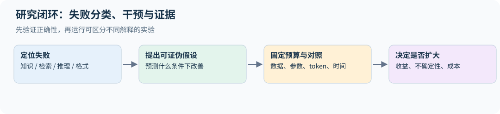

# 22｜研究设计：把一个训练想法变成可信结论

本章是课程方法的进阶整合。前文解释了组件怎样工作，本章讨论你应该怎样选择下一个实验、排除混杂因素，并在有限预算下决定是否扩大训练。它不是某一年新增的 CS336 原课讲义。

## 22.1 先问失败是什么，再决定改哪里

假设一个领域问答模型经常答错，至少有五种可能：知识不在参数或上下文中；检索没有找到证据；模型找到了证据却读错；推理链条出错；正确答案生成了但评估器未识别。给所有问题直接加 SFT 数据，可能掩盖原因，也可能把错误模式学得更牢。

先做四个条件的对照：闭卷、普通检索、人工提供充分证据、只评估最终答案格式。如果人工证据显著改善而普通检索不改善，优先排查检索；如果两者都不改善，检查证据利用与推理；如果格式修正就能显著涨分，模型能力与输出协议需要分开报告。



这些对照是诊断实验，不自动证明原因唯一。人工证据可能比检索结果更短、更干净，因此最好继续控制长度、位置和干扰文档，逐步缩小解释范围。

## 22.2 选择公平的预算单位

| 想研究的问题 | 优先固定 | 还应报告 |
|---|---|---|
| 新架构的计算效率 | 训练 FLOPs 与数据来源 | 参数、吞吐、峰值内存 |
| 新优化器的收敛效率 | 训练 token/FLOPs、调参机会 | 时间到目标损失、失败率 |
| 数据过滤是否有价值 | 固定模型、训练预算、验证集 | 原始数据需求、重复次数 |
| 后训练是否增强推理 | rollout 与更新预算 | 生成长度、验证器、测试预算 |
| 部署方案是否更实用 | 质量与延迟约束 | 吞吐、成本、容量、失败回退 |

“同样训练 10,000 步”可能意味着完全不同的 token 数。“同参数量”没有约束 MoE active FLOPs。“同样四张 GPU”也没有约束运行时间。预算单位应服务研究问题，并把无法同时匹配的维度透明报告。

调参预算也是资源。给新方法试 30 组学习率，给基线只试一次，会把搜索收益归到方法身上。反过来，把基线学习率直接搬给有不同更新尺度的新优化器，也可能不公平。

## 22.3 先验证单步，再比较最终指标

一项训练改动的最短证据链通常是：张量语义正确→单步梯度正确→小数据可过拟合→中等规模曲线稳定→多种子有效→目标规模成立。系统改动还需加入“相同输入/权重下数值一致”和真实端到端计时。

先记录梯度是否为零、是否有限、是否被裁剪，以及参数更新比

$$u_t=\frac{\|\theta_{t+1}-\theta_t\|_2}{\|\theta_t\|_2+\epsilon}.$$

参数重缩放或权重很小时，更新比的解释也会变化；需结合输出变化而不是把阈值当作跨参数化定律。全局均值可能掩盖个别层的异常，最好分层记录 residual RMS、QK logits 分位数、输出熵、梯度范数和更新比。指标异常后先保存触发 batch、RNG 和最后正常 checkpoint，再缩小实验定位。继续扩大训练规模通常只会让错误更贵。

## 22.4 交互作用：两个好改动加起来未必更好

设 A 表示新数据配方，B 表示新优化器，固定其他条件跑四个实验。令 $s_{ab}$ 为越大越好的分数，交互量为

$$I=s_{11}-s_{10}-s_{01}+s_{00}.$$

例如 $s_{00},s_{10},s_{01},s_{11}$ 依次为 70、72、73、74，则 $I=74-72-73+70=-1$：两个改动各自有益，但组合收益小于简单相加。原因可能是二者解决了同一瓶颈，也可能是最优超参数变化。只比较旧方案与“所有新招一起上”，无法识别哪个组件有效。

这个 2×2 设计只能估计当前尺度与设置下的交互；还要给出种子方差与逐题配对不确定性。对于多个因素，可以先用小规模筛选，再针对关键组合扩展，而不是穷举所有组合耗尽预算。

交互量依赖指标尺度。同一组结果在准确率上可能表现为非加性，在 log-odds 或 loss 上却不同；例如 logistic 模型的两个加性 logit 改动，经 sigmoid 后通常不再给出相加的准确率增量。应预先声明用哪个尺度回答哪个研究问题，不能看完结果再换一个最容易产生“协同”的坐标。

## 22.5 小规模到大规模：验证排序能否迁移

小模型实验的价值是排除错误与挑选候选，不是保证大模型排序。新内核在小矩阵上可能慢，在大矩阵上才快；小模型的数据需求和遗忘程度也可能不同。至少选择两个模型规模或两个训练预算，检查方法收益是否稳定以及是否出现交叉。

推荐报告每个实验的配置、数据指纹、训练/rollout/评估 token 数、实际 FLOPs 口径、硬件时间、随机种子、选 checkpoint 的规则和失败情况。未完成、OOM、发散也属于结果，不能只保留成功曲线后报告“稳定”。

## 22.6 多目标决策与 Pareto 前沿

质量、延迟、显存和成本往往互相冲突。如果 A 在质量上不低于 B、在成本和延迟上不高于 B，且至少一项严格更好，A 支配 B。没有被其他候选支配的方案构成 Pareto 前沿。

在前沿上仍需根据应用约束选择，例如首 token 延迟小于阈值、准确率达到门槛。把多指标压成一个任意加权总分，会隐藏权重选择。`research.py` 提供 `pareto_front`，并明确哪些列越大越好；教学测试会覆盖重复点、严格支配和指标方向。

**练习。** A 质量 80、延迟 200 ms，B 质量 81、延迟 300 ms，C 质量 79、延迟 250 ms，哪些方案被支配？

**解答。** C 被 A 支配；A/B 各有取舍，都在前沿。除非先给出延迟或质量约束，否则不能唯一选出最优方案。

## 22.7 一页实验卡

```text
问题与假设：哪类失败应改善？为什么？
干预项：改动什么？哪些预算与条件固定？
最小正确性证据：单步、mask、梯度、恢复、数值对照。
主指标：提前指定；逐题与训练随机性如何估计？
辅助指标：时间、显存、长度、拒答/失败、分层性能。
停止/扩展条件：达到什么证据才扩大规模？
复现材料：命令、配置、源码、数据/索引/模型版本。
结论范围：哪些条件已测，哪些只是推断？
```

这张卡把第 05、13、15、20 章的实践连在一起。研究能力不仅是提出新方法，更是让别人能判断你的证据是否支持结论。

## 22.8 为一次扩展实验设停止规则

先规定主指标、最小有用改进、最大预算、发散判据与扩大规模的门槛。筛选阶段允许根据开发集决定下一步，但应将“提出候选”和“独立确认候选”分开；看了几十条曲线后挑赢家，其置信区间不再自动等同于事先只比较这两种方案。

两种方法最好共享数据顺序和评估题目，配对能减小部分噪声；相同 seed 仍不意味着不同架构的初始化可逐值对齐。报告逐 seed 的差值、失败运行和资源分布，避免只画均值平滑线。停得早的失败与训练结束的成功也应计入到目标质量的成本。

有限预算下可用“排除明显失效→小规模充分调参→两档规模复核→锁定协议确认”分级。某个新内核正确性失败时无需先跑大模型；某个数据配方只在一个规模有效时，也应先检查排序是否交叉，再扩大训练。第 13 章提供外推不确定性，第 15 章提供评估抽样不确定性，两者应同时纳入决策。

## 22.9 把系统验收写成不变量

一次全局检查可以按依赖顺序分层，而不是只追逐最近修改的文件：输入 shape、dtype 与单位合法；前向因果性和 cache 等价；损失与梯度符合定义；中断恢复和缓存复用保留实验身份；实验汇总绑定源码与配置；最后核对正文、图表、公式和发布成品。每层至少保留一个独立参考或能推翻错误实现的反例。

验收结果应区分三种情况：实现错误、可选能力未安装、执行环境不允许运行（例如沙箱禁止网络套接字时，多进程通信检查无法启动）。三者的处理完全不同：第一种要修代码，第二种要在报告里注明覆盖范围缺口，第三种要换环境重跑，而不是把检查改成"总是通过"。同理，无网络不意味着来源已重新核验，单元测试通过也不替代真实的多进程或多卡检查。一份可信的训练流水线报告应列出每项检查实际运行与否，未运行的检查不能被计为通过。
