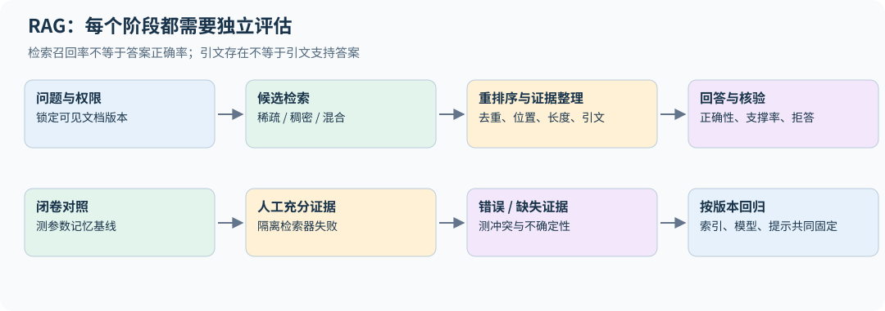

# 24｜RAG 与知识更新：把参数记忆和外部证据分开

这是课程之外的进阶扩展，连接语言模型训练与实际知识系统。目标不是教授某个 RAG 框架，而是理解检索、上下文、生成和评估之间的概率与失败边界。

## 24.1 何时更新参数，何时检索

参数记忆适合稳定规律、语言能力和需要反复调用的模式；外部检索适合可更新文档、来源追踪和按用户权限访问的内容。SFT 可以教模型怎样利用证据，却不保证把不断变化的知识永久准确写入权重。

| 需求 | 可先尝试 | 应验证的风险 |
|---|---|---|
| 输出格式或流程固定 | 提示、SFT | 学会模板但答错 |
| 领域语言与技能不足 | 持续预训练、SFT | 遗忘与训练成本 |
| 文档频繁更新、需引文 | RAG | 检索遗漏、过时索引 |
| 稳定能力需低延迟反复调用 | 训练、蒸馏 | 权重维护与错误固化 |

这不是互斥选择。一个系统可以检索事实、用训练获得的能力进行推理，再用工具检查数值。

## 24.2 从检索概率到生成概率

RAG 的一个概率视角是对证据文档 z 边缘化：

$$p(y\mid x)=\sum_zp_\eta(z\mid x)p_\theta(y\mid x,z).$$

实际系统经常先做 top-k 检索，再把多个片段拼进一个 prompt；这与严格对每个 z 的生成概率加权求和不是完全相同的实现。top-k 截断、重排序和上下文压缩都改变了可用证据分布。[RAG 原论文](https://arxiv.org/abs/2005.11401)

## 24.3 chunk 不是越短越精准

片段过短会丢失限定条件、表头和指代；过长会增加噪声与上下文成本。按语义结构切分段落、保留标题路径、表格上下文和稳定文档 ID，通常比任意按固定字符截断更容易追溯。

重叠窗口能保护边界，却产生大量近重复命中，使 top-k 看似很大、独立证据很少。检索后可按文档/段落去重，并保留原始偏移、时间、版本和权限元数据。权限过滤应在返回内容给模型之前完成，不能只在生成后隐藏引用。

## 24.4 稀疏、稠密与重排序

BM25 使用词频、文档频率与长度归一化。对 query 词 t，一个常见打分项为

$$\operatorname{IDF}(t)\frac{f_{t,d}(k_1+1)}{f_{t,d}+k_1(1-b+b|d|/\overline{|d|})}.$$

它对精确术语、编号和罕见名称有优势，依赖分词与倒排索引。dense retrieval 将 query/document 编码成向量，以内积或 cosine 排序，能学习部分语义匹配，但也可能忽略关键数字或否定。[Dense Passage Retrieval](https://arxiv.org/abs/2004.04906)

双编码器允许离线计算文档向量；cross-encoder 将 query 与候选一起编码，通常更适合少量候选重排序，代价更高。混合检索可以合并稀疏/稠密排名，再用 reranker。不要直接把数值范围不同的 score 相加而不校准；倒数排名融合（RRF）只用名次：文档 $d$ 的融合分数为 $\sum_r1/(k+\mathrm{rank}_r(d))$，常取 $k=60$。`retrieval.py` 的 `reciprocal_rank_fusion` 实现了它。

双编码器训练常将问题向量 $q_i$ 与正确段落 $d_i^+$ 拉近、与负例段落拉远。例如候选集合为 $\mathcal D_i$ 时，

$$L_i=-\log\frac{\exp(q_i^\top d_i^+/\tau)}{\sum_{d\in\mathcal D_i}\exp(q_i^\top d/\tau)}.$$

batch 内其他正例可充当负例，但一个段落可能同时回答多个问题，形成假负例。hard negative 能教模型区分相似但不支持答案的段落，也可能引入标错的相关段落。向量是否归一化、temperature 和负例采样决定分数几何；换 embedding 模型后应重新计算相应文档向量并重建 ANN 索引；若只换 query encoder，须验证它与旧文档空间仍对齐。

`retrieval.py` 提供小规模 BM25、recall@k 和 MRR，使用固定中文示例与明确的字符/ASCII 词切分。它没有训练 embedding、构建 ANN 索引或调用生成模型，实验只验证检索与评分链条。

在四文档教学语料上，三条与文档共享关键词的 query 都把目标排在第一位；第四条 query "如何表示词序"问的正是 RoPE，却与 RoPE 那篇文档没有一个共同的字，BM25 返回空结果，recall 为 0。这就是词法检索的典型盲区：同义改写。稠密检索能部分弥补它，但又可能忽略数字和否定，所以真实系统常把两者用 RRF 合并。真实评估应包含语义改写、数字冲突、过期版本、无答案问题和更大的负例集合。[可运行源码](../../examples/retrieval.py)

## 24.5 一个高分检索器为什么仍会让模型答错

Recall@k 问“相关证据是否进入候选”，MRR 看第一个相关候选排第几；它们不测回答正确性。两者都把相关性当成二值。若标注有等级（例如“直接回答”3 分、“背景相关”1 分），用 nDCG@k：$\mathrm{DCG}@k=\sum_{i=1}^k(2^{g_i}-1)/\log_2(i+1)$，再除以理想排序的 DCG。同样两篇相关文档都在前 2 名时 recall@2 相同，但把只算背景相关的文档排在第一，nDCG@2 从 1 降到约 0.71（`ndcg_at_k` 的测试用例）。对 RAG 而言，生成器往往最依赖前一两个片段，这个区别有实际意义。得到证据后，模型仍可能忽略它、被邻近干扰覆盖，或把另一版本中的数字混在一起。正确引文 ID 也不等于引文实际支持句子。

推荐至少四组对照：无检索、实际检索、人工充分证据、错误/缺失证据。然后分别评分：证据召回、证据是否足以回答、回答正确性、引用支撑率与应拒答时的行为。其中“引用支撑率”常被称为忠实度（faithfulness）：把回答拆成原子陈述，逐条判断是否能由所给证据推出。它与正确性是两回事：回答可以正确但来自参数记忆、不被证据支持（不忠实），也可以忠实于一份错误证据而答错。用模型做这类判断时，要先在人工标注的小样本上测它的一致率。若模型在错误证据下仍自信回答，系统要明确采用证据还是参数记忆，以及冲突时怎样处理。

**排序指标也需要明确分母。** nDCG 的理想排序应来自同一查询的完整相关性标注集，不能只在检索器已经返回的文档中找理想顺序，否则漏掉最重要证据也可能得 1。重复文档按首次出现去重；无相关文档的查询要单独评估拒答或报告采用的零分约定，不能默默从平均值中消失。教学函数要求有限、非负且至少一项为正的等级，以免把 NaN 标注传播成不可解释的分数；实现同时缩放 DCG 与理想 DCG，避免大等级的 $2^g$ 溢出。等级刻度本身也属于评估协议：指数增益下，把所有等级乘二会改变相对权重。

## 24.6 长上下文不等于可靠证据利用

把检索器换成“所有文档都塞进上下文”不会自动解决问题。证据位置、干扰文档、重复片段和多个必要事实相距很远，都可能影响表现。长上下文研究展示了某些模型和任务对证据位置敏感；这是测试设计的理由，不是断言所有模型都具有相同曲线。[Lost in the Middle](https://arxiv.org/abs/2307.03172)

在固定总长度下移动证据，或在固定证据下增加干扰，能分别识别位置与长度影响。多跳任务要评估所有必要证据是否同时进入上下文；只命中其中一条可能仍无法推导答案。

令 E 表示所需证据全部进入上下文，A 表示最终答案正确，则 $P(A)=P(E)P(A\mid E)+P(\neg E)P(A\mid\neg E)$。第二项可能来自参数记忆、猜测或数据泄漏，所以答案正确率不是检索质量的直接替代。若一道题必须同时得到两条事实，各自召回率都是 90%，完整证据率只在独立假设下才是 81%；根据二者相关性，它可在 80%–90% 之间。评估多跳检索应标出必要证据集合，并分别测完整率和证据齐全后的回答质量。

## 24.7 更新、审计与不可信文本

索引应有版本，能够定位一次回答实际使用的文档快照。重建 embedding 后距离分布变化，旧 reranker 阈值与缓存也要重新验证。仅记录当前网页链接不足以复现历史回答。

检索文档是证据数据，不是系统指令。网页里要求模型忽略规则、调用工具或泄露内容的文字，不应被当成更高优先级命令；工具授权也应由应用验证。评估这种边界与普通检索准确率是两项独立工作。

**练习。** RAG 的答案正确率提高，但 recall@k 不变，可以说明什么？

**解答。** 可能改善了重排序、证据利用、上下文整理或生成协议；也可能答案来自参数记忆。需要结合人工证据和错误证据对照，不能把所有提升都归给检索器。

## 24.8 Late interaction 与检索器的训练分布

单向量检索把整篇文档压成一个向量，cross-encoder 为每对 query/document 重新联合编码。ColBERT 的 late interaction 介于二者之间：分别离线/在线编码 token 向量，用

$$s(q,d)=\sum_i\max_j q_i^\top d_j$$

聚合每个 query token 的最佳文档匹配。文档 token 向量可预计算，细粒度匹配仍发生在查询时；代价是比单向量更多的索引容量与候选评分工作。MaxSim 不是整体事实支撑概率，词项相关也不保证句子蕴含。[ColBERT](https://arxiv.org/html/2004.12832v2)

检索器训练中的 hard negatives 应来自部署会遇到的混淆：数字不同、版本不同、同名实体、条件或否定不同。只随机抽完全无关段落可能使训练 loss 很低，却学不会这些区别；把实际相关文档误作负例又会直接损坏召回。训练/验证要按原始文档或问题簇划分，不能让同文档的重叠 chunk 跨集合制造虚高分。

## 24.9 自适应检索：何时需要继续找证据

Self-RAG 将检索与反思信号纳入训练/生成，说明检索不是必须对每题固定调用一次。这样的控制器需要学习“是否缺证据、当前证据是否支持答案、是否值得继续检索”，收益应与额外检索/评审成本一起计算。[Self-RAG](https://arxiv.org/html/2310.11511v1)

把这一思路推到底，就是用强化学习训练模型自己决定何时检索、检索什么。Search-R1 让模型在逐步推理中多次生成搜索查询、实时取回结果，只用最终答案的结果奖励训练；取回的文本作为上下文但不计入策略损失（与第 32.8 节工具返回的 mask 同理），报告在七个问答数据集上明显优于检索增强的基线。这类“深度研究”式 agent 的评估同样要固定搜索后端与调用预算，否则分数差别可能只是检索次数不同。[Search-R1](https://arxiv.org/abs/2503.09516)

一个可实施的评估流程是先固定索引与生成器，比较从不检索、每题检索、开发集调好的自适应规则；记录准确率、引用支撑率、无答案识别和平均/尾部调用数。控制器不能读取测试真值，也不能把 judge 的自信直接当作证据充分。拒答阈值应在开发集选择，并在新来源、新版本与冲突文档上复核。
