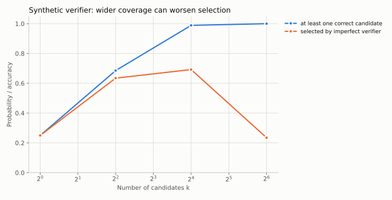
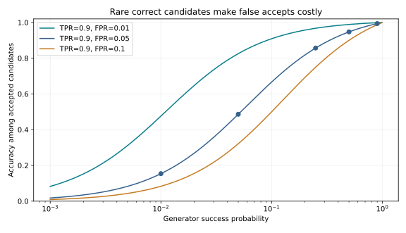

# 25｜推理时计算：采样、验证器与搜索

这是第 12、18 章的进阶扩展。训练提供一种策略，推理系统还可以分配多次尝试、长输出、验证与搜索预算。本章解释增加计算何时能改善答案，以及验证器为什么可能成为新的瓶颈。

## 25.1 先区分四种增加计算的方式

更长的单条推理链增加串行步骤；多候选采样探索不同答案；搜索根据反馈扩展部分轨迹；反思/修订让模型重新检查已生成内容。它们不等价，也不都保证提高准确率。

如果题目需要一个模型完全不知道的事实，重复同样的错误答案并不能创造知识。如果验证器不能辨别候选正确性，生成了正确答案也未必会被选中。推理预算与模型能力、任务难度、验证质量共同决定收益。[Test-time Compute Scaling](https://arxiv.org/abs/2408.03314)

## 25.2 pass@k 是有答案，不是选对答案

独立候选单次成功率为 p，至少有一个正确候选的概率为

$$P(\text{存在正确候选})=1-(1-p)^k.$$

它是 oracle selection 的指标：假设有完美方法识别成功候选。真实 verifier 的 best-of-k accuracy 往往更低。一个能够稳定产生 10% 正确答案的模型，用很多采样可以达到高 pass@k，但如果输出阶段只是随机挑一条，实际准确率仍为 10%。

正相关的成功事件常削弱独立采样公式的收益；不同依赖结构也可改善覆盖，因此应测联合成功与重复率，不把所有相关性都等同于坏。极端情况下所有采样都完全相同，再采样一百次也不会提高成功率。重复率、答案簇数、轨迹差异与采样温度都应进入日志，而不是只记录 k。

## 25.3 自一致性与加权投票

自一致性将不同推理轨迹的最终答案归一化，再按出现频率选择答案。它依赖“正确答案在可采样轨迹中较常见”这一条件；若模型有系统性偏见，多数投票可能稳定放大错误。

多个答案类别时，通常选的是众数，不必有某个答案超过 50%。在固定有限类别、IID 采样且正确答案是唯一最高概率类别时，即使其概率只有 0.4、另外两类各 0.3，增加样本也会越来越稳定地选对；若一个错误答案概率为 0.45、正确答案为 0.4，则会越来越稳定地选错。答案归一化改变类别划分，所以把“1/2”“0.5”分成两类本身就可能改变投票结果；开放式长文本又不一定有稳定的有限类别集合。

数值答案要统一分数、小数、单位和等价表达；代码任务通常不能简单按字符串投票，需执行测试或比较行为。加权投票把 verifier 分数或轨迹权重合并，但分数没有校准时可能被单个自信错误覆盖。

## 25.4 outcome verifier 与 process verifier

outcome verifier 评价完整答案或最终结果，process verifier 为中间步骤提供反馈。前者标签较便宜，可能难定位早期错误；后者提供密集监督，却需要定义步骤边界、正确性和局部错误对最终结果的关系。[Training Verifiers](https://arxiv.org/abs/2110.14168)、[Let's Verify Step by Step](https://arxiv.org/abs/2305.20050)

验证器本身也可以是生成模型。GenRM 把验证写成下一个 token 预测（让模型生成"是/否"并可先写出验证推理），与生成任务联合训练；ThinkPRM 让长思维链模型逐步写出验证过程，用比判别式 PRM 少几个数量级的步骤标签达到更好的效果。它们把验证也变成可以花推理时计算的过程，验证器的预算因此也要计入 25.8 节的对齐比较。[GenRM](https://arxiv.org/abs/2408.15240)、[ThinkPRM](https://arxiv.org/abs/2504.16828)

不能把每步正确概率随意相乘当作整条链正确概率，除非条件依赖和概率校准满足所需分解。某步局部看似合理也可能依赖早先错误假设。检查最终答案、步骤有效性、证据来源和格式是不同维度。

## 25.5 为什么 k 越大可能越容易挑到 verifier 漏洞

假设每次独立采样产生“错误且获得虚高分”的总概率为 q；采样越多，出现至少一个此类候选的概率为

$$1-(1-q)^k.$$

真实情形还取决于正确候选分数和相关性，但这个式子说明：搜索更广会探索到评分器的长尾错误。best-of-k 优化的是 verifier 分数，不能自动当成优化真实正确率。

`reasoning.py` 构造明确标注的合成 verifier：正确候选总是得分 1，少量错误候选得分 2。它同时报告 oracle pass@k 与真实选择准确率，可以出现“正确答案覆盖率不断升高，最终选择却变差”。这不是测量任何实际模型的指标，而是对选择偏差的可执行反例。

在这个严格定义的 toy model 中，单次正确概率为 p，错误候选被虚高评分的条件概率为 $\varepsilon$，故虚高错误的总概率是 $q=(1-p)\varepsilon$。选择正确需要“没有虚高错误，且至少有一个正确候选”，因此

$$P(\text{选对})=(1-q)^k-(1-p-q)^k.$$

取 $p=0.25,\varepsilon=0.03$，20,000 次合成试验中，k=16 的覆盖率约 98.88%、选择准确率约 69.21%；k=64 的覆盖率约 100%，选择准确率却约 23.47%。这些数值来自固定 seed 的实际运行，公式也可以直接预测其趋势。[实验源码](../../examples/reasoning.py)

## 25.6 按难度分配计算

固定总预算下，给已很容易的问题更多候选可能收益很小；对完全不会的问题，增加少量候选也可能无效。理想策略把预算分配给边际收益高的题目，但难度和收益曲线需要用开发集估计，不能偷看测试答案。

可以根据可校准的不确定性、候选分歧、验证失败或明确工具错误选择继续采样、换检索、调用验证器或结束。停止规则必须计入评估协议：比较固定 k 与自适应策略时，报告实际总 token、延迟尾部与未完成率。

在理想完美验证器、各次独立且每个候选成本相同的模型里，从 k 次增到 k+1 次的覆盖增量为 $p(1-p)^k$；比较不同成本题目时，应看该增量除以新增成本。这是观察结果前的固定预算曲线：已知且固定的 p 下，若确认前 k 次都错，下一次的条件成功率仍为 p；若已有正确答案则可停止。真实系统还要从开发集估计 p 和选择器表现，不能按测试真值分配计算；有误判的 best-of-k 不保证边际收益为正，实际失败记录也会更新对未知 p 的判断。

## 25.7 搜索树并不天然优于采样

DeepSeek-R1 报告专门写了"不成功的尝试"一节，正好对应本节和 25.4 节。PRM：难以在一般推理中定义细粒度的"步骤"，难以判断中间步骤是否正确（自动标注效果不好、人工标注难以扩展），引入模型化的 PRM 后不可避免地出现奖励欺骗。MCTS：token 生成的搜索空间比棋类大得多，限制每个节点的扩展数又容易陷入局部最优；价值模型直接决定搜索质量，而细粒度的价值模型很难训练。报告也说明，这不代表这些方法不能做出好的推理模型；最终的 R1 改用结果奖励的 RL，让模型在一条长思维链内部自己探索和回溯。长链推理可以看作把外部搜索"内化"到单次采样里，两者的预算应按 25.8 节对齐比较。[DeepSeek-R1](https://arxiv.org/abs/2501.12948)

搜索把部分生成轨迹作为节点，扩展候选动作，并依据 value/verifier 选择继续探索的分支。它能复用前缀，但可能在早期估值错误时剪掉正确路径。分支宽度、深度、回溯、缓存和环境状态是否可重置，都影响真实成本。

对工具 agent，节点不只是 token 前缀，还包含文件系统、工具副作用和环境观察。若两个分支共享可变环境状态，实验可能不再比较独立路径。需要隔离或回滚，并把不可逆动作放到明确授权的执行阶段。

## 25.8 怎样进行预算对齐的比较

记录每题 prompt token、所有候选 output token、verifier token/调用数、工具耗时与最终选取策略。仅固定“最终答案长度”会漏掉大量隐藏的候选和验证成本。若部署指标是响应延迟，并行采样与串行长链的墙钟成本又不同。

**练习。** 某系统从 k=8 增到 k=64 后 pass@k 提高，但最终 accuracy 降低，首先怀疑什么？

**解答。** 检查 verifier 的极端误评分、重复/相关候选、答案归一化和选择策略；同时确认相同基础模型与采样协议。这个现象不说明基础模型“能力变弱”，可能只是选择器在更大候选池里更易出错。

## 25.9 过程验证器究竟在预测什么

“这一步局部成立”和“从这一步继续最终会答对”是两种标签。前者需要推理规则或人工步骤判断，后者是依赖续写策略的 value；换模型、temperature 或搜索预算后，后者也变。最终答案正确还可能包含互相抵消的错误，不能反向给所有中间步骤都标正确。[过程监督研究](https://arxiv.org/html/2305.20050v1)

将非负步骤奖励相加可能偏向长轨迹，概率相乘可能快速趋近零；min 聚合又由最差一步主导。链式法则需要第 t 项恰为 $P(C_t\mid C_1,\ldots,C_{t-1},x)$，其中 $C_t$ 是相同定义下的步骤正确事件；普通分桶校准不足以保证这个逐输入条件概率（第 14.9 节）。使用 logits、奖励分或独立判断概率时，要把聚合看成需要验证的选择器，而不是概率恒等式。

## 25.10 验证器的低误收率为什么仍不够

设生成成功率 p，验证器对正确候选的保留率 t、对错误候选的误收率 f，则

$$P(\text{正确}\mid\text{保留})=\frac{pt}{pt+(1-p)f}.$$

取 t=0.9、f=0.05，p=0.5 时保留精度约 94.7%，p=0.05 时只有 48.6%，p=0.01 时约 15.4%。同一个验证器在难题池上可能让保留下来的多数答案仍然错误；应按生成器、题目难度和候选来源测校准，而不是只公布整体准确率。

这与 best-of-k 的极端值问题不同：此处是在固定阈值下看保留数据的基率，25.5 节是在候选池中挑最大分。二者都要求独立真值抽查，尤其当验证器也作为训练 reward 时。
