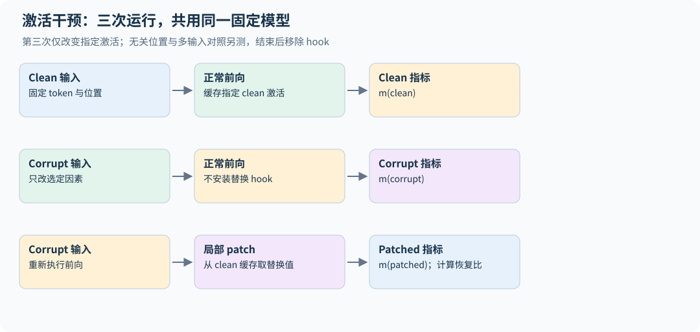

# 27｜机制可解释性：从相关现象到受控干预

本章属于课程外的研究扩展。它帮助读者检查模型内部计算，而不是宣称可以从几张 attention 图读出“模型真正想法”。可解释性结果同样需要对照、统计和适用范围。

## 27.1 观测不等于因果解释

attention 权重高只表明当前头把较多权重放在某些 value 上，最终输出还经过 value 投影、其他头、MLP、残差和多层组合。某个神经元与概念相关，也可能只是与真正起作用的特征共同出现。

线性 probe 可以测表示是否包含可读出的信息，但 probe 成功不证明模型本身使用了该信息。参数或激活删掉后输出变化，也可能是把模型推到分布外造成的普遍破坏，而非定位了独一无二的机制。

## 27.2 先定义可测量的行为差异

选择 clean/corrupt 两个输入，尽量只改变一个关键因素，并用具体指标测模型行为。例如正确答案 a 与对照答案 b 的 logit difference：

$$m(x)=z_a(x)-z_b(x).$$

差值避免单个 logit 整体漂移的一部分混淆，但仍依赖答案 token 选择与分词。多 token 答案应使用相同条件下的序列 log probability，不能只取第一 token。

## 27.3 Activation patching 的干预

先运行 clean 输入保存某层/位置的激活 $h^{clean}$，再运行 corrupt 输入并把对应激活替换为 $h^{clean}$，观察结果是否恢复。normalized recovery 可写成

$$R=\frac{m(x^{patched})-m(x^{corrupt})}{m(x^{clean})-m(x^{corrupt})}.$$

分母接近零时指标不稳定，应改报原始差值或剔除该对照。R 可以小于 0 或大于 1，不能自动裁成 0–1 再解释成概率。patch 的是 residual、head output、MLP output 还是 key/value，具有不同语义。[Activation Patching 方法分析](https://arxiv.org/abs/2309.16042)

跨样本汇总也要说明顺序。设某两例的 clean-corrupt 差为 1 和 10，patch 各恢复 1，则逐例恢复比例的平均为 $(1+0.1)/2=0.55$，而先汇总差值再归一化为 $2/11\approx0.182$；前者给样本等权，后者按原始差距加权。两种问题都可以研究，但不能在不同方法间混用；最好同时保留原始分子、分母和无效小分母样本的数量。

## 27.4 必须防止把正确答案直接注入模型

如果把最后一层、答案位置的全部 hidden state 从 clean 复制过来，输出恢复几乎是预期结果。这是检查工具是否有效的正对照，不是发现了跨层推理机制。

同理，tokenization 不同导致位置错位时，所谓“替换对应词”可能实际替换了不同内容。需要记录具体 token ID、位置和上下文长度；最好使用多组最小对照和多个指标，检查结论是否依赖某一种 corruption。

`interpretability.py` 提供临时 forward hook 与可清理的激活替换，并用一个受控加法支路玩具模型验证：换回相关通道能恢复，换无关通道无效。它测试干预工具与逻辑，不声称解释了 TinyLM 的知识存储。

具体玩具函数为 $y=h_0+2h_1$，第三通道不影响输出。clean `[1,2,50]` 得 5，corrupt `[0,2,-50]` 得 4；只换回第一通道恢复到 5，只换回第三通道仍为 4。异常中断后 hook 也应移除，否则下一次“基线”运行会继续被干预。这些控制已写入自动测试。[实验源码](../../examples/interpretability.py)

## 27.5 消融、patching 与模型编辑不同

零消融将一部分激活归零，可能制造训练中未见的状态；mean ablation 用平均激活替换，仍可能不匹配当前上下文；clean patching 使用另一输入的激活，改变的是条件计算。模型编辑则直接修改参数，希望定向改变某个行为，同时保留其他行为。

定位与编辑事实关联的研究提供了这类方法，但编辑一个事实成功不证明找到了独立“知识槽位”，更不能证明其他事实或组合推理完全不受影响。[Locating and Editing Factual Associations](https://arxiv.org/abs/2202.05262)

评价编辑至少看目标成功率、同义改写泛化、关联事实一致性、无关任务保持，以及连续多次编辑后的累积影响。输入很像训练模板时成功，可能只是局部模式适配。

## 27.6 一份可信的干预报告

说明模型 checkpoint、clean/corrupt 输入、token 对齐、patch 位置、替换张量、评价指标和所有控制实验。报告跨样本的分布，不只展示最漂亮的一例。负结果也重要：某位置 patch 无效不能证明它完全无关，信息可能通过冗余路径传递。

对批量 hook，检查没有原地修改共享缓存、没有把 clean 运行的计算图带进另一次运行、异常后 hook 能被清理。训练和推理模式也要固定。干预工具本身有 bug 时，解释性图会看起来非常可信，却没有实际含义。

多位置扫描还涉及多重选择：从上千次 patch 中挑最大的恢复值，会同时挑中噪声。应在开发输入上选位置/特征，再用未参与选择的输入确认；报告跨输入配对差值与区间。零消融无效不能证明无因果贡献，充分恢复也不能证明必要性；冗余路径、尺度变化和离分布干预必须用多种对照区分。

## 27.7 如何把这一章用于学习而非过度解释

可以先对已经通过因果/cache 测试的小模型观察层间表示，再设计受控任务，例如输入位置交换、无关干扰和某个明确规则。先提出能被反例推翻的机制假设，再选择最小干预。

**练习。** 把 clean 模型最后一层答案位置的完整表示复制到 corrupt 运行后，答案恢复了，是否证明该位置“存储了全部知识”？

**解答。** 不能。最终 logits 本来由这个表示计算，恢复只说明替换足以控制输出。要研究机制，应比较更早、更局部的干预，并使用无关位置和多种 corruption 对照。

## 27.8 稀疏自编码器：把叠加表示拆成字典

对某层激活 h，SAE 用过完备特征 z 重建：

$$z=\operatorname{ReLU}(W_e(h-b_d)+b_e),\qquad\widehat h=W_dz+b_d,$$

$$L_{SAE}=\mathbb E\left[\|h-\widehat h\|_2^2+\lambda\|z\|_1\right].$$

宽字典容纳多种模式，稀疏约束希望每个输入只激活少数特征。编码/解码列尺度有自由度，实际训练要约束 decoder norm 或采用其他稳定设计；L1、Top-k、JumpReLU 等稀疏实现也有不同偏置。低重建误差不保证特征可解释，更不保证字典完整或唯一。[Scaling Monosemanticity](https://transformer-circuits.pub/2024/scaling-monosemanticity/index.html)

检查重建替换后的模型行为、平均非零数、死特征比例、不同 seed/字典宽度下的稳定性，以及高激活样本是否来自单一模板。字典宽度还会带来"特征吸收"：一个宽泛概念的特征在某些子情形下不激活，被更具体的特征吸收掉，于是它看起来像一个有漏洞的探测器。Matryoshka SAE 让字典的各个前缀都能独立重建，BatchTopK 在整个 batch 上分配非零配额，都是针对这类问题的训练变体。[Matryoshka SAE](https://arxiv.org/abs/2503.17547)、[BatchTopK SAE](https://arxiv.org/abs/2412.06410) 评估时也应把 SAE 特征与一个简单基线（例如在同一层激活上训练的线性探针）放在同一下游任务上比较，不要只看特征是否"可命名"。

**一个负面结果：SAE 探针不如线性探针。** Google DeepMind 机制可解释性团队 2025 年 3 月公布了一次这样的对照。任务是检测用户的有害意图，训练集与验证集之外，用训练中没见过的新越狱方式做分布外（OOD）测试集（训练 4,046 例、验证 1,014 例、OOD 3,850 例）。直接在残差流上训练的稠密线性探针几乎完美，OOD 上 AUROC 约 0.999。只用单个 SAE 特征的探针连训练集都拟合不好；从 SAE 特征中选约 20 个做稀疏探针，分布内接近完美，但 OOD 明显更差。在对话数据上微调 SAE 有帮助，也只缩小了约一半的差距；直接在 SAE 重建后的激活上训练探针，OOD AUROC 还会下降约 0.04–0.05，说明重建误差里正好丢了有用的信息。团队据此暂时降低基础 SAE 研究的优先级，但明确说这不等于 SAE 没用：他们在同一项目中用 SAE 发现并排查了数据集里的虚假相关。[GDM Mech Interp 团队进展更新 #2](https://www.alignmentforum.org/posts/4uXCAJNuPKtKBsi28)

这和本节的检查清单是同一回事：如果目标是"对一个已知概念做判断或干预"，先用线性探针做基线，SAE 必须在这条基线之上证明价值。也有研究者提出了反面的分工：SAE 对"已知概念"的操作不如简单方法，但在"发现事先不知道的概念"（生成假设、排查数据问题）上有独特用处，这能解释为什么负面与正面结果并存。[Position: Use SAEs to Discover Unknowns](https://arxiv.org/abs/2506.23845) 上述 GDM 团队博文不是同行评审论文，数字来自单一任务与单一模型族，读者应把它当作一次有分量的反例，而不是对所有任务的定论。只展示几个“可命名”特征可能存在选择偏差；SAE 未找到某概念也不证明原模型没有表示它。

## 27.9 Steering：方向干预与因果解释的距离

steering 常用 $h'=h+\alpha v$，v 可来自对比样本平均差、probe 或 SAE decoder 方向。SAE feature clamping 则指定某个特征幅度，两者不是同一个干预。观察目标行为提高，要同时测无关任务、语气/长度、事实错误与拒答变化，并对照随机方向、符号反转、强度扫描和不同提示。[Activation Addition](https://arxiv.org/abs/2308.10248)

若通过 SAE 改特征，可以保留重建残差：$h'=h+W_d(z'-z)$，而不是直接把 h 换成 $W_dz'$。后者同时移除了 SAE 未解释的部分，无法把影响单独归因于某个特征。强度越大，越可能制造分布外激活；成功改变行为不等于已经找到正常运行时必要且唯一的机制。

教学代码验证稀疏表示和方向干预的张量/残差关系，不训练真实模型 SAE。对于实际研究，仍需第 27.3–27.6 节的 clean/corrupt、位置与无关控制，不能把 steering 效果直接当成人类语言解释的证明。

## 27.10 从 SAE 特征到计算图，还多了什么假设

SAE 重建某层激活，transcoder 则尝试用稀疏特征近似某个子层的输入—输出映射；跨层 transcoder 可以把不同深度的特征作用连成图。Circuit Tracing 使用替代模型和局部线性贡献寻找候选计算路径，再用干预验证。图上的边表示选定替代系统中的贡献，不是原模型全部非线性因果关系。[Circuit Tracing 方法与局限](https://transformer-circuits.pub/2025/attribution-graphs/methods.html)

替换子层后应先测原模型的行为保真度；若输出已明显变坏，图可能解释的是替代误差。固定一次输入上的 attention 模式来线性化，也不会完整解释 QK 路由为何形成；裁剪图会遗漏弱但合计重要的路径，冗余路径又可能使单点消融无效。

梯度乘激活差是局部一阶近似：$\Delta m\approx\nabla_hm^\top\Delta h$。对大幅 patch、饱和门或跨分布替换，二阶项可很大，不能把归因分数当作实测干预效果。报告应包括替代前后质量、重建残差、不同 corruption、多个样本与真实 patch；特征命名只能作为待检验的解释。

这六章扩展的共同目的，是把训练、检索、推理、压缩和解释放回同一条证据链：先定义行为与预算，再做正确实现，最后用有辨识力的对照支持结论。
