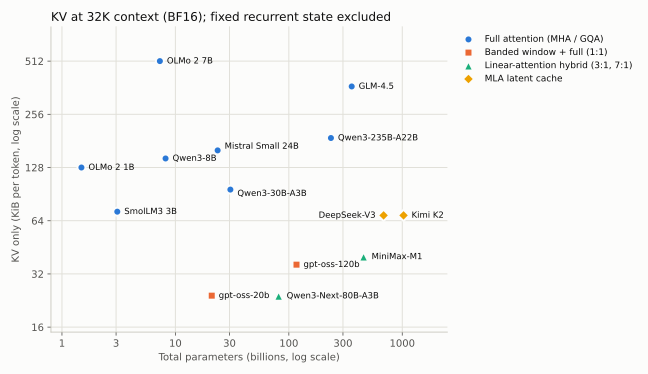

# 29｜2025 年开源模型的架构解剖

第 03–07 章讲的是组件，本章用真实的开源模型检验这些组件今天是怎样被组合的。结构参数主要从各模型在 Hugging Face 上的 `config.json` 计算，MTP、量化元数据与存储缓冲还需权重索引/元数据补充，配置文件按固定版本保存在 `sources/model-configs/`。[architectures.py](../../examples/architectures.py) 对每个模型族写出参数公式，再与官方 safetensors 元数据报告的总参数量逐个比对：14 个模型全部**精确相等**，误差为 0 个参数。单独漏算一个 bias、norm 或 MTP 模块通常会导致不一致，但两个错误项也可能抵消，因此还需核对分项与张量形状。比对只覆盖"总参数"一列：激活参数统一按 gpt-oss 模型卡的口径计算，测试检查它与 6 个模型的标称值（模型名或模型卡中的数字）相差不超过 6%，各家口径并不相同（见 29.1 节）；KV 两列由公式直接算出，没有外部数字可以对照；HF 元数据的总数也不含量化缩放张量（29.5 节）。

```bash
python -m examples.architectures
```

本章的结论是对这些公开配置的读解。各家在技术报告中说明了部分设计动机，但多数架构选择没有公开的消融，不能把"某个模型这样做"当成"这样做最好"的证据。


## 29.1 一张总表

上下文取 32,768 token、BF16 KV cache。"激活参数"采用 gpt-oss 模型卡的口径：每层注意力、实际被路由到的专家、输出头，不含输入 embedding（它是查表，不是矩阵乘），也不含推理时可丢弃的 MTP 模块。

| 模型 | 类型 | 总参数 | 激活参数 | 层数 | $d$ | Q/KV 头 | KV 每 token | 32K 上下文 KV |
|---|---|---:|---:|---:|---:|---|---:|---:|
| OLMo-2-0425-1B | dense MHA | 1.48B | 1.28B | 16 | 2048 | 16/16 | 128 KiB | 4.0 GiB |
| SmolLM3-3B | dense GQA | 3.08B | 3.08B | 36 | 2048 | 16/4 | 72 KiB | 2.3 GiB |
| OLMo-2-1124-7B | dense MHA | 7.30B | 6.89B | 32 | 4096 | 32/32 | 512 KiB | 16.0 GiB |
| Qwen3-8B | dense GQA | 8.19B | 7.57B | 36 | 4096 | 32/8 | 144 KiB | 4.5 GiB |
| Mistral-Small-24B | dense GQA | 23.57B | 22.90B | 40 | 5120 | 32/8 | 160 KiB | 5.0 GiB |
| Qwen3-30B-A3B | MoE 128 选 8 | 30.53B | 3.04B | 48 | 2048 | 32/4 | 96 KiB | 3.0 GiB |
| gpt-oss-20b | MoE 32 选 4 | 20.91B | 3.61B | 24 | 2880 | 64/8 | 24 KiB* | 0.75 GiB |
| gpt-oss-120b | MoE 128 选 4 | 116.83B | 5.13B | 36 | 2880 | 64/8 | 36 KiB* | 1.1 GiB |
| Qwen3-Next-80B-A3B | 混合 + MoE 512 选 10 + 1 共享 | 81.32B | 3.56B | 48 | 2048 | 16/2 | 24 KiB** | 0.75 GiB |
| Qwen3-235B-A22B | MoE 128 选 8 | 235.09B | 21.57B | 94 | 4096 | 64/4 | 188 KiB | 5.9 GiB |
| GLM-4.5 | MoE 160 选 8 + 1 共享 | 358.34B | 32.86B | 92 | 5120 | 96/8 | 368 KiB | 11.5 GiB |
| MiniMax-M1-80k | 混合 + MoE 32 选 2 | 456.09B | 47.17B | 80 | 6144 | 64/8 | 40 KiB*** | 1.25 GiB |
| DeepSeek-V3 | MLA + MoE 256 选 8 + 1 共享 | 684.49B | 36.63B | 61 | 7168 | 128 / MLA | 68.6 KiB | 2.1 GiB |
| Kimi K2 | MLA + MoE 384 选 8 + 1 共享 | 1026.41B | 31.69B | 61 | 7168 | 64 / MLA | 68.6 KiB | 2.1 GiB |

\* gpt-oss 一半层是 128 token 的带状窗口注意力，这一半的 KV 不随上下文增长；表中是 32K 上下文下的平均值。\*\* Qwen3-Next 48 层中只有 12 层保留 KV，其余 36 层是 Gated DeltaNet，另需一份固定大小的状态，按配置并假设递归状态存成 BF16 时约 38 MiB：32K 上下文时约占总量的 5%，上下文越短占比越大。实际引擎可能用 FP32 累积状态，还要计入卷积状态、布局与对齐，不能由 BF16 权重推断历史状态也全部是 BF16。\*\*\* MiniMax-M1 80 层中只有 10 层是 softmax 注意力，其余 70 层是 Lightning Attention（线性注意力），同样只保留固定大小的状态。

几个可核对的数字：gpt-oss 模型卡给出 120b 激活 5.13B、20b 激活 3.61B，与本表一致；DeepSeek-V3 报告"671B 总参数、37B 激活"，本表 684.49B 总量多出的 13.46B 正是一个 MTP 模块，去掉它是 671.03B；Kimi K2 摘要写"1T 总参数、32B 激活"，报告表 2 写作 1.04T 与 32.6B；本表按同一口径算出的激活参数 31.69B 低约 3%，报告没有给出逐项分解，差在哪里无法确定。

"激活参数"的口径各家不同，对照时要先换算。Qwen3-30B-A3B 的模型卡写"30.5B 总参数、3.3B 激活"，它把输入 embedding 也算进激活参数：本表的 3.04B 加上 embedding 的 0.31B 正好是 3.35B。GLM-4.5 的报告写"355B 总参数、32B 激活"，并说明统计时计入 MTP 层、不计词 embedding 和输出层：本表的 358.34B 减去主干与 MTP 各自的 embedding 和输出头（4 份，每份 0.78B）是 355.2B。MiniMax-M1 报告"456B 总参数、45.9B 激活"：总数与本表完全一致；本表激活 47.17B 减去输出头（1.23B）是 45.94B，说明它的口径不计输出头。元数据里 15,728,640 个 FP32 参数正是 80 层路由器（$80\times6144\times32$），其余为 BF16。



## 29.2 dense 模型：共识已经很稳定

五个 dense 模型的骨架几乎相同：pre-norm 或其变体、RMSNorm、SwiGLU、RoPE、无 bias、GQA 或 MHA。差别集中在几个"小"选择上，而这些选择恰好对应第 03–05 章讨论过的稳定性问题。

- **QK-Norm 很常见，但不是默认。** 表中 Qwen3 全系、Qwen3-Next 的全注意力层、OLMo 2 和 GLM-4.5 都有 QK-Norm，SmolLM3、Mistral Small、gpt-oss 和两个 MLA 模型没有。参数比对能区分这一点：漏掉或多算这几个 norm 权重，总数就对不上。Qwen3 技术报告写明去掉了 Qwen2 的 QKV bias，引入 QK-Norm"以保证训练稳定"；OLMo 2 对整个 Q、K 投影做 RMSNorm，公式里因此多出 $d+h_{kv}d_h$ 个参数。这是第 3.5 节"在 softmax 之前控制 logit 尺度"的直接应用。MLA 的投影吸收通常不显式生成完整 key；对完整 key 做非线性归一化会破坏这种简化计算路径，不能无代价照搬 QK-Norm，但并非数学上禁止使用，Kimi K2 为此设计了 QK-Clip（第 5.12 节）。
- **归一化的位置在变。** OLMo 2 把 RMSNorm 移到注意力和 MLP 的**输出**上：$h=x+\mathrm{RMSNorm}(\mathrm{Attn}(x))$，残差主干上不再有归一化，同时加上 z-loss。这种"后置到子层输出"的写法既不是经典 post-norm，也不是 pre-norm。
- **RoPE base 分成两派。** 一派把 base 调大：从原始的 $10^4$ 到 OLMo 2 的 $5\times10^5$、Qwen3 的 $10^6$、SmolLM3 的 $5\times10^6$、Mistral Small 的 $10^8$；base 越大，最慢的旋转周期越长，长距离位置越不容易"绕一圈"混淆。另一派保留较小的 base，再用 YaRN 扩展上下文：DeepSeek-V3 为 $10^4$、Kimi K2 为 $5\times10^4$、gpt-oss 为 $1.5\times10^5$（第 30.1–30.2 节）。
- **SmolLM3 每 4 层去掉一层 RoPE。** 配置中 `no_rope_layers` 有 36 项，其中 27 层用 RoPE、9 层不用。这是第 04 章 NoPE 消融的一个工程化变体：部分层不直接施加 RoPE，但可继承前层及因果结构带来的位置信息，被认为有助于长上下文泛化。 Llama 4 也是每 4 层一层 NoPE，并让其余 RoPE 层只做 8K 块内的分块注意力（iRoPE，第 30.4 节）。
- **宽深比因团队而异。** 第 3.7 节的共识区间是 $d/L\approx100$–$200$。OLMo 2 两个模型与 Mistral Small 是 128，gpt-oss-20b 是 120，DeepSeek-V3 与 Kimi K2 是 117.5，Qwen3-8B 是 114，都在区间内；Qwen 的 MoE 系列（Qwen3-30B-A3B 43、Qwen3-235B 44、Qwen3-Next 43）、GLM-4.5（56）、SmolLM3-3B（57）和 gpt-oss-120b（80）则明显更深更窄。偏深集中在少数几家的设计里，不是"小模型"或"MoE"的普遍规律。GLM-4.5 的报告给出了理由：相对 DeepSeek-V3 和 Kimi K2，它缩小宽度、增加层数，因为"更深的模型推理能力更好"；它还用了 2.5 倍的注意力头（隐藏宽度 5120 配 96 个头），报告称这不降低训练损失，却稳定地提高 MMLU、BBH 等推理基准。这些都是团队的说法，报告没有给出消融数字。
- **KV 头数差别很大。** 同为 7–8B，OLMo 2 7B 用 MHA（每 token 512 KiB），Qwen3-8B 用 32/8 的 GQA（144 KiB），32K 上下文下 KV 分别是 16 GiB 和 4.5 GiB。做长上下文推理时，这一项比参数量更早成为瓶颈。

## 29.3 MoE：细粒度、多专家、无共享专家之争

第 06 章的趋势在这些配置里一览无余：除 gpt-oss-20b 与 MiniMax-M1（均为 32 个）外，表中专家数都在 128–512 之间，每个专家的 MLP 宽度远小于 dense 的 $\frac83d$。Qwen3-30B-A3B 每个专家宽 768，是 $d=2048$ 的 0.375 倍；Qwen3-Next 只有 512。

- **共享专家并无共识。** DeepSeek-V3、Kimi K2、GLM-4.5 各保留 1 个共享专家；Qwen3 MoE 明确去掉了共享专家（技术报告："Unlike Qwen2.5-MoE, the Qwen3-MoE design excludes shared experts"），并改用全局 batch 的负载均衡损失鼓励专家专门化；gpt-oss 也没有共享专家；而同一家的 Qwen3-Next 又加回了 1 个共享专家（宽 512，输出带 sigmoid 门）。这与第 6.5 节 DeepSeek 和 OLMoE 消融结论互相矛盾的情况一致。
- **前几层保持 dense。** DeepSeek-V3 与 GLM-4.5 的前 3 层、Kimi K2 的第 1 层是普通 MLP（`first_k_dense_replace`），之后才换成 MoE。这些报告没有给出相应的消融；一种常见的解释是浅层表示更通用，换成 MoE 收益小。
- **路由打分与负载均衡。** DeepSeek-V3 用 sigmoid 打分、对每个专家加一个只影响"选谁"而不影响门控权重的偏置项，按历史负载在线调整，即第 6.3 节的"无辅助损失"方案（另外仍保留一个系数很小的序列级平衡损失，见第 6.5 节）；checkpoint 里每层都存有这个偏置（`e_score_correction_bias`）。gpt-oss 的 Hugging Face 配置里有 `router_aux_loss_coef` 字段（0.9，供 transformers 训练时使用），但模型卡没有说明原始训练用什么方法做负载均衡。
- **稀疏度可以继续提高。** Kimi K2 技术报告做了"稀疏度缩放律"实验：固定激活参数，把总专家数与激活专家数之比从 8 提高到 48，在相同验证损失下分别节省 1.69、1.39、1.15 倍 FLOPs（相对稀疏度 8、16、32）。据此它把专家数从 DeepSeek-V3 的 256 增加到 384，同时把注意力头从 128 减到 64 以降低推理开销。总参数因此超过 1T，激活参数反而比 DeepSeek-V3 少。

## 29.4 注意力的三条省 KV 路线

同一张表里能看到第 07、12 章讨论过的三条路线都已落地：

1. **MLA（DeepSeek-V3、Kimi K2）**：每层只缓存 512 维的 KV latent 加 64 维解耦的 RoPE key，共 576 个数。若用同样 128 个头的普通 MHA，需要缓存 K（$128\times192$）和 V（$128\times128$）共 40,960 个数，MLA 压缩了约 71 倍（这里按 DeepSeek-V3 实际的头宽计算：K 每头 192 维，即 128 维加 64 维 RoPE 部分；V 每头 128 维）。71 倍是指定 MHA 基线下的缓存比，不能直接当作相对现代 GQA 服务的收益：与 8 个 KV 头、头宽 128 的 GQA（每层 2,048 个数）相比约小 3.6 倍，与 Qwen3-235B 的 4 个 KV 头（1,024 个数）相比约小 1.8 倍；表中每 token 68.6 KiB 对 188 KiB 还叠加了层数差异，并非只改变缓存结构的受控对照。代价是注意力计算更复杂，且 RoPE 必须单独处理（第 7.5 节）。
2. **带状窗口与全局层交替（gpt-oss）**：36 层中 18 层只看最近 128 个 token，另 18 层是全注意力。窗口层的 KV 封顶在 128 个 token，于是长上下文下 KV 约为纯全注意力的一半。Gemma 3 更激进：每 5 个局部层（窗口 1,024）配 1 个全局层。
3. **线性注意力混合（Qwen3-Next、MiniMax-M1）**：Qwen3-Next 每 4 层只有 1 层是全注意力（`full_attention_interval` 为 4），其余 36 层是 Gated DeltaNet，状态大小固定、不随上下文增长；MiniMax-M1 的 80 层中只有 10 层是 softmax 注意力。第 7.6 节引用的讲义配比在这里可以逐层核对。

**注意力汇点（attention sink）。** gpt-oss 每个注意力头有一个可学习的 logit，加在 softmax 分母里、参与归一化后再丢掉。模型卡解释，这让注意力头可以"不关注任何 token"。没有它时，softmax 必须把总和为 1 的权重分给某些真实 token，模型往往会把多余的注意力堆到第一个 token 上，即 StreamingLLM 观察到的"注意力汇点"现象（第 30 章）。

**注意力输出门控。** Qwen3-Next 的全注意力层让 `q_proj` 多输出一份与 query 同宽的向量，经 sigmoid 后逐元素乘到注意力输出上；参数公式里因此多出 $d\cdot h\cdot d_h$ 一项。动机来自同一团队的系统消融：在 15B MoE 与 1.7B dense 模型、3.5T token 上比较了 30 多种门控变体，在 SDPA 输出后加逐头 sigmoid 门效果最稳定，训练更稳、能承受更大学习率。论文把原因归到两点：给低秩的 $W_VW_O$ 映射加了非线性，以及依赖 query 的稀疏门让头可以"什么也不输出"，因而缓解了上一段的注意力汇点、改善了长上下文外推。它与 gpt-oss 的可学习 sink logit 是解决同一问题的两种做法。[Gated Attention](https://arxiv.org/abs/2505.06708)

**部分维度旋转（partial RoPE）。** 配置里还能读到另一个细节：GLM-4.5 的 `partial_rotary_factor` 为 0.5，Qwen3-Next 为 0.25，即每个头只有前一半或前四分之一维度施加 RoPE，其余维度不直接施加旋转，但输入隐状态仍可携带上游层和因果结构形成的位置信息；MLA 则把 RoPE 放在单独的 64 维分支上（第 7.5 节）。这和 SmolLM3 按层去掉 RoPE 是同一类思路的不同粒度：保留一部分不随位置旋转的通道，用来做与距离无关的内容匹配。

## 29.5 checkpoint 里不止权重

精确对齐参数量时，暴露了几类第 08 章的公式没有覆盖的张量，它们会影响显存和下载体积：

- **MTP 模块。** DeepSeek-V3（13.46B）、GLM-4.5（5.54B）、Qwen3-Next（1.65B）的 checkpoint 都带一个多 token 预测层：把主干在位置 $i$ 的最后一层隐状态与下一个 token $t_{i+1}$ 的 embedding 拼接、投影，再过一个完整的注意力加 MoE 块，预测 $t_{i+2}$。DeepSeek-V3 的 13.46B 中约 1.85B 是 checkpoint 为 MTP 单独存的一份 embedding 与输出头。DeepSeek-V3 报告说明训练时它提供额外监督，推理时可以直接丢掉，也可以作为 speculative decoding 的草稿头（第 12.6 节）。Qwen3-Next 的模型卡写明带有 MTP，并给出用它做 speculative decoding 的推理框架参数；但它的 `config.json` 里没有 MTP 字段，要统计这部分参数只能对照权重索引。
- **低精度权重与缩放因子。** DeepSeek-V3 与 Kimi K2 的发布权重中，分别有约 99.4% 和 99.8% 的参数以 FP8 E4M3 存储，每个 $128\times128$ 块有一个缩放因子；gpt-oss 的 MoE 权重以 MXFP4 存储（安全张量里显示为 U8 打包），每 32 个数共享一个 8 位指数（第 34 章）。HF 元数据报告的参数总数不含这些缩放张量：DeepSeek-V3 的 F32 计数只有 15,104 个，正好是 59 个 `e_score_correction_bias`；gpt-oss 的 U8 计数等于专家权重的逻辑个数，不是实际存储的字节数。
- **非可训练缓冲。** Kimi K2 每层存了一个形状为 [56] 的 rotary `inv_freq` 缓冲，61 层共 3,416 个数。它不是参数，但会出现在"总参数"统计里，`architectures.py` 把它单列为 `stored_buffers`。

## 29.6 从模型名到可复核的架构对象

一份可信架构账应依次读取 config、实现、权重索引，再区分逻辑参数、可训练参数、存储张量元素与文件字节。量化 U8 可能每字节打包两个 4-bit 权重，也有 scale/metadata；MTP 和非可训练 buffer 不一定进入主干推理；共享 embedding 可有多个引用却只有一份存储。

总数对齐是有价值的校验，但不能证明每层语义正确：两个遗漏项也可能恰好抵消。进一步检查每类张量名称/形状、attention bias/QK norm、共享专家、MTP、KV dtype 与实际前向路径。active 参数只是约定口径，矩阵乘次数、注意力配对和专家批次并集需单独算（第 6.8 节）。

本章固定的是一组 2025 模型快照，不是持续更新的排行榜。新版本改了配置、量化布局或 kernel 后，复用旧表前应重新核对版本。参数更少、KV 更小和吞吐更高之间没有一对一关系，需把理论账与实际服务预算连起来。

## 29.7 快照之后：同一骨架上的两次增量

本章的表固定了一组 2024 年末至 2025 年发布的模型快照（最早的 OLMo-2-1124-7B 与 DeepSeek-V3 分别发布于 2024 年 11 月和 12 月）。之后的两个后续版本说明，同一套骨架上的改动往往很小、很集中，用本章的方法逐项对配置就能看清改了什么。

**DeepSeek-V3.2-Exp（2025-09）。** 与 V3 的固定版本配置相比，MLA 维度、专家数、层数沿用原骨架；与稀疏索引直接相关的三个字段是`index_n_heads` 64、`index_head_dim` 128、`index_topk` 2048。这就是第 7 章介绍的 DeepSeek Sparse Attention：一个轻量索引器为每个 query 挑出 2,048 个候选 key，主注意力只在这些位置上计算。它仍需保存全长的主 MLA 缓存，并额外维护索引器的键与相应状态；主注意力只读取选中的位置，但索引器还要扫描候选。因此它主要减少主注意力的访问与计算，不能按 top-k 比例推断整个推理步骤的加速或总缓存大小。safetensors 元数据报告的总参数为 685,396,921,376，比 V3 多约 0.91B，量级与每层一个索引器相符。量化配置还多了 `scale_fmt: ue8m0`：FP8 块缩放因子被限制为 2 的幂，与第 34.4 节 MX 格式的 E8M0 共享缩放是同一取舍。[DeepSeek-V3.2-Exp 配置](https://huggingface.co/deepseek-ai/DeepSeek-V3.2-Exp/blob/194c67e12b1b0d6df0ef373ddcf215bc84027409/config.json)

**Kimi K2 Thinking（2025-11）。** 结构与 K2 相同，元数据总参数与本章表中的 K2 只差 4,392 个，差别在存储的辅助张量而不是网络结构；变化集中在两处。一是上下文：YaRN 的 `factor` 从 32 提到 64，`max_position_embeddings` 从 131,072 提到 262,144，$\beta$ 仍都为 1（第 30.2 节）。二是权重精度：模型卡说明在后训练阶段对 MoE 组件做量化感知训练（QAT，第 26.9 节），原生以 INT4 推理，低延迟模式下生成速度约为 2 倍。配置里的量化方案是每 32 个权重一组的对称 INT4，并把注意力、共享专家、第 0 层的稠密 MLP（`first_k_dense_replace` 为 1）和输出头排除在外，所以元数据中约 1.01T 参数以打包整数存储、约 11.7B 仍为 BF16。这与 gpt-oss 的 MXFP4（第 29.5、34.4 节）思路相同：只压缩占绝大多数参数、按 token 稀疏激活的路由专家。[Kimi K2 Thinking 模型卡](https://huggingface.co/moonshotai/Kimi-K2-Thinking/blob/a51ccc050d73dab088bf7b0e2dd9b30ae85a4e55/README.md)

这两个例子的读法与本章一致：先对配置找出变化的字段，再判断它改变的是参数、每 token 计算、KV 存储还是存储精度，最后用元数据总数核对。本书没有把这两个版本加入 29.1 节的精确复算表，它们的数字只作为对照引用。

## 练习

**1．** 用总表估算：在一张 80 GB 显卡上，以 BF16 权重部署 Qwen3-30B-A3B，32K 上下文最多能同时服务几个请求？换成 gpt-oss-20b（MoE 权重按 MXFP4 计约 10 GB，其余 BF16 约 3.6 GB）呢？

**解答。** Qwen3-30B-A3B 权重 $30.5\times2\approx61$ GB，剩余约 19 GB，每请求 3.0 GiB（3.2 GB），约 5.9 个，即最多 5 个。gpt-oss-20b 权重约 $19.1\times4.25/8+1.8\times2\approx13.7$ GB，剩余约 66 GB，每请求 0.75 GiB（0.8 GB），约 82 个。两者激活参数相近（3.0B 对 3.6B），并发上限却差约 14 倍（82 对 5.9）。每层每 token 的 KV 其实一样大：gpt-oss 是 $2\times8\times64$，Qwen3-30B-A3B 是 $2\times4\times128$，都是 1,024 个数。差别来自 gpt-oss 层数只有一半、其中一半又是 128 token 的窗口，KV 因此小 4 倍；权重方面，MXFP4 比 BF16 省下约 28 GB，两个模型的权重共差约 47 GB。并发容量由 KV、权重总量/精度和运行时共同决定，active 参数量不能单独预测。这只是显存上限，没有计入激活和运行时开销。

**2．** DeepSeek-V3 与 Kimi K2 的 KV 每 token 完全相同（68.6 KiB），而 Kimi K2 的注意力头只有一半。为什么？

**解答。** MLA 缓存的是 512 维 latent 加 64 维 RoPE key，与头数无关；头数只影响从 latent 展开出 K/V 的投影矩阵大小和注意力计算量。这正是 MLA 的设计目的：缓存大小与头数解耦。

**3．** 第 3.7 节的共识区间说 $d/L\approx100$–$200$。从总表找出两个明显偏离的模型，讨论这对训练和推理各有什么影响。

**解答。** 例如 Qwen3-235B（$d/L\approx44$）与 Qwen3-Next（约 43）；Qwen3-30B-A3B（43）、GLM-4.5（56）、SmolLM3（57）、gpt-oss-120b（80）也在区间之外。更深意味着更多串行层，可能增加单 token 的计算、启动和专家通信次数；同参数量下宽度也变了，延迟须按真实矩阵形状测量。流水线 stage 数是另一个配置：可以每个 stage 放更多层，并不随模型层数必然增加。好处是有更多顺序组合的计算步骤，训练稳定性仍需验证。这些配置没有公开的宽深比消融数字（GLM-4.5 只给出了“更深推理更好”的定性说法），不能据此断言更深更好。

**4．** 为什么"激活参数"不计输入 embedding，却计输出头？

**解答。** 输入 embedding 对每个 token 只是取出一行，几乎不消耗算力；输出头要与整个词表矩阵相乘，$2dV$ FLOPs/token，是真实的计算。激活参数的用途是估算每 token 计算量，所以按"是否参与矩阵乘"来计。gpt-oss 的词表有 20 万，输出头 0.58B，在 5.13B 激活参数中占 11%。
