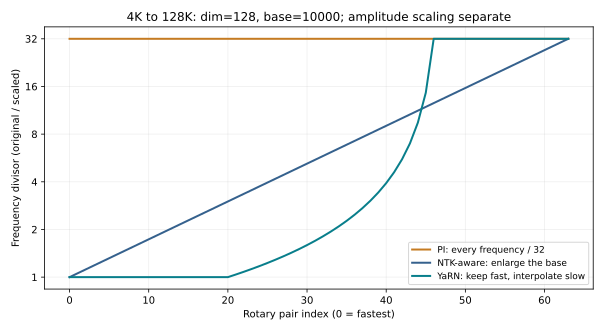

# 30｜长上下文：位置缩放、注意力汇点与混合层

第 04 章推导了 RoPE 并指出"公式能算不等于模型会用"。本章讨论社区把上下文从 4K 扩到 128K 乃至 1M 时实际采用的三类做法：改位置编码的频率（PI、NTK、YaRN），改缓存策略（注意力汇点、滑动窗口），以及改架构（局部/全局交替、线性注意力混合）。最后讨论怎样判断一个模型真的会用长上下文。配套代码见 [long_context.py](../../examples/long_context.py)，其中 YaRN 的频率计算与 Hugging Face transformers 的参考实现在 DeepSeek-V3、Kimi K2、gpt-oss 的真实配置上逐元素对照，最大相对误差约 $10^{-7}$（FP32 舍入）；gpt-oss 的配置设了 `truncate: false`，比对时要照此传参。对照测试在安装了 transformers 时自动运行。

## 30.1 从波长看 RoPE：哪些维度会"绕圈"

第 4.2 节的 RoPE 把头宽 $d_h$ 分成 $d_h/2$ 对，第 $j$ 对的角频率为 $\omega_j=\theta^{-2j/d_h}$，转一整圈需要的 token 数（波长）为 $\lambda_j=2\pi/\omega_j$。取 $d_h=128$、$\theta=10^4$：最快的一对波长为 $2\pi\approx6.3$ 个 token，最慢的一对约 54,410 个 token。

在 4K 上下文上预训练时，64 对中有 46 对的波长不超过 4,096，展开的相位跨度超过一圈；最慢的 18 对则没有转满一圈。这里的“超过一圈”是跨度判断：整数位置只采到有限个角度，并未覆盖圆周上所有连续相位，也不保证新整数位置的角度曾精确出现。扩展到 32K 时，慢维度会走出原先较短的相位区间；快维度也可能遇到新的离散相位组合、相对距离模式和任务分布。因此不能把外推失败唯一定位到慢维度。

把 base 调大可以减慢部分维度的相位变化，但不自动消除训练分布外推；同样的短训练长度下，转不满一圈的维度反而更多。最慢一对的波长近似随 base 线性增长（严格地说正比于 $\theta^{(d_h-2)/d_h}$）：$\theta=10^6$（Qwen3）时约 506 万 token，$\theta=10^8$（Mistral Small）时约 4.7 亿。第 29.2 节列出的 dense 模型（OLMo 2、Qwen3、SmolLM3、Mistral Small）把 base 调到 $5\times10^5$–$10^8$，原因就在这里；DeepSeek-V3（$10^4$）、Kimi K2（$5\times10^4$）和 gpt-oss（$1.5\times10^5$）则保留较小的 base，改用 YaRN 扩展，是另一条路线（30.2 节）。代价是快维度和慢维度之间的分辨率分配变了，大 base 通常要配合在长序列上继续训练。

## 30.2 三种频率缩放

要把在 $L$ 长度上训练的模型用到 $sL$，有三种代表性做法：

- **位置插值（PI）**：把所有频率除以 $s$，等价于把位置 $m$ 换成 $m/s$。最大相位回到训练范围内，但快维度也被压缩了 $s$ 倍，相邻 token 的位置差变得难以分辨。PI 原论文用不到 1000 步微调把 LLaMA 扩展到 32K。
- **NTK-aware 缩放**：在 $d_h>2$ 时不改位置，改 base：$\theta'=\theta\cdot s^{d_h/(d_h-2)}$。最慢的维度恰好被拉长 $s$ 倍，最快的维度完全不变。它保留部分局部分辨率，并减慢低频变化，但这不是下游任务质量保证。
- **YaRN**：按每对的"转圈数"分三段处理。在原上下文 $L$ 内转圈数超过 $\beta_{fast}$（默认 32）的快维度完全不动；转圈数少于 $\beta_{slow}$（默认 1）的慢维度按 PI 除以 $s$；中间用线性斜坡过渡。

$$\omega'_j=(1-\gamma_j)\frac{\omega_j}{s}+\gamma_j\omega_j,\qquad\gamma_j=1-\mathrm{clip}\Big(\frac{j-j_{low}}{j_{high}-j_{low}},0,1\Big),$$

其中 $j_{low}$、$j_{high}$ 是转圈数恰好为 $\beta_{fast}$、$\beta_{slow}$ 的维度下标。对 $d_h=128$、$\theta=10^4$、$L=4096$、$s=32$，斜坡位于第 20 到第 46 对之间：第 0–20 对（共 21 对）频率不变，从第 46 对起频率除以 32，斜坡中的第 32 对约除以 1.8。

严格说，连续交点为 $j(\beta)=d_h\log(L/(2\pi\beta))/(2\log\theta)$；默认实现对快端向下、慢端向上取整后才得到上述 20 和 46。`truncate=False` 则保留连续端点，所以相同参数下边界附近也会有细小差别。下面的图直接读取 `long_context.py` 的输出，纵轴是原频率除以新频率，越高表示变化越慢；额外的 Q/K 幅度修正尚未计入。

YaRN 还做了温度修正，用来抵消上下文变长后 softmax 分布变平的效应：$q$ 和 $k$ 各乘 $\sqrt{1/t}=0.1\ln s+1$（$s=32$ 时约 1.35），注意力 logit 因此乘 $1/t\approx1.81$。DeepSeek-V3 与 Kimi K2 的配置把 `mscale` 和 `mscale_all_dim` 都设为 1，此时 RoPE 部分的因子是 1，修正改为折算到 MLA 的 softmax 缩放里（transformers 的实现把 softmax 缩放乘以 mscale 的平方）；gpt-oss 则把 1.35 直接乘在 $q$、$k$ 的旋转上。读配置文件时要分清这两种约定，`yarn_attention_factor` 实现了两者。

**这些配置在真实模型里长什么样。** DeepSeek-V3：`factor 40`、`original_max_position_embeddings 4096`，对应最长 163,840 token；Kimi K2：`factor 32`，131,072 token；gpt-oss：`factor 32`、`rope_theta 150000`，131,072 token。DeepSeek-V3 和 gpt-oss 用默认的 $\beta_{fast}=32$、$\beta_{slow}=1$；Kimi K2 的固定版本配置却把两者都设为 1（`rope_theta 50000`、$d_{rope}=64$），斜坡两端几乎重合（第 19–20 对之间）：索引 0–19 的 20 对频率不变，索引 20–31 的 12 对除以 32，基本没有过渡段。"三段式"只是默认参数下的样子，读配置时要看 $\beta$ 的实际取值。DeepSeek-V3 与 Kimi K2 的报告写明在 4K 上下文上完成主体预训练，再用 YaRN 扩展并继续训练；gpt-oss 的模型卡写明用 YaRN 把全注意力层扩展到 131,072，预训练长度没有说明，配置中的原始长度为 4,096。

## 30.3 注意力汇点：为什么第一个 token 那么"重要"

StreamingLLM 的观察是：只保留最近 $w$ 个 token 的滑动窗口缓存，一旦文本长度超过缓存，困惑度会突然飙升；但只要额外保留最开头的几个 token，性能就基本恢复。原因是 softmax 的权重总和必须为 1。当一个注意力头在当前位置"无事可做"时，它仍然要把权重分给某些 token，训练中模型学会了把这部分多余的权重堆到序列开头（开头的 token 对所有后续位置都可见）。这些 token 本身语义上不重要，却起到"垃圾桶"作用。扔掉它们，原本流向那里的权重被迫分给其他 token，注意力分布就乱了。

两个工程结论：

1. **流式缓存策略。** 保留前 4 个 token 加最近的窗口，缓存大小固定。100K token 的流式输入，用 4 + 1,024 的策略保留 1,028 个位置（`streaming_kv_positions`）。论文在其测试配置下观察到更稳定的长流生成；被移除位置已不能直接检索，但部分信息可能被后续隐藏状态间接保留，这不提供无限记忆。该函数只返回保留位置，真正实现还需按算法处理 RoPE 与 cache 坐标，不能把索引筛选当作完整流式模型。
2. **把汇点做进架构。** gpt-oss 给每个头一个可学习的 logit $s_h$，参与 softmax 归一化后丢弃：

$$p_{ij}=\frac{e^{S_{ij}}}{e^{s_h}+\sum_{j'}e^{S_{ij'}}}.$$

当 $s_h$ 很大时，真实 token 上的总权重 $\sum_jp_{ij}$ 可以接近 0，这个头的输出接近零向量；当 $s_h\to-\infty$ 时退化为普通注意力。`sink_attention` 实现了这个公式：sink logit 为 8 时，demo 中真实 token 上的平均权重只剩 0.15%。这与"off-by-one softmax"的思路相同，让"什么都不关注"成为一个显式的选项。

它等价于对普通注意力输出加一个依赖 query 的标量门。令 $L_i=\operatorname{LSE}_j(S_{ij})$、普通输出为 $o_i$，则 $\alpha_i=\sigma(L_i-s_h)$、$o_i^{sink}=\alpha_io_i$。因此 sink 的绝对数值不是关闭程度，关键是它与真实 key 总指数质量的比较。固定分数下增加可见 key 会增大该质量，value 与输出投影的尺度也影响最后写回；这正是“sink 很大”不足以直接决定剪枝的原因。

## 30.4 用架构而不是位置编码解决长上下文

位置缩放处理频率/相位范围的外推风险，没有解决全注意力的两个成本：计算随 $T^2$ 增长，KV 随 $T$ 线性增长。第 29 章的模型展示了其中三种架构上的应对，表的最后一行是另一条路线：

局部窗口的感受野需要按层数分析。若每层只能看自己和前面 $w-1$ 个位置，且没有其他跨位置路径，L 层后最远可间接依赖 $L(w-1)$ 个位置以前的输入，序列起点还会截短这个范围。它说明局部层并非完全不能传远距离信息，也说明固定深度的纯窗口网络不能直接检索任意远的 token。中间层压缩与训练是否学会保留信息，是额外的能力条件。

| 做法 | 例子 | KV 随上下文的增长 | 代价 |
|---|---|---|---|
| 局部/全局交替 | gpt-oss（1:1，窗口 128）、Gemma 3（5:1，窗口 1,024） | 只有全局层线性增长 | 局部层可逐层间接传递；全局层提供直接远距访问 |
| 线性注意力混合 | Qwen3-Next（3:1 Gated DeltaNet）、MiniMax-M1（7:1） | 只有 softmax 层线性增长 | 线性层的固定状态会混合、遗忘细节 |
| 压缩缓存 | DeepSeek-V3、Kimi K2（MLA） | 每层 576 个数，线性增长但斜率小 | 计算更复杂，RoPE 需单独处理 |
| 稀疏注意力 | DeepSeek Sparse Attention、NSA | 仍需存全部 KV，但只读取一部分 | 依赖选择机制的召回率（DSA 用轻量索引器，NSA 用压缩注意力分支的分数） |
| 低精度 KV | FP8 KV cache（vLLM、TensorRT-LLM 等推理引擎的常见选项） | 斜率减半（BF16→FP8），仍线性增长 | 需要逐张量或逐头缩放；注意力分数对 K 的误差敏感，要在长上下文任务上验证 |

前三行改变主缓存的形态或数量；稀疏注意力主要改变每个 query 访问的位置，还可能增加索引状态。最后一行改变的是"每个数几位"，它可以与其他设计叠加：MLA 的 576 个数存成 FP8 时，每 token 的 KV 再减半。位置编码本身也可以只作用于部分维度或部分层：GLM-4.5 与 Qwen3-Next 的 partial RoPE（第 29.4 节）、SmolLM3 每 4 层一层 NoPE（第 29.2 节），都保留一部分不随位置旋转的通道。这类设计常被认为有助于长度泛化，但公开报告里缺少与纯 RoPE 的受控对比，应当当作待验证的选择而不是结论。

**Llama 4 的 iRoPE：把 NoPE 层与分块注意力配对。** Meta 称之为 iRoPE（interleaved RoPE），并把它用于 Scout 的长上下文。由于模型权重需要授权才能下载，这里以 Hugging Face transformers 的公开实现为准。默认每 4 层中有 1 层是 NoPE 层（`no_rope_layer_interval` 为 4），其余 3 层用 RoPE。两类层的注意力范围也不同：RoPE 层是**分块注意力**，只在 `attention_chunk_size`（默认 8,192）个 token 的块内计算；NoPE 层是全因果注意力，能看到整段上下文。这种配对限制了 RoPE 层内可见的相对距离。若训练已覆盖同样的块长，且旋转保持正交、不另加位置相关的非线性，RoPE 点积只依赖块内相对位移；跨块的直接注意力由 NoPE 层承担，顺序信息可由因果 mask 和上游层间接提供。但绝对位置的数值误差、上游表示和任务分布仍可能变化，不能据此保证完整模型没有长度外推风险。分块层的 KV 也只需保留当前块，长上下文下与 gpt-oss 的带状窗口层一样封顶。

NoPE 层还要处理 30.2 节提到的"上下文变长、softmax 变平"：实现里只对 NoPE 层的 query 乘一个随位置增长的温度因子，$q\leftarrow q\cdot\big(1+0.1\ln(1+\lfloor (t+1)/8192\rfloor)\big)$，$t$ 为位置。按从 0 开始的 t 计，t=0 至 8190 时因子为 1；t=8191（第 8192 个 token）才变成约 1.0693。到第 131072 个 token 约为 1.2833，第 1048576 个 token 约为 1.4860。注释注明其思路来自 Scalable-Softmax：让 softmax 的锐度随候选数量对数增长，抵消分布随长度摊平。这与 YaRN 的温度修正（30.2 节）方向相同，但 YaRN 按扩展倍数整体乘一个常数，这里按每个 query 的实际位置逐级增大。[transformers v4.57.0 的 Llama 4 实现](https://github.com/huggingface/transformers/blob/v4.57.0/src/transformers/models/llama4/modeling_llama4.py)、[Scalable-Softmax](https://arxiv.org/abs/2501.19399)

这里能核对的是结构与公式；Meta 宣称的 Scout 千万 token 上下文是否在各类任务上都可用，需要按 30.5 节的方法单独评估，本书没有复现。

在 32K 上下文下，第 29 章的 Qwen3-Next 与 gpt-oss-20b 每请求 KV 都只有 0.75 GiB，而同样激活参数量级的 Qwen3-30B-A3B 是 3.0 GiB。这一列决定了重要的历史状态容量；推理成本还包括权重、固定递归状态、KV 读取、计算与调度，不能只由一个 KV 数字决定。

## 30.5 怎样训练和评估长上下文能力

**训练。** 典型流程是先在 4K–8K 上完成大部分预训练，再用长文档继续训练数十亿到数千亿 token（DeepSeek-V3 约 1,260 亿，Qwen3 是数千亿），同时调整 RoPE（YaRN 或增大 base）。ProLong 的系统实验给出几条可操作的结论：代码仓库和书籍是好的长数据来源，但必须与高质量短数据混合，否则短上下文能力下降；训练序列长度超过评估长度有帮助；SFT 阶段只用短指令数据也能得到很好的长上下文表现。ProLong-8B 只用 40B token 的长上下文训练，就在 128K 的多数长上下文任务上超过了 Llama-3.1-8B-Instruct。packing 时文档边界的注意力 mask（第 4.6 节）在长序列训练中尤其重要。

**评估。** 困惑度和"大海捞针"（在长文本里找一句插入的话）都不足以说明问题：困惑度主要由局部预测决定，捞针只测单点检索。应该同时看：

- 多针检索与多跳聚合：需要同时用到分散在不同位置的几条信息；
- 证据位置敏感性：同一证据放在开头、中间、结尾时的表现差异（第 24.6 节的 Lost in the Middle）；
- 真实长任务：长文档问答、代码仓库级理解、长对话中的指代；
- 短上下文回归：扩展之后，原来的短任务分数不能明显下降。

## 30.6 2025 年末：混合路线继续探索，全注意力仍在使用

Kimi Linear 的核心是 Kimi Delta Attention（KDA），以更细粒度门控管理有限递归状态，配合适合硬件的 chunk-wise 算法；模型交替使用 KDA 与全局 MLA，比例为 3:1。它不能被简化成“$QK^\top V$ 改结合顺序”或“不再有 KV”。报告比较了匹配训练设置下的质量与成本；减少的长期 KV 主要来自线性层，MLA 层和递归状态仍需存储。[Kimi Linear](https://arxiv.org/abs/2510.26692)

另一方面，MiniMax-M2 的公开模型实现为逐层全因果注意力，使用独立 Q/K/V/O 投影和 GQA，而 MiniMax-M1 是 Lightning Attention 混合架构。M2 的选择说明同一团队不同模型会采用不同取舍，不证明 M1 路线失败或线性注意力失去价值。[MiniMax-M2 官方源码](https://huggingface.co/MiniMaxAI/MiniMax-M2/blob/04312f0cfbdeefb912575595b7c045512a29293c/modeling_minimax_m2.py)

应比较固定预算下的语言建模、关联检索、长输入推理、长输出 RL、缓存容量和 decode 吞吐；短上下文平均分并不足以决定架构。混合比例、共享专家、训练数据与 kernel 常一起变化，跨模型排行榜不是受控架构消融。当前仍有全注意力、稀疏注意力、线性/SSM 混合多条路线，本节不给其中一种冠以普遍最优。

## 30.7 长上下文能力应按任务绘成曲面

上下文长度只是一个轴，另有证据位置、相关事实数、干扰强度、输出长度和总推理预算。RULER 将单针之外的多种合成检索/聚合任务纳入评估，展示标称上下文长度与任务上的有效长度可能不同；它仍是合成测试，需加真实文档和代码任务。[RULER](https://arxiv.org/html/2404.06654v1)

可在固定总长度下移动证据，在固定证据下增加干扰，再分别测单事实、多事实组合与引用支撑。保持问题和答案不变而只换位置时，需避免 padding/模板变化引入额外线索。长输入检索通过不保证长输出推理可靠，短任务回退也要单列。

训练长序列时还需看真正的长依赖曝光：把大量短文档 packing 成 128K，若用文档隔离 mask，模型看到的有效注意力跨度仍可能很短；若不隔离，又可能主要学习无关文档拼接。应记录文档长度、有效 attention span、重复率及跨文档监督目标。[ProLong 的数据和训练对照](https://arxiv.org/html/2410.02660v1)

## 练习

**1．** 一个模型在 $\theta=5\times10^5$、$d_h=128$、4K 上下文下预训练。它的 64 对旋转中，有几对的波长超过 4K、几对超过 32K？直接用到 32K 时，哪些维度会遇到训练中没见过的相位？

**解答。** 32 对超过 4K，其中 22 对超过 32K（`rotation_wavelengths(128, 5e5)`）。前者在训练长度内相位跨度不足一圈，扩长后会走出原先的短区间；其中 22 对即使在 32K 内也转不满一圈。波长短于 4K 的其余 32 对只是在离散位置上跨过周期范围，不能保证新相位或联合频率/距离模式已被训练覆盖。YaRN 的 $\beta_{slow}=1$ 对应“原上下文内转不满一圈”的连续边界，实际是否完整插值还按端点取整规则计算。

**2．** YaRN 的 $s=32$。为什么不直接对所有维度做 PI，而要保留快维度不变？

**解答。** 快维度编码的是相邻几个 token 的相对位置。PI 把它们也压缩 32 倍，相邻 token 的相位差变成原来的 1/32，可能使模型更难区分“前一个词”和“前两个词”，对局部语法与精确复制有风险。快维度在原上下文内已经转了很多圈，单频相位覆盖较充分；保留它们是兼顾局部结构的工程选择，不保证长距离行为完全无外推风险。

**3．** 一个注意力头在某层的 sink logit 学到很大的值。这对该层的输出意味着什么？能否据此剪掉这个头？

**解答。** 对大部分 query，这个头分给真实 token 的总权重很小，输出接近零向量，等于"这个头在这里不工作"。但 sink 的权重是相对于当前 scores 的，遇到特别匹配的 key 时 $e^{S_{ij}}$ 仍可能压过 $e^{s_h}$。是否能剪掉要做消融，不能只看 sink 值。

**4．** 流式缓存保留 4 个汇点加 1,024 个最近 token。用户在第 500 轮对话里问"我们一开始讨论的那个数字是多少"，模型能回答吗？

**解答。** 一般不能。最开头的 4 个 token 只是注意力的"垃圾桶"，通常不包含那个数字；最近 1,024 个 token 之前的内容（除了开头 4 个汇点）都已被丢弃。保留汇点在论文测试设置下有助于稳定流式生成，但不提供任意早期内容的长期记忆保证。需要长期记忆时要用检索（第 24 章）、摘要或真正的长上下文模型。
