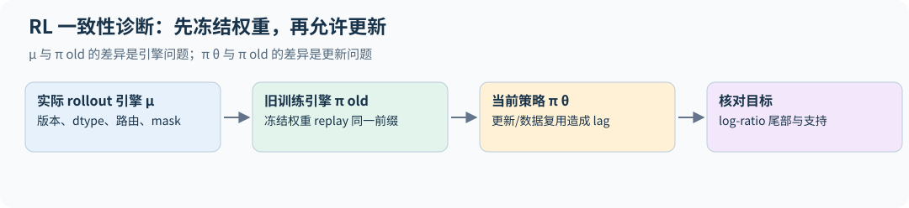

# 31｜推理模型的强化学习：从 GRPO 到 DAPO、CISPO 与熵

第 18 章推导了 GRPO 族的估计量，并在小模型上跑通了完整循环。2025 年社区在大模型 RLVR 上积累了大量经验，本章整理其中有公开细节、能用公式说清楚的部分：DeepSeek-R1 的训练流程、DAPO 的四项改动、CISPO 对裁剪的重新设计、熵坍缩的机制，以及"RL 到底有没有教会模型新东西"的争论。配套代码 [rl_objectives.py](../../examples/rl_objectives.py) 与第 18 章的 `posttrain.py` 使用同一套张量约定，可以直接对比梯度。

## 31.1 DeepSeek-R1：两个模型、一条流水线

R1 论文实际上报告了两件事。**R1-Zero** 直接在 DeepSeek-V3-Base 上用 GRPO 做 RL，没有任何 SFT：奖励只有答案正确性和格式，回答长度与推理能力随训练一起增长，论文展示了模型在中途学会"重新思考"的"aha moment"样例。论文附录给出的超参数：每步 32 道不同的题，每题采样 16 个回答，温度 1，KL 系数 0.001；最大长度在第 8.2K 步之前为 32,768 token，之后改为 65,536，性能与回答长度在那一步都出现明显跳升，共训练 10,400 步。

R1-Zero 的问题是可读性差、中英文混杂。**R1** 因此加了四个阶段：先用数千条"像人一样思考"的冷启动数据做 SFT；再做推理 RL，加入语言一致性奖励；然后用拒绝采样收集约 60 万条推理样本（每题采样多个回答、只保留正确的，并过滤掉语言混杂、段落过长和含代码块的思维链），与非推理数据合并后重新 SFT；最后做覆盖所有场景的 RL。蒸馏出的小模型（基于 Qwen 和 Llama）只做 SFT、不做 RL，就得到很强的推理能力。

这条流水线回答了第 18.13 节的问题：冷启动 SFT 换来可读性和更快的早期学习，代价是可能缩窄探索；蒸馏提供了把大模型 RL 成果迁移到小模型的路径，成本需要计入教师生成与学生训练。

## 31.2 DAPO：让 GRPO 在长思维链上稳定

DAPO 论文从一个复现问题出发：在 Qwen2.5-32B 上直接跑 GRPO，AIME 2024 只有 30 分，低于 DeepSeek 报告的 47 分。分析发现基线存在熵坍缩、奖励噪声和训练不稳定。DAPO 的改动使其达到 50 分，并且只用 DeepSeek-R1-Zero-Qwen-32B 一半的训练步数。论文表 1 按顺序逐项叠加，给出每一步的 AIME 2024 分数（32 次采样平均）：

| 配置 | AIME 2024 |
|---|---:|
| 朴素 GRPO | 30 |
| + 超长过滤（截断样本不计损失） | 36 |
| + 解耦裁剪 | 38 |
| + 超长奖励塑形 | 41 |
| + token 级损失 | 42 |
| + 动态采样（即 DAPO） | 50 |

这是按一种固定顺序做的累积消融，每项的增益依赖叠加顺序。AIME 2024 只有 30 道题，论文的 avg@32 对每题采样 32 次，减少的是生成噪声，不会把它变成 960 道独立题。若向新题目分布外推，标准误还取决于题目成功率之间的方差；$\sqrt{0.42\times0.58/30}\approx9$ 个百分点只是用观测均值代入二项式上界公式的量级参考，不能保证每次都保守，也不能当作实测 avg@32 的标准误（第 15.5 节）。41→42 与 30→50 都应结合逐题配对结果、多次训练及消融顺序解释，不能只凭跨度较大就宣布因果贡献或显著性。论文也说明，token 级损失带来的分数提升不大，主要作用是让训练更稳定、长度增长更健康。下面分别说明主要的几项。

**1．解耦裁剪（Clip-Higher）。** PPO 的裁剪 $\mathrm{clip}(r,1-\epsilon,1+\epsilon)$ 对上下界一视同仁。论文的例子：一个当前概率 $\pi_{old}=0.01$ 的 token，即使优势为正，在 $\epsilon=0.2$ 下，0.012 是这个正优势样本的 surrogate 进入平坦区的边界；而概率 0.9 的 token 的上限是 1.08，实际上不受约束。这种阈值限制低概率正优势样本继续提高 surrogate 的空间，是论文解释探索受限的一种机制；坍缩还取决于其他样本与完整更新。DAPO 把上界单独放宽：

$$\mathcal J=\mathbb E\Big[\frac{1}{\sum_i|o_i|}\sum_i\sum_t\min\big(r_{i,t}\hat A_i,\ \mathrm{clip}(r_{i,t},1-\epsilon_{low},1+\epsilon_{high})\hat A_i\big)\Big],$$

论文取 $\epsilon_{low}=0.2$、$\epsilon_{high}=0.28$。下界保持不变是论文的配方选择；放宽它允许负优势样本的 surrogate 在更低概率处才进入平坦区，可能减少多样性，但并不等于必然把概率压到零。`clipped_token_fraction` 可以直接看出效果：demo 中一个比率为 1.25 的正优势 token，在对称裁剪下被截断（梯度为 0），在 $\epsilon_{high}=0.28$ 下仍有梯度，被截断 token 的比例从 33% 降到 25%。

**2．动态采样。** 一组回答全对或全错时，组内优势全为 0（第 18.2 节），这组样本不提供奖励优势项的梯度，却占了 batch。DAPO 持续采样，丢掉这类组，直到 batch 被有效组填满，约束写成 $0<|\{o_i:\text{正确}\}|<G$。代价是需要额外的生成；`dynamic_sampling_mask` 返回应保留的组。

若二值奖励下题目 x 的成功率为 $p_x$，独立 G 次采样成为混合组的概率为 $a_x=1-p_x^G-(1-p_x)^G$。持续从原提示分布 q 抽题并只保留混合组时，入选提示分布满足 $q_{keep}(x)\propto q(x)a_x$，更偏向中等成功率的题。批内信号密度提高，不代表所有难题都得到更多训练；实际还需计入为凑满 batch 丢掉的组和总 rollout 成本。

**3．token 级损失聚合。** GRPO 先在每条回答内平均、再在回答间平均，长回答中每个 token 的权重被稀释。在长思维链里，这意味着冗长、重复的错误回答受到的惩罚反而更轻。DAPO 改为对 batch 内所有有效 token 直接平均（上式的 $1/\sum_i|o_i|$），每个 token 权重相同。这与第 18.5 节讨论的 Dr. GRPO"固定分母"是同一个方向的不同选择；测试 `test_token_level_aggregation_weights_long_sequences_more` 验证了长度不同的两条回答中每个 token 得到相同梯度。

**4．超长奖励塑形。** 超过最大长度被截断的回答，答案往往不完整，直接给 $-1$ 会把"推理正确但写得长"的样本也惩罚掉，形成噪声。DAPO 在最大长度 $L_{max}$ 之前设一个长度为 $L_{cache}$ 的缓冲区，在其中线性加罚：

$$R_{len}(y)=\begin{cases}0,&|y|\le L_{max}-L_{cache}\\[2pt]\dfrac{(L_{max}-L_{cache})-|y|}{L_{cache}},&L_{max}-L_{cache}<|y|\le L_{max}\\[4pt]-1,&|y|>L_{max}\end{cases}$$

这一项加在正确性奖励之上。DAPO 的最大生成长度为 20,480 token，缓冲区 4,096。

DAPO 的配方去掉了 KL 惩罚，论文报告在其设置下更有效；长思维链本身不意味着 KL 一定有害，其他长时间 RL 配方仍可能使用 KL 控制（第 31.5 节）。

PPO 裁剪限制的是某个样本继续改善 surrogate 的收益，不会将参数投影到概率区间。其他样本、共享参数、动量与有限学习率仍可使概率越过边界。因此 0.012/0.0128 是平坦区的阈值，不是一次更新的最大概率；配套测试构造了共享参数的一步更新越界反例。

## 31.3 CISPO：裁剪权重而不是裁剪更新

PPO 式裁剪的一个副作用是：被裁剪的 token 梯度恰好为 0。MiniMax-M1 的报告指出，这些往往是"However""Recheck""Wait""Aha"之类标志反思的低概率 token，正是推理路径的分叉点；它们在部分离策略更新中比率超过正优势分支的上界，该样本当时的裁剪项便不给梯度；若后续共享参数更新使比率回到区间，梯度可以恢复，并非永久冻结这些 token。报告还说明，DAPO 放宽上界的做法在他们每批生成做 16 轮离策略更新的设定下效果有限。CISPO 换了一种写法：

$$\mathcal J_{CISPO}=\mathbb E\Big[\frac{1}{\sum_i|o_i|}\sum_i\sum_t\mathrm{sg}\big(\hat r_{i,t}\big)\,\hat A_i\,\log\pi_\theta(o_{i,t}\mid q,o_{i,<t})\Big],\quad \hat r_{i,t}=\mathrm{clip}(r_{i,t},1-\epsilon^{IS}_{low},1+\epsilon^{IS}_{high}),$$

其中 $\mathrm{sg}$ 是停止梯度。重要性权重被截断以控制方差，但它只作为一个常数系数乘在 REINFORCE 项前，因此不会仅因比率超过上界而把该项梯度置零；advantage 为零、权重下溢或 mask 无效时仍可没有贡献。论文实际上不设下界，只调上界。`cispo_loss` 的测试构造了一个比率为 $e\approx2.72$、优势为正的 token：PPO 与 DAPO 的梯度都是 0，CISPO 的梯度是 $-\mathrm{clip}(e,\cdot,1.5)=-1.5$。

MiniMax-M1 报告在 Qwen2.5-32B 的受控对比中，CISPO 达到同样性能所需步数约为 DAPO 的一半。同一份报告还记录了一个很有工程价值的坑：训练引擎与推理引擎对同一 token 算出的概率不一致，相关系数只有约 0.9，奖励因此不增长；逐层排查发现来源是输出头的高幅值激活，把输出头改为 FP32 后相关系数升到 0.99，训练才恢复正常。报告特别说明，这个问题在较小的、使用 softmax 注意力的 dense 模型上没有出现，所以它不是所有 RL 训练都会遇到的坑，而是规模、架构和推理引擎共同作用的结果。这呼应第 18.9 节："old logp 必须对应真实采样策略"。

## 31.4 熵坍缩：机制与对策

该熵机制论文研究的多组 RLVR 设置出现了一个共同现象：策略熵在训练早期急剧下降，性能随后饱和。熵机制论文把这一现象量化为经验关系 $R=-a\,e^{H}+b$：在该研究的实验区间内，性能与熵下降相关；拟合关系不规定其他任务或训练配方的性能上限。

它给出的机制是：在 softmax 策略下，一步策略梯度后熵的变化由"动作的对数概率"与"该动作 logit 的变化"之间的协方差决定（下面的公式）；在自然策略梯度下，logit 的变化与优势成正比，普通 softmax 策略梯度则是 $\delta z_v\propto p_v A_v$，协方差的权重随之不同。这种协方差提供了经验解释，但“高概率”或“低概率”不是充分的符号判据。即使只增大一个独立 logit，其对熵的导数也是 $-p_v(\log p_v+H)$：阈值为 $p_v=e^{-H}$，取决于完整分布；真实参数更新同时改变多个 logits，必须把所有贡献相加。论文所测训练中该协方差常为正，观察到的是相应设置下的熵下降。对策是限制高协方差 token 的更新：Clip-Cov 对它们截断梯度，KL-Cov 对它们加 KL 惩罚。DAPO 的 Clip-Higher 从另一个角度达到类似效果：它放宽部分正优势样本的更新空间，但这些更新是否提高整体熵仍取决于完整分布与共享参数。

监控上，第 18.15 节的完整词表熵是必备日志。熵快速降到很低而验证集准确率还在上升时，可以继续；两者同时停滞时，需检查探索、奖励覆盖、数据难度、截断与优化；日志本身不能证明所有可用探索已经耗尽。[熵机制原论文](https://arxiv.org/abs/2505.22617)

固定前缀、有限 softmax 分布 p，微小 logit 改变 $\delta z$ 给出精确一阶关系：

$$\delta H=-\sum_vp_v(\log p_v+H)\delta z_v=-\operatorname{Cov}_{v\sim p}(\log p_v,\delta z_v).$$

这是对任意 logit 扰动的局部微分，不等于所有共享参数更新都使 logit 与 advantage 简单成正比。配套代码对照 autograd 和小步有限变化；实际熵方向仍取决于完整扰动，不能只按某个被采 token 的概率标签判断。

## 31.5 RL 到底教会了模型什么

这是 2025 年争论最多的问题，三篇论文给出了看似矛盾的结论：

- **"没有超出基础模型。"** Yue 等人用很大的 $k$ 测 pass@k：RLVR 模型在 $k=1$ 时明显更好，但在 $k$ 很大时，基础模型的 pass@k 反而更高。覆盖率与困惑度分析显示，RL 模型能解出的题基本都在基础模型的采样分布之内。他们的解读是：当前的 RLVR 主要提高了采样效率，把基础模型已有但概率较低的正确路径变得更可能，而没有引入新的推理模式；相反，蒸馏可以从教师引入新模式。
- **"延长训练可以扩展边界。"** ProRL 用 KL 控制、周期性重置参考策略和多样任务做长时间 RL，报告在一些基础模型于有限采样预算内未答对的任务上，RL 模型也能做对，且边界的扩展与训练时长和基础模型在该任务上的能力强相关。
- **"答案对不等于推理对。"** 另一项工作指出，大 $k$ 下的 pass@k 会把"蒙对答案"算作成功。他们提出 CoT-Pass@K，要求推理过程也正确；该研究在这个指标下观察到 RLVR 扩展推理覆盖；有限采样仍不能证明基础模型原本的成功概率为零。

这些结论并不完全冲突：它们的差别在于训练时长、任务类型和"成功"的定义。对读者有用的结论是方法论层面的：

1. 只报告 pass@1 不够，要同时画 pass@k 随 $k$ 的曲线，并与基础模型对比；
2. $k$ 很大时要检查成功样本的推理过程，排除猜中答案；
3. 区分"让已有能力更可靠"（对部署很有价值）和"获得新能力"（研究问题），不要混为一谈。

第 18.16 节的小模型实验里，训练题准确率大幅上升而留出题只有小幅提升，是同一问题在玩具规模上的影子。

## 31.6 一张 2025 年 RL 算法对照表

| 方法 | advantage | 比率与裁剪 | 损失聚合 | 其他 |
|---|---|---|---|---|
| GRPO（DeepSeekMath 写法） | 组内标准化 | token 级，对称裁剪 | 先序列内平均再平均 | 小 KL 惩罚 |
| Dr. GRPO | 组内中心化，不除标准差 | token 级，对称裁剪 | 固定常数分母 | 去掉长度偏置 |
| DAPO | 组内标准化 | token 级，$\epsilon_{low}=0.2$、$\epsilon_{high}=0.28$ | 全 batch token 平均 | 动态采样、超长塑形、无 KL |
| GSPO | 组内标准化 | 序列级几何平均比率 | 序列级 | 第 18.8 节 |
| CISPO | 组内标准化 | 裁剪权重并停止梯度，不因超过上界而屏蔽该项梯度 | 全 batch token 平均 | 只设上界；M1 同时用 DAPO 的动态采样与长度惩罚，无 KL |

R1 论文把比率写成整条回答的概率比 $\pi_\theta(o_i\mid q)/\pi_{old}(o_i\mid q)$，第一阶段 RL 的裁剪系数 $\epsilon$ 取 10，几乎不起裁剪作用；论文也指出裁剪系数太小会截断大量 token 的梯度，太大则训练不稳定。表中第一行按 DeepSeekMath 的 token 级写法列出，便于与其他方法对照。

## 31.7 训练—推理不一致：三种来源不能混为一谈

令实际生成引擎概率为 $\mu_{old}$，训练引擎对相同旧权重算出的概率为 $\pi_{old}$，更新后概率为 $\pi_\theta$。同一 token、同一前缀下有

$$\log\frac{\pi_\theta}{\mu_{old}}=\log\frac{\pi_\theta}{\pi_{old}}+\log\frac{\pi_{old}}{\mu_{old}}.$$

第一项是更新/数据复用产生的 policy lag，第二项是相同权重下的引擎差异。另有一类支持变化：top-p/top-k、停止规则或 tokenizer 不一致，会让两侧根本不在同一事件空间。MoE 路由不同还会改变实际参与计算的子模型。把所有偏离都叫“离策略”会掩盖修复位置。

诊断首先禁止更新，在同一权重版本 replay 实际 rollout。按层、长度、batch、TP 大小、dtype 和专家路由检查 logits 与选中 token logps；记录 log-ratio 中位数、p95/p99、最大值及路由一致率，不能只报告高度相关的整体概率。之后再允许参数更新，测 lag 的增长和 clip fraction。把 dtype 改得更精细可能降低数值差异，却不能修复版本错位和不同采样支持。

### ScaleRL：输出 logits 的 FP32 修复

ScaleRL 对 RL compute–performance 曲线做系统实验，配方包括异步采样、CISPO、损失/advantage 聚合选择与 FP32 logits 等措施。其精度案例定位到 generator/trainer 不同 kernel 在输出头产生概率差异，并对两侧输出头使用 FP32 计算。把已有 BF16 logits **事后** `.float()` 无法恢复矩阵乘已丢掉的信息。[The Art of Scaling Reinforcement Learning Compute for LLMs，§4](https://arxiv.org/html/2510.13786v1)

这里支持的结论是“输出头精度可显著影响该实验的稳定性与性能”，不是“ScaleRL 必须全模型 FP16”或“其聚合方式普遍最优”。论文的训练规模、模型和任务是条件，迁移时需消融。

### DeepSeek-V3.2：四个分开核对的策略

报告第 3.1 节说明了四类稳定措施：

| 措施 | 直接处理的问题 | 需要保留的条件 |
|---|---|---|
| 重要性加权的 $k_3$ KL | old 样本下的 KL 值与路径梯度偏差 | 概率支持一致；分子当前概率可求导 |
| off-policy sequence masking | 负优势且旧/新差异较大的序列带来不稳定更新 | 是实用有偏筛选；记录剔除率和难度变化 |
| Keep Routing | 生成与训练时相同输入被路由到不同专家 | 保存/复用生成路径；明确训练所优化的路由条件 |
| Keep Sampling Mask | 截断采样导致两策略支持不同 | 复用截断支持并正确重归一化；不是普通 padding mask |

固定前缀、从 old 策略 o 采样，当前策略 p、参考 q 都在相同支持上时，可写

$$\widehat K=\frac{p(a)}{o(a)}\left[\frac{q(a)}{p(a)}-\log\frac{q(a)}{p(a)}-1\right].$$

对固定 old 分布求期望，$\mathbb E_o\widehat K=KL(p\Vert q)$；对整个乘积求导，其期望也可对应这个**固定前缀条件 KL**的梯度。如果把外面的 p/o detach，路径梯度的结论会改变；如果前缀仍来自旧策略，也不能据此说整条序列的当前状态分布已完整校正。第 17.7 节的“数值无偏与梯度无偏不同”在这里仍然适用。教学枚举测试对照值与梯度，不提供完整工业训练配方。[DeepSeek-V3.2，§3.1](https://arxiv.org/html/2512.02556v1)

### FP16：更细尾数的代价

2025 年 10 月的另一篇研究通过训练和推理两侧统一 FP16，在其多个模型、算法和框架设置中显著减轻不一致。FP16 比 BF16 多 3 位尾数，但指数范围窄，需检查激活/梯度溢出、下溢、loss scaling 和跳步；不是所有模型都能直接整体 `.half()`。[Defeating the Training-Inference Mismatch via FP16](https://arxiv.org/abs/2510.26788v1)

### 直接校正第二项：截断重要性权重

上面的措施都在缩小 $\pi_{old}/\mu_{old}$ 的偏离。另一条常用做法是承认它存在、直接在损失里校正：每个 token 乘上 $w=\min\big(\pi_{old}/\mu_{old},\,C\big)$（$C$ 为截断上限，常取个位数），再计算原来的裁剪目标；变体把超出区间的 token 直接 mask 掉，而不是截断权重。截断限制了方差，代价是对偏离大的 token 引入偏差，这与第 18.19 节"完整重要性权重为何迅速失效"是同一个取舍。实现时 $\mu_{old}$ 必须是生成引擎在采样时记录下的 log-prob，不能事后用训练引擎重算。监控被截断或被 mask 的 token 比例：比例持续上升说明引擎差异在变大，应回到上面的逐层诊断，而不是调高 $C$。

本书没有在真实双引擎大模型上复现这一结论；`numerical_tools.py` 只提供 log-ratio 诊断和精确分布校正的受控检查。ScaleRL、DeepSeek-V3.2 和 FP16 是不同论文的不同措施，应在相同基线下逐项比较。

## 31.8 异步 RL 的版本、支持与梯度边界

概率差异诊断也应先统一精度，再相减。真实 log-prob 都不大于 0，两个有限 FP16 log-prob 之差的绝对值不超过 65504，本身不会溢出；要先转 FP64 的理由是：训练端（常为 FP32）与推理端（常为 BF16）的输入 dtype 不同，必须在同一精度下比较；跨大量 token 求均值、分位数时低精度会累积误差，而且 `torch.quantile` 根本不接受 FP16 输入。应先选出二值 mask 中的有效位置，转到 FP64 后再算差值、分位数和最大值。padding 的 NaN 不应参与统计，非二值 mask 也不应被默默当作布尔值。

一次 rollout 应绑定采样权重版本、生成引擎配置、prompt/response token、停止/截断原因，以及**实际采样分布**的 logps。训练前用同版本 replay 检查引擎差异，再与当前参数比较 policy lag。只保存“这是第 100 步样本”不够：不同 worker 可能拿到不同权重，长轨迹生成期间也可能跨更新。

通常一条轨迹应使用一致策略版本；若故意在轨迹中更新，概率记录必须逐动作对应实际版本。top-p 改变支持时，不能从未截断 logits 重建不存在的采样事件。缓存/路由同步也属于概率定义的一部分；第 31.7 节的措施分别处理这些不同问题。

当复用次数增加，监控各版本年龄的成功率、log-ratio 分位数、clip fraction、ESS 和被剔除比例。固定前缀 token KL 或几何平均比率不会自动校正旧前缀状态分布；“数值稳定”与“目标无偏”是不同结论。[GSPO 的序列 surrogate](https://arxiv.org/html/2507.18071v1)

一个正确的 stop-gradient 模式是把旧概率和 advantage 固定，让当前 logps 可导；CISPO 还固定经过裁剪的权重。不同算法 detach 的位置不同，须对照所写目标做小分布梯度验证，不能按变量名字猜。按 prompt 条件过滤 rollout、按随机 token 总数归一化时，还需记录改变后的样本分布。[DAPO](https://arxiv.org/html/2503.14476v1)

## 练习

**1．** 某 token 的 $\pi_{old}=0.02$，优势为正。在 $\epsilon=0.2$ 的对称裁剪与 $\epsilon_{high}=0.28$ 的解耦裁剪下，该样本的正优势 surrogate 在概率多大时进入平坦区？对一个 $\pi_{old}=0.8$ 的 token 呢？

**解答。** 低概率 token：0.024 对 0.0256；高概率 token：0.96 对 1.024（概率不能超过 1，实际上不受限）。裁剪是乘性的，低概率 token 到达平坦区的绝对概率差较小；放宽上界改变该项继续提供收益的范围，真实更新还由全部样本共同决定。

**2．** 一个 batch 有两条回答：A 长 100 token、优势 +1；B 长 1,000 token、优势 −1。比较 GRPO 的序列平均与 DAPO 的 token 平均下，B 中每个 token 受到的惩罚权重。

**解答。** 序列平均：每条回答权重 1/2，B 中每个 token 的权重为 $\frac12\cdot\frac1{1000}=5\times10^{-4}$，A 中为 $5\times10^{-3}$。token 平均：每个 token 都是 $1/1100\approx9.1\times10^{-4}$。序列平均下，冗长的错误回答每个 token 受到的惩罚只有短回答的 1/10，这正是 DAPO 改用 token 平均的原因。

**3．** DAPO 的 $L_{max}=20480$、$L_{cache}=4096$。长度为 18,000 和 21,000 的两条回答，超长惩罚各是多少？

**解答。** 18,000 落在缓冲区（16,384 到 20,480）内：$(16384-18000)/4096\approx-0.395$。21,000 超过 $L_{max}$：$-1$。`overlong_penalty` 的 demo 输出与此一致。

**4．** 为什么固定已生成 batch 中删除零优势组不改变梯度之和，却不能直接推出动态重采样不改变期望目标？

**解答。** 固定 batch、固定分母时，删除零贡献组确实不改变梯度之和；重新采样直到凑满有效组则是条件抽样，改变 prompt/轨迹分布。若再按随机有效 token 数归一化，长度与贡献相关，期望不一定只是原梯度乘全局常数。需要另行分析目标与权重，并报告丢弃率、长度、难度与所有额外生成成本；采样预算不能只数保留样本。
