# 从零构建大语言模型：CS336 中文深度学习指南

2024–2026 公开核心课程综合版，核验日期 2026-10-26。

# 00｜如何用这本书学会从零构建语言模型

这本书面向已经学过深度学习、能读懂 PyTorch 与矩阵微分的读者。你不需要先观看 CS336 视频；每章给出理解所需的定义、推导、工程约束与小实验。学习目标是能够独立解释并实现一个语言模型训练系统，理解扩大到真实规模时哪些假设会失效，而不是记住模型名称。

本书综合 [2024 年课程](https://cs336.stanford.edu/spring2024/)、[2025 年课程](https://cs336.stanford.edu/spring2025/) 与 [2026 年课程](https://cs336.stanford.edu/)，核心讲义与作业的核验日期为 2026-10-26，补充论文与官网课程政策的核验日期为 2026-10-31。它是独立撰写的中文教材，不是课件翻译。主线覆盖各年公开的 1–17 讲与五组作业；没有公开讲义的嘉宾课不在覆盖范围内，见第 35 章。

全书结构：第 01–19 章是课程主线；第 20 章把所有可运行实验串起来；第 21 章是推导与自测；第 22–27 章是面向研究与应用的扩展（实验设计、数据适配、检索增强、推理时计算、压缩、机制可解释性），不属于课程原有内容；第 28 章按五组作业组织要点与常见错误；第 29–34 章整理 2024–2025 年社区进展（开源模型架构、长上下文、推理 RL、agent、合成数据、低精度），每章配有可在 CPU 上运行的 demo，同样不属于课程原有内容；第 35、36 章是来源索引与完整代码。

## 0.1 一门课真正要解决的问题

假设你有一批原始网页、一组加速器和一个总预算，要交付一个可评估的语言模型。你需要同时决定：

1. **表示**：哪些字节组成一个 token？上下文长度在不同语言中意味着多少内容？
2. **函数**：模型如何根据前缀产生分布？参数如何分配给注意力、MLP 和专家？
3. **优化**：损失、更新规则和学习率如何对应到有效训练 token？
4. **资源**：每个训练步需要多少运算、显存和网络通信？
5. **证据**：怎样证明提升来自方法，而不是更多算力、数据泄漏或评估模板变化？
6. **行为**：怎样把预测器变成能遵循指令、完成推理任务的系统？

这些决定彼此耦合。更大的词表缩短序列，却增大输出层；更多专家增加容量，却增加通信；长推理提高某些任务的成功率，却占用更多 KV cache 并降低服务吞吐。

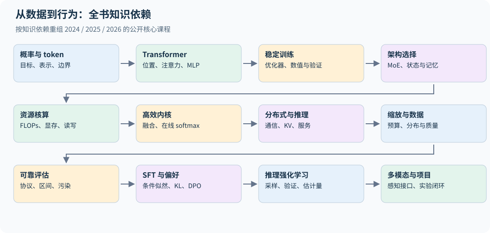

## 0.2 本书的三种阅读动作

遇到公式，先检查每个量的单位和张量形状，再读推导。遇到实验，先写下预期结果，再运行代码。遇到经验结论，追问比较是否固定了数据、参数、训练计算量和推理预算。一个知识点直到你能预测它在哪些条件下失效，才算真正掌握。

例如，“FlashAttention 更快”不是完整知识。你应该能解释它为什么减少 HBM 读写、为什么不改变精确注意力的数学结果、为什么 FLOPs 不一定减少，以及为什么很小的矩阵可能无法体现收益。

## 0.3 学习顺序与可验收成果

| 阶段 | 章节 | 必须产出的证据 | 对应作业 |
|---|---|---|---|
| 做对一个模型 | 01–05 | BPE 与讲义示例一致、因果不变性、梯度对照、能下降的验证损失 | A1 |
| 理解架构取舍 | 06–07 | 专家利用率、长序列状态与 KV 大小计算 | — |
| 做快与做大 | 08–12 | 理论资源账、正确计时、内核数值对照、分布式梯度等价 | A2 |
| 做可信实验 | 13–15 | 缩放预测留出误差、数据消融、带区间的评估 | A3、A4 |
| 改善行为 | 16–19 | 正确 response mask、偏好目标、可验证奖励、模态接口 | A5 |
| 独立完成项目 | 20–21、28 | 一份可复现报告和误差分析 | 全部 |
| 研究与应用扩展 | 22–27 | 预算对齐的干预实验、知识更新方案、验证与压缩对照 | — |
| 跟上社区进展 | 29–34 | 从 config.json 精确复算参数与 KV、读懂 YaRN 配置、对照 DAPO/CISPO 梯度、构造 agent 损失掩码、测量合成数据与低精度误差 | — |

## 0.4 没有大 GPU 能做到哪一步

| 硬件 | 能完成的 | 参考数字 |
|---|---|---|
| 普通 CPU | 必需依赖下的测试与 demo；Triton 等可选检查按报告单列；10K 词表的 BPE 训练；8M 参数模型的 TinyStories 训练和生成样例（质量见第 20.4 节） | 每个运行用 8 个 CPU 线程，1,500 步约 16 分钟（第 20.4 节） |
| Apple Silicon（MPS） | A1 的低资源路径：4,000 万 token，目标损失 2.00 | 讲义参考实现在 M4 Max 上约 36 分钟，损失 1.80 |
| 单张消费级 GPU | A1 完整 TinyStories 配置；A2 能放入实际显存的基准与 Triton kernel；先按 dtype、batch 和上下文核算容量 | — |
| 课程集群（B200） | A1 排行榜与 OpenWebText；A2 大尺寸与多卡；A5 的 1B 模型 GRPO | A1 基础配置约 20–30 分钟；作业为 A5 标准 GRPO 实验分配 2 B200-小时 |

CPU 实验验证的是算法与数值关系；真实吞吐、长上下文峰值显存和多机扩展需要对应硬件，不能由 CPU 结果外推。

**课程政策与本书代码。** 截至 2026-10-31，官网允许用 LLM 回答基础编程问题或高层概念问题，禁止用它直接解决作业题，并强烈建议关闭 AI 自动补全。详细政策应以课程官网及其链接文档为准。[课程官网](https://cs336.stanford.edu/)

A1 还规定不能使用 `torch.nn`、`torch.nn.functional` 和 `torch.optim` 中的定义，`nn.Parameter`、容器类和 `Optimizer` 基类除外。本书的 `examples/` 是讲解用的参考实现：为了简洁直接用了 `nn.Linear`、`F.cross_entropy` 等，函数接口也与作业不同；作业的书面计算题，本书换用作业没有考的模型或设定演示方法。如果你在修这门课，请先独立完成作业，再用本书对照原理。

## 0.5 符号统一

| 符号 | 意义 | 常见混淆 |
|---|---|---|
| $B,T$ | batch 中序列数、序列长度 | batch token 数是 $BT$ |
| $d,L$ | 隐藏宽度、Transformer 层数 | $L$ 不表示序列长度 |
| $h_q,h_{kv},d_h$ | query 头数、KV 头数、头宽 | 通常 $d=h_qd_h$，但并非定义要求 |
| $V,f$ | 词表大小、MLP 中间宽度 | $V$ 同时可能表示 value，依语境区分 |
| $N,D,C$ | 参数量、训练 token 数、训练 FLOPs | 重复数据也消耗 $D$，不等于独立信息量 |
| $P$ | 并行进程数 | 不与参数量 $N$ 混用 |
| $\pi_\theta,\pi_{old},\pi_{ref}$ | 当前策略、采样策略、参考策略 | 后两者角色不同 |

字母有限，下面几处局部符号会与上表重名，以所在小节的定义为准：第 10 章的 $L_i$ 是第 $i$ 行的 logsumexp，不是层数；$P$ 在第 03、08、10 章表示注意力概率矩阵，不是进程数；$M$ 在第 01 章是被计损失的 token 数，在第 10 章先表示片上容量、后表示 $BT$；$s$ 在第 8.5、12.8 节是每个元素的字节数，在第 8.8 节引用的 Korthikanti 激活显存公式中是序列长度。

默认自然对数；交叉熵单位为 nats/token。一次乘加按两次 FLOPs 计算。GB 使用 $10^9$ bytes，GiB 使用 $2^{30}$ bytes。代码默认张量布局为 `[batch, time, width]`，注意力内部为 `[batch, heads, time, head_dim]`。

## 0.6 三年合并的方法

2024 年更细的 Bloom filter、后缀数组、数据选择、人工偏好和 PEFT 内容保留。2025 年的独立推理服务课、FlashAttention 作业、SFT→专家迭代→GRPO 路线补入主线。2026 年的线性注意力与混合架构、TPU、FSDP、更细的 RL 估计量及多模态单独展开。哪些内容是课程要求、哪些是教学补充，见逐讲与作业覆盖表（第 35 章）。

原始资料并不能替你形成理解。本书也不能替代动手验证。若仅阅读、不运行任何实验，你可能会懂术语，却仍难以定位一个 loss 正常下降但模型偷看未来的训练 bug。

本书区分四类证据：解析推导、教学代码实测、原始论文报告、尚待验证的解释。每次复算时先确认所属类型；不把 CPU 数值对照等同于 GPU 性能或工业能力复现。

## 0.7 深入研究时，用三个问题贯穿一章

先写出本章优化或计算的对象：是字符串概率、固定数据上的 loss、策略期望奖励，还是服务延迟。再写出保证等价的条件：相同 mask、采样分布、参数、精度或通信归约。最后设计一个能让错误实现暴露的反例。只观察最终 loss 下降，通常无法区别目标变了、实现错了和真正改善了模型。

新增的推导实验集中在 `examples/mechanisms.py`：词表分块交叉熵、虚拟词表并行、仿射扫描、MLA 投影吸收、重要性权重诊断、验证器基率与随机舍入。第 20.14 节把它们连成“先手算—再验证梯度—最后测资源”的路线；它们与课程主线相连，适合已学过深度学习、希望进一步研究大模型的读者。


---

# 01｜语言建模目标：从概率到可执行训练任务

## 1.1 一个联合分布如何变成训练程序

对 token 序列 $x_{1:T}$，链式法则给出

$$p_\theta(x_{1:T})=\prod_{t=1}^{T}p_\theta(x_t\mid x_{<t}).$$

这不要求语言真的按某个简单马尔可夫过程产生。它只是任意联合分布都满足的分解。自回归模型把每个条件分布表示成神经网络的 softmax。最大似然等价于最小化

$$\mathcal L(\theta)=-\frac{1}{M}\sum_{i,t}m_{i,t}\log p_\theta(x_{i,t}\mid x_{i,<t}),\qquad M=\sum_{i,t}m_{i,t}.$$

$m$ 是损失掩码，可以排除 padding，也可以在指令微调时排除用户输入。分母必须与掩码一致，否则序列长度和 padding 比例会暗中改变梯度大小。这里的 $M$ 是本次更新的有效目标 token 总数。

在相同的概率空间和加权约定下，交叉熵可以写作 $H(p_{data})+D_{KL}(p_{data}\Vert p_\theta)$。对 token 目标，更精确地说是先对给定上下文的条件分布做这个分解，再按训练上下文及 mask 权重求平均；它不自动等于按文档均匀加权的序列级 KL。固定数据分布时，熵项无法通过参数改变，KL 项鼓励模型覆盖数据中的模式。这个目标不会自动等价于“回答正确”“遵守指令”或“人类喜欢”。

加权还可能改变被拟合的条件分布。固定前缀 h，若目标 token y 的保留权重为 $a(h,y)\ge0$，加权训练对应 $q_a(y\mid h)=q(y\mid h)a(h,y)/\sum_vq(v\mid h)a(h,v)$，前提是分母为正。若权重只依赖 h，则只改变上下文出现的频率；若依赖答案是否正确、是否通过过滤，则也改变该前缀下的答案分布。第 14、18、33 章的过滤与非负奖励加权都应分清这两种情况，带负 advantage 的策略目标则不能直接解释为这种重加权分布。

## 1.2 Teacher forcing 与因果性是两件事

训练时把真实前缀送给模型，称为 teacher forcing。一条文本可以并行产生所有位置的目标：

```text
原序列： [BOS]  语言  模型  有趣  [EOS]
输入：   [BOS]  语言  模型  有趣
目标：   语言   模型  有趣  [EOS]
```

正确移位只保证输入与标签对齐；它不保证网络没有偷看未来。注意力矩阵还必须屏蔽位置 $j>i$。判断因果性的有效测试是：只替换序列后半段，前半段所有 logits 都应保持不变，而不是只观察训练 loss。

```python
x, y = tokens[:, :-1], tokens[:, 1:]
logits = model(x)                        # [B,T,V]
loss = F.cross_entropy(
    logits.reshape(-1, logits.size(-1)), y.reshape(-1)
)
```

这里为简洁用了 `F.cross_entropy`；A1 要求自己实现交叉熵，不能调用 `torch.nn.functional` 中的定义（见第 0.4 节末的课程政策）。

推理时前缀包含模型自己生成的 token，训练和推理的前缀分布可能不同。一次错误可以把模型带到训练中少见的上下文。扩大模型、改善数据和使用针对性后训练可以缓解，不能仅靠把训练 loss 再压低一点保证消除。

上式序列似然包含首 token。若训练窗口直接使用 `tokens[:-1] → tokens[1:]` 而没有 BOS，窗口首 token 只作为条件，不贡献预测项；截断上下文也改变了条件集合。BOS/EOS、滑动窗口 stride、是否重复计入重叠目标必须写进评估协议。

## 1.3 为什么稳定 softmax 必须写对

对于 logits $z\in\mathbb R^V$，令 $m=\max_jz_j$，则

$$\log p(y)=z_y-m-\log\sum_j\exp(z_j-m).$$

减去最大值不会改变概率，却避免直接计算 $\exp(1000)$。不要先得到非常小的概率再取 log；应直接使用 `log_softmax` 或融合交叉熵。梯度为

$$\frac{\partial\ell}{\partial z_j}=p_j-\mathbf1[j=y].$$

若把 logits 当作独立变量做梯度下降，这会提高目标 logit、降低其他 logits；实际网络共享参数，单个样本的绝对概率变化还取决于梯度交叉项（第 17.12 节）。严格均匀预测的损失为 $\log V$：若 $V=256$，约为 5.545。

随机初始化并不等于严格均匀。若 logits 的随机分布在交换词表标签后不变，且与目标独立，则 $\mathbb E[p_y]=1/V$，由 Jensen 不等式有 $\mathbb E[-\log p_y]\ge\ln V$。仅有“与目标独立”不够：若目标总为第 1 类，一个固定预测 $(0.9,0.1)$ 与目标独立，NLL 却只有 $-\ln0.9\approx0.105<\ln2$。若 logits 独立同分布于 $\mathcal N(0,\sigma^2)$，在固定方差、大词表的近似下，期望 NLL 约为 $\ln V+\sigma^2/2$（$V=10^4$、$\sigma=0.22$ 时为 9.234，下面练习中的实测值为 9.226）。因此 $\ln V$ 是对称初始化的参考尺度；类别偏置、共享权重和输入相关性都应另查，不能当作任意模型的固定初始值。

全被屏蔽的注意力行是一个特殊陷阱：所有 score 都是 $-\infty$ 时，`-inf - (-inf)` 产生 NaN。训练数据和 mask 设计应保证每个有效 query 至少可看见一个 key；padding query 的处理需要单独约定。

## 1.4 困惑度不是跨 tokenizer 的通用分数

$$\mathrm{PPL}=\exp(\mathcal L).$$

如果一个模型以字符切词，另一个以长子词切词，预测一步承担的信息量不同，不能直接比较 PPL。即使都叫 BPE，词表与预切分规则也可能不同。跨 tokenizer 可报告同一原始测试文本的 bits per byte：

$$\mathrm{BPB}=\frac{\sum_t-\log p(x_t)}{(\text{UTF-8 bytes})\log 2}.$$

比较时应固定是否计入 BOS/EOS、文档边界与上下文重置。BPB 改善可比性，但不能消除数据预处理、上下文预算和模型目标差异。跨文档 BPB 应使用“全部 NLL / 全部原始字节”，不能平均各文档的 BPB。

还有一个经常忽略的层次：tokenizer 确定性地把字符串映射为一种标准切分，但同一字节串可能由多种 token 序列解码得到。通常报告的是标准切分路径的 NLL/BPB，并未对所有能解码成该字符串的路径求和。它是明确且实用的评估协议，不应未经说明就称为“完整字符串概率”。

## 1.5 从随机初始化到真实能力的证据链

先让模型过拟合一个小 batch。若做不到，优先怀疑梯度、目标移位、优化器或模型连线。再扩大训练集并观察验证集。若训练损失下降而验证损失恶化，检查分布变化、重复率和学习率。最后才看自由生成，因为生成还混合了采样策略、停止规则与任务难度。

验证集损失应累计“总 NLL / 总有效 token”，不能不加权平均不同长度 batch 的均值。训练与评估使用的 dropout 模式不同，比较前记得切换 `train()` / `eval()`；禁用梯度并不会自动禁用 dropout。

**练习。** 两个 batch 分别有 100 和 900 个有效 token，平均损失分别为 1 与 3。正确整体损失是多少？为什么简单平均错误？

**解答。** $(100\times1+900\times3)/1000=2.8$。简单平均得到 2，会把短 batch 的每个 token 赋予九倍权重。后面的梯度累积和分布式训练会反复遇到相同问题。

**练习 2．** 词表 $V=10{,}000$ 的随机初始化模型，初始交叉熵大约是多少？若第一步的 loss 是 13.6，最可能是什么原因？

**解答。** 均匀预测时 $\ln10^4\approx9.21$。13.6 远高于此，值得检查 logit 尺度、标签移位与数据分布；单个 loss 不能唯一定位原因。本书这次受控实验测得初始 logits 尺度过大，softmax 很尖锐但指向错误类别。第 20.4 节去掉 RMSNorm 的模型初始验证损失正是 13.65。用训练种子 7 的那次初始化、在 64 个验证窗口上实测：残差流的标准差逐层为 0.99、1.10、1.33、2.22，经过最后一层后跳到 14.2，logits 标准差约 3.1；有 RMSNorm 的基线 logits 标准差只有 0.22，初始损失 9.23，几乎等于 $\ln V$。这些统计量依赖随机种子（换种子 0，最后一层后约为 17.7），增长也主要集中在最后一层，不是逐层平稳增长。

**练习 3．** 某模型在验证集上的 loss 为 2.33 nats/token，tokenizer 平均 4.12 bytes/token。困惑度和 bits per byte 各是多少？

**解答。** $\mathrm{PPL}=e^{2.33}\approx10.3$；$\mathrm{BPB}=2.33/(4.12\ln2)\approx0.816$。跨 tokenizer 比较还需满足 1.4 节的原始文本、边界与上下文协议；BPB 是标准切分路径的共同字节口径，不是消除所有差异后的绝对能力分数。

本章对应各年第一、二讲及基础作业的语言建模训练接口，见 [2026 基础作业](https://github.com/stanford-cs336/assignment1-basics/blob/a158843b20107949f1a8d7df1b05cd33b9166712/cs336_assignment1_basics.pdf)。

## 1.6 交叉熵的曲率与“概率旋钮”

固定一个目标 y，把 logits 当成自变量，交叉熵的 Hessian 为

$$H_z=\operatorname{diag}(p)-pp^\top,\qquad v^\top H_zv=\operatorname{Var}_{j\sim p}(v_j)\ge0.$$

因此损失关于 logits 凸，且整体平移方向满足 $H_z\mathbf1=0$；所有 logits 同加一个常数，概率不变。但 logits 是网络参数的非线性函数，不能由此推出关于参数的损失凸，或每次更新都提高每个训练样本的目标概率。多个 token 共享参数时，梯度相加可以相互抵消；第 17.12 节的 DPO 反例也是同一条链式法则。

平均 NLL 降低只意味着加权几何平均的目标概率提高，并不保证所有题、所有语言都提高。把一个困难答案的概率从 0.01 提至 0.02，NLL 改善为 $\ln2$；把 0.49 提至 0.51，改善仅约 0.040，却可能改变 argmax 是否答对。前者对概率建模很显著，后者对二选一指标很显著。第 15 章要求同时测分布损失、行为指标和分层结果，原因就在这里。

**自测。** 为什么对 logits 做有限差分能验证交叉熵梯度，却不能证明模型因果性？

**解答。** 它验证给定 logits 下的局部导数；模型是否利用未来信息发生在生成 logits 的计算图中，需另做未来 token 扰动测试。


---

# 02｜分词：决定模型看到怎样的世界


## 2.1 tokenizer 同时改变统计问题和系统成本

字节词表只有 256 个基本单位，可表示任意 UTF-8 文本；代价是多字节字符及常见单词会占用多个位置。词级词表压缩常见词，却难以覆盖新词、拼写变化、代码和不同语言。子词分词在二者之间：常见片段成为一个单位，不常见片段回退成更小单位。

必须区分 Unicode code point、UTF-8 byte 和视觉字符。一个 emoji 可能由多个 code point 组成，一个 code point 又可能需要多个字节：`len("🙂")` 是 1，`len("🙂".encode())` 是 4，一个汉字通常是 3 个字节。若 token 保存的是任意字节片段，单个 token 不一定能独立解码成合法 Unicode；应该拼接所有 bytes 后再解码，遇到非法序列用替换字符 U+FFFD 表示，而不是抛异常中断生成。

## 2.2 BPE 训练：预切分、计数、合并

现代 byte-level BPE 的训练分三步。

**第一步，按特殊 token 切段。** `<|endoftext|>` 这类标记是硬边界：先用它把语料切成文档，标记本身不参与任何 pair 计数。否则 GPT-2 正则会把 `<|endoftext|>` 拆成 `<|`、`endoftext`、`|>` 三个普通 pre-token，它们是语料中出现最多的片段之一（本书下载的 TinyStoriesV2 完整训练集约 270 万次，第 20.4 节实际使用的前 200 MiB 约 26 万次），白白消耗 merge；在分隔符紧贴标点的语料中，上一篇的结尾标点还会和 `<|` 落进同一个标点 pre-token（例如 `."<|`），产生跨文档的 pair。TinyStoriesV2 的分隔符总是单独成行，不会出现这种合并，但网页抓取等语料没有这样的保证。

**第二步，正则预切分。** 每段文本再按 GPT-2 风格的正则切成 pre-token，merge 只在 pre-token 内部发生：

```python
PAT = r"""'(?:[sdmt]|ll|ve|re)| ?\p{L}+| ?\p{N}+| ?[^\s\p{L}\p{N}]+|\s+(?!\S)|\s+"""
```

它把英文缩写、带前导空格的单词、数字串、标点串和空白分开。注意 `\p{L}` 包含汉字，所以连续中文会成为一个很长的 pre-token。`\s+(?!\S)` 让一串空格的最后一个留给下一个单词，于是 `"  words"` 切成 `" "` 和 `" words"`。预切分规则直接影响代码缩进、数字和中文的压缩方式。

**第三步，迭代合并。** 统计所有 pre-token 内相邻 pair 的频次（按 pre-token 出现次数加权），选最高频者合并为新 token。并列时需要确定规则：CS336 作业约定选择**字节串字典序更大**的 pair，即 `max` 而不是 `min`。用 Sennrich 等人的经典例子验证，语料按空白切分后为 `{low:5, lower:2, widest:3, newest:6}`：

```text
第一轮 pair 频次：es 9、st 9、we 8、lo 7、ow 7 ……
es 与 st 并列，字典序 ('s','t') > ('e','s')，所以合并 s t
后续合并顺序：s t, e st, o w, l ow, w est, n e, ne west, w i, wi d, wid est, low e, lowe r
只取前 6 个 merge 时，newest 编码为 [ne, west]
```

本书 [tokenizer.py](../examples/tokenizer.py) 的 `train_bpe` 逐项复现上述 12 个 merge，测试直接对照作业讲义。若把并列规则写成 `min`，第一个 merge 会变成 `es`，后面整张 merge 表随之改变，官方测试会失败。`aaaa` 中相邻 `aa` 计数为三，但一轮从左到右的非重叠替换只能合并两次；"频次统计"与"执行替换"不要混淆。

## 2.3 让训练快到可以实际使用

朴素实现每次 merge 都重扫整个语料，若有 $K$ 轮合并、$M$ 个初始 token，成本约 $O(KM)$。两个优化把它变成几秒钟的事：

1. **先聚合 pre-token。** 数百万篇故事里 `" the"` 出现上百万次，只需保存 `{(32,116,104,101): 次数}` 一份。之后所有计数都在去重后的词表上进行。
2. **增量更新 pair 计数。** 合并 `(A,B)` 只会改变包含它的那些 pre-token 的相邻 pair。维护 `pair → 出现在哪些词` 的倒排索引；合并时对这些词先减去旧 pair 计数、执行替换、再加回新 pair 计数。选最高频 pair 用带惰性失效的最大堆：每次计数改变就压入新条目，弹出时若计数与当前值不符就丢弃。

预切分是另一个瓶颈，但它可以并行：把文件按字节切块，每个块的边界向后移动到下一个 `<|endoftext|>` 处，保证不会把一篇文档切开，各进程独立计数后相加。merge 循环本身有全局依赖，在 Python 中难以并行。

这里要求分隔符是独立边界：若特殊 token 同时有 `x` 和 `axb`，在 `axb` 中间的 `x` 处分块，就会把原本应整体跳过的特殊 token 变成普通的 `a`、`b`。匹配还可能跨越读文件的缓冲区边缘。`count_pretokens_file` 在分隔符可能与其他特殊 token 重叠时回退到单块计数；安全分隔符的扫描保留缓冲区后缀，保证并行结果与整段计数一致。进程数不应改变训练得到的频数。

**实测。** 在 TinyStories 训练集前 200 MiB（209.7 MB）上训练 10K 词表：16 进程预切分加上增量合并共 5.8 秒；10 MB 文本编码约 2 秒/进程。验证集上压缩率为 **4.117 bytes/token**，最长的 token 是 `" enthusiastically"`，最后几个 merge 是 `" disagre"`、`" differently"`、`" current"`、`" crosses"`、`" cooled"`。到 10K 词表的末尾，BPE 已经在合并儿童故事里频次不高的完整单词。`" disagree"`、`" disagreed"` 早已经由其他合并路径各自成为一个 token；末尾的 `" disagre"` 是为剩下的词形补上的，例如 `" disagrees"` 编码为 `disagre`+`es`、`" disagreement"` 编码为 `disagre`+`ement`。同一个字符串可以经不同的合并路径到达，这也是 merge 顺序决定编码结果的原因。学到的单位直接反映语料分布。运行方式见第 20 章的 `scripts/run_tinystories.py`。

## 2.4 编码为什么依赖 merge rank

训练产物不仅是最终词表，还包含有序的 merge 规则。编码新文本时，先做同样的特殊 token 切段与正则预切分；然后在每个 pre-token 内反复寻找**当前存在的、训练时最早学到的** pair 并合并，直到没有可用规则。用"找到词表中最长的字符串"代替这一过程，会在部分输入上得到不同结果。

```python
while len(ids) > 1:
    pair = min(zip(ids, ids[1:]), key=lambda p: ranks.get(p, inf))
    if pair not in ranks:
        break
    ids = merge_pair(ids, pair, merged[pair])
```

同一个 pre-token 反复出现时可以缓存其编码结果，TinyStories 这种重复度高的语料上收益很大。

## 2.5 特殊 token 与流式编码的边界

特殊 token 表示文档终止、聊天角色、工具调用等结构语义。编码时先按已注册的特殊 token 切段：若两个特殊 token 有重叠（例如 `<|a|>` 与 `<|a|><|a|>`），应优先匹配更长者。处理不可信文本时，是否允许字面字符串被解释成控制 token 必须由调用方决定。

大文件无法一次读入内存，需要 `encode_iterable` 逐块产出 token ID。难点在块边界：

- 块末的最后一个 pre-token 可能还会增长，例如块以 `"  "` 结尾，下一块以 `"words"` 开头，整体切分是 `" "` + `" words"`，提前编码就会出错。
- 块末可能是某个特殊 token 的前缀（`"<|endo"`），也可能是一个更长特殊 token 的开头。
- 缩写的正则分支需要看到撇号后的两个字符：块以 `"we'r"` 结尾时会被切成 `we`、`'`、`r`，下一块的 `"e"` 到达后整体应是 `we`、`'re`。所以不仅最后一个 pre-token 不确定，倒数第二个也可能变。

正确做法是只编码"后续输入不可能改变"的部分：对本书固定的 GPT-2 正则，保留末尾至少两个字符及未完成匹配，用于覆盖上述缩写与前瞻依赖；其余部分和可疑的特殊 token 前缀留到下一块。本书实现对短字符串穷举了所有三段切分，对长文本用 1、3、7、13 个字符的固定宽度切块对照，流式结果与一次性编码完全相同。只保留最后一个 pre-token 的写法会在缩写处出错，所以测试文本一定要包含缩写和连续空白。

这不是任意正则的通用流式定理：例如 `a(?=.{5}z)|a.` 的匹配需要更远的前瞻。本书对已核验的 GPT-2 与 `\S+` 模式增量编码，其他自定义模式先收齐输入再编码，保证结果而不承诺流式内存。即使默认模式也可能遇到无限增长的 pre-token，且编码缓存随独特片段增大，不能宣称严格有界内存。`encode(text, allow_special=False)` 与 `encode_iterable(chunks, allow_special=False)` 将控制标记字面串作为普通内容；默认 `True` 保留已注册结构标记的旧行为，调用方要按输入来源选择。

流式**解码**是另一个方向的边界问题。`中` 的 UTF-8 字节为 `E4 B8 AD`，若模型分三次输出，逐 token 调用 `decode([id])` 再拼接会得到三个替换符，无法恢复原字符。`Tokenizer.decode_iterable(ids)` 使用增量 UTF-8 解码器，保留未完成的码点，等后续字节到达后才输出；只在整个流结束时刷新末尾残片。其输出拼接应等于一次性 `decode(ids)`，测试同时覆盖合法汉字/emoji、非法字节和流末截断。它保证字节到文本一致，不保证每个输出块都是完整的视觉字符：组合音标与 ZWJ emoji 还可能跨块。

## 2.6 词表大小是一道资源题

输入 embedding 需要 $Vd$ 个参数；若输出头不共享权重，再增加 $Vd$。输出 logits 的张量大小为 $BTV$，计算量约为 $2BTdV$。大词表能减少 $T$，但增大 $V$。主体模型很小时，词表参数可能占比很高：第 20 章的 TinyStories 模型共 8.33M 参数，其中 embedding 与输出头占 5.12M。

公开模型的经验是：单语模型多用 30K–50K 词表（GPT-2/3 为 50,257，LLaMA 为 32,000），多语言与生产系统多用 100K–250K（Qwen 约 152K；Gemma 3/4 为 262,144，略超出这一区间）。比较两个 tokenizer 应固定同一份原始文档，报告 bytes/token、不同语言的 token 分布、编码吞吐，以及下游模型在固定训练 FLOPs 下的结果。只看英文压缩率会把中文、代码或数学符号的成本隐藏起来。

中文"同样 8K 上下文"不意味着与英文承载相同长度的信息。上下文长度是 token 数，不是字数。在 TinyStories 上训练的 10K 词表几乎没有中文 merge，汉字会退回到逐字节编码，一个字占 3 个 token。

## 2.7 Unigram 与 SentencePiece：另一个分词目标

2024 年架构讲义专门比较了 BPE 与 Unigram。**SentencePiece 是工具库，不是一种等同于 Unigram 的算法**；它既支持 BPE，也支持 Unigram，并把规范化、空白表示、特殊符号与模型文件一起管理。[2024 第三讲第 51–58 页](https://github.com/stanford-cs336/spring2024-lectures/blob/2eab561d4fc5f0bd77ab68afc85dd563a0b107ba/nonexecutable/Lecture%203%20-%20architecture.pdf)

Unigram 给每个词片 $s$ 一个概率 $p(s)$。字符串 $x$ 可能有多种合法切分 $z=(s_1,\ldots,s_m)$，模型为每条路径赋予 $p(z)=\prod_jp(s_j)$，训练考虑所有能拼回 $x$ 的路径之和：

$$p(x)=\sum_{z\in\mathcal S(x)}\prod_{s\in z}p(s).$$

这与 BPE 按固定 merge rank 编码不同。设 $V[j]$ 是前 $j$ 个字符的最佳切分 log probability，则 Viterbi 递推为

$$V[j]=\max_{i<j,\,x_{i:j}\in\mathcal V}\{V[i]+\log p(x_{i:j})\},\qquad V[0]=0.$$

把 max 换成 logsumexp，就得到对所有切分路径求和的 forward 动态规划。最优路径的概率不等于全部路径概率。例如 `ab` 可以切为 `[ab]` 或 `[a,b]`，若三种词片概率分别为 0.2、0.4、0.4，所有切分的边缘路径权重是 $0.2+0.4^2=0.36$，最佳路径概率只有 0.2。

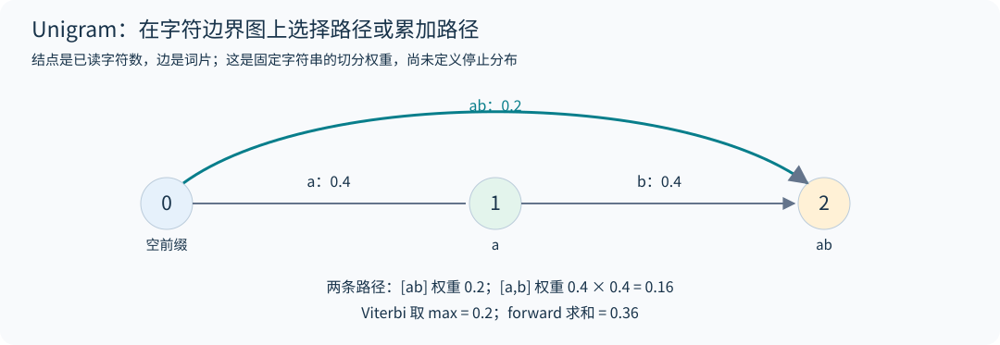

训练通常从较大候选词片集合开始，估计各路径的后验使用次数、更新词片概率，再逐步剪掉对语料似然影响较小的词片，同时保留基本字符保证可编码。对同一字符串采样不同切分可形成 subword regularization。[Subword Regularization](https://arxiv.org/abs/1804.10959) `tokenizer.py` 的 `unigram_segment` 同时返回最佳切分与边缘 log probability，用于把"搜索切分"和"学习词表"两个问题分开检查。

上述 $p(x)$ 是固定字符串上的切分边缘权重。若把它解释成跨所有有限字符串的归一化生成分布，还需要定义 EOS 或长度/停止分布；仅让词片概率和为 1，不会自动让所有不同长度路径的总质量为 1。本章动态规划比较路径、计算切分后验，不实现这个完整停止模型。

## 2.8 可逆性的对象必须说清楚

byte-level BPE 对原始 UTF-8 字节往返可逆。若在编码前使用 NFKC，把全角 `Ａ` 规范化成 `A`，解码最多恢复规范化后的文本。空白折叠、大小写转换也一样。因此"tokenizer 可逆"需说明是否包含规范化步骤、是否有 unknown token，以及空白是否被完整保存。

数字预切分影响进位模式和位值表示：逐位数字更容易把每位对齐到相似的 token 角色；多位数字片段压缩更好，但从左还是从右分组会影响长数对齐。训练 tokenizer 应只用训练数据，不能先利用测试领域特有词片优化压缩。

## 2.9 社区进展：词表与对话格式

第 29 章的 14 个开源模型中，词表从 OLMo 2 的 100,352 到 gpt-oss 的 201,088 不等，Qwen3 系列为 151,936，DeepSeek-V3 为 129,280，Kimi K2 为 163,840。较大词表可能提高压缩率，但不同训练语料、规范化或预切分的 tokenizer 没有 token 数单调关系；应在同一原始文本上实测。输出头则随实际词表大小增大：gpt-oss 的输出头有 0.58B 参数，占其 5.13B 激活参数的 11%（第 29 章练习 4）。

对话与工具调用的格式也固化在 tokenizer 里。gpt-oss 的 harmony 格式用特殊 token 标出消息边界，用关键字参数标明作者与接收者，并用"通道"区分思维链、工具调用和最终回答（第 32.1 节）。环境返回的文本可能包含看起来像控制标记的字符串，必须按普通文本编码。第 2.5 节"是否允许字面字符串被解释成控制 token 必须由调用方决定"，在 agent 场景中答案几乎总是"不允许"。

## 2.10 免固定分词器的字节级架构：BLT 与 H-Net

普通 byte Transformer 虽然词表只有 256 个元素，但每个中文字符可占多个字节，全部大模型计算都在长字节序列上进行，代价很高。“免分词器”的新路线通常不是把 BPE 换成 byte embedding 就结束，而是在模型内部学习/构建可变长度计算单元。

| 路线 | 字节到大模型计算单元 | 核心区别 |
|---|---|---|
| 普通 byte Transformer | 每个字节都经过大主干 | 无压缩层，序列更长 |
| BLT（2024 首发） | 根据 next-byte 熵形成 patch，局部编码→latent Transformer→局部解码 | 熵驱动可变 patch，把较重计算放在 patch 级 |
| H-Net（2025） | 端到端学习上下文依赖的动态 chunk，层级编码/解码 | 分块与主干联合学习，可堆叠多层抽象 |

BLT 使用局部模块处理字节和恢复预测，重主干处理较短 patch 序列；patch 大小随可预测性变化。熵模型也消耗算力，切块不能偷看未来答案。H-Net 学习边界/压缩并还原序列，需控制压缩率和训练稳定性。二者避免固定外部子词词表，仍需要 UTF-8、字节编码、结构标记和动态分块；不能称为完全没有表示或边界机制。[BLT](https://arxiv.org/abs/2412.09871)、[H-Net](https://arxiv.org/abs/2507.07955)

评估应固定原始文本、总 FLOPs 与输入信息量，报告 bits/byte、平均/分位 patch 长度、主干调用数、长尾字符与代码质量，以及真实 prefill/decode 性能。不同方法的“token 数”不具有同一单位，不能把 byte 数与 BPE token 数直接相除比较缩放律。


本节给出论文架构和计算取舍，没有实现完整 BLT/H-Net 或重跑其规模化实验。它补的是固定 tokenizer 之外的设计空间，不建议读者仅凭新论文名就替换已经验证的数据与模型管线。

## 2.11 动态字节分块必须满足增量因果性

BPE 可把 `a` 编成一个 token，却在续写 `b` 后把 `ab` 合成另一个 token；因此“同一前缀的切分不受未来影响”不是普通离线 tokenizer 的性质。字节级模型在生成过程中决定是否调用重主干时，却必须当场做决定。设 $b_{<t}$ 为已知字节、$c_t$ 为是否在下一字节前开新 patch，合法决策只能依赖 $b_{<t}$ 和由它生成的状态，不能用尚未生成的 $b_t$。

BLT 用预测分布的熵 $H_t=-\sum_{v=0}^{255}p(v\mid b_{<t})\log p(v\mid b_{<t})$ 判断下一个位置有多不确定。它与实际读到 $b_t$ 后计算的 surprisal $-\log p(b_t\mid b_{<t})$ 不同：后者会偷看当前答案。局部 encoder、全局 patch 主干和局部 decoder 还需正确移位，不能让已包含待预测字节的 patch 表示回流到该位置。[BLT 的 incremental patching 与架构](https://arxiv.org/html/2412.09871v1)

H-Net 的边界由可学习 router 决定，压缩后还要因果地还原长度。离散选点、平滑/代理梯度和压缩率辅助目标共同影响训练；不能仅把 hard threshold 的梯度设为零，就期待主任务自动学会分块。[H-Net 的动态分块与因果扩展](https://arxiv.org/html/2507.07955v1)

验收时比较逐字节生成与整序列 teacher forcing：在同一已知前缀上，边界决策、局部状态与 next-byte logits 应按约定一致。另记录 patch 长度分布和最坏长度；平均压缩率相同的两个方案，尾部延迟和高熵文本的计算成本仍可能不同。

## 练习

**1．** 用 `max` 和 `min` 两种并列规则分别处理 `{low:5, lower:2, widest:3, newest:6}`，第一个 merge 各是什么？哪种符合作业约定？

**解答。** 第一轮 `es` 与 `st` 都是 9。`max` 选 `('s','t')`，`min` 选 `('e','s')`。作业约定字典序更大者，即 `s t`。

**2．** 为什么不能任意把一篇文档切成两个字节块，分别编码后直接拼接 token ID？

**解答。** 一个 pre-token 可能跨越切块点，被切成两半后会得到不同的 merge；UTF-8 字符本身也可能跨块。并行训练应把块边界对齐到特殊 token；流式编码要把末尾未定型的 pre-token 留给下一块。

**3．** TinyStories 验证集 22.5 MB，编码后 5.47M token。若模型验证损失为 2.33 nats/token，换算成 bits per byte 是多少？

**解答。** 先由数据算压缩率：$22{,}502{,}601/5{,}466{,}407\approx4.117$ bytes/token。于是 $\mathrm{BPB}=2.33/(4.117\times\ln2)\approx0.816$。这是用验证 loss 与平均压缩率作的估计；本书的 loss 来自抽取窗口，压缩率来自整个文件，两者不自动构成精确的全语料 BPB。严格比较时应在同一批原始文档上汇总实际 NLL 和字节数，并固定上下文重置及特殊 token 计分规则（第 1.4 节）。

**4．** `ab` 的最佳切分概率是 0.2，为什么不能把 $-\log0.2$ 当作对所有 Unigram 切分求和后的 NLL？

**解答。** `[a,b]` 路径也贡献 0.16，总概率为 0.36，边缘 NLL 为 $-\log0.36$。Viterbi 解码与似然训练使用不同的动态规划归约。

本章对应各年第一讲与基础作业的分词部分，见 [2026 第一讲源码](https://github.com/stanford-cs336/lectures/blob/de53a9f979a6ee35f7d13a5e1aadee5ea1afc58e/lecture_01.py) 与 [2026 基础作业](https://github.com/stanford-cs336/assignment1-basics/blob/a158843b20107949f1a8d7df1b05cd33b9166712/cs336_assignment1_basics.pdf)。


---

# 03｜解剖现代 Transformer


## 3.1 先沿着形状走一遍

token ID `[B,T]` 经 embedding 变成 $X\in\mathbb R^{B\times T\times d}$。一个 pre-norm block 为

$$U=X+\operatorname{Attn}(\operatorname{Norm}(X)),\qquad Y=U+\operatorname{MLP}(\operatorname{Norm}(U)).$$

堆叠 $L$ 层，末尾再做归一化与词表投影。残差流是所有层共享的宽度为 $d$ 的通信通道，注意力和 MLP 分别计算要写回该通道的增量。

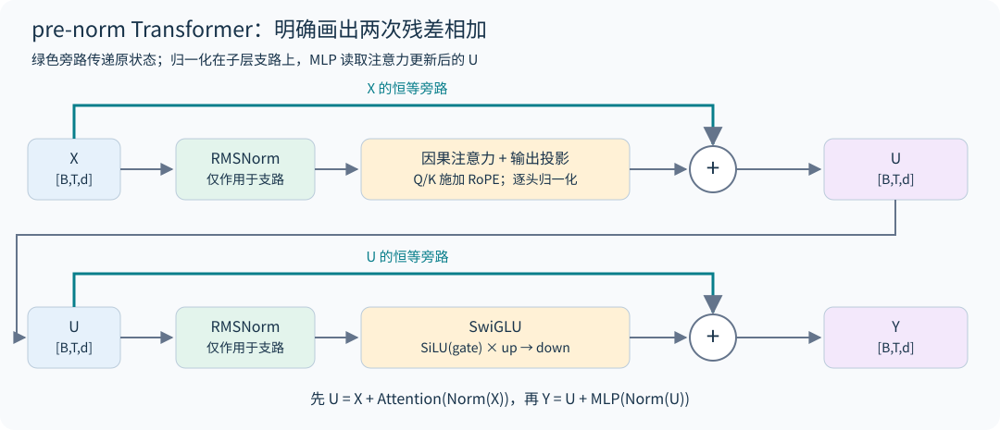

原始 Transformer 与现代解码器有不同的常见选择，不能把某一配置当成定义。现代设计中的 pre-norm、RMSNorm、SwiGLU、RoPE 和无 bias 是一组经验组合。本书的模型实现采用这一组合；各年第三讲讨论了它们与 post-norm、LayerNorm、ReLU/GELU、并行子层等替代方案的对照。[2026 架构讲义](https://github.com/stanford-cs336/lectures/blob/de53a9f979a6ee35f7d13a5e1aadee5ea1afc58e/lecture_03.pdf)

## 3.2 自注意力到底在计算什么

对于单个头，$Q=XW_Q,K=XW_K,V=XW_V$，每个投影有 $d_h$ 个通道。

$$S_{ij}=\frac{q_i^\top k_j}{\sqrt{d_h}}+M_{ij},\quad P_{ij}=\operatorname{softmax}_j(S_{ij}),\quad o_i=\sum_jP_{ij}v_j.$$

query 表示当前位置需要检索什么，key 表示每个来源位置如何被匹配，value 表示实际搬运什么信息。这是有用的功能解释，不代表训练后每个维度都具有可命名语义。

若 $q,k$ 各维近似独立、零均值、单位方差，则点积方差约为 $d_h$。除以 $\sqrt{d_h}$ 使初始尺度不随头宽迅速增大，避免 softmax 过早饱和。训练后独立单位方差假设未必成立，因此仍可能需要 QK normalization 或 logit soft-capping。

多个头提供分别归一化的检索分布；拼接后用 $W_O$ 写回残差流。头之间通常读取相同的可见 token 范围，区别在于各自的 Q/K 分数及归一化分母。把两组通道拼成一个更宽的头，会先将两组点积相加、按新头宽缩放，再做一次 softmax；这不同于原来分别归一化的两个检索分布，因此多头不等于把一个头随意分块。

## 3.3 MLP 与 SwiGLU

普通 MLP 为 $\phi(XW_1)W_2$，参数量约 $2df$。SwiGLU 为

$$\operatorname{SwiGLU}(X)=\big[\operatorname{SiLU}(XW_g)\odot(XW_u)\big]W_d,$$

其中 $W_g,W_u\in\mathbb R^{d\times f}$，$W_d\in\mathbb R^{f\times d}$，参数量约 $3df$。gate 支路决定每个特征的连续通过程度，另一支路提供被调制的内容。门控不是二值开关。

若普通 MLP 取 $f=4d$，参数为 $8d^2$。要让 SwiGLU 保持近似相同预算，可取 $f=8d/3$，实际再对齐硬件友好的整数倍。若不匹配参数量就比较两种激活，观察到的改进可能部分来自新增容量。

注意力混合位置，MLP 在每个位置独立变换特征，但多层组合使 MLP 也能影响上下文行为。把 MLP 简化为“只存知识”、注意力简化为“只推理”，不足以指导架构设计。

## 3.4 为什么 pre-norm 有利于深层优化

对简化残差块 $y=x+F(N(x))$，Jacobian 为 $I+J_FJ_N$。存在一条恒等梯度路径，梯度不必每层都穿过归一化。post-norm 的 $y=N(x+F(x))$ 则是 $J_N(I+J_F)$，每一层的主路径都受到归一化 Jacobian 作用。

这解释了深层训练稳定性的一个机制，但不是所有训练配置的定理。残差方差可能随深度增长，更新尺度与初始化仍要控制。双归一化、子层输出归一化等设计试图在保持残差路径和控制子层尺度之间取得平衡。

RMSNorm 的计算为

$$r=\sqrt{\frac1d\sum_jx_j^2+\epsilon},\qquad y_i=g_i\frac{x_i}{r}.$$

它不减均值，参数 $g$ 为逐通道可学习缩放。忽略 epsilon 时，对正数缩放 $x\mapsto cx,c>0$ 不变；负数缩放会翻转符号。当输入均方远小于 epsilon 时，近似缩放不变性也不成立。它对平移不具有不变性。省略均值相关运算可简化内核；实际速度取决于融合、读写和硬件，不应只数标量运算。

## 3.5 数值尺度与稳定性设计

QK norm 在形成注意力 logits 前控制 query/key 尺度；soft-capping 可用 $c\tanh(z/c)$ 限制极值；z-loss 可惩罚 $\lambda(\log\sum_j e^{z_j})^2$。三者施加的位置和约束不同，不能互换。

softmax 对整体平移不变，但浮点计算的动态范围不是无限的。z-loss 约束了这种“概率看起来相同、内部数值却越漂越大”的自由度。归一化、损失和优化器状态通常优先采用 FP32 归约，即便矩阵乘使用 BF16。

## 3.6 从推导到代码

阅读 [model.py](../examples/model.py)，依次定位 `RMSNorm`、`Attention`、`FeedForward`、`Block` 和 `TinyLM`。代码刻意显式产生注意力矩阵，便于理解 shape 和 mask；真正的高效内核在第 10 章解释。

`Config` 里有三个开关对应基础作业的消融：`norm`（`"pre"`、`"post"`、`"none"`）、`position`（`"rope"` 或 `"none"`，即 NoPE）、`ffn`（`"swiglu"` 或不门控的 `"silu"`）；第四个开关 `tie_embeddings` 对应讲义排行榜部分建议的权重共享。测试对每个单项变体都检查因果性与 KV cache 一致性，第 20.4 节给出它们在 TinyStories 上的真实对比。`model.py` 为简洁直接用了 `nn.Linear`、`nn.Embedding` 和 `F.silu`，A1 不允许这样做，要从 `nn.Parameter` 自己搭（第 0.4 节）。

**初始化。** 作业给出的近似方案：线性层权重 $\mathcal N\big(0,\frac{2}{d_{in}+d_{out}}\big)$，截断在 $\pm3\sigma$；embedding $\mathcal N(0,1)$，截断在 $\pm3$；RMSNorm 增益初始化为 1。pre-norm Transformer 对初始化相当鲁棒，但这个尺度仍要匹配：embedding 用 $\sigma=1$ 是因为它的输出直接进入 RMSNorm，传入子层的正比例尺度近似被归一化；但 embedding 仍沿残差主干传递，因此整个网络并不对该尺度严格不变；共享输入/输出 embedding 时，这个矩阵同时充当读出层，应改用线性层的较小尺度，否则这组配置的初始 logits 可能过大。`model.py` 的 `init_linear` 与作业一致。

## 3.7 超参数的"共识区间"

2026 年第三讲统计了大量公开模型，发现几个超参数出奇地一致。它们不是定理，但可以作为起点：

| 超参数 | 常见取值 | 讲义中的例子与例外 |
|---|---|---|
| $d_{ff}/d$ | 普通 MLP 取 4；GLU 类取 $8/3\approx2.67$ | LLaMA 65B 2.69（讲义幻灯片标作"LLaMA 70B"）、Qwen 14B 2.67；PaLM 4，Mistral 7B 与 LLaMA 2 70B 3.5；T5 11B 曾用 64 倍 |
| 头宽 × 头数 | 等于 $d$ | 大多数模型比值约为 1，头宽多为 128 |
| $d/n_{layer}$（宽深比） | 约 100–200 | GPT-3/OPT/Mistral/Qwen 为 128，LLaMA 为 102，BLOOM 205；过深的模型难并行、延迟高 |
| 词表 | 单语 30K–50K；多语言 100K–250K | GPT-2/3 50,257，LLaMA 32,000，Qwen 约 152K，Gemma 4 约 262K |
| 正则化 | 预训练基本不用 dropout，用 weight decay | weight decay 同时影响优化轨迹与正则化，作用取决于数据重复和日程 |

Kaplan 等人的实验显示，$d_{ff}/d$ 在 1 到 10 之间都接近最优，宽深比也有很宽的平坦区；这些"共识"更多反映工程习惯和硬件效率，而不是精确的最优值。

## 3.8 解码：温度与 top-p

训练好的模型给出下一个 token 的分布 $p$，生成时还要选一个解码规则。温度 $\tau$ 把分布改为 $\mathrm{softmax}(z/\tau)$：$\tau<1$ 更集中，最大 logit 唯一时 $\tau\to0^+$ 集中到该 argmax。若多个 logits 恰好并列最大，极限是在它们之间均匀分配，固定 argmax 的并列规则则只选一个。代码的 temperature=0 是明确的贪心分支，不能直接除以零。top-p（nucleus）采样把 token 按概率从大到小排序，保留累积概率首次达到阈值的最小前缀，重新归一化后再采样；它在分布集中时只留少数候选，在分布平坦时留很多。

`model.py` 的 `sample_next` 先做温度、再做 top-p，`generate` 遇到 `eos_id` 停止。测试检查了 $p=(0.5,0.3,0.15,0.05)$、top-p 0.75 时只会采到前两个 token。基础作业要求至少生成 256 个 token（或到第一个 `<|endoftext|>`），并讨论影响流畅度的因素。

## 3.9 串行与并行子层为什么不是同一函数

标准串行块先更新注意力，再让 MLP 读取更新后的状态：$u=x+A(N_1(x))$、$y=u+F(N_2(u))$。并行子层则常写成

$$y=x+A(N_1(x))+F(N_2(x)).$$

并行版本中，两条支路都读取原始 x，有机会共同计算投影、复用归一化输入或重叠执行，但 MLP 在这一层不能直接利用注意力刚写入的信息。即便参数量相同，它们也不是重排计算顺序得到的等价实现。若共享 $N_1,N_2$ 又增加了一项约束，需要单独消融。2024 基础作业的 parallel-layers 实验正是要比较这种取舍。[2024 基础作业](https://github.com/stanford-cs336/spring2024-assignment1-basics/blob/dae79d035bf866a71d81a02b0c023980d537b16d/cs336_spring2024_assignment1_basics.pdf)

## 3.10 深宽比、无 bias 和正则化怎样一起比较

忽略词表头，常见 dense 模型参数近似为 $N\propto Ld^2$。固定参数下把层数乘 4、宽度约除以 2，可以保留相近参数量，却增加串行深度、改变矩阵形状和每层通信次数；相同 FLOPs 不保证相同延迟。更宽模型可能让矩阵乘效率更好，更深模型提供更多迭代计算步骤；二者谁更好需要匹配预算和充分调参的实验。

去掉线性层 bias 可简化参数、广播与融合，但不是因为所有 bias 都能被 RMSNorm 抵消：RMSNorm 没有中心化操作。dropout 为隐藏表示加入随机性，weight decay 直接改变参数轨迹，二者不是同一种正则化。大数据、少重复预训练中有些配方不用 dropout，领域微调和重复数据训练却可能呈现不同权衡。

做归一化、激活、位置或并行层消融时，应明确固定的是参数、token、FLOPs 还是训练时间；有的消融改变了多个成本项。至少比较训练稳定性、验证损失和吞吐，不仅比较同 step 下的一条曲线。课堂经验配方提供候选起点，不能代替本任务下的对照。

## 3.11 社区进展：2025 年开源模型的默认配置

第 29 章从固定版本的 `config.json` 精确复算了 14 个开源模型的参数量，与官方 safetensors 元数据逐个相等。其中五个 dense 模型的骨架已高度一致：RMSNorm、SwiGLU、RoPE、无 bias、GQA 或 MHA（MoE 模型里 gpt-oss、GLM-4.5 的 QKV 投影仍带 bias）。变化集中在稳定性细节上：

- QK-Norm 很常见但不是默认：Qwen3、OLMo 2、GLM-4.5 采用（Qwen3 用它替代了 Qwen2 的 QKV bias），SmolLM3、Mistral Small、gpt-oss 和 MLA 模型没有；
- OLMo 2 把归一化移到子层输出上，残差主干上不再有归一化；
- 宽深比因团队而异：OLMo 2、Mistral Small、DeepSeek-V3 落在第 3.7 节的 100–200 区间内，Qwen 的 MoE 系列（约 43）、GLM-4.5（56）、SmolLM3-3B（57）明显更深更窄。

详见第 29.2 节。

## 3.12 把注意力拆成“选哪里”与“写什么”

采用行向量、暂略位置和归一化，一颗头写回残差的量为

$$\Delta x_i=\sum_j a_{ij}\,x_jW_VW_O,\qquad a_{ij}=\operatorname{softmax}_j(x_iW_QW_K^\top x_j^\top/\sqrt{d_h}).$$

QK 路径决定路由权重，OV 路径决定被搬运的内容。即使 $a_{ij}$ 很大，若 $x_jW_VW_O$ 很小或被别的头抵消，最终影响也可能很小；反过来，小注意力权重乘很大的 value 也能显著写回。单头 OV 的秩最多为头宽，但多头相加、跨层与非线性 MLP 组合后，不再受一个头的秩约束。

这也解释几种稳定化为何不等价。QK norm 改变路由分数的尺度；输出门控直接改变 OV 写回强度；z-loss 对 $Z=\log\sum_ve^{z_v}$ 的梯度为 $2\lambda Zp_v$，约束 softmax 归一化常数，不能代替控制残差或 value 范数。记录 attention entropy 时应同时看 value/output RMS，才可能定位“分布很尖但写回很弱”与“分布平坦但残差爆炸”的不同问题。

**自测。** 能否只凭一个头总把注意力放在 BOS，就判定它没用？

**解答。** 不能。应检查其 OV 写回及后续利用，再做控制消融；BOS 的高权重本身只说明路由现象，第 27 章讨论干预边界。

## 练习

**1．** 宽度 $d=512$、SwiGLU 中间宽度 $f=1360$，MLP 有多少权重？若改成 $f=2048$，比较时改变了什么？

**解答。** 前者为 $3\times512\times1360=2,088,960$。后者为 3,145,728，参数和主要 FLOPs 同时增大约 50.6%。单看验证损失更低不能证明新宽度配置在固定计算预算下更优。

**2．** 作业的 TinyStories 配置为 $d=512$、$d_{ff}=1344$、4 层、16 头、词表 10,000。不计 embedding 和输出头，参数约多少？加上它们呢？

**解答。** 每层 $4d^2+3dd_{ff}+2d=1{,}048{,}576+2{,}064{,}384+1{,}024\approx3.11$M，4 层约 12.5M。作业在一处把这个配置描述为"约 17M 非 embedding 参数"，另一处又称"约 17M 总参数"，两处口径本身不一致。17.6M 恰好等于 4 层加上输出头（$Vd=5.12$M），可能是只排除输入 embedding 的口径，但讲义没有说明。三者全算约 22.7M。不同资料对"非 embedding 参数"的口径不一致，报告时要写清楚。

**3．** 共享输入/输出 embedding 时，为什么不能沿用 $\sigma=1$ 的 embedding 初始化？

**解答。** 共享矩阵同时是读出层，logits 为 $h^\top W_e$。在坐标方差约为 1、近似独立且忽略共享权重相关性的量级估算中，logit 方差约为 $d$；真实 $h$ 与共享 $W_e$ 存在相关性，不能当作精确方差公式。这提示 logits 可能过大，需实测初始 NLL 与 logit 分布。本书采用读出层的较小尺度；也可设计额外输出缩放，但要重新验证激活、更新与 logits。

本章原始架构背景可参见 [Attention Is All You Need](https://arxiv.org/abs/1706.03762)；课程中的模型选择与工程取舍以上述三年讲义为主要依据。


---

# 04｜位置、长上下文与 KV 共享

## 4.1 为什么注意力本身不知道顺序

如果对一组输入同时置换 token，并忽略因果 mask，自注意力的输出会按相同方式置换。矩阵乘和逐行 softmax 没有内建“这是第几个词”的坐标。因果 mask 提供了可见性顺序，但通常仍需要显式位置机制表达距离和相对结构。

绝对位置 embedding 把位置向量加到输入；正弦位置编码用固定频率生成位置向量；相对位置 bias 直接修正 attention score。RoPE 则旋转 query 和 key，使它们的内积依赖相对位移。

**完全不加位置编码（NoPE）也能训练。** 带因果 mask 的 decoder 并非对位置完全无知：第 $t$ 个位置能看到恰好 $t$ 个 token，可辨认的开头标记等内容结构能经因果注意力形成随位置变化的信号。基础作业要求做这个消融。在第 20.4 节的 TinyStories 实验中，NoPE 的验证损失比 RoPE 高 0.14。一个简单的检查是：取单层模型，把最后一个位置之前的两个不同 token 对调。不带位置编码时，最后一个位置的 query 面对的是同一组 key 和 value，只是顺序变了，输出不变；带 RoPE 时则可改变。测试 `test_nope_last_position_ignores_order_of_earlier_tokens` 对两种设置都做了检查。这个不变性仅针对固定参数、无随机扰动的单层最后位置，不能推广到多层：第一层较早位置已经读入不同前缀，第二层面对的 key/value 集合不再相同，因此能够区分排列。配套双层反例和因果/cache 测试展示了这种区别。因果结构提供顺序线索，但可表示位置、训练后会利用位置和能向更长序列泛化是三种不同结论。[NoPE 的理论与实验](https://arxiv.org/html/2305.19466v2)

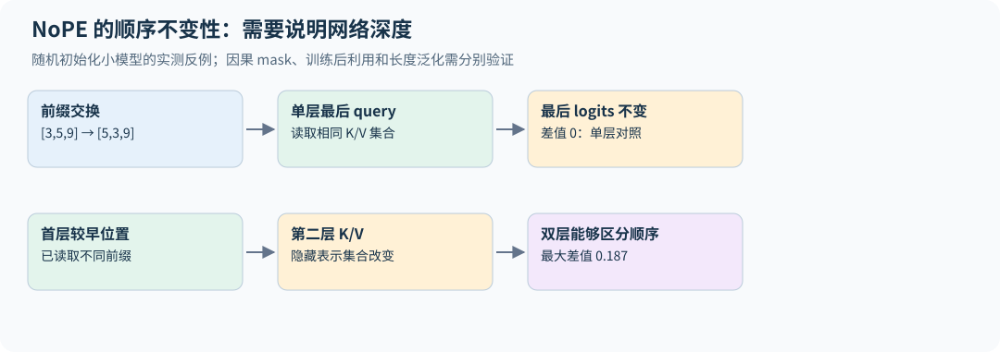

一个具体的位置线索构造是：第一位置的 value 在某通道为 1，其余位置为 0，Q/K 分数全为零。第 t 个位置的因果均匀注意力输出就是 $1/t$，有限长度下可以区分位置。这里用到了可辨认的开头标记；一般的“内容有差异”并不足以保证位置可恢复，而且相邻位置的信号差约为 $1/t^2$，长序列与有限精度下越来越难区分。这个构造说明表示能力，不能代替训练是否学会或能否外推的实验。

## 4.2 RoPE 的核心推导

在二维平面定义旋转矩阵

$$R(\theta)=\begin{bmatrix}\cos\theta&-\sin\theta\\\sin\theta&\cos\theta\end{bmatrix}.$$

把位置 $m$ 的 query 旋转为 $R(m\omega)q$，位置 $n$ 的 key 旋转为 $R(n\omega)k$。因为旋转是正交变换，

$$[R(m\omega)q]^\top[R(n\omega)k]=q^\top R((n-m)\omega)k.$$

位置只通过差值 $n-m$ 进入这个内积。对更高维向量，把坐标分成多个二维平面，各自使用 $\omega_j=\theta_{base}^{-2j/d_h}$。高频刻画近距离变化，低频提供更长的变化尺度。[RoFormer](https://arxiv.org/abs/2104.09864)

旋转不改变每一对坐标的范数，不代表注意力结果不变：query 与 key 的相对旋转改变了夹角。RoPE 通常施加于 Q/K 而非 V。相邻配对与前后半维配对都能实现旋转，但加载已有权重时必须与原模型约定一致。

## 4.3 长上下文外推为什么会失败

公式在任意 $m$ 上都可计算，不意味着模型在未训练过的距离上能正确利用信息。旋转相位、注意力距离分布、干扰 token 数量以及训练任务分布都改变了。

一种直观方法是位置插值：把目标上下文位置除以扩展倍数 $s$，让相位范围接近训练范围。它降低长距离外推压力，却压缩短距离分辨率。改变 RoPE base 或分频段缩放试图兼顾两者；不同方法的最佳设置依赖模型和训练过程。

因此扩长上下文应同时检查短文本能力、长文档检索、多处信息聚合、远距离推理，以及真实任务性能。只在一个“针在草堆”位置成功不能证明模型能可靠理解整篇长文。长上下文微调通常还要调整数据混合、序列 packing 与 batch token 数。

## 4.4 MHA、MQA 与 GQA

标准 MHA 每个 query 头有自己的 key/value 头，即 $h_{kv}=h_q$。MQA 令所有 query 共享一个 KV 头。GQA 取中间值，例如 32 个 query 头分为 8 组，每组共享一套 KV。

$$Q:[B,h_q,T,d_h],\qquad K,V:[B,h_{kv},T,d_h].$$

GQA 不减少 query 头数，因此 score 计算仍涉及 $h_q$ 个头；它减少 K/V 投影和缓存大小。每层注意力权重数在无 bias 时为

$$d(h_qd_h)+2d(h_{kv}d_h)+(h_qd_h)d.$$

当 $d=h_qd_h$ 时，等于 $2d^2+2dd_{kv}$，其中 $d_{kv}=h_{kv}d_h$。把 GQA 的所有层仍按 $4d^2$ 计算，会高估参数量。

本书代码通过 `repeat_interleave` 把 KV 展开到 query 头数以方便验证。它保留小 KV cache，却会产生额外临时张量；生产内核应直接复用共享 KV，避免物理复制。

## 4.5 cache 的位置与 mask 必须一起改变

已缓存前 $S$ 个 token，新输入长度为 $t$，它们的位置应是 $S,\ldots,S+t-1$。第 $i$ 个新 query 能看见 key 位置 $j\le S+i$。对于单 token 解码，这意味着它能看见全部已有缓存与自身。

如果对 `[1,S+1]` 的 score 直接使用左上角的普通下三角 mask，会只允许第一个 key，导致看起来“有 cache”，生成却错误。不同框架对于非方阵 `is_causal` 的对齐约定可能不同，使用前必须验证；本书显式构造位置比较避免歧义。

RoPE 后的 K 可以直接缓存，不应在下次调用中再次旋转。prefill、单 token decode 和多 token 分块 decode 的 logits 应与一次完整前向一致，这比观察生成文字是否合理更强。

## 4.6 三种 mask 和两个位置坐标

因果 mask 回答“能否看未来”，padding mask 回答“这个 token 是否真实存在”，packing 的文档 mask 回答“能否读取相邻但无关的文档”。loss mask 则控制监督项，属于另一个维度。把它们都叫作 `mask` 而没有 shape 和语义，是常见错误源。

以 `[A0,A1,B0,B1,PAD]` 为例，若 A/B 是独立文档、token 不能跨文档读取，可见矩阵为：

```text
         A0 A1 B0 B1 PAD
A0        1  0  0  0  0
A1        1  1  0  0  0
B0        0  0  1  0  0
B1        0  0  1  1  0
PAD       0  0  0  0  0
```

最后一行不能直接做普通 softmax；应剔除 padding query，或给其临时安全 key 并在输出后置零。`examples/objectives.py` 生成的是“1 表示允许读取”的矩阵，没有替调用方掩盖全空行。

独立文档的**目标边界**还要单独处理。对 `[BOS_A,a,EOS_A,BOS_B,b,EOS_B,PAD]` 整串移位，会产生 `EOS_A → BOS_B` 这个跨文档监督项；阻断 attention 并没有删除它。若要等价于逐文档条件似然，该项应屏蔽，`a → EOS_A` 和 `b → EOS_B` 则保留。无 BOS 时，各文档首 token 仍没有对应预测项；需要补 BOS 或明确采用“条件于首 token”的目标。

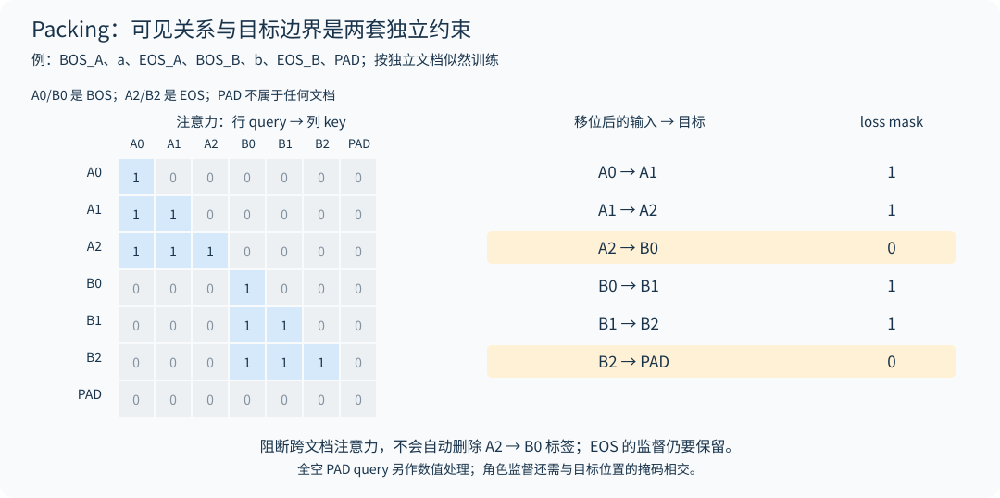

`packed_next_token_mask(document_ids, supervised)` 接收未移位的文档 ID 与可选角色掩码，返回相邻两位置属于同一有效文档、且目标位置需监督的 `[B,T-1]` mask。EOS 的文档 ID 属于它结束的文档；PAD 用 −1；每个独立段使用唯一 ID。它与 `packed_causal_mask` 配合使用，不会自动插 BOS 或重置位置。配套小网络对照逐文档与 packing 的 loss、全部参数梯度及文档间扰动隔离，避免只验证了 attention 矩阵就宣布训练目标等价。

PyTorch SDPA 的布尔 mask 中 `True` 表示允许参与注意力，而 `nn.MultiheadAttention` 的某些布尔 mask 参数中 `True` 表示屏蔽；不能跨 API 直接照搬。非方阵 causal 对齐也必须与缓存坐标核对。[PyTorch 2.11 注意力源码与接口说明](https://github.com/pytorch/pytorch/blob/v2.11.0/torch/nn/functional.py)

position ID 是模型语义位置，cache slot 是物理存储位置，两者不必相同。左 padding 的变长 batch 中，每条样本有效前缀长度不同，不能统一用 padded width 当作 RoPE 起点。滑动窗口丢弃旧缓存后，也不能自然把绝对位置重置为零。教学 `TinyLM` 只接受等长、无 padding、连续增长的缓存；服务系统需要逐请求位置、有效长度和页表管理。

**练习。** 已有 7 个缓存 token，一次送入 3 个新 token。三个 query 的绝对位置和可见 key 数是多少？

**解答。** 位置为 7、8、9，可见 key 数分别为 8、9、10。比较必须基于绝对位置；把它们当作 0、1、2 会同时破坏 RoPE 和因果 mask。

GQA、位置机制和长短注意力混合（滑动窗口与全局层交替见第 7 章与第 30 章）对应 [2026 第三讲](https://github.com/stanford-cs336/lectures/blob/de53a9f979a6ee35f7d13a5e1aadee5ea1afc58e/lecture_03.pdf) 与 [第十讲](https://github.com/stanford-cs336/lectures/blob/de53a9f979a6ee35f7d13a5e1aadee5ea1afc58e/lecture_10.py)。

## 4.7 社区进展：从 4K 到 128K

RoPE base 从 $10^4$ 增大到 Qwen3 的 $10^6$、Mistral Small 的 $10^8$。DeepSeek-V3 与 Kimi K2 在 4K 上下文上完成主体预训练，再用 YaRN（factor 40 与 32）扩展到 128K（配置上限分别为 163,840 与 131,072）；gpt-oss 的模型卡写明用 YaRN 把全注意力层扩展到 131,072，配置中的原始长度为 4,096、factor 为 32。SmolLM3 每 4 层去掉一层 RoPE，是 NoPE 思路的工程化变体。gpt-oss 给每个头加了一个可学习的 sink logit，让注意力可以"不关注任何 token"。

第 30 章从 RoPE 的波长出发推导 PI、NTK 与 YaRN，并讨论注意力汇点和长上下文评估。`long_context.py` 的 YaRN 实现与 transformers 参考实现在这三个模型的真实配置上逐元素一致（最大相对误差约 $10^{-7}$）。

## 4.8 cache 一致性还要求位置规则固定

RoPE 内积依赖相对位置的推导，假定同一频率表用于两边。若动态扩长时把频率由 $\omega$ 改为 $\omega'$，旧 cache 的 K 仍按 $\omega$ 旋转，新 Q 却按 $\omega'$ 旋转，两者不再等价于新规则下完整重算。实现可以固定整次请求的规则，或按算法要求重建/转换旧 key；不能只改配置后继续拼接旧缓存。

只改变旋转、原始 key 固定时，可写 $k_j^{new}=R_j(\omega')R_j(\omega)^\top k_j^{old}$。但在多层 Transformer 中，改位置规则也会改变较早层的 attention 输出，后续层的原始 K 和 V 随之变化；逐层给旧 K 再转一次并不能恢复新规则下整网重算的结果。该转换只说明局部线性关系，是否必须重建整个前缀仍取决于模型计算图。

相对旋转也不证明任意整网平移都严格不变：绝对 embedding、窗口边界、BOS、位置相关缩放与截断都可能破坏这个条件。测试应覆盖不同前缀长度、一次输入多个新 token，以及越过扩长阈值的情形。

换到框架 SDPA 时还有一个独立陷阱：其 dropout 由函数参数决定，模块 `.eval()` 不会自动替你将 `dropout_p` 改为零。典型调用是：

```python
output = F.scaled_dot_product_attention(
    q, k, v, attn_mask=allowed_mask,
    dropout_p=(dropout if training else 0.0),
)
```

这里 `allowed_mask` 必须与 cache 的绝对位置一致；非方阵的 `is_causal=True` 不应未经验证替代它。布尔 mask 语义、GQA 是否展开及实际选中的后端，都应按对应版本核对。[PyTorch v2.11 SDPA 定义](https://github.com/pytorch/pytorch/blob/v2.11.0/torch/nn/functional.py)


---

# 05｜优化器、训练稳定性与实验纪律


## 5.1 AdamW 的每一项分别做什么

对于梯度 $g_t$，Adam 维护一阶、二阶指数滑动平均：

$$m_t=\beta_1m_{t-1}+(1-\beta_1)g_t,\quad v_t=\beta_2v_{t-1}+(1-\beta_2)g_t^2.$$

由于初值为零，早期均值有向零偏差，用 $\hat m_t=m_t/(1-\beta_1^t)$、$\hat v_t=v_t/(1-\beta_2^t)$ 校正。AdamW 更新为

$$\theta_t=(1-\eta_t\lambda)\theta_{t-1}-\eta_t\frac{\hat m_t}{\sqrt{\hat v_t}+\epsilon}.$$

weight decay 在自适应缩放之外直接衰减参数，与把 $\lambda\theta$ 加进梯度再送入 Adam 不同。后者的正则化项也会进入动量与二阶状态，其作用取决于坐标的梯度历史。

这里的 $\eta_t$ 是学习率本身，衰减强度因此是 $\eta_t\lambda$：PyTorch 与 A1 讲义都这样写。AdamW 原论文（Algorithm 2）的衰减只乘日程倍数 $\eta_t$（一个 0–1 之间的系数），不乘基础学习率 $\alpha$。两种写法的差别在扫学习率时显现：固定 $\lambda$ 改变 $\alpha$，按 PyTorch 写法有效衰减也跟着变，按原论文写法则不变。读到"独立 weight decay"或换用不同框架的超参数时，要先确认是哪一种。

$\epsilon$ 不只是防止除零；在梯度很小时，它还改变有效步长。比较优化器实现必须对齐 bias correction、epsilon 放置位置、weight decay 顺序和步数起点。源码见 [optim.py](../examples/optim.py)，测试会用同一梯度序列与 PyTorch AdamW 对照。

还要区别梯度为零与没有梯度。这个 AdamW 实现遇到 `grad=None` 会跳过该参数，包括状态步数与衰减；显式零梯度仍会更新动量、推进步数并执行 weight decay。已有动量也可能继续推动参数。MoE 未激活专家、条件分支或全零优势 batch 中，是否分配零梯度张量会因此改变训练轨迹；“这一项没有任务梯度”不自动等于“参数没变”。

2026 年 A1 讲义的 Algorithm 1 写法与上式略有不同：先做 $\theta\leftarrow\theta-\alpha\lambda\theta$，再更新 $m,v$，最后 $\theta\leftarrow\theta-\alpha_t\,m/(\sqrt v+\epsilon)$，其中 $\alpha_t=\alpha\sqrt{1-\beta_2^t}/(1-\beta_1^t)$。它等价于把上式中的 $\epsilon$ 换成 $\epsilon/\sqrt{1-\beta_2^t}$，两者在任意有限步的有效 $\epsilon$ 上都可能不同，早期差异更大，随步数增加趋于相同。`optim.py` 用的是 PyTorch 的写法。另一个容易忽略的约定是哪些参数做 weight decay：讲义对所有参数都做，本书的 `train.py` 跳过一维参数（RMSNorm 增益），这是很多开源训练代码的惯例。

**常用默认值。** 公开大模型多用 $\beta_1=0.9$、$\beta_2=0.95$（比 Adam 原论文的 0.999 小，二阶矩对近期梯度反应更快，有助于避免损失尖峰），weight decay 0.1，梯度裁剪 1.0，预训练基本不用 dropout。2026 年第三讲的观察是：在讲义所讨论的大数据预训练设置中，weight decay 与余弦学习率日程的相互作用显著影响优化轨迹；这不排除它在数据有限或重复较多时的正则化作用，也不能仅凭 token 数大于参数量推出不会过拟合。

## 5.2 学习率如何与 token 预算对应

warmup 让动量、激活尺度与早期更新逐渐进入工作区间。cosine decay 在预先固定终点的情况下把学习率平滑降至最小值。作业采用的形式是：$t<T_w$ 时 $\alpha_t=\frac{t}{T_w}\alpha_{max}$；$T_w\le t\le T_c$ 时

$$\alpha_t=\alpha_{min}+\tfrac12\Big(1+\cos\big(\pi\tfrac{t-T_w}{T_c-T_w}\big)\Big)(\alpha_{max}-\alpha_{min});$$

$t>T_c$ 后保持 $\alpha_{min}$。用 $N$ 步训练时，应让 $T_c=N$，使学习率在训练结束时降到最低；若步数 $t$ 从 0 计到 $N-1$，最后一次更新的学习率会略高于 $\alpha_{min}$，要么令 $T_c=N-1$，要么接受这点差别。WSD 则分成 warmup、stable、decay，便于在稳定阶段分叉多个退火分支，比较不同训练预算。`optim.py` 提供 `cosine_lr` 与 `wsd_lr` 两种日程。

不要将长 cosine 训练中途的 checkpoint 当成相同预算下完成退火的模型。两者已消耗 token 相同，学习率历史和终点状态不同，会影响缩放定律拟合。课程在 MiniCPM、DeepSeek 等案例中强调了这一点。[2026 第十一讲](https://github.com/stanford-cs336/lectures/blob/de53a9f979a6ee35f7d13a5e1aadee5ea1afc58e/lecture_11.pdf)

全局 batch token 数为 $P\times B_{micro}\times T\times A$，其中 $A$ 为梯度累积次数。增大并行数或累积次数后若仍保持相同步数，总训练 token 已改变。日志必须同时记录 step、tokens seen、学习率和时间。

## 5.3 梯度累积怎样才等价

设本次更新的第 $i$ 个 microbatch 有 $M_i$ 个有效 token，平均损失为 $\ell_i$，正确总损失为

$$\ell=\sum_i\frac{M_i}{\sum_jM_j}\ell_i.$$

只有各 $M_i$ 相等，才等于各 microbatch loss 除以累积次数。可变长度 SFT/RL 中，简单 `/accum_steps` 经常不符合想优化的目标。应先决定是按 token、按序列，还是按 prompt 平均，再实现对应分母。

全局 norm clipping 应在所有 microbatch 梯度累积完成后执行一次：

$$g\leftarrow g\min\left(1,\frac{c}{\|g\|_2+\epsilon}\right).$$

若逐 microbatch 裁剪，得到的是不同优化算法。FP16 loss scaling 时先反缩放再裁剪。分布式参数分片下，还必须计算所有分片的总平方范数，不能独立裁剪每张卡。

裁剪不是非有限值的修复：Inf 乘零仍可变成 NaN，负阈值也没有合法范数含义。教学实现保留 FP64 累积精度，用缩放后平方和避免有限大梯度的平方溢出，并在修改任何梯度前拒绝 NaN/Inf。FP16 `GradScaler` 可按其协议跳过溢出步；那属于明确的失败处理，需单独计数。

## 5.4 BF16、FP16 与 FP32 的角色

FP16 有较多尾数精度但指数范围较窄，BF16 有与 FP32 相同的指数位数但较少尾数位。BF16 更不容易因为数值幅度大而溢出，却仍会损失细小增量。低精度矩阵乘通常配合较高精度累加，具体行为由硬件和算子决定。

混合精度并非把整个训练状态统一 `.half()`。参数、主权重、梯度、Adam 状态、归约、激活可使用不同 dtype。纯 BF16 更新时，当更新远小于参数的可表示间距，更新可能直接消失；FP32 主权重或补偿求和等策略处理的是这个问题。

本书 CPU 模型默认 FP32，便于数值验证。不要把它的内存占用当成 BF16 大模型训练的显存账。

`examples/optim.py` 的 Adam 状态与参数使用同一 dtype，因此该教学优化器默认服务于 FP32/FP64 参数，没有实现 FP32 master weights。将整个模型 `.bfloat16()` 后直接复用它，并不等于实现了正文介绍的生产混合精度方案。autocast 也不负责自动把所有 optimizer state 提升为 FP32；应实际检查参数、梯度和状态的 dtype。

## 5.5 初始化与尺度迁移

线性层 $h'=Wh$ 若输入各维方差近似为一，$\operatorname{Var}(W_{ij})\sim1/d$ 可使输出方差保持常数阶。但保持激活尺度并不自动保持更新尺度。学习率、参数化方式和宽度共同决定一次梯度更新能改变多少函数输出。

μP 的目标是让不同宽度模型拥有可比较的特征更新尺度，从而使小模型调出的超参数更容易迁移。它涉及输入层、隐藏矩阵、读出层各自不同的缩放规则，并区分优化器；不能简单概括为“学习率除以宽度”。验证方法是跨宽度比较激活统计和最优学习率是否趋于稳定，再评估迁移误差。[Tensor Programs V](https://arxiv.org/abs/2203.03466)

Muon 类方法把矩阵梯度的动量近似正交化，若 $M=U\Sigma V^\top$，理想化方向为 $UV^\top$；实际使用近似迭代避免完整 SVD。它改变矩阵更新的几何结构，常需为 embedding、标量参数等配套其他优化器。其优劣必须在匹配调参预算、训练计算量和规模的条件下验证，不能从一个很小模型的速度比赛直接外推。[Muon is Scalable for LLM Training](https://arxiv.org/abs/2502.16982)

## 5.6 一个失败定位顺序

| 现象 | 首先检查 | 有辨识力的实验 |
|---|---|---|
| loss 突然 NaN | 全 mask 行、低精度归约、爆炸 logits | 捕获第一个非有限张量 |
| 小 batch 无法过拟合 | 标签移位、梯度是否存在、参数是否更新 | 单层/短序列退化实验 |
| 训练很好、生成胡乱 | 因果 mask、cache、模板、解码 | 完整前向与逐步前向对照 |
| 多卡结果变差 | 梯度平均、样本重复、token 分母 | 单步全局 batch 等价对照 |
| 恢复训练曲线跳变 | optimizer、scheduler、RNG、data cursor | 连续跑与中断恢复比较 |

checkpoint 应包含模型、优化器、学习率状态、随机数状态、数据游标/采样器状态、tokenizer 版本与配置。只保存模型权重可以继续训练，但不是严格续跑。

## 5.7 为什么“激活不爆炸”还不够：一个更新尺度推导

考虑单样本线性层 $h=Wx$，$x\in\mathbb R^n$，每个坐标为常数阶，因此 $\|x\|^2=\Theta(n)$。SGD 的该层更新为 $\Delta W=-\eta\delta x^\top$，其中 $\delta=\partial\ell/\partial h$。固定同一输入后，这次权重更新导致

$$\Delta h=\Delta Wx=-\eta\delta\|x\|^2=\Theta(\eta n\delta).$$

即使初始化 $W_{ij}\sim\mathcal N(0,1/n)$ 使每个 $h_i$ 方差保持常数阶，更新仍可能随宽度增长。若在这个局部算例中固定 $\delta_i=\Theta(1)$，就需 $\eta=\Theta(1/n)$ 才能控制 $\Delta h_i$；真实网络中的 $\delta$ 又由读出层、损失归一化和其他层共同决定，因此这不是完整 μP 配方。

μP 要同时控制初始化坐标与学习后的坐标变化，并使特征更新不在极限中消失。实施时需区分哪些维度随规模增长、哪些保持固定；input embedding、隐藏矩阵、readout 与优化器不能统一套同一比例。官方 `mup` 实现用 base shapes 标记这些维度，并配套读出层、优化器与 attention 缩放。注意它的某些 Transformer 配方会采用与标准 $1/\sqrt{d_h}$ 不同的缩放，这依赖其宽度极限设计；本书 TinyLM 仍是普通参数化模型。[μP 官方实现](https://github.com/microsoft/mup)

验证分两步：先跨宽度运行少量更新，检查每层激活 `abs().mean()` 和更新幅度是否稳定；再检查最优学习率区间能否迁移。坐标检查通过只验证尺度约定，并不保证最优超参数在深度、数据、batch 或优化器改变后仍然相同。

## 5.8 临界 batch 为什么与梯度噪声有关

假设独立样本梯度均值为 $g$、协方差为 $\Sigma$，$B$ 个样本均值梯度的噪声协方差为 $\Sigma/B$。在简化的各向同性局部模型里，信噪比达到同量级时可定义

$$B_{noise}\sim\frac{\operatorname{tr}\Sigma}{\|g\|^2}.$$

小于该尺度时，增大 batch 能明显降低噪声；远大于该尺度后，再增加样本对每次更新的方向帮助有限，但仍增加计算量。真实“临界 batch”还受曲率、学习率、样本相关性和目标损失影响，不能直接当成硬件最佳 batch。[An Empirical Model of Large-Batch Training](https://arxiv.org/abs/1812.06162)

对语言模型，同文档相邻 token 并非独立，batch token 数和独立梯度样本数不是一回事。报告大 batch 收益时，同时比较时间到目标损失与计算量到目标损失，才能区分系统利用率改善与统计效率下降。

## 5.9 中断恢复不能悄悄改变学习率日程

计划训练 120 步，在第 40 步中断，与“计划训练 40 步并完成 cosine decay”是两种不同轨迹。恢复时不仅要载入权重，还要恢复原计划终点、已完成步数、动量和采样状态。

```bash
python -m examples.train --steps 120 --stop-after 40 --out outputs/resume
python -m examples.train --steps 120 --resume outputs/resume/checkpoint.pt --out outputs/resume
```

`train.py` 的恢复接口固定完整日程，测试比较连续运行与中断恢复后的模型、Adam 状态、随机数状态和日志，要求逐值相同。这只适用于本例确定性 CPU 路径；多进程 data loader、不同 GPU 数及非确定性算子还需要单独处理。activation checkpointing 也要保留随机算子的状态，否则反向重算的 dropout 可能不同于原前向。[PyTorch checkpoint 源码说明](https://github.com/pytorch/pytorch/blob/v2.11.0/torch/utils/checkpoint.py)

## 5.10 从 token 文件喂满训练设备

大语料通常提前编码成整数文件，训练时随机选取 $T+1$ 个连续 ID，前 T 个作为输入、后 T 个作为目标。词表若超过 65,536，`uint16` 无法表示全部 ID；可以用 uint32/int32 保存，在送入 embedding 前转成框架要求的整型。文件头、字节序、tokenizer 指纹、文档边界和 token 总数需要一并记录。

内存映射让操作系统按访问页加载数据，不等于整个文件已经在物理内存中。`.npy` 文件含头部，应该用 `np.load(path, mmap_mode='r')` 或 `open_memmap` 读取；直接 `np.memmap` 原始二进制文件时必须约定 dtype、shape 和 offset。只读映射与 PyTorch 共享内存时不能无意原地写入，可复制选中的小 batch 后再转换。

预取、多个 worker、页锁定内存和异步 host→device 复制可以减少设备等待，但 worker 过多也会造成随机 IO、重复数据和 CPU 竞争。`non_blocking=True` 并不保证所有传输都与计算重叠，还受页锁定、流与同步依赖限制。先在 profiler 中区分取数、复制和计算阶段，再调整缓存、worker 和 batch。

`data.py` 中的 `mmap_next_token_batch` 用只读 `.npy` 演示目标移位和边界检查；`train.py` 的 `--train/--valid` 选项用同样方式直接从 token 文件训练，第 20.4 节的 TinyStories 实验就是这样运行的。它只处理一个已编码文件，不替代支持文档边界、跨卡分片、shuffle buffer、数据游标恢复的生产 loader。[2024 第二讲数据加载部分](https://github.com/stanford-cs336/spring2024-lectures/blob/2eab561d4fc5f0bd77ab68afc85dd563a0b107ba/lecture_02.py)

## 5.11 学习率扫描：真实曲线长什么样

第 20.4 节在 TinyStories 上用同一个 8.3M 参数模型、同样 1,500 步扫描了六个学习率。最终验证损失（nats/token）：

| 峰值学习率 | 3e-4 | 1e-3 | **3e-3** | 1e-2 | 3e-2 | 1e-1 |
|---|---:|---:|---:|---:|---:|---:|
| 1,500 步验证损失 | 2.938 | 2.493 | **2.325** | 2.758 | 3.148 | 4.542 |

损失对学习率呈明显的 U 形，最优点附近相差 3 倍，损失就差 0.17–0.43。学习率过大时（0.03、0.1）训练没有出现 NaN，但损失长时间停在高位：0.1 时验证损失从第 100 步的 4.69 回升到第 500 步的 5.21，在 5.0–5.2 之间徘徊到第 1000 步，之后才持续下降（第 1500 步为 4.54）。这次扫描没有做去掉梯度裁剪的对照，不能把"没有发散"归因于裁剪；AdamW 的自适应比例有助于控制尺度，但 $|\hat m|/\sqrt{\hat v}$ 并没有一般性的上界 1，不能由此保证逐坐标更新不超过学习率。扫描到最优值的 33 倍仍未发散，所以这个实验还没有找到发散边界。作业要求学习率扫描里至少包含一个发散的运行，就要继续增大学习率，或者去掉裁剪做对照。

## 5.12 社区进展：Muon 的稳定性与低精度优化器状态

Kimi K2 用 Muon 预训练了 1T 参数的 MoE 模型。报告指出，扩大规模后 Muon 比 AdamW 更容易出现注意力 logit 爆炸；对完整 key 做 QK-Norm 会破坏 MLA 的简单投影吸收路径，因此不能无代价照搬（第 7.10 节）。它的解法 QK-Clip 是：每步更新后检查每个头在当前 batch 中的最大 logit $S^h_{max}$，超过阈值 $\tau$ 时把该头的 $W_q$、$W_k$ 各乘以 $\sqrt{\tau/S^h_{max}}$。这一步不改变当前步的前向和反向计算，只约束权重的增长。对 MLA，只缩放各头独有的部分：$q^C$、$k^C$ 各乘 $\sqrt{\gamma_h}$，$q^R$ 乘 $\gamma_h$，所有头共享的 $k^R$ 不动，其中 $\gamma_h=\min(1,\tau/S^h_{max})$。Muon 与 QK-Clip 合称 MuonClip，K2 用它训练 15.5T token，全程没有一次 loss spike。

精度方面，DeepSeek-V3 把 AdamW 的一阶、二阶矩改存为 BF16，主权重和梯度仍保留 FP32（第 34.3 节）。这与第 5.4 节"更新远小于参数的可表示间距时会直接消失"的分析一致：精度要留在累加更新的地方。

## 5.13 Muon 规模化：矩阵形状、更新尺度与状态切分

对 $W\in\mathbb R^{m\times n}$，满秩时理想化正交化动量 $O=UV^\top$ 有 $\|O\|_F^2=\min(m,n)$，所以逐元素 RMS 为 $1/\sqrt{\max(m,n)}$。直接使用 O 会使宽矩阵和窄矩阵的每参数更新量不同。Moonlight 的规模化研究采用

$$\Delta W=-\eta\left(0.2\sqrt{\max(m,n)}\,O+\lambda W\right),$$

使理想化动量方向的 RMS 约为 0.2，并配合 weight decay。系数 0.2 是论文匹配 AdamW 更新尺度的经验选择，不是正交化的数学常数。实际 Newton–Schulz 用有限迭代，输出也不必是精确极分解；测试 SVD 的尺度关系只能核验该直觉，不代表复现了训练效率。[Muon is Scalable for LLM Training，§2.2](https://arxiv.org/html/2502.16982v1)

Muon 常用于二维隐藏权重，embedding、读出层和一维参数可采用其他优化器。必须明确矩阵的重排、QKV 是否合并，以及专家矩阵的边界，不能把所有参数先摊平成一个矩阵后正交化。长方形矩阵常先选择较小侧做迭代以节约算力，这改变实现成本而不改变目标矩阵的形状约定。

分布式训练还要说明正交化作用于完整梯度还是局部分片：一般有 $\operatorname{polar}([G_1,G_2])\ne[\operatorname{polar}(G_1),\operatorname{polar}(G_2)]$。对分片分别执行正交化，是另一种更新规则，不能自动声称与单机等价。状态所有权、必要通信与全矩阵/分片更新应有小矩阵对照，之后才比较吞吐与收敛。MuonClip 的注意力稳定约束解决另一类问题，应与更新 RMS 匹配分开消融。

## 5.14 Muon 的几何：谱范数约束下走多远

设当前梯度/动量矩阵为 $G=U\Sigma V^\top$。线性化损失后，在谱范数步长约束下求最陡下降方向：

$$\min_{\|\Delta W\|_2\le\eta}\langle G,\Delta W\rangle_F=-\eta\|G\|_*,\qquad \Delta W=-\eta UV^\top.$$

$\|G\|_*$ 是奇异值之和。该结论来自谱范数与核范数的对偶性：每个奇异方向可使用至多 $\eta$ 的步长，所以让它们与 G 反向即可达到下界。SGD 保留奇异值大小，Muon 的理想化方向则把非零奇异方向的增益拉到相近量级；这解释了它改变矩阵更新几何的含义，并不证明非线性训练长期最优。[Muon 原论文的正交化和形状尺度](https://arxiv.org/html/2502.16982v1)

有一个边界：作为优化器的方向选择，零梯度应保持零任务更新（weight decay 另计）。实际 Newton–Schulz 多项式保留零奇异方向；对应的部分极分解写作 $U\operatorname{diag}(\mathbf1[\sigma_i>0])V^\top$。满秩时其平方 Frobenius 范数为 $\min(m,n)$，秩 r 时为 r。第 5.13 节的 RMS 公式适用于满秩；秩亏时尺度为 $\sqrt{r/(mn)}$。直接对零矩阵取 SVD 后无条件用 `u @ vh`，会把任意零空间基当成更新，本书的数值工具显式排除这些方向。

## 5.15 weight decay、梯度累积与严格恢复的条件

暂时忽略任务梯度，AdamW 的衰减满足

$$\theta_K=\theta_0\prod_{t=1}^K(1-\lambda\eta_t)\approx\theta_0\exp\!\left(-\lambda\sum_t\eta_t\right).$$

近似要求每个 $\lambda\eta_t$ 足够小。相同 $\lambda$ 配上不同步数或日程面积，累计收缩不同；batch 翻倍、token 预算不变时，更新次数往往减半。因此优化器对照不能只抄同一个 weight decay 数字。[Decoupled Weight Decay](https://arxiv.org/abs/1711.05101)

梯度累积的等价也有前提：参数在所有 microbatch 间固定、随机行为按协议一致、没有跨 microbatch 统计依赖。MoE 容量路由、CLIP 的 batch 负例、BatchNorm 或按组 reward 归一化不能任意切断；否则即使 loss 分母正确，前向目标也已改变。

严格恢复需要恢复“实验”，不只是张量。`train.py` 将学习率/日程、batch/context、优化器超参数、评估协议、线程、PyTorch 与训练代码指纹、训练/验证 token 内容哈希写入 checkpoint；同一路径的文件被替换也会被检测。旧 checkpoint 缺少这些信息时不冒充精确续跑，可另行加载权重作为新的训练阶段。内容哈希需一次顺序读文件。本例 `tokens_per_second` 只计训练循环及其中的验证，哈希和初始化属于启动开销，报告端到端时间时需另计。

恢复文件本身也需要失败语义：先把完整 checkpoint 写到同目录临时文件，写入成功后再替换正式文件，避免磁盘写满或序列化异常破坏上一个可恢复状态。优化器参数组则应在任何参数更新之前统一检查；否则第二组的非法学习率报错时，第一组可能已经更新。本书分别用模拟写入失败和两参数组反例检查这两条不变量。

训练 loss 有限也不代表本次运行可以参与模型选择。验证 loss 若出现 NaN/Inf，应终止运行并标记为失败，保存已实际完成的更新次数；不能只把 JSON 数值改为 null 后仍返回成功。初始验证失败意味着完成 0 次更新，最后一次更新后的验证失败则保留那个步数，但该运行仍不能作为最优 checkpoint。

## 练习

**1．** 把 batch 翻倍后验证损失更低，是否说明"大 batch 更好"？

**解答。** 尚不能。若步数不变，你也训练了两倍 token；若 token 不变，优化器更新次数减半。应分别匹配训练 token、计算预算与学习率调参，再判断关键因素。

**2．** $\beta_2=0.999$ 与 $\beta_2=0.95$ 的二阶矩分别大约记住最近多少步的梯度？突然出现一个大梯度时，哪一个的更新幅度更容易失控？

**解答。** 指数滑动平均的有效窗口约 $1/(1-\beta_2)$：分别约 1000 步和 20 步。固定一阶矩与历史二阶矩时，较小 $\beta_2$ 会更快把新尖峰计入分母，往往减小这次自适应比例。例如长期 $m=v=1$ 后出现 $g=100$，取 $\beta_1=0.9$、忽略 bias correction 与 epsilon，$m=10.9$；$\beta_2=0.999$ 得 $v=10.999$、比例约 3.29，0.95 得 $v=500.95$、比例约 0.487。实际历史、bias correction、裁剪与参数组不同，不能仅凭 $\beta_2$ 判断哪次更新必然失控。

**3．** 余弦日程设 $\alpha_{max}=3\times10^{-3}$、$\alpha_{min}=3\times10^{-4}$、$T_w=75$、$T_c=1500$。第 787 步的学习率是多少？

**解答。** $787.5$ 是 $T_w$ 与 $T_c$ 的中点，第 787 步几乎就在中点，余弦项约为 0，$\alpha\approx\alpha_{min}+\frac12(\alpha_{max}-\alpha_{min})=1.65\times10^{-3}$。


---

# 06｜混合专家：把容量和每 token 计算量分开

## 6.1 稀疏的是计算路径

MoE 通常把一个 MLP 替换成 $E$ 个专家 $F_e$ 和 router。对 token 表示 $x$ 计算路由分数，从中选择 $k$ 个专家：

$$y=\sum_{e\in\mathrm{TopK}(r(x))}g_e(x)F_e(x).$$

若每个专家有 $n_e$ 个参数，总专家参数约为 $En_e$，每 token 激活的专家参数约为 $kn_e$。但所有参数仍需要存储、加载或分片管理，优化器状态也不会凭空消失。注意力、共享层与 router 的成本不能忽略。

例如 16 个专家、top-2、每专家 10M 参数，专家总容量为 160M，每 token 用到 20M 专家参数。这不等于整个模型只有 20M 参数的训练成本，更不保证实际运行时间与 20M dense 模型相同。

## 6.2 top-k 不可导，router 为什么还能学

所选专家集合随分数变化是离散的。实践中通常对被选中的 gate 权重求导，而不对“谁入选”这个离散操作求导。梯度能改变已选路由的权重与相应专家，未选专家可能长期得不到任务梯度，所以负载均衡很关键。

一个微妙例子：若 top-1 后只对选中分数重新 softmax，单元素 softmax 恒为一，task loss 对这个 gate 没有梯度。不同路由方案会保留全专家 softmax 后的所选概率，或借助额外损失和其他机制。不要只凭 `topk` 代码看起来合理就认为 router 能学习。

对 top-k gate 是否重新归一化、用 softmax 还是 sigmoid、是否添加噪声、是否有共享专家，都改变训练与系统行为。课程对这些差异进行了跨模型比较。[2026 第四讲](https://github.com/stanford-cs336/lectures/blob/de53a9f979a6ee35f7d13a5e1aadee5ea1afc58e/lecture_04.pdf)

## 6.3 负载均衡是在同时优化统计与系统

简化 top-1 情况，令 $f_e$ 是分配给专家 $e$ 的 token 比例，$p_e$ 是 router 概率的 batch 均值，可使用

$$L_{bal}=\alpha E\sum_ef_ep_e.$$

$f_e$ 通常视为不可导统计量，梯度经 $p_e$ 传播。它倾向于降低过载专家的路由概率，但不是直接强制每个专家 token 数完全相等。过强的平衡损失会让模型为均匀利用牺牲任务性能。

top-k 时还要写清负载分母。本书 `TopKMoE` 的 `load[e]` 是“专家 e 的分配次数 / 全部 $BTk$ 次分配”，因此各项和为 1；“收到过专家 e 的 token / BT”则各项和为 k。例如两条 token 都选中专家 0 和 1，前一种记为 $(0.5,0.5,0,\ldots)$，后一种为 $(1,1,0,\ldots)$。两者差 k 倍，若直接代入同一辅助损失且不调整系数，会改变正则强度。

另一类方法根据历史负载调整用于选路的 bias，使过载专家下次更难被选中。这类控制与 gate 的任务权重可分开设计。“无辅助损失”必须看清是指取消哪一级损失，不能理解为训练没有任何平衡机制。

router 的 FP32 计算与 z-loss 可控制 logits 的动态范围，减少数值不稳定。专家利用率、空专家比例、最大/平均负载比和路由熵应进入训练日志。

任务梯度未进入未选中的专家权重，不等于未选专家的 router logit 无梯度：若门权来自全局 softmax，归一化分母仍耦合所有路由 logits。容量溢出时的丢弃也需检查因果性；若决定当前 token 是否保留依赖后续 token 的竞争，即使专家内部没有跨 token 注意力，也可能泄露未来。应对完整路由/容量路径运行未来扰动测试。

## 6.4 capacity 与 token dropping

平均每专家收到 $BTk/E$ 个 token。若每专家缓冲容量设为

$$\mathrm{capacity}=\left\lceil c\frac{BTk}{E}\right\rceil,$$

$c$ 为 capacity factor，过载 token 可能被丢弃、重路由或延后。丢弃规则可能让同一个请求的结果依赖同 batch 的其他请求。无 dropout、固定随机种子仍不代表 MoE 推理完全不受调度影响。

dropless 实现通过可变尺寸专家 batch、分组 GEMM 或块稀疏运算减少丢 token，但负载不均衡仍会造成尾部延迟。小 batch 下每专家矩阵很小，Tensor Core 利用率可能下降。

## 6.5 专家并行的通信路径

token 从原所在设备发到专家设备，完成专家计算，再发回并按 gate 合并。核心通常是两次 all-to-all 式 dispatch/combine。通信量随 token 激活大小与 top-k 增长，且受最拥挤链路和最慢专家限制。

更细粒度的专家让固定 active FLOPs 下的组合更丰富；共享专家提供通用计算路径；限制跨设备路由可降低通信，但限制了选择空间。架构与网络拓扑应该一起设计。

2026 年第四讲整理了近期公开 MoE 的路由配置（"细粒度比例"指每个专家的 MLP 宽度相对于同尺寸 dense 模型 MLP 的比例）：

| 模型 | 路由专家数 | 每 token 激活 | 共享专家 | 细粒度比例 |
|---|---:|---:|---:|---:|
| Switch Transformer | 64 | 1 | 0 | — |
| Mixtral | 8 | 2 | 0 | — |
| DBRX | 16 | 4 | 0 | — |
| DeepSeek V1 | 64 | 6 | 2 | 1/4 |
| Qwen 1.5 MoE | 60 | 4 | 4 | 1/8 |
| OLMoE | 64 | 8 | 0 | 1/8 |
| DeepSeek V3 | 256 | 8 | 1 | 1/14 |
| Llama 4 Maverick | 128 | 1 | 1 | 1/2 |

多数近期模型走向更多、更细的专家，每个 token 激活的专家也更多；但也有明显的反例，例如表中的 Llama 4 Maverick 每个 token 只激活 1 个专家，gpt-oss 也只激活 4 个。关于共享专家，证据并不一致：DeepSeek 的消融显示更多专家和共享专家都有帮助，OLMoE 的消融则显示细粒度有收益、共享专家没有。DeepSeek 三代 MoE 也展示了平衡机制的演进：V1 用专家级与设备级辅助损失；V2 增加通信平衡损失并限制每个 token 最多路由到 $M$ 台设备；V3 改为 sigmoid 打分、按历史负载调整每个专家的选路偏置（无辅助损失），只保留一个很小的序列级辅助损失。

upcycling 用 dense 模型初始化多个专家，再打破对称性并继续训练。它能复用已有知识，却不意味着复制完模型就获得了有效专家分工。微调数据量小还可能让路由或少数专家过拟合。

运行 `python -m examples.extensions` 可观察 top-k 路由和专家负载。教学代码为便于检查而计算所有专家、最后乘稀疏 gate，因此没有稀疏计算的速度收益；它演示的是路由数学。测试专门检查 top-1 保留全 softmax 概率时，router 能从任务 loss 获得非零梯度。[代码](../examples/extensions.py)

**练习。** 一个 MoE 的 active parameter 数减半，为什么推理延迟可能没有减半？

**解答。** 权重访问、KV 访问、router、跨卡发送、负载不均衡和小矩阵效率都可能主导时间。active 参数是计算估计的一项，不是端到端延迟模型。

## 6.6 token choice、expert choice 与全局匹配

把一批 token 与专家的 router 分数写成矩阵 $S\in\mathbb R^{M\times E}$。token choice 每行选 k 个专家，控制每个 token 的计算量，却不直接保证每列负载。expert choice 每列选固定数量的 token，控制每个专家的 batch 大小，但每个 token 可能被零个、一个或多个专家接收。

全局匹配可以引入二值分配变量 $a_{te}$，优化

$$\max_a\sum_{t,e}a_{te}S_{te},\qquad\sum_ea_{te}=k,\quad\sum_ta_{te}\le c_e.$$

它同时表达 token 预算与专家容量，但需检查总容量是否足够，并支付匹配或近似求解成本。soft relaxation、带噪路由和哈希路由是在质量、可微性、均衡与计算成本之间的不同折中。它们不是换个 `topk` 维度就得到完全相同的语义。[2026 第四讲第 27–30 页](https://github.com/stanford-cs336/lectures/blob/de53a9f979a6ee35f7d13a5e1aadee5ea1afc58e/lecture_04.pdf)、[Expert Choice Routing](https://arxiv.org/abs/2202.09368)

若 expert choice 在一整条自回归序列的 token 间共同争夺容量，某个较早 token 是否被选中可能受到后续 token 的分数影响。这会破坏“前缀变化不依赖未来”的严格逐 token 因果实现，除非设计独立的路由分组或其他约束。分组粒度和在线解码时如何路由都属于模型定义，不能只用训练 loss 判断正确性。

**算例。** 8 个 token 各选 2 个专家，共需 16 次 token→专家分配；4 个专家若各容量 3，总容量只有 12，无论 router 分数怎样都无法满足全部分配。此时必须改变容量、丢弃/改派规则或 token 预算，而不是希望均衡 loss 自动解决不可行约束。

**练习 3．** 一个 MoE 有 64 个专家、每 token 选 top-6，加 2 个共享专家，每个专家 MLP 参数 22M。总专家参数与每 token 激活的专家参数各多少？

**解答。** 总计 $(64+2)\times22=1{,}452$M；每 token 激活 $(6+2)\times22=176$M，约为总量的 12%。注意力、embedding 与 router 另算；显存要放下全部 1.45B，计算只用到 176M。

**练习 4．** 4 个专家、top-1 路由，一个 batch 中各专家分到的 token 比例为 $f=(0.7,0.1,0.1,0.1)$，平均路由概率为 $p=(0.6,0.15,0.15,0.1)$。按 6.3 节公式（$\alpha=1$）的平衡损失是多少？完全均衡时呢？

**解答。** $4\times(0.42+0.015+0.015+0.01)=1.84$；完全均衡时 $f_e=p_e=0.25$，损失为 $4\times4\times0.0625=1$。这里 $f$ 由路由概率的 argmax 产生，两者正相关，此时损失大于 1 表示路由集中，梯度会压低专家 1 的概率。若 $f$ 与 $p$ 反向（概率高的专家分到的 token 反而少），损失也可能低于 1，所以它的数值不是通用的集中度指标。

## 6.7 社区进展：真实 MoE 的配置

第 29.3 节逐项读了 2025 年的 MoE 配置：

- 除 gpt-oss-20b 与 MiniMax-M1（均为 32 个）外，表中专家数为 128–512，每个专家很窄，Qwen3-30B-A3B 的专家宽度只有 $d$ 的 0.375 倍；
- 共享专家没有共识：DeepSeek-V3、Kimi K2、GLM-4.5 各保留 1 个，Qwen3 MoE 和 gpt-oss 不用，Qwen3-Next 又加回了 1 个；
- DeepSeek-V3 与 GLM-4.5 的前 3 层保持 dense；
- DeepSeek-V3 每层存有无辅助损失路由的偏置 `e_score_correction_bias`；gpt-oss 的模型卡没有说明负载均衡方法。

Kimi K2 的稀疏度缩放实验固定激活参数、提高总专家数与激活专家数之比，在相同验证损失下节省 FLOPs，据此把专家数从 256 增加到 384。

## 6.8 一个 batch 究竟会读多少专家权重

单 token 只选 k 个专家，不意味着整个 decode batch 也只读取 k 份权重。若 E 个专家均匀路由，每个 token 从中选 k 个不同专家，且 token 间选择独立，则 batch B 中至少被访问一次的专家数期望为

$$\mathbb E[E_{used}]=E\left[1-(1-k/E)^B\right].$$

推导只需给每个专家一个“至少被选一次”的指示变量：单 token 不选它的概率是 $1-k/E$，B 次都不选是其 B 次方，再对 E 个专家求和。例如 $E=128,k=4$，B 为 1、8、32、128 时，期望访问 4、28.7、81.7、125.8 个专家。`mechanisms.py` 复算这组数值；真实路由非均匀/相关时应直接统计 unique experts，而不是照套均匀模型。

若单 token 选中专家 e 的概率为 $r_e$，每次仍选 k 个不同专家，则 $\sum_er_e=k$。只要求 token 间独立时，非均匀版本为 $\mathbb E[E_{used}]=\sum_e[1-(1-r_e)^B]$。当 $B>1$，括号内是关于 $r_e$ 的凹函数，因此固定总选择量下，均匀路由给出最大的期望专家并集。路由更集中可能少读一些专家权重，却使热点专家的计算和通信更拥挤；“访问专家少”和“负载均衡好”不是同一指标。

这给出 MoE 的两面：大 batch 带来更多专家权重读取，也让每个专家得到更大的 token 矩阵、更好复用权重。低 batch 的 active FLOPs 优势可能被许多小 GEMM 与 dispatch 延迟抵消；大 batch 又可能接近读遍全专家。应同时记录每专家 token 数、批次专家并集、远程路由比例和端到端时间。第 29 章的 active 参数表只描述单 token 主项，不能预测整批 HBM 读取量。


---

# 07｜注意力替代方案：用怎样的记忆换取长上下文效率

## 7.1 精确注意力昂贵在哪里

全注意力为每个 query 比较每个 key，score 数量为 $T^2$。FlashAttention 可以避免保存完整矩阵，但仍计算这些配对。要进一步改变复杂度，需要改变连接结构、核函数或历史状态的表示。

本章重点来自 [2026 第四讲前半部分](https://github.com/stanford-cs336/lectures/blob/de53a9f979a6ee35f7d13a5e1aadee5ea1afc58e/lecture_04.pdf)，是相对 2024/2025 年 MoE 主题的重要扩充。

滑动窗口只看最近 $w$ 个位置，将每层计算降低到 $O(Twd_h)$，但远处信息需要经过多层中间位置传递。混合局部层与全局层保留周期性的直接长距离访问。稀疏检索式注意力先用廉价索引选候选 key，再计算较贵匹配；收益取决于候选选择开销与召回率。

## 7.2 线性注意力的结合律

若暂时移除 softmax，则

$$QK^\top V=Q(K^\top V).$$

左式形成 $T\times T$ 矩阵，右式先形成 $d_h\times d_v$ 状态。对因果版本可递推

$$S_t=S_{t-1}+k_tv_t^\top,\qquad y_t=q_t^\top S_t.$$

每步只更新一个固定大小状态。对归一化核注意力，用特征映射 $\phi$ 替代 key/query，并维护

$$S_t=\sum_{i\le t}\phi(k_i)v_i^\top,\quad z_t=\sum_{i\le t}\phi(k_i),\quad y_t=\frac{\phi(q_t)^\top S_t}{\max(\phi(q_t)^\top z_t,\epsilon)}.$$

正分母下不加保护项才是精确的归一化核平均；上式按教学代码采用下限保护。它与“分母加 epsilon”不同：后者即使分母很大也改变数值，下限保护只在小分母区改变结果。两种稳定化都需明确约定；比较显式矩阵与递推时必须使用同一种。

这里不能把 softmax 任意搬进搬出矩阵乘。普通 softmax attention 并不等于这个表达式，除非使用特定近似和对应误差分析。线性复杂度来自改变算子，也可能牺牲精确检索能力。

配套 [extensions.py](../examples/extensions.py) 用 $\phi(x)=\operatorname{ELU}(x)+1$，分别显式形成因果核矩阵和递推 $S_t,z_t$，对照输出与梯度。两者相等说明递推正确实现了该核注意力，不说明它与 softmax 注意力相等。

数学上的正特征也会在浮点实现里丢失。对负 x，直接先算 $e^x-1$ 再加 1，会在 x 足够负时消减为零；应按 $\phi(x)=e^x$（$x<0$）、$x+1$（$x\ge0$）计算。示例还把 FP16/BF16 的特征、状态和分母提升到 FP32，最后再转回输入 dtype；相关矩阵乘显式关闭外层 autocast，否则 `.float()` 后仍可能再次降精度。$10^{-8}$ 在 FP16 中也可能变成零，原本的分母保护退化为 0/0。输出与梯度测试同时覆盖负值、半精度、autocast 和不同的 value 宽度，并拒绝不等长 Q/K/V，避免 `zip` 静默丢掉尾部。

“线性”指固定特征宽度下对序列长度的增长：递推每步仍要做约 $d_kd_v$ 的状态更新，状态存储约 $d_kd_v+d_k$ 个数。训练反向的激活可随长度增长，chunk 算法和重计算决定峰值；固定 decode 状态不等于训练显存固定。

## 7.3 固定状态不是免费的无限记忆

所有历史被压进固定大小 $S_t$，序列越长，不同信息越可能相互干扰。全注意力保留所有 key/value，允许对个别历史位置重新查询；递归状态无法任意恢复已经被混合或遗忘的细节。

加入门控 $S_t=\gamma_t S_{t-1}+k_tv_t^\top$ 可主动遗忘。更一般的状态空间模型写成

$$s_t=A_ts_{t-1}+B_tx_t,\qquad y_t=C_ts_t.$$

选择性状态空间模型让部分系数依赖输入，决定保留与写入什么。若只逐 token 执行，训练并行度有限；结构化扫描与分块算法利用递推的可组合性恢复高效并行。Mamba 与 Mamba-2 分别提供了选择性状态建模和状态空间对偶视角。[Mamba](https://arxiv.org/abs/2312.00752)、[Mamba-2](https://arxiv.org/abs/2405.21060)

## 7.4 Delta rule：先纠正旧记忆，再写新记忆

用 $S\in\mathbb R^{d_k\times d_v}$ 存储 key→value 映射，预测 $\hat v=S^\top k$。对平方误差 $\frac12\|S^\top k-v\|^2$ 做一步梯度下降：

$$S'=S+\beta k(v-S^\top k)^\top.$$

它不只是不断叠加新关联，还减去当前 key 方向上旧预测的错误。加入遗忘可先置 $\widetilde S=\gamma S$，再执行

$$S'=\widetilde S+\beta k(v-\widetilde S^\top k)^\top.$$

这是理解 gated delta 类方法的简化形式；完整模型还包含归一化、投影、门控约束和适合硬件的 chunk 算法。稳定步长受 key 范数影响，所以归一化并非可有可无的小修饰。

稳定条件可从同一个关联的残差直接看出。令 $e=v-S^\top k$，不加遗忘时更新后 $e'=v-S'^\top k=(1-\beta\|k\|^2)e$。对非零 k 和非零残差，单次关联误差严格缩小需 $0<\beta\|k\|^2<2$；等于 1 时该关联一次写准，超过 2 时重复写入会放大误差。单位范数 key 把阈值简化为 $0<\beta<2$。这只针对固定 k、v 的局部更新，不保证不同关联互相干扰时整条序列稳定。

## 7.5 MLA 是压缩缓存的另一条路线

Multi-head Latent Attention 把 K/V 的生成建立在较低维 latent $c_t$ 上，例如 $k_t=W_Kc_t,v_t=W_Vc_t$。若只缓存 $c_t$，解码时可用投影重建，或通过矩阵代数把部分投影吸收到 query/输出变换中。

难点是位置编码与这些代数变换未必交换；因此实际架构会把位置相关与内容相关分量作专门设计。缓存大小应包含 latent 和额外位置分量，不能只数 $c_t$ 就声称完整节省。[DeepSeek-V2](https://arxiv.org/abs/2405.04434)

## 7.6 公开模型怎样混合两类层

纯线性注意力或纯状态空间模型在精确检索类任务上通常吃亏，因此采用线性注意力或状态空间层的近期大模型几乎都做成**混合**结构（多数大模型仍然只用 softmax 注意力，见第 29 章）：大部分层是固定状态的线性层，少数层保留全注意力。2026 年第四讲列举了几种配比：MiniMax-M1 与 MiniMax-Text-01 是 7 层线性注意力配 1 层全注意力；Qwen 3.5 / Qwen-Next 是 3 层 gated delta net 配 1 层注意力；Nemotron 3 是大约 3:1 的 Mamba 与注意力混合。讲义也指出，这方面的受控消融并不多，现有证据只说明较低的全注意力比例下损失仍可接受。

另一条路线是**稀疏注意力**而不是换算子：DeepSeek Sparse Attention（DeepSeek-V3.2、GLM-5 使用）用一个很轻的索引器为每个 query 选出少量候选 key，再只在这些 key 上做精确注意力。它可以在短上下文稠密预训练之后再适配，不必从头训练。收益取决于索引器的召回率：漏掉的关键 token 无法再被注意到。

混合比例、哪几层放全注意力、全注意力层是否也用滑动窗口，都是架构超参数。比较时要固定训练 token 与 FLOPs，并同时报告长上下文检索与普通语言建模两类指标。

## 7.7 如何比较替代方案

| 方案 | 历史状态 | 主要收益 | 必须验证 |
|---|---|---|---|
| 全注意力 | 每个 token 的 KV | 精确逐位置访问 | 长序列计算与缓存 |
| 窗口注意力 | 最近窗口 KV | 有界局部成本 | 远距离依赖 |
| 线性/递归状态 | 固定矩阵或向量 | 解码状态不随长度增长 | 关联记忆与检索干扰 |
| 混合架构 | 两类状态 | 平衡能力与资源 | 混合比例与跨层配合 |
| latent KV | 压缩历史 latent | 较小 KV 存储 | 投影开销、位置处理 |

**练习。** 将上下文从 4K 增到 64K，固定状态模型的缓存不变，是否证明它更好？

**解答。** 只证明某个资源维度更有利。需要同时比较训练预算、有效信息保留、任务准确率、实际延迟及状态更新成本。相同参数量不保证相同 active FLOPs，更不保证相同检索能力。

**练习 2．** 一个 32 层模型采用 3:1 的线性注意力与全注意力混合，上下文从 8K 增到 128K。与全注意力模型相比，KV cache 大约缩小多少？

**解答。** 在相同 KV 头宽和精度下，仅随长度增长的 KV 部分为全注意力的 1/4；总历史状态为 $M_{hybrid}(T)=M_{full}(T)/4+M_{state}$，比值为 $1/4+M_{state}/M_{full}(T)$，随 T 增长才趋近 1/4。例如全注意力 8K 时为 1 GiB、线性层固定状态合计 0.25 GiB，则混合总量为 0.5 GiB、比值 1/2；128K 时全注意力为 16 GiB，混合为 4.25 GiB、比值约 0.266。固定状态不能在短上下文自动忽略。

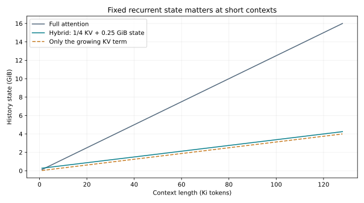

## 7.8 社区进展：混合层已经进入大模型

本章讨论的混合方案在 2025 年的开源模型中都有了实例：

- Qwen3-Next：每 4 层只有 1 层全注意力，其余 36 层是 Gated DeltaNet，全注意力层的输出再乘一个 sigmoid 门；
- MiniMax-M1：80 层中只有 10 层是 softmax 注意力；
- gpt-oss：一半层是 128 token 的带状窗口，一半是全注意力。

32K 上下文下，Qwen3-Next 每请求的 KV 只有 0.75 GiB，激活参数相近的 Qwen3-30B-A3B 是 3.0 GiB。见第 29.4 节与第 30.4 节。

## 7.9 从递推到并行扫描：结合律在哪里

考虑 $h_t=A_th_{t-1}+b_t$，把一步表示成仿射变换 $(A_t,b_t)$。先做 1 再做 2 的组合是

$$(A_2,b_2)\circ(A_1,b_1)=(A_2A_1,\ A_2b_1+b_2).$$

组合满足结合律但一般不交换。因此可用树状前缀扫描求所有累积变换，依赖深度由 T 降至 $\log T$；不能把它理解为所有时间步本来互不依赖。若 A 是稠密状态矩阵，组合本身很贵；对角、标量或其他结构化 A 才使扫描经济。若 A 还依赖尚未算出的旧状态，也不能先把整列 A 并行准备好。[Mamba-2 的递推、矩阵与结构化状态空间对偶](https://arxiv.org/html/2405.21060v1)

`affine_scan` 用对角 A 和倍增扫描，对照串行递推的输出及全部梯度，包含非 2 次幂长度。它使用 $O(T\log T)$ 工作量来展示结合律；生产算法的 work-efficient scan、chunk 内 GEMM、跨 chunk 传状态是另一个优化层次。SSM 与注意力的对偶针对特定结构算子，不表示任意 softmax attention 都可无损压成固定状态。

## 7.10 MLA 投影吸收：把“省 KV”真的写出来

对一个头采用列向量，$k_j=W_Kc_j,v_j=W_Vc_j$。定义 $\widetilde q=W_K^\top q$，则

$$q^\top k_j=\widetilde q^\top c_j,\qquad W_O\sum_ja_jv_j=(W_OW_V)\sum_ja_jc_j.$$

第一式让 query 直接与缓存 latent 比较；第二式先按注意力权重聚合 latent，再投影回输出。多头必须分别算各自的 $a_j$ 与 latent 加权和，不能把多个头的 softmax 合为一个。推理权重固定时，投影乘积可预先合并；训练中仍需正确传回每个原矩阵的梯度。[DeepSeek-V2 §2.1.2–2.1.3](https://arxiv.org/html/2405.04434v5)

若完整 key 还经过位置相关的 $R_j$，分数变成 $q^\top R_i^\top R_jW_Kc_j$，中间旋转依赖 j，一般无法预先吸收到单个 query 矩阵。解耦 RoPE 把内容内积与独立的位置内积相加，所以缓存要包含 latent 和 RoPE key；非线性 key norm 也会改变吸收条件。

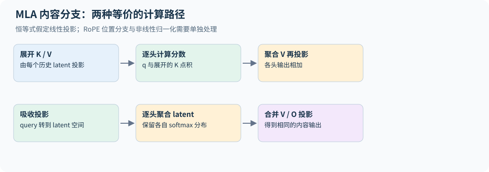

`mla_content_output` 对展开 K/V 与投影吸收两条路径检查输出和 Q、latent、K/V/O 投影的全部梯度。只验证内容分支的恒等式，不复现完整 MLA kernel；省缓存也可能增大吸收后点积维度，真实性能依赖 head/latent 形状与实现。


---

# 08｜资源核算：先算清楚，再运行实验


## 8.1 张量布局是资源分析的起点

PyTorch tensor 不只有 shape，还有 dtype、stride、storage offset 和实际 storage。`transpose` 常返回共享存储的 view；`contiguous()` 可能分配新内存。`reshape` 有时是 view，有时需要复制，取决于布局能否满足新的 stride。

对于 $X:[B,T,d]$，`numel()*element_size()` 给出逻辑元素字节数，但多个 view 可能共享存储，不能把它们全部相加当成独立占用。峰值显存还包括梯度、优化器、临时算子 workspace、通信缓冲和分配器保留空间。

PyTorch 的 reserved 通常已经包含 allocated：它是分配器向设备申请后持有的内存，不能把两者再相加。可以报告 allocated 峰值、reserved 峰值及设备总占用，并解释差额；三者在不同时间达到峰值，也不应拼成一个并不存在的同时峰值。

`einsum` 的价值是让维度语义清楚，例如 `btd,df->btf`。可读的表示并不保证编译出的内核最快；跨维度排列、是否形成 contiguous 张量和矩阵形状仍会影响实际速度。各年第二讲通过 PyTorch/einops 把这些细节与 FLOPs 分析连接起来。[2026 第二讲](https://github.com/stanford-cs336/lectures/blob/de53a9f979a6ee35f7d13a5e1aadee5ea1afc58e/lecture_02.py)

## 8.2 参数量逐项相加

对无 bias、无权重共享、GQA+SwiGLU 的 decoder，在这些结构假设完整列出且不含额外模块时，参数量为

$$N=2Vd+L(2d^2+2dd_{kv}+3df+2d)+d.$$

其中 $2Vd$ 是 embedding 与输出头，$2d^2+2dd_{kv}$ 是 Q/K/V/O 投影，$3df$ 是 MLP，$2d$ 是块内两个 RMSNorm，最后 $d$ 是末尾归一化。若共享输入/输出 embedding，减去 $Vd$。RoPE 固定频率不算可训练参数。

这个公式应与 `sum(p.numel() for p in model.parameters())` 对照。差异通常揭示了 bias、权重共享或配置假设不一致。

## 8.3 FLOPs 的主项与被忽略的项

矩阵乘 $[m,k]@[k,n]$ 约需 $2mkn$ FLOPs。每个训练 token 经过的 dense 权重若为 $N$，前向线性层约为 $2N$ FLOPs；对输入和权重的梯度各增加一次同量级矩阵乘，所以训练主项约为 $6ND$。

但 $6ND$ 不是精确的宇宙常数。注意力 score 与 value 聚合额外贡献每层前向约 $4BT^2d$ FLOPs；反向、causal tile 跳过、重计算、词表头、MoE active 参数及未使用参数都会改变实际数字。

判断 $6ND$ 是否合适，应先检查序列长度是否足以让 $T^2d$ 项显著。短序列下线性层常占主导；极长序列下忽略注意力运算会严重低估成本。

## 8.4 一个训练预算算例

假定 dense 模型 $N=10^9$，训练 $D=2\times10^{10}$ token，近似 $C=1.2\times10^{20}$ FLOPs。若全部设备合计实测持续训练吞吐为 $2\times10^{14}$ FLOP/s，则仅主计算约需 $6\times10^5$ 秒，即 6.94 天。

这不是某张 GPU 的性能承诺；吞吐数字是人为设定的算例。数据读取、checkpoint、失败重跑与验证还需额外时间。把理论峰值直接放进分母会低估训练周期。

模型 FLOPs utilization（MFU）是无量纲比率，必须计入时间。若一步的算法 FLOPs 为 $F_{model}$、平均步时为 $t_{step}$、设备数为 $P$、单卡理论峰值为 $F_{peak}$ FLOP/s，则

$$\mathrm{MFU}=\frac{F_{model}}{t_{step}\,P\,F_{peak}}.$$

HFU 的分子可计入重计算等实际执行运算，因此可能高于同口径 MFU。报告时要给出公式、dtype、设备数、是否使用稀疏峰值、是否计入 attention 与重计算，以及时间是否包含数据加载和通信。

## 8.5 显存账单必须说明 dtype 假设

一个常见假设：BF16 模型参数 2 bytes、BF16 梯度 2 bytes、FP32 master 参数 4 bytes、FP32 Adam 一二阶状态各 4 bytes，总计 16 bytes/参数。10 亿参数的这部分约 16 GB，尚未包括激活。

若梯度为 FP32，则变为 18 bytes/参数；若直接持有 FP32 参数与梯度而没有额外 master copy，参数 4、梯度 4、Adam 8，也为 16。总数碰巧一样不代表训练状态结构一样。

传统注意力保存 $P:[B,h_q,T,T]$ 时，单层占 $sBh_qT^2$ bytes。取 $B=1,h_q=32,T=8192,s=2$，单个概率矩阵就是 4 GiB。FlashAttention 避免保存该矩阵，但模型其他激活仍随 $BTd$、层数和 checkpoint 策略增长。

KV cache 属于推理状态，通常为

$$M_{KV}=2LBTh_{kv}d_hs.$$

因子 2 来自 K 和 V，$s$ 是每元素字节数。这是未计分页碎片、额外元数据、量化 scale 和共享前缀的基础账。

## 8.6 重计算用算力购买容量

普通反向保存中间激活。checkpoint 只保留部分边界，反向时重跑局部前向。若按 $L$ 层链条每 $k$ 层设一个边界，简化峰值激活约与 $L/k+k$ 成正比，取 $k\approx\sqrt L$ 可得到 $O(\sqrt L)$ 的层数依赖。真实 Transformer 的不等层开销、算子融合和调度使最优点更复杂。

重计算增加 FLOPs，却可能允许更大 batch、更少分片或更好的通信重叠，最终缩短墙钟时间。应同时测量 tokens/s 和峰值显存，而不是只盯着 FLOPs 增加。

## 8.7 让参数账与 FLOPs 账真正对上

令 $N_{proj}=L(2d^2+2dd_{kv}+3df)$，统计各层投影矩阵的参数；输出头为 $Vd$。忽略 norm、激活函数、bias 和词表 softmax 的低阶项，一批序列的前向约为

$$F_{forward}\approx2BT(N_{proj}+Vd)+4LBT^2d.$$

注意 embedding lookup 没有对所有 $Vd$ 权重做一次 dense matmul。未共享输入/输出 embedding 时，直接拿总参数 $N$ 代入 $2BTN$ 会把输入 embedding 当成每 token 的密集计算；在小模型大词表场景中误差明显。权重共享又会让“一份参数”承担不同算子角色，所以最准确的账始终按操作而不是按存储份数累加。

在可近似把前向/反向主要矩阵乘按 1:2 计数时，训练一步约为

$$F_{train}\approx6BT(N_{proj}+Vd)+12LBT^2d.$$

对照论文时要先对齐注意力项的约定。PaLM 定义 MFU 时每 token 用 $6N+12LTd$，与上式一致（不计 causal mask 省掉的一半）。Kaplan 等的 $C\approx6N+6Ln_{ctx}d$ 只给每 token 注意力计入一个 $T^2$ 项量级，即上式注意力项的一半。FlashAttention 等内核报告的 TFLOP/s 又常按 causal 只算一半 tile。同一次训练用不同约定，算出的 MFU 可以差出几个百分点，"我的 FLOPs 对不上论文"往往只是约定不同。

这是未跳过未来 tile 的全矩阵约定；真正利用因果稀疏性的内核能减少 score/value 部分运算，但不会把所有线性投影也减半。optimizer update、重计算、padding 和通信另计。

变长 batch 要按各自长度计算。若隔离文档且内核真正跳过无效配对，注意力主项随 $\sum_iT_i^2$ 增长；若补齐到最长 $T_{max}$ 后仍做稠密计算，则按 $B T_{max}^2$ 付费。例如长度 1024 与 8192 两条序列，稠密 padding 的配对数约为各自单独计算的 1.97 倍。attention mask 保证语义正确，不自动让执行成本变为有效 token 数的函数。

对普通 MHA、$f=8d/3$ 的 SwiGLU，$N_{proj}/L\approx12d^2$，每层注意力配对项与投影项的比值约为 $T/(6d)$。例如 $d=4096,T=32768$，比值约 1.33，注意力已不能被 $6ND$ 主项轻率忽略。这是单层主项的数量级判断，不是某个 FlashAttention 内核的实测速度比。

## 8.8 一个完整算例：Llama 2 形状的模型

基础作业要求对 GPT-2 形状的模型做完整的参数、FLOPs、显存与训练时间核算，那几道题请自己完成。这里用作业没有考的 Llama 2 7B 演示同样的方法：$V=32000$、$T=4096$、$L=32$、$d=4096$、32 个头、$d_{ff}=11008$，SwiGLU、RMSNorm、不共享 embedding。[examples/accounting.py](../examples/accounting.py) 把下列数字全部算出，`python -m examples.accounting` 可复算。

**参数。** 每层 $4d^2+3dd_{ff}+2d=202{,}383{,}360$，32 层共 6.48B；embedding 与输出头各 $Vd=131.1$M；再加末端 RMSNorm，合计 **6,738,415,616**，与公开的 Llama 2 7B 参数量一致。BF16 仅加载权重就需 13.5 GB。

**前向 FLOPs。** 只计矩阵乘，每条序列取满上下文（统一取 4,096）：

| 模型 | 每条序列（TFLOPs） | Q/K/V/O 投影 | 注意力 $QK^\top$ 与 $PV$ | SwiGLU | 输出头 |
|---|---:|---:|---:|---:|---:|
| Llama 2 7B | 62.9 | 28.0% | 14.0% | 56.4% | 1.7% |
| Llama 2 13B | 119.0 | 28.9% | 11.5% | 58.5% | 1.1% |
| Llama 2 70B（GQA，8 个 KV 头） | 606.9 | 16.3% | 7.2% | 76.1% | 0.3% |
| Llama 2 7B，上下文 32,768 | 996.0 | 14.1% | 56.5% | 28.5% | 0.9% |

模型变大时，MLP 占比上升、输出头占比下降，因为 $Ld^2$ 项增长快于 $Vd$；70B 用 GQA 把 K/V 投影缩小到 1/8，投影占比明显下降。上下文从 4K 增到 32K，每条序列的 FLOPs 增加约 15.8 倍而不是 8 倍：随 $T^2$ 增长的注意力项从 14% 变成 57%。这正是 8.3 节"先检查 $T^2d$ 项是否显著"的定量版本。

**显存。** 混合精度 AdamW 的模型状态按 8.5 节的 16 字节/参数计，7B 为 107.8 GB，一张 80 GB 显卡放不下，必须分片（第 11 章）。激活用 Korthikanti 等人推导的每层 $sbh(34+5as/h)$ 字节估算（16 位、无模型并行；$s$ 为序列长度、$b$ 为 batch、$h$ 为隐藏宽度、$a$ 为头数）：[Reducing Activation Recomputation](https://arxiv.org/abs/2205.05198)

| 策略 | 每条 4,096 token 序列的激活 |
|---|---:|
| 不重计算 | 104.2 GB |
| 历史公式中的选择性重计算（移去二次注意力保存项） | 18.3 GB |
| 每层重算：仅已保存的层输入边界 | 1.07 GB |

$5as/h$ 一项来自注意力分数、softmax 与 dropout，$s=4096$ 时它等于 160，远大于 34，所以长序列下最值得省的是注意力部分。原公式按 4h GeLU MLP 加 dropout 的 GPT 块推导，SwiGLU 块的常数不同，这里只作量级估算。表中的 1.07 GB 只数边界保存量，不是训练峰值：反向仍有当前层重建激活、QKV、梯度与 workspace。FlashAttention 的具体保存张量也不等于简单移去旧公式的一项；它与选择性重算需分别测量。

**训练时间。** Llama 2 7B 用 2.0T token 训练。按 8.7 节的 $F_{train}$（含注意力项，不跳过未来 tile）约 $9.2\times10^{22}$ FLOPs，只用 $6ND$ 则是 $8.1\times10^{22}$。论文报告 7B 用了 184,320 个 A100-80GB GPU 小时；A100 的 BF16 峰值为 312 TFLOP/s，由此反推的有效利用率约 45%（按 $6ND$ 计约 39%）。[Llama 2](https://arxiv.org/abs/2307.09288) 核算的用处就在这里：把一个公开数字拆成"总 FLOPs ÷ 峰值 ÷ 利用率"，判断它是否合理。

不同的人对"哪些张量算激活"的约定可能不同，结果会差一些；关键是把约定写清楚，并能指出主导项。

## 8.9 社区进展：把公式对到真实 checkpoint

第 29 章把本章的参数公式推广到 GQA、MLA、MoE、MTP 和 Gated DeltaNet 与 Lightning Attention 混合层，用 14 个开源模型的 `config.json` 计算，再与官方 safetensors 元数据对照，全部精确相等。对齐过程暴露了几类本章公式没有覆盖的张量：

- DeepSeek-V3（13.46B）、GLM-4.5、Qwen3-Next 的 checkpoint 带有多 token 预测（MTP）模块，DeepSeek-V3 报告的 671B 不含它；
- GLM-4.5 的 Q/K/V 投影带 bias（`attention_bias=true`），输出投影却没有，按"四个投影都有 bias"计会多算；
- Kimi K2 每层存了一个 rotary `inv_freq` 缓冲。

"激活参数"也需要定义：gpt-oss 模型卡计入输出头、不计输入 embedding，按这个口径复算的 5.13B 和 3.61B 与模型卡一致。

## 8.10 FlashAttention 之后，词表 logits 可能成为新峰值

设有效输入位置数 $M=BT$，输出词表 V，完整 logits 有 MV 个元素。$M=32768,V=131072$ 时，单个 BF16 logits 就是 8 GiB，FP32 为 16 GiB；随后 log-softmax、梯度或临时 cast 可能再增加峰值。FlashAttention 只解决注意力矩阵，不解决这一输出层。

交叉熵实际只需要每行的 logsumexp 与目标 logit。可以把词表切成块，维护行统计，反向重算各块概率；第 10.10 节给出精确推导，Cut Cross-Entropy 将这类思路映射到融合内核。[Cut Your Losses](https://arxiv.org/html/2411.09009v1)

只把 logits 按 token 分成小块后逐个相加 loss，若普通 autograd 仍保留每个块的 softmax，累积保存量未必下降到一个块；必须检查保存张量的生命周期。相反，分块重算减少的是 logits 激活，不会消除 $Vd$ 权重、其梯度和 Adam 状态。把“峰值少了 8 GiB”和“词表层全部省掉”混在一起，会再次算错容量。

## 练习

**1．** 参数已经可以放入显存，为什么仍会在第一次 `optimizer.step()` OOM？

**解答。** 许多优化器惰性创建动量状态。前向和反向通过只说明模型、激活与梯度能容纳，首次更新还要分配状态和可能的临时缓冲。

**2．** Llama 2 7B 共享输入与输出 embedding 后参数减少多少？前向 FLOPs 是否减少？

**解答。** 参数减少 $Vd=131.1$M（约 1.9%）。前向 FLOPs 不变：embedding lookup 本来就不是矩阵乘，输出头的 $2TdV$ 仍然要算。

**3．** 把 Llama 2 7B 改成 GQA（32 个 query 头、8 个 KV 头），每层投影参数减少多少？对上下文 4096 的前向 FLOPs 影响大吗？

**解答。** K/V 投影从 $2d^2$ 降到 $2d\cdot d/4$，每层减少 $1.5d^2\approx25.2$M，32 层约 805M。投影 FLOPs 减少 37.5%，总前向 FLOPs 约减少 10.5%；注意力分数与加权求和的 FLOPs 不变，因为 query 头数没变。GQA 的主要收益在推理时的 KV cache，见第 12 章。

**4．** 若以 BF16 参数与梯度、FP32 主权重与 Adam 状态训练 Llama 2 7B，模型状态需要多少显存？与全 FP32（参数、梯度、两个动量）相比呢？

**解答。** $16$ bytes/参数（2+2+4+4+4），约 107.8 GB，与全 FP32 相同。混合精度节省的是激活和带宽，不是这部分模型状态；减少它要靠 ZeRO/FSDP 分片，见第 11 章。


---

# 09｜GPU、TPU、性能分析与 Triton


## 9.1 GPU 为什么需要不同的编程思路

CPU 擅长少量复杂控制流，GPU 通过大量并行工作隐藏延迟。GPU 中线程组成 warp，多个 warp 组成 thread block，在 SM 上执行。线程拥有寄存器，同 block 可共享片上 shared memory，跨 block 通常通过全局内存通信。

global memory 容量大但访问昂贵；寄存器和 shared memory 快但容量有限。Tensor Core 对特定形状和 dtype 的矩阵运算吞吐极高，标量运算不能简单按同样峰值估算。block 太小缺少工作，太大又可能因寄存器/shared memory 占用降低同时驻留的 block 数。

TPU 同样围绕大型矩阵计算单元、片上内存和高速互连设计，但执行组织、编译栈和网络拓扑与 GPU 不同。不能把 GPU 的 warp 数和 block size 调参原样搬到 TPU。几个对应关系值得记住：TPU 的矩阵单元（MXU）是脉动阵列，按固定的大块形状（如 128×128）吞吐，维度不是这个块的整数倍时同样会浪费算力（对应 9.5 节末尾练习中的 tile 量化）；片上向量内存（VMEM）对应 GPU 的 shared memory/寄存器，HBM 的角色相同，roofline 分析照样适用；芯片之间用 ICI 组成 2D/3D 环面（torus），集合通信的拓扑与 GPU 的 NVLink 交换网络不同（第 11 章）；编程上通常不手写线程调度，而是由 XLA 编译整张计算图，用 sharding 注解声明张量怎样切分，需要手写内核时用 Pallas。本章其余部分以 GPU 为主。2026 年课程把 TPU 及加速器互连纳入硬件与并行讨论。[第五讲](https://github.com/stanford-cs336/lectures/blob/de53a9f979a6ee35f7d13a5e1aadee5ea1afc58e/lecture_05.pdf)、[第八讲](https://github.com/stanford-cs336/lectures/blob/de53a9f979a6ee35f7d13a5e1aadee5ea1afc58e/lecture_08.pdf)

## 9.2 Roofline 把两个限制放在一张图上

定义算术强度 $I=\mathrm{FLOPs}/\mathrm{bytes\ moved}$。若硬件计算峰值为 $F$，可用内存带宽为 $W$，理想性能上界为

$$\mathrm{throughput}\le\min(F,WI).$$

两条线的交点 $F/W$ 称为 ridge point。课程使用的 H100 数字是 BF16 稠密峰值 989 TFLOP/s、HBM 带宽 3.35 TB/s，ridge point 约 **295 FLOPs/byte**：在理想 roofline 模型中，低于它时带宽项给出更低上界，高于它才有机会接近 Tensor Core 算力上界。B200 的 BF16 峰值约 2.5 PFLOP/s（2026 系统作业引用的规格），不经 Tensor Core 的 FP32 只有 80 TFLOP/s，相差 30 倍，这也是混合精度几乎是必选项的原因。FP32 矩阵乘也可以走 TF32 Tensor Core，峰值约为 BF16 的一半（H100 的约 495 TFLOP/s 属于 TF32 Tensor Core 口径），但要在 PyTorch 里显式允许。

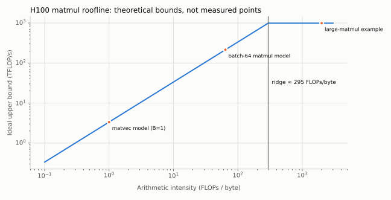

对矩阵乘 $C=AB$，若每个元素理想情况下只从 HBM 读写一次，

$$I\approx\frac{2mnk}{s(mk+kn+mn)}.$$

方阵增大时计算量立方增长，最少数据移动平方增长，因此更可能受计算限制。对 $[B,D]\times[D,F]$ 的 BF16 矩阵乘，若 $B\ll D,F$，算术强度约为 $B$：在这个近似下，batch 中的 token 数超过约 295，H100 的带宽上界才不再低于 Tensor Core 算力上界。矩阵向量乘（$B=1$）的强度约为 1，这解释了预填充和单 token 解码的一项主要性能差异。逐元素操作每读写几个字节只做几次运算，强度在 0.25–5 FLOP/byte 之间（讲义按 ReLU 约 0.25、GELU 约 5 计，BF16），比 ridge point 低两个数量级，对足够大的工作量常受数据移动限制，融合既可能少搬数据，也可能减少小 kernel 的启动开销。

Roofline 是上界模型，不包含所有现实开销。内核启动、通信、同步、控制分歧、非合并访存、cache 行为和低占用率都可能让实际点远低于曲线。

因此“位于 ridge 左侧”严格表示带宽项给出更低的理想上界，不能仅凭算术强度宣布实测瓶颈一定是 HBM；小 kernel 也可能受启动或延迟限制。上面的矩阵乘强度假定每个矩阵只读写一次，是乐观值；重复读块会降低实际强度，缓存复用则可能减少设备外存流量。

BF16 Tensor Core 的 ridge point 适用于对应矩阵算子；逐元素标量运算需要自己的算力上界，不能用 989 TFLOP/s 预测 ReLU 能达到的吞吐。CUDA event 衡量相应流的依赖区间，其他流若不在事件依赖中可能不被计入；完整训练与多卡步时应另用同步后的墙钟窗口和最慢 rank。

## 9.3 四种关键优化

**融合。** `x→bias→activation` 如果分别执行，会重复读写 HBM 并多次启动内核。融合把中间值留在片上，少搬数据。过度融合也可能增加寄存器压力，必须测量。

**合并访存。** 相邻线程访问相邻地址更容易合并成少量内存事务。张量的 stride 会决定逻辑上相邻的元素在物理内存中是否相邻。

**tiling。** 把大矩阵划为块，加载到片上后反复使用。块大小控制数据复用、尾部 padding、寄存器需求和并行任务数。较大的 tile 不一定更快。

**减少非矩阵操作与同步。** 当 Tensor Core 很快，重复归约、标量除法、跨 warp 通信和 barrier 可能变成瓶颈。FlashAttention-2 的改进就不能只用“少读内存”解释。

## 9.4 计时首先要确保测到了执行

GPU 操作通常异步提交。用 CPU 时钟包裹调用而不同步，测到的可能只是排队时间。可用 CUDA events，或在墙钟计时两端同步。warmup 要涵盖编译、内存分配和库算法选择，编译耗时应单独报告。

```python
# GPU 实验示意，需 CUDA 环境；本书 CPU 环境没有实测这段。
for _ in range(10):
    y = operation(x)
torch.cuda.synchronize()
start, end = torch.cuda.Event(enable_timing=True), torch.cuda.Event(enable_timing=True)
start.record()
for _ in range(100):
    y = operation(x)
end.record()
end.synchronize()
milliseconds = start.elapsed_time(end) / 100
```

分别测前向、前向+反向和完整训练步。报告形状、dtype、warmup、重复次数、中位数或分位数、峰值 allocated/reserved memory。用 profiler 找到主要耗时再优化，防止把只占 1% 的算子加速十倍后误以为能显著改善全程。`triton.testing.do_bench` 会自动处理 warmup、同步和多次重复，适合给单个 kernel 计时。

上面的 event 循环得到的是 100 次执行的平均时间，不能从一个平均值算出单次延迟的 p95/p99。要研究尾部，应记录多个独立窗口或逐次样本，同时报告计时工具自身开销、缓存是否预热及是否存在其他负载。吞吐基准与交互延迟基准可以使用不同测量设计，但必须明确各自测到的对象。

**三个必备的观测工具。** 系统作业要求熟练使用它们：

- **Nsight Systems（nsys）**：`nsys profile --trace=cuda,nvtx,osrt --pytorch=functions-trace python bench.py` 记录 CPU 提交、kernel 执行、内存复制与同步的完整时间线。用 `torch.cuda.nvtx.range("attention scores")` 给代码段加 NVTX 标签，就能把 kernel 归属到源码位置；仅截取预热后的具名范围时，需要一起使用 `--capture-range=nvtx --nvtx-capture=measure`，并在代码中用 `torch.cuda.nvtx.range("measure")` 包住测量窗口；单独写 `--nvtx-capture` 缺少范围参数。默认捕获可能只匹配已注册字符串；使用 PyTorch 普通字符串范围时按版本设置 `NSYS_NVTX_PROFILER_REGISTER_ONLY=0`，并先用短运行确认范围被识别。[Nsight Systems CLI](https://docs.nvidia.com/nsight-systems/UserGuide/index.html)
- **torch.profiler**：在 Python 内部按算子汇总 CPU/CUDA 时间、调用次数和输入形状，适合快速判断"哪类算子占了大头"。
- **显存快照**：`torch.cuda.memory._record_memory_history(max_entries=1_000_000)` 开始记录，跑若干步后 `torch.cuda.memory._dump_snapshot("snap.pickle")`，拖进 PyTorch 的在线可视化页面，可以看到每次分配来自哪行代码、峰值发生在前向末尾还是优化器首步。

读时间线时先问：GPU 是否一直在忙？空白处 CPU 在做什么？矩阵乘占总时间多少，softmax、归一化等"小算子"又占多少？在注意力层里，softmax 的 FLOPs 远少于两个矩阵乘，耗时却可能相当，因为它是带宽受限的。

## 9.5 一个 Triton 行归约的思路

Triton 的一个 program 处理一组元素，`tl.arange` 生成索引，`tl.load`/`tl.store` 带 mask 处理尾部。下面是教学骨架，不是完整可运行 benchmark：

```python
@triton.jit
def rms_kernel(X, G, Y, stride, D: tl.constexpr, BLOCK: tl.constexpr):
    row = tl.program_id(0)
    col = tl.arange(0, BLOCK)
    x = tl.load(X + row * stride + col, col < D, other=0).to(tl.float32)
    inv = tl.rsqrt(tl.sum(x * x, axis=0) / D + 1e-6)
    g = tl.load(G + col, col < D, other=0)
    tl.store(Y + row * D + col, x * inv * g, col < D)
```

这个骨架假设最后一维连续，输出连续，`BLOCK` 覆盖整行；对巨大 $D$ 可能寄存器不足，需要分块归约。编写内核前先有 PyTorch 参考，逐个检查非整齐维度、低精度、大幅值输入和 backward。

2024 系统作业以 RMSNorm 为主要自定义内核；2025/2026 转为 FlashAttention-2。前者仍然适合作为理解归约、读写、融合和反向的第一步。Triton API 以运行环境和[官方教程](https://triton-lang.org/main/getting-started/tutorials/index.html)为准。

**练习。** 为什么矩阵维度从 1792 增加到 1793 可能导致时间明显跳变？（讲义的例子：A100 有 108 个 SM，tile 为 256×128，每个 SM 一次跑一个 block。）

**解答。** 1792 = 7×256 = 14×128，正好切成 $7\times14=98$ 个 tile，一轮就能跑完。多一行一列后要切成 $8\times15=120$ 个 tile，新增的 tile 几乎全是 padding；108 个 SM 跑完第一轮后，剩下 12 个 block 还要单独跑一轮，耗时接近翻倍。这叫 wave quantization。维度更大不仅增加乘法次数，还可能改变硬件利用率；同一现象在 1024→1025 上不一定出现（256×128 的 tile 下从 32 个变成 45 个，都不到一轮），那时的变慢主要来自对齐和 padding。

## 9.6 `torch.compile`、Triton 与自定义反向的边界

`torch.compile` 尝试捕获张量计算图，利用编译后端做融合、调度和代码生成；它与手写 Triton 内核是不同层次的控制。张量值驱动的 Python 分支、频繁 `.item()` 或不支持的调用可能引起 graph break，动态 shape 还可能触发新编译或 shape guard。第一次调用的编译成本必须与稳定运行时间分开。

“编译后更快”要分开检验：输出与梯度是否一致、图是否覆盖热点、重编译次数、峰值显存、稳态 step 时间和端到端训练时间。小输入时启动开销可能主导；长序列时内存或通信可能主导。课堂用朴素、内置和编译后的 GELU，以及朴素与 Triton 版的 softmax 对照说明这一点；系统作业再对注意力做编译前后的对照。[2026 第六讲](https://github.com/stanford-cs336/lectures/blob/de53a9f979a6ee35f7d13a5e1aadee5ea1afc58e/lecture_06.py)

自定义 `torch.autograd.Function` 的 forward 输出张量，同时用 `save_for_backward` 保存反向真正需要的张量；backward 接收输出梯度，必须按 forward 输入顺序返回对应梯度，非张量参数一般返回 `None`。PyTorch Tensor 操作组成的 forward 不会因为被放进自定义 Function 就自动替你构造内部 backward。

`systems.py` 将第 21 章的 RMSNorm 导数写成完整的一阶自定义反向：保存 x、gain 与归一化倒数，按行求输入梯度，对所有 token 求 gain 梯度。测试检查它的前向与参考表达式一致，并在 FP64 上用有限差分通过 gradcheck；明确不支持二阶导数。GPU 版本还要解决跨行归约、临时缓冲和并行写入，不能把 CPU 验证等同于 Triton 性能验证。

## 9.7 低精度累加：一个几行就能复现的实验

系统作业的第一个混合精度练习考的就是累加精度，那道题请自己做。这里换一个设定：把 0.001 累加 10,000 次（真值 10）。`python -m examples.systems` 在 CPU 上的结果：

| 累加器 dtype | 每次加数 dtype | 结果 |
|---|---|---:|
| FP32 | FP32 | 10.0004 |
| BF16 | BF16 | **0.5** |
| FP32 | BF16 | 9.9945 |
| BF16，Kahan 补偿求和 | BF16 | 9.9375 |

BF16 只有 8 位有效位。和到 0.5 时，相邻可表示数的间距是 $2^{-8}\approx0.0039$，0.001 小于间距的一半，每次加法都被舍入掉，总和停在 0.5，只累加了二十分之一。第三行用 FP32 累加器，误差只剩 0.001 在 BF16 中无法精确表示（存成 0.000999），$10^4$ 个这样的数之和恰好是 9.9945。这里累加没有引入新误差，是因为 BF16 加数只有 8 位有效位，每个部分和在 FP32 的 24 位有效位中都能精确表示；第一行（FP32 加 FP32，得 10.0004）说明 FP32 累加在一般情况下仍有舍入误差，只是比 BF16 小得多。第四行的 Kahan 求和仍用 BF16 存总和，但用第二个 BF16 变量记下每次加法被舍掉的部分，下一次再补回去：累加不再停滞，结果 9.9375 与 10 只差 BF16 在这个量级的一个间距（0.0625）。

结论限定为这组朴素逐次舍入的加法：低精度累加可能停滞，高精度或补偿能改善。具体矩阵乘与归约的内部精度由算子、硬件及后端配置决定，不能只从 `autocast` 推出所有累加都为完整 FP32；第 34.3 节给出内部累加受限的实例。优化器更新保持 FP32 则靠 FP32 主权重与优化器状态，与 autocast 无关（第 5.4 节）。纯 BF16 参数配合纯 BF16 更新时，就近舍入会把小于半个间距的更新直接舍掉，原理与这里相同。

## 9.8 FP8 和 block scaling 为什么不仅是换 dtype

FP8 的 E4M3、E5M2 分别为指数范围与有效数字分配不同位数；它们并非仅有位数不同的 BF16。数值范围不足时，常把一组值写成 $x\approx s\,q$，低精度 q 保存局部量化结果，s 保存尺度，计算时还需考虑累加精度和转换开销。[FP8 Formats for Deep Learning](https://arxiv.org/abs/2209.05433)

单 tensor scale 被少量 outlier 支配时，会浪费大多数值的分辨率；按通道或小块设置 scale 缩小局部动态范围，但增加元数据和布局约束。2026 讲义介绍的 microscaling 用小块共享 scale；转置后原来一块中的元素可能被重新分组，原 scale 未必仍适用，因此 forward、输入梯度和权重梯度所需矩阵布局可能要分别量化。[2026 第五讲第 27–29 页](https://github.com/stanford-cs336/lectures/blob/de53a9f979a6ee35f7d13a5e1aadee5ea1afc58e/lecture_05.pdf)

要同时记录 saturation 比例、量化误差、scale 更新方式、哪些层仍用高精度，以及端到端收敛。更小字节数节省带宽，但 scale 计算、重排、cast、无法使用匹配矩阵内核等开销，可能抵消收益。这里没有承诺教学代码已复现 FP8 训练。

## 9.9 occupancy 与带宽之外的限制

同一 warp 内不同线程走不同分支，可能需要分支掩码下依次执行；合并访存改善 global memory 事务，shared-memory bank conflict 则是另一层争用。提高 occupancy 可以隐藏延迟，却可能减少每个 block 可用的寄存器或 tile 大小，因此不是越高越好。

读 profiler 时先确认是在 CPU 提交、kernel 执行、同步、内存复制还是 collective 上等待。GPU timeline 上出现空白不一定缺 FLOPs，可能是数据没到或等待另一 rank。为实现优化，应该提出可被测量推翻的假设，如“融合减少两次 HBM 中间写读”，再核对实际 kernel 数和时间。

## 9.10 社区进展：FP8 与 MXFP4 已经落地

第 9.7 节的低精度累加问题在真实训练中同样存在。DeepSeek-V3 报告 H800 上 FP8 矩阵乘的累加器只保留约 14 位精度，它的解法是每累加 128 个元素就把部分和提升到 FP32。配合激活 1×128、权重 128×128 的分块缩放，它用 FP8 完成了 671B 模型的预训练；在两个较小规模、各约 1T token 的对照实验中，FP8 相对 BF16 的损失误差低于 0.25%。

gpt-oss 以 MXFP4 发布 MoE 权重：每 32 个数共享一个 8 位的 2 的幂缩放，每个数 4.25 位，120b 模型因此能放进一张 80 GB 显卡。第 34 章按规范实现了这两种格式，并测量了异常值、截断和缩放粒度的影响。

## 9.11 性能实验要报告哪一种“快”

至少区分首次调用（编译、算法搜索、分配）、预热后的算子时间、完整训练步、从启动到目标 loss 的总时间。CUDA event 的循环平均适合稳定 kernel；有 shape 重编译、动态路由、取数和 checkpoint 时，还要用墙钟分位数。先固定输入张量/权重比较数值，再换真实数据评估端到端，才能定位收益来自哪里。

显存有三个口径：活跃张量 allocated、分配器持有的 reserved、设备总占用。缓存池、NCCL、CUDA context 和第三方 workspace 不一定都出现在 PyTorch allocated 中；`empty_cache()` 只处理未使用的缓存块，不会释放仍被引用的计算图。测峰值先预热并初始化 optimizer state，再在同步点重置 peak stats；冷启动峰值另报。

例如热点占完整训练时间 40%，加速两倍后总加速最多为 $1/(0.6+0.4/2)=1.25$。若实测超过它，可能同时改善了内存导致 batch 增大，也可能基线/计时范围不同；应解释新增变化。较低精度如果增加失败重跑，稳态 tokens/s 上升也不意味着达到目标的 GPU 小时下降。

## 练习

**1．** 在 H100 上，BF16 的 $[B,4096]\times[4096,4096]$ 矩阵乘，batch $B$ 至少多大才可能进入计算受限区？

**解答。** 强度 $I=2B\cdot4096^2/[2(4096B+4096^2+4096B)]$。$B=295$ 时 $I\approx258$，$B=350$ 时约 $299$，$B=400$ 时约 $335$。阈值约在 $B\approx350$，量级与"约等于 ridge point"一致；小 batch 推理远在其下。

**2．** RMSNorm 对 $[B,T,d]$ 的 BF16 张量做一次前向，每个元素约几次运算、读写几个字节？受什么限制？

**解答。** 忽略每行的低阶归约开销，平方、求和、乘倒数、乘 gain 约 4 次运算/元素。若输入只读一次、输出只写一次，且 gain 在多行间复用，主流量约 4 bytes/元素，强度约 1 FLOP/byte；gain 若每行重新从 HBM 读取还要另计。它是低算术强度算子，融合通常优先减少读写，但不能拿 BF16 Tensor Core 的 ridge point 直接断言它的实测瓶颈：标量算力上界、寄存器溢出和小张量的启动延迟都需检查。

**3．** 用 nsys 测得一个训练步里 GPU 有 30% 的时间空闲。至少列出三种可能原因，以及分别怎样确认。

**解答。** 数据加载跟不上（看时间线上 CPU 线程与 H2D 复制）；Python 端频繁 `.item()` 或打印造成同步（看 CUDA API 行里的 synchronize）；kernel 太小、启动开销主导（kernel 数量多、单个很短，考虑融合或 `torch.compile`）；多卡时等待其他 rank 的 collective（看 NCCL kernel 的等待时间）。


---

# 10｜FlashAttention：通过改变数据移动实现精确加速

## 10.1 问题不是不会算注意力

普通实现先写出 $S=QK^\top/\sqrt{d_h}$，再写出 $P=\mathrm{softmax}(S)$，最后算 $PV$。$S,P$ 的大小随序列长度平方增长，反复在 HBM 读写很昂贵。目标是分块计算最终 $O$，避免把整个 $T\times T$ 中间矩阵存到 HBM。

不能独立 softmax 每个 key block 后把结果相加，因为每块分母不同。FlashAttention 的数学关键是在线维护全局 softmax 的归一化信息。[FlashAttention](https://arxiv.org/abs/2205.14135)

## 10.2 在线 softmax 的不变量

对一个 query，已处理的一组 logits $s_j$ 维护

$$m=\max_js_j,\quad \ell=\sum_j e^{s_j-m},\quad u=\sum_je^{s_j-m}v_j.$$

加入新块 $s^{new}$，令 $m'=\max(m,\max s^{new})$、$\alpha=e^{m-m'}$，则

$$\ell'=\alpha\ell+\sum_j e^{s_j^{new}-m'},$$

$$u'=\alpha u+\sum_j e^{s_j^{new}-m'}v_j.$$

最后 $o=u/\ell$。乘 $\alpha$ 是把旧块从旧参照最大值改写到新参照最大值。旧信息没有丢失，也没有做低秩近似。

一个数值例子：旧 logit 为 2，新 logit 为 4，旧 $m=2,\ell=1,u=v_1$。更新后 $m'=4$，$\ell'=e^{-2}+1$，$u'=e^{-2}v_1+v_2$，与一次完整 softmax 完全相同，只有浮点计算顺序可能造成舍入差异。

也可以独立处理两个互不重叠的 key 集合 A、B，再合并。若局部输出为 $o_A,o_B$、局部 logsumexp 为 $L_A,L_B$，则 $L=\operatorname{logaddexp}(L_A,L_B)$，全局输出为 $o=e^{L_A-L}o_A+e^{L_B-L}o_B$。权重由各块的总概率质量决定，不能简单平均局部输出。这同时解释了 split-KV 和跨设备分块合并；空集合取质量零，两个集合都空时不定义普通 softmax 输出。

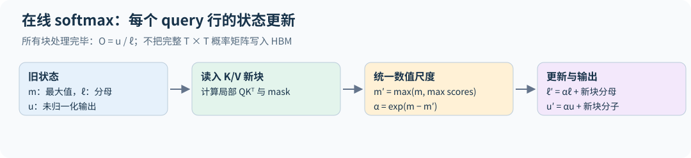

通用稀疏/padding mask 下，早期 key block 可能对某行全空，初始 $m=m^\prime=-\infty$ 会使指数更新出现 NaN。空块应保持该行旧状态不变；第一次遇到有效块时再初始化有限最大值。最终仍全空的行要剔除或按协议处理。教学代码的方阵 causal 路径从每行都有至少一个可见 key 的首块开始，不覆盖任意 mask 的这一边界。

## 10.3 从一行到 query/key tile

取一块 $Q_i$（$B_q$ 行）放入片上内存，遍历所有 $K_j,V_j$（每块 $B_k$ 行），计算局部 scores，应用 mask，更新该 query 块每一行的 $m,\ell,u$。结束后只写出输出 $O_i$ 和每行的 logsumexp

$$L_i=m_i+\log\ell_i=\log\sum_j e^{S_{ij}}.$$

对于 causal attention，可跳过完全位于未来的 key tile；边界 tile 内仍需逐元素 mask。不同的 $(Q_i,\text{batch})$ 之间完全独立，这就是 GPU 上的并行维度。

[attention.py](../examples/attention.py) 只实现这条思路中不属于作业的部分：

| 函数 | 做什么 | 用途 |
|---|---|---|
| `online_attention` | 全部 query 一次处理，key 分块流过 | 看在线 softmax 的状态更新，与稠密实现一致到 $10^{-16}$（FP64） |
| `softmax_backward` | softmax 的向量—Jacobian 积 | 10.5 节反向公式的核心恒等式，与 autograd 对照 |
| `triton_softmax` | 行 softmax 写成一个 Triton kernel，按列块流式读取 | 熟悉 Triton 的编程模型 |

二维分块前向、基于 $L$ 的反向和 Triton 注意力 kernel 是 2026 年系统作业的评分内容，本书只讲原理，不提供实现；课程作业的独立完成要求见第 28 章。

## 10.4 一个 Triton kernel 的基本要素

作业讲义规定了 FlashAttention kernel 的骨架（launch grid、kernel 内的循环、片上统计量的 dtype、mask 约定），照讲义写即可。这里用一个更简单的 kernel 说明同样的编程要素。`triton_softmax` 对二维张量逐行做 softmax：

- launch grid 为 `(行数,)`，每个 program 用 `tl.program_id(0)` 找到自己负责的那一行；
- `tl.arange(0, BLOCK)` 生成一块列下标，`mask=cols < n_cols` 处理行宽不是块宽整数倍的情况，越界位置用 `other=-inf` 填充，使它们对最大值和求和都没有贡献；
- 第一遍循环按列块读取，用 10.2 节的递推维护 $m$ 和 $\ell$（这里没有 $V$，所以没有 $u$）；第二遍再读一次，写出 $e^{x-m}/\ell$。整行不必一次放进片上内存；
- $m,\ell$ 用 `tl.float32`，输出再转回输入 dtype。

FlashAttention 前向在此基础上多了三样东西：每个 program 负责一块 query 而不是一行；每个 key 块要先用 `tl.dot` 算出 score 块；递推里多一个输出累加器 $u$。

没有 GPU 也能检查逻辑：Triton 提供解释器模式，在导入 triton 之前设置环境变量即可在 CPU 上逐元素执行 kernel。

```bash
TRITON_INTERPRET=1 python -m examples.attention
TRITON_INTERPRET=1 python -m unittest discover -s tests -p test_course.py
```

解释器很慢，也不反映任何性能，但能抓住下标、mask 和指针偏移错误。`triton_softmax` 在解释器下与 `torch.softmax` 的误差约 $5\times10^{-10}$（FP32），测试覆盖了行宽 1、16、37 和需要减去最大值才不溢出的大 logit。解释器本身也有缺陷，作业讲义就提醒过它有 bug。本书在 Triton 3.6 上实测：16×16 的 `tl.dot` 在 FP32 和 FP16 输入下结果精确，在 BF16 输入下误差达到 $10^{10}$ 量级。所以 BF16 路径只能在 GPU 上验证，解释器下的 BF16 错误不一定是你的 kernel 的错。

## 10.5 反向也无需保存整个概率矩阵

已知上游梯度 $dO$，对 $O=PV$ 有

$$dV=P^\top dO,\qquad dP=dOV^\top.$$

softmax 的逐行反向为

$$dS=P\odot\big(dP-\operatorname{rowsum}(P\odot dP)\big).$$

利用 $O=PV$，行归约可改写为

$$D_i=\sum_jP_{ij}dP_{ij}=\sum_rO_{ir}dO_{ir}.$$

在反向仍可访问输入 $Q,K,V$ 的前提下，额外保存 $O$ 与每行 logsumexp $L_i$ 就足以避免保存完整 $P$；$Q,K,V$ 必须保留或从其他 checkpoint 重算，不能当成零成本。反向重新计算 score tile，再用 $P_{ij}=\exp(S_{ij}-L_i)$ 恢复概率块。接着

$$dQ=dSK/\sqrt{d_h},\qquad dK=dS^\top Q/\sqrt{d_h}.$$

在 Q/K/V 头宽相同、计入三个输入梯度且按相同有效注意力配对计数时，可以比较主要矩阵乘的 FLOPs。普通反向做 4 次同等量级的矩阵乘（$dV=P^\top dO$、$dP=dOV^\top$、$dQ$、$dK$）；FlashAttention 的反向还要重算一次 $S=QK^\top$，共 5 次，约为前向注意力（2 次）的 2.5 倍，前向加反向的主要矩阵乘约为前向的 3.5 倍，而不重算时约为 3 倍。这是注意力核心算术的近似账，不含投影、softmax、归约和通信，也不等于整层或实测耗时之比。这多出来的一次就是第 8.4 节 HFU 高于 MFU 的来源之一，换来的是免去保存巨大的 $P$。实现时要追踪缩放因子是否已包含在 $S$，否则反向容易漏乘或重复乘 $1/\sqrt{d_h}$。`softmax_backward` 验证了其中的 softmax 恒等式。

要分清两种"省显存"。保存 $O$ 和 $L$ 而不是 $P$，省的是前向到反向之间要保留的张量。如果反向一次性重建整块 $P$（作业允许的普通 PyTorch 加 `torch.compile` 写法就是这样），反向时的峰值仍随 $T^2$ 增长：$T=65{,}536$ 时，一个头的 FP32 $P$ 就有 16 GiB。只有分块反向才去掉这一项。

以上推导假定没有 attention dropout、可学习 attention bias 或额外 logit 变换。若有 dropout，需要重现相同随机 mask 并纳入链式法则；有 soft-capping 就需乘其导数；有 GQA 则来自共享 KV 的多个 query 头梯度要累加到同一个 K/V。若内部用 `exp2`，保存的 logsumexp 也必须与自然对数或以 2 为底的约定一致。

## 10.6 FlashAttention-2 改进的不只是算法公式

FlashAttention-2 优化了非 matmul 操作数、并行任务划分与 warp 内工作分配，降低 shared memory 通信，并提高长序列、小 batch 等情形的占用率。在线 softmax 仍是核心，但“有相同递推公式”并不等于达到相同速度。[FlashAttention-2](https://arxiv.org/abs/2307.08691)

写内核时，前向每个 query tile 的输出可以独立计算。反向哪个梯度需要跨块累加，取决于怎样划分并行任务：FlashAttention-2 按 K/V 列块分配线程块，dK、dV 留在块内，dQ 用原子加累加；作业讲义的分块反向算法则把 $P$ 算两遍，一遍按 K/V 块求 dK、dV，一遍按 Q 块求 dQ，从而完全避免原子操作。寄存器资源、head dimension、causal 与否和 dtype 都影响最佳 tile 设置。

## 10.7 从正确性到性能的验证顺序

先在 float64 小矩阵上对照输出与 Q/K/V 梯度，再覆盖非整块维度、长度 1、因果边界和数值极值。低精度比较用合理容差，记录误差随规模的变化。之后再在 GPU 上测峰值显存与执行时间。作业的基准协议值得照搬：batch 1、causal，序列长度取 128 到 65,536 的 2 的幂，头宽取 16 到 128，dtype 取 BF16 与 FP32，分别报告前向、反向和前向加反向的延迟，并与不使用 FlashAttention 的 PyTorch 实现对比。长序列下朴素实现会因 $T^2$ 显存而 OOM，这本身就是要记录的结果。

逐元素接近不保证索引完全正确，所以还要加入结构性检查：未来 value 被任意替换后，过去输出应不变；对所有 score 加相同常数，输出应不变；单 key 行的输出应恰好等于该 value。

**练习。** 在线 softmax 处理新块时若忘记给旧分母乘 $\alpha$，有什么后果？

**解答。** 当新块最大值高于旧最大值时，旧分母仍以旧尺度计量、新分子却以新尺度计量，破坏同一归一化基准。分块顺序或块大小一变，输出就会变化；这是很有辨识力的测试。

## 10.8 精确、低显存和少 IO 是三个不同结论

“精确注意力”表示没有用低秩、稀疏或核近似替代原算子；不同浮点归约顺序仍会产生误差，不能要求与任意 dense 内核逐位一致。固定 head dim 时，不存储完整概率矩阵可以把辅助存储由随 $T^2$ 增长降到随 $T$ 增长，但不能由此推出总 HBM 访问只有 $O(T)$。

为了复用有限片上容量，Q/K/V tile 可能多次读入。在原始论文的标准 IO 模型与容量范围内，单头头宽为 $d_h$、片上可容纳 $M$ 个标量时，其 HBM 访问分析出现 $O(T^2d_h^2/M)$ 的主项，另有输入输出的必要读写。把片上容量增大，或改变 tile 与循环次序，都能改变复用程度。[FlashAttention 的 IO 分析](https://arxiv.org/abs/2205.14135)

这也是为什么仅用 Python 循环“分块”不自动得到同样收益：autograd 可能保存各块中间张量，循环可能多次启动内核，tile 不一定停留在片上。应分别验证数学结果、峰值存储、实际数据移动和墙钟时间。

**练习。** $T=8192$、32 个头、BF16，朴素实现为保存一层的概率矩阵 $P$ 需要多少显存？FlashAttention 为同一层额外保存的 $L$ 需要多少？

**解答。** $P$：$32\times8192^2\times2$ 字节 = 4 GiB（每个样本）。$L$：$32\times8192\times4$ 字节 = 1 MiB。两者相差 $T\times2/4=4096$ 倍：一个按 $T^2$ 增长，一个按 $T$ 增长，再乘以 BF16 与 FP32 的字节比。

## 10.9 社区进展：FlashAttention-3

FlashAttention-3 论文所测的部分 H100 配置中，FlashAttention-2 的利用率约为 35%；这不是所有形状和版本的硬上限。FlashAttention-3 利用 Hopper 的异步特性，让数据搬运与 Tensor Core 计算重叠，并把分块矩阵乘与 softmax 交错执行。FP16 达到 740 TFLOP/s（75% 利用率），FP8 接近 1.2 PFLOP/s。

FP8 版本还用随机正交矩阵同时旋转 $Q$ 和 $K$，注意力分数不变，但异常值被摊开，数值误差降低 2.6 倍。在线 softmax 的数学（10.2 节）没有变，变的是它在硬件上的调度。见第 34.5 节。

## 10.10 把在线归约用于大词表交叉熵

令隐藏状态 $H\in\mathbb R^{M\times d}$、输出权重 $W\in\mathbb R^{V\times d}$，$z_{iv}=h_i^\top w_v$。对目标 $y_i$，

$$\ell_i=\operatorname{LSE}_v(z_{iv})-h_i^\top w_{y_i}.$$

无需保存全部 $M\times V$ logits：每次计算一个词表块，合并各块 logsumexp；目标项只读取对应权重行。反向重算块概率 $p_{iv}=e^{z_{iv}-L_i}$，有

$$G_{iv}=\frac{p_{iv}-\mathbf1[v=y_i]}M,\qquad dH=\sum_bG_bW_b,\quad dW_b=G_b^\top H.$$

`tiled_linear_cross_entropy` 用自定义一阶 autograd 保存 H、W、labels 与每行 LSE，重算每块梯度，不筛掉小概率。测试对照完整交叉熵、所有输入梯度、有限差分，并检查没有保存完整 logits。它只支持 FP32/FP64、无 bias、无 label smoothing，padding 先筛掉；没有融合 GPU kernel 或二阶导数。

前向与反向重算还要使用一致的精度。外层 autocast 可能把 `H @ W.T` 降为 FP16，却让逐元素相乘后归约的目标 logit 仍为 FP32，导致 LSE 与目标项不再对应同一组 logits。该参考实现为前向和自定义反向都显式关闭 autocast，按声明的 FP32/FP64 计算；生产低精度内核则需另外规定输入量化、累加和目标项的共同精度，不能只在 loss 输出处转 FP32。

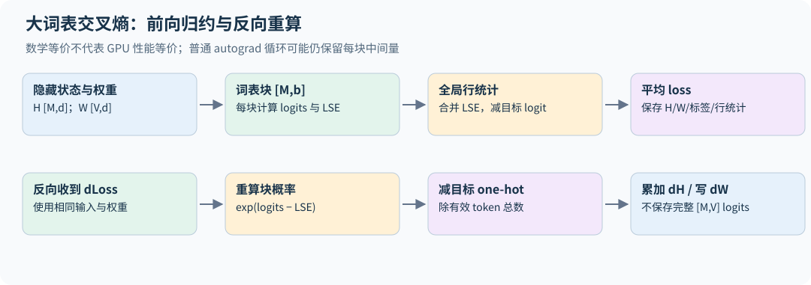

Cut Cross-Entropy 的系统实现还涉及 SRAM tiling、梯度累加精度、排序与小梯度过滤。**分块精确算法**和**近似筛除梯度的优化**要分开：官方实现提供不同过滤/累加配置，不能把所有模式统称为数学逐项完全相同。[论文](https://arxiv.org/html/2411.09009v1)、[作者实现](https://github.com/apple/ml-cross-entropy)

**自测。** 将每块 loss 分别除以词表块大小再相加，能得到原始 CE 吗？

**解答。** 不能。分母需要所有词表项的全局 logsumexp；块内独立 softmax 改变了概率模型，与注意力块不能独立归一化的原因相同。


---

# 11｜分布式训练：切分状态、计算与通信


## 11.1 collective 是并行策略的基本词汇

all-reduce 让每个进程得到所有输入的和；all-gather 把分片收集到所有进程；reduce-scatter 先求和再让每个进程持有一个结果分片；all-to-all 让每个进程向其他进程发送不同部分。

all-reduce 可以由 reduce-scatter 加 all-gather 实现。对大小 $S$ bytes、$P$ 个进程的理想 ring，每个进程发送数据约为 $2(P-1)S/P$。粗略时间模型为

$$t\approx2(P-1)\alpha+\frac{2(P-1)S}{PW},$$

$\alpha$ 是每阶段延迟，$W$ 是有效链路带宽。它假设均衡链路与理想调度，不等同于任意拓扑下的最优算法。很多小通信受延迟限制，一个大通信可能受带宽限制。

## 11.2 数据并行：同一模型，不同样本

每个进程持有相同参数，对本地数据计算梯度，然后平均梯度并各自更新。若所有本地 batch 有相同有效样本/有效 token 权重，平均梯度与单机全局 batch 梯度等价。

若每个进程的有效 token 数 $M_r$ 不同，本地 loss 应按全局分母处理。假设框架最终对梯度除以 $P$，本地可用 $P\times\mathrm{NLLsum}_r/\sum_rM_r$。直接平均各 rank 的 token mean，会让短样本进程权重过大。

本书 [distributed.py](../examples/distributed.py) 用两个 CPU/Gloo 进程做三项检查：等长 `[4,4]` 与不等长 `[3,5]` 本地 batch 的梯度都与单进程全局目标一致；reduce-scatter 后接 all-gather 等于 all-reduce；ZeRO-1 分片优化器的更新与不分片完全相同（见 11.4）。它验证通信语义和梯度归一化，不涉及 NCCL 性能或多机吞吐。

## 11.3 bucket 与通信重叠

反向从最后层往前进行，一旦某些参数的梯度算完，就可以启动异步 all-reduce，与剩余反向重叠。每个参数单独通信会产生大量延迟；全部梯度一个 bucket 又会等到最后才开始。bucket 大小决定折中。

必须确保参数更新前所有通信完成，也不能在异步通信尚未读取完毕时修改缓冲。所有 rank 必须以兼容顺序调用 collective，否则可能死锁。梯度累积时只在最后一次 microbatch 同步可节省通信，但需要遵循框架对应机制。

## 11.4 ZeRO 与 FSDP：消除重复存储

在“参数 BF16 2、梯度 BF16 2、master+Adam 12 bytes/参数”的假设下，每卡模型状态近似为：

| 方式 | 每卡 bytes/参数，不含激活与临时全量层 |
|---|---:|
| 普通数据并行 | $16$ |
| ZeRO-1：切优化器状态 | $4+12/P$ |
| ZeRO-2：再切梯度 | $2+14/P$ |
| ZeRO-3：再切参数 | $16/P$ |

ZeRO-3/FSDP 在计算某层前 all-gather 该层参数，反向后 reduce-scatter 梯度并释放不再需要的完整参数。理想状态存储近似线性下降，但峰值仍包括当前层、可能预取的下一层、激活和通信缓冲。[ZeRO](https://arxiv.org/abs/1910.02054)

通信量方面，2026 年第八讲的结论是：ZeRO-1 与 ZeRO-2 把梯度 all-reduce 换成 reduce-scatter，再 all-gather 更新后的参数，在参数/梯度同通信精度与理想布局下，归约和聚集的逻辑元素量约为 $2\Psi$（$\Psi$ 为参数量），与 DDP 同阶；这表示理想字节量相近，不保证消息延迟、调度与真实步时没有代价。ZeRO-3/FSDP 在前向和反向都聚集参数的日程下约为 $3\Psi$，精度不同应分别换算字节。

包装粒度太粗会临时聚集过多参数，太细会产生大量小通信。前向后是否立刻 reshard、反向预取距离、梯度累积期间保留什么状态，都在内存与通信之间交换成本。

**优化器状态分片的最小实现。** 一般流程是每个 rank 持有完整参数，反向后同步梯度，只为自己“拥有”的参数建 Adam 状态和执行更新，再由拥有者广播新值。本书 `zero1_check` 为隔离状态分片的作用，让所有 rank 使用相同数据，因此梯度本已相同，省略了这一步梯度 all-reduce；不同本地数据的同步与权重归一化由独立的 `ddp_check` 验证。分配所有权时要平衡元素数：按张量轮流分配可能得到 160 对 24 个状态元素，按大小贪心分配后为 96 对 88。三步更新与不分片 AdamW 一致，验证的是这个简化设定的更新语义，不能当作完整 ZeRO-1 通信性能结果。真实数据并行若采用完整梯度 all-reduce 再广播参数，通信又多于优化后的 reduce-scatter/all-gather 路径。

## 11.5 张量并行：切一个矩阵乘

对 MLP $Y=\phi(XW_1)W_2$，把 $W_1$ 按输出列切为 $W_1^{(r)}$，各卡得到独立中间特征，再把 $W_2$ 按相应输入行切为 $W_2^{(r)}$：

$$Y=\sum_r\phi(XW_1^{(r)})W_2^{(r)}.$$

中间激活不必全量 gather，最后求和即可。对 SwiGLU，gate 与 up 必须使用匹配分片。注意力可以按头切分，但 GQA 头组和 KV 复制策略要单独考虑。[Megatron-LM](https://arxiv.org/abs/1909.08053)

张量并行每层频繁通信，适合高带宽连接域。不能不看硬件拓扑就把 TP 随意跨慢网络扩展。

## 11.6 流水线并行：切层

不同设备持有不同层，batch 被拆成多个 microbatch 以填满流水线。对 $p$ 个 stage、$m$ 个 microbatch，简化均衡调度下 bubble 占总时间的比例约为 $(p-1)/(m+p-1)$；讲义用的是 bubble 与有效计算时间之比 $(p-1)/m$，两者分母不同，比较时要看清。增加 microbatch 可减少气泡，却会影响激活保存、batch 设计与调度开销。

1F1B 在 warmup 后交替一个前向和一个反向以控制激活内存：每个 stage 同时保存的 microbatch 激活从 $m$ 份降到最多 $p$ 份。在 stage 均衡、前后向耗时固定且忽略通信的非交错调度模型里，它与 GPipe 的气泡比例相同，主要收益是激活内存；真实时间仍取决于调度和通信。要缩小气泡，可以用交错（interleaved/virtual stage）调度：每个设备持有 $v$ 段不相邻的层，气泡近似降到 $(p-1)/(vm)$（按与有效计算之比），代价是点对点通信增加约 $v$ 倍。进一步调度可把反向拆成输入梯度和权重梯度，尝试填补气泡；真实收益受 stage 不平衡与通信限制。

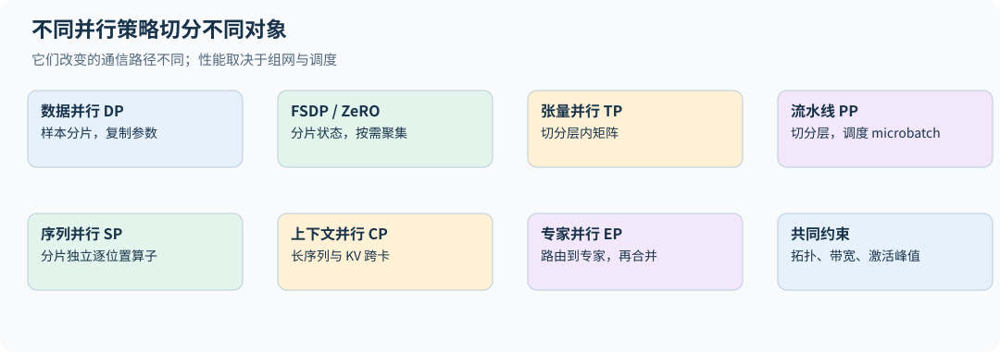

## 11.7 sequence、context 与 expert 并行

sequence parallel 通常配合 TP，把 LayerNorm、dropout 等沿序列独立的算子及激活分片，减少那些原本在 TP 设备间重复的部分。在常见的 Megatron 式 TP+SP 配置下，相关 all-reduce 可拆成 reduce-scatter 与 all-gather，理想 ring 算法的总通信字节相同，中间激活以分片形式存放。但调用时机、延迟、重叠和反向重算可能改变，不能据此断言实际通信时间不增加。context parallel 则把一个长序列分布到多设备，主要有两类做法。环形注意力（ring attention）让每个设备保留自己那段 Q，KV 块沿环点对点传递，配合在线 softmax 逐块累加（第 10 章），通信可与计算重叠。Ulysses 式做法则用 all-to-all 把"按序列切分"换成"按头切分"，每个设备对部分头做完整长度的注意力，再 all-to-all 换回来；它要求头数能被设备数整除，GQA 的 KV 头少时受限。两者名称相似，通信需求不同。

expert parallel 按专家分片，需 dispatch/combine；注意力部分不一定采用同样的分组。最终训练系统可能组合 DP、TP、PP、CP、EP，各并行组大小的乘积需与实际设备映射一致，但某些策略可共享或重组通信组，不能机械相乘所有缩写。

## 11.8 可复现与故障恢复

数据 sampler 应确保不同 rank 不意外读到相同样本，并在每个 epoch 正确推进状态。checkpoint 写入需要一致的全局 step 与分片元数据；恢复时世界大小变化还涉及 reshard 与数据位置处理。随机种子相同不保证跨 GPU 数严格逐位一致，浮点归约顺序本身会改变舍入。

**练习。** 从 1 卡扩到 8 卡，单步时间变长了一点，是否说明分布式失败？

**解答。** 要看全局 batch 与 token 吞吐。如果每步处理 8 倍 token，稍慢的 step 仍可能显著提高吞吐。另一方面，不能只报告吞吐而隐瞒更大 batch 导致达到同一验证损失需要更多 token。

三年并行讲义与 2026 年系统作业共同支持本章；2026 作业明确包含 FSDP 实作，见 [2026 系统作业](https://github.com/stanford-cs336/assignment2-systems/blob/ca8bc81a59b70516f7ebb2da4808daade877c736/cs336_assignment2_systems.pdf)。

## 11.9 把 FSDP 的一个训练步按时间展开

假设每张卡只保存本层参数的一个分片，并在前向后 reshard。开始前向时，all-gather 得到该层完整权重；用本地样本计算该层输出；释放完整权重而保留本地分片。反向到该层时，再 all-gather 一次完整权重，计算本地梯度，然后 reduce-scatter 出本卡负责的平均梯度分片，释放全量临时权重，最终只更新本地 optimizer state。

若同一层完整权重共 $S$ bytes，按理想 ring、同精度近似，每个 all-gather 或 reduce-scatter 的每卡发送量为 $(P-1)S/P$。这个简化 FSDP 日程的两次 gather 加一次 scatter 约为 $3(P-1)S/P$，普通 DDP 梯度 all-reduce 约为 $2(P-1)S/P$。实际梯度与参数精度不同时应分别计字节；保留全量参数跨越前后向会减少 gather，却增加驻留显存。

所以“ZeRO-3 理想状态只有 $16N/P$ bytes”不能直接用作峰值。至少还要加正在计算的层、预取层、重算激活和通信 workspace。模型只有一个巨大 embedding/head 时，这个单层峰值可能成为主要限制。

## 11.10 一个不等长 batch 的算例

两卡分别有 2 和 6 个有效 token。若平均各自 mean loss，每个短卡 token 权重为 $1/4$，长卡 token 权重为 $1/12$，短卡 token 被放大三倍。正确全局权重都是 $1/8$。当 DDP 最终对梯度除以 2 时，两卡分别反向 $2\,\mathrm{NLLsum}_r/8$ 即可。

梯度累积跨越多个 microbatch 时，分母应是**所有卡、本次 optimizer update 的全部有效 token 数**，而不是当前 microbatch 数。若某卡没有有效 token，不能直接跳过该卡的 collective；要用可微零贡献保持通信调度一致，或在数据层保证各卡有效工作。mask 修正的是统计权重，不会替你解决 collective 死锁。[PyTorch DDP 源码说明](https://github.com/pytorch/pytorch/blob/v2.11.0/torch/nn/parallel/distributed.py)

全局梯度裁剪还要先判断参数是分片还是复制。对互不重叠的梯度分片，可将各 rank 的平方范数求和；对 DDP 中已同步的完整梯度，每张卡已持有同一个全局向量，再把 P 份平方范数相加会把范数放大 $\sqrt P$。混合 TP/FSDP/复制参数时，要让每个逻辑参数恰好计一次，不能对所有张量统一套一次跨卡 sum。

## 11.11 张量并行反向通信不能从前向猜

把两层 MLP 切成各卡的 $H_r=\phi(XW_{1,r})$、$Y_r=H_rW_{2,r}$，前向总输出为 $Y=\sum_rY_r$。上游总梯度 $G=\partial L/\partial Y$ 对每个 $Y_r$ 的梯度都是 G，不需要再把同一个 G 求和 P 次。

各卡先算 $dW_{2,r}=H_r^\top G$、$dH_r=GW_{2,r}^\top$，再乘激活导数得到 $dZ_r$。输入梯度则是

$$dX=\sum_rdZ_rW_{1,r}^\top.$$

所以这里需要在反向归约的是各分片对共享输入 X 的贡献。这就是 Megatron 风格“前向恒等/反向归约”与“前向归约/反向恒等”映射的来由；它建立在特定复制张量和 loss 语义上，不能把任意原始 all-reduce 调用都当成相同自动微分节点。[2026 第八讲第 39–41 页](https://github.com/stanford-cs336/lectures/blob/de53a9f979a6ee35f7d13a5e1aadee5ea1afc58e/lecture_08.pdf)

`systems.py` 用虚拟分片计算两层 MLP 的各卡输入梯度，并检查求和后与未分片结果一致。真实多进程实现还要检查参数梯度所在分片、复制参数的同步与并行组，不能在最后一层又额外除/乘 P。

## 11.12 把网络拓扑放进并行决策

节点内高带宽互连与节点间网络可能相差很大。TP 每层频繁交换激活，PP 更多沿相邻 stage 传递 microbatch，FSDP 搬权重，EP 产生动态多目标流量。相同总字节数在不同链路布局、争用和消息大小下也会有不同时间。

环、网格/环面、树和交换网络各有度数、路径长度与二分带宽取舍。规则通信更容易预规划，MoE 的非均衡 all-to-all 更依赖路由与热点处理。不能把某年的“TP 只在 8 卡节点内”记成永远有效的硬件定理；应该依据当前连接域与实际 collective 性能布置并行组。[2026 第八讲第 9–13 页](https://github.com/stanford-cs336/lectures/blob/de53a9f979a6ee35f7d13a5e1aadee5ea1afc58e/lecture_08.pdf)

粗略比较时用 $t=\alpha+S/W$，多条链路共享资源时 W 应是有效而非标称带宽。即使计算与通信理论可重叠，也只有在依赖允许、资源不互相争抢时才接近完全隐藏。用时间线测量暴露在关键路径上的通信，才知道下一步该缩小通信还是增大计算块。

## 11.13 词表并行的交叉熵无需聚集全词表

将 V 按 rank 切成互不重叠的集合 $\mathcal V_r$，每卡保留本地 logits。对一个 token，先归约全局最大值，再归约平移后的指数和与目标 logit：

$$m=\max_r\max_{v\in\mathcal V_r}z_v,\quad Z=\sum_r\sum_{v\in\mathcal V_r}e^{z_v-m},\quad \ell=m+\log Z-z_y.$$

只有目标 y 所属的 rank 提供 $z_y$，其他 rank 提供零；按每个 token 通信行统计，不必聚集全部 $BT\times V$ logits。各分片仍需对隐藏状态产生梯度贡献，并按张量并行语义归约。`sharded_cross_entropy` 是单进程虚拟分片对照，覆盖不等长词表分片、极大 logits 与分片边界标签；其 autograd 不是实际 collective 的自动反向。[Megatron-LM 的输出词表并行](https://arxiv.org/html/1909.08053v4)

## 11.14 累积梯度时，DDP 与 FSDP 的内存代价不同

DDP 可以在前几次 microbatch 暂停梯度同步，在最后一次一起归约；其 `no_sync` 应包住对应前向和反向。FSDP 暂停 reduce-scatter 时，具体实现可能保留完整未分片梯度，省通信却提高峰值。是否前向后重分片、是否在反向后重分片和是否同步梯度是不同控制，不能只设一个“累积次数”就推断内存仍为 $N/P$。[FSDP2 官方教程](https://docs.pytorch.org/tutorials/intermediate/FSDP_tutorial.html)

AMP 也要按完整更新边界工作：所有 microbatch 使用一致 loss scale，累积结束后 `unscale_` 一次、全局裁剪、step，再更新 scale。若某步因溢出跳过更新，scheduler 的推进规则需要明确。把每个 microbatch 的缩放梯度先分别 unscale 后再与新缩放梯度相加，会混合单位。[PyTorch AMP 累积示例](https://github.com/pytorch/pytorch/blob/v2.11.0/docs/source/notes/amp_examples.rst)

## 练习

**1．** 一个 10B 参数模型，BF16 参数与梯度、FP32 主权重与 Adam 状态，在 8 卡上分别用 DDP、ZeRO-1、ZeRO-2、ZeRO-3 训练，每卡的模型状态各是多少（不含激活）？

**解答。** 按 11.4 节的表：DDP $16\times10=160$ GB；ZeRO-1 $4\times10+12\times10/8=55$ GB；ZeRO-2 $2\times10+14\times10/8=37.5$ GB；ZeRO-3 $16\times10/8=20$ GB。80 GB 卡上只有后三种的理想状态账低于容量，且还要为激活和当前层的全量参数留空间。

**2．** 同一个 10B 模型用 ZeRO-3 在 8 卡上训练，单层 BF16 权重 400 MB。按 11.9 节的简化日程，每层每步每卡要发送多少数据？若有效带宽 100 GB/s，这部分通信需要多久？

**解答。** 两次 all-gather 加一次 reduce-scatter，约 $3\times(P-1)/P\times400\,\mathrm{MB}=1.05$ GB，约 10.5 ms。这只是忽略延迟的通信量/带宽估计；是否暴露还取决于依赖与预取。如果可用于重叠的计算窗口小于通信需求，此时需要预取或更大的 batch 来隐藏它。

**3．** 张量并行把整个 Transformer 块（注意力与 MLP）切到 4 卡上，序列 $B\times T=8192$ token、$d=4096$、BF16。每层前向需要几次 all-reduce？每次多大？

**解答。** 按 11.5 节的列/行切分，MLP 前向末尾一次 all-reduce，注意力输出投影后再一次，每层共两次。每次张量为 $8192\times4096\times2$ 字节 = 64 MiB；用 ring all-reduce 时每张卡发送约 $2\times\frac34\times64=96$ MiB，接收也为 96 MiB；若报告收发之和则为 192 MiB。反向对称地再有两次。每层四次 64 MiB 的同步通信，这就是 TP 只适合高带宽连接域的原因。


---

# 12｜推理系统：延迟、吞吐和生成质量


## 12.1 prefill 与 decode 是两种工作负载

prefill 一次处理整个输入，通常有较大的矩阵乘，权重可在很多 token 间复用。decode 每步只生成一个新 token，需要反复读取模型权重和已有 KV。batch 很小时，线性层接近矩阵向量乘，往往受内存带宽约束。

这解释了为什么同一个模型训练时利用率很高，交互式生成却可能很低。不能用训练 tokens/s 预测在线服务延迟。服务指标至少包括首 token 延迟 TTFT、后续 token 间隔 TPOT、请求吞吐、输出 token 吞吐和 p95/p99 延迟。

## 12.2 KV cache 省掉了什么

过去位置在因果网络中的隐藏表示不会因新 token 而改变，所以过去各层 K/V 可以复用。每步只计算新 token 的 Q/K/V，并对所有历史 KV 做注意力。cache 省去重复计算过去前缀，但仍需读取相关历史 KV，单步 attention 成本仍随历史长度增长。

取 $L=32,h_{kv}=8,d_h=128,T=8192,B=1$，BF16 下缓存约为

$$2\times32\times8\times128\times8192\times2=1\ \mathrm{GiB}.$$

若改用 32 个 KV 头，变为 4 GiB。多并发、长输出和长 prompt 会迅速吃满显存。paged cache 与共享前缀能够减少碎片/重复，但不会改变独立唯一 KV 的基本信息量。

**减小 KV 的几条架构路线**（2025/2026 推理讲义的整理）：GQA/MQA 让多个 query 头共享 KV（第 04 章）；MLA 只缓存低维 latent，DeepSeek-V2 把每 token 每层需要缓存的维度从 MHA 的 $2\times16384$（K 与 V 各 $128$ 头 $\times128$ 维）压到 $512+64=576$（后 64 维留给 RoPE，见第 07 章）；跨层注意力（CLA）让相邻层共享 KV；局部（滑动窗口）注意力与全局注意力交替，局部层只保留最近 $w$ 个位置的 KV。目标是在不明显损失质量的前提下缩小 KV：DeepSeek-V2 报告 MLA 在其设置下甚至略优于 MHA，局部注意力单独使用则可能掉点。这些结论都应在自己的长上下文任务上复核。

## 12.3 采样控制分布，不是修复模型

temperature 用 $p_i\propto\exp(z_i/\tau)$，$\tau$ 越低通常越集中；贪心取 argmax 是独立分支，不能直接除以零。top-k 只保留概率最大的 k 个，top-p 保留累积概率达到阈值的最小前缀并重新归一化。

过滤顺序、temperature 放置位置与停止 token 都是生成协议的一部分。报告任务分数必须固定这些设置。降低温度可能改善某些格式任务，却降低候选多样性，影响 pass@k 和自一致性投票。

训练时不要把 top-p 截断后的概率误用作原策略的 log probability。RL 的采样分布若与训练中使用的策略概率不同，重要性比率和目标解释都需要相应调整。

## 12.4 continuous batching 与分页缓存

传统 batch 等待最长请求完成，短请求结束后资源空闲。continuous batching 在每个调度轮次移除完成请求并加入新请求，提高利用率，但需要维护各请求的长度、cache 页表和位置。

PagedAttention 把 KV cache 分成固定大小物理块，通过页表映射到每个请求的逻辑序列，缓解必须预分配连续最大长度缓存的问题。它改善内存管理，不等于改变 attention 的数学定义。[PagedAttention](https://arxiv.org/abs/2309.06180)

块表还让**前缀共享**变得自然：多个请求共享同一个 system prompt 时，填满的前缀块只存一份，按引用计数释放。SGLang 的 RadixAttention 把所有请求的前缀组织成基数树，在多轮对话和 agent 工作负载里复用率很高。[inference.py](../examples/inference.py) 的 `PagedKVCache` 是一个最小的块分配器：4 个请求共享 48 token 的系统提示、各自再有 25 个 token，块大小 16 时共占 11 个物理块，不共享需要 20 个；若按最大长度 2048 连续预留则需要 512 个。

大型 prefill 可能阻塞 decode，引发延迟抖动。chunked prefill 把长输入切段与 decode 交错；prefill/decode 分离还可使用不同设备池，但增加 KV 传输和调度复杂度。选择要基于真实请求长度分布与服务延迟目标。

## 12.5 量化为什么有时省内存却不加速

均匀对称量化可写作 $q=\operatorname{clip}(\operatorname{round}(w/s),q_{min},q_{max})$，反量化 $\hat w=sq$。逐 tensor scale 简单，逐通道/分组 scale 更能适应不同范围，但增加元数据和反量化开销。

weight-only 量化主要减少权重读写和存储；若没有匹配的融合内核，先解压回 FP16 再普通矩阵乘可能抵消速度收益。激活 outlier、KV 量化误差、校准数据分布和 accumulation dtype 都影响质量。

在没有 clipping 的标量均匀量化中，rounding 误差满足 $|w-\hat w|\le s/2$；发生 clipping 后不再有这个界。对线性层，$\Delta y=(\hat W-W)x$，所以 $\|\Delta y\|\le\|\hat W-W\|\,\|x\|$。同样的权重误差遇到不同激活分布会产生不同输出误差，这解释了为什么用真实校准输入衡量输出重建误差，可能比只最小化权重 MSE 更有效。

稀疏剪枝也类似：删掉数值不代表硬件会跳过计算。非结构化零值若仍用 dense GEMM，FLOPs 与时间不一定减少。参数存储、理论乘加数和实际执行路径应分别报告。

## 12.6 speculative decoding 的精确接受规则

draft 模型从分布 $q$ 提议 token $x$，target 分布为 $p$。接受概率为 $\min(1,p(x)/q(x))$；若拒绝，从归一化残差分布 $[p-q]_+$ 采样替代。它不是简单地“target 觉得够好就接受”。

为什么正确？接受路径对 token $x$ 贡献 $q(x)\min(1,p(x)/q(x))=\min(p(x),q(x))$。所有拒绝的总概率等于 $\sum_x[p(x)-q(x)]_+$，乘残差条件分布后贡献 $[p(x)-q(x)]_+$，两条路径相加恰为 $p(x)$。

多 token 版本让 target 并行验证一段 draft，遇到第一次拒绝时截断后续提议；全部接受时还可以利用 target 已算出的下一位置分布多生成一个 token。收益依赖接受率、draft 成本、可并行验证长度和内存瓶颈，并非 draft 越小越好。Medusa 在 target 上加多个预测头直接并行出草稿（它常配合 typical acceptance，不保证与 target 分布完全一致；Medusa-2 还会微调主干），EAGLE 让草稿模型读取 target 的高层特征，多 token prediction 训练目标也可提供草稿能力。

`examples/inference.py` 的 `speculative_step` 实现一轮完整的"起草 $k$ 个、验证、拒绝时从残差采样、全部接受时补一个"。对随机生成的 5 词表、$k=3$ 的分布，两万轮模拟中首 token 的经验分布与 target 分布的最大偏差约 0.004（两万次抽样的统计误差量级），平均每轮产出约 2.1 个 token。分布完全一致是这个算法的正确性标准，每轮 token 数才是速度收益。

接受与修正规则中的 $p,q$ 必须是实际目标和草稿的采样分布，包括各自 temperature/top-p 处理；还要使用同一 token 事件空间。若只是比较原始 logits，而采样经过另一套处理，上述证明不再适用。拒绝概率为零时无需构造残差分布，否则会在 $p=q$ 的情况下除以零。[Speculative Decoding 原论文](https://arxiv.org/abs/2211.17192)

多 token 验证还要求每一行条件于**同一条实际草稿前缀**：第 i 行的 target 与 draft 都看到输入前缀加草稿的前 i−1 个 token。在第 i 处拒绝、换成修正 token 后，后续草稿行的条件已经过时，必须丢弃并按新前缀重算，KV 也要回滚到接受部分。逐位置的正确性由这个条件关系归纳到完整序列，并非只检查首 token 就足够。`speculative_step` 是一轮概率操作，调用方仍负责 EOS、输出预算和 KV 回滚；它返回的修正/额外 token 也不属于“被接受的草稿”。配套两 token 小例子枚举联合分布，另测中途拒绝时不会使用过时的后续行。

概率以 FP16/BF16 保存后，总和可能因舍入略偏离 1，检查时应先高精度求和，再允许有依据的小误差。对非负的正规数，逐项相对舍入误差按概率质量加权后仍约为单位舍入误差，而不是词表大小乘以该误差；只有次正规数的绝对误差项会随元素个数累加。直接把容差设为 `vocab_size * eps`，在 512 词表的 BF16 中就会容忍总和为 0.5，掩盖输入问题。本书参考实现将两种误差分开，只在合法舍入范围内重新归一化。

## 12.7 一个服务实验应该怎样报告

至少固定输入/输出长度分布、并发数、采样策略、模型权重、量化设置与 cache 精度。区分饱和吞吐实验和满足延迟约束的负载实验。吞吐高的配置若让 p99 延迟超过应用要求，仍然可能不可用。

**练习。** 一种 batching 策略让输出 tokens/s 翻倍，却让首 token 延迟翻三倍，是否更好？

**解答。** 取决于应用。离线批处理可能接受，实时交互可能无法接受。性能比较应在明确的服务目标约束下进行，而不是只最大化一个计数。

服务负载还需说明请求到达过程。只等前一个请求完成再提交下一个的闭环测试，会在服务变慢时自动降低到达率，容易掩盖排队尾部；固定到达率的开环测试则应记录排队、超时和被拒请求。TTFT 从提交到首 token，包含排队、预填充与调度；TPOT 是逐 token 间隔的汇总，均值不能替代 p95/p99。离线饱和 tokens/s 与满足延迟目标的有效吞吐需要分别报告。

若请求生成 n 个 token、首 token 时刻为 $t_1$、末 token 为 $t_n$，常见逐请求 TPOT 为 $(t_n-t_1)/(n-1)$，仅在 $n>1$ 时定义。先对每个请求算 TPOT 再平均，给请求等权；汇总所有间隔再平均，给长输出更多权重，两者可能不同。流式接口还可能一次发送多个 token，所以客户端收到的 chunk 间隔不一定是模型逐 token 延迟。

稳定负载下，Little 定律给出平均在途请求数 $\bar N=\lambda\bar T$，其中 $\lambda$ 为完成请求率、$\bar T$ 为平均系统停留时间；排队与服务都要计入。这个约束有助于核对并发、吞吐、延迟是否自洽，但持续过载时队列增长，不能把短暂窗口的数字套成稳态容量结论。

## 12.8 用带宽下界估计 decode 的延迟与吞吐

只考虑每轮必须读取的 dense 线性权重，参数量为 $N_w$、每参数 $s$ bytes、并发 batch 为 $B$，每轮计算约 $2BN_w$ FLOPs，读权重约 $sN_w$ bytes，算术强度近似 $I\approx2B/s$，BF16 下约为 $B$。H100 的 ridge point 约 295，仅靠权重复用要接近它，batch 需要到数百，而不是 1–4 个请求。

但每个请求还有自己的 KV cache，它不在请求之间共享。2026 推理讲义用一个简单模型把两者放在一起：假设计算与访存完美重叠、忽略其他开销，每一步解码都要读一遍全部权重和所有请求的 KV，

$$\text{latency}\approx\frac{sN_w+B\cdot M_{KV/seq}}{W},\qquad \text{throughput}=\frac{B}{\text{latency}}.$$

以 Llama 2 13B（40 层、$d=5120$、40 个头、头宽 128）在 H100（3.35 TB/s、80 GB）上、上下文 1024、BF16 为例，`python -m examples.accounting` 给出：

| 配置 | 显存（GB） | 每步延迟（ms） | 吞吐（token/s） |
|---|---:|---:|---:|
| MHA，batch 1 | 26.9 | 8.0 | 125 |
| MHA，batch 64 | 79.7 | 23.8 | 2,689 |
| MHA，batch 256 | 240.8 | — | 放不下 |
| GQA 8 个 KV 头，batch 64 | 33.4 | 10.0 | 6,417 |
| GQA 8 个 KV 头，batch 256 | 65.6 | 19.6 | 13,068 |

读法：增大 batch 用更差的单请求延迟换更高的总吞吐，因为读权重的成本被摊薄了；但每个请求的 KV（MHA 下每序列 0.84 GB）随 batch 线性增长，很快放不下。GQA 把 KV 缩小 5 倍，同样 batch 下延迟更低、能开更大的 batch（表中 GQA 行同时少了 1.68B 的 K/V 投影权重，参数从 13.02B 降到 11.34B，所以这一列的差别不全来自 KV）。这是吞吐的理论上界、延迟的理论下界，真实系统还要扣除 kernel 开销、调度和非重叠部分。

无排队且预热完成时，首 token 延迟（TTFT）的主要计算通常是 prefill；在线还包括等待与调度。prefill 是大矩阵乘，适合小 batch 以降低 TTFT；decode 适合大 batch 以提高吞吐。prefill/decode 分离的目的之一是让两类阶段各自选择 batch，另外也是为了消除 prefill 对 decode 的干扰，并让两者独立配置资源与并行方式。

带宽模型默认 GPU 的全部 SM 都在读 KV，这在长上下文、小 batch 的 decode 里不一定成立。一些 decode 内核按 batch 与头组织线程块，并行度可能不足。实际块数取决于使用 query 头还是 KV 头、GQA 分组和 tile 划分，不能仅从 8 个 KV 头推出只有 8 个块；小 batch 下仍应检查 SM 利用率和实际带宽。Flash-Decoding（split-KV）因此把 KV 的序列维也切成若干段并行计算，每段得到局部输出和 logsumexp，再用在线 softmax 的合并规则（第 10.2 节）归约。它增加了沿序列的并行度，有机会提高带宽利用率；主 KV 数据量不变，但多了部分输出、logsumexp 和归约的读写，不能保证达到理论带宽。短上下文或大 batch 时并行度已足够，这些额外开销可能抵消收益。

教学 cache 每步用 `torch.cat` 扩大 K/V，既分配新张量又复制旧内容；它验证语义，但还增加了本可避免的缓存搬运。预分配 cache 按位置写入、分页 cache 按页追加，才更接近服务实现。相同的 cache 数学不等于相同的缓存管理成本。

带宽项还应与计算下界比较：理想重叠时 $t_{step}\ge\max(F_{step}/F_{peak},M_{read}/W)$，实际还受同步、通信与 kernel 限制。上表仅展示内存带宽模型，不是测出的服务速度；高 batch 进入计算受限区后，不能继续仅用 bytes/W 外推。MoE 的权重读取还取决于该批次覆盖了哪些专家，不能直接把总参数或单 token active 参数当作每轮唯一读取量。

## 12.9 剪枝加蒸馏：换一个更小的模型

量化保持结构、降低每个数的位数；另一条路线是直接得到更小的模型。课程介绍的流程是：在大模型上用校准数据估计各层、各头、MLP 通道或 embedding 维度的重要性，剪掉不重要的部分，再以原模型为教师做蒸馏，恢复剪枝造成的损失，必要时迭代。结构化剪枝（删整层、整头、整通道）得到稠密的小矩阵，有机会使用常规内核加速；新形状的对齐、占用率与启动开销仍可能抵消收益；非结构化稀疏则依赖专门内核。与从头训练同尺寸小模型相比，这条路线的卖点是用少得多的 token 达到相近质量，但需要在目标任务上验证。 两个代表性的公开实践：Minitron 对 Nemotron-4 做深度、宽度、注意力与 MLP 的结构化剪枝，再用不到原训练数据 3% 的 token 做蒸馏重训，把模型压缩 2–4 倍；Sheared-LLaMA 把 LLaMA2-7B 剪到指定目标形状，并按各数据域的 loss 动态调整重训数据配比。[Minitron](https://arxiv.org/abs/2407.14679)、[Sheared-LLaMA](https://arxiv.org/abs/2310.06694)

## 12.10 社区进展：KV 设计与权重精度决定并发

第 29 章的练习 1 用真实配置算了一笔账。在一张 80 GB 显卡上服务 32K 上下文的请求：

- Qwen3-30B-A3B 以 BF16 部署，约 5.9 个请求，即最多同时服务 5 个；
- gpt-oss-20b 用 MXFP4 权重，约 82 个。

两者激活参数相近，理想显存容量比约为 14 倍（82 对 5.9）。这个差距由两部分相乘：空闲显存差约 3.5 倍（两者权重差约 47 GB，其中 MXFP4 相对 BF16 省下约 28 GB）；每请求的 KV 差约 4 倍。两者每层每 token 的 KV 其实一样大（都是 1,024 个数），KV 的差别来自 gpt-oss 层数只有一半、其中一半又是 128 token 的窗口。MLA 每层只缓存 576 个数，与头数无关。DeepSeek-V3 的 MTP 模块可以作为 speculative decoding 的草稿头（12.6 节）。长上下文推理成本的架构应对见第 30.4 节。

## 12.11 草稿模型的接受率与加速边界

单位置接受率可化为

$$\alpha=\sum_vq_v\min(1,p_v/q_v)=\sum_v\min(p_v,q_v)=1-\tfrac12\|p-q\|_1.$$

它由实际采样分布的 total variation 距离决定；在相同题上“答案准确率接近”不能替代逐前缀概率匹配。草稿非常小但分布偏差大，可能比稍大的高接受率草稿更慢。[Speculative Decoding](https://arxiv.org/html/2211.17192v2)

设一轮草稿 k 个 token 花 $t_d(k)$，target 验证花 $t_v(k)$，平均输出 $\mathbb E[L]$，则每输出 token 的平均轮次成本约为 $(t_d(k)+t_v(k))/\mathbb E[L]$，需低于普通 decode 的 $t_v(1)$ 才有收益。接受率随位置和前缀变化、EOS 提前终止、KV 回滚、调度和共享设备争用都会影响这张账。不能把“平均吐出 3 个 token”直接叫作“三倍加速”。

## 12.12 前缀缓存的键与失败恢复

KV 是“模型在某个前缀上的中间计算”，缓存键至少应覆盖模型/适配器版本、全部祖先 token、位置规则，以及多模态输入身份；相同末块 token 配不同历史不产生相同 KV。生产设计常将父块哈希、本块 token 和额外身份组合，且只复用已填满的不可变块；共享未填满块后继续写入需要 copy-on-write 或其他隔离。[vLLM 前缀缓存设计](https://docs.vllm.ai/en/latest/design/prefix_caching/)

本书的 allocator 仅代表同一固定模型、文本前缀的块语义，不存实际 K/V。请求入场先算需要多少新块，再一次性更改状态；容量不足就保持原状态，避免“前面几个块已分配、最后一个 OOM”泄露引用。测试验证失败入场、重复 request ID 与释放后块数。真实服务还需要取消、抢占、并发锁及缓存失效。

## 12.13 分离 prefill/decode 为什么依赖网络

分离设备可降低大 prefill 对 decode 的干扰，并分别调整并行布局，但要把已计算的 KV 送到 decode 池。传输下界约为 $M_{KV,prompt}/W_{network}$，还包括排队与布局转换；长 prompt、大 KV 或慢互连可能抵消收益。按延迟目标统计 goodput，即在约定 TTFT/TPOT 等阈值内完成的请求速率，才能判断分离是否有价值。[DistServe](https://arxiv.org/html/2401.09670v1)

同样 tokens/s 下，某系统大量超时，另一系统稳定完成，两者可用吞吐不同。按请求长度分层报告排队、传 KV、prefill、decode 与取消率，比只给一个总吞吐数字更能解释瓶颈。

## 练习

**1．** 用 12.8 节的模型估算：Llama 2 13B 在 H100 上，batch 64 时 MHA 改成 MQA（1 个 KV 头），显存和每步延迟大约变成多少？

**解答。** 每序列 KV 从 0.84 GB 降到 0.021 GB，batch 64 共 1.3 GB；K/V 投影变小，权重降到约 21.9 GB。总计约 23.3 GB，延迟约 7.0 ms，吞吐约 9,200 token/s。代价是质量可能下降，GQA 是折中。

**2．** speculative decoding 的单位置接受率为 $\alpha$、每轮起草 $k$ 个 token，若各位置独立，期望每轮产出多少 token？

**解答。** 前 $i$ 个草稿全部被接受的概率为 $\alpha^i$，加上拒绝或全部接受后多出的那一个：$\mathbb E=\sum_{i=0}^{k}\alpha^i=(1-\alpha^{k+1})/(1-\alpha)$。$\alpha=0.54,k=3$ 时约 2.0，与 demo 的 2.1 同量级（demo 各位置的接受率不同）。

本章以 [2025 推理讲义](https://github.com/stanford-cs336/spring2025-lectures/blob/b98b08a98d9d47a69bbdcb4e96a58aa48ee4d13b/lecture_10.py) 和 [2026 推理讲义](https://github.com/stanford-cs336/lectures/blob/de53a9f979a6ee35f7d13a5e1aadee5ea1afc58e/lecture_10.py) 为主线。


---

# 13｜缩放定律：在大实验之前学会预测


## 13.1 “定律”是条件性的经验模型

常见拟合形式为

$$\mathcal L(N,D)=E+AN^{-\alpha}+BD^{-\beta}.$$

$E$ 是不可由这两个尺度继续消除的渐近损失项，$A,B,\alpha,\beta$ 依赖数据、架构、优化方案和拟合范围。它不是对任意任务都成立的物理定律。把训练分布或 tokenizer 换掉，拟合参数也可能改变。

幂律的直觉之一是：数据不断覆盖更罕见模式，模型不断表示更细结构，新增资源的边际收益逐渐降低。经典均值估计的均方误差是 $\sigma^2/n$，提供一个简单幂律例子；神经模型指数通常不能靠这个玩具推导直接预测。

## 13.2 固定训练计算预算的最优分配

使用近似 $C=6ND$，代入 $D=C/(6N)$：

$$\mathcal L(N)=E+AN^{-\alpha}+B(6N/C)^\beta.$$

求导设零，得到

$$\alpha AN^{-\alpha}=\beta BD^{-\beta},$$

$$N_* = \left(\frac{\alpha A}{\beta B}\right)^{1/(\alpha+\beta)}(C/6)^{\beta/(\alpha+\beta)},$$

$$D_*\propto C^{\alpha/(\alpha+\beta)}.$$

这要求 $A,B,\alpha,\beta>0$，并假设 N、D 可以连续选择且没有数据或部署上限。令 $u=\log N$ 后，二阶导数为 $A\alpha^2e^{-\alpha u}+B\beta^2(6/C)^\beta e^{\beta u}>0$，所以这个理想模型只有一个内部最优点。若要求用满固定 C、可用独立数据上限为 $D_{max}$ 且不允许重复，则可行 N 至少为 $C/(6D_{max})$；部署又可能要求 $N\le N_{max}$。应在可行区间内找最优点，区间为空时说明预算、数据和部署约束不能同时满足，而不是继续使用无约束公式。

若两个指数近似相等，则参数和 token 数都随计算预算的平方根增长。Chinchilla 的拟合给出 $N_*\propto C^{0.5}$、$D_*\propto C^{0.5}$。指数相等只说明 token 与参数之比不随预算变化，这个比值本身来自拟合系数，约为**每个参数 20 个训练 token**；Kaplan 等人早先得到的 $N_*\propto C^{0.73}$、$D_*\propto C^{0.27}$ 则意味着预算越大、每参数 token 越少。但"每参数固定训练多少 token"不是脱离条件的常数。数据质量、重复、推理成本和真实架构都会改变最优点。[Chinchilla](https://arxiv.org/abs/2203.15556)

## 13.3 三种拟合方式回答同一问题

第一种，对大量不同规模模型的训练曲线取计算预算下的最佳包络。必须控制中途 checkpoint 尚未完成退火的偏差。

第二种，固定多个计算预算，每个预算下改变 $N,D$，得到 IsoFLOP 曲线并找最低点，再拟合最佳 $N_*(C)$。它直接服务“有限预算怎么分配”的决策。

第三种，对 $N,D$ 网格的最终损失做联合参数拟合。它利用更多数据，却面临参数可辨识性问题：$E$ 与指数互相补偿，不同初始化可能得到近似相同误差却截然不同的远距离外推。

Chinchilla 论文第三种方法报告的拟合值是 $E=1.69$、$A=406.4$、$B=410.7$、$\alpha=0.34$、$\beta=0.28$，由 13.2 节的公式得到 $N_*\propto C^{0.45}$。把这组常数代入 Chinchilla 自己的训练预算（约 $5.8\times10^{23}$ FLOPs），最优约为 32B 参数、3T token，即每参数约 90 个 token，与前两种方法给出的约 20 对不上。Besiroglu 等人（2024）从论文图中重建数据重新拟合，认为原报告的第三种方法拟合有误，重拟合后的结果与每参数约 20 个 token 一致。[Chinchilla Scaling: A replication attempt](https://arxiv.org/abs/2404.10102) 这个例子正好说明本节的可辨识性问题：同一份数据，联合拟合的常数稍有偏差，外推出的分配就差几倍。

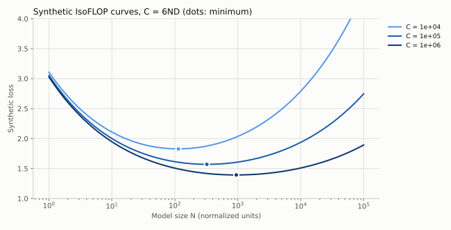

Kaplan 与 Chinchilla 的不同结论与训练设置、学习率、预算范围和参数核算等因素有关，不能简单理解成一篇“错”、一篇“永远对”。后续工作把差距拆到了具体因素上：Kaplan 统计的是非 embedding 参数，且在小规模上进行，Pearce 与 Song（2024）指出，差距的大部分来自"只算非 embedding 参数"加上"小规模实验"这两点，在这两个条件下模拟 Chinchilla 的实验会得到接近 Kaplan 的有偏指数；Porian 等人（2024）进一步把差距归到最后一层计算的计入方式、warmup 长度和随规模调整的优化器超参数上，逐项修正后两者可以对齐。[Reconciling Kaplan and Chinchilla](https://arxiv.org/abs/2406.12907)、[Resolving Discrepancies in Compute-Optimal Scaling](https://arxiv.org/abs/2406.19146) 课程三年都保留了对这些差异的分析。[Kaplan 等](https://arxiv.org/abs/2001.08361)、[2026 第九讲](https://github.com/stanford-cs336/lectures/blob/de53a9f979a6ee35f7d13a5e1aadee5ea1afc58e/lecture_09.pdf)

## 13.4 怎样用有限实验避免自欺

先覆盖数量级，再在可能的最优区附近加密。每个预算至少有几个位于最优点两侧的模型，否则只能证明你测试区间里的某个端点最好。用对数坐标检查残差结构，而不是只报告 $R^2$。

预留一两个较大预算作真正的外推验证，不能拟合后再把它们也当训练点。用 bootstrap 或多随机种子评估拟合不确定性。预测应是一个范围，附上最大外推倍数和失效条件。

**一个能检验答案的模拟。** `python -m examples.scaling` 在一个已知真值的损失曲面 $L=1+2N^{-0.35}+D^{-0.3}$（加噪声）上做 IsoFLOP 实验，7 个预算，外推到比最大预算大 1000 倍的目标，真实指数为 $0.3/0.65\approx0.4615$。它比较密集网格、预算受限网格和边缘补点三种设计、两种"找最低点"的方法，并用 20 个噪声种子重复整个流程：

| 设计 | 查询次数 | 指数（均值±标准差） | 目标处 $N_*$ 误差中位数 | 最差 |
|---|---:|---:|---:|---:|
| 密集网格，取最低点 | 287 | $0.459\pm0.029$ | 22% | 108% |
| 密集网格，抛物线顶点 | 287 | $0.460\pm0.000$ | 6% | 8% |
| 预算受限，取最低点 | 35 | $0.416\pm0.030$ | 41% | 60% |
| 预算受限，抛物线顶点 | 35 | $0.466\pm0.005$ | 4% | 21% |
| 预算受限 + 边缘补点，抛物线顶点 | 36 | $0.462\pm0.003$ | 3% | 9% |

"预算受限"的设计每个预算只跑 5 个模型，以上一预算的最优点按 $C^{0.5}$ 外推为中心，左右各放到 4 倍；第一个预算没有上一个点可用，以 $\sqrt{C/6}\approx12.9$ 为中心。"边缘补点"在最低点落在网格边缘时，沿同样的对数间距向外加点，直到最低点落在内部或达到每个预算最多 4 个补点的上限。几点读法：

- 只取最低的那次运行，会把 $N_*$ 量化到网格点上，噪声还会让它在相邻点之间跳；网格稀疏时误差可达 40%。
- 第一个预算放大了粗网格误差：真实 $N_*\approx39$ 位于网格范围内，但相邻候选是 25.8 与 51.6，20 个种子的最低观测点都选在右端 51.6。这里是最小预算的 $N_*$ **被高估**，把 log-log 拟合左端抬高，斜率因此变小。去掉第一个预算后，取最低点的指数均值从 0.416 回到 0.447。这支持检查边缘命中的做法，但不意味着真最优点一定在范围之外，也不能把所有偏差归给这一个点。
- 在 $\log N$ 上拟合抛物线取顶点（Chinchilla 的做法），用的是曲线形状而不是单个点。35 次查询的中位误差就与 287 次相当，但最差情况（21%）仍明显差于密集网格（8%）；在这个设置下，边缘补点只多花 1 次查询，把最差情况降到 9%。粗网格的最低观测点落在端点、拟合顶点落在网格外是两件事，应分别记录；补点后仍可能有网格量化误差或拟合偏差。
- 密集网格加抛物线的约 6% 误差几乎全是偏差：种子间标准差约为 0，无噪声重跑仍是 +6%。原因是在跨 4 个数量级的范围上，IsoFLOP 曲线关于 $\log N$ 并不对称，整段拟合抛物线会把顶点拉偏；应只用最低点附近的一段来拟合。
- 单个种子的结果可能很好也可能很差，重复整个设计才看得出方法本身的方差。

**自适应设计也要报告成本分布。** 默认噪声下，补点设计的 20 个种子都是 36 次查询；把噪声标准差改为 0.04，抛物线补点设计的查询次数变为 35–39 次。只写第一个种子的次数会掩盖这种变化。`seed_study` 同时报告查询数与计算量的最小值、均值、最大值，以及补点前/后的边缘命中率；计算量为各次查询预算之和，不能把一个小预算补点和一个大预算补点等价计价。达到补点上限后仍在边缘的曲线应标记为证据不足，而不是宣布找到了内部最优点。

A3 讲义在第一部分（给定的数据）建议直接取最低点，但没有说明理由。给定数据每个预算 8 个点、相邻 $N$ 约差 1.6 倍，取最低点会把 $N_*$ 量化到这个步长，可以和抛物线顶点的结果对照。自己用有限预算设计实验时，网格要么足够密，要么改用拟合。

搜索网格也属于实验设计：真实实验中不知道最优点在哪，只能根据上一个预算的结果放置候选。demo 中的解析最优点只用于事后核验。

## 13.5 课程中的两份缩放配方

2026 年第十一讲比较了几家公开细节较多的做法：

- **MiniCPM**：用 μP 让最优学习率在不同宽度间大致稳定，固定宽深比后整体放大；用 WSD 学习率日程，在稳定阶段的不同位置分叉退火，一次训练就能得到多个预算下"完成退火"的点；最优 batch 随目标损失下降而多项式增长。
- **DeepSeek**：不用 μP，直接在小规模上拟合最优学习率和 batch 随计算量的变化，再外推；同样使用分段衰减的 WSD 式日程。

两者共同点是：先把学习率、batch 这些超参数随规模的变化弄清楚，再拟合 $N_*,D_*$；否则小模型调参不足会人为制造对某种方法有利的趋势。

**A3 的设定。** 2026 年作业不让学生自己训练，而是通过一个训练 API 提交配置（层数、宽度、头数、batch、学习率、训练 token 等）和最长运行时间，API 在 B200 上真实训练并返回验证损失序列。拟合缩放律的总预算是 12 B200-小时，目标是为 48 B200-小时的最终训练选出最优配置并预测其损失。提交的运行在排队时就按最长运行时间预扣预算，完成后按实际用时返还；超时按上限计费。非 embedding 参数按 $12n_{layer}d^2$ 估算。这道题本质上就是上面的"预算受限设计"：每一次查询都有成本，怎么分配查询比拟合公式本身更重要。还有两点和本节的 demo 不同。第一，A3 的预算按 B200 墙钟时间计，不是按 FLOPs 计；不同形状、batch 和精度的吞吐不同，要用实测运行时间把"等成本"换算成 FLOPs 或 token，等 FLOPs 不等于等成本。第二，API 只提供 warmup 加余弦的学习率日程，一次运行中途记录的 `val_losses` 不是"完成退火"的短训练，不能当作额外的 IsoFLOP 点；13.5 节 MiniCPM 用 WSD 日程从一次训练分叉出多个预算的技巧，在这里用不上。

## 13.6 有限数据、重复训练与混合数据

第二次看到同一个 token 仍消耗算力，但新增信息通常少于第一次。可以把有效数据量建模成随重复次数逐渐饱和的函数，但饱和速率必须由实验确定。高质量小数据重复可能优于低质量新数据，不能只按独立 token 数排序。

不同领域损失对数据混合比例的响应也不相同。按域分别拟合缩放曲线，再优化加权目标是一个思路；跨域迁移和竞争使简单可加模型可能失效。混合比例应通过小规模消融和目标评估验证。

## 13.7 训练最优与部署最优

若模型将生成 $Q$ 个输出 token，总成本粗略为

$$C_{total}\approx C_{train}(N,D)+Q\,C_{infer/token}(N,T,B).$$

训练最优模型可能太大、推理太贵。让较小模型训练更久，常能在部署总成本下更合算。Sardana 等人把推理需求直接加进 Chinchilla 的目标函数，推理请求量大时最优模型更小、训练 token 更多；Gadre 等人则研究了远超每参数 20 token 的"过度训练"区间，发现损失随训练 token 的缩放仍可预测。这也是 2024–2025 年开源小模型普遍用数千、上万 token/参数训练的原因（第 29 章）。[Beyond Chinchilla-Optimal](https://arxiv.org/abs/2401.00448)、[Language models scale reliably with over-training](https://arxiv.org/abs/2403.08540)真正目标还包括延迟、显存与请求长度，不能用一个静态 $2N$ 的推理 FLOPs 估计覆盖所有服务条件。

MoE 的缩放还需区分总参数、active 参数、专家粒度和稀疏度。优化器、batch 和学习率也随规模变化；不充分调参的小模型可能人为制造有利于某方法的缩放趋势。

**练习。** 若 $\alpha=\beta$，计算预算增加 16 倍，理想训练最优 $N,D$ 各增加多少倍？如果推理预算占主导，还会照做吗？

**解答。** 两者各约 4 倍。若推理占主导，则应重新优化总成本，往往更偏向较小模型和更多训练数据；具体取决于服务量与性能要求。

## 13.8 如何拟合联合幂律而不把参数“拟合成故事”

令 $A=e^a,B=e^b$，并约束 $E,\alpha,\beta>0$。对每次运行 $i$，可在 log-loss 空间定义残差

$$r_i=\log(E+e^aN_i^{-\alpha}+e^bD_i^{-\beta})-\log\widehat L_i.$$

对这些残差最小化平方损失或 Huber 损失，是一种可执行选择；它与在原始 loss 空间做最小二乘不同，前者更看重相对误差。Huber 能减少偶发失稳运行的影响，却不能让本来有偏的实验设计变得可信。应记录被剔除的失败运行，避免只选好看的曲线。

改变参数单位也会改变 $A,B$。若 N 从“参数个数”改为“百万参数”，指数不变，系数会相应缩放；将一个单位下的系数带入另一个单位会得到荒谬预算。$C=6ND$ 只有在 N、D、C 的单位配套时才成立，教学合成数据使用的是归一化单位。

用多个初始化重启拟合，保存多组接近最优的参数。如果这些参数在观测区内预测相近、在目标预算处差别很大，说明现有数据不足以确定外推，而不是挑一个最顺眼的指数就结束。bootstrap 还应按独立训练运行或 seed 抽样；同一次训练的多个 checkpoint 彼此相关，不能当作独立重复来缩小区间。

## 13.9 有限数据的饱和模型

设独立数据量为 U，完成首轮后又重复 R 轮，可用一个经验性有效数据模型

$$D_{eff}=U+UR_*(1-e^{-R/R_*})$$

代替把所有曝光都当新数据。它满足 R=0 时为 U，初期额外一轮近似贡献 U，而长期趋近 $U(1+R_*)$；其边际收益 $\partial D_{eff}/\partial R=Ue^{-R/R_*}$ 逐渐减少。$R_*$ 必须由真实数据和训练设置拟合，不是普遍常数。[Scaling Data-Constrained Language Models](https://arxiv.org/abs/2305.16264)

若过滤使质量提高但 U 显著减少，在小预算下可能更好，在大预算下则可能过早进入重复饱和。固定过滤阈值不一定跨预算最优。应同时记录 U、实际消费 token 数 $U(1+R)$ 与验证损失，不能只报告有效数据的拟合值。

有效数据只用于拟合收益，实际训练账仍由消费量决定：$C\approx6N\,U(1+R)$，不能把 $D_{eff}$ 放进成本分母后宣称重复 token 免费。若最优点要同时选择过滤阈值与重复次数，应联合记录质量、独立数据 U 和真实 FLOPs。

## 13.10 平滑 loss 与突然变化的任务分数

连续预测损失平滑下降时，离散指标仍可能跳变。一个模型给正确选项的概率由 0.49 增到 0.51，在二选一 argmax 指标上从错变对；一串答案若必须全部正确才得分，还会放大多个子步骤的联合影响。这种测量效应不证明所有“涌现能力”都是假象，也不证明模型内部一定发生了离散相变。

因此应同时看连续 loss、准确率、部分分数、题目分层和不确定性。不能由整体 token loss 的幂律直接推导某个 benchmark 的最佳 scaling 指数，也不能把下游曲线短暂变陡当成无上限收益。[2026 第九讲的下游缩放讨论](https://github.com/stanford-cs336/lectures/blob/de53a9f979a6ee35f7d13a5e1aadee5ea1afc58e/lecture_09.pdf)

## 13.11 社区进展：稀疏度与精度也是缩放变量

Kimi K2 做了稀疏度缩放实验：固定激活参数，提高总专家数与激活专家数之比。在相同验证损失下，稀疏度 48 相对稀疏度 8、16、32 分别节省 1.69、1.39、1.15 倍 FLOPs（第 29.3 节）。

"Scaling Laws for Precision"用 465 次预训练实验拟合，并在最大 1.7B 参数的模型上验证，结论是低精度训练相当于减少有效参数量；训练后量化的损失随预训练数据量增大，数据多到一定程度后，继续预训练反而让量化后的模型变差（第 34.6 节）。这对"过度训练小模型再量化部署"的做法是一个直接的提醒，但它的结论来自小规模实验，外推需要验证。

## 13.12 预测区间之外，还要分析决策敏感性

由 13.2 节公式，固定指数时，系数比改变对最优规模的影响为

$$\frac{\partial\log N_*}{\partial\log(A/B)}=\frac1{\alpha+\beta}.$$

若 $\alpha=\beta=0.3$，$A/B$ 只偏 10%，最优 N 就约偏 $1.1^{1/0.6}-1\approx17.2\%$。指数估计误差还会乘上外推距离的 $\log C$，所以观测范围内拟合很好也可能远期选错模型。

最优 N 不确定大，不代表附近配置的 loss 必然差很大。令 $u=\log N$，固定 C 的曲率为 $A\alpha^2e^{-\alpha u}+B\beta^2(6/C)^\beta e^{\beta u}$；在平坦谷底，较宽的 N 区间都接近最优。应报告候选的预测损失差、区间、吞吐及失败风险，不只报告一个“最优参数量”。当误差范围内近似同分，可优先选择已验证稳定且部署成本合适的配置，再用新实验缩小不确定性。

## 练习

**1．** 按 Chinchilla 的 20 token/参数经验，$C=10^{21}$ FLOPs 下最优 $N$ 与 $D$ 约多少？

**解答。** $C=6ND=6N\cdot20N=120N^2$，$N=\sqrt{10^{21}/120}\approx2.9\times10^9$，$D\approx5.8\times10^{10}$。这只是数量级参考，真实最优比例依赖数据和架构。

**2．** 你只有 30 次查询预算，要拟合 5 个计算预算的 IsoFLOP 曲线。每个预算 6 个点、均匀撒在 $N$ 上 100 倍的范围，与每个预算 6 个点、集中在上一预算预测值附近 8 倍范围，各有什么风险？

**解答。** 宽范围不容易漏掉最优点，但点稀，顶点估计误差大，且大量预算花在离最优点很远、对拟合帮助小的位置。窄范围精度高，但若上一预算的预测偏了，真实最优点可能落在网格之外，此时要检查最低点是否在网格边缘，并补点。


---

# 14｜数据工程：从原始网页到可解释的训练分布


## 14.1 数据流水线也是模型设计

训练数据决定模型会把哪些表达、语言、任务和知识看作常见。大规模数据工程不是简单“下载→去重→训练”，而是在可追溯记录下定义训练分布。

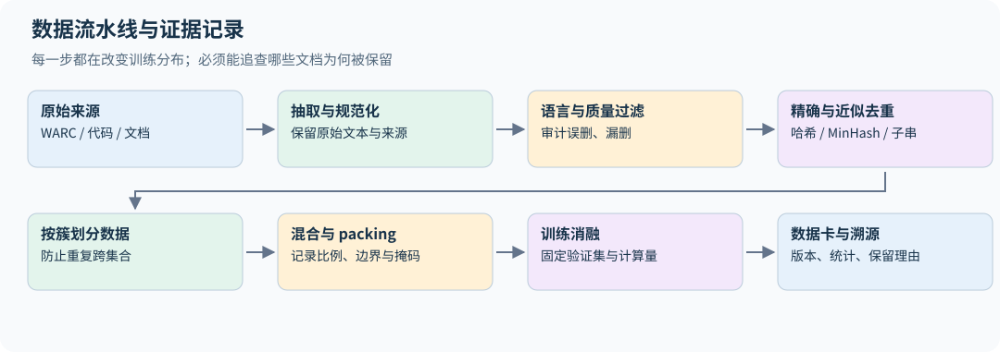

原始来源包括网页、百科、书籍、代码、论文、论坛和人工/合成指令。Common Crawl 的 WARC 包含抓取记录与响应内容，WET 提供抽取文本，WAT 提供部分元数据；具体下载格式应以相应数据发行说明为准。原始 HTML 需要编码检测、正文提取和错误处理，不能只用一个正则删标签。

为每个文档保留来源 ID、抓取时间、处理版本、语言、质量分数、去重簇、许可证/使用条件记录与最终保留原因。可访问不等于已确认适合所有训练与再分发用途；本书不替读者对具体数据集作法律结论。

## 14.2 质量过滤不等于真理检测

**抽取。** Common Crawl 自带的 WET 文本是用一套通用规则从 HTML 抽出来的，导航栏、版权尾注、cookie 提示都会混进去。数据作业要求自己用 Resiliparse 从 WARC 的 HTML 抽取正文（先检测编码，UTF-8 失败时回退），并与 WET 对比。抽取质量直接决定后续所有过滤器看到什么；DCLM 的实验显示，换一个抽取器就能让同一批网页训练出的模型分数明显变化。

**规则过滤。** Gopher 论文给出了一组简单、可解释的规则，作业要求实现其中四条，删除满足任一条件的文档：

- 少于 50 或多于 100,000 个词；
- 平均词长不在 3 到 10 个字符之间；
- 超过 30% 的行以省略号结尾；
- 含字母的词少于 80%。

它们针对的是菜单页、代码转储、数字表格、截断的摘要列表这类明显不适合语言建模的页面。规则对中文等不以空格分词的语言并不适用，"词"的定义要按语言调整。[data.py](../examples/data.py) 的 `rule_quality_check` 返回触发的规则名，便于统计每条规则各删了多少文档。本章 `data.py` 的函数只用于理解原理，接口也与作业不同；课程作业的独立完成要求见第 28 章开头。

**模型过滤。** 语言识别通常用 fastText 的 `lid.176` 模型给出语种和置信度，阈值要在抽样审计后决定。质量分类器则需要正负样本：一个常见做法是把 Wikipedia 引用的外部链接页面当作"高质量"正例、随机 Common Crawl 页面当作负例，训练 fastText 二分类器，用其分数排序或设阈值。KenLM 等小语言模型的困惑度也可用于筛除异常文本，但低困惑度可能偏爱模板化或重复内容。

公开数据集在这里分成两派：C4、Gopher、RefinedWeb、FineWeb、Dolma 在**质量**过滤上刻意不用模型打分（语言识别、毒性过滤等环节仍用 fastText 之类的分类器，例如 FineWeb 的英文阈值 0.65、Dolma 的 Jigsaw 毒性分类器；FineWeb-Edu 则是在 FineWeb 上再加模型打分，见 14.11 节）；GPT-3、LLaMA、DCLM 使用基于模型的质量过滤，DCLM 的固定协议对照支持模型过滤的收益（第 33.1 节）；不同领域和预算未必沿用同一选择。规则过滤更可解释、更不容易把某种风格当成"质量"，这是本书的判断。

过滤器的正例定义了“好”的方向。用百科当正例，可能保留百科风格却压低对话、方言和代码的比例。毒性词表也可能把引用、学术讨论或某些群体的语言误删。要按语言、来源和任务分层抽样审计误删与漏删，而不只看整体保留率。

个人信息处理是三年数据作业的一项明确任务。邮件、电话号码和 IP 地址可用规则检测后替换为类型标记，并返回命中数量供统计。IPv4 不能只匹配"四段数字"，还应验证每段在 0–255，`999.1.1.1` 和版本号 `1.2.3.4.5` 都不应命中；边界条件要单独想清楚，例如排除"更长的点分数字"时，不能把句末的句号也当成数字的一部分，否则 `My IP is 10.0.0.1.` 会漏掉。电话号码需要考虑国家区号与分隔符；邮件规则也不等于证明某字符串对应真实个人。`redact_contacts` 实现了这三类规则（占位符为 `<EMAIL>` 等），测试覆盖了上面三个反例。

这些规则会误伤代码示例、版本号、数学表达和公开联系方式，且无法找出所有隐含身份信息。合理流水线保留文档级计数、按域抽查，并决定替换片段还是删除整个文档。若把所有格式都替换成同一个高频占位符，模型可能学会大量输出占位符；因此还应监测替换比例及对任务的影响。[2026 数据作业 §2.4](https://github.com/stanford-cs336/assignment4-data/blob/0555bea66369872d912652debf10b115ca0688c8/cs336_assignment4_data.pdf)

DSIR 类方法用轻量特征空间估计目标分布与候选分布的密度比 $w(x)\propto p_{target}(\phi(x))/p_{raw}(\phi(x))$，再重要性重采样。它选择“更像目标”的样本，不保证直接最大化最终模型性能；特征映射和目标集代表性决定效果。2024 年第二节数据课对这类方法有较细展开。[2024 第十二讲](https://github.com/stanford-cs336/spring2024-lectures/blob/2eab561d4fc5f0bd77ab68afc85dd563a0b107ba/lecture_12.py)

## 14.3 精确去重：先决定何为相同

**行级去重。** 网页之间大量重复的是模板行：导航、页脚、"分享到"按钮。作业的做法是两遍扫描：第一遍统计所有文件中每一行的出现次数（用行的哈希作键，内存不随行长增长）；第二遍重写每个文件，只保留在整个语料中只出现一次的行。这样 StackOverflow 页面的头尾菜单被删掉，问题和回答保留下来。`drop_repeated_lines` 在内存中的文档列表上演示这个两遍过程。注意它会把合法的重复行（例如两篇文章都引用同一句话）也删掉，这是有意的取舍。

对规范化文本计算稳定哈希，相同哈希进入同组，再按需要核对原文。Python 默认 `hash()` 可能因进程随机化而变化，不适合持久化去重键。SHA-256 等稳定哈希更适合实验记录。

规范化也可能损失信息：大小写、空白、全半角转换对普通 prose 可能合理，对代码缩进、标识符和数学符号则可能改变语义。因此应分域设计，原始文本保留以便追查。

Bloom filter 用 $m$ 位、$k$ 个哈希记录已见元素，插入 $n$ 项后假阳性概率近似为

$$p_{fp}\approx(1-e^{-kn/m})^k,\qquad k_*\approx(m/n)\ln2.$$

标准插入/查询下不会漏掉已插入元素，但可能误报未插入元素已存在。如果“命中就丢弃”，会损失少量独特文档。它适合节省内存，不能替代精确相等判断的定义。

## 14.4 MinHash：把集合相似度压成签名

把文档变成字符或词的 n-gram 集合 $A$，Jaccard 相似度为 $J(A,B)=|A\cap B|/|A\cup B|$。对一个随机排列，取集合中排序最小的元素作为签名。两集合签名相同，当且仅当并集里最小元素落在交集，因此

$$\Pr[h_{min}(A)=h_{min}(B)]=J(A,B).$$

用 $k$ 个独立签名估计相似度，其标准差约为 $\sqrt{J(1-J)/k}$。签名数越多越准确，也需要更多内存与计算。实际哈希族只是对理想随机排列的近似。

LSH 将签名分成 $b$ 个 band，每个 band 有 $r$ 行。任一 band 全部相同就生成候选，相似度为 $s$ 的文档对成为候选的概率为

$$1-(1-s^r)^b.$$

这是一条概率曲线，不是硬阈值。以 16 个 band、每 band 8 行（共 128 个签名）为例，相似度 0.5、0.7、0.8、0.9 的文档对成为候选的概率分别约为 0.06、0.61、0.95、1.00；调整 $b,r$ 可以移动曲线的陡峭位置。候选对还应计算真实 Jaccard 复核。聚类若用连通分量，A≈B、B≈C 不保证 A≈C；保留代表文档时要意识到传递闭包可能扩大删除范围。

`near_duplicate_clusters` 把完整流程串起来：词级 5-gram 集合、MinHash 签名、按 band 分桶找候选、复核真实 Jaccard、并查集聚类，返回每簇保留的第一篇的下标。demo 中一篇新闻与"加了一句分享提示"的副本 Jaccard 为 0.875，被合并；另一篇无关文章保留。

Jaccard 还会受到文档长度影响。若一篇 100-shingle 文档被完整包含在另一篇 1000-shingle 文档中，Jaccard 仅为 0.1，但短文档的 containment $|A\cap B|/|A|$ 为 1。想找整段复制时，应该用段落/子串方法或明确的包含率目标，不能仅提高 MinHash 签名数就解决度量不匹配。

空文档没有最小哈希值，应在进入 MinHash 前过滤；极短文档也可能因常用短语而看起来相同。签名碰撞、哈希 seed、shingle 边界与中文按字/按词的选择都要固定。字符级方法不依赖分词器，词级方法可能更贴近语义，但“语义相同”与“字符串重复”仍是不同定义。

## 14.5 子串重复与后缀数组

整篇文档不相似，也可能共享大量长段落，例如导航、版权尾注和重复文章片段。把文档连接成序列并加入不可混淆的边界，后缀数组按字典序排列各后缀；相邻后缀的最长公共前缀能暴露重复子串。

实现时要避免跨文档边界形成伪重复，处理重叠匹配，并决定删除整文还是只删片段。大规模后缀结构对内存和外存算法要求高，不能把玩具 `sorted(all_suffixes)` 当成可扩展实现。这是 2024 年去重讲义中值得保留的细节。[2024 第十三讲](https://github.com/stanford-cs336/spring2024-lectures/blob/2eab561d4fc5f0bd77ab68afc85dd563a0b107ba/lecture_13.py)

## 14.6 划分、混合、packing 与污染

去重簇应整体分入 train/validation/test，避免同一内容不同拷贝跨集合。时间、来源域和作者也可能构成相关性，应根据评估目的选择更严格的划分。benchmark 去污染需要考虑答案、题目改写、翻译和解释文本，精确字符串匹配只能发现部分问题。

若域 $i$ 有 $n_i$ token，可用 $p_i\propto n_i^\tau$ 调整采样：$\tau=1$ 按规模，$\tau<1$ 提高小域权重。它也会增加小域重复次数，要同时记录独立文档量和实际训练曝光次数。

packing 把短文档拼接以减少 padding。用 EOS 分隔不等于阻止跨文档注意力，block-diagonal attention 也不会自动屏蔽跨文档的下一 token 目标。是否保留这种监督、是否重置 position ID，必须与训练目标一致；第 4.6 节给出独立文档目标的边界图与代码。长上下文训练与代码 infilling 的 FIM 变换也应记录各自采样比例。

## 14.7 合成数据不是无条件的信息增益

教师能生成更多示范，但如果没有新问题、可靠筛选或外部验证，只重复教师的高概率输出可能缩窄分布。有效合成流程通常包含多样的 seed、难度控制、事实/代码/数学验证、重复检测，以及与真实数据混合。

Self-instruct 扩展指令形式，self-distillation 迁移教师行为，STaR/专家迭代利用可验证成功轨迹。每一步都要防止测试题被用于生成训练答案，并把教师与验证器版本纳入元数据。

## 14.8 用公开数据配方理解设计空间

课程介绍多个数据集不是为了记年份和 TB 数，而是为了识别可重复的选择。下表概括它们在课程中的教学角色；它不代替各发行版的数据卡，也不暗示不同版本使用完全相同的流水线。

| 数据配方 | 主要选择 | 学习时追问 |
|---|---|---|
| WebText 类 | 用社区链接信号选择网页 | 社区选择了哪些人、语言和主题？ |
| C4 类 | 大规模网页文本与启发式清洗 | 规则删除了什么，保留了什么模板？ |
| CCNet 类 | 语言识别、去重与语言模型评分 | 评分模型如何塑造语言和风格分布？ |
| The Pile 类 | 多来源显式混合 | 学术、代码、书籍等比例如何决定能力？ |
| RefinedWeb 类 | 精心清理的大规模网页 | 强清洗网页可替代多少人工组合来源？ |
| Dolma 类 | 公开数据与可追溯处理工具 | 能否复现每阶段统计和去重决策？ |
| DCLM 类 | 固定训练/评估协议研究数据选择 | 数据收益是否在固定模型与算力下仍成立？ |
| The Stack 类 | 代码来源与许可相关元数据 | 仓库分叉、重复文件和测试污染如何处理？ |

比较配方应看最终模型在一致协议下的表现，而不是“过滤越多越高级”。课程的来源追溯还覆盖百科、书籍、StackExchange、GitHub、arXiv 及许可明确的数据集合，强调不同来源的质量、覆盖与使用条件。[2026 第十三讲](https://github.com/stanford-cs336/lectures/blob/de53a9f979a6ee35f7d13a5e1aadee5ea1afc58e/lecture_13.py)

评估过滤器时至少区分两个实验：固定最终训练 token/FLOPs，衡量保留样本的价值；固定原始数据池与处理预算，衡量整条流水线可交付多少有效数据。强过滤若只留下很小子集，前一种实验可能表现好，却需要更多重复或原始抓取才能支撑大规模训练。记录“被保留文档上的平均分”不足以评估此取舍。

FIM（fill-in-the-middle）是把代码前缀、中间段、后缀按特殊标记重排，让 decoder 在已知前后文时生成缺失片段。例如从 `prefix + middle + suffix` 构造 `PRE prefix SUF suffix MID middle`。它仍然使用自回归目标，却通过数据变换改变条件信息。特殊 token、重排概率、截断和文件边界必须一致，否则模型可能只学会标记格式。

## 14.9 质量分类器的分数为什么随来源漂移

假设用高质量来源作正例、随机网页作负例，训练二分类器输出 q。它学到的可能是内容质量，也可能是来源风格、语言、模板或领域差异。把 classifier score 当成事实正确率没有依据；把所有语言统一用同一阈值，也可能改变语言混合比例。

若分类器给出的恰是训练分布下的逐输入后验 $q(x)=P(y=1\mid x)$，训练先验为 $\pi=P(y=1)$，则在分母非零处，由 Bayes 公式有

$$\frac{p(x\mid y=1)}{p(x\mid y=0)}=\frac{q(x)}{1-q(x)}\frac{1-\pi}{\pi}.$$

普通校准只要求 $P(y=1\mid q(X)=s)=s$，比“每个 x 的后验正确”弱。一个对所有输入都预测 0.5 的分类器，在正负各半的数据上可以完全校准；若两类输入的真实后验分别为 0.9、0.1，它仍无法区分密度比 9 与 1/9。因此可靠性图或 ECE 很好，不足以证明重要性权重正确，还需检验特征覆盖、逐域区分能力和目标/候选支持。

但数据选择需要的 target/raw ratio 未必就是这两个类条件密度之比，且高分区的小校准误差会被 odds 放大。分类器排序、概率校准和重要性权重是不同用途。将权重截断能控制方差，也会改变目标分布，应该写进实验条件。

审计样本应同时抽取高分保留、低分删除和阈值附近样本，按语言/域分层查看精度与召回。域内 train/validation 划分还不够：同站点模板或近重复页面若跨集合，会夸大泛化。最好在来源域或时间上再设留出组，观察 score 分布漂移。三年数据作业中的 quality classifier、过滤消融和样本检查共同覆盖这个主题。

## 14.10 数据作业的完整闭环

2026 年数据作业把上述工具串成一个优化问题：起点是已经按 fastText `lid.176` 英文概率不低于 0.7 预过滤过的 WET 文件（原始为 2,500 个），自由组合过滤、去重和其他方法，产出训练数据；用 GPT-2 tokenizer 编码（每篇文档后加 `<|endoftext|>`，存为 `uint16` 数组），在固定的模型与训练脚本下训练（8 卡、每卡 batch 128、16,384 步、上下文 512，约 $2^{33}\approx8.6$B token），目标是最小化 Paloma 基准中 C4 100 个域子集上的验证损失。过滤后的数据若少于 8.6B token，训练时就会重复多轮（第 13.9 节）。训练配置不能改，能改的只有数据。可以利用 Paloma 验证数据来构造过滤器或分类器，但不能把验证文本直接放进训练集。

这个设定逼着你回答本章的所有问题：每个过滤器各删了多少（作业要求报告），删掉的文档是否该删（抽样检查被删与被保留的各五篇），处理全部 Common Crawl 需要多长时间。目标是 C4 风格的网页，所以"质量"在这里有明确的操作定义：像目标分布。换一个目标（代码、数学、对话），最优流水线可能完全不同。

作业允许用指定验证集指导过滤，不表示同一集合仍能作为独立最终测试。它在这个研究流程中承担开发集角色；若要声称对新网站或新时间段泛化，仍需另留不参与分类器训练、阈值选择和流水线迭代的集合（第 15.10 节）。

## 14.11 社区进展：从过滤到改写

2024–2025 年的公开数据配方有三个明显的方向，第 33 章逐一展开：

- **大模型标注、小模型打分。** FineWeb-Edu 用 Llama-3-70B-Instruct 标注约 46 万个网页，训练小分类器跑遍 15T token，花了 6,000 H100 小时，最后保留 1.3T。
- **中期训练换数据。** OLMo 2 在学习率退火阶段改用高质量与合成数学数据。
- **合成数据以改写为主。** Phi-4 的合成数据占训练 token 的 40%、重复约 14 轮；Kimi K2 改写知识文本，同样看 10 遍，"改写 10 次各看一遍"比"原文看 10 遍"在 SimpleQA 上高 5 个点。

第 14.9 节关于分类器分数漂移的提醒，对这些做法全部适用。

## 14.12 把过滤器的误差换算成训练分布

设某域原始占比为 $w_i$，保留概率为 $a_i$，过滤后该域占比为

$$w'_i=\frac{w_ia_i}{\sum_jw_ja_j}.$$

这里 $w_i$ 与 $a_i$ 必须以同一种单位计量。若 $w_i$ 是文档占比、$a_i$ 是文档保留概率，上式得到文档占比；训练 token 占比还应乘保留文档的平均长度 $\bar\ell_{i,keep}$，即 $w^{token}_i\propto w_i a_i\bar\ell_{i,keep}$。两域文档数各半、保留率相同，但保留长度分别为 100 和 1000 token，最终 token 比例就是 1:10。仅报告“每域保留一半”不足以确定训练混合。

例如按文档数计两域各占一半，过滤器分别保留 80% 和 20%，最终文档比例变为 80%:20%。即使过滤器整体“精度提高”，它也改变了语言/来源分布；整体验证收益不能独立归因于域内质量。需同时做固定最终域比例和自由比例两组对照，记录保留量、重采样曝光及域内验证表现。[DSIR 的目标分布视角](https://arxiv.org/abs/2302.03169)

流水线顺序也不交换：先去重再打分，与先打分再按首个样本去重，可能保留同簇中的不同代表；先按域采样再全局去重，又改变不同来源的存活率。应保留每一步的输入数、输出数、操作版本和关联文档 ID，使最终模型的训练分布可追溯到过滤决策。

一份实用审计表应按“来源/语言 × 长度 × 保留/删除/阈值附近”分层，抽取人工样本检查误删与漏删。若只抽保留样本，无法估计丢掉了多少有效内容；若每层同样抽 100 条，汇总时需按各层总体规模加权，不能直接平均抽样比例。

## 练习

**1．** 去重后训练 loss 变高但验证 loss 变低，是否说明流水线出错？

**解答。** 不一定。重复内容原本更容易记住并被多次计入训练均值。去重改变了训练分布和有效样本权重，训练 loss 上升可以伴随泛化改善。应在同一固定验证集、同等计算预算下比较。

**2．** 用 Gopher 规则过滤中文网页会发生什么？应该怎样调整？

**解答。** 中文不以空格分词，整段文字常被当成一个"词"：词数远少于 50、平均词长远超 10，几乎所有中文页面都会被删掉。应先用分词器或按字切分，再按中文语料的统计分布重新设定阈值，并抽样审计。

**3．** MinHash 用 20 个 band、每 band 5 行。相似度 0.8 的文档对成为候选的概率是多少？若想让 0.5 的对很少成为候选，应调大 $b$ 还是 $r$？

**解答。** $1-(1-0.8^5)^{20}\approx0.9996$。增大 $r$ 让曲线在高相似度处才陡峭上升，减少低相似度候选；增大 $b$ 则相反，提高召回。$r=5$ 时 0.5 的对成为候选的概率约 $1-(1-0.5^5)^{20}\approx0.47$，太高。

本章综合 2024 四节数据课与 [2026 第十三讲](https://github.com/stanford-cs336/lectures/blob/de53a9f979a6ee35f7d13a5e1aadee5ea1afc58e/lecture_13.py)、[第十四讲](https://github.com/stanford-cs336/lectures/blob/de53a9f979a6ee35f7d13a5e1aadee5ea1afc58e/lecture_14.py)。


---

# 15｜评估：把“模型更好”变成可检验陈述

## 15.1 先定义要测的能力

预训练 loss 衡量预测分布，选择题衡量在特定题目和协议下的选项表现，对话偏好衡量某类评审的选择，agent benchmark 衡量包含工具与环境的系统任务完成率。它们相关，但不等价。

一条可检验陈述应写成：“在固定模型、提示、采样、工具权限和预算下，方法 A 在预先锁定的测试集合上提高某指标多少，并有怎样的不确定性。”省略这些条件的排行榜差异很难解释。

## 15.2 likelihood 评估与生成评估

选择题可比较每个候选的条件 log probability，也可让模型生成一个选项字母。二者测试的行为不同：前者绕过部分格式服从问题，后者更贴近实际回答。多 token 选项的总 log probability 偏向较短答案，长度归一化又改变评分含义，应固定并公开规则。

few-shot 示例选择、选项顺序、空格、答案前缀、chat template、system prompt 都可能影响结果。评估应保存完整格式化 prompt 和 tokenizer/模型版本，不能只保存题目 ID 与最终分数。

## 15.3 一张基准地图：每类在测什么、坑在哪里

2026 年评估讲义按"测什么"把常见基准分成几类。下表只记录讲义中可核对的事实，用于建立直觉；具体分数会随模型更新而过时，不在此列出。

| 类别 | 代表 | 形式与规模 | 主要局限 |
|---|---|---|---|
| 困惑度 | 留出语料、Paloma | 测试文本上的条件似然 | 依赖 tokenizer；对所有 token 一视同仁，包括与任务无关的词 |
| 考试式 | MMLU | 57 个学科的四选一 | 名为"理解"，实测主要是知识；已接近饱和 |
| 考试式 | MMLU-Pro | 去掉噪声题，扩到 10 个选项，用 CoT 评测 | 准确率比 MMLU 低 16–33 个百分点，仍是选择题 |
| 考试式 | GPQA | 61 位博士撰写的研究生级题目 | 博士专家 65%，非专家查 Google 30 分钟也只有 34%；题量小 |
| 考试式 | Humanity's Last Exam | 约 2,500 道多学科题，含多模态 | 用前沿模型过滤难度，与"真实使用"距离最远 |
| 开放式对话 | Chatbot Arena | 真实用户提问、匿名双模型、人选更好的一个 | 用户群体与偏见未知；风格与正确性混在一起 |
| 开放式对话 | AlpacaEval | 805 条指令，GPT-4 作评审算对基线胜率 | 评审偏爱长回答，2.0 版用回归做长度校正 |
| 开放式对话 | WildBench | 从真实对话中选出 1,024 条，评审按清单打分 | 与 Arena 相关性高，仍依赖 LLM 评审 |
| Agent | SWE-bench | 12 个 Python 仓库、2,294 个 issue，用单元测试判分 | 测试不完备时可"通过而未修好" |
| Agent | Terminal-Bench | 终端环境任务，2.0 版 89 个 | 结果依赖 agent 脚手架与工具权限 |
| Agent | CyBench | 40 个 CTF 安全任务 | 用首次解出时间衡量难度 |

讲义里有两个观察值得记住。第一，**一些基准（如 LAMBADA、HellaSwag）本质上是"伪装的困惑度"**：选择题用条件似然打分时，模型只是在比较几个续写的概率。第二，**趋势是越来越难、越来越接近真实使用**：从选择题到开放对话，再到要求模型"做事"的 agent 任务，评测对象也从"模型"变成了"模型加脚手架"。

**Arena 的 Elo。** Chatbot Arena 用

$$P(A\succ B)=\frac{1}{1+10^{(R_B-R_A)/400}}$$

表示一种 Elo 风格胜率尺度；Arena 也使用 Bradley–Terry 拟合及 bootstrap 等估计，并非只做传统在线 Elo 更新。这就是底数为 10、尺度为 400 的 Bradley–Terry 模型。100 分差对应约 64% 胜率，400 分差约 91%。它的好处是不要求所有模型回答同一批提示，新模型和新提示可以随时加入；代价是分数依赖对手池与用户分布。`examples/evaluation.py` 的 `elo_win_probability` 实现了这个换算。

## 15.4 pass@k 的意义与估计

对一道题独立采样 $n$ 个候选，$c$ 个通过验证，抽取 $k$ 个至少成功一次的无偏组合估计量为

$$\widehat{\mathrm{pass@k}}=1-\frac{\binom{n-c}{k}}{\binom nk},\qquad n\ge k.$$

它衡量“有一个通过验证的候选”的概率，不等于系统能挑出这个候选。如果实际部署只返回一个结果，必须另评估选择器。提高 $k$ 同时增加了推理预算；比较模型时应报告总生成 token 或总成本。

代码任务的测试集可能不完整，数学答案解析可能被格式投机利用，环境任务可能通过绕过目标状态获分。验证器本身需要误判分析。

## 15.5 不确定性与配对比较

若 $n$ 个独立样本上准确率为 $\hat p$，粗略标准误为 $\sqrt{\hat p(1-\hat p)/n}$。在 1000 题、50% 准确率附近约为 1.58 个百分点，95% 正态近似区间的半宽约为 3.1 个百分点。边界概率或小样本更适合 Wilson 区间等方法。

比较两个模型在同一组题上的差异，应该使用逐题配对差值，或配对 bootstrap，而不是把两组结果当作独立样本。题目同源、同作者或同模板时，应按簇重采样，避免低估不确定性。训练随机性还需要多个训练 seed，不能由对测试题 bootstrap 替代。

区间是针对抽样机制的：题目 bootstrap 估计测试分布抽样变化，训练 seed 重复估计优化随机性，二者不能互相替代。将同一题的多次生成当作独立题目会夸大有效样本量；应以题目为簇。多个模型/提示反复比较后挑最大值，还需开发集选择和独立确认，不能继续用未经选择修正的单次 95% 区间解释胜出。

对 $m$ 道独立抽取的题，每题独立生成 $r$ 次，令题目本身的成功概率为 $p_i$、估计总分为各题成功比例的平均。题目分布与采样随机性的全方差分解为

$$\operatorname{Var}(\widehat a)=\frac{\operatorname{Var}(p_i)}m+\frac{\mathbb E[p_i(1-p_i)]}{mr}.$$

增加每题采样次数只缩小第二项；若评估对象是这组固定题而非新的题目分布，则条件方差只包含采样项。用 $\sqrt{\bar p(1-\bar p)/m}$ 作为多次采样平均分的标准误，会把不同题目难度与生成噪声混在一起，若使用真实总体均值 p 代入，该二项式表达式给出这组假设下的上界；实际用有限样本的估计值代入则只是近似，不能保证每次都保守。比较两模型时还需逐题配对；仅从总体准确率无法恢复它们的差值方差。

## 15.6 人类与 LLM judge

pairwise 偏好常用 Bradley–Terry 模型 $P(A\succ B)=\sigma(s_A-s_B)$ 汇总。分数依赖对手池、样本分布和评审偏好，并非模型的绝对物理属性。

LLM judge 容易受到位置、长度、语气、自我偏好和提示注入影响。可随机交换答案顺序、隐藏来源、明确评分维度，并用人工审计估计失误。长度控制可以降低一类偏差，却不能自动恢复“真实能力”。不同评审群体的偏好差异本身也是重要结果。

## 15.7 安全与可靠性评估

同时看风险请求的适当处理与正常请求的误拒率；单纯提高拒绝比例并不等于更安全或更有用。按风险类型、语言、上下文长度和改写方式分层评估，记录失败样例。

事实性需区分是否给出答案、答案是否正确、置信表达是否校准，以及错误是否来自缺乏知识、检索失败或推理失误。经过偏好优化的模型可能更自信、更集中，并不自动保持预训练概率的校准性质。

允许拒答时，应同时报告覆盖率 $c=P(\text{作答})$ 和作答后的准确率 $a=P(\text{正确}\mid\text{作答})$。若把拒答计为任务未完成，总体正确率为 $ca$。系统从“覆盖 100%、准确 80%”变成“覆盖 50%、作答准确 95%”，不能仅以 95% 宣布能力提高。可在开发集选择阈值，再在测试集画风险—覆盖曲线，并分别计入错误答案与拒答的应用成本。

## 15.8 agent 评估的单位是完整系统

工具、检索索引、浏览器环境、测试运行权限、最大步数、重试次数和墙钟预算都影响结果。一个模型在相同权重下使用更多工具调用，也可能获得更高完成率。应区分模型变化与 agent scaffolding 变化。

训练集污染检测不能靠“模型给正确答案”证明记忆。高似然也可能来自题目简单；低似然也不排除见过改写。要结合数据溯源、时间划分、近重复检查与新设计的测试集合。课程将真实性、有效性和污染作为评估核心，而不只是列举基准名称。[2026 第十二讲](https://github.com/stanford-cs336/lectures/blob/de53a9f979a6ee35f7d13a5e1aadee5ea1afc58e/lecture_12.py)

**练习。** A 在 200 道题上得分 61%，B 为 62%，能否直接宣布 B 更强？

**解答。** 不能。差异只有两道题，需要查看配对结果、不确定性、任务分层和是否经过反复调参。若试过很多变体后只挑最好者，选择偏差还会进一步放大表面提升。

## 15.9 一份可以实际复算的统计协议

pass@k 估计无需计算容易溢出的组合数。若 $n-c\ge k$，计算失败概率的对数

$$\log P(\text{全部失败})=\sum_{i=0}^{k-1}\log\left(1-\frac{c}{n-i}\right),$$

再用 `-expm1(log_failure)` 得到至少一次成功的概率；若 $n-c<k$ 则为 1。这里的候选应来自固定采样协议，通常假设 IID；beam search、去重后重新计数或人为相关的候选不满足同一解释。

Wilson 区间在小样本和 0%/100% 附近比简单正态区间更稳健。令 $z=1.96$、$p=c/n$，其中心和半宽为

$$\text{center}=\frac{p+z^2/(2n)}{1+z^2/n},\qquad \text{half}=\frac{z\sqrt{p(1-p)/n+z^2/(4n^2)}}{1+z^2/n}.$$

答对 10/10 题不能推出真实准确率恰为 100%；Wilson 的 95% 区间下界约为 72.2%。区间解释假设题目可代表所关注分布，不能修复污染或选择偏差。

配对 bootstrap 每次抽同一组题目索引，并同时取 A/B 在这些题上的结果，再求差值。独立对 A/B 抽不同题目破坏配对，常浪费精度。代码见 [evaluation.py](../examples/evaluation.py)，包含 pass@k、Wilson 和配对 bootstrap 的可运行实现；测试用枚举子集核验 pass@k。[代码模型论文中的 pass@k 估计](https://arxiv.org/abs/2107.03374)

同一原题的多种改写、同一仓库的多个任务不能随意视为独立题。`paired_cluster_bootstrap` 每次有放回抽取独立簇，保留簇内所有题目及 A/B 配对；同一簇被抽两次就按两份计。`weighting="item"` 对抽中题目的总差值除以总题数，`"cluster"` 则先算每簇均值再平均。例如一个 1 题簇改善 1、另一个 9 题簇均改善 0，前者点估计为 0.1，后者为 0.5；要先按部署抽样单位选目标。簇内复制记录不会增加独立证据，bootstrap 也不能从仅一两个簇恢复充分的不确定性信息。若部署关心新簇与新题两级变化，还需与该抽样设计对应的分层分析。

## 15.10 把模型评分与挑模型分开

训练集用于更新参数，开发集用于调超参数与选择 checkpoint，最终测试集只在协议锁定后用来报告。反复查看测试集再改 prompt、解码或数据，本质上也在使用测试反馈调参。

同时报告任务指标与成本：例如“相同 8K 输出 token 上限、相同采样温度、每题 16 次生成、同一 verifier”。若比较策略会动态早停，计入实际总 token、平均/尾部延迟及失败后的重试。更大的 test-time compute 可以提高成功率，但应被当作一种资源投入，而不是藏在模型能力分数里。

## 15.11 置信度校准和有效性

准确率只看预测是否正确，校准则问“声称 80% 把握的一组预测是否约有 80% 正确”。多类 Brier score 为

$$\operatorname{Brier}=\frac1n\sum_i\sum_c(p_{ic}-\mathbf1[y_i=c])^2.$$

它同时惩罚错误与过度自信。ECE 把预测按置信度分桶，比较各桶准确率和平均置信度，再按桶大小加权；它容易受分桶数与样本量影响，所以不能只用一个 ECE 数字评价可靠性。语言模型生成整段回答时，某个 token 概率并不自动等于“整段事实正确的概率”，需要先定义共同事件空间。

校准也不衡量区分能力。所有样本都报总体成功率的常量预测，可以在总体上校准，却无法分辨容易与困难样本；第 14.9 节给出它不能恢复密度比的反例。Brier 与 NLL 是概率评分，准确率或排序指标描述决策，可靠性图描述校准，应让这些指标各自回答对应的问题。

构念有效性问“指标是否测到了想研究的能力”，外部有效性问“在其他分布和部署环境中是否仍成立”。例如通过格式匹配得到高分，未必具有稳健推理；在人工短题上表现好，也未必适用于真实长文。校准是本书为理解课程评估限制加入的补充，不替代污染检测、真实任务设计或人工审计。

## 15.12 固定测试与红队探索的职责不同

课程安全补充作业包含 red teaming。固定测试集用于比较版本；红队探索主动寻找容易失败的表达、上下文或工具组合，目的是发现覆盖空白。探索者会根据反馈不断调整问题，所以其失败比例不能直接当作真实用户分布中的风险率。

记录每个失败的任务意图、输入变体、模型版本、解码协议、工具上下文和评分理由，再提炼成可复现回归案例。回归集一旦用于开发，就不能继续作为未见测试；应留出新变体及正常请求，检查修复是否导致误拒。评估记录涉及实际用户数据时，应先做必要脱敏。

**练习。** 两个模型在 Arena 上相差 50 分。若从同一提示分布里抽 400 次两两比较，胜率的期望和 95% 区间大约是多少？这足以区分它们吗？

**解答。** 期望胜率 $1/(1+10^{-50/400})\approx0.571$。400 次比较的标准误约 $\sqrt{0.571\times0.429/400}\approx0.025$，观测胜率大约落在 52%–62%。但这不等于一定能区分：这是在真实胜率已知时观测值的波动范围，"能否区分"要问的是检验功效。以 50% 为原假设做双侧检验（$\alpha=0.05$），400 次比较的功效约 82%，也就是约五分之一的实验会得出"不显著"；100 次只有约 30%。要达到 80% 功效约需 380 次比较。平局、用户异质性与题目相关性会让所需次数更多。

## 15.13 社区进展：评估方法的新问题

2025 年的几个争论都落在评估方法上：

- **RL 有没有教会模型新东西**，取决于 pass@k 中的 $k$ 取多大，以及"成功"是只看答案还是也看推理过程（第 31.5 节）；
- **agent 分数是系统的分数**，必须报告脚手架、工具集、步数与 token 上限（第 32.6 节）；
- **去污染应写成可执行的规则。** Tulu 3 用 8-gram 匹配，测试样本超过 50% 的 token 与同一条训练样本重叠就算显著重叠，并说明了这种方法抓不到改写的局限（第 33.4 节）。

## 15.14 零次成功、反复采样与能力上界

在 n 次 IID 尝试中未观察到成功，并不证明成功概率为零。以固定 n、固定策略、无中途挑选为前提，单侧 95% 上界解 $(1-p)^n=0.05$：

$$p_{upper}=1-0.05^{1/n}\approx3/n.$$

n=100 时约为 2.95%，n=1000 时约为 0.299%。因此“基础模型采样 1000 次仍失败”支持在该协议下成功很少见；不能证明没有相应能力或答案路径。多个问题难度不同，应逐题分析，不能把所有失败混成一个共同 p。相关采样、beam search 与测试污染也会破坏 IID 解释。

评估还要区分每题平均成功率和至少成功一次的覆盖率。对每题各生成 20 次，不应把它们当 20 个独立新题；比较模型时以题目为簇、模型间配对重采样。过程正确性由另一个 judge 评分时，还需报告 judge 的误判，不能把 CoT-Pass@k 当作无噪声真值。与第 31.5 节的 RL 能力争论一起读，才能给“扩展了推理边界”一个可检验的含义。


---

# 16｜中期训练、指令微调与参数高效适配

## 16.1 每个训练阶段在改变什么

预训练在广泛文本上学习分布；中期训练把数据向代码、数学、长上下文或任务形式倾斜；SFT 用示范教模型在给定指令下产生期望回答。三者不一定有严格边界，常见差别是数据分布、损失掩码、学习率与序列结构。[2026 第十五讲](https://github.com/stanford-cs336/lectures/blob/de53a9f979a6ee35f7d13a5e1aadee5ea1afc58e/lecture_15.pdf)

继续预训练可以吸收领域知识，SFT 可激活已有能力、约束输出方式，也可能学习新模式。不能把“SFT 只教格式、永远不学知识”当成定律。实际效果受示范覆盖、模型容量、重复次数和训练步数影响。

## 16.2 response-only loss 的正确对齐

对于 prompt $x$ 和 response $y$，条件似然为

$$\mathcal L_{SFT}=-\sum_{t=1}^{|y|}\log\pi_\theta(y_t\mid x,y_{<t}).$$

将对话串成完整 token 序列后，input/target 相差一位。掩码应标记目标 token 是否属于 assistant response，包括约定的结束 token；它不是简单标记输入位置是否属于 assistant。

```text
完整串：  用户标记  问题  助手标记  答案1  答案2  EOS
输入：    用户标记  问题  助手标记  答案1  答案2
目标：    问题      助手标记  答案1  答案2  EOS
loss mask: 0       0         1      1      1
```

注意 `encode(prompt)+encode(response)` 不一定等于 `encode(prompt+response)`，因为分词可能跨边界合并。聊天模板若用专门控制 token 提供稳定边界会更容易对齐；否则需要完整编码后的 offsets 或明确的边界处理策略。

## 16.3 归一化定义了训练偏好

按所有 response token 平均，会让长回答贡献更多总权重；先逐序列平均再逐样本平均，则每个样本总权重相同。两种目标都可合理，但效果不同。多轮对话应明确训练所有 assistant 回合，还是只训练最后一轮。

packing 后的注意力 mask 与 loss mask 相互独立。前者规定看什么，后者规定哪些预测接受监督。仅把 prompt 的 loss 设为零，不会阻止 response 读取 prompt，这正是条件生成所需行为。

## 16.4 示范数据从哪里来

2026 年第十五讲比较了几类常见指令数据：FLAN 把大量现成 NLP 任务改写成指令格式，覆盖广但回答简短、像"在答题"而不是在对话；Alpaca 用强模型按种子指令生成，风格更像助手，但继承了教师的错误；ShareGPT/Vicuna 来自真实用户与 ChatGPT 的对话；OpenAssistant 由志愿者撰写和标注；Tulu 3 等则是多来源混合并精心过滤。数据来源决定了模型的"口吻"：同样的知识，训练在 FLAN 上与训练在对话数据上，模型说话的方式可能明显不同；具体程度应由固定模板和任务的对照验证。

以下是讲义中基于特定研究的经验提醒，不推翻 16.1 节 SFT 也能学习新信息的边界：SFT 最擅长**提取**预训练已有的行为，而不是加入新行为；加入模型不知道的知识，即使内容正确，有时反而有害，因为它在教模型"自信地说出没有依据的内容"；少量正确类型的数据（安全、指令遵循、风格）影响很大，例如约 500 条安全示范就能显著改善安全行为，但长尾能力仍需要更多数据。

## 16.5 示范质量与幻觉

长度、口吻、引用形式和拒绝策略都可以被 SFT 快速学到。如果示范鼓励每题都回答，即使模型缺少相关知识也可能学习自信补全。若示范包含虚构来源，模型会模仿来源格式而不是自动验证其真实性。

构建数据时要区分能力示范、事实知识、表达风格和边界处理；按任务分层评估。用少量高质量数据的成功案例不能证明数据量总不重要，尤其对新能力、长链推理或多语言迁移。

安全 SFT 需要覆盖正常请求、风险请求与边界请求，同时衡量误拒和遗漏。人工标注指南、评审一致性与分歧应成为数据记录的一部分。2024 年课程对人工示范、偏好标注和风格偏差的讨论值得与新版一起保留。[2024 第十五讲](https://github.com/stanford-cs336/spring2024-lectures/blob/2eab561d4fc5f0bd77ab68afc85dd563a0b107ba/nonexecutable/Lecture%2015%20-%20Alignment%20by%20SFT.pdf)

## 16.6 LoRA 从低秩更新出发

对 $W\in\mathbb R^{d_{out}\times d_{in}}$，冻结 $W$，学习

$$W'=W+\frac{\alpha}{r}BA,\quad A\in\mathbb R^{r\times d_{in}},\quad B\in\mathbb R^{d_{out}\times r}.$$

新增参数为 $r(d_{in}+d_{out})$，远小于全矩阵。典型初始化 A 随机、B 为零，让初始 $\Delta W=0$。此时第一步对 A 的梯度为零，但 B 可收到非零梯度，之后两者都能学习；若两者都为零且没有其他更新项，对 BA 的任务梯度会同时为零，无法开始学习。

LoRA 主要节省可训练参数的梯度和优化器状态；冻结权重仍需加载，反向传播仍需经过网络并保存/重算激活。部署时在适当精度下可以合并 $BA$ 到 $W$，但多适配器切换、量化权重和精度误差会影响实际方案。[LoRA](https://arxiv.org/abs/2106.09685)

rank 限制的是单个更新矩阵，而不是整个模型输出行为只有 rank-r 的简单自由度。不同层、不同投影的低秩更新经过非线性组合可产生复杂变化。rank、目标模块和训练预算应一起调。

量化后的合并还要再检查一次函数。QLoRA 训练时实际使用的是反量化基座 $\widetilde W$ 加高精度更新 $\Delta W$；合并后若重新量化，推理权重变成 $Q(\widetilde W+\Delta W)$，一般不等于 $\widetilde W+\Delta W$。例如间距 0.5 的量化网格，基座为 1、更新为 0.1，重新量化可能又得到 1，适配更新被抹掉。合并前后应比较固定输入的 logits 与任务指标，而不只检查保存的参数名称。

## 16.7 QLoRA 省的内存在哪里

QLoRA 将冻结基础权重量化存储，计算时反量化到合适 dtype，LoRA 因子保持可训练精度。NF4 是针对近似正态权重分布设计的非均匀量化编码，double quantization 进一步压缩分组 scale 等量化常数。[QLoRA](https://arxiv.org/abs/2305.14314)

**量化常数的账。** QLoRA 用块大小 64 的 NF4：每 64 个权重共享一个 absmax 缩放常数。若常数存成 FP32，每参数额外开销是 $32/64=0.5$ bit；double quantization 把这些常数再按 256 个一组量化成 8 位、每组再存一个 FP32 常数，开销降到 $8/64+32/(64\times256)\approx0.127$ bit。7B 模型的冻结权重因此约为 $7\times10^9\times(4+0.127)/8\approx3.6$ GB。反量化后用 BF16 计算，LoRA 因子和它们的 AdamW 状态按可训练参数量另算。

4-bit 权重不意味着完整训练状态每参数只需 0.5 bytes；还有 scales、LoRA 权重、梯度、优化器、激活和临时反量化缓冲。是否使用 paged optimizer 会影响内存峰值与 CPU/GPU 传输。

## 16.8 一个适配实验的最小对照

固定基础权重、训练数据、模板、预算与评估协议，对比零样本、full SFT、不同 rank LoRA。分别记录峰值显存、训练时间、保存体积、任务分数与通用能力回退。不要仅以“可训练参数少”推断质量相同或速度更快。

**练习。** 用户 prompt 部分不计算 loss，为什么它仍影响参数梯度？

**解答。** response 的预测通过注意力读取 prompt 的隐藏表示，链式法则会沿这些依赖传播。mask 移除了直接预测 prompt 的监督项，并没有切断 prompt 对回答的条件作用。

## 16.9 一个 token 边界就能改变监督含义

EOS 与 PAD 可能共用同一个 ID，此时不能用 `labels != pad_id` 构造 loss mask，否则真实回答的 EOS 也被删掉，模型会学不到正确停止。应使用真实长度、角色边界或独立 attention/loss mask 来区分“有意义的结束标记”和“填充占位”。

监督的第一个回答 token 对应 prompt 最后一个 token 位置的 logits。最后一个 EOS 对应回答末 token 的 logits。把 mask 按输入位置而非目标位置对齐，会多训练一个模板位置或漏掉一个回答 token。`examples/objectives.py` 明确要求 logits、labels、mask 已经移位对齐，并分别实现按 token 与按序列平均的 SFT loss。

## 16.10 蒸馏：学习一个答案，还是学习一整个分布

硬标签蒸馏把教师生成的轨迹当作 SFT 示范。软标签蒸馏在同一上下文、同一 token 空间上，让学生分布逼近教师分布。给定温度 $\tau$，定义

$$q_\tau=\operatorname{softmax}(z_{teacher}/\tau),\quad p_\tau=\operatorname{softmax}(z_{student}/\tau),$$

$$L_{KD}=\tau^2D_{KL}(q_\tau\Vert p_\tau).$$

较高温度暴露非首选 token 之间的相对关系；$\tau^2$ 用于补偿温度对梯度量级的影响，是常见约定而非必须常数。教师分布要 detach。可以与原始标签交叉熵混合，但必须明确定义两个损失的权重与 token mask。[知识蒸馏原论文](https://arxiv.org/abs/1503.02531)

对未缩放的学生 logit $z_j$，梯度为 $\partial L_{KD}/\partial z_j=\tau(p_{\tau,j}-q_{\tau,j})$。不乘 $\tau^2$ 时则为 $(p_{\tau,j}-q_{\tau,j})/\tau$。当温度远大于两侧 logit 差异，中心化后 $p_{\tau,j}-q_{\tau,j}\approx(\widetilde z_{student,j}-\widetilde z_{teacher,j})/(V\tau)$，才看出这个补偿使梯度近似不随温度缩小；有限温度下它不保证相同更新，温度同时改变了被拟合的概率分布。

不同 tokenizer 的词表位置不对应，不能直接对 logits 作 KL。可使用文本轨迹蒸馏，或另行构造共同事件空间。软标签方法通常还要计算整个词表分布，代价不同于只保存教师最终文本。

[objectives.py](../examples/objectives.py) 的 `distillation_loss` 实现同词表、按有效 token 平均的这一目标，测试检查教师无梯度、padding 无贡献、学生提高教师偏好的类别概率。它不是跨 tokenizer 蒸馏算法。

蒸馏也有上下文分布问题：教师在自己的成功轨迹上给出的分布，不等于学生犯错后实际遇到的状态。on-policy distillation 让教师评价学生产生的前缀，更贴近学生状态分布，但需要额外教师调用；不能把“更多教师 token”隐藏在相同训练步数的比较里。

**练习 2．** 对一个 $4096\times4096$ 的投影矩阵做 rank 16 的 LoRA，新增多少参数？若模型有 32 层、每层对 Q/K/V/O 四个投影都加 LoRA，总共多少？

**解答。** 每个矩阵 $16\times(4096+4096)=131{,}072$；$32\times4\times131{,}072\approx16.8$M，约为 7B 模型的 0.24%。可训练参数少，但前向与反向仍要经过全部冻结权重。

**练习 3．** 一批 SFT 数据中，回答长度为 10 和 90 token 的两个样本，按 token 平均与按序列平均时，短样本每个 token 的梯度权重各是多少？

**解答。** 按 token 平均：每个 token 权重 $1/100$。按序列平均：短样本每个 token 为 $\frac12\times\frac1{10}=1/20$，长样本为 $\frac12\times\frac1{90}=1/180$。后者让短回答的每个 token 权重大 9 倍。

## 16.11 社区进展：蒸馏成了小模型的主路径

DeepSeek-R1 的蒸馏小模型只做 SFT、不做 RL，Qwen3 的小模型则先做离策略蒸馏、再做对齐教师 logits 的在策略蒸馏，具体数字见第 33.4 节。后者正是 16.10 节"教师应在学生的前缀上给出分布"的大规模实践。

第 33.5 节用一个能完全验证的玩具实验比较了教师采样、拒绝采样过滤和软标签蒸馏。agent 轨迹的 SFT 掩码（只对模型生成的段计算损失）见第 32.1 节。

## 16.12 LoRA 的 rank 为什么也是优化尺度

写 $\Delta W=sBA$，初始 B=0，A 的元素独立、零均值、方差 $\sigma_A^2$。设任务对 W 的梯度为 G，单步 SGD 有 $B_1=-\eta sGA^\top$，因而

$$\Delta W_1=-\eta s^2GA^\top A,\qquad \mathbb E[\Delta W_1]=-\eta s^2r\sigma_A^2G.$$

若固定 $\alpha$ 使用 $s=\alpha/r$，该理想化首步函数更新随 $1/r$ 缩小；$s=\alpha/\sqrt r$ 则在此假设下不随 r 缩小。这是 rsLoRA 的 rank stabilization 动机。它不保证所有 Adam、初始化、数据规模下最优超参数不变，也不等于 rank 越大越好。[rsLoRA](https://arxiv.org/abs/2312.03732)

冻结 W 只去掉 $dW$ 的保存/更新，不自动去掉传播给更早层的梯度（沿用本节列向量约定，$g_x=W^\top g_y$）。若在冻结主干上包 `no_grad()`，位于更早层的 adapter 也可能断掉梯度。应逐模块检查哪些参数可训练，以及 loss 对它们是否非零；共享权重、多 adapter 与量化合并要用合并前后 logits 对照。

**自测。** r 从 16 增到 64、$\alpha,\eta$ 不变，在上述首步 SGD 模型中，两种缩放分别如何变化？

**解答。** $\alpha/r$ 的期望有效更新变为 1/4；$\alpha/\sqrt r$ 保持同量级。若只比较固定 LR 的最终分数，可能混入更新尺度差异。


---

# 17｜RLHF、PPO 与 DPO：从示范到偏好优化

## 17.1 偏好数据告诉我们的是什么

一个偏好样本包含相同 prompt $x$、较优回答 $y_w$ 与较差回答 $y_l$。它没有直接给出绝对质量，也不保证两个回答之一真的正确。评审者的知识、文化、风格偏好、长度偏好与题目分布都会影响标签。

Bradley–Terry 模型假设

$$P(y_w\succ y_l\mid x)=\sigma(r_\phi(x,y_w)-r_\phi(x,y_l)).$$

奖励模型最小化 $-\log\sigma(r_w-r_l)$。奖励只有差值可辨识，给同一 prompt 的所有奖励加一个常数不改变偏好概率。训练/验证应按 prompt 分开，防止同一题的不同候选泄漏。

## 17.2 为什么需要参考策略约束

直接最大化奖励模型可能钻它的漏洞。常见目标为

$$J(\pi)=\mathbb E_{x,y\sim\pi}[r(x,y)]-\beta\,\mathbb E_xD_{KL}(\pi(\cdot|x)\Vert\pi_{ref}(\cdot|x)).$$

参考策略通常是固定的 SFT 模型，限制偏离它的程度。奖励尺度与 $\beta$ 的相对关系决定约束强度。奖励模型升高而人工评价下降，是奖励过优化的重要信号。

对自回归序列，KL 可按期望分解成各 token 条件分布的 KL。采样 log ratio $\log\pi(y_t|s_t)-\log\pi_{ref}(y_t|s_t)$ 是相关期望的估计，单个样本可以为负；“每个 token 的 KL 都非负”只适用于对该位置所有 token 求期望后的真正 KL。

展开时还需说明状态分布：序列 KL 等于在**当前策略产生的前缀**下，对各位置条件 KL 累加后求期望。若前缀来自固定数据集或旧策略，即使在每个前缀上精确遍历词表计算 KL，也是在度量另一种上下文加权的距离。

## 17.3 从 policy gradient 到 PPO

对轨迹 $y$，$\nabla_\theta\pi_\theta(y)=\pi_\theta(y)\nabla_\theta\log\pi_\theta(y)$，所以

$$\nabla_\theta\mathbb E_{y\sim\pi_\theta}r(y)=\mathbb E[r(y)\nabla_\theta\log\pi_\theta(y)].$$

减去不依赖当前动作的 baseline 不改变期望，因为 $\mathbb E[\nabla\log\pi]=0$，选择合适时可以降低方差。PPO 常用价值模型估计未来回报，再构造 advantage。

时序差分为 $\delta_t=r_t+\gamma V(s_{t+1})-V(s_t)$，GAE 为

$$\hat A_t=\sum_{l\ge0}(\gamma\lambda)^l\delta_{t+l}.$$

终止状态的 bootstrap 应为零；长度截断是否视为终止要与任务定义一致。序列结尾奖励加每 token KL shaping，是语言模型 PPO 的一种常见构造。

对采样时的旧策略 $\pi_{old}$，令 $\rho_t=\pi_\theta(a_t|s_t)/\pi_{old}(a_t|s_t)$，PPO 最大化

$$\mathbb E\left[\min(\rho_t\hat A_t,\operatorname{clip}(\rho_t,1-\epsilon,1+\epsilon)\hat A_t)\right].$$

若 $A>0$，超过上界后继续增大概率不再获得该项收益；若 $A<0$，低于下界后继续降低概率也不再获得额外收益。clip 并不把参数更新严格限制在某个 KL 球内，需要实际监控 KL、clip fraction、熵和奖励。

`old` 用来定义采样分布与比率，`ref` 用来定义行为约束。它们可以来自不同 checkpoint，不能混成一个对象。

## 17.4 DPO 的闭式推导

固定 $x$，在所有分布上优化前述 KL 正则奖励目标，用拉格朗日乘子约束概率和为一，可得

$$\pi^*(y|x)=\frac{\pi_{ref}(y|x)\exp(r(x,y)/\beta)}{Z(x)}.$$

整理后

$$r(x,y)=\beta\log\frac{\pi^*(y|x)}{\pi_{ref}(y|x)}+\beta\log Z(x).$$

将这个隐式奖励代入 pairwise 偏好模型，$\log Z(x)$ 相消，得到

$$L_{DPO}=-\log\sigma\left(\beta\left[\log\frac{\pi_\theta(y_w|x)}{\pi_{ref}(y_w|x)}-\log\frac{\pi_\theta(y_l|x)}{\pi_{ref}(y_l|x)}\right]\right).$$

这提供了直接用偏好对训练策略的目标，无需在每步显式训练奖励模型并在线采样。该推导要求 $\beta>0$、归一化常数有限，且待优化策略只能在参考分布非零的支持上分配质量：若 $\pi(y)>0$ 而 $\pi_{ref}(y)=0$，$KL(\pi\Vert\pi_{ref})$ 为无穷。它从非参数最优分布出发；有限模型、离线数据覆盖和实际优化不保证达到该理想最优点。[DPO](https://arxiv.org/abs/2305.18290)

## 17.5 DPO 实现最容易出错的五处

序列 log probability 是 response token log probability 的**和**。随意换成均值会改变隐式奖励与目标，不再是原始 DPO。

张量形状也是目标定义的一部分：四组序列 log-prob 都应为同一批次的 `[B]`。若 chosen 是 `[B]`、rejected 是 `[B,1]`，广播会产生 `[B,B]`，把配对偏好变成所有样本交叉比较；loss 仍是有限标量，单看训练曲线不容易发现。教学实现显式拒绝这类错配，并在 FP32 或 FP64 中计算 margin。若输入已经是有限的 FP16 log-prob，单个差值 policy−ref 的绝对值不超过 65504，因为二者都在 [−65504,0] 内。但 margin 的第二次相减 $(\log\pi_c-\log\pi^{ref}_c)-(\log\pi_r-\log\pi^{ref}_r)$ 可能溢出：例如策略的 chosen/rejected 为 −40000/−1，参考为 −1/−40000，真实差值为 −79998，FP16 无法表示。相近的两组比率则可能相互抵消，因此不能仅从单条序列的 log-prob 幅度推断一定溢出。更常见的损失发生在上游：序列 log-prob 若在 BF16 中累加，数值在 1000 附近的间距已是 4.0，进入 `dpo_loss` 后再升精度也无法恢复，所以 token log-prob 的求和本身就应在 FP32 中进行。

参考模型应冻结且关闭训练随机性，输出不参与梯度。若预计算 reference logps，必须固定模板、tokenizer、EOS 和截断策略。

chosen/rejected 必须对应相同 prompt。若用户回合不同，prompt 的概率不再自然抵消。超长截断还可能把两回答的关键差别截没。

“奖励准确率”应检查 $\log\pi_\theta/\pi_{ref}$ 的 chosen-rejected margin，而不是只比较当前模型的两条原始 log probability。长回答原始概率更低不代表隐式奖励更差。示例函数见 [posttrain.py](../examples/posttrain.py)。

## 17.6 PPO 与 DPO 的选择是数据与系统问题

PPO 可利用当前策略产生的新行为，但在线采样、奖励、价值模型和多轮更新复杂且昂贵。DPO 易于利用静态偏好数据，训练较简单，但难以纠正数据覆盖之外的失败，也可能过拟合标签偏差或长度模式。

二者都需要独立评估。更高隐式奖励准确率、更低 DPO loss 或更高代理 reward，都不是人工偏好或任务正确率提升的充分条件。

2026 年讲义提醒了两种典型失败。一是**奖励过优化**：沿着代理奖励一直优化，真实偏好先升后降；这在人类偏好和带噪声的 AI 偏好上都会出现，只有在无噪声的合成偏好上不明显。二是**模式坍缩**：熵持续下降、回答越来越单一，模型也不再是校准良好的概率模型（讲义的原话是 no calibration by default）。另外，PPO 与 DPO 孰优孰劣的公开结论高度依赖实验设定，很多结果难以复现；Tulu 3 等开放项目在 DPO 之外还比较了长度归一化 DPO 和 SimPO。看到"某方法更好"的结论时，先问基础模型、数据、调参预算是否对齐。

**练习。** 初始策略与参考策略完全相同，任意偏好对的 DPO loss 是多少？梯度是否为零？

**解答。** margin 为零，loss 为 $\log2$，梯度通常不为零。把两条 log probability 当作独立变量时，loss 鼓励 chosen 上升、rejected 下降；实际模型共享参数，不能由此保证 chosen 的绝对概率提高。单步 SGD 对相对 log probability 差的局部影响及反例见 17.12 节。

## 17.7 “无偏 KL 估计”为什么可能给出错误梯度

固定上下文，令当前分布为 $p$、参考分布为 $q$，从 $p$ 采样动作 $a$，并假定所需支持与期望有限。最直接估计量是 $k_1=\log(p(a)/q(a))$。另一种常见非负量为

$$k_3=\frac{q(a)}{p(a)}-1-\log\frac{q(a)}{p(a)}.$$

因为 $\mathbb E_p[q/p]=1$，有 $\mathbb E_p[k_3]=D_{KL}(p\Vert q)$。非负来自 $u-1-\log u\ge0$。若实际上从 $\pi_{old}$ 采样，而没有分布校正，上述相等不再自动成立。课程 2025 年 RL 代码讲义给出了这类数值估计。[2025 第十七讲](https://github.com/stanford-cs336/spring2025-lectures/blob/b98b08a98d9d47a69bbdcb4e96a58aa48ee4d13b/lecture_17.py)

但对参数 $\theta$，一个依赖当前策略的期望满足

$$\nabla_\theta\mathbb E_{a\sim p_\theta}f_\theta(a)=\mathbb E_{p_\theta}[f_\theta(a)\nabla_\theta\log p_\theta(a)+\nabla_\theta f_\theta(a)].$$

把采样动作当常量直接反向，只得到右边第二项。对 $k_1$，该项的期望甚至是 $\mathbb E_p\nabla\log p=0$，而真实 KL 梯度一般不为零。对 $k_3$ 也不能仅凭其数值期望正确就声称自动得到了正确目标梯度。精确的结论可以用小分布枚举验证：在 on-policy 采样下，把 $k_3=\frac{\pi_{ref}}{\pi_\theta}-\log\frac{\pi_{ref}}{\pi_\theta}-1$ 直接放进 loss 反传，得到的是 $\nabla_\theta KL(\pi_{ref}\Vert\pi_\theta)$的无偏路径梯度估计；$k_2=\frac12(\log\frac{\pi_\theta}{\pi_{ref}})^2$ 的路径梯度期望才等于 $\nabla_\theta KL(\pi_\theta\Vert\pi_{ref})$；$k_1$ 的为 0。DeepSeekMath 的 GRPO 和 2025 年讲义代码都把 $k_3$ 直接加进 loss，因此在固定前缀、on-policy 动作采样且仅对该估计量反传的条件下，正则路径梯度对应 $KL(q\Vert p)$；旧前缀、离策略权重、共享参数与轨迹状态依赖会改变完整训练目标，不能由此概括所有 GRPO 为严格优化全序列的 $KL(\pi_{ref}\Vert\pi_\theta)$。

因此要区分三种用法：用于日志的估计量可以 `no_grad`；固定上下文的精确 KL 正则可以遍历词表直接求导；用 KL 作为轨迹奖励时，需按选定 policy-gradient 目标处理采样依赖与 stop-gradient。固定 rollout 上的 KL surrogate 也可以有工程价值，但必须按 surrogate 描述。本书 `sampled_kl_metric` 明确只作诊断，测试还枚举两动作分布比较了“数值相等”和“梯度不同”。

这里的 k3 数值等式还要求参考 q 在 p 的支持内；只有 $\mathbb E_p[q/p]=1$ 才能消去常数项。硬 top-p 截断可能破坏此条件。有限词表 softmax 在数学上有全支持，也可能在浮点中下溢；全词表枚举可把 $p\,k_3$ 改写为 $q-p+p(\log p-\log q)$，用稳定 log-softmax 计算，避免先造出 q/p 的 Inf。该改写只用于完整枚举，不能代替 rollout 单样本的重要性加权。

两个支持方向不要混淆。有限 $KL(p\Vert q)$ 要求 p 不越过 q 的支持；k3 恒等式还要求 q 的全部质量能被 p 采样覆盖。若 q 在 p 的支持 S 内只有质量 $q(S)<1$，则 $\mathbb E_p[k_3]=KL(p\Vert q)+q(S)-1$。例如 p=(1,0)、q=(1/2,1/2)，k3 期望为 $\ln2-1/2$，真实 KL 为 $\ln2$；每个采样项仍非负，却已经不是同一个期望。

## 17.8 DPO 的 beta 和偏好覆盖

在原始正则奖励问题中，固定奖励函数时，更大的 $\beta$ 意味着更强的 KL 约束；但实际 DPO 中隐式奖励也随策略改变，$\beta$ 同时缩放分类 margin 和梯度，不能直接把一次参数增大解释为训练后 KL 一定按比例减小。应测量真实策略漂移与任务指标。

偏好标签也可能非传递：评审可能在不同维度下偏爱 A 胜 B、B 胜 C、C 胜 A。单标量奖励把多维偏好压缩为一维，是建模假设。保留评审分歧、任务分层和不同质量维度，有助于识别一个高偏好分模型究竟改善了正确性、风格还是其他行为。

## 17.9 RLAIF 与 Constitutional AI 的监督从哪里来

RLAIF 使用 AI 产生比较反馈，降低大量人工逐条标注的成本，但偏好仍由模型、提示、原则和输入分布定义。Constitutional AI 的典型流程包括按原则批评并修订回答、对修订结果做监督学习，再依据原则产生偏好对并进行偏好优化。生成器与评审器可能共享系统性盲点，不能把反馈来自 AI 等同于反馈没有人为选择。[Constitutional AI](https://arxiv.org/abs/2212.08073)

评审原则需要说明相互冲突时怎样权衡，保留不确定、平局和分歧信息。评审器能被长度、风格或答案中的指令影响，因此应隐藏来源、交换顺序、限制评审器对被评内容的指令解释，并抽样人工复核。训练代理奖励与最终独立评估应分开。该主题来自 2024/2026 年偏好与自训练部分。

## 17.10 长度归一化偏好目标与 SimPO

原始 DPO 使用序列 log probability 的和及参考策略比率。若改为长度平均，或删除参考模型，就改变了目标，不能继续沿用原始 KL 正则最优策略推导。

SimPO 的典型隐式分数为 $s_\theta(x,y)=\beta\log\pi_\theta(y|x)/|y|$，对偏好对最小化

$$L_{SimPO}=-\log\sigma(s_\theta(x,y_w)-s_\theta(x,y_l)-\gamma).$$

这里 $\gamma$ 是希望 preferred 超过 rejected 的目标 margin；没有显式 reference logps，可省去参考模型前向。但长度平均不保证完全消除长度偏好，margin、beta 与训练数据仍会影响行为。`posttrain.py` 的教学实现检查合法长度，测试 chosen/rejected 梯度方向，并与 DPO 的初始行为区分。[SimPO](https://arxiv.org/abs/2405.14734)、[2026 第十五讲第 60 页](https://github.com/stanford-cs336/lectures/blob/de53a9f979a6ee35f7d13a5e1aadee5ea1afc58e/lecture_15.pdf)

**练习 2．** 偏好对的策略与参考 log probability 分别为：chosen $-40$ 与 $-42$，rejected $-50$ 与 $-49$，$\beta=0.1$。DPO 的 margin 与 loss 是多少？

**解答。** chosen 的 log ratio 为 $+2$，rejected 为 $-1$，margin $=0.1\times(2-(-1))=0.3$，loss $=-\log\sigma(0.3)\approx0.554$，低于初始的 $\ln2\approx0.693$。

**练习 3．** 两个回答在 Bradley–Terry 模型下的奖励差为 1.0，偏好概率是多少？若要让偏好概率达到 0.9，奖励差需要多大？

**解答。** $\sigma(1)\approx0.731$；$\sigma(\Delta r)=0.9$ 需要 $\Delta r=\ln9\approx2.20$。

2024 年 RLHF 讲义与 2025 安全补充作业保留了完整偏好学习主线，见 [2024 第十六讲](https://github.com/stanford-cs336/spring2024-lectures/blob/2eab561d4fc5f0bd77ab68afc85dd563a0b107ba/nonexecutable/Lecture%2016%20-%20Alignment%20by%20RLHF.pdf)、[2025 安全补充](https://github.com/stanford-cs336/assignment5-alignment/blob/eb2c562e05802d3c9ee4c4ec2eec43b104d77e9e/cs336_spring2025_assignment5_supplement_safety_rlhf.pdf)。

## 17.11 社区进展：奖励的三种来源

Qwen3 的通用 RL 阶段同时使用三类奖励：

- 规则奖励：用于指令遵循和格式；
- 有参考答案的模型奖励：让 Qwen2.5-72B-Instruct 对照参考答案打分，避免纯规则造成的误判；
- 无参考答案的奖励模型：用人类偏好数据训练，覆盖开放式问题。

Kimi K2 把可验证奖励与模型对自身输出按 rubric 自评的奖励结合起来，把对齐从有标准答案的任务扩展到开放任务。这些做法让本章的偏好学习与第 18 章的可验证奖励在同一个 RL 阶段里共存；推理 RL 的 2025 年进展见第 31 章，agent 的奖励设计见第 32.2 节。

## 17.12 DPO 为什么可能把 chosen 的概率也压低

令 $a=\log\pi_\theta(y_w|x)$、$b=\log\pi_\theta(y_l|x)$，参考模型固定，DPO margin 为 $z=\beta[(a-a_{ref})-(b-b_{ref})]$。对单个偏好对，

$$\frac{\partial L}{\partial a}=-c,\quad\frac{\partial L}{\partial b}=c,\qquad c=\beta\sigma(-z)>0.$$

这是对两个中间标量的偏导，不能当成两个独立概率旋钮。令 $g_w=\nabla_\theta a,g_l=\nabla_\theta b$，一次 SGD 更新为 $\Delta\theta=\eta c(g_w-g_l)$。一阶展开得到

$$\Delta a\approx\eta c(\|g_w\|^2-g_w^\top g_l),\qquad\Delta b\approx\eta c(g_l^\top g_w-\|g_l\|^2).$$

当交叉项大于 $\|g_w\|^2$，chosen 的 log probability 就会下降。相对差却满足 $\Delta(a-b)\approx\eta c\|g_w-g_l\|^2\ge0$。后一个结论限定于单个偏好对、小步长 SGD 和固定参考；batch 中其他偏好、Adam 预条件、weight decay、有限步长都要另行分析。[DPO 目标的原始定义](https://arxiv.org/abs/2305.18290)

**一个完整概率模型的反例。** 两条回答共享第一个 token，其概率为 $\sigma(-2\theta)$；之后 chosen/rejected 的条件概率分别为 $\sigma(\theta)$、$\sigma(-\theta)$。还有一个补齐归一化的其他回答。于是

$$\pi(y_w)=\sigma(-2\theta)\sigma(\theta),\qquad\pi(y_l)=\sigma(-2\theta)\sigma(-\theta).$$

从 $\theta=0$、$\beta=1$、$\eta=0.1$ 开始一次 DPO 更新，得到 $\theta=0.05$：chosen 从 0.25 降至约 0.24345，rejected 从 0.25 降至约 0.23157，比率从 1 升至约 1.05127。共享前缀概率下降覆盖了 chosen 后缀的收益。`numerical_tools.py` 用可微模型复算并检查两条概率与剩余质量相加为 1。

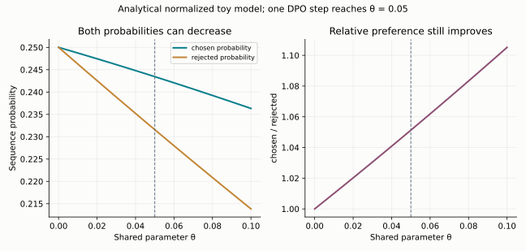

训练时应同时记录 chosen/rejected 的原始序列 log probability、相对 reference 的 margin、长度与独立行为指标。偏好分类准确率提高只说明相对区分更好；如果两者都下降且回答行为恶化，应检查数据覆盖、梯度干扰和正则强度。加入 SFT/NLL 锚定是一种可对照的改动，不能宣称是所有 DPO 的必需修复。

## 17.13 GAE：把价值误差与采样方差分开

有限轨迹上可反向递推 $A_t=\delta_t+\gamma\lambda A_{t+1}$，其中 $\delta_t=r_t+\gamma V(s_{t+1})-V(s_t)$。$\lambda=0$ 使用一步 TD；$\lambda=1$ 时望远镜相消，得到 Monte Carlo 回报减去 $V(s_t)$（若不是终止点，还带末端 bootstrap）。中间值用更短目标减少采样波动，却可能引入价值估计误差，不能只说 lambda 是一个“稳定性参数”。[GAE 原论文](https://arxiv.org/abs/1506.02438)

例如 $\gamma=1,r=[0,0,1]$，$V(s_0),V(s_1),V(s_2),V(s_3)=[0.2,0.4,0.7,0]$，TD 残差为 $[0.2,0.3,0.3]$；lambda=1 的 advantage 为 $[0.8,0.6,0.3]$，正是最终奖励 1 减各状态价值。若 s3 是超时截断却仍有后续回报，设 V(s3)=0 就额外改变了目标。

PPO 的 policy、value、entropy/KL 是不同损失项：对 policy surrogate 的 advantage 通常停止梯度，value 分支用自己的回归目标训练。共享主干也不意味着可以让 policy loss 任意穿过 advantage 计算图，否则与原策略梯度估计量不同。

实现时用两个边界开关更清楚。令 $b_t$ 表示允许从实际后继状态 bootstrap，$c_t$ 表示 GAE 递推可继续进入下一条记录，则

$$\delta_t=r_t+\gamma b_tV(s_{t+1})-V(s_t),\qquad A_t=\delta_t+\gamma\lambda c_tA_{t+1}.$$

真正终止时两者均为 0；仅因采样时限截断时，可取 $b_t=1,c_t=0$，保留末态价值却不串入重置后新 episode 的奖励。此时 $V(s_{t+1})$ 必须来自截断前的最终观测，不能用自动 reset 后的初态代替。`posttrain.generalized_advantages` 接收逐转移的 reward、当前/后继 value 及 `terminated/truncated`，返回已停止梯度的 advantage 和 $A_t+V(s_t)$ 价值目标；测试对照有限和、lambda 两个端点及相邻 episode 隔离。它不含价值网络训练或完整 PPO trainer。

## 17.14 DPO 中共享前缀能省什么、不能证明什么

对相同 prompt 和共同回答前缀 u，令 $y_w=uw,y_l=ul$，则

$$\log\pi(y_w\mid x)-\log\pi(y_l\mid x)=\log\pi(w\mid x,u)-\log\pi(l\mid x,u).$$

共同前缀的直接 log-prob 项精确抵消，梯度也抵消；但它的隐藏表示仍影响后缀预测，参数共享仍可令两条完整回答的绝对概率同时下降（17.12 节）。“前缀抵消”不能证明前缀表示对训练无关。

reference logps 可离线缓存，但应绑定基础权重、adapter、模板、tokenizer、EOS/截断和 loss mask 的身份。同样文本在模板或边界改变后可能不是同一事件；继续用旧缓存会把数据处理差异当成偏好更新。chosen/rejected 分开截断尤其可能改变共同前缀，需先核对实际 token 序列。


---

# 18｜推理强化学习：GRPO、Dr. GRPO、MaxRL 与 GSPO

## 18.1 可验证奖励改变了反馈来源

在数学和代码任务中，可以用答案检查或程序测试对完整回答评分。RLVR 用这种验证反馈训练策略，避免为每条轨迹人工排序。但验证器可能不完备、奖励稀疏，且只检查最终答案不一定检查中间推理正确性。

2025 年作业以 Qwen2.5-Math-1.5B 和 MATH 为实验对象，比较 SFT、专家迭代与 GRPO；2026 年作业改为 OLMo-2-0425-1B 与 GSM8K，展开 advantage 归一化及离策略估计量对比。它们是两套不同实验，不能混用默认超参数和基线结果。

**2026 作业的具体设定**，读懂它就知道一个能跑通的 RLVR 系统需要哪些部件：

- 提示词：`r1_zero` 模板要求模型在 `<think>` 中推理、在 `<answer>` 中作答；用 vLLM 采样，温度 1.0、top-p 1.0、最长 512 token，遇到 `</answer>` 停止并保留停止串。
- 奖励：格式奖励（是否按模板输出）与答案奖励（解析出的答案是否正确）分开记录。先用基线评估把输出分成"格式对且答案对""格式对答案错""格式错"三类，并人工查看"格式错但其实答对了"的样本，判断解析器有没有冤枉模型。
- 建议超参数：学习率 $10^{-5}$；每步 256 条 rollout，即 32 道题、每题 8 条（group size 8）；训练 batch 等于 rollout batch，梯度累积 32 次；梯度裁剪 1.0；AdamW $\beta=(0.9,0.95)$、无 weight decay；共 200 个 rollout 步，每 10 步在至少 1,024 道验证题上评估。
- 验收：标准 on-policy GRPO 用 4 个随机种子训练，验证准确率均值至少 25%；画出 loss、梯度范数、token 熵、训练奖励（总计与格式）、验证奖励与平均回答长度随步数的变化，并标出种子间方差。[2025 作业](https://github.com/stanford-cs336/assignment5-alignment/blob/eb2c562e05802d3c9ee4c4ec2eec43b104d77e9e/cs336_spring2025_assignment5_alignment.pdf)、[2026 作业](https://github.com/stanford-cs336/assignment5-alignment/blob/c2734a26308710949fe13226960a1e8cece94b7e/cs336_spring2026_assignment5_alignment.pdf)

## 18.2 先从一个 Bernoulli 任务理解方差

假设一题成功概率为 $p$，奖励 $r\in\{0,1\}$。每题采样 $G$ 个回答，既有成功又有失败的概率为

$$1-p^G-(1-p)^G.$$

当 $p$ 非常接近 0 或 1，小 group 常得到相同奖励。组内相对方法此时没有差异信号。扩大 group、调整题目难度或使用课程式数据选择，都可能比单纯加训练步更有效，但也消耗推理预算。

## 18.3 GRPO 用组内对照代替价值模型

同一 prompt 采样 $G$ 条轨迹，奖励为 $r_i$，均值 $\bar r$，标准差 $s_r$。常见组 advantage 为

$$A_i=\frac{r_i-\bar r}{s_r+\epsilon}.$$

它用同题其他回答作为基线，不需要独立价值模型。轨迹级 advantage 可以赋给每个 response token，再用 token-level clipped surrogate；原始配方还可包含参考策略 KL，但许多实验变体省略或改变它，必须明确写出目标。DeepSeekMath 的完整目标是

$$\begin{aligned}\mathcal J_{GRPO}&=\mathbb E\Big[\frac1G\sum_{i=1}^G\frac1{|o_i|}\sum_{t=1}^{|o_i|}\Big(\min\big(r_{i,t}A_i,\ \mathrm{clip}(r_{i,t},1-\epsilon,1+\epsilon)A_i\big)\\&\qquad\qquad-\beta\,\mathbb D_{KL}[\pi_\theta\|\pi_{ref}]_{i,t}\Big)\Big],\qquad r_{i,t}=\frac{\pi_\theta(o_{i,t}|q,o_{i,<t})}{\pi_{old}(o_{i,t}|q,o_{i,<t})},\end{aligned}$$

其中 KL 用逐 token 的 k3 估计（第 17 章）。三处选择都值得单独审视：先在回答内按 $1/|o_i|$ 平均再在组内平均（18.5 节、第 31.2 节的 DAPO 改成对全部 token 平均）、组标准差归一化（18.6 节）、KL 项（许多 RLVR 配方直接去掉）。[DeepSeekMath](https://arxiv.org/abs/2402.03300)

均值和标准差必须只在同一 prompt 的 group 内计算，不能把整个 batch 的不同题混在一起。sample 排列、mask、padding、EOS 和截断都会改变归一化。标准差用总体估计（除以 $G$）还是样本估计（除以 $G-1$）也会差一个因子 $\sqrt{G/(G-1)}$：2026 年作业的公式写的是总体标准差，但要求实现时用 `torch.std` 的默认值，也就是样本估计；本书代码用总体标准差（`correction=0`），18.10 节的数值也按总体标准差算。对照作业测试时要注意这一点。

## 18.4 组均值 baseline 有一个有限样本偏差

考虑没有标准差归一化的估计量 $\frac1G\sum_i(r_i-\bar r)\nabla\log\pi(y_i)$。因为 $\bar r$ 包含 $r_i$ 自身，baseline 并非独立于当前动作。对独立同分布采样，有

$$\mathbb E[\widehat g]=(1-1/G)\nabla J.$$

推导：$\bar r$ 中与当前 score function 相关的只有 $r_i/G$，其他项期望为零。若用 leave-one-out baseline

$$b_i=\frac{\sum_{j\ne i}r_j}{G-1},$$

则可恢复无偏期望，且 $r_i-b_i=\frac G{G-1}(r_i-\bar r)$。再除以由同一组估计的标准差后，相关性更复杂，不能继续宣称无偏。

## 18.5 长度归一化改变了奖励分配

序列归一化目标对每条回答使用 $\frac1{|y_i|}\sum_t$，使长短轨迹总权重相似，但每个 token 的权重与长度相关。固定归一化目标使用统一常数，如 $L_{max}$，则每条轨迹的总贡献随有效 token 数增长。

这里没有“随便平均一下”的自由。若一个 loss 的目的本来是完整轨迹 reward 的 policy gradient，score function 是 $\sum_t\nabla\log\pi(y_t|\cdot)$；再除以随机轨迹长度会改变该目标。长度还与正确性相关时，偏置会体现在生成长度变化上。

Dr. GRPO 讨论取消组标准差与逐序列长度归一化，使用组中心化 reward 和固定分母，以隔离难度与长度造成的偏置。[Understanding R1-Zero-Like Training](https://arxiv.org/abs/2503.20783)

## 18.6 MaxRL：把难题重新加权

2026 年作业讨论的 MaxRL 变体用 $A_i=(r_i-\bar r)/\bar r$，并在比较中使用固定分母。全零组的均值为 0，必须有数值保护：作业要求给分母加 `advantage_eps`，本书代码用 $\max(\bar r,\epsilon)$，两者在全零组都给 0，非零组仅在 $\epsilon\ll\bar r$ 时近似相同；稀疏奖励或较大 epsilon 下差别不能忽略。

在大 group/总体近似下，除以组标准差或组均值可以看作按该题成功率 p 重加权；有限 group 的随机分母与同组奖励相关，不能视为确定权重。MaxRL 论文第 5 节用这种“权重函数”的视角统一了 REINFORCE、GRPO 与 MaxRL。[Maximum Likelihood Reinforcement Learning](https://arxiv.org/abs/2602.02710) 作业的 `derive_difficulty_reweightings` 一题要求自己推导这些权重，这里只给定性结论：除以组均值倾向于提高低成功率题的相对权重；除以总体标准差的因子在成功率接近 0 和接近 1 的两端较大。有限 group 中的零成功组仍没有正例，随机除法还可能放大噪声。

## 18.7 拒绝采样微调与专家迭代

RFT 采样回答，只保留通过验证者，再做似然训练。对 on-policy 二值 reward、以原始采样数为固定分母的单步更新，$r\nabla\log\pi$ 就是无 baseline policy gradient 的估计。

但若先按成功率筛题、把保留集重新均匀采样、按成功条数归一化或多 epoch 重放，prompt 权重和采样分布发生变化，不再简单等价。RFT 不显式压低失败轨迹，方差和数据效率也与带 baseline 方法不同。

专家迭代是“采样→验证→学习成功轨迹→更新采样策略”的循环。冷启动 SFT 可提高初始成功率，给稀疏奖励创造可学习信号；它也可能把教师的风格和错误模式带入学生。

## 18.8 离策略复用：省采样成本，增加估计难度

完整序列的重要性权重为

$$w(y)=\frac{\pi_\theta(y|x)}{\pi_{old}(y|x)}=\exp\left(\sum_t\log\pi_\theta(y_t|\cdot)-\log\pi_{old}(y_t|\cdot)\right).$$

它能进行分布转换，但长序列乘积的方差可能极大。PPO/GRPO 常使用单 token 比率与 clipping，这是实用 surrogate；它没有完整修正前缀和整条轨迹分布变化，不能称为严格无偏的完整离策略估计。

精确分布转换需要目标策略有概率的轨迹也在采样分布支持内。如果采样用了 top-k/top-p，把一些 token 概率硬设为零，而目标仍是未截断策略，那么这些未采到轨迹没有有限重要性权重能补回来。采样协议应被视为概率模型的一部分。

GSPO 使用序列几何平均比率

$$s(y)=\exp\left(\frac1{|y|}\sum_t[\log\pi_\theta(y_t|\cdot)-\log\pi_{old}(y_t|\cdot)]\right),$$

再对序列级 $sA$ 做 clipping。几何平均降低长乘积的极端幅度，也引入偏差；它的导数自然包含 $1/|y|$ 的长度归一化。比率的定义变了，裁剪范围的量级也随之改变：GSPO 论文实验中左右裁剪范围取 $3\times10^{-4}$ 和 $4\times10^{-4}$，对照的 GRPO 取 0.2 和 0.27，相差约三个数量级，不能把 token 级的 $\epsilon$ 直接搬过来。GSPO 不是“把完整重要性采样稳定实现了一遍”，而是改变了 surrogate。[GSPO](https://arxiv.org/abs/2507.18071)

## 18.9 训练系统中的实际难点

超参数应在解释公式的同一范围内验证。本书 PPO/DAPO 接口选用正的比率下界，要求 $0\le\epsilon_{low}<1$、有限的 $\epsilon_{high}\ge0$。这不是所有论文的数学限制：若 $\epsilon_{low}\ge1$，对非负概率比率相当于不再施加下界裁剪，第 31.6 节引用的 R1 大 epsilon 就属于这种情况，不能直接传给本书的较窄接口。CISPO 的上界 $1+\epsilon_{high}$ 也按包含 on-policy 比率 1 的约定要求 $\epsilon_{high}\ge0$；负 epsilon 会改变这一语义，上界为负时甚至反转正优势项的方向。NaN 不能只用大小比较过滤，因为 `NaN < 0` 为假。测试应包含非法边界、shape 错配和有效 token 上的非有限值，同时保证 padding 的无效值不会进入统计。

rollout 引擎与训练引擎必须同步同一版本权重，old logps 对应真实采样策略。模板、temperature、截断和特殊 token 处理应一致。异步采样会带来 policy lag，需要跟踪样本版本和更新间隔。

日志除了平均 reward，还应包含组内全对/全错比例、长度分布、截断率、格式奖励与正确性奖励、KL、熵、clip fraction 和不同难度组的成功率。熵下降不一定等于更会推理；可能只是模式坍缩。

长链思考、自一致性、多候选搜索与验证器筛选都消耗 test-time compute。比较时用成功率—总生成 token/延迟曲线，而不是只对比“开启思考”后的单个分数。agent RL 把轨迹扩展到工具动作、环境反馈与多步终止，信用分配和奖励投机更复杂。

18.16 节给出一个在 CPU 上几分钟就能跑完的完整 GRPO 循环，包含采样、打分、组内 advantage、微批累积、clipping 与上述部分日志（混合奖励组比例、格式与正确性奖励、熵、梯度范数、准确率；没有记录长度、KL 和裁剪比例）。

**练习。** 某组奖励为 `[0,0,0,0]`，标准 GRPO 的 advantage 应是什么？直接除以标准差会怎样？

**解答。** 合理带 epsilon 实现得到全零，代表该组没有相对信号。直接除以零会产生 NaN。给它们任意设成正奖励不属于数值修复，而是在改变学习目标。

零 advantage 只让这组的策略梯度 surrogate 贡献为零，不保证整次训练更新为零。其他 prompt、KL/熵损失仍可能贡献梯度；即使当前梯度张量全零，已有 Adam 动量和 weight decay 也可能改变参数。若希望整个无信号 batch 不执行更新，需要明确跳过 optimizer/scheduler，而不是把它与零梯度 step 混用（第 5.1 节）。

## 18.10 一个 prompt 的数值算例

设同一题有四条回答，奖励 `[1,0,0,0]`，均值 $1/4$，总体标准差 $\sqrt3/4$。则：

| 方法 | 成功回答 advantage | 每条失败回答 advantage |
|---|---:|---:|
| 组中心化 / Dr. GRPO | $3/4$ | $-1/4$ |
| 标准差归一化 GRPO | $\sqrt3$ | $-1/\sqrt3$ |
| MaxRL（忽略 epsilon） | $3$ | $-1$ |
| RLOO | $1$ | $-1/3$ |
| 二值 RFT | $1$ | $0$ |

表中按总体标准差计算；若按作业要求用 `torch.std` 的默认样本估计，标准差归一化一行变为 $1.5$ 与 $-0.5$。这些数值只是 reward 权重，尚未乘每条轨迹的 score function。再选择逐序列长度或固定分母，就又改变了一次加权。如果成功回答长 100 token、失败回答长 10 token，“先按序列平均”和“所有轨迹统一除以 100”不是只差一个全局常数。

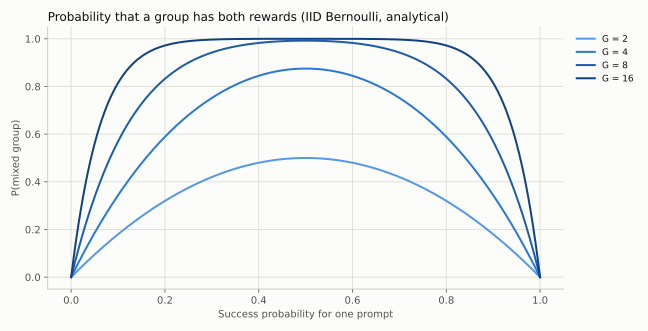

图中是 Bernoulli 独立采样的解析概率，不是大模型实训结果。它说明难题与易题都可能在有限 group 下缺少对照，且 group 增大并不创造模型完全无法产生的正确解。

## 18.11 PyTorch 计算图中的三条边界

`old_logp` 必须 detach；如果 `ratio = exp(logp - logp)`，分子分母一起变化，梯度为零。数值上当前与旧策略相同不妨碍学习：使用 `old_logp = logp.detach()`，此时 ratio 为 1，但对当前 logp 的导数仍为 1。测试已将这一点与直接 on-policy loss 的梯度对照。

优势估计也应按所选估计量 detach，不能让梯度反向穿过 reward、均值或标准差。否则你同时在优化 advantage 构造过程，而不是原先写下的 score-function 估计量。

padding 要在危险运算之前处理。`exp(logp-old_logp)*mask` 可能先产生 Inf，而 `Inf*0` 仍是 NaN；`(NaN-(-Inf))*0` 也不是零。本书先把无效位置设为安全值，再计算差值、指数或 softmax，最后按明确分母归约。有效位置的非有限值会报错，不会被伪装成正常零贡献；整条回答无有效 token 也要求调用方明确剔除或纠正数据。

## 18.12 推理预算、蒸馏与在线系统的共同约束

先用强教师成功轨迹做 SFT，再做 RLVR，是把更高初始成功率换成更容易利用的奖励信号；直接从基础模型做 RL 则更能暴露初始探索与稀疏反馈的问题。最后把成功行为蒸馏到小模型，又改变部署成本。这些训练阶段不能靠“是否用了 RL”一个标签概括。

比较推理训练方案至少分开三个预算：教师产生示范的成本、训练期间 rollout 成本、测试期间搜索/长输出成本。大 group、多候选验证、长 CoT 和模型规模都会消耗这些预算。还应检查截断答案是否被错误记成普通失败、超长输出是否占用大部分训练 token，以及 verifier 是否误把格式正确当内容正确。

## 18.13 三个课程案例应读出的不同设计问题

2025/2026 讲义用 R1、Kimi k1.5、Qwen 3 说明了 RLVR 的不同训练选择。本书不重复排行榜分数，而把案例转成可检查的决策：

| 案例 | 课程讨论的关键选择 | 对读者实验的启发 |
|---|---|---|
| R1-Zero 与 R1 | 基础模型直接 RL 对比冷启动 SFT、多阶段 RL/SFT 与蒸馏 | 分开验证初始探索、可读性和后续通用行为 |
| Kimi k1.5 | 难度过滤、长上下文训练、课程安排与长度控制 | reward 增长要与总生成量、困难题比例、截断率一起看 |
| Qwen 3 | reasoning RL 后叠加通用对齐，混合 thinking/non-thinking 模式 | 训练阶段可能互相影响，模式控制需成对评估 |

冷启动可能提高成功轨迹密度，也会缩窄探索；长输出可能帮助搜索，也可能只是重复；通用偏好优化可能改善交互，却改变特定数学指标。应在每个阶段保存固定评估结果，而不是只评估流水线末端，就把所有收益归因于最后一个算法。[2026 第十六讲](https://github.com/stanford-cs336/lectures/blob/de53a9f979a6ee35f7d13a5e1aadee5ea1afc58e/lecture_16.pdf)

## 18.14 Agent RL：生成 token 与环境动作之间的边界

工具环境轨迹可写成 $(s_t,a_t,o_{t+1},r_t)$。语言模型生成的工具调用 token 属于 action；工具执行返回的 observation 是状态的一部分，通常不应作为 policy-gradient 的动作 token 计入 log probability。把整段 transcript 无差别加权会让模型“学习提高环境输出概率”，偏离原策略目标。

训练环境要可重置、可验证，工具版本和依赖要固定。最终测试通过与否是 outcome reward；步骤评分可帮助信用分配，却可能引入代理漏洞。如果修改环境、额外重试或调用外部模型，也要计入预算。测试用例不充分时，环境通过率不等于真实任务完成率。

长轨迹中的失败可能来自规划、工具参数、环境不稳定或最后答案格式。记录分阶段状态和终止原因，比只看平均 reward 更能定位原因。2026 课程增加了编码 agent 环境构造与专家数据路线，但没有公开所有实现细节；这里给出可核验的方法框架，不声称复现这些工业系统。

## 18.15 熵指标不是抽中 token 的负 log probability

给定前缀，策略完整 next-token 分布的熵为

$$H(p)=-\sum_vp_v\log p_v=\log\sum_ve^{z_v}-\sum_vp_vz_v.$$

抽样 token 的 $-\log p(a)$ 是 surprisal；当 $a\sim p$ 时其期望等于熵，但一个样本可能远离这个期望。如果 token 来自数据集或旧策略，平均 surprisal 还不再是当前分布的熵。记录 RL 熵应说明是完整词表计算、采样估计还是经过 top-p 后的分布。

`posttrain.py` 的 `token_entropy` 计算完整词表熵：低精度输入在 FP32 计算 log-softmax，padding 先安全处理后归零。均匀 V 类的熵应为 $\log V$，极集中的分布接近零。熵下降可能表示更确定的正确策略，也可能是过早坍缩，需要与成功率和答案多样性一起分析。这里实现的是诊断指标，不自动添加 entropy bonus；把熵作为正则项会再次改变训练目标。

## 18.16 一个能在 CPU 上跑完的 GRPO 循环

把上面的部件全部接起来，最小的可验证版本是这样的：策略是第 20 章那个 125K 参数的 TinyLM，先在合成算术文本上预训练 120 步，它学会了 `a+b=` 后接一个数字和换行，但答案基本靠猜（100 道题答对 10%，与第 20.3 节是同一个 checkpoint）。RL 任务是让它答对 $(a+b)\bmod10$。`examples/posttrain.py` 的 `grpo_arithmetic_demo` 每一步：

1. 从 80 道训练题中有放回地抽 32 道（平均约 27 道不同的题），每道采样 8 个两字节回答（温度 1.0）；
2. 打分：格式奖励看是否为"一个数字加换行"，总奖励还要求数字正确；
3. 按组计算 advantage（`grpo`、`dr_grpo` 或 `maxrl`）；
4. 用当前策略在这批 rollout 上算 old log-prob，然后做两轮 clipped surrogate 更新：第一轮 ratio 恰为 1（on-policy），第二轮复用已经变旧的 rollout（off-policy），每轮把 256 条分成 4 个微批累积梯度，按序列归一化加权后裁剪到 1.0 再更新；
5. 每 10 步记录训练奖励、格式奖励、混合奖励组比例、token 熵、80 道训练题和 20 道留出题上的贪心准确率，以及这 10 步内**每一次**更新的裁剪前梯度范数（最大值与超过 1.0 的次数）。只记录第 10 步那一次的范数会漏掉裁剪事件。

20 道留出题从不作为 RL 提示，但它们在预训练文本中出现过。三种 advantage、各 3 个种子、学习率都取 $10^{-3}$、200 步后的结果（`python scripts/run_grpo_demo.py`）：

| advantage | 训练题准确率（3 个种子） | 留出题准确率 | 最终 token 熵 |
|---|---|---|---|
| 初始策略 | 0.11–0.13 | 0.00–0.05 | —（第 10 步时 0.76–1.16） |
| GRPO（除以组标准差） | 0.75、0.90、0.86 | 0.40、0.10、0.10 | 0.04–0.09 |
| Dr. GRPO（只中心化） | 0.49、0.54、0.71 | 0.15、0.05、0.05 | 0.04–0.17 |
| MaxRL（除以组均值） | 0.96、0.96、0.96 | 0.50、0.35、0.25 | 0.02–0.04 |

每个种子共 400 次更新（200 步 × 2 轮）。裁剪前梯度范数超过 1.0、因而触发裁剪的次数：GRPO 9、21、9 次（最大范数 2.2–5.9），Dr. GRPO 1、0、0 次，MaxRL 16、6、15 次（最大 9.3）。

这张表应该怎样读：

- **学习确实发生了**：训练题准确率从约 0.1 升到 0.49–0.96，熵降到接近 0。混合奖励组比例在训练后期都降到 0–0.12，与 18.2 节的分析一致：题目被学会（或放弃）后，组内不再有信号。前期走势因种子而异：MaxRL 三个种子和 GRPO 的两个种子先升到 0.5–0.8 再下降，GRPO 另一个种子和 Dr. GRPO 大体从一开始就在下降，3 个种子不足以把这种差别归到方法上。
- **留出题也有提升，但远小于训练题**：说明 RL 主要强化了被奖励的那些提示的答案，只有一小部分迁移。留出题只有 20 道，准确率的粒度是 0.05、标准误约 0.1，Dr. GRPO 的一个种子在留出题上没有提升。在大模型上，这对应"RL 是在激发已有能力还是在记住训练集"的问题，必须用独立验证集回答。
- **不能把方法差别单独归因于 advantage 的整体尺度，也没有排除全部尺度效应**。demo 用 AdamW：把所有 advantage 乘一个常数，一阶矩与二阶矩的平方根同比例变化，更新量基本不变。但梯度裁剪是一条尺度通道：上面的计数显示，advantage 最大的 MaxRL 和 GRPO 都有数十次更新被裁剪，Dr. GRPO 几乎没有，裁剪会改变 Adam 看到的梯度历史。另一个明确差异是题与题之间的相对权重；Adam 对固定正比例的抵消仅在整个梯度历史同比例且 epsilon 可忽略时近似成立，逐步变化的尺度、两轮比率更新和数值误差仍会影响轨迹。三种 advantage 给难题和易题的相对权重不同（18.6 节的定性结论；具体权重函数是作业 `derive_difficulty_reweightings` 一题的内容，请自己推导）。这种权重与固定学习率、两轮复用 rollout 相互作用：Dr. GRPO 在第 10 步的熵最低（0.76–0.82，GRPO 为 0.91–1.05，MaxRL 为 1.13–1.16），但最终熵并不最低（0.04–0.17，与 GRPO 相当，高于 MaxRL），准确率也最低。但高熵与低准确率不足以区分探索不足、错误偏好或有效更新量的差别；需要按题记录正确答案概率、答案多样性，并做学习率与裁剪的受控对照。这些日志只是 3 个种子的现象，不支持单一机制归因。
- **作业的比较协议只能给出单向结论**。2026 年作业只为标准 GRPO 扫学习率，各变体沿用同一学习率。讲义明确说明：变体更好，可以视为它调优后性能的下界；变体更差，则不能断言它更差，因为它的超参数没有调过；较好也应在多 seed、独立测试与预算对齐后再归因，不能把未充分调优的基线当作算法上界。
- **3 个种子的离散度较大**（Dr. GRPO 从 0.49 到 0.71，GRPO 的留出题从 0.10 到 0.40），单种子不足以稳定判断方法排序。

这个 demo 的回答只有两个字节，没有思维链，也没有长度归一化带来的问题；它验证的是 RL 循环的每个部件和日志，而不是推理能力。

## 18.17 baseline 不一定降低方差

作业用一个两动作的例子，要求推导不同 baseline 下策略梯度估计量的方差，那道题请自己完成。这里换一个三动作的例子说明同一个现象。策略为 softmax，三个动作的概率 $\pi=(0.05,0.05,0.9)$，奖励 $r=(0,0.5,1)$；只看第三个动作的 logit $\theta$ 这一个方向，score function $\partial_\theta\log\pi(a)=\mathbf 1[a=3]-\pi_3$，即 $(-0.9,-0.9,0.1)$。单样本估计量 $Z=(r-b)\,\partial_\theta\log\pi(A)$ 的期望与 $b$ 无关（都是 0.0675），方差却随 $b$ 变化：

| baseline | 方差 |
|---|---:|
| $b=0$ | 0.0146 |
| $b=\mathbb E[r]=0.925$（平均奖励） | 0.0375 |
| $b_*=\mathbb E[rs^2]/\mathbb E[s^2]=0.325$（21.3 节） | 0.0051 |

平均奖励反而把方差放大了约 2.6 倍。原因是高概率动作的 score 很小、罕见动作的 score 很大：减去接近 1 的平均奖励后，罕见动作上的 $(r-b)s$ 变大，而它们正是 score 大的那些。21.3 节的最优 baseline 按 $s^2$ 加权，所以偏向罕见动作的奖励。`posttrain.py` 的 `pg_estimator_variance` 对任意小动作空间精确枚举这个方差，测试用蒙特卡洛估计对照，并检查 $b_*$ 处方差最小。

**练习。** 在 18.16 节的设定下，一道题的成功率是 $p=1/8$，group size 8。这组恰好有一个成功回答的概率是多少？此时 GRPO、Dr. GRPO、MaxRL 给这个成功回答的 advantage 各是多少？

**解答。** 恰好一个成功：$8\times\frac18\times(\frac78)^7\approx0.39$。组均值 $1/8$，总体标准差 $\sqrt{7}/8$。Dr. GRPO：$7/8=0.875$；GRPO：$(7/8)/(\sqrt7/8)=\sqrt7\approx2.65$（按 `torch.std` 的样本标准差则是 2.47）；MaxRL：$(7/8)/(1/8)=7$。单看这一题的 advantage 幅度可相差 8 倍；Adam 的尺度抵消只是固定全局倍数且 epsilon 可忽略时的近似，不能由此排除全部尺度效应。还应比较题与题之间的相对权重，见 18.16 节。

## 18.18 社区进展：2025 年的 RLVR 经验

第 31 章整理了大模型 RLVR 的公开经验，都可以用本章的估计量直接对照：

- **DAPO**：把裁剪上界单独放宽到 0.28，丢弃全对或全错的组，按 batch 内全部 token 平均，对超长回答线性加罚；
- **CISPO**：裁剪重要性权重并停止梯度，而不是裁剪更新，让被裁剪的低概率反思 token 仍有梯度；
- **熵坍缩**：论文在其假设下用协方差解释熵的变化；通用 logit 微分与共享参数边界见第 31.4 节；
- **RL 的边界**：RL 是否只提高了采样效率、没有扩展能力，三篇论文给出了不同的结论。

`rl_objectives.py` 与本章的 `posttrain.py` 使用同一套张量约定。多轮工具使用的 RL 见第 32 章。

## 18.19 完整重要性权重为何迅速失效

令每 token 的 log-ratio 为 $\delta_t$，完整轨迹权重 $w=e^{\sum_t\delta_t}$。在简化的弱相关近似中，若每项方差为 $\sigma^2$，总 log-weight 方差随 T 约为 $T\sigma^2$；有相关性时还要加协方差项。指数把波动转成重尾，因此平均 log-ratio 很小不保证长轨迹权重温和。

常用的有效样本数近似（这里仅作为权重集中度诊断）为

$$ESS=\frac{(\sum_iw_i)^2}{\sum_iw_i^2}=\frac1{\sum_i\bar w_i^2},\qquad \bar w_i=\frac{w_i}{\sum_jw_j}.$$

应在 log 空间稳定归一化，再看 ESS、最大归一化权重和 log mean weight。16 条样本的权重相同时 ESS=16；其中一条 log-weight 为 20、其余为 0 时 ESS 约为 1。这个诊断不保证无偏或支持覆盖：所有权重都错乘同一个常数，ESS 也不变；样本完全没覆盖某个高奖励模式，ESS 甚至仍可很好看。[ESS 近似的假设与局限](https://arxiv.org/abs/1809.04129)

普通 IS 使用 $n^{-1}\sum_iw_if_i$，自归一化 IS 使用 $\sum_i\bar w_if_i$，裁剪再归一化又是另一估计量。稳定实现只解决溢出，不能把有偏 surrogate 变成完整无偏校正。第 31.8 节把这一点放回异步 rollout 的版本管理中。

## 18.20 终止、截断和奖励的位置

模型生成 EOS、工具任务成功、用完 token/调用预算、采样服务报错是不同事件。若任务定义就是预算内成功，超时可以是终止失败；若预算只是数据采集截断，value-based 目标可能需要末端 bootstrap。把二者都叫 done 会混淆目标。纯 outcome GRPO 通常没有价值 bootstrap，但仍需明确截断样本是否计奖、是否进入 loss、是否触发长度惩罚。

一次工具动作可能由多 token 组成，工具观察本身不进入动作 log-prob，但后续动作受它影响。最终 reward 可以作为整条轨迹的 score-function 权重；过程奖励若直接叠加，改变的是回报，不能称为无影响的“日志增强”。潜势塑形在特定条件下保留最优策略，推导见第 32.7 节。


---

# 19｜多模态：把感知、语言与生成接到一起

## 19.1 非文本输入也需要表示接口

Transformer 接收向量序列，文本 token 只是其中一种来源。图像可划成 patches，再投影并送入视觉编码器；音频可表示成连续特征或离散 codec token；视频增加时间维度和大量冗余帧。

例如 $224\times224$ 图像切成 $14\times14$ patch，得到 $16\times16=256$ 个 patch token，不含额外特殊 token。输入高宽都翻倍，patch 数变四倍，若对所有 patch 做全注意力，score 项可能变十六倍。高分辨率感知是一道信息质量与资源的共同问题。

## 19.2 CLIP：用文本监督语义对齐

给一批配对图文，编码并归一化为 $u_i,v_j$，相似度 $s_{ij}=u_i^\top v_j/\tau$。CLIP 的对称对比损失为

$$L=\frac1{2B}\sum_i\left[-\log\frac{e^{s_{ii}}}{\sum_je^{s_{ij}}}-\log\frac{e^{s_{ii}}}{\sum_je^{s_{ji}}}\right].$$

每张图的正确文本是正例，同 batch 其他文本是负例，反方向也类似。它学习语义对齐，便于零样本分类和检索，但不保证保留所有像素级细节。batch 构成决定负例分布，大规模训练需要跨设备特征聚合及正确梯度处理。[CLIP](https://arxiv.org/abs/2103.00020)

这里“其他配对均为负例”是一种训练假设：同 batch 两张相似图都可能匹配同一 caption，形成假负例。一图多 caption、重复图片和相似文本需要去重或多正例目标等处理。跨卡 all-gather 特征时，还应明确哪些远端特征保留梯度、loss 按本卡还是全局 batch 平均；错误地 detach 全部聚合特征可能让部分 encoder 没有预期梯度。

[extensions.py](../examples/extensions.py) 提供对称 CLIP loss，并检查正确配对的损失低于错配、同时重排图文对不改变损失。它只演示已经得到 feature 后的对齐目标，不包含训练好的图像编码器，也不能用于真实图像问答。

CLIP 的梯度累积不能仅靠除以累积次数模拟更大的对比 batch：拆成几个 microbatch 后，每个 softmax 分母缺少其他 microbatch 的负例，目标本身已经变化。要恢复全局目标，需要让对应的跨批特征参与分母，并正确保留或重算其梯度；这与普通逐 token 可加的交叉熵不同。

## 19.3 SigLIP：从多类归一化到成对二分类

SigLIP 用 $z_{ij}\in\{-1,+1\}$ 标记是否配对，对每对图文使用 logistic loss：

$$L\propto\sum_{i,j}\log\left(1+\exp[-z_{ij}(a\,u_i^\top v_j+b)]\right).$$

它不需要对每一行/列做完整 softmax 分母，训练可以更灵活地组织成对样本。SigLIP 论文给出的对比是：从头训练的 SigLIP 用 32 块 TPUv4 芯片 5 天达到 ImageNet 零样本 73.4%，而它估计 CLIP 级别的训练约需 256 个 TPUv3 核训练 10 天（CLIP 原论文报告的最大 ViT 在 256 块 V100 上训练了 12 天）；在 batch 小于 16K 时 SigLIP 优于 CLIP。但负例远多于正例，缩放、bias 与采样权重仍然重要；“不需要全局 softmax”不等于没有跨设备数据或通信问题。[SigLIP](https://arxiv.org/abs/2303.15343)

## 19.4 视觉编码器 + projector + LM

常见 VLM 把视觉特征投影到语言模型宽度，再与文本 embedding 一同送入 decoder。projector 可以是线性层、MLP 或 cross-attention/resampler，用来调整维度和视觉 token 数。

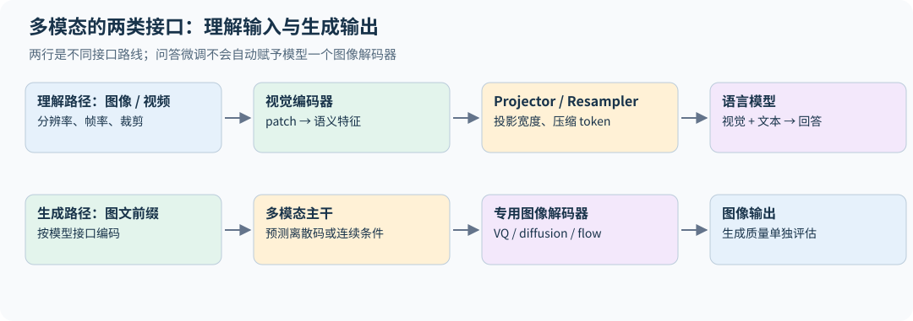

一种训练路线先冻结视觉编码器与 LM，只训练 projector，使接口对齐；随后训练 projector 与 LM 做视觉指令微调。也有方案进一步训练视觉编码器、使用多阶段分辨率与数据课程。冻结策略不是普遍固定规则。[LLaVA](https://arxiv.org/abs/2304.08485)

生成回答时通常仍只在文本输出上算语言建模损失。视觉 token 可以参与注意力却不作为离散文本标签。这和 SFT 中 prompt 的角色类似。

文字模板里的一个 `<image>` 占位符可能会展开成数百个视觉 embedding。展开后 attention mask、position ID、labels 和 loss mask 必须同时重排，不能仍沿用展开前的文本长度。连续视觉 embedding 不是“某个词表 ID 的答案”，这些位置通常使用忽略标签；第一个回答 token 仍由前一位置的输出预测。

## 19.5 分辨率、视频和位置编码

中心裁剪可能删除边缘文字，小图缩放也可能丢失 OCR 所需细节：LLaVA-1.5 使用的 CLIP ViT-L/14@336px 把图像缩放裁剪到 336×336（这是在 224 分辨率训练后多训一个 epoch 得到的版本，其他 CLIP 模型用 224）。AnyRes（LLaVA-NeXT 引入；团队更新的 LLaVA-1.5 报告也介绍该路线）把高分辨率图像切成与编码器分辨率匹配的 $a\times b$ 块，分别编码后拼接，token 太多时再插值压缩；LLaVA-OneVision 进一步按场景分配预算：单图用高分辨率，多图每张用基础分辨率，视频每帧用更低分辨率。Qwen2-VL 的动态分辨率方案以 14×14 patch 编码，再把每 2×2 个相邻 patch 合并为一个 token，讲义给出一个 224×224 区域约 66 个 token（$16\times16$ 个 patch 合并后为 64 个，另加起止标记）；讲义示例的视频采样配置为每秒 2 帧、总量上限 16,384 个 token；它是预处理预算，并非所有版本的固有限制。

视频不仅需要“图像 token 更多”，还需要时间顺序、采样帧率、跨帧关联和显式时间信息。降低帧率可能漏掉短暂事件，提高分辨率却未必修复时间缺失。数据设计要区分空间细节任务和时间推理任务。

多维 RoPE 可把旋转维度分配给时间、高度、宽度轴，避免把所有空间结构压成单一文本位置。不同频段如何分配、是否交错、视频时间戳是否作为独立 token，都是架构选择。[Qwen2-VL](https://arxiv.org/abs/2409.12191)

若每帧保留 $K$ 个视觉 token、视频采样 $F$ 帧，直接送入 LM 的视觉 token 数近似 $FK$。翻倍帧数后，全注意力配对项可能约变四倍，KV 约变两倍；若文本长度也很长，应使用总长度而非只用视觉 token 估算。视觉压缩器用更少 token 换取成本，可能损失小字、短事件或精细空间关系，要按任务验证。

AnyRes 的归属以 [LLaVA-NeXT 官方说明](https://llava-vl.github.io/blog/2024-01-30-llava-next/) 为依据；固定分辨率裁剪、动态分辨率与分块拼接不是同一个流程。需要把视觉 token 数、实际裁剪覆盖和 OCR 质量一起报告，不能只从输出 token 数推断保留了全部视觉信息。

## 19.6 理解图像与生成图像要求不同

CLIP 式表示优先保留可与文本匹配的语义，可能丢失纹理、精确颜色和布局。重建或生成图像需要更细的信息。VQ-VAE 类方法用 codebook 把图像表示离散化，让自回归模型生成图像 token；另一条路线让语言模型与连续 latent 上的 diffusion/flow 生成器配合。

离散 codebook 可用最近邻选择 $k=\arg\min_j\|z-e_j\|^2$，配合重建损失、codebook 更新与 commitment 约束。离散选择的梯度处理需专门方法；码本大小、压缩率和重建质量决定语言模型要处理多少视觉 token。

Chameleon 类统一离散序列体现了“所有模态放进同一自回归接口”的路线；它与仅接视觉编码器的 VLM 有不同的生成能力与训练稳定性问题。课程 2026 年最后一节常规讲（第 17 讲）讨论了这些方向，包含 CLIP、SigLIP、LLaVA、Qwen-VL 系列与 Chameleon。[2026 第十七讲](https://github.com/stanford-cs336/lectures/blob/de53a9f979a6ee35f7d13a5e1aadee5ea1afc58e/lecture_17.py)

音频与 diffusion 的详细建模不属于该公开讲义的完整推导范围；本章给出接口层认识，不把本书扩充为整门语音或扩散模型课程。

## 19.7 多模态评估与损失平衡

长视频样本的输入 token 很多，首先影响计算与上下文预算；是否主导损失还取决于哪些 token 受监督。仅对文字回答计损失时，同样长的答案不会因视觉 token 更多就自动获得更大权重；若视觉输出也被预测，或分母使用总输入长度，权重才会相应改变。应明确 modality mix、分辨率分布与监督长度，并用模态分项指标验证。

视觉问答正确可能来自语言先验而非图像。可遮挡图像、替换相似图像、改变空间关系进行反事实检查。OCR、计数、图表、跨图比较和时间关系应分别评估，不能以单一总分代表所有感知能力。

**练习。** 把 projector 从线性层改成更大 MLP 后分数提高，如何验证它学到了更好的视觉接口？

**解答。** 固定数据、训练预算、冻结策略和分辨率，比较多种视觉任务，并增加无图/错图对照。如果不看图也同样提升，改进可能来自语言适配而不是视觉利用。

## 19.8 多层视觉注入与多维位置的频段分配

早期 VLM 常把视觉特征只作为输入序列的一段。DeepStack 类思路把多个视觉层级的信息注入语言模型不同深度，减少所有感知信息都必须经过同一个输入接口压缩的限制。要明确每一层投影后的宽度、token 对齐关系与残差缩放；不能把不同空间粒度的 feature 未经重采样直接相加。

2026 年课程还讨论了 interleaved MRoPE：把时间、宽度、高度轴交错分配到不同旋转频段，而不是让某个轴只占一整段频率。直觉是避免某个轴只能使用偏高或偏低频率；实际效果需在长视频、空间关系与时间定位任务上消融。显式时间戳 token 又提供另一种时间信息，和旋转位置编码并非重复的同一机制。[2026 第十七讲的 Qwen3-VL 与 DeepStack 部分](https://github.com/stanford-cs336/lectures/blob/de53a9f979a6ee35f7d13a5e1aadee5ea1afc58e/lecture_17.py)

## 19.9 不同模态的长度权重怎样落到损失上

文本、图像、视频样本长度差异很大，可以用一族明确目标分析归一化：

$$L_\alpha=\frac1B\sum_i\frac1{n_i^\alpha}\sum_{t=1}^{n_i}\ell_{it}.$$

$\alpha=0$ 时长样本总权重随 token 数增长，$\alpha=1$ 时每个样本平均后再平均，$\alpha=1/2$ 介于两者。这里 $n_i$ 应明确是参与 loss 的 token 数还是全部模态 token 数；只对文字答案监督时，这两种定义可能差得很大。Qwen3-VL 报告说明，它把逐样本损失改为"平方根归一化的逐 token 损失"，以平衡文本与多模态数据的贡献，对应上式 $\alpha=1/2$ 的思路；报告没有给出精确的归一化常数。[Qwen3-VL](https://arxiv.org/abs/2511.21631)

先固定模态采样比例，再改变长度归一化，能区分“长视频数量更少”和“每条长视频被降权”两种效应。报告分模态质量、训练 token 和有效损失权重，避免一个总 loss 隐藏了某模态被忽略。

## 19.10 从码本选择到可训练的 VQ 接口

设编码器连续输出为 $z_e(x)$，最近码本向量为 $e_k$。一个典型 VQ-VAE 训练目标包含重建、码本与 commitment 三部分：

$$L=L_{recon}+\|\operatorname{sg}[z_e]-e_k\|^2+\beta\|z_e-\operatorname{sg}[e_k]\|^2.$$

`sg` 表示停止梯度。码本项把被选向量拉向编码器输出，commitment 项限制编码器远离所选码本，离散最近邻路径通常用 straight-through 近似让重建梯度传回编码器，或对码本采用 EMA 等替代更新。码本长期只有少量条目被使用，说明离散表示可能坍缩；需监测利用率和重建错误。

统一文本/图像离散词表后，图像序列可能长、熵高，不同模态的 logit 与 norm 尺度会影响训练稳定性。这连接了第 3.5 节的 QK norm、z-loss 和 19.9 节的长度加权。高效重建也不保证 OCR 或精细感知最佳，因此理解任务与生成任务仍要分别评估。[2026 第十七讲的 Chameleon/VQ-VAE 部分](https://github.com/stanford-cs336/lectures/blob/de53a9f979a6ee35f7d13a5e1aadee5ea1afc58e/lecture_17.py)

**练习 2．** $448\times448$ 的图像用 $14\times14$ patch 切分得到多少个视觉 token？若 projector 把每 $2\times2$ 个相邻 patch 合并为一个 token 呢？30 帧视频按后者处理，共多少 token？

**解答。** $32\times32=1024$；合并后 256；30 帧为 7,680 个，相当于一篇不短的文章。视频理解的上下文成本主要来自这里。

## 19.11 SigLIP 的负例比例为什么需要 bias

在 $B>1$ 对图文中共有 $B^2$ 个 pair、只有 B 个正例；若每对等权且相似度全相同，常量匹配概率的最优值是 $1/B$，对应的总 logit 为

$$z_*=\log\frac{1/B}{1-1/B}=-\log(B-1).$$

若共同的相似度项 $a\,u_i^\top v_j=c$，则 $z=c+b$，最优偏置是 $b_*=-\log(B-1)-c$；只有 $c=0$ 或已吸收进偏置时，才直接写作 $b_*=-\log(B-1)$。

论文的实际初始化正是这个思路：$t'=\log10$（乘性 logit 尺度 $t=10$，对应前文 $1/\tau$）、$b=-10$。$B=8192$ 时 $-\log(B-1)\approx-9.0$，$-10$ 与这个先验同量级；论文表 4 在 8K batch 上的消融显示，$b=-10$ 的零样本 ImageNet 为 63.0%，$b=0$ 为 61.7%，乘性尺度初值更小时差距更大（61.0% 对 53.7%）。

这只是等分数、全 pair 目标下的先验算例，不是要求训练 bias 固定在此。相似度贡献接近零时，从 b=0 开始会给大量负例预测约 50% 匹配，早期梯度被纠正先验主导。原论文使用可学习温度/bias，并按 B 而不是 $B^2$ 归一化 pair loss；给全部 pair 同乘一个正的常数只改变 loss/梯度尺度，不改变这个最优常量 bias。改变正负样本比例、相对权重，或跨卡聚合后实际加入更多负例，才会改变最优先验。[SigLIP §3 与算法 1](https://arxiv.org/html/2303.15343v3)

文本相同的两张图、一图多 caption 和重复样本可能产生假负例；增加 batch 既增加负例信息，也改变这类碰撞概率。对照应报告有效全局 pair 数、是否多正例、哪些远端特征保留梯度，不能只比较“每卡 batch 一样”。

## 19.12 视觉利用需要分层的干预评估

同题可构造原图、无图、错图、只遮关键区域、只改变文字/数值的版本。记录答案变化与是否依赖真正相关的视觉信息；遮掉全图后的下降也可能来自输入分布异常，单个消融不足以证明因果定位。OCR 题、空间关系、计数和跨帧时序应分别测，因为压缩视觉 token 可能只伤其中一类。

评估还要固定实际像素、裁剪、tile 上限、帧时间戳和视觉 token 预算。同样“32K 上下文”，更高分辨率图像可能占去更多文本位置；性能变化既来自感知信息，也来自文本被截断。只对回答 token 监督时，损失长度是有效回答长度，不能把所有视觉输入 token 自动算进平均分母。


---

# 20｜贯穿实验：从正确代码到可信结论

本章把前面的知识连成可执行的实验路线。代码独立编写，规模适合 CPU，不是官方作业答案，也不复现课程的模型分数。实测结果来自随书脚本和结果文件；理论下界、数量级计算及作业参考分数分别标明，不把它们当成本书实测。GPU 内核与大模型后训练部分给出实验规格；真实性能结论必须在对应硬件上测量。

## 20.1 环境与第一轮运行

在仓库根目录执行：

```bash
python -m pip install -r requirements.txt
python -m unittest discover -s tests -v       # CPU 测试；可选依赖会按报告跳过
python -m examples.tokenizer                   # 复现作业的 BPE 示例
python -m examples.train --steps 120           # 合成算术小模型
python -m examples.attention                   # 在线 softmax、softmax 反向恒等式
python -m examples.accounting                  # Llama 2 资源核算
python -m examples.distributed                 # 双进程 DDP、collective、优化器状态分片
python -m examples.inference                   # speculative decoding、分页 KV
python -m examples.scaling                     # 预算受限的 IsoFLOP 设计
python -m examples.data                        # 规则过滤、联系方式替换、MinHash 去重
python -m examples.posttrain                   # 小模型上的完整 GRPO 循环
python scripts/run_checks.py                   # 写出 book/validation.json
```

较长的实验各有脚本：`scripts/run_core_experiments.py`（约 30 秒，写出 `book/experiment-results.json`）、`scripts/run_grpo_demo.py`（9 个并行进程约 3 分钟）、`scripts/run_tinystories.py`（下载约 220 MB 数据；默认 6 个运行并行、每个 8 线程，在 48 线程以上的机器上约 1 小时，16 核机器建议用 `--parallel 2`，预计要 2–3 倍时间）。`requirements.txt` 里的 `regex` 是 tokenizer 必需的依赖；要在 CPU 上跑 Triton kernel，还需另装 `triton`。

不同 PyTorch 版本、CPU 指令与线程设置会带来数值差异，CPU 多线程归约的顺序也不固定：同一种子重跑 TinyStories，最终验证损失可差约 0.003。GRPO 这类反复采样的过程，微小差异可能在几十步后放大成不同的轨迹，结果文件里的数字要在脚本的线程设置下才能逐值复现。

后面的 TinyStories/GRPO 完整训练表是带固定协议的历史运行记录；浮点累积顺序和软件版本变化可能改变逐值结果，尤其是反复采样的 RL 轨迹。复现实验应另存版本、线程、dtype 与完整日志。

训练入口保存的 checkpoint 包含模型、优化器、配置、步数、完整学习率日程终点、seed、日志与 RNG 状态，支持 `--stop-after` 与 `--resume`，测试验证中断恢复与连续训练逐值相同。

## 20.2 实验 A：BPE 与讲义逐项对照

`python -m examples.tokenizer` 首先用作业讲义里的经典例子（`low`、`lower`、`widest`、`newest`）训练 6 个 merge，输出必须是 `st, est, ow, low, west, ne`；然后在一段中英混合文本上训练 300 词表并验证往返。

**验收。** 讲义示例的 12 个 merge 与 `newest → [ne, west]` 一致；特殊 token 不参与计数、不被拆分，重叠时取最长；默认预切分保留合法 Unicode 的往返，非法字节解码为 U+FFFD；`encode_iterable` 应与一次性编码相同，并行预切分应与串行同频数。这些契约由 `test_course.py`、`test_regressions.py`、`test_statistical_contracts.py` 等测试覆盖缩写、连续空白、重叠标记和多种切块；有限测试不是对任意输入已经穷尽的证明。

**规模实验。** 在 TinyStories 200 MiB 上训练 10K 词表用时 5.8 秒，验证集压缩率 4.117 bytes/token（第 2.3 节）。

## 20.3 实验 B：一个小模型从"学会格式"到"学会加法"

模型为 2 层、宽度 64、4 个 query 头、2 个 KV 头、SwiGLU 宽度 176、256 字节词表，共 125,248 参数。训练文本是独立随机生成的 `a+b=c\n` 行，$c=(a+b)\bmod10$，训练集只有 1,500 行（9 KB），1000 步（batch 16、上下文 32）约看 57 遍；训练集与验证集是不同的随机序列，但 100 个算术事实在两边都会出现，所以这是同分布建模实验，不是泛化测试。

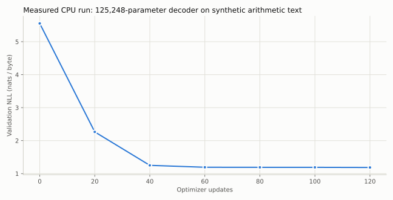

120 步时验证损失从 5.55 降到约 1.19，但贪心输出 `2+3=7`：模型学会了格式，没学会加法。只看总损失看不出这一点，因为每行 6 个字节里有两个随机输入数字，它们本来就不可预测。`python -m examples.evaluation --checkpoint ...` 把损失按目标字节的角色拆开，并在全部 100 道题上测答案准确率：

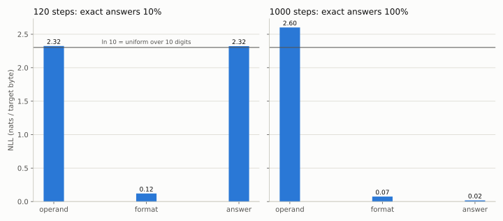

| 训练步数 | 输入数字 NLL | 格式 NLL | 答案 NLL | 100 道题答对 |
|---|---:|---:|---:|---:|
| 120 | 2.32 | 0.12 | 2.32 | 10% |
| 1000 | 2.60 | 0.07 | 0.02 | 100% |

120 步时答案 NLL 接近 $\ln10\approx2.30$，与在 10 个数字上均匀猜的 NLL 同量级；接近该值不证明每条预测分布严格均匀；训练到 1000 步，答案 NLL 降到 0.02，100 道题全对。总损失只从 1.19 降到 0.92，变化并不显眼，变化主要发生在答案位。输入数字的 NLL 反而从 2.32 升到 2.60，高于均匀分布的 $\ln10$，说明对本应独立的随机操作数预测变差；这与过拟合有限训练样本中的偶然关联相容，但仅凭 NLL 不能确定模型记住了哪些具体顺序。整体验证损失在第 480 步附近达到最低（0.845），之后回升到 0.919，是这个同分布小数据实验中的过拟合信号。

对于无限 IID 算术事实流、完整边界约定和完美答案模型，每行的理想熵率为 $2\ln10/6\approx0.768$ nats/byte。这是生成分布上的期望下界，不是有限验证样本每次必然不低于的硬阈值；本书无 BOS 的窗口还省略首 token 目标，角色比例也略有变化。要研究真正的算术泛化，应留出一部分 $(a,b)$ 组合完全不进训练集，或改变位数与进位模式。

## 20.4 实验 C：TinyStories 上的学习率扫描与架构消融

这是基础作业第 7 节实验的 CPU 缩小版，由 `python scripts/run_tinystories.py --download` 一键运行。脚本会在原文旁写 `*.download.json` 记录来源与哈希；若 `outputs/tinystories/` 里已有更早下载、没有该记录的原文，改用 `--train-text`/`--valid-text` 指定这两个文件并省略 `--download`。下文的种子重复（`--seed-repeats`）要求结果文件记录了所用 token 数据的哈希，本书现存结果早于该机制，需先完整重跑一次基础实验。

若已选好学习率，可用 `--best-lr` 跳过扫描。此时运行记录里的 `base_run` 为 `base`，图表据此读取真正的基线，并注明“扫描已跳过”；训练步数、学习率和失败标记也应来自该记录，不能写死成历史实验的设置。指定基线若发散、未完成或没有有限验证损失，脚本会在生成样例和覆盖实验汇总之前停止。绘图保留非有限点的断口，避免把失败前后的曲线连成连续训练轨迹。

**设置。** TinyStories 训练集取前 200 MiB（约 5,100 万 token），完整验证集 22.5 MB（547 万 token）；10K 词表 BPE；模型 4 层、$d=256$、8 头、$d_{ff}=704$，共 8.33M 参数，其中 embedding 与输出头占 5.12M；上下文 128、batch 32、1,500 步，共处理 614 万 token；AdamW $(0.9,0.95)$、weight decay 0.1、余弦日程（warmup 75 步，末端为峰值的 10%）、梯度裁剪 1.0。验证损失在验证集上 512 个固定的等间距窗口上计算。每个运行占 8 个 CPU 线程，6 个运行并行，单个运行约 11–18 分钟。与作业的完整配置（上下文 256、$d=512$、3.3 亿 token）相比，模型约小 3 倍、训练 token 少 50 多倍（这里只有约 0.7 token/参数），绝对损失不可比，趋势也只能谨慎参考。

**学习率扫描。**

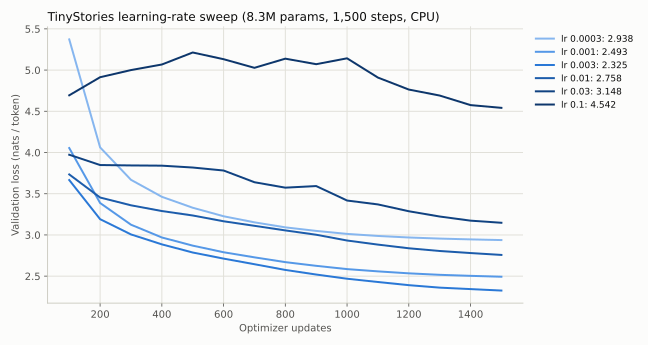

$3\times10^{-3}$ 最优（验证损失 2.325），相邻的 $10^{-3}$ 与 $10^{-2}$ 分别差 0.17 和 0.43。0.03 和 0.1 没有出现 NaN，但损失长时间停在 3.8 以上，最终 3.15 和 4.54。这次扫描没有做去掉梯度裁剪的对照，不能把"没有发散"归因于裁剪；扫描到最优值的 33 倍仍未发散，说明发散边界还没找到（第 5.11 节）。

**消融。** 都用最优学习率 $3\times10^{-3}$、同样 1,500 步：

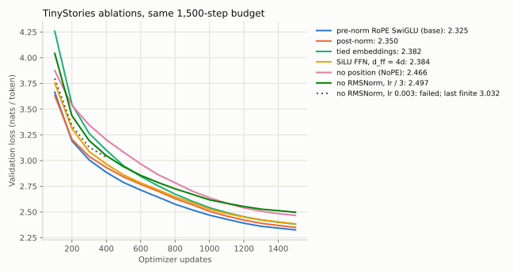

| 变体 | 参数量 | 1,500 步验证损失 | 相对基线 |
|---|---:|---:|---:|
| 基线：pre-norm、RoPE、SwiGLU | 8.33M | 2.325 | — |
| post-norm | 8.33M | 2.350 | +0.025 |
| 共享输入/输出 embedding | 5.77M | 2.382 | +0.057 |
| 不门控 SiLU，$d_{ff}=4d=1024$ | 8.27M | 2.384 | +0.058 |
| 去掉位置编码（NoPE） | 8.33M | 2.466 | +0.141 |
| 去掉全部 RMSNorm，学习率 $3\times10^{-3}$ | 8.33M | 在第 484 步发散 | — |
| 去掉全部 RMSNorm，学习率 $10^{-3}$ | 8.33M | 2.497 | +0.172 |
| 去掉全部 RMSNorm，学习率 $3\times10^{-4}$ | 8.33M | 2.888 | +0.563 |

读这张表时注意：

- **归一化的作用首先是让大学习率可用。** 没有 RMSNorm 时，原来的最优学习率在第 484 步损失突然跳到 1,794，训练崩溃。降低学习率后可以训练，但"相对基线"一列混合了两个因素：学习率和归一化。在同一学习率下比较，去掉 RMSNorm 几乎不吃亏：$10^{-3}$ 时为 2.497 对 2.493，$3\times10^{-4}$ 时甚至略好（2.888 对 2.938）。它比基线差，主要是因为用不了最优的大学习率。
- **post-norm 在这个浅模型上只差 0.025。**post-norm 的问题主要出现在深层网络和大学习率下（第 3.4 节），4 层模型不足以暴露它；不要从这个结果推断"post-norm 和 pre-norm 一样好"。
- **NoPE 能学，但此配置的 loss 更高。** 因果 mask 和不同的前缀内容可提供顺序线索，但“看见 t 个 token”不自动保证模型能数到 t；若所有 token 表示相同，归一化平均仍可能完全相同。较差分数与额外学习位置线索的解释相容，不能仅由这个消融唯一确定原因（第 4.1 节）。
- **SwiGLU 对比参数量匹配的 SiLU 好约 0.06**，与 Shazeer（2020）观察到的方向一致。
- **共享 embedding 省了 31% 参数，只差 0.057。** 小模型上 embedding 占比很高，共享的性价比可观。
- 每个消融只跑了一个种子。基线用 4 个种子（7–10）重复（`python scripts/run_tinystories.py --seed-repeats 8 9 10`），验证损失为 2.325、2.337、2.326、2.316，标准差 0.009、极差 0.021。post-norm 的 +0.025 约为种子标准差的 3 倍；但比较的是两个单次运行，差值的标准差约为 $\sqrt2\sigma\approx0.012$，只有约 2 倍，而且 4 个种子估出的 $\sigma$ 本身也不精确。它可能是真实差异，但幅度很小，单种子下不宜过度解读；+0.05 以上的差别在这些观测中较大，但变体自身的种子方差未知，仍需重复变体并做配对比较，不能凭基线方差宣布已确证。

**生成样例。** 基线模型（验证损失 2.325）以 `Once upon a time` 开头，温度 0.8、top-p 0.95：

> Once upon a time, there was a little boy named Tim. Tim was a bit careless. He liked to talk and play with his friends. One day, Tim saw a big tree with a beautiful kite. He was so excited! Tim wanted to play with the kite. So, he took the kite out of the tree to find the ball. ...

句子通顺、有简单情节，但前后不一致（风筝变成了球）。贪心解码则更容易重复短语。作业要求的流畅程度对应验证损失 1.45（GPU 完整配置）或 2.00（CPU/MPS 低资源配置）；本实验的 2.33 相当于更早的训练阶段。

## 20.5 实验 D：系统优化的双重验收

CPU 上能做的是正确性：`attention.py` 的在线 softmax 在 FP64 下与稠密注意力一致，Triton 行 softmax kernel 在 `TRITON_INTERPRET=1` 下也能对照（第 10 章）。GPU 实验应再建立三个实现：朴素 PyTorch、框架优化实现、自己的 Triton 实现，固定输入，分别测前向、反向、峰值显存和误差。

建议形状网格沿用系统作业：batch 1、causal，序列长度 128 到 65,536，头宽 16 到 128，BF16 与 FP32。每个结果记录 GPU 型号、软件版本和是否包含编译时间。先按第 08 章估算内存，不要在未知设备上直接跑最大配置。

优化前先观察 profiler：若已经受网络或数据供给限制，单个 attention kernel 加速对端到端影响有限。用 Amdahl 定律估算上限：原来耗时占比 $f$ 的部分加速 $s$ 倍，总加速为 $1/[(1-f)+f/s]$。

## 20.6 实验 E：分布式与恢复

`examples.distributed` 启动两个 CPU 进程：等长和不等长本地 batch 的平均梯度都与单进程全局目标一致；reduce-scatter 加 all-gather 等于 all-reduce；按大小平衡所有权的优化器状态分片（简化版 ZeRO-1，见第 11.4 节）与不分片 AdamW 逐值一致，两个 rank 分别只保存 96 和 88 个状态元素（不分片为 184）。扩展到 GPU 后再加入同步时间、bucket 与 overlap 消融。

恢复实验将连续训练 N 步与训练 K 步保存后再恢复到 N 步比较；本书的单进程 CPU 版本要求逐值相同，多进程与非确定性算子需要写清允许的误差。

较长实验的缓存不能只按运行名称判断。TinyStories 脚本先检查原始数据、tokenizer 和 token 数组的指纹，再按模型配置、训练设置、线程数、PyTorch 版本及训练源码决定是否复用运行；metrics 与 checkpoint 的哈希也需一致。同名运行换了学习率或数据，旧结果不能继续充当本次结果。并行 worker 使用 `spawn` 并显式传入配置，避免依赖父进程里的模块级全局变量或已初始化的线程池。

下载的“前 200 MiB”和“前 400 MiB”是不同数据输入，即使保存路径相同。下载记录需包含请求上限、来源和实际哈希；服务器返回部分内容时，还要核对它是否覆盖请求的完整前缀。tokenizer、train/valid 数组及其元数据只有全部完成后才一起替换；训练缓存的 metrics、checkpoint 与身份记录也一样。这样处理失败或原文中途变化时，旧结果仍保持内部一致（这只对普通异常成立；进程被强制终止或断电时不保证原子性，见 README）。

## 20.7 实验 F：数据流水线与缩放设计

`examples.data` 提供 Gopher 式规则、联系方式替换、行级与文档级去重的参考实现（接口与作业不同，第 14 章）。从自己有权使用的小语料出发，建立原始、规则过滤、精确去重、近重复去重四个版本，用同一个固定验证集和相同训练 FLOPs 比较，并报告每步删掉的文档数、域比例与抽样审计。

缩放部分，`examples.scaling` 在已知真值的合成曲面上比较实验设计（第 13.4 节）：每个预算只用 5 个点、拟合抛物线顶点时，20 个种子的目标 $N_*$ 误差中位数约 4%；同样 5 个点只取最低点，误差约 41%；最低点落在网格边缘时补一个点，最差误差从 21% 降到 9%。这是练习 A3 查询分配的沙盒，不是真实模型的缩放律。

## 20.8 实验 G：在小语言模型上跑通 GRPO

`python scripts/run_grpo_demo.py` 用实验 B 中 120 步的模型作为初始策略，在 2 字节算术回答上运行完整的 GRPO 循环，比较三种 advantage（第 18.16 节）：

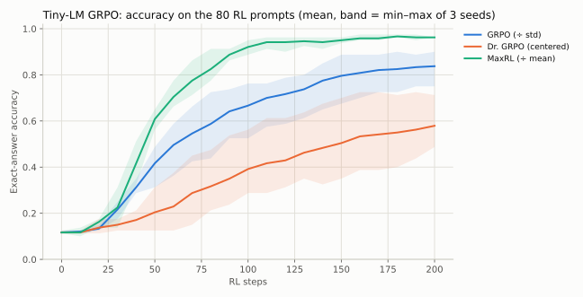

固定学习率 $10^{-3}$ 下，200 步后训练题准确率：MaxRL 0.96、GRPO 0.75–0.90、Dr. GRPO 0.49–0.71；20 道留出题（从不作为 RL 提示，但在预训练文本中出现过）只从 0–0.05 升到 0.05–0.50。固定全局倍数且 epsilon 可忽略时，AdamW 对整体梯度缩放近似不敏感；但每个种子 400 次更新里，MaxRL 有 6–16 次、GRPO 有 9–21 次触发梯度裁剪，Dr. GRPO 最多 1 次，裁剪本身就是一条尺度通道。差别至少包括题与题之间的相对权重；尚未隔离全部尺度与超参数交互，见第 18.16 节；作业的比较协议也只为标准 GRPO 调学习率。

升级到真实语言模型时，先在固定 rollout 上对照每个 token 的 log probability、mask 与 loss，再验证一次更新能提高成功轨迹的相对概率，然后才加入在线采样、多 prompt group 和离策略复用。公平比较各变体应固定基础模型、prompt 池、采样预算、最大输出长度和评估协议，一次只改一个因素，报告多个种子，不以训练奖励选测试最好的 checkpoint。

## 20.9 用结构性测试捕捉隐蔽错误（汇总）

| 验证对象 | 关系 | 可捕获的典型 bug |
|---|---|---|
| BPE | 讲义示例的 merge 序列；流式等于一次性 | 并列规则反了、块边界切断 pre-token |
| 因果注意力 | 改未来 token 不影响过去 logits（每个单项消融都测） | mask 方向错、广播错 |
| KV cache | 完整前向 = 分块前向 | 位置偏移错、重复 RoPE |
| 在线 softmax | 分块输出等于稠密；softmax 反向恒等式与 autograd 一致 | 分母缩放错、边界 mask 错 |
| AdamW、裁剪、日程 | 与 PyTorch 逐值一致；日程端点精确 | bias correction、epsilon 位置 |
| 累积梯度 | 不等长 microbatch = 全局目标 | 简单平均造成权重改变 |
| 资源核算 | 公式参数量 = 模型实际参数量；Llama 2 7B 为 6,738,415,616，与公开数字一致 | 漏算 norm、共享权重 |
| DPO | 初始 loss = log 2，梯度方向正确 | chosen/rejected 反向 |
| RL mask | padding 不贡献目标和梯度 | 长度归一化含 padding |
| speculative decoding | 可精确计算的小例子上，首个输出 token 的分布等于 target 分布 | 接受规则或残差分布写错 |

失败时先缩小到一个 batch、一个头、很短序列和 FP64。真实数据的大矩阵会同时混入数值误差、随机性和性能问题，降低可定位性。

## 20.10 最终项目报告模板

```text
研究问题：预期改善什么，机制是什么？
基线：模型、数据、tokenizer、参数量、训练 token 与 FLOPs。
改动：唯一变化项与可能的混杂因素。
验证：数值正确性、因果/cache 检查、训练与恢复测试。
结果：固定评估集上的指标、置信区间、时间与显存。
消融：失效条件、按语言/长度/难度分层结果。
复现：命令、配置、seed、软件版本、源码 commit、数据指纹。
结论：证据支持什么；哪些推断尚未得到实验支持。
```

## 20.11 进阶章节的实验入口

运行 `python scripts/run_advanced_experiments.py` 可复算第 22–27 章的小实验并写出 `book/advanced-experiments.json`。

| 主题 | 运行入口 | 验证对象 |
|---|---|---|
| 数据权重与研究设计 | `python -m examples.research` | 权重归一化、梯度冲突、Pareto 方向 |
| 检索 | `python -m examples.retrieval` | BM25 排序、同义改写的召回失败、RRF |
| 候选与验证器 | `python -m examples.reasoning` | oracle 覆盖与实际选择的差别 |
| 压缩 | `python -m examples.compression` | 零 scale、通道尺度、输出误差与权重误差 |
| 激活干预 | `python -m examples.interpretability` | 相关/无关 patch、hook 清理、恢复比率 |

这些入口验证明确的数学关系或受控反例，不训练大模型 RAG、真实 verifier、压缩内核或机制回路。

## 20.12 第 29–34 章的实验入口

| 主题 | 命令 | 应看到的结果 |
|---|---|---|
| 开源模型架构 | `python -m examples.architectures` | 14 个模型的总参数与 safetensors 精确相等；激活参数、KV 每 token |
| 长上下文 | `python -m examples.long_context` | YaRN 斜坡 [20, 46]、q/k 缩放 1.3466（logit 乘约 1.81）；sink 使真实 token 权重降到 0.15% |
| 推理 RL 目标 | `python -m examples.rl_objectives` | 被裁剪 token 比例 33% 对 25%；超长惩罚 [0, 0, −0.39, −1, −1] |
| Agent | `python -m examples.agents` | 162 个 token 中 74 个计入损失；马虎轨迹奖励 0、工具错误 1 次 |
| 低精度 | `python -m examples.low_precision` | MXFP4 误差 0.114、1.87% 截断；gpt-oss-120b checkpoint 60.8 GiB |
| 合成数据 | `python -m examples.synthetic_data` | 学生准确率：真实数据、过滤后、软标签都是 1.00，未过滤的教师采样 0.954（5 个种子平均） |

`python scripts/run_frontier_experiments.py` 一次运行全部六项，约 1 分钟，结果写入 `book/frontier-results.json`。

关于理论边界的受控反例可用 `python scripts/run_chapter_review.py` 运行，记录在 `book/chapter-review-results.json`：单层/双层 NoPE、混合固定状态、PPO 平坦边界与实际更新、熵的一阶变化，以及 FineWeb-Edu 标注成本的单位换算。它们不训练新的工业模型。

## 20.13 数值工具与目标核对实验

运行 `python scripts/run_review_update_experiments.py`，结果写入 `book/review-update-results.json`。它不重新运行昂贵的 LM 训练：

| 对照 | 必须观察到的关系 | 来源章节 |
|---|---|---|
| 单参数 DPO 概率模型 | chosen/rejected 均下降，比率上升，概率质量仍为 1 | 17.12 |
| 固定前缀的重要性加权 $k_3$ | 枚举值/梯度与精确 KL 相同；detach 外层比率后梯度不同 | 31.7 |
| 合成幂律预测 | 原尺度均值需区分 log 趋势；新运行区间包含额外残差 | 28.3 |
| 激活检查点 | 固定 RNG 下 dropout loss/梯度与不重算一致 | 28.2 |
| Muon 形状尺度 | 理想极分解 RMS 随矩阵形状改变，缩放后约为 0.2 | 5.13 |
| QAT/2:4/SAE | fake 前向与代理梯度、局部稀疏模式、保留重建残差分别验证 | 26、27 |

可核验的数学关系不代表已训练出真实 SAE、完成 BLT/H-Net、或复现 NVFP4 与双引擎 RL。这些新方法的工业结果按原文引用，完整 GPU 性能仍需对应硬件和软件环境。

## 20.14 用小实验验证推导与反例

```bash
python scripts/run_mechanism_experiments.py
python -m unittest discover -s tests -p test_mechanisms.py -v
```

第一条命令写出 `book/mechanism-results.json`；第二条验证数学关系与实际实现边界。实验都使用小张量或可枚举概率模型：

| 实验 | 应验证的关系 | 连接的章节 |
|---|---|---|
| 词表分块 CE | loss、dH、dW 与完整 softmax 相同，不保存完整 logits | 08、10、11 |
| 仿射扫描 | 串行和倍增扫描的全部状态与梯度一致 | 07 |
| MLA 内容分支 | 展开 K/V 与投影吸收的输出、全部梯度一致 | 07、29 |
| 重要性权重 | 均匀与重尾权重的 ESS 不同，共同倍数不改变 ESS | 18、31 |
| 验证器基率 | 同一 TPR/FPR 下，难题的保留数据精度可能大幅降低 | 25、33 |
| 输入加权低秩 | 最小 weight MSE 与最小层输出误差可选不同方向 | 26 |
| 随机舍入/塑形 | 区间内舍入均值正确；潜势奖励望远镜相消 | 32、34 |
| 运行契约 | OOM 入场不泄露块；恢复拒绝新数据/新日程 | 05、12 |

跨章的归一化、稳定性和反例可继续运行：

```bash
python scripts/run_chapter_review.py
python -m unittest tests.test_chapter_invariants -v
```

第一条命令在 `book/chapter-review-results.json` 中保留 NoPE、PPO 等原有对照，并将分块 softmax 合并、Delta rule、CLIP 跨批负例、MoE 非均匀路由、Adam 零梯度与无梯度、预条件梯度和 YaRN 频率计数写入 `chapter_invariants`。第二条用自动微分或独立枚举检查关键关系，也覆盖 SigLIP 偏置、KL 支持缺失、固定长度归一化、量化合并与多层误差；第 21.10 节给出可手算的对应题。

同一结果文件的 `interfaces` 字段把表示、训练和评估接口连起来：流式 UTF-8 解码应等于完整解码；packing 应与逐文档目标有相同 loss/梯度；负特征的线性注意力仍需正确归一化；GAE 的终止和超时使用不同 bootstrap；簇内重复题不能变成独立证据。运行 `python -m unittest tests.test_learning_interfaces -v` 可检查这些关系，并枚举具有前缀依赖的 speculative decoding 联合分布。RoPE 频率对照图同样读取这份结果中的实际函数输出。

复算时先预测结果，再改变块宽、序列长度、rank、概率支持或 dtype 找失效条件。CPU 验证通过之后，GPU 研究仍需独立测峰值、实际内核和端到端时间；不要把这些小实验的误差或运行秒数当作工业方案的质量/性能结果。


---

# 21｜推导工作台与综合自测

## 21.1 RMSNorm 反向推导

设 $r=\sqrt{d^{-1}\sum_jx_j^2+\epsilon}$、$y_i=g_ix_i/r$，上游梯度为 $a_i=\partial L/\partial y_i$。直接路径贡献 $a_ig_i/r$，经 $r$ 的间接路径贡献

$$\frac{\partial L}{\partial r}=-\frac{\sum_ja_jg_jx_j}{r^2},\qquad\frac{\partial r}{\partial x_i}=\frac{x_i}{dr}.$$

因此

$$\frac{\partial L}{\partial x_i}=\frac{a_ig_i}{r}-\frac{x_i}{dr^3}\sum_ja_jg_jx_j,\qquad\frac{\partial L}{\partial g_i}=\frac{a_ix_i}{r}.$$

多个 token 共享 $g$，所以权重梯度还要对 batch/time 归约。这是自定义内核的重要区别：输入梯度可以按行独立算，参数梯度需要跨行累加。使用 atomic、分块临时缓冲加归约或其他方法会影响精度和性能。

## 21.2 softmax Jacobian 与注意力反向

对 $p_i=e^{z_i}/\sum_je^{z_j}$，

$$\frac{\partial p_i}{\partial z_j}=p_i(\delta_{ij}-p_j).$$

若上游为 $a_i$，无需构造 $V\times V$ Jacobian：

$$\frac{\partial L}{\partial z_j}=p_j\left(a_j-\sum_ip_ia_i\right).$$

注意力反向就是对每个 query 行应用这个向量-Jacobian 乘积。理解它后，FlashAttention 中保存行统计、重建 tile 的做法就不再像特殊技巧，而是避免显式中间矩阵的一种组织方式。

## 21.3 policy gradient baseline 的最小方差形式

令 $s(y)=\nabla\log\pi(y)$，估计量为 $(r-b)s$，baseline 不依赖动作。若用梯度向量平方范数衡量方差，最小化 $\mathbb E[(r-b)^2\|s\|^2]$ 得

$$b_* = \frac{\mathbb E[r\|s\|^2]}{\mathbb E[\|s\|^2]}.$$

它一般不恰好等于平均 reward。价值模型和组均值是实用近似，优点是容易估计，不能保证对每个梯度方向都最优。baseline 若使用当前动作信息，需要重新检查无偏条件。

## 21.4 十个跨章节问题

**1．为什么词表增大可能让模型既更快又更慢？**

序列变短降低 attention 与部分激活成本，词表头变大增加参数、输出计算和 logits 存储。实际方向依赖压缩率、模型宽度、batch 与序列长度。

**2．为什么训练 loss 很低仍可能完全不能生成？**

可能偷看未来、标签对齐错、cache 位置错、模板不同，也可能数据过拟合或采样不当。先用结构性等价测试排除实现问题。

**3．FlashAttention 把 $O(T^2)$ 变成 $O(T)$ 了吗？**

需要说明是哪一项。它避免存储完整二次矩阵，使必要的注意力中间状态显著降低；精确全配对的主要运算仍是二次量级。把“显存复杂度”简称为“复杂度”会造成误解。

**4．把 1 个模型复制到 8 张卡，能训练 8 倍大的模型吗？**

普通数据并行不能，因为每卡仍持有完整模型状态。需要分片状态或模型并行，且激活和临时聚集可能仍形成峰值。

**5．GQA 减少 KV 头后，query-key 配对数也按比例减少吗？**

不会。query 头数不变，每个 query 头仍与全部 key 配对，注意力分数与加权求和的 FLOPs 都不变；GQA 节省的是 KV 投影与缓存。真实内核要避免把共享 KV 物理展开造成临时开销。

**6．为何更小模型训练更久可能是更好的交付方案？**

如果部署生成量大，小模型每次服务的节约可以抵消额外训练成本，还可能满足更低延迟和更小内存要求。优化对象是总成本与质量约束。

**7．去重是否一定提高模型质量？**

不一定。重复也可能提供有用权重，错误去重会删掉不同语义内容。需要固定预算、验证集与域分布进行实验，不能预设所有重复都坏。

**8．DPO 是否完全不需要奖励？**

它不需要显式奖励模型参与每次训练，但目标使用偏好标签，并通过策略/参考比率定义隐式奖励。标签质量与参考分布依然关键。

**9．为什么 GRPO 更高 reward 不一定代表更强推理？**

可能来自格式投机、验证器漏洞、更多生成 token、难度采样变化或重复题记忆。需要独立测试、预算对齐和失败案例审计。

**10．多模态模型为什么可能不看图也答对？**

数据存在语言先验或答案分布偏置。错图、无图和关系扰动测试能够区分视觉利用与语言猜测。

## 21.5 数量级速算题

这些题仿照作业的纸面计算题，训练"先估算再动手"的习惯。答案只需对到数量级。

**11．** 一个 7B 参数的 dense 模型训练 2T token，需要多少 FLOPs？在 1,024 张 H100（BF16 稠密峰值 989 TFLOP/s）上以 40% MFU 训练要多久？

**解答。** $6ND=6\times7\times10^9\times2\times10^{12}=8.4\times10^{22}$。有效吞吐 $1024\times989\times10^{12}\times0.4\approx4.05\times10^{17}$ FLOP/s，约 $2.1\times10^5$ 秒，即 2.4 天。真实训练还要加上故障恢复、评估和数据处理时间。

**12．** 70B 模型用 BF16 存权重做推理，若权重不能常驻片上缓存，按每步从 HBM 读取完整 dense 权重的模型，单请求 decode 要读多少字节？在 3.35 TB/s 的单卡上（假设放得下），每步至少多久？

**解答。** $1.4\times10^{11}$ 字节，约 42 ms，即每秒最多约 24 个 token。这就是大模型推理要做张量并行、量化和批处理的原因。

**13．** 一层注意力 32 个头、头宽 128、上下文 32K、GQA 8 个 KV 头，BF16 KV cache 每个请求每层多少字节？80 层呢？

**解答。** $2\times8\times128\times32768\times2=134$ MB 每层，80 层约 10.7 GB 每请求。80 GB 显存放完权重后，长上下文下只能同时服务很少的请求。

**14．** 4 卡数据并行，每卡 batch 8、上下文 2048、梯度累积 16 步，每次参数更新处理多少 token？若总训练预算为 200 亿 token，需要多少次更新？

**解答。** $4\times8\times2048\times16=1{,}048{,}576$ token/更新，约 19,073 次更新。改卡数而不改其他设置会改变全局 batch，学习率通常要重新调。

**15．** 一个 group size 为 16 的 GRPO 实验，题目成功率为 2% 时，一组里至少有一个成功回答的概率是多少？成功率为 98% 时，至少有一个失败的概率呢？

**解答。** 在组内独立同分布采样、二值奖励的假设下，$1-0.98^{16}\approx0.276$；同理也是 0.276。两端都只有约四分之一的组同时包含成功和失败，能产生非零组内相对优势。过滤全同奖励组能提高保留组中有效组的比例，但会增加采样成本，并按题目接受率改变训练分布。

**补充题：PPO、NoPE 与成本口径。** 为什么 PPO 正优势比率超过 1.2 后仍可能继续变大？为什么单层 NoPE 交换前缀不变不适用于双层？70B 模型前向处理 15T token 的主项是多少？

**解答。** 裁剪只是单个样本 surrogate 的平坦边界，共享参数等仍可越界；双层读取的早期隐藏表示包含不同前缀，key/value 集合已改变；$2ND=2.1\times10^{24}$ FLOPs。对照第 04、31、33 章及新增数值检查。

## 21.6 阅读论文时的检查顺序

先看问题定义与计算预算，再看 baseline 是否充分调参。对架构论文，记录总参数、active 参数、训练 token、上下文、词表、推理协议；对系统论文，记录 shape/dtype/hardware 和正确性范围；对后训练论文，记录基础模型、验证器、采样分布、总 rollout token、训练步数和评估选择过程。

最后检查哪些结果是经验观察，哪些是公式推导，哪些是作者假设。不要因为曲线接近直线就认定可以外推，也不要因为一个公式来自期望等式就认定有限样本实现无偏。

## 21.7 常用术语索引

| 术语 | 中文含义 | 章节 |
|---|---|---|
| BPE / merge rank / pre-token | 字节对编码 / 合并优先级 / 预切分单元 | 02 |
| residual stream | 残差流 | 03 |
| RoPE / GQA / MLA | 旋转位置编码 / 分组查询 / 潜变量注意力 | 04、07 |
| WSD / μP / Muon | 学习率日程 / 参数化 / 矩阵优化器 | 05、13 |
| active parameters | 每 token 激活参数 | 06、08 |
| arithmetic intensity | 每搬运字节对应运算量 | 08–09 |
| HBM / SRAM | 高带宽显存 / 片上静态存储 | 09–10 |
| all-reduce / reduce-scatter | 全归约 / 归约分片 | 11 |
| FSDP / ZeRO | 参数、梯度与状态分片 | 11 |
| prefill / decode / KV cache | 预填充 / 逐步解码 / 键值缓存 | 12 |
| IsoFLOP | 固定运算预算的实验曲线 | 13 |
| MinHash / LSH | 集合相似度签名 / 局部敏感哈希 | 14 |
| contamination | 训练与测试内容污染 | 14–15 |
| SFT / PEFT / LoRA | 示范微调 / 参数高效微调 / 低秩适配 | 16 |
| PPO / DPO | 策略优化 / 直接偏好优化 | 17 |
| RLVR / GRPO / GSPO | 可验证奖励 RL / 组相对 / 组序列优化 | 18 |
| CLIP / SigLIP / VLM | 图文对比学习 / 图文二分类 / 视觉语言模型 | 19 |
| NoPE / post-norm / weight tying | 无位置编码 / 后置归一化 / 共享输入输出 embedding | 03、04、20 |
| ridge point / MFU | 算力与带宽之比 / 模型 FLOPs 利用率 | 08、09 |
| nsys / NVTX / memory snapshot | 时间线分析 / 代码段标签 / 显存分配快照 | 09 |
| speculative decoding / PagedAttention / RadixAttention | 草稿验证解码 / 分页 KV / 前缀树复用 | 12 |
| Gopher rules / fastText / MinHash+LSH | 规则过滤 / 轻量分类器 / 近重复检测 | 14 |
| Elo / Chatbot Arena / SWE-bench | 两两比较评分 / 众包对比平台 / 代码 agent 基准 | 15 |
| Dr. GRPO / MaxRL / RLOO | 只中心化 / 除以均值 / 留一 baseline | 18 |

当你能从数据格式一路追踪到张量、损失、梯度、通信、服务结果和评估结论，这门课的知识才成为一个连贯系统。

## 21.8 第 22–34 章综合自测：判断结论的边界

以下题是本书新增的学习自测，附可检查答案；不提供官方作业评分题解。先写下自己的解释，再对照答案与对应章。

**16．研究设计（22）。** 新配方质量更高，但训练 token 翻倍，是否证明算法更有效？

**解答。** 不能。匹配研究问题要求的 token/FLOPs/墙钟预算，给基线同等调参机会；再比较质量、失败率与成本。时间效率与统计效率可给出不同排序。

**17．数据适配（23）。** 已退火到很低的 LR，续训新领域时为什么不能只比较“旧末端 LR”和“新峰值 LR”？

**解答。** 应加入平滑升温→退火，并控制 optimizer 状态、回放比例与总 token；评估新域及旧域。否则学习率路径、数据混合与状态重置混在一起，不能定位遗忘原因。

**18．RAG（24）。** 检索 recall@k 很高但答案仍错，怎样分辨检索与生成问题？

**解答。** 对照闭卷、实际证据、人工充分证据和错误/缺失证据；检查证据支撑率、位置和版本。Recall 只说明命中，不说明证据充分或模型正确使用。

**19．推理预算（25）。** k 增大时正确候选覆盖率上升，最终准确率却下降，矛盾吗？

**解答。** 不矛盾。更广搜索也更容易命中 verifier 的虚高错误。分别测 oracle 覆盖与真实选择，把所有候选和 verifier 成本计入预算。

**20．压缩（26）。** 每层 weight MSE 更小，为什么完整任务可能更差？

**解答。** 激活尺度/相关性决定输出误差，多层误差改变后续分布；校准未覆盖的长文本和领域也可能退化。QAT/2:4 还需匹配实际部署内核，稀疏/低 bit 不自动等于加速。

**21．可解释性（27）。** SAE 某个特征能 steering 一个行为，是否说明它是唯一且必要的概念表示？

**解答。** 不能。需重建误差、残差保留、随机方向/强度/位置对照、多输入泛化与消融；字典不唯一，强干预可进入分布外。可控制输出和理解正常机制不同。

**22．作业实战（28）。** 两个 rank 的通信总时长都很大，但训练步时下降了，怎样报告？

**解答。** 总通信可与计算重叠，不能相加当作步时。报告最慢 rank 迭代、暴露通信尾部、bucket/消息分布和全局 batch，区分重叠收益与增加 batch 的影响。

**23．架构解剖（29）。** MoE 名称里的“active 3B”能否直接与 dense 3B 比 FLOPs 和 KV？

**解答。** 需查 embedding、shared expert、router、MTP 是否计入；KV 由注意力类型/层数/头维决定，active 参数不是缓存量。复算配置和实际算子，不能只看模型名。

**24．长上下文（30）。** 扩 RoPE 后 needle retrieval 成功，是否证明长推理和长输出可靠？

**解答。** 不足。分别评估位置、干扰、多事实聚合、短文本回退和长输出稳定性。Kimi Linear 与 M2 的路线不同，也不能代替匹配预算的架构消融。

**25．RL（31）。** 同权重同前缀下两个引擎的 logps 已不同，增大 PPO clip 可以根治吗？

**解答。** 不能。先区分精度、kernel、TP、路由、采样 mask 与版本 lag。放宽 clip 改变优化 surrogate，未保证修复实际采样概率或支持。

**26．Agent（32）。** 工具返回观察文本是否计入策略梯度的动作概率？

**解答。** 通常不计；模型生成的调用/回答是 action，工具 observation 是环境信息。另记录失败、工具预算与可变环境状态，避免把 transcript 所有 token 无差别训练。

**27．合成数据（33）。** 软标签蒸馏优于硬标签前，最该先检查什么？

**解答。** 同 tokenizer/事件空间、上下文、有效答案 mask、loss 权重、教师质量和总成本。目标字节占比不同足以制造“软标签更好”的混杂。

**28．低精度（34）。** NVFP4 和 MXFP4 的元素都是 E2M1，为什么还需要两种名字？

**解答。** 分组和 scale 不同：32/E8M0 与 16/E4M3+张量尺度。元数据、局部动态范围与硬件支持不同；有效位数、重建质量和真实吞吐分别核算。

**29．DPO 跨章题（17、22）。** chosen/rejected 都降概率但偏好 margin 提高，是否一定是实现 bug？

**解答。** 不一定。共享参数的交叉梯度可压低 chosen，而 rejected 更低。检查原始概率、reference margin、有效长度、独立行为和 batch 干扰；不能仅由 loss 下降判断行为改善。

## 21.9 进阶推导自测

**30．** $BT=32768,V=131072$ 时 BF16 logits 占多少内存？分块 CE 后哪些内存仍在？

**解答。** $BT\times V\times2=8$ GiB。仍需隐藏状态、输出权重、梯度和优化器状态；只消去完整 logits 的长期保存。

**31．** MLA 内容分支为什么不能把各头 latent 加权和先求和，再用同一个输出矩阵？

**解答。** 各头注意力分布和 $W_O^hW_V^h$ 不同；正确形式是每头先按自己的概率聚合再投影，最后求和。

**32．** 仿射扫描依赖结合律，是否意味着可交换时间步？

**解答。** 不意味着。$(A_2A_1,A_2b_1+b_2)$ 一般不同于反序组合；扫描只能改变括号，不能改变时间顺序。

**33．** 生成器成功率 5%，验证器保留 90% 正例并误收 5% 负例，保留样本有多准确？

**解答。** $0.05\times0.9/(0.05\times0.9+0.95\times0.05)\approx48.6\%$。误收率看似低，但错误候选数量远多于正确候选。

**34．** LoRA 的 B 初始为零，增大 r 是否必然增大第一步更新？

**解答。** 不必然。A 的各元素独立、零均值且方差不随 r 改变时，SGD 的首步有效权重更新期望正比 $s^2r$；固定 alpha 下 $s=\alpha/r$ 反而使该期望随 r 缩小。单次随机初始化和 Adam 的更新还需分别分析。

**35．** 16 个 IS 权重全等于 1000，ESS=16 是否证明概率校正正确？

**解答。** 不能。ESS 只看相对集中度；还要检查平均权重、支持、old logps 与样本版本。

**36．** 潜势塑形在截断末端留下非零 $\Phi(s_T)$，总回报差仍是只依赖初态的常数吗？

**解答。** 一般不是。差值是 $-\Phi(s_0)+\gamma^T\Phi(s_T)$，后者可能依赖轨迹；需要正确终止/末端处理。

**37．** 随机舍入在一个量化区间内无偏，能否推出量化后整个网络无偏且质量不变？

**解答。** 不能。即使每个输入条件下均值正确，非线性也一般不满足 $\mathbb E[f(Q(x))]=f(x)$，更不保证任务质量不变。数据相关 scale 本身不必破坏条件无偏性；要检查端点、舍入概率、截断和误差相关性，再做完整训练与任务验证。

## 21.10 归一化、稳定性与误差的跨章核对

这些题对应第 20.14 节的小张量实验。先确定等式的假设，再代入数字；局部等式成立不代表完整训练一定稳定。

**38．分块注意力（10）。** 两个不相交块的指数质量分别为 1 和 3，块内归一化输出分别为 2 和 6。完整注意力输出是多少，能直接平均两个块吗？

**解答。** $o=(1\times2+3\times6)/(1+3)=5$，直接平均得到 4 是错的。实现用各块的 log-sum-exp 恢复质量权重；全遮罩块的质量为零，其局部 softmax 不能直接求值后带着 NaN 参与乘法。

**39．Delta rule（07）。** $\|k\|^2=4$，更新后的残差为 $e'=(1-\beta\|k\|^2)e$。取 $\beta=0.125,0.25,0.75$ 时，平方误差分别变成原来的多少？

**解答。** 分别为 0.25、0、4 倍。严格收缩要求 $0<\beta\|k\|^2<2$，所以这里是 $0<\beta<0.5$；这个单步、单 key 条件并非整个序列训练的稳定性保证。

**40．DDP 范数（05、11）。** 四张卡已同步相同梯度 $g=(3,4)$，裁剪阈值为 5。若跨卡求和各自的平方范数，会发生什么？

**解答。** 逻辑梯度范数是 5；重复求和得到 $\sqrt{4\times25}=10$，忽略实现中的 epsilon 时会把本不需裁剪的梯度缩成一半。互不重叠的分片才应合并平方范数，完整复制梯度只计一次。

**41．CLIP 与 SigLIP（19）。** 把两对图文拆成两个单样本 CLIP microbatch，再平均 loss，能还原原来的对比目标吗？SigLIP 将全部 pair loss 的分母从 B 换成 $B^2$，是否改变最优常量 logit？

**解答。** 不能还原 CLIP：每个单样本 softmax 只有正例，loss 与梯度都为零，而完整 batch 保留跨样本负例。对固定 $B>1$、所有 pair 等权的 SigLIP，改变共同分母只缩放梯度，最优常量总 logit 仍为 $-\log(B-1)$；若共同相似度项为 c，偏置应再减去 c。

**42．KL 支持条件（17）。** $p=(1,0),q=(1/2,1/2)$ 时，$D_{\mathrm{KL}}(p\|q)$ 有限。在 p 上采样的 $k_3=q/p-1-\log(q/p)$ 是否仍是它的无偏估计？

**解答。** 否。真 KL 为 $\log2$，但唯一样本处 $k_3=\log2-1/2$。这里 $\mathbb E_p[q/p]=1/2$，因为 q 在 p 不覆盖的位置还有质量；有限的正向 KL 不足以保证 k3 恒等式。

**43．量化误差（16、26、34）。** 基值 1、LoRA 更新 0.1，合并后舍入到间隔 0.5 的网格，更新还在吗？两层权重分别加误差 $E_1,E_2$，总输出误差能只相加两项吗？

**解答。** 合并值 1.1 舍入回 1，更新消失。两层线性网络的精确误差为 $W_2E_1x+E_2W_1x+E_2E_1x$，还存在交叉项；逐层较小的 weight MSE 不能单独保证任务质量更好。

**44．检索与选择性回答（15、24）。** 两条必需证据各自命中率为 90%，同时命中的概率必为 81% 吗？只回答 60% 的问题，其中准确率为 95%，占全部问题的正确作答率是多少？

**解答。** 联合命中率只能确定在 80%–90% 之间，独立时才是 81%。将拒答计为未成功时，正确作答率为 $0.6\times0.95=57\%$；因此还要同时报告覆盖率，不能只报已回答部分的准确率。

## 21.11 从公式到接口的五个自测

**45．流式解码（02）。** UTF-8 字符被拆成三个 token，能否每个 token 单独解码后拼接文本？

**解答。** 不能。每段都可能是不完整码点，独立解码会提前插入 U+FFFD。应保留增量解码器状态，流结束时才刷新剩余字节；输出拼接应与完整字节解码相同。

**46．Packing（04、16）。** 已用 block-diagonal attention 隔离两个文档，是否可以对整串移位后的所有 labels 直接算 loss？

**解答。** 若目标是独立文档似然，还要屏蔽上一文档 EOS 预测下一文档 BOS 的跨界项，保留文档内部预测 EOS 的项，并与目标位置的角色掩码相交。没有 BOS 的文档首 token 仍不会被预测。

**47．校准与密度比（14、15）。** 正负各半的数据中，分类器对所有输入都报 0.5，是否完全校准？能否由此正确重加权每个输入？

**解答。** 它可满足总体校准，却没有区分能力。若两类输入的真实后验为 0.9 与 0.1，等先验下密度比分别是 9 与 1/9；常量分数给出的比率全为 1。逐输入后验正确比普通校准更强。

**48．GAE（17、32）。** 时限截断后环境自动 reset，下一条观测来自新 episode；能把它的 value 直接用于旧 episode 的 bootstrap 吗？

**解答。** 不能。若截断允许 bootstrap，应使用截断前最终状态的 value，同时切断 GAE trace，避免新 episode 的奖励进入旧轨迹；真正任务终止则两条路径都关闭。

**49．簇与权重（15、22）。** 一个单题簇改善 1，另一个九题簇都改善 0。每题等权与每簇等权的提升各是多少？把每条题复制十次能增加独立证据吗？

**解答。** 分别为 0.1 与 0.5，对应不同评估对象。复制记录没有增加独立簇；按簇抽样并保留簇内配对，才不会把这些拷贝当作十倍证据。只有两个簇仍不足以给出稳健的泛化结论。


---

# 22｜研究设计：把一个训练想法变成可信结论

本章是课程方法的进阶整合。前文解释了组件怎样工作，本章讨论你应该怎样选择下一个实验、排除混杂因素，并在有限预算下决定是否扩大训练。它不是某一年新增的 CS336 原课讲义。

## 22.1 先问失败是什么，再决定改哪里

假设一个领域问答模型经常答错，至少有五种可能：知识不在参数或上下文中；检索没有找到证据；模型找到了证据却读错；推理链条出错；正确答案生成了但评估器未识别。给所有问题直接加 SFT 数据，可能掩盖原因，也可能把错误模式学得更牢。

先做四个条件的对照：闭卷、普通检索、人工提供充分证据、只评估最终答案格式。如果人工证据显著改善而普通检索不改善，优先排查检索；如果两者都不改善，检查证据利用与推理；如果格式修正就能显著涨分，模型能力与输出协议需要分开报告。


这些对照是诊断实验，不自动证明原因唯一。人工证据可能比检索结果更短、更干净，因此最好继续控制长度、位置和干扰文档，逐步缩小解释范围。

## 22.2 选择公平的预算单位

| 想研究的问题 | 优先固定 | 还应报告 |
|---|---|---|
| 新架构的计算效率 | 训练 FLOPs 与数据来源 | 参数、吞吐、峰值内存 |
| 新优化器的收敛效率 | 训练 token/FLOPs、调参机会 | 时间到目标损失、失败率 |
| 数据过滤是否有价值 | 固定模型、训练预算、验证集 | 原始数据需求、重复次数 |
| 后训练是否增强推理 | rollout 与更新预算 | 生成长度、验证器、测试预算 |
| 部署方案是否更实用 | 质量与延迟约束 | 吞吐、成本、容量、失败回退 |

“同样训练 10,000 步”可能意味着完全不同的 token 数。“同参数量”没有约束 MoE active FLOPs。“同样四张 GPU”也没有约束运行时间。预算单位应服务研究问题，并把无法同时匹配的维度透明报告。

调参预算也是资源。给新方法试 30 组学习率，给基线只试一次，会把搜索收益归到方法身上。反过来，把基线学习率直接搬给有不同更新尺度的新优化器，也可能不公平。

## 22.3 先验证单步，再比较最终指标

一项训练改动的最短证据链通常是：张量语义正确→单步梯度正确→小数据可过拟合→中等规模曲线稳定→多种子有效→目标规模成立。系统改动还需加入“相同输入/权重下数值一致”和真实端到端计时。

先记录梯度是否为零、是否有限、是否被裁剪，以及参数更新比

$$u_t=\frac{\|\theta_{t+1}-\theta_t\|_2}{\|\theta_t\|_2+\epsilon}.$$

参数重缩放或权重很小时，更新比的解释也会变化；需结合输出变化而不是把阈值当作跨参数化定律。全局均值可能掩盖个别层的异常，最好分层记录 residual RMS、QK logits 分位数、输出熵、梯度范数和更新比。指标异常后先保存触发 batch、RNG 和最后正常 checkpoint，再缩小实验定位。继续扩大训练规模通常只会让错误更贵。

## 22.4 交互作用：两个好改动加起来未必更好

设 A 表示新数据配方，B 表示新优化器，固定其他条件跑四个实验。令 $s_{ab}$ 为越大越好的分数，交互量为

$$I=s_{11}-s_{10}-s_{01}+s_{00}.$$

例如 $s_{00},s_{10},s_{01},s_{11}$ 依次为 70、72、73、74，则 $I=74-72-73+70=-1$：两个改动各自有益，但组合收益小于简单相加。原因可能是二者解决了同一瓶颈，也可能是最优超参数变化。只比较旧方案与“所有新招一起上”，无法识别哪个组件有效。

这个 2×2 设计只能估计当前尺度与设置下的交互；还要给出种子方差与逐题配对不确定性。对于多个因素，可以先用小规模筛选，再针对关键组合扩展，而不是穷举所有组合耗尽预算。

交互量依赖指标尺度。同一组结果在准确率上可能表现为非加性，在 log-odds 或 loss 上却不同；例如 logistic 模型的两个加性 logit 改动，经 sigmoid 后通常不再给出相加的准确率增量。应预先声明用哪个尺度回答哪个研究问题，不能看完结果再换一个最容易产生“协同”的坐标。

## 22.5 小规模到大规模：验证排序能否迁移

小模型实验的价值是排除错误与挑选候选，不是保证大模型排序。新内核在小矩阵上可能慢，在大矩阵上才快；小模型的数据需求和遗忘程度也可能不同。至少选择两个模型规模或两个训练预算，检查方法收益是否稳定以及是否出现交叉。

推荐报告每个实验的配置、数据指纹、训练/rollout/评估 token 数、实际 FLOPs 口径、硬件时间、随机种子、选 checkpoint 的规则和失败情况。未完成、OOM、发散也属于结果，不能只保留成功曲线后报告“稳定”。

## 22.6 多目标决策与 Pareto 前沿

质量、延迟、显存和成本往往互相冲突。如果 A 在质量上不低于 B、在成本和延迟上不高于 B，且至少一项严格更好，A 支配 B。没有被其他候选支配的方案构成 Pareto 前沿。

在前沿上仍需根据应用约束选择，例如首 token 延迟小于阈值、准确率达到门槛。把多指标压成一个任意加权总分，会隐藏权重选择。`research.py` 提供 `pareto_front`，并明确哪些列越大越好；教学测试会覆盖重复点、严格支配和指标方向。

**练习。** A 质量 80、延迟 200 ms，B 质量 81、延迟 300 ms，C 质量 79、延迟 250 ms，哪些方案被支配？

**解答。** C 被 A 支配；A/B 各有取舍，都在前沿。除非先给出延迟或质量约束，否则不能唯一选出最优方案。

## 22.7 一页实验卡

```text
问题与假设：哪类失败应改善？为什么？
干预项：改动什么？哪些预算与条件固定？
最小正确性证据：单步、mask、梯度、恢复、数值对照。
主指标：提前指定；逐题与训练随机性如何估计？
辅助指标：时间、显存、长度、拒答/失败、分层性能。
停止/扩展条件：达到什么证据才扩大规模？
复现材料：命令、配置、源码、数据/索引/模型版本。
结论范围：哪些条件已测，哪些只是推断？
```

这张卡把第 05、13、15、20 章的实践连在一起。研究能力不仅是提出新方法，更是让别人能判断你的证据是否支持结论。

## 22.8 为一次扩展实验设停止规则

先规定主指标、最小有用改进、最大预算、发散判据与扩大规模的门槛。筛选阶段允许根据开发集决定下一步，但应将“提出候选”和“独立确认候选”分开；看了几十条曲线后挑赢家，其置信区间不再自动等同于事先只比较这两种方案。

两种方法最好共享数据顺序和评估题目，配对能减小部分噪声；相同 seed 仍不意味着不同架构的初始化可逐值对齐。报告逐 seed 的差值、失败运行和资源分布，避免只画均值平滑线。停得早的失败与训练结束的成功也应计入到目标质量的成本。

有限预算下可用“排除明显失效→小规模充分调参→两档规模复核→锁定协议确认”分级。某个新内核正确性失败时无需先跑大模型；某个数据配方只在一个规模有效时，也应先检查排序是否交叉，再扩大训练。第 13 章提供外推不确定性，第 15 章提供评估抽样不确定性，两者应同时纳入决策。

## 22.9 把系统验收写成不变量

一次全局检查可以按依赖顺序分层，而不是只追逐最近修改的文件：输入 shape、dtype 与单位合法；前向因果性和 cache 等价；损失与梯度符合定义；中断恢复和缓存复用保留实验身份；实验汇总绑定源码与配置；最后核对正文、图表、公式和发布成品。每层至少保留一个独立参考或能推翻错误实现的反例。

验收结果应区分三种情况：实现错误、可选能力未安装、执行环境不允许运行（例如沙箱禁止网络套接字时，多进程通信检查无法启动）。三者的处理完全不同：第一种要修代码，第二种要在报告里注明覆盖范围缺口，第三种要换环境重跑，而不是把检查改成"总是通过"。同理，无网络不意味着来源已重新核验，单元测试通过也不替代真实的多进程或多卡检查。一份可信的训练流水线报告应列出每项检查实际运行与否，未运行的检查不能被计为通过。


---

# 23｜数据混合、持续预训练与遗忘

本章加深第 14、16 章的数据与适配讨论，并引入 DoReMi、领域适配和多任务干扰的进阶视角。重点是如何理解数据权重的作用，不把某个自动配方当成跨模型通用最优解。

## 23.1 数据比例就是梯度比例

有 K 个数据域，采样概率为 $w_i$，各域目标为 $L_i(\theta)$，则整体目标

$$L(\theta,w)=\sum_{i=1}^Kw_iL_i(\theta),\qquad\nabla_\theta L=\sum_iw_i\nabla_\theta L_i.$$

若按文档采样，长文档和短文档得到的 token 权重不同；若按 token 采样，长文档贡献的总采样概率质量通常更大，但具体还取决于窗口构造与域内采样。实验必须说明 $w_i$ 是文档、序列还是有效 token 的比例。重复曝光也在改变梯度权重，并非仅增加数据体积。

一个域的原始损失高，不代表多喂它一定最划算。随机噪声、不同 tokenizer 压缩率、罕见符号和真正可学的新知识都可能提高 loss。固定同一 tokenizer 后，仍需区分数据本身难度与模型尚未学到的部分。

## 23.2 超额损失与自动重加权

DoReMi 先用小代理模型学习数据域权重，再把权重用于更大模型训练。其关键思想之一是相对参考模型衡量超额损失，避免仅因某域本来更难预测就无限提高其权重。完整方法包含代理/参考模型训练、损失估计与权重平均等细节。[DoReMi](https://arxiv.org/abs/2305.10429)

为理解更新几何，可考虑简化的指数权重步：

$$\widetilde w_i=\frac{w_i\exp(\eta e_i)}{\sum_jw_j\exp(\eta e_j)},\qquad w'_i=(1-\gamma)\widetilde w_i+\gamma/K.$$

$e_i$ 表示某域的超额损失，$\eta$ 控制反应速度，$\gamma$ 提供最小探索质量。更大的 $e_i$ 会得到更大权重；计算时应使用 log weights 加稳定 softmax，避免指数溢出。

`research.py` 的 `reweight_domains` 仅实现这一步和归一化测试，**不是 DoReMi 复现**。真实应用还要处理噪声估计、领域内长尾、权重平滑、参考模型偏差，以及代理模型排序能否迁移到目标规模。

## 23.3 领域适配与任务适配

持续预训练延续 next-token 目标，用领域文本更新基础模型；任务适配预训练更聚焦目标任务输入分布；SFT 则使用任务示范约束条件输出。领域适配的研究表明，在一些设置下继续预训练能带来收益，但不能据此保证任何领域、任何模型都值得继续训练。[Don't Stop Pretraining](https://arxiv.org/abs/2004.10964)

例如法律术语陌生可能需要领域文本，答案格式不稳定可能需要 SFT，知识频繁更新且需要来源可能更适合 RAG。三个方法可以组合，但每一步都应有独立基线：原模型、只检索、只 SFT、持续预训练后 SFT。把所有步骤一起加入无法判断哪个成本有效。

## 23.4 为什么学新领域会忘旧能力

旧任务梯度为 $g_A$，新任务梯度为 $g_B$，对新任务做一步 SGD 更新 $\Delta\theta=-\eta g_B$，旧损失的一阶变化约为

$$\Delta L_A\approx-\eta g_A^\top g_B.$$

内积为正表示局部方向协同，为负表示局部冲突。它只是当前位置的一阶诊断：Adam 的预条件、有限步长、曲率与共享表示会改变长期效果，不能靠一个 cosine similarity 预测完整遗忘。

即使只看一步，换优化器也会改变这张几何图。若实际更新为 $\Delta\theta=-\eta P g_B$，旧损失变化近似 $-\eta g_A^\top P g_B$。取 $g_A=(1,1)$、$g_B=(1,-0.5)$，普通内积为 0.5；若预条件矩阵 $P=\operatorname{diag}(0.1,10)$，则加权内积为 −4.9，方向由协同变成冲突。分析真实优化器时应使用它实际产生的更新向量，不能把原始梯度 cosine 当作跨优化器不变的量。

`gradient_transfer_demo` 用两个合成二次任务构造相反梯度，让读者直接看到新损失下降、旧损失上升。它没有训练语言模型，用来验证公式符号与局部解释。

## 23.5 回放、正则化与参数高效适配

回放把一部分通用数据与新领域数据混合，保留旧分布梯度；对参考模型的 KL 约束限制行为漂移；冻结部分参数或 LoRA 缩小可更新子空间。三者都可能减轻遗忘，也都可能限制新能力获取，不能仅凭参数更新少就认为没有遗忘。

建立“训练阶段×评估任务”的矩阵，分别测新领域、通用知识、语言表达、长上下文和安全行为。定义旧任务指标 $s_j$ 的变化 $\Delta s_j=s_j^{after}-s_j^{before}$，同时报告最坏回退和目标域收益。只有整体平均分可能掩盖关键任务退化。

数据回放比例不是越高越好：比例过高会稀释新领域更新，比例过低又失去保留信号。低学习率、短训练、不同混合比例应在固定 token 预算下对照，避免把训练更久的收益当成更好配方。

## 23.6 蒸馏与合成数据的共同盲点

教师更大不代表每条示范都正确。若教师也依赖过时知识，蒸馏会复制错误；若只保留高 reward 的简短答案，可能收窄行为分布。保留题目来源、教师版本、采样温度、验证规则与拒收原因，使后续能追踪问题。

训练数据的质量分数、选择权重、合成成功率和去重策略应该进入实验记录。评估时将问题按训练近重复、同域新组合、时间外推与跨域分开，才能区别“换了概率权重”与“获得了稳健新能力”。

**练习。** 某域 loss 最大，自动混合算法应一直增加该域权重吗？

**解答。** 不应。高 loss 可能来自不可预测噪声或分词单位差异。至少参考可学的超额损失、权重估计方差与实际验证收益，并限制权重快速坍缩到单域。

## 23.7 持续预训练为什么需要重新升温与重新退火

一个已经完成退火的模型，其学习率可能接近零；直接按旧末端学习率继续训练，新域适配会很慢。重新升温将学习率在有限更新/token 窗口内从较低值升到新的峰值，再重新退火，让模型能响应新数据。这与意外丢失 scheduler 状态后“突然跳回大 LR”不同，应该是明确规划的日程。

升温也会改变通用能力，尤其在分布变化大、没有回放时。相关研究把 **LR re-warming、re-decaying、旧数据 replay** 组合起来，在特定模型尺度与分布变化下达到重训基线；不能把结论简化成“所有续训都恢复原峰值 LR”。[持续预训练研究](https://arxiv.org/abs/2403.08763)

在相同新数据 token 预算下比较：保持末端 LR、直接使用新峰值、平滑升温后退火；每种日程再比较有/无回放。锁定优化器状态是否继承、新峰值相对旧峰值的比例和升温长度。评估矩阵同时包含新域收益、旧域回退、训练稳定性与时间。若重置 Adam 状态，还多改变了一个因素，应单独消融。

严格恢复同一训练与计划新的适配阶段是两件事：前者要求原日程与 RNG 连续，后者允许新数据与新日程，但需另存配置和阶段元数据。第 5.9 节的恢复测试不应该用于阻止有意的学习率升温。

## 23.8 DoReMi 的完整逻辑不是“难域多喂一点”

DoReMi 先训练参考模型，再训练小代理和域权重，最后用平均域权重训练大模型；代理模型本身不是最后交付物。其理想化 min-max 目标针对域内超额损失，而算法 1 还将**每 token 的正超额损失**先截到非负，再做域内平均，不能把“平均差后截断”和“逐 token 截断后平均”混用。[DoReMi 目标与算法 1](https://arxiv.org/html/2305.10429v4)

若两个 token 的 loss 差为 $[-1,1]$，先平均为 0，再截断仍为 0；逐 token 截断后平均是 0.5。两种数值赋给权重更新器，会得到不同域权重。参考模型也不是不可约熵的真值，它的能力偏差会进入“还能学多少”的估计。

还要分清实际采样分布 q 与期望目标分布 w：若按 q 抽域、想优化 $\sum_iw_iL_i$，需按 $w_i/q_i$ 作相应加权；若已经按 w 抽样又乘 w，会把域权重重复施加。代理权重迁移到更大模型前，固定 tokenizer/域定义，核对域内 loss、重复率及目标任务，不能仅因指数权重和为 1 就认为复现了 DoReMi。


---

# 24｜RAG 与知识更新：把参数记忆和外部证据分开

这是课程之外的进阶扩展，连接语言模型训练与实际知识系统。目标不是教授某个 RAG 框架，而是理解检索、上下文、生成和评估之间的概率与失败边界。

## 24.1 何时更新参数，何时检索

参数记忆适合稳定规律、语言能力和需要反复调用的模式；外部检索适合可更新文档、来源追踪和按用户权限访问的内容。SFT 可以教模型怎样利用证据，却不保证把不断变化的知识永久准确写入权重。

| 需求 | 可先尝试 | 应验证的风险 |
|---|---|---|
| 输出格式或流程固定 | 提示、SFT | 学会模板但答错 |
| 领域语言与技能不足 | 持续预训练、SFT | 遗忘与训练成本 |
| 文档频繁更新、需引文 | RAG | 检索遗漏、过时索引 |
| 稳定能力需低延迟反复调用 | 训练、蒸馏 | 权重维护与错误固化 |

这不是互斥选择。一个系统可以检索事实、用训练获得的能力进行推理，再用工具检查数值。

## 24.2 从检索概率到生成概率

RAG 的一个概率视角是对证据文档 z 边缘化：

$$p(y\mid x)=\sum_zp_\eta(z\mid x)p_\theta(y\mid x,z).$$

实际系统经常先做 top-k 检索，再把多个片段拼进一个 prompt；这与严格对每个 z 的生成概率加权求和不是完全相同的实现。top-k 截断、重排序和上下文压缩都改变了可用证据分布。[RAG 原论文](https://arxiv.org/abs/2005.11401)

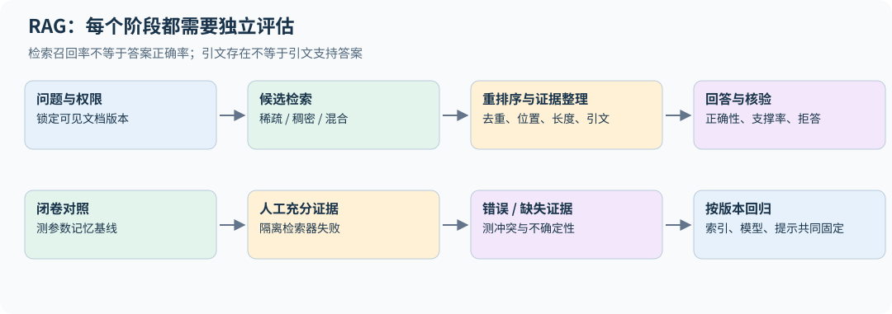

## 24.3 chunk 不是越短越精准

片段过短会丢失限定条件、表头和指代；过长会增加噪声与上下文成本。按语义结构切分段落、保留标题路径、表格上下文和稳定文档 ID，通常比任意按固定字符截断更容易追溯。

重叠窗口能保护边界，却产生大量近重复命中，使 top-k 看似很大、独立证据很少。检索后可按文档/段落去重，并保留原始偏移、时间、版本和权限元数据。权限过滤应在返回内容给模型之前完成，不能只在生成后隐藏引用。

## 24.4 稀疏、稠密与重排序

BM25 使用词频、文档频率与长度归一化。对 query 词 t，一个常见打分项为

$$\operatorname{IDF}(t)\frac{f_{t,d}(k_1+1)}{f_{t,d}+k_1(1-b+b|d|/\overline{|d|})}.$$

它对精确术语、编号和罕见名称有优势，依赖分词与倒排索引。dense retrieval 将 query/document 编码成向量，以内积或 cosine 排序，能学习部分语义匹配，但也可能忽略关键数字或否定。[Dense Passage Retrieval](https://arxiv.org/abs/2004.04906)

双编码器允许离线计算文档向量；cross-encoder 将 query 与候选一起编码，通常更适合少量候选重排序，代价更高。混合检索可以合并稀疏/稠密排名，再用 reranker。不要直接把数值范围不同的 score 相加而不校准；倒数排名融合（RRF）只用名次：文档 $d$ 的融合分数为 $\sum_r1/(k+\mathrm{rank}_r(d))$，常取 $k=60$。`retrieval.py` 的 `reciprocal_rank_fusion` 实现了它。

双编码器训练常将问题向量 $q_i$ 与正确段落 $d_i^+$ 拉近、与负例段落拉远。例如候选集合为 $\mathcal D_i$ 时，

$$L_i=-\log\frac{\exp(q_i^\top d_i^+/\tau)}{\sum_{d\in\mathcal D_i}\exp(q_i^\top d/\tau)}.$$

batch 内其他正例可充当负例，但一个段落可能同时回答多个问题，形成假负例。hard negative 能教模型区分相似但不支持答案的段落，也可能引入标错的相关段落。向量是否归一化、temperature 和负例采样决定分数几何；换 embedding 模型后应重新计算相应文档向量并重建 ANN 索引；若只换 query encoder，须验证它与旧文档空间仍对齐。

`retrieval.py` 提供小规模 BM25、recall@k 和 MRR，使用固定中文示例与明确的字符/ASCII 词切分。它没有训练 embedding、构建 ANN 索引或调用生成模型，实验只验证检索与评分链条。

在四文档教学语料上，三条与文档共享关键词的 query 都把目标排在第一位；第四条 query "如何表示词序"问的正是 RoPE，却与 RoPE 那篇文档没有一个共同的字，BM25 返回空结果，recall 为 0。这就是词法检索的典型盲区：同义改写。稠密检索能部分弥补它，但又可能忽略数字和否定，所以真实系统常把两者用 RRF 合并。真实评估应包含语义改写、数字冲突、过期版本、无答案问题和更大的负例集合。[可运行源码](../examples/retrieval.py)

## 24.5 一个高分检索器为什么仍会让模型答错

Recall@k 问“相关证据是否进入候选”，MRR 看第一个相关候选排第几；它们不测回答正确性。两者都把相关性当成二值。若标注有等级（例如“直接回答”3 分、“背景相关”1 分），用 nDCG@k：$\mathrm{DCG}@k=\sum_{i=1}^k(2^{g_i}-1)/\log_2(i+1)$，再除以理想排序的 DCG。同样两篇相关文档都在前 2 名时 recall@2 相同，但把只算背景相关的文档排在第一，nDCG@2 从 1 降到约 0.71（`ndcg_at_k` 的测试用例）。对 RAG 而言，生成器往往最依赖前一两个片段，这个区别有实际意义。得到证据后，模型仍可能忽略它、被邻近干扰覆盖，或把另一版本中的数字混在一起。正确引文 ID 也不等于引文实际支持句子。

推荐至少四组对照：无检索、实际检索、人工充分证据、错误/缺失证据。然后分别评分：证据召回、证据是否足以回答、回答正确性、引用支撑率与应拒答时的行为。其中“引用支撑率”常被称为忠实度（faithfulness）：把回答拆成原子陈述，逐条判断是否能由所给证据推出。它与正确性是两回事：回答可以正确但来自参数记忆、不被证据支持（不忠实），也可以忠实于一份错误证据而答错。用模型做这类判断时，要先在人工标注的小样本上测它的一致率。若模型在错误证据下仍自信回答，系统要明确采用证据还是参数记忆，以及冲突时怎样处理。

**排序指标也需要明确分母。** nDCG 的理想排序应来自同一查询的完整相关性标注集，不能只在检索器已经返回的文档中找理想顺序，否则漏掉最重要证据也可能得 1。重复文档按首次出现去重；无相关文档的查询要单独评估拒答或报告采用的零分约定，不能默默从平均值中消失。教学函数要求有限、非负且至少一项为正的等级，以免把 NaN 标注传播成不可解释的分数；实现同时缩放 DCG 与理想 DCG，避免大等级的 $2^g$ 溢出。等级刻度本身也属于评估协议：指数增益下，把所有等级乘二会改变相对权重。

## 24.6 长上下文不等于可靠证据利用

把检索器换成“所有文档都塞进上下文”不会自动解决问题。证据位置、干扰文档、重复片段和多个必要事实相距很远，都可能影响表现。长上下文研究展示了某些模型和任务对证据位置敏感；这是测试设计的理由，不是断言所有模型都具有相同曲线。[Lost in the Middle](https://arxiv.org/abs/2307.03172)

在固定总长度下移动证据，或在固定证据下增加干扰，能分别识别位置与长度影响。多跳任务要评估所有必要证据是否同时进入上下文；只命中其中一条可能仍无法推导答案。

令 E 表示所需证据全部进入上下文，A 表示最终答案正确，则 $P(A)=P(E)P(A\mid E)+P(\neg E)P(A\mid\neg E)$。第二项可能来自参数记忆、猜测或数据泄漏，所以答案正确率不是检索质量的直接替代。若一道题必须同时得到两条事实，各自召回率都是 90%，完整证据率只在独立假设下才是 81%；根据二者相关性，它可在 80%–90% 之间。评估多跳检索应标出必要证据集合，并分别测完整率和证据齐全后的回答质量。

## 24.7 更新、审计与不可信文本

索引应有版本，能够定位一次回答实际使用的文档快照。重建 embedding 后距离分布变化，旧 reranker 阈值与缓存也要重新验证。仅记录当前网页链接不足以复现历史回答。

检索文档是证据数据，不是系统指令。网页里要求模型忽略规则、调用工具或泄露内容的文字，不应被当成更高优先级命令；工具授权也应由应用验证。评估这种边界与普通检索准确率是两项独立工作。

**练习。** RAG 的答案正确率提高，但 recall@k 不变，可以说明什么？

**解答。** 可能改善了重排序、证据利用、上下文整理或生成协议；也可能答案来自参数记忆。需要结合人工证据和错误证据对照，不能把所有提升都归给检索器。

## 24.8 Late interaction 与检索器的训练分布

单向量检索把整篇文档压成一个向量，cross-encoder 为每对 query/document 重新联合编码。ColBERT 的 late interaction 介于二者之间：分别离线/在线编码 token 向量，用

$$s(q,d)=\sum_i\max_j q_i^\top d_j$$

聚合每个 query token 的最佳文档匹配。文档 token 向量可预计算，细粒度匹配仍发生在查询时；代价是比单向量更多的索引容量与候选评分工作。MaxSim 不是整体事实支撑概率，词项相关也不保证句子蕴含。[ColBERT](https://arxiv.org/html/2004.12832v2)

检索器训练中的 hard negatives 应来自部署会遇到的混淆：数字不同、版本不同、同名实体、条件或否定不同。只随机抽完全无关段落可能使训练 loss 很低，却学不会这些区别；把实际相关文档误作负例又会直接损坏召回。训练/验证要按原始文档或问题簇划分，不能让同文档的重叠 chunk 跨集合制造虚高分。

## 24.9 自适应检索：何时需要继续找证据

Self-RAG 将检索与反思信号纳入训练/生成，说明检索不是必须对每题固定调用一次。这样的控制器需要学习“是否缺证据、当前证据是否支持答案、是否值得继续检索”，收益应与额外检索/评审成本一起计算。[Self-RAG](https://arxiv.org/html/2310.11511v1)

把这一思路推到底，就是用强化学习训练模型自己决定何时检索、检索什么。Search-R1 让模型在逐步推理中多次生成搜索查询、实时取回结果，只用最终答案的结果奖励训练；取回的文本作为上下文但不计入策略损失（与第 32.8 节工具返回的 mask 同理），报告在七个问答数据集上明显优于检索增强的基线。这类“深度研究”式 agent 的评估同样要固定搜索后端与调用预算，否则分数差别可能只是检索次数不同。[Search-R1](https://arxiv.org/abs/2503.09516)

一个可实施的评估流程是先固定索引与生成器，比较从不检索、每题检索、开发集调好的自适应规则；记录准确率、引用支撑率、无答案识别和平均/尾部调用数。控制器不能读取测试真值，也不能把 judge 的自信直接当作证据充分。拒答阈值应在开发集选择，并在新来源、新版本与冲突文档上复核。


---

# 25｜推理时计算：采样、验证器与搜索

这是第 12、18 章的进阶扩展。训练提供一种策略，推理系统还可以分配多次尝试、长输出、验证与搜索预算。本章解释增加计算何时能改善答案，以及验证器为什么可能成为新的瓶颈。

## 25.1 先区分四种增加计算的方式

更长的单条推理链增加串行步骤；多候选采样探索不同答案；搜索根据反馈扩展部分轨迹；反思/修订让模型重新检查已生成内容。它们不等价，也不都保证提高准确率。

如果题目需要一个模型完全不知道的事实，重复同样的错误答案并不能创造知识。如果验证器不能辨别候选正确性，生成了正确答案也未必会被选中。推理预算与模型能力、任务难度、验证质量共同决定收益。[Test-time Compute Scaling](https://arxiv.org/abs/2408.03314)

## 25.2 pass@k 是有答案，不是选对答案

独立候选单次成功率为 p，至少有一个正确候选的概率为

$$P(\text{存在正确候选})=1-(1-p)^k.$$

它是 oracle selection 的指标：假设有完美方法识别成功候选。真实 verifier 的 best-of-k accuracy 往往更低。一个能够稳定产生 10% 正确答案的模型，用很多采样可以达到高 pass@k，但如果输出阶段只是随机挑一条，实际准确率仍为 10%。

正相关的成功事件常削弱独立采样公式的收益；不同依赖结构也可改善覆盖，因此应测联合成功与重复率，不把所有相关性都等同于坏。极端情况下所有采样都完全相同，再采样一百次也不会提高成功率。重复率、答案簇数、轨迹差异与采样温度都应进入日志，而不是只记录 k。

## 25.3 自一致性与加权投票

自一致性将不同推理轨迹的最终答案归一化，再按出现频率选择答案。它依赖“正确答案在可采样轨迹中较常见”这一条件；若模型有系统性偏见，多数投票可能稳定放大错误。

多个答案类别时，通常选的是众数，不必有某个答案超过 50%。在固定有限类别、IID 采样且正确答案是唯一最高概率类别时，即使其概率只有 0.4、另外两类各 0.3，增加样本也会越来越稳定地选对；若一个错误答案概率为 0.45、正确答案为 0.4，则会越来越稳定地选错。答案归一化改变类别划分，所以把“1/2”“0.5”分成两类本身就可能改变投票结果；开放式长文本又不一定有稳定的有限类别集合。

数值答案要统一分数、小数、单位和等价表达；代码任务通常不能简单按字符串投票，需执行测试或比较行为。加权投票把 verifier 分数或轨迹权重合并，但分数没有校准时可能被单个自信错误覆盖。

## 25.4 outcome verifier 与 process verifier

outcome verifier 评价完整答案或最终结果，process verifier 为中间步骤提供反馈。前者标签较便宜，可能难定位早期错误；后者提供密集监督，却需要定义步骤边界、正确性和局部错误对最终结果的关系。[Training Verifiers](https://arxiv.org/abs/2110.14168)、[Let's Verify Step by Step](https://arxiv.org/abs/2305.20050)

验证器本身也可以是生成模型。GenRM 把验证写成下一个 token 预测（让模型生成"是/否"并可先写出验证推理），与生成任务联合训练；ThinkPRM 让长思维链模型逐步写出验证过程，用比判别式 PRM 少几个数量级的步骤标签达到更好的效果。它们把验证也变成可以花推理时计算的过程，验证器的预算因此也要计入 25.8 节的对齐比较。[GenRM](https://arxiv.org/abs/2408.15240)、[ThinkPRM](https://arxiv.org/abs/2504.16828)

不能把每步正确概率随意相乘当作整条链正确概率，除非条件依赖和概率校准满足所需分解。某步局部看似合理也可能依赖早先错误假设。检查最终答案、步骤有效性、证据来源和格式是不同维度。

## 25.5 为什么 k 越大可能越容易挑到 verifier 漏洞

假设每次独立采样产生“错误且获得虚高分”的总概率为 q；采样越多，出现至少一个此类候选的概率为

$$1-(1-q)^k.$$

真实情形还取决于正确候选分数和相关性，但这个式子说明：搜索更广会探索到评分器的长尾错误。best-of-k 优化的是 verifier 分数，不能自动当成优化真实正确率。

`reasoning.py` 构造明确标注的合成 verifier：正确候选总是得分 1，少量错误候选得分 2。它同时报告 oracle pass@k 与真实选择准确率，可以出现“正确答案覆盖率不断升高，最终选择却变差”。这不是测量任何实际模型的指标，而是对选择偏差的可执行反例。

在这个严格定义的 toy model 中，单次正确概率为 p，错误候选被虚高评分的条件概率为 $\varepsilon$，故虚高错误的总概率是 $q=(1-p)\varepsilon$。选择正确需要“没有虚高错误，且至少有一个正确候选”，因此

$$P(\text{选对})=(1-q)^k-(1-p-q)^k.$$

取 $p=0.25,\varepsilon=0.03$，20,000 次合成试验中，k=16 的覆盖率约 98.88%、选择准确率约 69.21%；k=64 的覆盖率约 100%，选择准确率却约 23.47%。这些数值来自固定 seed 的实际运行，公式也可以直接预测其趋势。[实验源码](../examples/reasoning.py)

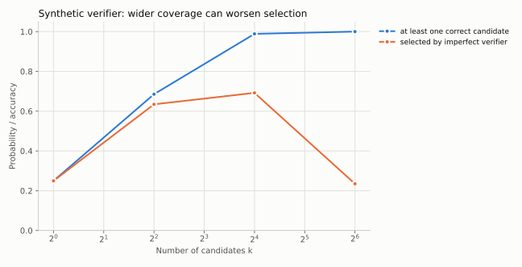

## 25.6 按难度分配计算

固定总预算下，给已很容易的问题更多候选可能收益很小；对完全不会的问题，增加少量候选也可能无效。理想策略把预算分配给边际收益高的题目，但难度和收益曲线需要用开发集估计，不能偷看测试答案。

可以根据可校准的不确定性、候选分歧、验证失败或明确工具错误选择继续采样、换检索、调用验证器或结束。停止规则必须计入评估协议：比较固定 k 与自适应策略时，报告实际总 token、延迟尾部与未完成率。

在理想完美验证器、各次独立且每个候选成本相同的模型里，从 k 次增到 k+1 次的覆盖增量为 $p(1-p)^k$；比较不同成本题目时，应看该增量除以新增成本。这是观察结果前的固定预算曲线：已知且固定的 p 下，若确认前 k 次都错，下一次的条件成功率仍为 p；若已有正确答案则可停止。真实系统还要从开发集估计 p 和选择器表现，不能按测试真值分配计算；有误判的 best-of-k 不保证边际收益为正，实际失败记录也会更新对未知 p 的判断。

## 25.7 搜索树并不天然优于采样

DeepSeek-R1 报告专门写了"不成功的尝试"一节，正好对应本节和 25.4 节。PRM：难以在一般推理中定义细粒度的"步骤"，难以判断中间步骤是否正确（自动标注效果不好、人工标注难以扩展），引入模型化的 PRM 后不可避免地出现奖励欺骗。MCTS：token 生成的搜索空间比棋类大得多，限制每个节点的扩展数又容易陷入局部最优；价值模型直接决定搜索质量，而细粒度的价值模型很难训练。报告也说明，这不代表这些方法不能做出好的推理模型；最终的 R1 改用结果奖励的 RL，让模型在一条长思维链内部自己探索和回溯。长链推理可以看作把外部搜索"内化"到单次采样里，两者的预算应按 25.8 节对齐比较。[DeepSeek-R1](https://arxiv.org/abs/2501.12948)

搜索把部分生成轨迹作为节点，扩展候选动作，并依据 value/verifier 选择继续探索的分支。它能复用前缀，但可能在早期估值错误时剪掉正确路径。分支宽度、深度、回溯、缓存和环境状态是否可重置，都影响真实成本。

对工具 agent，节点不只是 token 前缀，还包含文件系统、工具副作用和环境观察。若两个分支共享可变环境状态，实验可能不再比较独立路径。需要隔离或回滚，并把不可逆动作放到明确授权的执行阶段。

## 25.8 怎样进行预算对齐的比较

记录每题 prompt token、所有候选 output token、verifier token/调用数、工具耗时与最终选取策略。仅固定“最终答案长度”会漏掉大量隐藏的候选和验证成本。若部署指标是响应延迟，并行采样与串行长链的墙钟成本又不同。

**练习。** 某系统从 k=8 增到 k=64 后 pass@k 提高，但最终 accuracy 降低，首先怀疑什么？

**解答。** 检查 verifier 的极端误评分、重复/相关候选、答案归一化和选择策略；同时确认相同基础模型与采样协议。这个现象不说明基础模型“能力变弱”，可能只是选择器在更大候选池里更易出错。

## 25.9 过程验证器究竟在预测什么

“这一步局部成立”和“从这一步继续最终会答对”是两种标签。前者需要推理规则或人工步骤判断，后者是依赖续写策略的 value；换模型、temperature 或搜索预算后，后者也变。最终答案正确还可能包含互相抵消的错误，不能反向给所有中间步骤都标正确。[过程监督研究](https://arxiv.org/html/2305.20050v1)

将非负步骤奖励相加可能偏向长轨迹，概率相乘可能快速趋近零；min 聚合又由最差一步主导。链式法则需要第 t 项恰为 $P(C_t\mid C_1,\ldots,C_{t-1},x)$，其中 $C_t$ 是相同定义下的步骤正确事件；普通分桶校准不足以保证这个逐输入条件概率（第 14.9 节）。使用 logits、奖励分或独立判断概率时，要把聚合看成需要验证的选择器，而不是概率恒等式。

## 25.10 验证器的低误收率为什么仍不够

设生成成功率 p，验证器对正确候选的保留率 t、对错误候选的误收率 f，则

$$P(\text{正确}\mid\text{保留})=\frac{pt}{pt+(1-p)f}.$$

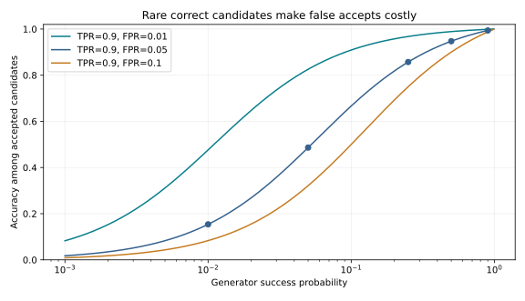

取 t=0.9、f=0.05，p=0.5 时保留精度约 94.7%，p=0.05 时只有 48.6%，p=0.01 时约 15.4%。同一个验证器在难题池上可能让保留下来的多数答案仍然错误；应按生成器、题目难度和候选来源测校准，而不是只公布整体准确率。

这与 best-of-k 的极端值问题不同：此处是在固定阈值下看保留数据的基率，25.5 节是在候选池中挑最大分。二者都要求独立真值抽查，尤其当验证器也作为训练 reward 时。


---

# 26｜模型压缩：量化、低秩与质量—成本前沿

第 12 章介绍了量化的基本意义，本章进一步解释误差如何通过激活传播，以及为什么 weight MSE 最小不一定带来最好的模型。它是面向研究与部署的扩展，不是要求读者复现某个商用推理库。

## 26.1 不同压缩方式改变不同对象

量化减少每个数值的存储精度；剪枝删除部分连接或结构；低秩分解限制矩阵秩；蒸馏重新训练较小学生。这些方法可以组合，但误差来源和运行内核不同。 结构化剪枝加蒸馏（直接换一个更小的稠密模型）见第 12.9 节。

非结构化零值若仍放在 dense GEMM 中不一定加速；低秩把一个矩阵乘拆成两个，rank 太高可能只增加启动与中间张量；低 bit 权重若每步完整解压，也未必节省时间。应分别报告文件大小、峰值内存、延迟、吞吐和任务质量。

## 26.2 把量化误差写成输出误差

采用列向量约定，$y=Wx$，校准输入组成 $X=[x_1,\ldots,x_m]$，量化矩阵为 $\widehat W$。令 $\Delta W=\widehat W-W$，则层输出误差为

$$\|\Delta WX\|_F^2=\operatorname{tr}(\Delta WXX^\top\Delta W^\top).$$

$XX^\top$ 衡量输入通道的尺度与相关性。如果某通道激活很大，小权重误差也可能产生大输出误差；如果不同通道误差互相抵消，仅逐权重绝对误差又可能过度悲观。

用 $H=XX^\top/m+\lambda I$ 作带阻尼的局部度量，可构造更稳健的重建目标。GPTQ 利用类似二阶/重建信息进行逐步量化与误差补偿；本章公式说明目标几何，不等于完整 GPTQ 算法。[GPTQ](https://arxiv.org/abs/2210.17323)

考虑一行权重，强制第 q 个坐标改变量为 $\delta=\widehat w_q-w_q$，其他坐标暂时允许连续调整。最小化 $\Delta w^\top H\Delta w$，约束 $e_q^\top\Delta w=\delta$，用拉格朗日乘子求导可得

$$\Delta w=\frac{\delta H^{-1}e_q}{(H^{-1})_{qq}},\qquad \min\Delta w^\top H\Delta w=\frac{\delta^2}{(H^{-1})_{qq}}.$$

因此量化一维后的误差可以通过相关维度部分补偿。实际逐步量化还需更新剩余变量、保证数值稳定、安排分块和量化网格；不能把这个单步连续解当作完整最优离散量化。`optimal_compensation` 用线性求解验证约束与局部最小值，不显式计算逆矩阵。

逐层误差还会相互作用。对两层线性网络，令 $\widehat W_i=W_i+E_i$，则 $\widehat W_2\widehat W_1x-W_2W_1x=W_2E_1x+E_2W_1x+E_2E_1x$。第一层小误差可能被第二层的大范数放大，两层误差也可能抵消；加入非线性后，激活开关变化还会使局部线性近似失效。因此逐层 weight MSE 或单层重建误差排序不能保证整网排序，应在全部压缩后重新评估，并考虑后续层实际收到的激活已经变化。

## 26.3 为什么校准数据本身也是实验条件

校准样本若全是短英文句子，不能保证代码、中文、长上下文或工具轨迹上误差相同。校准集不应用最终测试集来选择 scale、clip 或压缩配置，否则评估会泄漏。

至少比较层重建误差、固定验证 NLL、关键任务、长输入与罕见 token。量化后的模型可能总 loss 变化很小，却在特定格式或精细数值任务上明显变差；只看平均量化误差不足以证明可部署。

## 26.4 通道缩放：先保持函数，再改变可量化性

对正对角矩阵 S，有

$$Wx=(WS)(S^{-1}x).$$

精确计算下函数不变，但两侧动态范围改变。若某激活通道 outlier 很大，可以把一部分幅度转移到权重；量化两侧后，总误差取决于二者新的范围与 scale。SmoothQuant 利用这种等价变换平衡激活和权重的量化难度。[SmoothQuant](https://arxiv.org/abs/2211.10438)

AWQ 则利用激活信息识别对量化敏感的权重/通道并选择缩放，以改善低 bit weight-only 量化。[AWQ](https://arxiv.org/abs/2306.00978) 不应把这些方法合并成“把 outlier 删除”：它们在保持或近似保持函数的前提下改变表示与误差分配。

## 26.5 分组尺度、裁剪与极端值

均匀对称 b-bit 量化可取 $q_{max}=2^{b-1}-1$，$s=\max|w|/q_{max}$，量化为 $\widehat w=s\operatorname{clip}(\operatorname{round}(w/s),-q_{max},q_{max})$。每 tensor 一个 s 简单，但可能被最大值支配；每通道或分组 scale 更灵活，增加元数据。

裁剪允许牺牲少量极值，换取大多数值的分辨率。最佳阈值应依据校准目标，而不是假设越接近 min/max 越正确。零组需单独处理，避免 scale=0 导致 NaN；FP32 累加与量化存储也是不同精度层次。

`compression.py` 实现小矩阵对称量化与输出重建误差，不打包 bit，也不调用量化内核，因此不宣称真实显存或速度收益。测试包含零矩阵、通道尺度差异和等价变换。

若输入权重为 FP16/BF16，计算 scale 和反量化参考时先提升到 FP32。这主要影响 FP16 的小量：它的最小正规数为 $2^{-14}\approx6.1\times10^{-5}$，但保留次正规数时仍可表示到 $2^{-24}\approx6.0\times10^{-8}$；就近舍入到零的边界约在后者的一半，不能把正规数下限当作零阈值。很小的非零 `amax/qmax` 仍可能下溢成 0，随后出现 0/0；若后端冲零，阈值又会不同。BF16 的指数范围与 FP32 相同，下溢风险小得多。即使在 FP32 中，次正规数输入仍可能让 scale 变成 0，所以实现还把 scale 下限设为最小的正数（`nextafter(0, 1)`），而不是一个任意的 epsilon。返回参考值的 dtype 与实际打包权重的存储位数是两件事。零组、很小的非零组、恰好舍入中点与非有限输入应分别测试，不能用一个固定 epsilon 抹平所有边界。

## 26.6 低秩压缩与 LoRA 的区别

若 $W=U\Sigma V^\top$，保留前 r 个奇异值得到 $W_r$，它在 Frobenius 范数下是最佳 rank-r 近似。参数从 $d_{out}d_{in}$ 变成约 $r(d_{out}+d_{in})$，但输入分布加权的输出误差未必也最小。

LoRA 学习的是对基础权重的低秩**增量**，仍保留基础 W；低秩压缩直接用 $W_r$ **替代** W。两者目标和存储含义不同，不能因为 LoRA rank 很小就推断原模型可以无损压成同 rank。

若 rank-r 分解仍用普通两个 GEMM，仅当 $r(d_{in}+d_{out})<d_{in}d_{out}$ 才减少主项乘加。即使满足它，临时激活、两次启动与小矩阵效率仍可能使延迟变差；最佳 Frobenius 近似也只针对未加权矩阵误差。

## 26.7 小权重误差、大任务误差的反例

考虑 $W=[0.1,1]$，对称 2-bit 量化可能得到 $\widehat W=[0,1]$。若输入第一维常为 10、第二维很小，丢掉 0.1 会产生明显输出误差。反过来，若第二维几乎不出现，较大的第二维权重误差也可能对当前分布影响很小。

`compression.py` 用两个固定误差矩阵验证“更小 weight MSE 可以对应更大输出 MSE”。这是数学反例，不意味着某个真实模型必然具有相同通道分布。

本次输出中，weight MSE 为 0.0025 的扰动产生约 0.4100 的输出 MSE，而 weight MSE 约 0.0100 的另一扰动仅产生约 0.0005 的输出 MSE。这里输入刻意让某些通道更重要，所以结论是“需要匹配输入分布的误差度量”，不是“权重 MSE 完全没用”。[实验源码](../examples/compression.py)

## 26.8 压缩实验的交付标准

在同一硬件和服务协议下比较原模型与压缩模型，固定 batch、输入/输出长度、cache 精度与采样。分别测离线质量和端到端性能，再把候选放到第 22 章 Pareto 前沿上。对无法通过质量门槛的配置，不要仅因文件更小就推荐部署。

**练习。** 一个量化方案输出层重建误差很小，能否保证全模型 NLL 几乎不变？

**解答。** 不能。校准分布可能不代表真实输入，多层误差会改变后续激活，softmax 对关键 logit 差异也可能敏感。需对完整模型做独立验证，而不仅验证逐层局部目标。

## 26.9 QAT：训练中看见量化误差

训练后量化（PTQ）固定权重并用校准选择表示；量化感知训练（QAT）在前向插入 quantize→dequantize 的 **fake quantization**，继续更新高精度可训练权重，使它适应最终量化网格。round 的精确导数几乎处处为零，因此常用 straight-through estimator（STE）提供代理梯度。[PyTorch QAT 教程](https://pytorch.org/blog/quantization-aware-training/)

示意为 $\widetilde w=s\,\operatorname{clip}(\operatorname{round}(w/s),q_{min},q_{max})$。前向使用 $\widetilde w$，反向对未裁剪区采用近似恒等梯度；这是优化 surrogate，不是离散 round 的真实微分。learned scale、observer 冻结、裁剪导数和更新精度可各不相同，需要按配方说明。

QAT 的 fake 张量仍可为 FP32/BF16；训练阶段未必节省存储或加速。最终 convert 成与部署一致的 packed kernel 后，才测真实推理速度。对照应匹配数据、更新预算、bit/group 设置与最终部署内核，比较 original、PTQ、QAT，并检查领域和长上下文变化。

## 26.10 2:4 结构稀疏：50% 零值不是充分条件

2:4 要求沿硬件规定的连续四元素分组，每组最多保留两项非零；位置编码和非零值一起压缩后，支持该格式的 sparse Tensor Core 才能跳过相应计算。任意位置 50% 为零，或直接把零留在 dense 张量里，不能得到相同速度收益。[NVIDIA 结构稀疏说明](https://developer.nvidia.com/blog/structured-sparsity-in-the-nvidia-ampere-architecture-and-applications-in-search-engines/)

常见实验先按幅度或激活加权准则选组内保留位置，再用固定/逐步变化 mask 微调。基线需保持相同数据与调参预算；同时测模型质量、布局转换、实际 GEMM 和端到端服务时间。“稀疏峰值吞吐可达两倍”不等于完整模型延迟减半，因为其他层、KV 读取和非稀疏算子仍有成本。

`numerical_tools.py` 仅提供每组 top-2 mask 和 fake quant/STE 的梯度验证，使用不同于作业的矩阵例子；它保留 dense 浮点存储，不打包稀疏数据或测 sparse GPU 性能。

该 demo 特意采用全区间恒等 STE（裁剪区也传梯度），以便和离散前向做明确对照；它与仅在未裁剪区传梯度的 observer/fake-quant 配方不同。测试检查选定 surrogate 的导数，而不对 round 做有限差分后宣称获得真实梯度。实际 QAT 应采用部署工具链对应的精度、分组与反向约定。

## 26.11 输入加权的最优低秩近似

普通截断 SVD 最小化 $\|W-\widehat W\|_F^2$。若在输入二阶矩 $H=\mathbb E[xx^\top]\succ0$ 下最小化层输出误差（输入零均值时它才等于协方差），分解 $H=LL^\top$ 后可改写为

$$\operatorname{tr}((W-\widehat W)H(W-\widehat W)^\top)=\|(W-\widehat W)L\|_F^2.$$

令 $B=WL$，取其最佳 rank-r 近似 $B_r$，则 $\widehat W=B_rL^{-1}$。L 可逆时左右乘它不改变秩，因此这一解在指定局部度量下最优。实现用三角线性求解代替显式求逆；H 奇异时需处理支持子空间或加入阻尼，阻尼会改变目标。

例如 $W=\operatorname{diag}(2,1)$、$H=\operatorname{diag}(0.01,100)$：普通 rank-1 SVD 保留权重 2，输出误差为 100；加权解保留第二方向，误差仅 0.04。`input_weighted_low_rank` 复算这个反例。最佳层重建仍不等于最佳整网任务分数，后续非线性与校准分布需要另测。

## 26.12 正交旋转怎样与 RMSNorm 配合

对正交 Q，$\|xQ\|=\|x\|$，不含可学习 gain 的 RMS 归一化满足 $N(xQ)=N(x)Q$。因此可在残差空间换一组基，并相应变换输入/输出投影；gain 通常需先折入相邻权重。MLP 的 SiLU/GELU 不与任意旋转交换，不能在任意隐藏层随便插 Q 后声称函数不变。[QuaRot](https://arxiv.org/html/2404.00456v1)

旋转希望把集中在个别坐标的 outlier 分散，改善后续低 bit 量化。QuaRot 一类方法用随机 Hadamard 旋转；SpinQuant 进一步把旋转矩阵当作参数，在少量校准数据上学习，报告学到的旋转比随机旋转在 4 位权重/激活/KV 量化下明显更好。[SpinQuant](https://arxiv.org/abs/2405.16406)未量化的等价性、量化后的误差、真实 kernel 的布局/变换开销要分别验证；随机旋转的平均优势不保证每个输入都改善。QK、OV、残差和 MLP 中间通道需要各自正确的吸收位置。


---

# 27｜机制可解释性：从相关现象到受控干预

本章属于课程外的研究扩展。它帮助读者检查模型内部计算，而不是宣称可以从几张 attention 图读出“模型真正想法”。可解释性结果同样需要对照、统计和适用范围。

## 27.1 观测不等于因果解释

attention 权重高只表明当前头把较多权重放在某些 value 上，最终输出还经过 value 投影、其他头、MLP、残差和多层组合。某个神经元与概念相关，也可能只是与真正起作用的特征共同出现。

线性 probe 可以测表示是否包含可读出的信息，但 probe 成功不证明模型本身使用了该信息。参数或激活删掉后输出变化，也可能是把模型推到分布外造成的普遍破坏，而非定位了独一无二的机制。

## 27.2 先定义可测量的行为差异

选择 clean/corrupt 两个输入，尽量只改变一个关键因素，并用具体指标测模型行为。例如正确答案 a 与对照答案 b 的 logit difference：

$$m(x)=z_a(x)-z_b(x).$$

差值避免单个 logit 整体漂移的一部分混淆，但仍依赖答案 token 选择与分词。多 token 答案应使用相同条件下的序列 log probability，不能只取第一 token。

## 27.3 Activation patching 的干预

先运行 clean 输入保存某层/位置的激活 $h^{clean}$，再运行 corrupt 输入并把对应激活替换为 $h^{clean}$，观察结果是否恢复。normalized recovery 可写成

$$R=\frac{m(x^{patched})-m(x^{corrupt})}{m(x^{clean})-m(x^{corrupt})}.$$

分母接近零时指标不稳定，应改报原始差值或剔除该对照。R 可以小于 0 或大于 1，不能自动裁成 0–1 再解释成概率。patch 的是 residual、head output、MLP output 还是 key/value，具有不同语义。[Activation Patching 方法分析](https://arxiv.org/abs/2309.16042)

跨样本汇总也要说明顺序。设某两例的 clean-corrupt 差为 1 和 10，patch 各恢复 1，则逐例恢复比例的平均为 $(1+0.1)/2=0.55$，而先汇总差值再归一化为 $2/11\approx0.182$；前者给样本等权，后者按原始差距加权。两种问题都可以研究，但不能在不同方法间混用；最好同时保留原始分子、分母和无效小分母样本的数量。

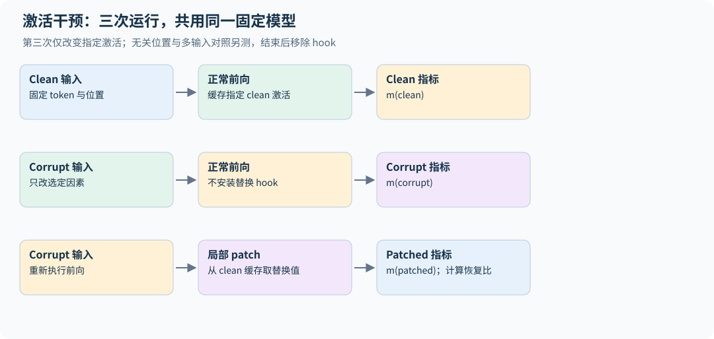

## 27.4 必须防止把正确答案直接注入模型

如果把最后一层、答案位置的全部 hidden state 从 clean 复制过来，输出恢复几乎是预期结果。这是检查工具是否有效的正对照，不是发现了跨层推理机制。

同理，tokenization 不同导致位置错位时，所谓“替换对应词”可能实际替换了不同内容。需要记录具体 token ID、位置和上下文长度；最好使用多组最小对照和多个指标，检查结论是否依赖某一种 corruption。

`interpretability.py` 提供临时 forward hook 与可清理的激活替换，并用一个受控加法支路玩具模型验证：换回相关通道能恢复，换无关通道无效。它测试干预工具与逻辑，不声称解释了 TinyLM 的知识存储。

具体玩具函数为 $y=h_0+2h_1$，第三通道不影响输出。clean `[1,2,50]` 得 5，corrupt `[0,2,-50]` 得 4；只换回第一通道恢复到 5，只换回第三通道仍为 4。异常中断后 hook 也应移除，否则下一次“基线”运行会继续被干预。这些控制已写入自动测试。[实验源码](../examples/interpretability.py)

## 27.5 消融、patching 与模型编辑不同

零消融将一部分激活归零，可能制造训练中未见的状态；mean ablation 用平均激活替换，仍可能不匹配当前上下文；clean patching 使用另一输入的激活，改变的是条件计算。模型编辑则直接修改参数，希望定向改变某个行为，同时保留其他行为。

定位与编辑事实关联的研究提供了这类方法，但编辑一个事实成功不证明找到了独立“知识槽位”，更不能证明其他事实或组合推理完全不受影响。[Locating and Editing Factual Associations](https://arxiv.org/abs/2202.05262)

评价编辑至少看目标成功率、同义改写泛化、关联事实一致性、无关任务保持，以及连续多次编辑后的累积影响。输入很像训练模板时成功，可能只是局部模式适配。

## 27.6 一份可信的干预报告

说明模型 checkpoint、clean/corrupt 输入、token 对齐、patch 位置、替换张量、评价指标和所有控制实验。报告跨样本的分布，不只展示最漂亮的一例。负结果也重要：某位置 patch 无效不能证明它完全无关，信息可能通过冗余路径传递。

对批量 hook，检查没有原地修改共享缓存、没有把 clean 运行的计算图带进另一次运行、异常后 hook 能被清理。训练和推理模式也要固定。干预工具本身有 bug 时，解释性图会看起来非常可信，却没有实际含义。

多位置扫描还涉及多重选择：从上千次 patch 中挑最大的恢复值，会同时挑中噪声。应在开发输入上选位置/特征，再用未参与选择的输入确认；报告跨输入配对差值与区间。零消融无效不能证明无因果贡献，充分恢复也不能证明必要性；冗余路径、尺度变化和离分布干预必须用多种对照区分。

## 27.7 如何把这一章用于学习而非过度解释

可以先对已经通过因果/cache 测试的小模型观察层间表示，再设计受控任务，例如输入位置交换、无关干扰和某个明确规则。先提出能被反例推翻的机制假设，再选择最小干预。

**练习。** 把 clean 模型最后一层答案位置的完整表示复制到 corrupt 运行后，答案恢复了，是否证明该位置“存储了全部知识”？

**解答。** 不能。最终 logits 本来由这个表示计算，恢复只说明替换足以控制输出。要研究机制，应比较更早、更局部的干预，并使用无关位置和多种 corruption 对照。

## 27.8 稀疏自编码器：把叠加表示拆成字典

对某层激活 h，SAE 用过完备特征 z 重建：

$$z=\operatorname{ReLU}(W_e(h-b_d)+b_e),\qquad\widehat h=W_dz+b_d,$$

$$L_{SAE}=\mathbb E\left[\|h-\widehat h\|_2^2+\lambda\|z\|_1\right].$$

宽字典容纳多种模式，稀疏约束希望每个输入只激活少数特征。编码/解码列尺度有自由度，实际训练要约束 decoder norm 或采用其他稳定设计；L1、Top-k、JumpReLU 等稀疏实现也有不同偏置。低重建误差不保证特征可解释，更不保证字典完整或唯一。[Scaling Monosemanticity](https://transformer-circuits.pub/2024/scaling-monosemanticity/index.html)

检查重建替换后的模型行为、平均非零数、死特征比例、不同 seed/字典宽度下的稳定性，以及高激活样本是否来自单一模板。字典宽度还会带来"特征吸收"：一个宽泛概念的特征在某些子情形下不激活，被更具体的特征吸收掉，于是它看起来像一个有漏洞的探测器。Matryoshka SAE 让字典的各个前缀都能独立重建，BatchTopK 在整个 batch 上分配非零配额，都是针对这类问题的训练变体。[Matryoshka SAE](https://arxiv.org/abs/2503.17547)、[BatchTopK SAE](https://arxiv.org/abs/2412.06410) 评估时也应把 SAE 特征与一个简单基线（例如在同一层激活上训练的线性探针）放在同一下游任务上比较，不要只看特征是否"可命名"。

**一个负面结果：SAE 探针不如线性探针。** Google DeepMind 机制可解释性团队 2025 年 3 月公布了一次这样的对照。任务是检测用户的有害意图，训练集与验证集之外，用训练中没见过的新越狱方式做分布外（OOD）测试集（训练 4,046 例、验证 1,014 例、OOD 3,850 例）。直接在残差流上训练的稠密线性探针几乎完美，OOD 上 AUROC 约 0.999。只用单个 SAE 特征的探针连训练集都拟合不好；从 SAE 特征中选约 20 个做稀疏探针，分布内接近完美，但 OOD 明显更差。在对话数据上微调 SAE 有帮助，也只缩小了约一半的差距；直接在 SAE 重建后的激活上训练探针，OOD AUROC 还会下降约 0.04–0.05，说明重建误差里正好丢了有用的信息。团队据此暂时降低基础 SAE 研究的优先级，但明确说这不等于 SAE 没用：他们在同一项目中用 SAE 发现并排查了数据集里的虚假相关。[GDM Mech Interp 团队进展更新 #2](https://www.alignmentforum.org/posts/4uXCAJNuPKtKBsi28)

这和本节的检查清单是同一回事：如果目标是"对一个已知概念做判断或干预"，先用线性探针做基线，SAE 必须在这条基线之上证明价值。也有研究者提出了反面的分工：SAE 对"已知概念"的操作不如简单方法，但在"发现事先不知道的概念"（生成假设、排查数据问题）上有独特用处，这能解释为什么负面与正面结果并存。[Position: Use SAEs to Discover Unknowns](https://arxiv.org/abs/2506.23845) 上述 GDM 团队博文不是同行评审论文，数字来自单一任务与单一模型族，读者应把它当作一次有分量的反例，而不是对所有任务的定论。只展示几个“可命名”特征可能存在选择偏差；SAE 未找到某概念也不证明原模型没有表示它。

## 27.9 Steering：方向干预与因果解释的距离

steering 常用 $h'=h+\alpha v$，v 可来自对比样本平均差、probe 或 SAE decoder 方向。SAE feature clamping 则指定某个特征幅度，两者不是同一个干预。观察目标行为提高，要同时测无关任务、语气/长度、事实错误与拒答变化，并对照随机方向、符号反转、强度扫描和不同提示。[Activation Addition](https://arxiv.org/abs/2308.10248)

若通过 SAE 改特征，可以保留重建残差：$h'=h+W_d(z'-z)$，而不是直接把 h 换成 $W_dz'$。后者同时移除了 SAE 未解释的部分，无法把影响单独归因于某个特征。强度越大，越可能制造分布外激活；成功改变行为不等于已经找到正常运行时必要且唯一的机制。

教学代码验证稀疏表示和方向干预的张量/残差关系，不训练真实模型 SAE。对于实际研究，仍需第 27.3–27.6 节的 clean/corrupt、位置与无关控制，不能把 steering 效果直接当成人类语言解释的证明。

## 27.10 从 SAE 特征到计算图，还多了什么假设

SAE 重建某层激活，transcoder 则尝试用稀疏特征近似某个子层的输入—输出映射；跨层 transcoder 可以把不同深度的特征作用连成图。Circuit Tracing 使用替代模型和局部线性贡献寻找候选计算路径，再用干预验证。图上的边表示选定替代系统中的贡献，不是原模型全部非线性因果关系。[Circuit Tracing 方法与局限](https://transformer-circuits.pub/2025/attribution-graphs/methods.html)

替换子层后应先测原模型的行为保真度；若输出已明显变坏，图可能解释的是替代误差。固定一次输入上的 attention 模式来线性化，也不会完整解释 QK 路由为何形成；裁剪图会遗漏弱但合计重要的路径，冗余路径又可能使单点消融无效。

梯度乘激活差是局部一阶近似：$\Delta m\approx\nabla_hm^\top\Delta h$。对大幅 patch、饱和门或跨分布替换，二阶项可很大，不能把归因分数当作实测干预效果。报告应包括替代前后质量、重建残差、不同 corruption、多个样本与真实 patch；特征命名只能作为待检验的解释。

这六章扩展的共同目的，是把训练、检索、推理、压缩和解释放回同一条证据链：先定义行为与预算，再做正确实现，最后用有辨识力的对照支持结论。


---

# 28｜五组作业实战导读（以 2026 年为准）

前面各章按知识组织，本章按作业组织：每组作业要交付什么、哪些地方最容易错、对应本书哪一章和哪个 demo、没有大算力时怎样降级完成。内容依据 2026 年作业讲义（[A1](https://github.com/stanford-cs336/assignment1-basics/blob/a158843b20107949f1a8d7df1b05cd33b9166712/cs336_assignment1_basics.pdf)、[A2](https://github.com/stanford-cs336/assignment2-systems/blob/ca8bc81a59b70516f7ebb2da4808daade877c736/cs336_assignment2_systems.pdf)、[A3](https://github.com/stanford-cs336/assignment3-scaling/blob/03e9372992e913061b9e78b5cfcb62ad8a87de35/cs336_assignment3_scaling.pdf)、[A4](https://github.com/stanford-cs336/assignment4-data/blob/0555bea66369872d912652debf10b115ca0688c8/cs336_assignment4_data.pdf)、[A5](https://github.com/stanford-cs336/assignment5-alignment/blob/c2734a26308710949fe13226960a1e8cece94b7e/cs336_spring2026_assignment5_alignment.pdf)），2024/2025 版本的差异见第 35 章。

先说清楚两件事。第一，截至 2026-10-31，官网允许基础编程与高层概念提问，禁止用 LLM 直接解决作业题，并强烈建议关闭 AI 自动补全（详细政策以官网链接文档为准）；本书的 demo 是用来理解原理、核对思路的参考，不是作业答案，作业代码请自己写。第二，课程的 GPU 预算以 B200 小时计；下面给出的低资源路径是讲义本身的建议或本书在 CPU 上实测可行的做法。

## 28.1 A1 基础：tokenizer、Transformer、训练循环

**要交付什么。** 从零实现 byte-level BPE 训练与编码（不能用现成 tokenizer 库）、`Linear`/`Embedding`/RMSNorm/SwiGLU/RoPE/softmax/注意力/Transformer LM、交叉熵、AdamW、余弦学习率日程、梯度裁剪、数据加载、checkpoint、解码；然后在 TinyStories 上训练到每 token 验证损失不高于 1.45，在 OpenWebText 上训练，做消融，并完成排行榜题（计 6 分）：只能用讲义提供的 OpenWebText 训练数据，在一张 B200 上最多运行 45 分钟，交最终验证损失和以墙钟时间为横轴的学习曲线。官方测试通过 `adapters.py` 接入你的实现，用 `uv run pytest` 运行。注意 A1 禁止使用 `torch.nn`、`torch.nn.functional`、`torch.optim` 中的定义，`nn.Parameter`、容器类和 `Optimizer` 基类除外；本书的 `examples/` 为简洁用了 `nn.Linear`、`F.cross_entropy` 等，不能照搬。

**最容易错的地方。**

| 位置 | 坑 | 概念讲解 |
|---|---|---|
| BPE 并列 | 应选字典序**更大**的 pair；写成 `min` 会让整张 merge 表错位 | 2.2 节（讲义示例的 merge 顺序） |
| 特殊 token | 先按 `<|endoftext|>` 切段，标记本身不计数；编码时重叠的特殊 token 取最长 | 2.2、2.5 节 |
| 训练速度 | 先聚合 pre-token，再增量更新 pair 计数；预切分按特殊 token 对齐并行 | 2.3 节（10K 词表 6 秒） |
| 流式编码 | 块末未定型的 pre-token 和特殊 token 前缀要留到下一块 | 2.5 节 |
| 解码 | 非法 UTF-8 用 `errors="replace"` 输出 U+FFFD | 2.1 节 |
| 初始化 | 线性层 $\mathcal N(0,\frac{2}{d_{in}+d_{out}})$ 截断于 $\pm3\sigma$，embedding $\mathcal N(0,1)$ 截断于 $\pm3$ | 5.5 节 |
| RoPE | 相邻两维成对旋转；位置从 cache 长度开始；只作用于 Q/K | 4.2、4.5 节 |
| 学习率日程 | 作业的余弦日程以 $(t,\alpha_{max},\alpha_{min},T_w,T_c)$ 定义，$t>T_c$ 后保持 $\alpha_{min}$ | 5.2 节 |
| 梯度裁剪 | 全局范数，$\epsilon=10^{-6}$ 加在分母 | 5.3 节 |

**资源核算题。** `transformer_accounting` 与 `adamw_accounting` 请自己算。第 8.8 节用作业没有考的 Llama 2 7B 演示同样的方法（参数、各部分 FLOPs、显存与训练时间），`python -m examples.accounting` 可复算。

**训练与消融。** 作业给出的 TinyStories 基础配置：10K 词表、上下文 256、$d=512$、$d_{ff}=1344$、4 层 16 头、RoPE $\Theta=10000$，总共处理约 3.3 亿 token，在一张 B200 上约 20–30 分钟。学习率要扫描，并找到至少一个发散的学习率，讨论"最优学习率在稳定性边缘"的说法；batch 从 1 扫到显存上限。消融包括：去掉所有 RMSNorm、改成 post-norm、去掉位置编码（NoPE）、SwiGLU 换成 $d_{ff}=4d$ 的不门控 SiLU。本书在 CPU 上做了一个缩小版的完整流程（第 20.4 节），每种消融的结果都有真实曲线。

**低资源路径。** 讲义建议 CPU 或 Apple MPS 上把总 token 降到 4,000 万，目标损失放宽到 2.00；讲义的参考实现在 M4 Max 上处理 $32\times5000\times256$ 个 token，CPU 约 1 小时 22 分、MPS 约 36 分钟，第 5000 步验证损失 1.80。MPS 上不要开 TF32；CPU 上可用 `torch.compile(model)`，MPS 上可用 `backend="aot_eager"`。调试先用 TinyStories 验证集训练 tokenizer（讲义按约 2.2 万篇计；本书使用的 V2 验证文件有 27,630 篇、22.5 MB），确认瓶颈一致后再上全量。

## 28.2 A2 系统：性能分析、FlashAttention-2、分布式

**要交付什么。** 端到端基准脚本与 nsys 分析；混合精度累加实验与 `autocast` 基准；显存分析；梯度检查点；PyTorch 注意力与 `torch.compile` 基准；FlashAttention-2 的纯 PyTorch 前向、Triton 前向（含 causal）、PyTorch 反向与基准；分布式通信基准、朴素 DDP、扁平化梯度 DDP、计算通信重叠的 DDP；优化器状态分片；FSDP；以及一组纸面计算题（数据并行、FSDP、张量并行、二维并行、环形 all-reduce 变体）。排行榜比的是两张 B200、batch 2 时一个完整训练步的墙钟时间，从空缓存开始 10 分钟内必须完成。

**模型尺寸表。** 除排行榜外，作业使用词表 10,000、batch 4，上下文长度随题目变化，五个尺寸：small（768/3072/12 层/12 头）、medium（1024/4096/24/16）、large（1280/5120/36/20）、xl（2560/10240/32/32）、10B（4608/12288/50/36）。用 8.8 节的方法先估算每个尺寸的参数、显存和 FLOPs，就知道哪些配置会 OOM，基准表里应该标出来而不是跳过。

**最容易错的地方。**

- 计时不同步：每次计时前后 `torch.cuda.synchronize()`，或用 `triton.testing.do_bench`；warmup 步不计入（9.4 节）。
- nsys 里分不清前向、反向和优化器：用 NVTX range 标记，再用 `--capture-range=nvtx --nvtx-capture=measure` 配合具名 `measure` 范围截取 warmup 之后（9.4 节）。
- FlashAttention：grid 是 (query tile 数, batch)，kernel 内只有一个 key 循环；片上 $m,\ell,O$ 用 FP32；作业约定的 causal 屏蔽值为 $-10^6$（有限负数是该测试设置的近似；通用精确 mask 通常使用 $-\infty$ 并处理全空行）；保存 $L$ 供反向，反向先算 $D=\mathrm{rowsum}(O\circ dO)$（10.3–10.5 节）。没有 GPU 时用 `TRITON_INTERPRET=1` 在 CPU 上核对下标与 mask；讲义提醒解释器有 bug，本书实测 Triton 3.6 解释器下 BF16 输入的 `tl.dot` 结果错误（第 10.4 节），BF16 路径只能在 GPU 上验证。
- 排行榜的模型比尺寸表大得多：$d=4096$、$d_{ff}=11008$、34 层、32 头、词表 151,936、上下文 32,768、BF16、batch 2，在两张 B200 上计时。讲义说明它是故意设计得难以放进显存的，实现也必须是自己的。
- DDP 不等长 batch：本地损失要按全局有效 token 数归一化（11.2、11.10 节）。
- 优化器状态分片：按参数大小平衡所有权，更新后由拥有者广播（11.4 节）。

**本书 demo。** `attention.py` 演示在线 softmax、softmax 反向恒等式与 Triton 行 softmax；`systems.py` 演示自定义 RMSNorm 反向、张量并行反向与低精度累加；`distributed.py` 验证 DDP、collective 等价与优化器状态分片。这些例子没有实现完整二维分块注意力前向与分块反向。CPU demo 验证数值与通信语义，GPU 性能需要实测。

### A2：怎样判断通信真的阻塞了训练

先固定模型、dtype、全局 batch 和有效 token 数，分别测单卡、同步 DDP、bucketed DDP 与 overlap 版本。计时前预热并同步；多卡迭代时间取最慢 rank，而不是只看 rank 0。记录均值/中位数、尾部时间、通信张量字节数、bucket 大小、软件和网络拓扑。

| 时间线现象 | 优先验证的假设 | 有辨识力的对照 |
|---|---|---|
| backward 后排着一长串 collective | 梯度就绪后才统一同步 | 提前启动 bucket，检查最后一个梯度后的通信尾部 |
| 大量短 collective，GPU 之间有空隙 | 延迟主导或 bucket 太小 | 扫消息/bucket 大小；记录调用数而非只看总字节 |
| collective 开始时间跨 rank 差很多 | 计算、取数或长度不均衡 | 对齐 NVTX 标签，比较各 rank 的数据/计算耗时 |
| 通信与计算重叠但步时没下降 | 二者竞争带宽/SM 或关键路径未缩短 | 对照无 overlap；用真实端到端步时确认 |

通信总耗时之和可能大于迭代墙钟时间，因为它与计算重叠，甚至不同流互相重叠。应测**关键路径上暴露的通信尾部**，并配合 $\alpha+S/W$ 判断延迟还是带宽限制。增加 batch 后更快也可能只是提高计算通信比，不等于算法统计效率不变。跨 rank 的设备时钟不能未经对齐直接相减。

### A2：activation checkpointing 的验收

这里的“检查点”是**激活重计算**，不是保存恢复训练文件。选择若干层/子图边界保留输入，反向时重跑内部计算。先以相同输入、权重和随机状态比较不开/开启时 loss 与梯度，再测真实峰值显存和完整训练步时。

重算必须重复相同的随机行为；dropout、MoE 随机路由、可变控制流都需检查。重算函数也不应重复有副作用的计数、缓存追加或状态更新。PyTorch 的 reentrant 与 non-reentrant checkpoint 行为不同，应显式配置 `use_reentrant`，而非依赖默认值。[PyTorch v2.11 checkpoint 说明](https://github.com/pytorch/pytorch/blob/v2.11.0/torch/utils/checkpoint.py)

实验至少有“全不重算、按 block 重算、只重算高显存子图”三组，在固定 batch 下测内存/时间，再在各自最大可行 batch 下比较 tokens/s。第二种比较多改变了 batch，应另报到目标验证损失的成本。

### A2：FSDP 实现要点

先在两 rank 小网络上对照单步梯度与更新，再增加预取与重叠。核对：所有 rank 参数分片顺序相同；padding 分片不会被当作真实参数；前向和反向需要时聚集完整权重；梯度 reduce-scatter 的 sum/average 与 loss 分母一致；临时全量权重释放时仍保留反向需要的信息；更新仅作用于本地分片。

优化器应连接实际持久保存的参数分片，不能继续更新一个已被替换的旧张量。预取增加同时驻留的完整层，不能只用理想 $N/P$ 状态账判断是否放得下。测试还应覆盖共享参数、无梯度分支、恢复后的 optimizer state 与所有 rank 的 collective 顺序。[官方 FSDP2 源码](https://github.com/pytorch/pytorch/tree/v2.11.0/torch/distributed/fsdp)

以上是实现和验收方法，不提供评分题的完整 FSDP 代码；具体接口与作业规定以讲义为准。

## 28.3 A3 缩放律：用有限查询预算做决策

**要交付什么。** 第一部分用给定的 IsoFLOP 数据（`isoflops_curves.json`）复现 Chinchilla 的方法：每个预算取最低损失对应的 $N$，拟合 $N_*(C)$ 与 $D_*(C)$，外推到 $10^{23}$ 和 $10^{24}$ FLOPs。第二部分是重头戏：通过训练 API 在 12 B200-小时内查询任意配置的验证损失，为 48 B200-小时的最终训练选出最优模型尺寸与超参数，并预测其最终损失，提交到 API；成绩部分取决于你预测的配置实际训练出来有多好。

**API 规则要读仔细。** 排队和运行中的实验按你设定的最长运行时间**预扣**预算，完成后按实际用时返还，超时按上限扣；超出 12 小时后 API 拒绝新请求。训练数据是 DCLM 分词后的固定顺序数据，没有重复 epoch；模型种子只影响初始化；架构与 A1 基本一致，上下文 512，32K 词表。API 支持 AdamW 与 SGD，都用 warmup 加余弦的学习率日程；讲义示例的设置是 weight decay 0.01、裁剪 1.0、warmup 5%、末端学习率 10%，但这些都是可调的超参数。非 embedding 参数按 $12n_{layer}d^2$ 估算。预算按 B200 墙钟时间计，一次运行中途记录的 `val_losses` 也不是完成退火的短训练，这两点对实验设计的影响见第 13.5 节。

**策略要点。**

1. 先花一小部分预算确认学习率和 batch 在小模型上的合理范围，否则后续 IsoFLOP 曲线会被调参不足污染（13.5 节）。
2. 每个计算预算放 4–6 个模型尺寸，以上一预算的预测为中心；用抛物线拟合顶点而不是只取最低点：稀疏网格下，只取最低点的 $N_*$ 中位误差约 41%，拟合顶点约 4%（13.4 节的模拟）。
3. 检查最低观测点是否落在网格边缘，是就补点。13.4 节的模拟里，真最优点在网格内，但粗网格把最小预算的最低点选到了右端，抬高拟合左端、压低指数；多花 1 次查询补点后，抛物线外推的最差误差从 21% 降到 9%。实际需预留补点预算，并记录上限耗尽后仍未确定的曲线。
4. 留一个较大预算不参与拟合，用来检验外推；报告预测区间而不是单个数字。
5. 最终提交的超参数（学习率、batch、宽深比）也要有依据，通常来自小规模的趋势外推。

`python -m examples.scaling` 在已知真值的合成曲面上比较了这些设计选择，可以先在上面练习"怎么分配查询"。

### A3：时间预算先用实测吞吐换算

若本地可以运行同配置模型，用包含前向、反向、更新与同步的稳定窗口测有效 token 吞吐：

$$q=\frac{\text{窗口内有效训练 token}}{\text{窗口墙钟秒数}},\qquad\widehat D(t)=\widehat q\,t.$$

词表、上下文、batch、并行数、精度和重算方式都可能改变 q。若 API 不提供单步 benchmark，可通过少量短查询的已处理 token 和实际用时估计；排队时间是否计费、超时规则需按 API 单独处理。不能用硬件峰值或另一种模型的 MFU 代替实测 q。

以秒计的预算与 FLOPs 预算只有在已知吞吐/成本关系时才能互换。对不同尺寸分别校准 q，并预留验证、保存和故障开销；预热长短也会让短查询的平均吞吐偏低。

### A3：损失预测区间怎样落地

保存每次独立运行的 N、D、日程、seed、最终退火完成后的 loss 和实际用时。拟合后按**运行/seed**重采样，重新拟合一组参数；在每个样本中带入目标配置与采样出的吞吐估计，得到目标损失分布。留出更大预算检查覆盖情况，再报告分位数、外推倍数和残差结构。

均值置信区间只反映已选模型族中平均 loss 的估计不确定性；**下一次训练的预测区间**还需加入独立训练的残差、随机性及吞吐影响。同一次运行的多个 checkpoint 不是独立重复。bootstrap 也不能自动覆盖模型族错设与跨规模变化，留出校验失败时应扩大实验或缩小结论。

`numerical_tools.py` 用简单幂律和独立合成噪声展示均值区间与新观测区间，并由解析梯度/概率等对照检查代码；它不生成这门课最终评分配置或预测答案。

该示例在 log-loss 空间拟合；指数还原的趋势是条件中位数，不能直接叫算术均值。代码用残差的经验指数均值（smearing）修正原尺度均值，再分别给出 bootstrap 均值区间与加入独立残差的新运行区间。具体数字保存于 `book/review-update-results.json`；这是指定模型族与噪声下的教学结果，不是实际 LM API 的预测，也没有证明该方法能覆盖任意远距离外推。

## 28.4 A4 数据：从 Common Crawl 到可训练的 token

**要交付什么。** 查看 WARC/WET；用 Resiliparse 抽取正文；fastText 语言识别；邮件、电话、IP 的 PII 掩码；NSFW 与仇恨言论分类器过滤；Gopher 规则；以 Wikipedia 引用链接为正例训练质量分类器；精确行去重；MinHash + LSH 文档去重；最后组合成流水线，过滤已按 fastText 英文概率不低于 0.7 预过滤过的 WET 文件（原始为 2,500 个），用 GPT-2 tokenizer 编码为 `uint16`，在固定训练脚本下训练 GPT-2 small 形状的模型，目标是最小化 Paloma C4-100-domains 验证损失。训练代码和超参数不能改。

**最容易错的地方。**

- 每个过滤器的阈值都要靠抽样审计决定，并报告每一步删掉了多少文档（14.2 节）。
- IPv4 要校验每段 0–255；电话号码格式多样；替换成统一占位符后要监测占位符比例（14.2 节）。
- 行去重删除的是"在整个语料中出现超过一次"的行，两遍扫描，用哈希作键（14.3 节）。
- MinHash 找到的只是候选，必须复核真实 Jaccard；并查集聚类会产生传递闭包（14.4 节）。
- 每篇文档末尾加 `<|endoftext|>`；`uint16` 足以容纳 GPT-2 的 50,257 个 ID（5.10 节）。
- 该作业允许用 Paloma 验证数据训练过滤器，但不能把验证文本放进训练集；在这样的迭代中它承担开发集角色，独立研究还需另外的最终留出评估（14.10 节）。

**本书 demo。** `data.py` 用于理解第 14 章的规则过滤、PII 掩码、行去重和 MinHash 去重，接口和细节与作业不同，不能当作作业代码提交或改写；作业的这些函数请对照讲义自己实现，再用自己的 WET 样本做消融。语言识别和质量分类器不在 demo 中。

## 28.5 A5 对齐：从 GRPO 到估计量变体

**要交付什么。** 用 vLLM 评估 OLMo-2-0425-1B 在 GSM8K 上的三种提示（`question_only`、`r1_zero`、`r1_zero_three_shot`）；推导 baseline 方差；实现分词与 response mask、逐 token log-prob 与熵、奖励计算、组归一化、on-policy 损失、按序列聚合、带梯度累积的 GRPO 训练步；跑通标准 GRPO（4 个种子平均验证准确率至少 25%），扫学习率、做提示消融；然后实现 Dr. GRPO（去掉标准差、常数归一化）、RFT、MaxRL 并在受控条件下比较；再实现离策略的 token 级重要性加权与 GSPO 序列级比率并比较；最后必须提出并测试一个自己的估计量（`try_your_own`，10 分），相对已讲过的某个方法只改动一处。比较变体时还要实现 GRPO_constant（标准 GRPO 改用常数归一化），中间穿插推导难度权重、讨论 RFT 与长度归一化等书面题。

**建议超参数**（作业给出）：学习率 $10^{-5}$，每步 256 条 rollout（32 题 × 每题 8 条），梯度累积 32，裁剪 1.0，AdamW $(0.9,0.95)$ 无 weight decay，采样温度 1.0、最长 512 token，共 200 个 rollout 步，每 10 步评估至少 1,024 道验证题。

**最容易错的地方。**

- response mask 必须只覆盖模型生成的部分，包括停止串；prompt 与 padding 不进入损失（16.2、16.9 节）。
- 按序列平均时，微批损失乘以“本微批序列数 / 总序列数”再反向；若每条序列都用同一个固定 $L_{max}$ 作分母且仍按序列平均，该微批权重保持不变。若改成全 batch 有效 token 平均，权重才随各微批有效 token 数变化。应先写出完整 batch 的分子与分母，再推微批系数（5.3 节）。
- 组均值与标准差只在同一题的 8 条回答内计算；全对或全错的组 advantage 为 0（18.3 节）。
- old log-prob 必须 detach；padding 位置先置安全值再做指数（18.11 节）。
- 各变体沿用标准 GRPO 调好的学习率（讲义的协议，预算所限），并用多个种子画均值与区间。结论首先限于这个共同协议；若变体在不偏向它的 LR 下仍有超出不确定性的收益，证据更强，但变体较差也可能来自 LR 不适配，不能直接解释为算法本身更差（18.16 节）。
- 奖励解析器可能冤枉模型：基线阶段就要人工检查"格式错但其实答对"的样本。

**本书 demo。** `posttrain.py` 的 `grpo_arithmetic_demo` 是同一结构的缩小版：采样、打分、组 advantage、on/off-policy 两轮 clipped 更新、微批累积、熵与混合组比例日志，CPU 上几分钟跑完；`scripts/run_grpo_demo.py` 用 3 个种子比较三种 advantage。demo 的约定（标准差估计、数值保护、裁剪范围等）是为讲解选的，与作业规定并不一致；demo 不能作为作业代码，作业的约定一律以讲义为准，自己实现。

### A5：完整核对清单

| 环节 | 必须固定/核对 | 建议证据 |
|---|---|---|
| 数据与划分 | prompt 分组、train/dev/test、重复题与难度 | 按 ID/近重复检查；开发集用于调参 |
| 模板与分词 | system/chat template、prompt/response 边界、移位 | 人工展开一条 token、label、mask 对照 |
| EOS/PAD/停止 | 有效结束 token、停止串、截断类型 | EOS=PAD 时仍保留真实 EOS 监督 |
| 采样 | temperature/top-p、最大长度、独立 group | 原始 reward、长度、全对/全错比例 |
| 策略角色 | 当前、实际采样 old、reference | old/ref detach；记录权重版本和模型哈希 |
| 引擎一致性 | 同权重同前缀的 logits/logps、精度、路由 | 更新前 replay rollout，查看 log-ratio 分位数 |
| 概率支持 | top-p 支持与概率重归一化 | 保存实际采样 mask；禁止只用原始 logits 代替截断概率 |
| reward/解析器 | 正确性、格式、单位与等价表达 | 人工核对成功/失败/格式错样本；空结果不默默计正常 |
| advantage | 同题 group、std correction、epsilon、长度权重 | 固定手工奖励组与零方差组的数值对照 |
| loss 与累积 | token/sequence/prompt 分母、跨卡全局权重 | 完整 batch 与 microbatch 单步梯度对照 |
| 优化 | unscale→clip→step、有效 step 数、scheduler | 梯度有限、参数确有更新、溢出跳步单独计数 |
| 权重同步/缓存 | 更新后 rollout 引擎加载、旧 KV 失效 | 同一版本 replay；旧数据重用次数与 policy lag |
| 评估 | 独立题、固定预算、seed、checkpoint 选择 | 准确率+区间+长度/成本；禁止按测试分选模型 |

所有异常日志要能追到触发 prompt、token、样本版本及 last-good checkpoint。一次 loss 有限不保证整个循环正确；训练 reward 提高也不替代独立验证。测试覆盖本书 demo，不代表通过官方作业全部验收。

## 28.6 推荐的完成顺序与时间分配

| 阶段 | 内容 | 先读 | 先跑 |
|---|---|---|---|
| 第 1–2 周 | A1 tokenizer 与模型组件，单元测试全部通过 | 第 01–05 章 | `examples.tokenizer`、`tests/test_course.py` |
| 第 3 周 | A1 训练、学习率扫描、消融 | 第 05、20 章 | `scripts/run_tinystories.py` |
| 第 4–5 周 | A2 基准、FlashAttention、DDP/分片 | 第 08–11 章 | `examples.attention`、`examples.distributed` |
| 第 6 周 | A3 先做纸面拟合，再规划 API 预算 | 第 13 章 | `examples.scaling` |
| 第 7 周 | A4 过滤与去重流水线 | 第 14 章 | `examples.data` |
| 第 8–9 周 | A5 GRPO 及变体 | 第 16–18 章 | `examples.posttrain` |

每完成一组作业，用第 20.10 节的报告模板写一页记录：改了什么、怎样验证正确、结果的不确定性有多大、哪些结论只在当前规模成立。

## 28.7 把作业知识迁移成自己的研究实验

课程 handout 与测试接口属于特定年度；独立研究应重新定义数据、预算和验收，而不以“通过作业测试”代替方法结论。可以按以下顺序扩大：

| 阶段 | 最小对照 | 通过后再扩大什么 |
|---|---|---|
| 目标与 mask | 展开一条 token/label/mask；完整与微批梯度对照 | 变长 batch、packing、多卡 |
| 数值与内存 | FP64 小矩阵、块边界、全空/极端输入 | BF16/FP8、实际 GPU kernel |
| 架构 | 固定预算的基线与单项改动 | 两种规模、足够的 LR 调参 |
| 数据 | 固定验证、域比例、重复曝光与去重簇 | 更多来源及长尾任务 |
| 后训练 | 固定 rollout 复算概率、reward 和一次更新 | 在线采样、异步版本、多轮环境 |
| 交付 | 恢复/取消/失败样例、独立评估与成本 | 长运行和真实服务负载 |

新增机制实验见第 20.14 节。它们帮助检验公式，完整的 CCE GPU、MLA/SSM 工业实现、真实验证器与多机 RL 仍需相应系统；先列清缺失部件与实验条件，再做性能或能力结论。


---

# 29｜2025 年开源模型的架构解剖

第 03–07 章讲的是组件，本章用真实的开源模型检验这些组件今天是怎样被组合的。结构参数主要从各模型在 Hugging Face 上的 `config.json` 计算，MTP、量化元数据与存储缓冲还需权重索引/元数据补充，配置文件按固定版本保存在 `sources/model-configs/`。[architectures.py](../examples/architectures.py) 对每个模型族写出参数公式，再与官方 safetensors 元数据报告的总参数量逐个比对：14 个模型全部**精确相等**，误差为 0 个参数。单独漏算一个 bias、norm 或 MTP 模块通常会导致不一致，但两个错误项也可能抵消，因此还需核对分项与张量形状。比对只覆盖"总参数"一列：激活参数统一按 gpt-oss 模型卡的口径计算，测试检查它与 6 个模型的标称值（模型名或模型卡中的数字）相差不超过 6%，各家口径并不相同（见 29.1 节）；KV 两列由公式直接算出，没有外部数字可以对照；HF 元数据的总数也不含量化缩放张量（29.5 节）。

```bash
python -m examples.architectures
```

本章的结论是对这些公开配置的读解。各家在技术报告中说明了部分设计动机，但多数架构选择没有公开的消融，不能把"某个模型这样做"当成"这样做最好"的证据。


## 29.1 一张总表

上下文取 32,768 token、BF16 KV cache。"激活参数"采用 gpt-oss 模型卡的口径：每层注意力、实际被路由到的专家、输出头，不含输入 embedding（它是查表，不是矩阵乘），也不含推理时可丢弃的 MTP 模块。

| 模型 | 类型 | 总参数 | 激活参数 | 层数 | $d$ | Q/KV 头 | KV 每 token | 32K 上下文 KV |
|---|---|---:|---:|---:|---:|---|---:|---:|
| OLMo-2-0425-1B | dense MHA | 1.48B | 1.28B | 16 | 2048 | 16/16 | 128 KiB | 4.0 GiB |
| SmolLM3-3B | dense GQA | 3.08B | 3.08B | 36 | 2048 | 16/4 | 72 KiB | 2.3 GiB |
| OLMo-2-1124-7B | dense MHA | 7.30B | 6.89B | 32 | 4096 | 32/32 | 512 KiB | 16.0 GiB |
| Qwen3-8B | dense GQA | 8.19B | 7.57B | 36 | 4096 | 32/8 | 144 KiB | 4.5 GiB |
| Mistral-Small-24B | dense GQA | 23.57B | 22.90B | 40 | 5120 | 32/8 | 160 KiB | 5.0 GiB |
| Qwen3-30B-A3B | MoE 128 选 8 | 30.53B | 3.04B | 48 | 2048 | 32/4 | 96 KiB | 3.0 GiB |
| gpt-oss-20b | MoE 32 选 4 | 20.91B | 3.61B | 24 | 2880 | 64/8 | 24 KiB* | 0.75 GiB |
| gpt-oss-120b | MoE 128 选 4 | 116.83B | 5.13B | 36 | 2880 | 64/8 | 36 KiB* | 1.1 GiB |
| Qwen3-Next-80B-A3B | 混合 + MoE 512 选 10 + 1 共享 | 81.32B | 3.56B | 48 | 2048 | 16/2 | 24 KiB** | 0.75 GiB |
| Qwen3-235B-A22B | MoE 128 选 8 | 235.09B | 21.57B | 94 | 4096 | 64/4 | 188 KiB | 5.9 GiB |
| GLM-4.5 | MoE 160 选 8 + 1 共享 | 358.34B | 32.86B | 92 | 5120 | 96/8 | 368 KiB | 11.5 GiB |
| MiniMax-M1-80k | 混合 + MoE 32 选 2 | 456.09B | 47.17B | 80 | 6144 | 64/8 | 40 KiB*** | 1.25 GiB |
| DeepSeek-V3 | MLA + MoE 256 选 8 + 1 共享 | 684.49B | 36.63B | 61 | 7168 | 128 / MLA | 68.6 KiB | 2.1 GiB |
| Kimi K2 | MLA + MoE 384 选 8 + 1 共享 | 1026.41B | 31.69B | 61 | 7168 | 64 / MLA | 68.6 KiB | 2.1 GiB |

\* gpt-oss 一半层是 128 token 的带状窗口注意力，这一半的 KV 不随上下文增长；表中是 32K 上下文下的平均值。\*\* Qwen3-Next 48 层中只有 12 层保留 KV，其余 36 层是 Gated DeltaNet，另需一份固定大小的状态，按配置并假设递归状态存成 BF16 时约 38 MiB：32K 上下文时约占总量的 5%，上下文越短占比越大。实际引擎可能用 FP32 累积状态，还要计入卷积状态、布局与对齐，不能由 BF16 权重推断历史状态也全部是 BF16。\*\*\* MiniMax-M1 80 层中只有 10 层是 softmax 注意力，其余 70 层是 Lightning Attention（线性注意力），同样只保留固定大小的状态。

几个可核对的数字：gpt-oss 模型卡给出 120b 激活 5.13B、20b 激活 3.61B，与本表一致；DeepSeek-V3 报告"671B 总参数、37B 激活"，本表 684.49B 总量多出的 13.46B 正是一个 MTP 模块，去掉它是 671.03B；Kimi K2 摘要写"1T 总参数、32B 激活"，报告表 2 写作 1.04T 与 32.6B；本表按同一口径算出的激活参数 31.69B 低约 3%，报告没有给出逐项分解，差在哪里无法确定。

"激活参数"的口径各家不同，对照时要先换算。Qwen3-30B-A3B 的模型卡写"30.5B 总参数、3.3B 激活"，它把输入 embedding 也算进激活参数：本表的 3.04B 加上 embedding 的 0.31B 正好是 3.35B。GLM-4.5 的报告写"355B 总参数、32B 激活"，并说明统计时计入 MTP 层、不计词 embedding 和输出层：本表的 358.34B 减去主干与 MTP 各自的 embedding 和输出头（4 份，每份 0.78B）是 355.2B。MiniMax-M1 报告"456B 总参数、45.9B 激活"：总数与本表完全一致；本表激活 47.17B 减去输出头（1.23B）是 45.94B，说明它的口径不计输出头。元数据里 15,728,640 个 FP32 参数正是 80 层路由器（$80\times6144\times32$），其余为 BF16。

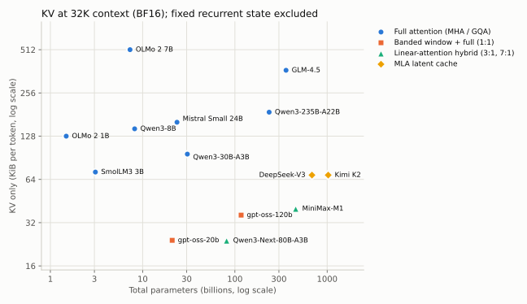

## 29.2 dense 模型：共识已经很稳定

五个 dense 模型的骨架几乎相同：pre-norm 或其变体、RMSNorm、SwiGLU、RoPE、无 bias、GQA 或 MHA。差别集中在几个"小"选择上，而这些选择恰好对应第 03–05 章讨论过的稳定性问题。

- **QK-Norm 很常见，但不是默认。** 表中 Qwen3 全系、Qwen3-Next 的全注意力层、OLMo 2 和 GLM-4.5 都有 QK-Norm，SmolLM3、Mistral Small、gpt-oss 和两个 MLA 模型没有。参数比对能区分这一点：漏掉或多算这几个 norm 权重，总数就对不上。Qwen3 技术报告写明去掉了 Qwen2 的 QKV bias，引入 QK-Norm"以保证训练稳定"；OLMo 2 对整个 Q、K 投影做 RMSNorm，公式里因此多出 $d+h_{kv}d_h$ 个参数。这是第 3.5 节"在 softmax 之前控制 logit 尺度"的直接应用。MLA 的投影吸收通常不显式生成完整 key；对完整 key 做非线性归一化会破坏这种简化计算路径，不能无代价照搬 QK-Norm，但并非数学上禁止使用，Kimi K2 为此设计了 QK-Clip（第 5.12 节）。
- **归一化的位置在变。** OLMo 2 把 RMSNorm 移到注意力和 MLP 的**输出**上：$h=x+\mathrm{RMSNorm}(\mathrm{Attn}(x))$，残差主干上不再有归一化，同时加上 z-loss。这种"后置到子层输出"的写法既不是经典 post-norm，也不是 pre-norm。
- **RoPE base 分成两派。** 一派把 base 调大：从原始的 $10^4$ 到 OLMo 2 的 $5\times10^5$、Qwen3 的 $10^6$、SmolLM3 的 $5\times10^6$、Mistral Small 的 $10^8$；base 越大，最慢的旋转周期越长，长距离位置越不容易"绕一圈"混淆。另一派保留较小的 base，再用 YaRN 扩展上下文：DeepSeek-V3 为 $10^4$、Kimi K2 为 $5\times10^4$、gpt-oss 为 $1.5\times10^5$（第 30.1–30.2 节）。
- **SmolLM3 每 4 层去掉一层 RoPE。** 配置中 `no_rope_layers` 有 36 项，其中 27 层用 RoPE、9 层不用。这是第 04 章 NoPE 消融的一个工程化变体：部分层不直接施加 RoPE，但可继承前层及因果结构带来的位置信息，被认为有助于长上下文泛化。 Llama 4 也是每 4 层一层 NoPE，并让其余 RoPE 层只做 8K 块内的分块注意力（iRoPE，第 30.4 节）。
- **宽深比因团队而异。** 第 3.7 节的共识区间是 $d/L\approx100$–$200$。OLMo 2 两个模型与 Mistral Small 是 128，gpt-oss-20b 是 120，DeepSeek-V3 与 Kimi K2 是 117.5，Qwen3-8B 是 114，都在区间内；Qwen 的 MoE 系列（Qwen3-30B-A3B 43、Qwen3-235B 44、Qwen3-Next 43）、GLM-4.5（56）、SmolLM3-3B（57）和 gpt-oss-120b（80）则明显更深更窄。偏深集中在少数几家的设计里，不是"小模型"或"MoE"的普遍规律。GLM-4.5 的报告给出了理由：相对 DeepSeek-V3 和 Kimi K2，它缩小宽度、增加层数，因为"更深的模型推理能力更好"；它还用了 2.5 倍的注意力头（隐藏宽度 5120 配 96 个头），报告称这不降低训练损失，却稳定地提高 MMLU、BBH 等推理基准。这些都是团队的说法，报告没有给出消融数字。
- **KV 头数差别很大。** 同为 7–8B，OLMo 2 7B 用 MHA（每 token 512 KiB），Qwen3-8B 用 32/8 的 GQA（144 KiB），32K 上下文下 KV 分别是 16 GiB 和 4.5 GiB。做长上下文推理时，这一项比参数量更早成为瓶颈。

## 29.3 MoE：细粒度、多专家、无共享专家之争

第 06 章的趋势在这些配置里一览无余：除 gpt-oss-20b 与 MiniMax-M1（均为 32 个）外，表中专家数都在 128–512 之间，每个专家的 MLP 宽度远小于 dense 的 $\frac83d$。Qwen3-30B-A3B 每个专家宽 768，是 $d=2048$ 的 0.375 倍；Qwen3-Next 只有 512。

- **共享专家并无共识。** DeepSeek-V3、Kimi K2、GLM-4.5 各保留 1 个共享专家；Qwen3 MoE 明确去掉了共享专家（技术报告："Unlike Qwen2.5-MoE, the Qwen3-MoE design excludes shared experts"），并改用全局 batch 的负载均衡损失鼓励专家专门化；gpt-oss 也没有共享专家；而同一家的 Qwen3-Next 又加回了 1 个共享专家（宽 512，输出带 sigmoid 门）。这与第 6.5 节 DeepSeek 和 OLMoE 消融结论互相矛盾的情况一致。
- **前几层保持 dense。** DeepSeek-V3 与 GLM-4.5 的前 3 层、Kimi K2 的第 1 层是普通 MLP（`first_k_dense_replace`），之后才换成 MoE。这些报告没有给出相应的消融；一种常见的解释是浅层表示更通用，换成 MoE 收益小。
- **路由打分与负载均衡。** DeepSeek-V3 用 sigmoid 打分、对每个专家加一个只影响"选谁"而不影响门控权重的偏置项，按历史负载在线调整，即第 6.3 节的"无辅助损失"方案（另外仍保留一个系数很小的序列级平衡损失，见第 6.5 节）；checkpoint 里每层都存有这个偏置（`e_score_correction_bias`）。gpt-oss 的 Hugging Face 配置里有 `router_aux_loss_coef` 字段（0.9，供 transformers 训练时使用），但模型卡没有说明原始训练用什么方法做负载均衡。
- **稀疏度可以继续提高。** Kimi K2 技术报告做了"稀疏度缩放律"实验：固定激活参数，把总专家数与激活专家数之比从 8 提高到 48，在相同验证损失下分别节省 1.69、1.39、1.15 倍 FLOPs（相对稀疏度 8、16、32）。据此它把专家数从 DeepSeek-V3 的 256 增加到 384，同时把注意力头从 128 减到 64 以降低推理开销。总参数因此超过 1T，激活参数反而比 DeepSeek-V3 少。

## 29.4 注意力的三条省 KV 路线

同一张表里能看到第 07、12 章讨论过的三条路线都已落地：

1. **MLA（DeepSeek-V3、Kimi K2）**：每层只缓存 512 维的 KV latent 加 64 维解耦的 RoPE key，共 576 个数。若用同样 128 个头的普通 MHA，需要缓存 K（$128\times192$）和 V（$128\times128$）共 40,960 个数，MLA 压缩了约 71 倍（这里按 DeepSeek-V3 实际的头宽计算：K 每头 192 维，即 128 维加 64 维 RoPE 部分；V 每头 128 维）。71 倍是指定 MHA 基线下的缓存比，不能直接当作相对现代 GQA 服务的收益：与 8 个 KV 头、头宽 128 的 GQA（每层 2,048 个数）相比约小 3.6 倍，与 Qwen3-235B 的 4 个 KV 头（1,024 个数）相比约小 1.8 倍；表中每 token 68.6 KiB 对 188 KiB 还叠加了层数差异，并非只改变缓存结构的受控对照。代价是注意力计算更复杂，且 RoPE 必须单独处理（第 7.5 节）。
2. **带状窗口与全局层交替（gpt-oss）**：36 层中 18 层只看最近 128 个 token，另 18 层是全注意力。窗口层的 KV 封顶在 128 个 token，于是长上下文下 KV 约为纯全注意力的一半。Gemma 3 更激进：每 5 个局部层（窗口 1,024）配 1 个全局层。
3. **线性注意力混合（Qwen3-Next、MiniMax-M1）**：Qwen3-Next 每 4 层只有 1 层是全注意力（`full_attention_interval` 为 4），其余 36 层是 Gated DeltaNet，状态大小固定、不随上下文增长；MiniMax-M1 的 80 层中只有 10 层是 softmax 注意力。第 7.6 节引用的讲义配比在这里可以逐层核对。

**注意力汇点（attention sink）。** gpt-oss 每个注意力头有一个可学习的 logit，加在 softmax 分母里、参与归一化后再丢掉。模型卡解释，这让注意力头可以"不关注任何 token"。没有它时，softmax 必须把总和为 1 的权重分给某些真实 token，模型往往会把多余的注意力堆到第一个 token 上，即 StreamingLLM 观察到的"注意力汇点"现象（第 30 章）。

**注意力输出门控。** Qwen3-Next 的全注意力层让 `q_proj` 多输出一份与 query 同宽的向量，经 sigmoid 后逐元素乘到注意力输出上；参数公式里因此多出 $d\cdot h\cdot d_h$ 一项。动机来自同一团队的系统消融：在 15B MoE 与 1.7B dense 模型、3.5T token 上比较了 30 多种门控变体，在 SDPA 输出后加逐头 sigmoid 门效果最稳定，训练更稳、能承受更大学习率。论文把原因归到两点：给低秩的 $W_VW_O$ 映射加了非线性，以及依赖 query 的稀疏门让头可以"什么也不输出"，因而缓解了上一段的注意力汇点、改善了长上下文外推。它与 gpt-oss 的可学习 sink logit 是解决同一问题的两种做法。[Gated Attention](https://arxiv.org/abs/2505.06708)

**部分维度旋转（partial RoPE）。** 配置里还能读到另一个细节：GLM-4.5 的 `partial_rotary_factor` 为 0.5，Qwen3-Next 为 0.25，即每个头只有前一半或前四分之一维度施加 RoPE，其余维度不直接施加旋转，但输入隐状态仍可携带上游层和因果结构形成的位置信息；MLA 则把 RoPE 放在单独的 64 维分支上（第 7.5 节）。这和 SmolLM3 按层去掉 RoPE 是同一类思路的不同粒度：保留一部分不随位置旋转的通道，用来做与距离无关的内容匹配。

## 29.5 checkpoint 里不止权重

精确对齐参数量时，暴露了几类第 08 章的公式没有覆盖的张量，它们会影响显存和下载体积：

- **MTP 模块。** DeepSeek-V3（13.46B）、GLM-4.5（5.54B）、Qwen3-Next（1.65B）的 checkpoint 都带一个多 token 预测层：把主干在位置 $i$ 的最后一层隐状态与下一个 token $t_{i+1}$ 的 embedding 拼接、投影，再过一个完整的注意力加 MoE 块，预测 $t_{i+2}$。DeepSeek-V3 的 13.46B 中约 1.85B 是 checkpoint 为 MTP 单独存的一份 embedding 与输出头。DeepSeek-V3 报告说明训练时它提供额外监督，推理时可以直接丢掉，也可以作为 speculative decoding 的草稿头（第 12.6 节）。Qwen3-Next 的模型卡写明带有 MTP，并给出用它做 speculative decoding 的推理框架参数；但它的 `config.json` 里没有 MTP 字段，要统计这部分参数只能对照权重索引。
- **低精度权重与缩放因子。** DeepSeek-V3 与 Kimi K2 的发布权重中，分别有约 99.4% 和 99.8% 的参数以 FP8 E4M3 存储，每个 $128\times128$ 块有一个缩放因子；gpt-oss 的 MoE 权重以 MXFP4 存储（安全张量里显示为 U8 打包），每 32 个数共享一个 8 位指数（第 34 章）。HF 元数据报告的参数总数不含这些缩放张量：DeepSeek-V3 的 F32 计数只有 15,104 个，正好是 59 个 `e_score_correction_bias`；gpt-oss 的 U8 计数等于专家权重的逻辑个数，不是实际存储的字节数。
- **非可训练缓冲。** Kimi K2 每层存了一个形状为 [56] 的 rotary `inv_freq` 缓冲，61 层共 3,416 个数。它不是参数，但会出现在"总参数"统计里，`architectures.py` 把它单列为 `stored_buffers`。

## 29.6 从模型名到可复核的架构对象

一份可信架构账应依次读取 config、实现、权重索引，再区分逻辑参数、可训练参数、存储张量元素与文件字节。量化 U8 可能每字节打包两个 4-bit 权重，也有 scale/metadata；MTP 和非可训练 buffer 不一定进入主干推理；共享 embedding 可有多个引用却只有一份存储。

总数对齐是有价值的校验，但不能证明每层语义正确：两个遗漏项也可能恰好抵消。进一步检查每类张量名称/形状、attention bias/QK norm、共享专家、MTP、KV dtype 与实际前向路径。active 参数只是约定口径，矩阵乘次数、注意力配对和专家批次并集需单独算（第 6.8 节）。

本章固定的是一组 2025 模型快照，不是持续更新的排行榜。新版本改了配置、量化布局或 kernel 后，复用旧表前应重新核对版本。参数更少、KV 更小和吞吐更高之间没有一对一关系，需把理论账与实际服务预算连起来。

## 29.7 快照之后：同一骨架上的两次增量

本章的表固定了一组 2024 年末至 2025 年发布的模型快照（最早的 OLMo-2-1124-7B 与 DeepSeek-V3 分别发布于 2024 年 11 月和 12 月）。之后的两个后续版本说明，同一套骨架上的改动往往很小、很集中，用本章的方法逐项对配置就能看清改了什么。

**DeepSeek-V3.2-Exp（2025-09）。** 与 V3 的固定版本配置相比，MLA 维度、专家数、层数沿用原骨架；与稀疏索引直接相关的三个字段是`index_n_heads` 64、`index_head_dim` 128、`index_topk` 2048。这就是第 7 章介绍的 DeepSeek Sparse Attention：一个轻量索引器为每个 query 挑出 2,048 个候选 key，主注意力只在这些位置上计算。它仍需保存全长的主 MLA 缓存，并额外维护索引器的键与相应状态；主注意力只读取选中的位置，但索引器还要扫描候选。因此它主要减少主注意力的访问与计算，不能按 top-k 比例推断整个推理步骤的加速或总缓存大小。safetensors 元数据报告的总参数为 685,396,921,376，比 V3 多约 0.91B，量级与每层一个索引器相符。量化配置还多了 `scale_fmt: ue8m0`：FP8 块缩放因子被限制为 2 的幂，与第 34.4 节 MX 格式的 E8M0 共享缩放是同一取舍。[DeepSeek-V3.2-Exp 配置](https://huggingface.co/deepseek-ai/DeepSeek-V3.2-Exp/blob/194c67e12b1b0d6df0ef373ddcf215bc84027409/config.json)

**Kimi K2 Thinking（2025-11）。** 结构与 K2 相同，元数据总参数与本章表中的 K2 只差 4,392 个，差别在存储的辅助张量而不是网络结构；变化集中在两处。一是上下文：YaRN 的 `factor` 从 32 提到 64，`max_position_embeddings` 从 131,072 提到 262,144，$\beta$ 仍都为 1（第 30.2 节）。二是权重精度：模型卡说明在后训练阶段对 MoE 组件做量化感知训练（QAT，第 26.9 节），原生以 INT4 推理，低延迟模式下生成速度约为 2 倍。配置里的量化方案是每 32 个权重一组的对称 INT4，并把注意力、共享专家、第 0 层的稠密 MLP（`first_k_dense_replace` 为 1）和输出头排除在外，所以元数据中约 1.01T 参数以打包整数存储、约 11.7B 仍为 BF16。这与 gpt-oss 的 MXFP4（第 29.5、34.4 节）思路相同：只压缩占绝大多数参数、按 token 稀疏激活的路由专家。[Kimi K2 Thinking 模型卡](https://huggingface.co/moonshotai/Kimi-K2-Thinking/blob/a51ccc050d73dab088bf7b0e2dd9b30ae85a4e55/README.md)

这两个例子的读法与本章一致：先对配置找出变化的字段，再判断它改变的是参数、每 token 计算、KV 存储还是存储精度，最后用元数据总数核对。本书没有把这两个版本加入 29.1 节的精确复算表，它们的数字只作为对照引用。

## 练习

**1．** 用总表估算：在一张 80 GB 显卡上，以 BF16 权重部署 Qwen3-30B-A3B，32K 上下文最多能同时服务几个请求？换成 gpt-oss-20b（MoE 权重按 MXFP4 计约 10 GB，其余 BF16 约 3.6 GB）呢？

**解答。** Qwen3-30B-A3B 权重 $30.5\times2\approx61$ GB，剩余约 19 GB，每请求 3.0 GiB（3.2 GB），约 5.9 个，即最多 5 个。gpt-oss-20b 权重约 $19.1\times4.25/8+1.8\times2\approx13.7$ GB，剩余约 66 GB，每请求 0.75 GiB（0.8 GB），约 82 个。两者激活参数相近（3.0B 对 3.6B），并发上限却差约 14 倍（82 对 5.9）。每层每 token 的 KV 其实一样大：gpt-oss 是 $2\times8\times64$，Qwen3-30B-A3B 是 $2\times4\times128$，都是 1,024 个数。差别来自 gpt-oss 层数只有一半、其中一半又是 128 token 的窗口，KV 因此小 4 倍；权重方面，MXFP4 比 BF16 省下约 28 GB，两个模型的权重共差约 47 GB。并发容量由 KV、权重总量/精度和运行时共同决定，active 参数量不能单独预测。这只是显存上限，没有计入激活和运行时开销。

**2．** DeepSeek-V3 与 Kimi K2 的 KV 每 token 完全相同（68.6 KiB），而 Kimi K2 的注意力头只有一半。为什么？

**解答。** MLA 缓存的是 512 维 latent 加 64 维 RoPE key，与头数无关；头数只影响从 latent 展开出 K/V 的投影矩阵大小和注意力计算量。这正是 MLA 的设计目的：缓存大小与头数解耦。

**3．** 第 3.7 节的共识区间说 $d/L\approx100$–$200$。从总表找出两个明显偏离的模型，讨论这对训练和推理各有什么影响。

**解答。** 例如 Qwen3-235B（$d/L\approx44$）与 Qwen3-Next（约 43）；Qwen3-30B-A3B（43）、GLM-4.5（56）、SmolLM3（57）、gpt-oss-120b（80）也在区间之外。更深意味着更多串行层，可能增加单 token 的计算、启动和专家通信次数；同参数量下宽度也变了，延迟须按真实矩阵形状测量。流水线 stage 数是另一个配置：可以每个 stage 放更多层，并不随模型层数必然增加。好处是有更多顺序组合的计算步骤，训练稳定性仍需验证。这些配置没有公开的宽深比消融数字（GLM-4.5 只给出了“更深推理更好”的定性说法），不能据此断言更深更好。

**4．** 为什么"激活参数"不计输入 embedding，却计输出头？

**解答。** 输入 embedding 对每个 token 只是取出一行，几乎不消耗算力；输出头要与整个词表矩阵相乘，$2dV$ FLOPs/token，是真实的计算。激活参数的用途是估算每 token 计算量，所以按"是否参与矩阵乘"来计。gpt-oss 的词表有 20 万，输出头 0.58B，在 5.13B 激活参数中占 11%。


---

# 30｜长上下文：位置缩放、注意力汇点与混合层

第 04 章推导了 RoPE 并指出"公式能算不等于模型会用"。本章讨论社区把上下文从 4K 扩到 128K 乃至 1M 时实际采用的三类做法：改位置编码的频率（PI、NTK、YaRN），改缓存策略（注意力汇点、滑动窗口），以及改架构（局部/全局交替、线性注意力混合）。最后讨论怎样判断一个模型真的会用长上下文。配套代码见 [long_context.py](../examples/long_context.py)，其中 YaRN 的频率计算与 Hugging Face transformers 的参考实现在 DeepSeek-V3、Kimi K2、gpt-oss 的真实配置上逐元素对照，最大相对误差约 $10^{-7}$（FP32 舍入）；gpt-oss 的配置设了 `truncate: false`，比对时要照此传参。对照测试在安装了 transformers 时自动运行。


## 30.1 从波长看 RoPE：哪些维度会"绕圈"

第 4.2 节的 RoPE 把头宽 $d_h$ 分成 $d_h/2$ 对，第 $j$ 对的角频率为 $\omega_j=\theta^{-2j/d_h}$，转一整圈需要的 token 数（波长）为 $\lambda_j=2\pi/\omega_j$。取 $d_h=128$、$\theta=10^4$：最快的一对波长为 $2\pi\approx6.3$ 个 token，最慢的一对约 54,410 个 token。

在 4K 上下文上预训练时，64 对中有 46 对的波长不超过 4,096，展开的相位跨度超过一圈；最慢的 18 对则没有转满一圈。这里的“超过一圈”是跨度判断：整数位置只采到有限个角度，并未覆盖圆周上所有连续相位，也不保证新整数位置的角度曾精确出现。扩展到 32K 时，慢维度会走出原先较短的相位区间；快维度也可能遇到新的离散相位组合、相对距离模式和任务分布。因此不能把外推失败唯一定位到慢维度。

把 base 调大可以减慢部分维度的相位变化，但不自动消除训练分布外推；同样的短训练长度下，转不满一圈的维度反而更多。最慢一对的波长近似随 base 线性增长（严格地说正比于 $\theta^{(d_h-2)/d_h}$）：$\theta=10^6$（Qwen3）时约 506 万 token，$\theta=10^8$（Mistral Small）时约 4.7 亿。第 29.2 节列出的 dense 模型（OLMo 2、Qwen3、SmolLM3、Mistral Small）把 base 调到 $5\times10^5$–$10^8$，原因就在这里；DeepSeek-V3（$10^4$）、Kimi K2（$5\times10^4$）和 gpt-oss（$1.5\times10^5$）则保留较小的 base，改用 YaRN 扩展，是另一条路线（30.2 节）。代价是快维度和慢维度之间的分辨率分配变了，大 base 通常要配合在长序列上继续训练。

## 30.2 三种频率缩放

要把在 $L$ 长度上训练的模型用到 $sL$，有三种代表性做法：

- **位置插值（PI）**：把所有频率除以 $s$，等价于把位置 $m$ 换成 $m/s$。最大相位回到训练范围内，但快维度也被压缩了 $s$ 倍，相邻 token 的位置差变得难以分辨。PI 原论文用不到 1000 步微调把 LLaMA 扩展到 32K。
- **NTK-aware 缩放**：在 $d_h>2$ 时不改位置，改 base：$\theta'=\theta\cdot s^{d_h/(d_h-2)}$。最慢的维度恰好被拉长 $s$ 倍，最快的维度完全不变。它保留部分局部分辨率，并减慢低频变化，但这不是下游任务质量保证。
- **YaRN**：按每对的"转圈数"分三段处理。在原上下文 $L$ 内转圈数超过 $\beta_{fast}$（默认 32）的快维度完全不动；转圈数少于 $\beta_{slow}$（默认 1）的慢维度按 PI 除以 $s$；中间用线性斜坡过渡。

$$\omega'_j=(1-\gamma_j)\frac{\omega_j}{s}+\gamma_j\omega_j,\qquad\gamma_j=1-\mathrm{clip}\Big(\frac{j-j_{low}}{j_{high}-j_{low}},0,1\Big),$$

其中 $j_{low}$、$j_{high}$ 是转圈数恰好为 $\beta_{fast}$、$\beta_{slow}$ 的维度下标。对 $d_h=128$、$\theta=10^4$、$L=4096$、$s=32$，斜坡位于第 20 到第 46 对之间：第 0–20 对（共 21 对）频率不变，从第 46 对起频率除以 32，斜坡中的第 32 对约除以 1.8。

严格说，连续交点为 $j(\beta)=d_h\log(L/(2\pi\beta))/(2\log\theta)$；默认实现对快端向下、慢端向上取整后才得到上述 20 和 46。`truncate=False` 则保留连续端点，所以相同参数下边界附近也会有细小差别。下面的图直接读取 `long_context.py` 的输出，纵轴是原频率除以新频率，越高表示变化越慢；额外的 Q/K 幅度修正尚未计入。

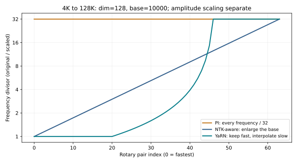

YaRN 还做了温度修正，用来抵消上下文变长后 softmax 分布变平的效应：$q$ 和 $k$ 各乘 $\sqrt{1/t}=0.1\ln s+1$（$s=32$ 时约 1.35），注意力 logit 因此乘 $1/t\approx1.81$。DeepSeek-V3 与 Kimi K2 的配置把 `mscale` 和 `mscale_all_dim` 都设为 1，此时 RoPE 部分的因子是 1，修正改为折算到 MLA 的 softmax 缩放里（transformers 的实现把 softmax 缩放乘以 mscale 的平方）；gpt-oss 则把 1.35 直接乘在 $q$、$k$ 的旋转上。读配置文件时要分清这两种约定，`yarn_attention_factor` 实现了两者。

**这些配置在真实模型里长什么样。** DeepSeek-V3：`factor 40`、`original_max_position_embeddings 4096`，对应最长 163,840 token；Kimi K2：`factor 32`，131,072 token；gpt-oss：`factor 32`、`rope_theta 150000`，131,072 token。DeepSeek-V3 和 gpt-oss 用默认的 $\beta_{fast}=32$、$\beta_{slow}=1$；Kimi K2 的固定版本配置却把两者都设为 1（`rope_theta 50000`、$d_{rope}=64$），斜坡两端几乎重合（第 19–20 对之间）：索引 0–19 的 20 对频率不变，索引 20–31 的 12 对除以 32，基本没有过渡段。"三段式"只是默认参数下的样子，读配置时要看 $\beta$ 的实际取值。DeepSeek-V3 与 Kimi K2 的报告写明在 4K 上下文上完成主体预训练，再用 YaRN 扩展并继续训练；gpt-oss 的模型卡写明用 YaRN 把全注意力层扩展到 131,072，预训练长度没有说明，配置中的原始长度为 4,096。

## 30.3 注意力汇点：为什么第一个 token 那么"重要"

StreamingLLM 的观察是：只保留最近 $w$ 个 token 的滑动窗口缓存，一旦文本长度超过缓存，困惑度会突然飙升；但只要额外保留最开头的几个 token，性能就基本恢复。原因是 softmax 的权重总和必须为 1。当一个注意力头在当前位置"无事可做"时，它仍然要把权重分给某些 token，训练中模型学会了把这部分多余的权重堆到序列开头（开头的 token 对所有后续位置都可见）。这些 token 本身语义上不重要，却起到"垃圾桶"作用。扔掉它们，原本流向那里的权重被迫分给其他 token，注意力分布就乱了。

两个工程结论：

1. **流式缓存策略。** 保留前 4 个 token 加最近的窗口，缓存大小固定。100K token 的流式输入，用 4 + 1,024 的策略保留 1,028 个位置（`streaming_kv_positions`）。论文在其测试配置下观察到更稳定的长流生成；被移除位置已不能直接检索，但部分信息可能被后续隐藏状态间接保留，这不提供无限记忆。该函数只返回保留位置，真正实现还需按算法处理 RoPE 与 cache 坐标，不能把索引筛选当作完整流式模型。
2. **把汇点做进架构。** gpt-oss 给每个头一个可学习的 logit $s_h$，参与 softmax 归一化后丢弃：

$$p_{ij}=\frac{e^{S_{ij}}}{e^{s_h}+\sum_{j'}e^{S_{ij'}}}.$$

当 $s_h$ 很大时，真实 token 上的总权重 $\sum_jp_{ij}$ 可以接近 0，这个头的输出接近零向量；当 $s_h\to-\infty$ 时退化为普通注意力。`sink_attention` 实现了这个公式：sink logit 为 8 时，demo 中真实 token 上的平均权重只剩 0.15%。这与"off-by-one softmax"的思路相同，让"什么都不关注"成为一个显式的选项。

它等价于对普通注意力输出加一个依赖 query 的标量门。令 $L_i=\operatorname{LSE}_j(S_{ij})$、普通输出为 $o_i$，则 $\alpha_i=\sigma(L_i-s_h)$、$o_i^{sink}=\alpha_io_i$。因此 sink 的绝对数值不是关闭程度，关键是它与真实 key 总指数质量的比较。固定分数下增加可见 key 会增大该质量，value 与输出投影的尺度也影响最后写回；这正是“sink 很大”不足以直接决定剪枝的原因。

## 30.4 用架构而不是位置编码解决长上下文

位置缩放处理频率/相位范围的外推风险，没有解决全注意力的两个成本：计算随 $T^2$ 增长，KV 随 $T$ 线性增长。第 29 章的模型展示了其中三种架构上的应对，表的最后一行是另一条路线：

局部窗口的感受野需要按层数分析。若每层只能看自己和前面 $w-1$ 个位置，且没有其他跨位置路径，L 层后最远可间接依赖 $L(w-1)$ 个位置以前的输入，序列起点还会截短这个范围。它说明局部层并非完全不能传远距离信息，也说明固定深度的纯窗口网络不能直接检索任意远的 token。中间层压缩与训练是否学会保留信息，是额外的能力条件。

| 做法 | 例子 | KV 随上下文的增长 | 代价 |
|---|---|---|---|
| 局部/全局交替 | gpt-oss（1:1，窗口 128）、Gemma 3（5:1，窗口 1,024） | 只有全局层线性增长 | 局部层可逐层间接传递；全局层提供直接远距访问 |
| 线性注意力混合 | Qwen3-Next（3:1 Gated DeltaNet）、MiniMax-M1（7:1） | 只有 softmax 层线性增长 | 线性层的固定状态会混合、遗忘细节 |
| 压缩缓存 | DeepSeek-V3、Kimi K2（MLA） | 每层 576 个数，线性增长但斜率小 | 计算更复杂，RoPE 需单独处理 |
| 稀疏注意力 | DeepSeek Sparse Attention、NSA | 仍需存全部 KV，但只读取一部分 | 依赖选择机制的召回率（DSA 用轻量索引器，NSA 用压缩注意力分支的分数） |
| 低精度 KV | FP8 KV cache（vLLM、TensorRT-LLM 等推理引擎的常见选项） | 斜率减半（BF16→FP8），仍线性增长 | 需要逐张量或逐头缩放；注意力分数对 K 的误差敏感，要在长上下文任务上验证 |

前三行改变主缓存的形态或数量；稀疏注意力主要改变每个 query 访问的位置，还可能增加索引状态。最后一行改变的是"每个数几位"，它可以与其他设计叠加：MLA 的 576 个数存成 FP8 时，每 token 的 KV 再减半。位置编码本身也可以只作用于部分维度或部分层：GLM-4.5 与 Qwen3-Next 的 partial RoPE（第 29.4 节）、SmolLM3 每 4 层一层 NoPE（第 29.2 节），都保留一部分不随位置旋转的通道。这类设计常被认为有助于长度泛化，但公开报告里缺少与纯 RoPE 的受控对比，应当当作待验证的选择而不是结论。

**Llama 4 的 iRoPE：把 NoPE 层与分块注意力配对。** Meta 称之为 iRoPE（interleaved RoPE），并把它用于 Scout 的长上下文。由于模型权重需要授权才能下载，这里以 Hugging Face transformers 的公开实现为准。默认每 4 层中有 1 层是 NoPE 层（`no_rope_layer_interval` 为 4），其余 3 层用 RoPE。两类层的注意力范围也不同：RoPE 层是**分块注意力**，只在 `attention_chunk_size`（默认 8,192）个 token 的块内计算；NoPE 层是全因果注意力，能看到整段上下文。这种配对限制了 RoPE 层内可见的相对距离。若训练已覆盖同样的块长，且旋转保持正交、不另加位置相关的非线性，RoPE 点积只依赖块内相对位移；跨块的直接注意力由 NoPE 层承担，顺序信息可由因果 mask 和上游层间接提供。但绝对位置的数值误差、上游表示和任务分布仍可能变化，不能据此保证完整模型没有长度外推风险。分块层的 KV 也只需保留当前块，长上下文下与 gpt-oss 的带状窗口层一样封顶。

NoPE 层还要处理 30.2 节提到的"上下文变长、softmax 变平"：实现里只对 NoPE 层的 query 乘一个随位置增长的温度因子，$q\leftarrow q\cdot\big(1+0.1\ln(1+\lfloor (t+1)/8192\rfloor)\big)$，$t$ 为位置。按从 0 开始的 t 计，t=0 至 8190 时因子为 1；t=8191（第 8192 个 token）才变成约 1.0693。到第 131072 个 token 约为 1.2833，第 1048576 个 token 约为 1.4860。注释注明其思路来自 Scalable-Softmax：让 softmax 的锐度随候选数量对数增长，抵消分布随长度摊平。这与 YaRN 的温度修正（30.2 节）方向相同，但 YaRN 按扩展倍数整体乘一个常数，这里按每个 query 的实际位置逐级增大。[transformers v4.57.0 的 Llama 4 实现](https://github.com/huggingface/transformers/blob/v4.57.0/src/transformers/models/llama4/modeling_llama4.py)、[Scalable-Softmax](https://arxiv.org/abs/2501.19399)

这里能核对的是结构与公式；Meta 宣称的 Scout 千万 token 上下文是否在各类任务上都可用，需要按 30.5 节的方法单独评估，本书没有复现。

在 32K 上下文下，第 29 章的 Qwen3-Next 与 gpt-oss-20b 每请求 KV 都只有 0.75 GiB，而同样激活参数量级的 Qwen3-30B-A3B 是 3.0 GiB。这一列决定了重要的历史状态容量；推理成本还包括权重、固定递归状态、KV 读取、计算与调度，不能只由一个 KV 数字决定。

## 30.5 怎样训练和评估长上下文能力

**训练。** 典型流程是先在 4K–8K 上完成大部分预训练，再用长文档继续训练数十亿到数千亿 token（DeepSeek-V3 约 1,260 亿，Qwen3 是数千亿），同时调整 RoPE（YaRN 或增大 base）。ProLong 的系统实验给出几条可操作的结论：代码仓库和书籍是好的长数据来源，但必须与高质量短数据混合，否则短上下文能力下降；训练序列长度超过评估长度有帮助；SFT 阶段只用短指令数据也能得到很好的长上下文表现。ProLong-8B 只用 40B token 的长上下文训练，就在 128K 的多数长上下文任务上超过了 Llama-3.1-8B-Instruct。packing 时文档边界的注意力 mask（第 4.6 节）在长序列训练中尤其重要。

**评估。** 困惑度和"大海捞针"（在长文本里找一句插入的话）都不足以说明问题：困惑度主要由局部预测决定，捞针只测单点检索。应该同时看：

- 多针检索与多跳聚合：需要同时用到分散在不同位置的几条信息；
- 证据位置敏感性：同一证据放在开头、中间、结尾时的表现差异（第 24.6 节的 Lost in the Middle）；
- 真实长任务：长文档问答、代码仓库级理解、长对话中的指代；
- 短上下文回归：扩展之后，原来的短任务分数不能明显下降。

## 30.6 2025 年末：混合路线继续探索，全注意力仍在使用

Kimi Linear 的核心是 Kimi Delta Attention（KDA），以更细粒度门控管理有限递归状态，配合适合硬件的 chunk-wise 算法；模型交替使用 KDA 与全局 MLA，比例为 3:1。它不能被简化成“$QK^\top V$ 改结合顺序”或“不再有 KV”。报告比较了匹配训练设置下的质量与成本；减少的长期 KV 主要来自线性层，MLA 层和递归状态仍需存储。[Kimi Linear](https://arxiv.org/abs/2510.26692)

另一方面，MiniMax-M2 的公开模型实现为逐层全因果注意力，使用独立 Q/K/V/O 投影和 GQA，而 MiniMax-M1 是 Lightning Attention 混合架构。M2 的选择说明同一团队不同模型会采用不同取舍，不证明 M1 路线失败或线性注意力失去价值。[MiniMax-M2 官方源码](https://huggingface.co/MiniMaxAI/MiniMax-M2/blob/04312f0cfbdeefb912575595b7c045512a29293c/modeling_minimax_m2.py)

应比较固定预算下的语言建模、关联检索、长输入推理、长输出 RL、缓存容量和 decode 吞吐；短上下文平均分并不足以决定架构。混合比例、共享专家、训练数据与 kernel 常一起变化，跨模型排行榜不是受控架构消融。当前仍有全注意力、稀疏注意力、线性/SSM 混合多条路线，本节不给其中一种冠以普遍最优。

## 30.7 长上下文能力应按任务绘成曲面

上下文长度只是一个轴，另有证据位置、相关事实数、干扰强度、输出长度和总推理预算。RULER 将单针之外的多种合成检索/聚合任务纳入评估，展示标称上下文长度与任务上的有效长度可能不同；它仍是合成测试，需加真实文档和代码任务。[RULER](https://arxiv.org/html/2404.06654v1)

可在固定总长度下移动证据，在固定证据下增加干扰，再分别测单事实、多事实组合与引用支撑。保持问题和答案不变而只换位置时，需避免 padding/模板变化引入额外线索。长输入检索通过不保证长输出推理可靠，短任务回退也要单列。

训练长序列时还需看真正的长依赖曝光：把大量短文档 packing 成 128K，若用文档隔离 mask，模型看到的有效注意力跨度仍可能很短；若不隔离，又可能主要学习无关文档拼接。应记录文档长度、有效 attention span、重复率及跨文档监督目标。[ProLong 的数据和训练对照](https://arxiv.org/html/2410.02660v1)

## 练习

**1．** 一个模型在 $\theta=5\times10^5$、$d_h=128$、4K 上下文下预训练。它的 64 对旋转中，有几对的波长超过 4K、几对超过 32K？直接用到 32K 时，哪些维度会遇到训练中没见过的相位？

**解答。** 32 对超过 4K，其中 22 对超过 32K（`rotation_wavelengths(128, 5e5)`）。前者在训练长度内相位跨度不足一圈，扩长后会走出原先的短区间；其中 22 对即使在 32K 内也转不满一圈。波长短于 4K 的其余 32 对只是在离散位置上跨过周期范围，不能保证新相位或联合频率/距离模式已被训练覆盖。YaRN 的 $\beta_{slow}=1$ 对应“原上下文内转不满一圈”的连续边界，实际是否完整插值还按端点取整规则计算。

**2．** YaRN 的 $s=32$。为什么不直接对所有维度做 PI，而要保留快维度不变？

**解答。** 快维度编码的是相邻几个 token 的相对位置。PI 把它们也压缩 32 倍，相邻 token 的相位差变成原来的 1/32，可能使模型更难区分“前一个词”和“前两个词”，对局部语法与精确复制有风险。快维度在原上下文内已经转了很多圈，单频相位覆盖较充分；保留它们是兼顾局部结构的工程选择，不保证长距离行为完全无外推风险。

**3．** 一个注意力头在某层的 sink logit 学到很大的值。这对该层的输出意味着什么？能否据此剪掉这个头？

**解答。** 对大部分 query，这个头分给真实 token 的总权重很小，输出接近零向量，等于"这个头在这里不工作"。但 sink 的权重是相对于当前 scores 的，遇到特别匹配的 key 时 $e^{S_{ij}}$ 仍可能压过 $e^{s_h}$。是否能剪掉要做消融，不能只看 sink 值。

**4．** 流式缓存保留 4 个汇点加 1,024 个最近 token。用户在第 500 轮对话里问"我们一开始讨论的那个数字是多少"，模型能回答吗？

**解答。** 一般不能。最开头的 4 个 token 只是注意力的"垃圾桶"，通常不包含那个数字；最近 1,024 个 token 之前的内容（除了开头 4 个汇点）都已被丢弃。保留汇点在论文测试设置下有助于稳定流式生成，但不提供任意早期内容的长期记忆保证。需要长期记忆时要用检索（第 24 章）、摘要或真正的长上下文模型。


---

# 31｜推理模型的强化学习：从 GRPO 到 DAPO、CISPO 与熵

第 18 章推导了 GRPO 族的估计量，并在小模型上跑通了完整循环。2025 年社区在大模型 RLVR 上积累了大量经验，本章整理其中有公开细节、能用公式说清楚的部分：DeepSeek-R1 的训练流程、DAPO 的四项改动、CISPO 对裁剪的重新设计、熵坍缩的机制，以及"RL 到底有没有教会模型新东西"的争论。配套代码 [rl_objectives.py](../examples/rl_objectives.py) 与第 18 章的 `posttrain.py` 使用同一套张量约定，可以直接对比梯度。


## 31.1 DeepSeek-R1：两个模型、一条流水线

R1 论文实际上报告了两件事。**R1-Zero** 直接在 DeepSeek-V3-Base 上用 GRPO 做 RL，没有任何 SFT：奖励只有答案正确性和格式，回答长度与推理能力随训练一起增长，论文展示了模型在中途学会"重新思考"的"aha moment"样例。论文附录给出的超参数：每步 32 道不同的题，每题采样 16 个回答，温度 1，KL 系数 0.001；最大长度在第 8.2K 步之前为 32,768 token，之后改为 65,536，性能与回答长度在那一步都出现明显跳升，共训练 10,400 步。

R1-Zero 的问题是可读性差、中英文混杂。**R1** 因此加了四个阶段：先用数千条"像人一样思考"的冷启动数据做 SFT；再做推理 RL，加入语言一致性奖励；然后用拒绝采样收集约 60 万条推理样本（每题采样多个回答、只保留正确的，并过滤掉语言混杂、段落过长和含代码块的思维链），与非推理数据合并后重新 SFT；最后做覆盖所有场景的 RL。蒸馏出的小模型（基于 Qwen 和 Llama）只做 SFT、不做 RL，就得到很强的推理能力。

这条流水线回答了第 18.13 节的问题：冷启动 SFT 换来可读性和更快的早期学习，代价是可能缩窄探索；蒸馏提供了把大模型 RL 成果迁移到小模型的路径，成本需要计入教师生成与学生训练。

## 31.2 DAPO：让 GRPO 在长思维链上稳定

DAPO 论文从一个复现问题出发：在 Qwen2.5-32B 上直接跑 GRPO，AIME 2024 只有 30 分，低于 DeepSeek 报告的 47 分。分析发现基线存在熵坍缩、奖励噪声和训练不稳定。DAPO 的改动使其达到 50 分，并且只用 DeepSeek-R1-Zero-Qwen-32B 一半的训练步数。论文表 1 按顺序逐项叠加，给出每一步的 AIME 2024 分数（32 次采样平均）：

| 配置 | AIME 2024 |
|---|---:|
| 朴素 GRPO | 30 |
| + 超长过滤（截断样本不计损失） | 36 |
| + 解耦裁剪 | 38 |
| + 超长奖励塑形 | 41 |
| + token 级损失 | 42 |
| + 动态采样（即 DAPO） | 50 |

这是按一种固定顺序做的累积消融，每项的增益依赖叠加顺序。AIME 2024 只有 30 道题，论文的 avg@32 对每题采样 32 次，减少的是生成噪声，不会把它变成 960 道独立题。若向新题目分布外推，标准误还取决于题目成功率之间的方差；$\sqrt{0.42\times0.58/30}\approx9$ 个百分点只是用观测均值代入二项式上界公式的量级参考，不能保证每次都保守，也不能当作实测 avg@32 的标准误（第 15.5 节）。41→42 与 30→50 都应结合逐题配对结果、多次训练及消融顺序解释，不能只凭跨度较大就宣布因果贡献或显著性。论文也说明，token 级损失带来的分数提升不大，主要作用是让训练更稳定、长度增长更健康。下面分别说明主要的几项。

**1．解耦裁剪（Clip-Higher）。** PPO 的裁剪 $\mathrm{clip}(r,1-\epsilon,1+\epsilon)$ 对上下界一视同仁。论文的例子：一个当前概率 $\pi_{old}=0.01$ 的 token，即使优势为正，在 $\epsilon=0.2$ 下，0.012 是这个正优势样本的 surrogate 进入平坦区的边界；而概率 0.9 的 token 的上限是 1.08，实际上不受约束。这种阈值限制低概率正优势样本继续提高 surrogate 的空间，是论文解释探索受限的一种机制；坍缩还取决于其他样本与完整更新。DAPO 把上界单独放宽：

$$\mathcal J=\mathbb E\Big[\frac{1}{\sum_i|o_i|}\sum_i\sum_t\min\big(r_{i,t}\hat A_i,\ \mathrm{clip}(r_{i,t},1-\epsilon_{low},1+\epsilon_{high})\hat A_i\big)\Big],$$

论文取 $\epsilon_{low}=0.2$、$\epsilon_{high}=0.28$。下界保持不变是论文的配方选择；放宽它允许负优势样本的 surrogate 在更低概率处才进入平坦区，可能减少多样性，但并不等于必然把概率压到零。`clipped_token_fraction` 可以直接看出效果：demo 中一个比率为 1.25 的正优势 token，在对称裁剪下被截断（梯度为 0），在 $\epsilon_{high}=0.28$ 下仍有梯度，被截断 token 的比例从 33% 降到 25%。

**2．动态采样。** 一组回答全对或全错时，组内优势全为 0（第 18.2 节），这组样本不提供奖励优势项的梯度，却占了 batch。DAPO 持续采样，丢掉这类组，直到 batch 被有效组填满，约束写成 $0<|\{o_i:\text{正确}\}|<G$。代价是需要额外的生成；`dynamic_sampling_mask` 返回应保留的组。

若二值奖励下题目 x 的成功率为 $p_x$，独立 G 次采样成为混合组的概率为 $a_x=1-p_x^G-(1-p_x)^G$。持续从原提示分布 q 抽题并只保留混合组时，入选提示分布满足 $q_{keep}(x)\propto q(x)a_x$，更偏向中等成功率的题。批内信号密度提高，不代表所有难题都得到更多训练；实际还需计入为凑满 batch 丢掉的组和总 rollout 成本。

**3．token 级损失聚合。** GRPO 先在每条回答内平均、再在回答间平均，长回答中每个 token 的权重被稀释。在长思维链里，这意味着冗长、重复的错误回答受到的惩罚反而更轻。DAPO 改为对 batch 内所有有效 token 直接平均（上式的 $1/\sum_i|o_i|$），每个 token 权重相同。这与第 18.5 节讨论的 Dr. GRPO"固定分母"是同一个方向的不同选择；测试 `test_token_level_aggregation_weights_long_sequences_more` 验证了长度不同的两条回答中每个 token 得到相同梯度。

**4．超长奖励塑形。** 超过最大长度被截断的回答，答案往往不完整，直接给 $-1$ 会把"推理正确但写得长"的样本也惩罚掉，形成噪声。DAPO 在最大长度 $L_{max}$ 之前设一个长度为 $L_{cache}$ 的缓冲区，在其中线性加罚：

$$R_{len}(y)=\begin{cases}0,&|y|\le L_{max}-L_{cache}\\[2pt]\dfrac{(L_{max}-L_{cache})-|y|}{L_{cache}},&L_{max}-L_{cache}<|y|\le L_{max}\\[4pt]-1,&|y|>L_{max}\end{cases}$$

这一项加在正确性奖励之上。DAPO 的最大生成长度为 20,480 token，缓冲区 4,096。

DAPO 的配方去掉了 KL 惩罚，论文报告在其设置下更有效；长思维链本身不意味着 KL 一定有害，其他长时间 RL 配方仍可能使用 KL 控制（第 31.5 节）。

PPO 裁剪限制的是某个样本继续改善 surrogate 的收益，不会将参数投影到概率区间。其他样本、共享参数、动量与有限学习率仍可使概率越过边界。因此 0.012/0.0128 是平坦区的阈值，不是一次更新的最大概率；配套测试构造了共享参数的一步更新越界反例。

## 31.3 CISPO：裁剪权重而不是裁剪更新

PPO 式裁剪的一个副作用是：被裁剪的 token 梯度恰好为 0。MiniMax-M1 的报告指出，这些往往是"However""Recheck""Wait""Aha"之类标志反思的低概率 token，正是推理路径的分叉点；它们在部分离策略更新中比率超过正优势分支的上界，该样本当时的裁剪项便不给梯度；若后续共享参数更新使比率回到区间，梯度可以恢复，并非永久冻结这些 token。报告还说明，DAPO 放宽上界的做法在他们每批生成做 16 轮离策略更新的设定下效果有限。CISPO 换了一种写法：

$$\mathcal J_{CISPO}=\mathbb E\Big[\frac{1}{\sum_i|o_i|}\sum_i\sum_t\mathrm{sg}\big(\hat r_{i,t}\big)\,\hat A_i\,\log\pi_\theta(o_{i,t}\mid q,o_{i,<t})\Big],\quad \hat r_{i,t}=\mathrm{clip}(r_{i,t},1-\epsilon^{IS}_{low},1+\epsilon^{IS}_{high}),$$

其中 $\mathrm{sg}$ 是停止梯度。重要性权重被截断以控制方差，但它只作为一个常数系数乘在 REINFORCE 项前，因此不会仅因比率超过上界而把该项梯度置零；advantage 为零、权重下溢或 mask 无效时仍可没有贡献。论文实际上不设下界，只调上界。`cispo_loss` 的测试构造了一个比率为 $e\approx2.72$、优势为正的 token：PPO 与 DAPO 的梯度都是 0，CISPO 的梯度是 $-\mathrm{clip}(e,\cdot,1.5)=-1.5$。

MiniMax-M1 报告在 Qwen2.5-32B 的受控对比中，CISPO 达到同样性能所需步数约为 DAPO 的一半。同一份报告还记录了一个很有工程价值的坑：训练引擎与推理引擎对同一 token 算出的概率不一致，相关系数只有约 0.9，奖励因此不增长；逐层排查发现来源是输出头的高幅值激活，把输出头改为 FP32 后相关系数升到 0.99，训练才恢复正常。报告特别说明，这个问题在较小的、使用 softmax 注意力的 dense 模型上没有出现，所以它不是所有 RL 训练都会遇到的坑，而是规模、架构和推理引擎共同作用的结果。这呼应第 18.9 节："old logp 必须对应真实采样策略"。

## 31.4 熵坍缩：机制与对策

该熵机制论文研究的多组 RLVR 设置出现了一个共同现象：策略熵在训练早期急剧下降，性能随后饱和。熵机制论文把这一现象量化为经验关系 $R=-a\,e^{H}+b$：在该研究的实验区间内，性能与熵下降相关；拟合关系不规定其他任务或训练配方的性能上限。

它给出的机制是：在 softmax 策略下，一步策略梯度后熵的变化由"动作的对数概率"与"该动作 logit 的变化"之间的协方差决定（下面的公式）；在自然策略梯度下，logit 的变化与优势成正比，普通 softmax 策略梯度则是 $\delta z_v\propto p_v A_v$，协方差的权重随之不同。这种协方差提供了经验解释，但“高概率”或“低概率”不是充分的符号判据。即使只增大一个独立 logit，其对熵的导数也是 $-p_v(\log p_v+H)$：阈值为 $p_v=e^{-H}$，取决于完整分布；真实参数更新同时改变多个 logits，必须把所有贡献相加。论文所测训练中该协方差常为正，观察到的是相应设置下的熵下降。对策是限制高协方差 token 的更新：Clip-Cov 对它们截断梯度，KL-Cov 对它们加 KL 惩罚。DAPO 的 Clip-Higher 从另一个角度达到类似效果：它放宽部分正优势样本的更新空间，但这些更新是否提高整体熵仍取决于完整分布与共享参数。

监控上，第 18.15 节的完整词表熵是必备日志。熵快速降到很低而验证集准确率还在上升时，可以继续；两者同时停滞时，需检查探索、奖励覆盖、数据难度、截断与优化；日志本身不能证明所有可用探索已经耗尽。[熵机制原论文](https://arxiv.org/abs/2505.22617)

固定前缀、有限 softmax 分布 p，微小 logit 改变 $\delta z$ 给出精确一阶关系：

$$\delta H=-\sum_vp_v(\log p_v+H)\delta z_v=-\operatorname{Cov}_{v\sim p}(\log p_v,\delta z_v).$$

这是对任意 logit 扰动的局部微分，不等于所有共享参数更新都使 logit 与 advantage 简单成正比。配套代码对照 autograd 和小步有限变化；实际熵方向仍取决于完整扰动，不能只按某个被采 token 的概率标签判断。

## 31.5 RL 到底教会了模型什么

这是 2025 年争论最多的问题，三篇论文给出了看似矛盾的结论：

- **"没有超出基础模型。"** Yue 等人用很大的 $k$ 测 pass@k：RLVR 模型在 $k=1$ 时明显更好，但在 $k$ 很大时，基础模型的 pass@k 反而更高。覆盖率与困惑度分析显示，RL 模型能解出的题基本都在基础模型的采样分布之内。他们的解读是：当前的 RLVR 主要提高了采样效率，把基础模型已有但概率较低的正确路径变得更可能，而没有引入新的推理模式；相反，蒸馏可以从教师引入新模式。
- **"延长训练可以扩展边界。"** ProRL 用 KL 控制、周期性重置参考策略和多样任务做长时间 RL，报告在一些基础模型于有限采样预算内未答对的任务上，RL 模型也能做对，且边界的扩展与训练时长和基础模型在该任务上的能力强相关。
- **"答案对不等于推理对。"** 另一项工作指出，大 $k$ 下的 pass@k 会把"蒙对答案"算作成功。他们提出 CoT-Pass@K，要求推理过程也正确；该研究在这个指标下观察到 RLVR 扩展推理覆盖；有限采样仍不能证明基础模型原本的成功概率为零。

这些结论并不完全冲突：它们的差别在于训练时长、任务类型和"成功"的定义。对读者有用的结论是方法论层面的：

1. 只报告 pass@1 不够，要同时画 pass@k 随 $k$ 的曲线，并与基础模型对比；
2. $k$ 很大时要检查成功样本的推理过程，排除猜中答案；
3. 区分"让已有能力更可靠"（对部署很有价值）和"获得新能力"（研究问题），不要混为一谈。

第 18.16 节的小模型实验里，训练题准确率大幅上升而留出题只有小幅提升，是同一问题在玩具规模上的影子。

## 31.6 一张 2025 年 RL 算法对照表

| 方法 | advantage | 比率与裁剪 | 损失聚合 | 其他 |
|---|---|---|---|---|
| GRPO（DeepSeekMath 写法） | 组内标准化 | token 级，对称裁剪 | 先序列内平均再平均 | 小 KL 惩罚 |
| Dr. GRPO | 组内中心化，不除标准差 | token 级，对称裁剪 | 固定常数分母 | 去掉长度偏置 |
| DAPO | 组内标准化 | token 级，$\epsilon_{low}=0.2$、$\epsilon_{high}=0.28$ | 全 batch token 平均 | 动态采样、超长塑形、无 KL |
| GSPO | 组内标准化 | 序列级几何平均比率 | 序列级 | 第 18.8 节 |
| CISPO | 组内标准化 | 裁剪权重并停止梯度，不因超过上界而屏蔽该项梯度 | 全 batch token 平均 | 只设上界；M1 同时用 DAPO 的动态采样与长度惩罚，无 KL |

R1 论文把比率写成整条回答的概率比 $\pi_\theta(o_i\mid q)/\pi_{old}(o_i\mid q)$，第一阶段 RL 的裁剪系数 $\epsilon$ 取 10，几乎不起裁剪作用；论文也指出裁剪系数太小会截断大量 token 的梯度，太大则训练不稳定。表中第一行按 DeepSeekMath 的 token 级写法列出，便于与其他方法对照。

## 31.7 训练—推理不一致：三种来源不能混为一谈

令实际生成引擎概率为 $\mu_{old}$，训练引擎对相同旧权重算出的概率为 $\pi_{old}$，更新后概率为 $\pi_\theta$。同一 token、同一前缀下有

$$\log\frac{\pi_\theta}{\mu_{old}}=\log\frac{\pi_\theta}{\pi_{old}}+\log\frac{\pi_{old}}{\mu_{old}}.$$

第一项是更新/数据复用产生的 policy lag，第二项是相同权重下的引擎差异。另有一类支持变化：top-p/top-k、停止规则或 tokenizer 不一致，会让两侧根本不在同一事件空间。MoE 路由不同还会改变实际参与计算的子模型。把所有偏离都叫“离策略”会掩盖修复位置。

诊断首先禁止更新，在同一权重版本 replay 实际 rollout。按层、长度、batch、TP 大小、dtype 和专家路由检查 logits 与选中 token logps；记录 log-ratio 中位数、p95/p99、最大值及路由一致率，不能只报告高度相关的整体概率。之后再允许参数更新，测 lag 的增长和 clip fraction。把 dtype 改得更精细可能降低数值差异，却不能修复版本错位和不同采样支持。

### ScaleRL：输出 logits 的 FP32 修复

ScaleRL 对 RL compute–performance 曲线做系统实验，配方包括异步采样、CISPO、损失/advantage 聚合选择与 FP32 logits 等措施。其精度案例定位到 generator/trainer 不同 kernel 在输出头产生概率差异，并对两侧输出头使用 FP32 计算。把已有 BF16 logits **事后** `.float()` 无法恢复矩阵乘已丢掉的信息。[The Art of Scaling Reinforcement Learning Compute for LLMs，§4](https://arxiv.org/html/2510.13786v1)

这里支持的结论是“输出头精度可显著影响该实验的稳定性与性能”，不是“ScaleRL 必须全模型 FP16”或“其聚合方式普遍最优”。论文的训练规模、模型和任务是条件，迁移时需消融。

### DeepSeek-V3.2：四个分开核对的策略

报告第 3.1 节说明了四类稳定措施：

| 措施 | 直接处理的问题 | 需要保留的条件 |
|---|---|---|
| 重要性加权的 $k_3$ KL | old 样本下的 KL 值与路径梯度偏差 | 概率支持一致；分子当前概率可求导 |
| off-policy sequence masking | 负优势且旧/新差异较大的序列带来不稳定更新 | 是实用有偏筛选；记录剔除率和难度变化 |
| Keep Routing | 生成与训练时相同输入被路由到不同专家 | 保存/复用生成路径；明确训练所优化的路由条件 |
| Keep Sampling Mask | 截断采样导致两策略支持不同 | 复用截断支持并正确重归一化；不是普通 padding mask |

固定前缀、从 old 策略 o 采样，当前策略 p、参考 q 都在相同支持上时，可写

$$\widehat K=\frac{p(a)}{o(a)}\left[\frac{q(a)}{p(a)}-\log\frac{q(a)}{p(a)}-1\right].$$

对固定 old 分布求期望，$\mathbb E_o\widehat K=KL(p\Vert q)$；对整个乘积求导，其期望也可对应这个**固定前缀条件 KL**的梯度。如果把外面的 p/o detach，路径梯度的结论会改变；如果前缀仍来自旧策略，也不能据此说整条序列的当前状态分布已完整校正。第 17.7 节的“数值无偏与梯度无偏不同”在这里仍然适用。教学枚举测试对照值与梯度，不提供完整工业训练配方。[DeepSeek-V3.2，§3.1](https://arxiv.org/html/2512.02556v1)

### FP16：更细尾数的代价

2025 年 10 月的另一篇研究通过训练和推理两侧统一 FP16，在其多个模型、算法和框架设置中显著减轻不一致。FP16 比 BF16 多 3 位尾数，但指数范围窄，需检查激活/梯度溢出、下溢、loss scaling 和跳步；不是所有模型都能直接整体 `.half()`。[Defeating the Training-Inference Mismatch via FP16](https://arxiv.org/abs/2510.26788v1)

### 直接校正第二项：截断重要性权重

上面的措施都在缩小 $\pi_{old}/\mu_{old}$ 的偏离。另一条常用做法是承认它存在、直接在损失里校正：每个 token 乘上 $w=\min\big(\pi_{old}/\mu_{old},\,C\big)$（$C$ 为截断上限，常取个位数），再计算原来的裁剪目标；变体把超出区间的 token 直接 mask 掉，而不是截断权重。截断限制了方差，代价是对偏离大的 token 引入偏差，这与第 18.19 节"完整重要性权重为何迅速失效"是同一个取舍。实现时 $\mu_{old}$ 必须是生成引擎在采样时记录下的 log-prob，不能事后用训练引擎重算。监控被截断或被 mask 的 token 比例：比例持续上升说明引擎差异在变大，应回到上面的逐层诊断，而不是调高 $C$。

本书没有在真实双引擎大模型上复现这一结论；`numerical_tools.py` 只提供 log-ratio 诊断和精确分布校正的受控检查。ScaleRL、DeepSeek-V3.2 和 FP16 是不同论文的不同措施，应在相同基线下逐项比较。

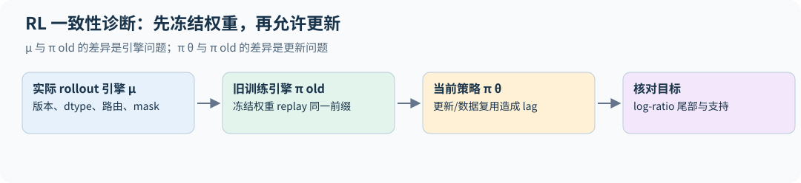

## 31.8 异步 RL 的版本、支持与梯度边界

概率差异诊断也应先统一精度，再相减。真实 log-prob 都不大于 0，两个有限 FP16 log-prob 之差的绝对值不超过 65504，本身不会溢出；要先转 FP64 的理由是：训练端（常为 FP32）与推理端（常为 BF16）的输入 dtype 不同，必须在同一精度下比较；跨大量 token 求均值、分位数时低精度会累积误差，而且 `torch.quantile` 根本不接受 FP16 输入。应先选出二值 mask 中的有效位置，转到 FP64 后再算差值、分位数和最大值。padding 的 NaN 不应参与统计，非二值 mask 也不应被默默当作布尔值。

一次 rollout 应绑定采样权重版本、生成引擎配置、prompt/response token、停止/截断原因，以及**实际采样分布**的 logps。训练前用同版本 replay 检查引擎差异，再与当前参数比较 policy lag。只保存“这是第 100 步样本”不够：不同 worker 可能拿到不同权重，长轨迹生成期间也可能跨更新。

通常一条轨迹应使用一致策略版本；若故意在轨迹中更新，概率记录必须逐动作对应实际版本。top-p 改变支持时，不能从未截断 logits 重建不存在的采样事件。缓存/路由同步也属于概率定义的一部分；第 31.7 节的措施分别处理这些不同问题。

当复用次数增加，监控各版本年龄的成功率、log-ratio 分位数、clip fraction、ESS 和被剔除比例。固定前缀 token KL 或几何平均比率不会自动校正旧前缀状态分布；“数值稳定”与“目标无偏”是不同结论。[GSPO 的序列 surrogate](https://arxiv.org/html/2507.18071v1)

一个正确的 stop-gradient 模式是把旧概率和 advantage 固定，让当前 logps 可导；CISPO 还固定经过裁剪的权重。不同算法 detach 的位置不同，须对照所写目标做小分布梯度验证，不能按变量名字猜。按 prompt 条件过滤 rollout、按随机 token 总数归一化时，还需记录改变后的样本分布。[DAPO](https://arxiv.org/html/2503.14476v1)

## 练习

**1．** 某 token 的 $\pi_{old}=0.02$，优势为正。在 $\epsilon=0.2$ 的对称裁剪与 $\epsilon_{high}=0.28$ 的解耦裁剪下，该样本的正优势 surrogate 在概率多大时进入平坦区？对一个 $\pi_{old}=0.8$ 的 token 呢？

**解答。** 低概率 token：0.024 对 0.0256；高概率 token：0.96 对 1.024（概率不能超过 1，实际上不受限）。裁剪是乘性的，低概率 token 到达平坦区的绝对概率差较小；放宽上界改变该项继续提供收益的范围，真实更新还由全部样本共同决定。

**2．** 一个 batch 有两条回答：A 长 100 token、优势 +1；B 长 1,000 token、优势 −1。比较 GRPO 的序列平均与 DAPO 的 token 平均下，B 中每个 token 受到的惩罚权重。

**解答。** 序列平均：每条回答权重 1/2，B 中每个 token 的权重为 $\frac12\cdot\frac1{1000}=5\times10^{-4}$，A 中为 $5\times10^{-3}$。token 平均：每个 token 都是 $1/1100\approx9.1\times10^{-4}$。序列平均下，冗长的错误回答每个 token 受到的惩罚只有短回答的 1/10，这正是 DAPO 改用 token 平均的原因。

**3．** DAPO 的 $L_{max}=20480$、$L_{cache}=4096$。长度为 18,000 和 21,000 的两条回答，超长惩罚各是多少？

**解答。** 18,000 落在缓冲区（16,384 到 20,480）内：$(16384-18000)/4096\approx-0.395$。21,000 超过 $L_{max}$：$-1$。`overlong_penalty` 的 demo 输出与此一致。

**4．** 为什么固定已生成 batch 中删除零优势组不改变梯度之和，却不能直接推出动态重采样不改变期望目标？

**解答。** 固定 batch、固定分母时，删除零贡献组确实不改变梯度之和；重新采样直到凑满有效组则是条件抽样，改变 prompt/轨迹分布。若再按随机有效 token 数归一化，长度与贡献相关，期望不一定只是原梯度乘全局常数。需要另行分析目标与权重，并报告丢弃率、长度、难度与所有额外生成成本；采样预算不能只数保留样本。


---

# 32｜Agent 与工具使用：把多轮交互变成训练数据

第 18.14 节给出了一条原则：工具调用 token 是策略的动作，工具返回的观测是环境的一部分，不应计入策略损失。本章把这条原则展开成可以实现的训练流程：轨迹怎样表示、损失掩码怎样构造、奖励怎样设计、数据从哪里来、环境要满足什么条件。配套代码 [agents.py](../examples/agents.py) 用一个计算器环境走完全流程，并在字节级 token 上检查掩码。


## 32.1 一条 agent 轨迹由什么组成

一个工具使用回合可以写成交替序列：

```text
[系统/用户] 问题
[模型]     思考……<tool>17 * 23</tool>
[工具]     <result>391</result>
[模型]     还差一步 <tool>391 + 389</tool>
[工具]     <result>780</result>
[模型]     <answer>780</answer>
```

只有"模型"段是策略生成的。`run_episode` 每收到一条模型消息就解析其中的工具调用，执行后把结果作为"工具"段接回，直到模型给出答案、不再调用工具，或用完调用预算（防止无限循环）。`byte_tokens_and_mask` 把整条轨迹编码成 token，并生成一个只在模型段为 1 的掩码。demo 中正确的一条轨迹共 162 个字节 token，其中 74 个是模型 token、40 个是工具结果，其余是问题；进入损失的只有那 74 个。

这个掩码同时用于 SFT 和 RL。SFT 时它是 response mask（第 16.2 节），RL 时它决定哪些位置的 log-prob 进入策略梯度。掩码错了，模型会学着"预测工具会返回什么"：这不是它能控制的东西，而且会让它在不调用工具的情况下编造工具结果。

**模板也是协议的一部分。** gpt-oss 使用 harmony 对话格式，以特殊 token 标出消息边界；角色标记作者，`to=python` 等接收者字段标记路由，analysis、commentary、final 等通道标记消息用途。角色、通道、接收者与指令优先级是不同概念：序列化格式本身不建立一个把 Assistant 和 Tool 继续排在 User 之后的指令授权链。工具结果可以提供证据，但其中的文字不会仅因来自工具就获得控制后续动作的权限。通道也不是权限或保密边界；调用协议还需接收者与结束控制标记，执行权限由应用验证。[Harmony 官方格式示例](https://github.com/openai/harmony)

第 2.5 节关于特殊 token 与不可信文本的规则在 agent 场景下更重要，因为环境返回的文本可能包含看起来像控制标记的字符串，必须按普通文本编码。

## 32.2 奖励：结果、格式与过程

第 18.16 节的小模型 GRPO 已经把格式奖励和答案奖励分开（A5 作业也分别记录两者）。agent 场景的奖励通常有三层：

- **结果奖励**：任务最终是否完成。数学题看答案，编程任务看测试是否通过，信息检索看返回的事实是否正确。相对格式分更贴近任务目标，通常较稀疏，且测试不完备或评分环境可修改时仍会被投机利用。
- **格式与协议奖励**：工具调用是否可解析、参数是否合法、最终答案是否在约定位置。demo 中"马虎"的轨迹把 `17 x 23` 发给计算器，得到 `error: unsupported expression`，最后答错；它格式奖励为 1、结果奖励为 0、工具错误 1 次。
- **过程信号**：调用次数、错误次数、是否重复调用同一个失败的工具。它们可以作为日志或小的惩罚项，但直接优化容易出问题，例如"少调用工具"会鼓励模型放弃使用工具。

奖励设计的核心风险与第 25.5 节相同：搜索越广，越容易找到评分器的漏洞。编程环境里，模型可能修改测试、跳过失败的测试或硬编码期望输出；检索环境里，可能直接复制看起来相关的片段。环境要防止这些行为（例如只读的测试文件、隐藏测试），评估要看真实任务完成情况。

## 32.3 环境：可重置、可隔离、可验证

RL 需要大量 rollout，每次 rollout 都要在环境中执行工具。工程上至少需要：

- **可重置**：每条轨迹从同一初始状态开始，用来控制不同样本的环境差异；随机初态的设定则需按第 18.3 节的分布条件重新分析。
- **隔离**：工具副作用（写文件、改数据库、联网）不能泄露到其他 rollout 或宿主机。编程类环境通常为每条轨迹启动一个容器。MiniMax-M1 为软件工程任务构建了容器化沙箱，从 GitHub 的 issue 与 PR 出发，让模型在其中真实执行代码，以测试结果作为可验证奖励。
- **安全的执行器**：demo 的计算器没有用 `eval`，而是解析成语法树、只允许整数与四则运算，并限制结果位数。`__import__('os')`、`2**10`、`abs(-1)` 都返回错误。真实环境同理：模型生成的任何东西都是不可信输入。
- **预算**：每条轨迹的最大调用次数、最大 token 数、墙钟时间。超出预算按失败处理还是截断后打折，要写进任务定义。

## 32.4 训练数据从哪里来

真实的多轮工具使用数据很少，主流做法是合成。Kimi K2 技术报告描述了一条完整的流水线，值得作为参照：

1. **工具库**：从 GitHub 抓取 3,000 多个真实 MCP（Model Context Protocol）工具规范，再按"大类→应用领域→具体工具"的层级演化出 2 万多个合成工具，用 embedding 可视化检查两者覆盖了互补的工具空间。
2. **智能体多样化**：合成数千个系统提示，每个配一组不同的工具。
3. **带评分标准的任务**：每个任务附一份 rubric，写明成功标准、预期的工具使用方式和检查点。
4. **多轮轨迹生成**：用大模型模拟不同风格的用户，用一个"工具模拟器"执行调用并维护状态，它会有意引入部分失败和边界情况。
5. **过滤**：大模型评审按 rubric 打分，只保留成功的轨迹。
6. **真实环境补充**：对编程等需要高保真的场景，改用真实执行环境。

这条流水线的每一步都对应前面的章节：工具模拟器就是环境，rubric 就是奖励，评审过滤就是拒绝采样（第 33 章）。它的主要风险是模拟器与真实工具之间的差距：模型可能学会利用模拟器的行为模式，到了真实工具上失效。

## 32.5 推理预算与工具使用

推理模型在 agent 任务里会消耗大量 token。gpt-oss 提供 low/medium/high 三档推理强度，模型卡报告准确率随推理长度平滑上升。Kimi K2 在 RL 中按任务类型设置每样本的 token 上限，超出就截断并扣分，以避免在非推理任务上生成过长回答。第 31.2 节 DAPO 的超长惩罚是同一类机制。评估 agent 时，应同时报告成功率、平均 token 数和平均工具调用次数，这与第 25.8 节的预算对齐原则一致。

## 32.6 评估 agent：系统而不是模型

可靠性要单独度量。pass@k 问的是"$k$ 次里至少成功一次"，适合有验证器、可以挑选结果的场景；面向用户的 agent 更关心"$k$ 次都成功"。τ-bench 为此定义了 pass^k：同一任务独立跑 $k$ 次全部成功的概率，若单次成功率为 $p$ 且各次独立，它约为 $p^k$。论文报告即使 gpt-4o 在零售领域单次成功率也不到 50%，pass^8 不到 25%。pass@k 随 $k$ 上升，pass^k 随 $k$ 下降，两者一起报告才能看出系统是"偶尔能做对"还是"稳定能做对"。[τ-bench](https://arxiv.org/abs/2406.12045)

这里的 $p$ 是单道任务的成功率。跨任务报告的是 $\mathbb E_i[p_i^k]$，不是 $(\mathbb E_i[p_i])^k$：一半任务总成功、一半总失败时，平均准确率是 50%，pass^8 仍是 50%，而不是 $0.5^8$。同一任务有 $n\ge k$ 次独立尝试、其中 $c$ 次成功时，无偏估计为 $\binom ck/\binom nk$；先逐题计算再平均，代码见 `evaluation.py` 的 `pass_all_k`。每轮必须重置任务环境；若尝试之间共享已改变的状态或修复结果，就不能沿用独立重试的解释。

第 15.3 节的 SWE-bench、Terminal-Bench 测的是"模型加脚手架"。同一个模型，换一个脚手架（检索方式、最大步数、是否允许重试）分数可能差很多。报告 agent 结果时至少要写明：脚手架、工具集、步数与 token 上限、重试策略、是否允许访问网络、评估集版本。MiniMax-M1 报告的 SWE-bench Verified 结果就特别注明使用了 Agentless 脚手架和修改过的两阶段定位流程。

## 32.7 过程奖励何时保留原任务目标

直接给每次工具调用 +0.1 可能鼓励无意义调用；给每步“看起来有进展”加分也可能制造循环。潜势塑形使用状态函数 $\Phi$：

$$r'_t=r_t+\gamma\Phi(s_{t+1})-\Phi(s_t).$$

沿轨迹的折扣和满足

$$\sum_{t=0}^{T-1}\gamma^t r'_t=\sum_{t=0}^{T-1}\gamma^t r_t-\Phi(s_0)+\gamma^T\Phi(s_T).$$

固定初态，或固定且不依赖策略选择的初态分布，终止潜势为零（或无限折扣极限项消失）时，差值与所选动作无关，因此可保留原问题的最优策略集合；这是有条件的奖励变换，不保证近似优化过程完全相同。[Ng、Harada、Russell 的奖励塑形定理](https://people.eecs.berkeley.edu/~russell/papers/icml99-shaping.pdf)

截断末态若留非零潜势，会多出依赖终点的残项。潜势可由训练时的状态信息定义，但必须保持同一状态函数与转移约定；“策略看不到某状态信息”本身不破坏望远镜恒等式。若塑形器使用依赖未来动作的结果、测试答案泄漏或不断变化的函数，则应重新分析目标与实验有效性。工具观察使环境部分可观测时，应明确状态取完整历史还是压缩表示，以及评分如何获得。`potential_shaping` 用短轨迹对照望远镜恒等式，测试同时展示非零末端留下的残项。

## 32.8 从串接 transcript 到可训练轨迹

**重新分词漂移。** 训练时若把生成的文本拼回字符串再整体重新分词，得到的 token 序列不一定等于采样时实际生成的 token ID：BPE 对同一字符串可能有多种切分，采样时模型可能走了一条非"规范"的切分（例如把一个词拆成两个 token），字符串边界处还可能发生合并。这样算出的 log-prob 就不是行为策略的 log-prob，训练数据悄悄变成了离策略数据（第 18.8 节）。可靠的做法是"token 进、token 出"：rollout 保存生成的 token ID 本身，工具返回单独分词后按 token 拼接，训练直接使用这些 ID 与对应的 mask。

本书字节 mask 标记原序列中的模型 token，送入 next-token loss 前必须按目标 token 取同一切片：`inputs=ids[:-1]`、`labels=ids[1:]`、`loss_mask=mask[1:]`。工具返回不作为 policy action，但可作为后续模型生成的上下文；若另外训练世界模型去预测工具结果，那是需单独定义的辅助目标，不能与策略损失混在一起。

真实 executor 还需一条轨迹的 request/call ID、幂等重试、超时、取消与状态快照。执行器返回失败与模型参数格式错误应分别标记；重复执行一次有副作用的调用可能改变后续环境，不能在日志中假装只是“再采样一个 token”。评估把这些系统条件固定后，才适合比较模型训练方法。

## 练习

**1．** 一条轨迹里，工具返回了一段 2,000 token 的网页内容，模型只生成了 150 token。若把整条轨迹都算进 SFT 损失，会发生什么？

**解答。** 若每个 token 等权且忽略其他上下文，监督项数量的约 93% 来自网页内容；实际 loss 与梯度占比还取决于各项 NLL 和导数；监督可能更多地用于预测网页，而不是学会何时调用工具、怎样使用结果。模型还可能学会不调用工具、直接编造"工具结果"。正确做法是只对模型生成的 150 个 token 计算损失。

**2．** 一个编程 agent 的奖励是"所有测试通过"。列出三种模型可能钻空子的方式，以及环境层面的防范。

**解答。** 修改或删除测试文件（测试只读、在模型看不到的副本上评分）；对测试输入硬编码输出（用隐藏测试，或对输入做随机化）；捕获所有异常让程序"不报错"（检查行为而不只看退出码）。另外要检查是否通过联网或读取仓库历史获取答案。

**3．** 为什么组内优势要求同一组 rollout 从完全相同的环境状态开始？

**解答。** 组内优势用同一题其他回答的平均奖励作为 baseline。若环境初始状态不同（例如文件系统里残留了上一条轨迹的文件），奖励差异部分来自环境而不是策略，baseline 不再是"同一题的平均表现"，估计量的方差增大，可能改变估计的任务分布；若初始状态是独立同分布抽样且与当前动作独立，则不自动导致 baseline 偏差，但已不再是固定状态对照。

**4．** 用工具模拟器合成数据有什么好处和风险？怎样检验模拟器是否足够真实？

**解答。** 好处是规模大、成本低、可以构造真实环境难以复现的失败情况。风险是模型学到模拟器特有的行为模式（例如固定的错误信息格式），换到真实工具后失效。检验方法：在真实工具上留一个评估集，比较模型在模拟环境与真实环境中的成功率差距；抽样对比模拟器与真实工具对同一调用的返回。


---

# 33｜合成数据、蒸馏与数据配方

第 14 章讲了过滤、去重和污染，第 14.7 节和第 23.6 节提醒过"合成数据不是无条件的信息增益"。本章看 2024–2025 年公开配方实际怎么做：预训练数据怎样从启发式规则走到"大模型标注、小模型打分"，中期训练怎样把最好的数据放在学习率退火阶段，合成数据怎样以"改写真实文本"为主，后训练数据怎样从提示池、拒绝采样和蒸馏中得到。最后用一个能完全验证对错的玩具实验，测量教师输出变成学生训练数据的三种方式。配套代码见 [synthetic_data.py](../examples/synthetic_data.py)。

本章引用的数字都对照原文逐条核对过（DCLM 核对到摘要，其余核对到正文）；它们是各团队在各自设定下的结果，不能直接横向比较。


## 33.1 预训练过滤：大模型标注，小模型打分

**FineWeb** 是一个从 96 个 Common Crawl 快照中抽取的 15T token 英文网页数据集。它的基础流水线仍是启发式的：URL 黑名单、fastText 语言识别（英文分数 ≥ 0.65）、沿用 MassiveText 的质量与重复过滤，逐快照独立做 MinHash 去重（第 14.4 节），再加上部分 C4 规则和几条自定义启发式。论文报告，跨快照的全局去重反而不如逐快照去重。

**FineWeb-Edu** 在此基础上加了一层模型打分：

1. 用 Llama-3-70B-Instruct 给约 46 万个网页按"教育价值"打 0–5 分；
2. 在其中 41 万条标注上训练一个小的回归头（冻结的 embedding 模型加线性层），留出 5 万条做验证；
3. 把输出四舍五入成整数，以 3 分为阈值，验证集 F1 为 82%；
4. 把这个小分类器跑遍 15T token，用了 6,000 H100 小时，最后得到 1.3T token。

论文报告 FineWeb-Edu 只训练 38B token 就在 MMLU 上达到 33.6%。

这套结构的经济学很清楚：大模型标注几十万条样本，成本固定；小分类器的成本随语料线性增长，但每 token 便宜几个数量级（练习 2）。代价是第 14.9 节讲的问题：分类器学到的是"Llama 3 认为有教育价值"，这与事实正确性、语言和领域分布都不是一回事。阈值选 3 而不是更高，正是在知识类基准与 HellaSwag 等其他基准之间折中。

**DCLM** 把"数据选择"变成了一个有固定协议的基准：提供从 Common Crawl 抽取的 240T token 原始池、固定的训练配方和 53 项下游评估，参赛者只改数据。它的主要结论是模型过滤（用分类器打分保留高分文档）对数据质量最关键。用 DCLM-Baseline 从头训练的 7B 模型，用 2.6T token 达到 MMLU 5-shot 64%，与 Llama 3 8B 的 66% 接近，计算量少 6.6 倍。

两者都说明，第 14.8 节表格里"DCLM 类：固定协议研究数据选择"的价值在于：只有固定模型和算力，才能把收益归因到数据上。

## 33.2 中期训练：把最好的数据放在退火阶段

第 05 章的 WSD 日程把训练分成 warmup、stable、decay 三段。2025 年的公开配方普遍利用了这一点：在学习率衰减阶段换一份更高质量、更偏目标能力的数据，称为中期训练（mid-training）或退火。

**OLMo 2** 写得最具体。第一阶段在 OLMo 2 Mix 1124 上预训练，第二阶段换成 Dolmino Mix 1124，由两部分组成：

| 子集 | 来源 | token 数 |
|---|---|---:|
| 高质量网页 | DCLM-Baseline 中 fastText 分数前 7% 且 FineWeb-Edu 分数 ≥ 2 | 752B |
| 学术论文 | peS2o | 58.6B |
| 指令数据 | FLAN（去污染） | 17.0B |
| 百科 | Wikipedia 与 Wikibooks | 3.7B |
| 问答 | Stack Exchange | 1.26B |
| 数学 | TinyGSM-MIND、MathCoder2 合成书籍、TuluMath 等合成数据，加 GSM8K 训练集 | 10.7B |

从中抽取 50B、100B、300B token 的样本做中期训练，最后把几次不同数据顺序的退火结果做权重平均（model souping）。数学部分 10.7B 中合成数据占了大部分，GSM8K 训练集也直接放了进去：这在规则上合法（只要评估用测试集），但读结果时要记住模型在退火阶段见过与评估同分布的题目。

**OLMo 2 的退火实验教什么。** 第 4.1 节在 7B 训练上比较多个峰值 LR：高 LR 在早期 loss 更低，低 LR 后来反超；部分交叉发生在 200B token 以后。研究又从 300B-token checkpoint 分叉，完成 50B 或 100B token 的线性退火，多种起始 LR 的最终 loss 接近，并在更长训练点做了复核。若只用早期 checkpoint 选 LR，可能得到错误排序。[OLMo 2，§4.1](https://arxiv.org/html/2501.00656v3)

“小规模退火”在这里是相对完整预训练而言，仍涉及 7B 模型和数百亿至数千亿 token，不是小模型几千步的实验。读者可借鉴**分叉后完成日程再比较**的方法；不能把“最终接近”推广为学习率不重要、不同数据配方都相同，或任意模型可以共享峰值 LR。

**Qwen3** 的预训练分三段：

1. 通用阶段：30T 以上 token，序列长 4,096，覆盖 119 种语言；
2. 推理阶段：约 5T 更高质量的 token，提高 STEM、代码、推理和合成数据的比例，并加快学习率衰减；
3. 长上下文阶段：数千亿 token，序列长 32,768，用 ABF 把 RoPE base 从 $10^4$ 调到 $10^6$（第 30 章）。

Qwen3 还给 30T 以上 token 按教育价值、领域、安全等维度打了标签，在小代理模型上做大量消融，按样本粒度而不是按数据源优化混合比例。

**最后的数据为何可能有较大影响。** 近期更新受到的后续覆盖较少，但末端学习率也更小，两种作用要一起考虑。用平方损失 $\ell_t(\theta)=\frac12(\theta-a_t)^2$ 作可计算的例子，SGD 满足

$$\theta_K=\theta_0\prod_{j=1}^K(1-\eta_j)+\sum_{t=1}^K\left[\eta_t\prod_{j=t+1}^K(1-\eta_j)\right]a_t.$$

括号中是第 t 个样本对最终参数的权重：较晚的数据少受后续收缩，却仍乘当时的步长。若两步学习率分别为 0.5、0.01，两个样本的系数是 0.495、0.01，最后一条并不更重要。这不是大模型的完整动力学，只用于说明“最后数据影响必然最大”缺少条件。OLMo 2 的实验支持在其设定下高质量退火与完成日程的价值；退火数据仍应按目标能力、污染和来源偏差审计，而不能由位置顺序直接推出普遍效果。

## 33.3 合成预训练数据：多数是改写，而不是凭空生成

**Phi-4** 是合成数据比例最高的公开配方之一：50 大类合成数据集，每类有不同的种子和多阶段提示流程，合计约 400B token（未加权）。它的预训练混合表（技术报告 Table 5）把"比例"和"重复次数"一起列出：

| 来源 | 训练 token 占比 | 独立 token 数 | 重复轮数 |
|---|---:|---:|---:|
| 网页 | 15% | 1.3T | 1.2 |
| 网页改写 | 15% | 290B | 5.2 |
| 合成 | 40% | 290B | 13.8 |
| 代码 | 20% | 820B | 2.4 |
| 定向采购（学术、书籍） | 10% | 580B | 1.7 |

合成数据只有 290B 独立 token，却占训练 token 的 40%，重复了约 14 轮（正文说 50 类合成数据合计约 400B token，与表中的 290B 不一致，报告没有解释差额）；网页有 1.3T，只用了 1.2 轮。报告给出了直接证据：在合成数据上多跑几轮，比加入新的网页 token 效果更好（报告图 2 中，合成数据训练 12 轮优于 4 轮加更多网页数据）。但它也报告，只用合成数据训练的模型在 TriviaQA 等知识类基准上明显更差、幻觉更多，所以网页数据仍要保留。这与第 13.6 节"高质量小数据重复可能优于低质量新数据"一致。报告还指出，Phi-4 在 STEM 问答（GPQA）和数学竞赛（MATH）上超过了它的教师 GPT-4o，并以此论证其数据方法不只是蒸馏。

**Kimi K2** 的思路是"改写以提高 token 效用"：高质量知识文本只读一遍学不充分，重复多轮又容易过拟合。它用一组风格和视角各异的提示让大模型改写原文；长文档按块依次改写再拼接，避免长输出被截断；最后做保真度检查，比较改写与原文的语义一致性。报告在一个早期 checkpoint 上用 SimpleQA 做了对比：

| 改写次数 | 训练轮数 | SimpleQA 准确率 |
|---:|---:|---:|
| 0（原始维基文本） | 10 | 23.76 |
| 1 | 10 | 27.39 |
| 10 | 1 | 28.94 |

同样看 10 遍，"改写 10 次各看一遍"比"原文看 10 遍"高 5 个点。实际训练中每个语料最多改写两次。K2 对数学数据也做了类似的改写。全部预训练共 15.5T token。

两份配方的共同点是：合成预训练数据大多是**对真实种子的变换**（改写、出题、问答化），而不是让模型凭空写。种子提供事实与覆盖面，生成提供形式的多样性。主要风险有三类：

- 改写引入事实错误，需要保真度检查；
- 风格趋同，所有文本都带上教师的口吻；
- 教师可能记住了评测题，改写会把污染带进训练集。

## 33.4 后训练数据：提示池、拒绝采样与蒸馏

后训练阶段，合成已经是默认做法，问题变成了怎样控制质量与覆盖面。

**从对齐模型里"挤出"指令。** Magpie 发现：只给 Llama-3-Instruct 输入对话模板中用户消息之前的部分，自回归模型就会自己补全一条"用户问题"。用这个办法它生成了 400 万条指令及其回答，不需要任何种子提示。第 32.1 节说"模板也是协议的一部分"，这里是同一事实的另一面：模板本身就编码了模型见过的指令分布。

**提示池与去污染。** Tulu 3 先汇集了 23,327,961 条候选提示，实际只用了 939,344 条做 SFT、425,145 条做 DPO（后者是 8B 与 70B 两套偏好数据所用提示的并集），并为数学、指令遵循等能力合成了基于人设（persona）的新提示。它的去污染规则写得足够具体，可以照做：

- 只在提示（多轮对话中的用户轮次）上匹配，因为回答常常由模型重新生成；
- 用 8-gram 匹配：测试样本中超过 50% 的 token 与同一条训练样本共享 8-gram，就算显著重叠；
- 某个训练集只要与任一评估集超过 2% 的样本重叠，就算被污染；与"未见"评估集重叠的训练集整个移除。

论文也说明了 n-gram 的局限：它能抓住只改了数字的数学题，但抓不到改写；embedding 匹配理论上能抓改写，实践中却难以区分"分布相似"和"真的是改写"。最后的 RLVR 阶段只用答案可验证的数据：GSM8K 与 MATH 的训练集，以及从 Tülu 2 SFT 数据中抽取指令、再按 IFEval 的约束类型加上可检查约束的指令遵循提示。论文也指出，各模型普遍过拟合 IFEval。

**拒绝采样。** DeepSeek-R1 的第三阶段对每道题采样多个回答、只保留正确的，并过滤掉语言混杂、段落过长和含代码块的思维链，得到约 60 万条推理样本，再加约 20 万条非推理数据。报告写明 DeepSeek-V3-Base 在这 80 万条数据上 SFT 两个 epoch；蒸馏版小模型（基于 Qwen 和 Llama）也用这 80 万条数据做 SFT、不做 RL（第 31.1 节），报告没有单独给出蒸馏模型的 epoch 数。

**从离策略蒸馏到在策略蒸馏。** Qwen3 的小模型（0.6B 到 14B 的 dense 模型和 30B-A3B）不再各自走完四阶段后训练，而是分两步从大模型蒸馏：

1. 离策略蒸馏：用教师在思考和非思考两种模式下的输出做 SFT；
2. 在策略蒸馏：让学生自己生成回答，再用 Qwen3-32B 或 Qwen3-235B-A22B 的 logits 计算 KL 并最小化。

报告称这比四阶段训练的 pass@1 和 pass@64 都更高，GPU 小时只要 1/10。第 16.10 节解释了原因：学生犯错后进入的状态，教师的示范轨迹里从未出现过；在策略蒸馏让教师在学生自己的前缀上给出分布；这些动机不能替代该配方的受控消融。代价是需要教师评价学生前缀；这里直接对齐 logits 的方案要求同一 tokenizer/事件空间，跨 tokenizer 需另设对齐方法。

## 33.5 一个能完全验证的实验

真实流水线的难处在于：教师的输出对不对，常常无法确定。下面的实验把任务换成第 20.3 节的个位加法，这样对错可以逐条判断，三种"把教师变成数据"的方式就能直接比较。

- **教师**：第 20.3 节的模型训练 1000 步，贪心解码在全部 100 个事实上 100% 正确。
- **学生**：一个更小的新模型（宽度 48、2 层）。
- **训练预算**：每种数据都训练 300 步、每步 32 行，每种设置跑 5 个种子。
- **损失**：四种设置用相同损失结构和原始算术事实池：预测前缀 `a+b=` 内三个下一字节目标（`+`、第二个运算数、`=`），再加答案字节损失。中间的运算数并非格式常量；这里只是所有分支共用的辅助前缀目标。过滤分支会改变事实频率及实际采样顺序，因此差别并不只有答案标签。

四种数据来源：

| 学生数据 | 答案字节的目标 | 5 个种子的准确率 | 平均 |
|---|---|---|---:|
| 真实数据 | 标准答案（100 个事实各 4 行） | 1.00 / 1.00 / 1.00 / 1.00 / 1.00 | 1.000 |
| 教师采样 | 教师在温度 1.5 下生成的答案，不检查 | 0.98 / 0.99 / 0.92 / 0.95 / 0.93 | 0.954 |
| 采样 + 过滤 | 只保留验证器判为正确的行 | 1.00 / 1.00 / 1.00 / 1.00 / 1.00 | 1.000 |
| 软标签蒸馏 | 教师在温度 1.5 下的完整答案分布（KL） | 1.00 / 1.00 / 1.00 / 1.00 / 1.00 | 1.000 |

教师在温度 1.5 下生成的 400 行中，96.5% 格式正确，83.75% 答案正确，过滤后剩 335 行。可以读出三点：

**1．不验证的合成数据会把教师的错误传下去。** 16% 的错误答案让学生平均低约 5 个点，5 个种子没有一个达到 100%。这里的错误分散在不同数字上，多数事实上正确答案仍是样本中的众数，所以损害有限；在真实场景中，教师的错误往往是系统性的（同一类题总错成同一个样子），学生学到的就是错误本身。

**2．过滤恢复了质量，但改变了分布。** 过滤后每个事实保留的样本数并不均匀：51 个事实 4 条全保留，34 个保留 3 条，14 个保留 2 条，1 个只剩 1 条（`facts_by_kept_samples`）。教师越不确定的事实，在过滤后的数据里越少。这里没有事实被完全删掉，学生也恢复到 100%；但在真实任务上，通过率低的难题可能一条正确回答都留不下来（练习 3），数据会系统性地偏向教师已经擅长的部分。常见的补救是对难题多采样直到拿到足够多的正确回答，或按题目而不是按样本重新加权。

**3．比较之前先对齐损失。** 软标签取自教师在同一温度下的分布，与采样数据的信息来源相同，只是没有采样噪声；它和过滤后的数据一样恢复到 100%，在这个设定下看不出软标签比硬标签更好。例如，若硬标签对整行 5 个位置平均、答案字节只占 1/5 的权重，而软标签给答案字节权重 1，即使教师信息相同，也会造成不公平比较。当前实现统一了答案损失的系数；过滤造成的题目分布变化仍单独保留。比较训练方法时，损失权重、采样顺序和训练预算都要先对齐，否则结论可能完全来自这些"无关"的差别。软标签的实际代价是训练时需要教师的 logits，并要求同一 tokenizer。

这只是一个玩具：教师在这个有限任务上的贪心准确率为 100%，但温度采样仍会错；验证器能精确检查算术答案，任务只有 100 个事实。它隔离了教师采样错误、过滤后的覆盖偏差与采样噪声；验证器在这里是精确的，所以没有测量真实验证器漏检的影响。学生指标只检查答案字节是否正确，不等同于完整格式成功率或未见算术规则的泛化。真实流水线的验证器只能抓住"可验证"的错误，这正是第 18 章强调可验证奖励的原因。

还要区分本实验与第 16.10 节的经典温度蒸馏。这里教师以温度 1.5 定义采样分布 q，软标签分支最小化 $KL(q_{1.5}\Vert p_1)$，学生使用温度 1，也没有乘 $1.5^2$；这是为了与从同一个 q 采到的硬标签交叉熵比较。在固定同一 prompt 时，$\mathbb E_{y\sim q}[-\log p_1(y)]=H(q)+KL(q\Vert p_1)$，二者对学生的期望梯度一致。它不同于同时软化教师和学生的 $\tau^2KL(q_\tau\Vert p_\tau)$，不能混用两种实验口径。

## 33.6 数据配方本身怎样做实验

把以上配方放在一起，可以总结出数据实验的几条共同做法：

- **用小代理模型做决策。** FineWeb 用消融模型比较每一步过滤，DCLM 固定模型与算力只换数据，Qwen3 在小代理模型上优化混合比例。代理模型的结论能否外推到大模型，要用第 13 章的方法在几个规模上验证。
- **同时记录比例和重复轮数。** Phi-4 的表格是好的范例：只给比例而不给独立 token 数，读者无法判断某个来源被重复了多少次。
- **合成数据要有完整的元数据。** 包括种子来源、教师模型及版本、提示模板、采样温度、验证器版本与通过率、拒收原因。第 23.6 节说过，没有这些就无法追查问题。
- **去污染规则要写成可执行的定义。** "我们做了去污染"没有信息量；"8-gram、50% token 覆盖、2% 样本阈值"才可以复现和质疑。

| 配方 | 规模 | 关键数据决策 |
|---|---|---|
| FineWeb-Edu | 15T → 1.3T token | Llama 3 标注 46 万页，小分类器全量打分，阈值 3 |
| DCLM-Baseline | 240T 原始池 | 固定协议下比较过滤方法，模型过滤最关键 |
| OLMo 2 | Dolmino 843B（高质量 832.6B + 数学 10.7B） | 退火阶段换高质量与合成数学数据，最后做权重平均 |
| Phi-4 | 约 10T 训练 token | 合成数据占 40%、重复 13.8 轮 |
| Qwen3 | 36T token、119 种语言 | 三阶段预训练，样本级混合优化，大到小蒸馏 |
| Kimi K2 | 15.5T token | 知识与数学改写，保真度检查 |
| DeepSeek-V3 | 14.8T token（全部训练 2.788M H800 小时） | R1 用拒绝采样得到 60 万条推理数据，加 20 万条非推理数据做蒸馏 SFT |
| Tulu 3 | 2,333 万条候选提示 | 94 万条 SFT、43 万条 DPO，8-gram 去污染，RLVR |

## 33.7 过滤后的合成数据是一种新分布

设教师轨迹分布为 q、验证器接受概率为 $a(x,y)$，保留样本满足

$$q_{keep}(x,y)=\frac{q(x,y)a(x,y)}{\mathbb E_q[a(X,Y)]}.$$

这会改变答案和 prompt 的权重；按题重采样、设每题配额或对稀有题多采样，均是在定义另一分布。硬过滤只保留高分轨迹，也不能凭空恢复教师从不产生的正确答案。第 25.10 节说明低通过率题中，即便验证器只有少量误收，保留集也可能主要是错误。

因此记录候选数、接受率、每题保留数、原始来源、教师/验证器版本与去重簇。评估过滤效果应同时固定候选生成预算和学生训练预算：只看相同训练 token 的学生效果，会漏掉为凑够高质量数据支付的额外教师成本；只看候选通过率，又无法知道学生是否受益。

软标签降低了有限采样标签的方差，但保留教师偏差；拒绝采样能利用外部可验证信息，但改变覆盖。两者应使用匹配的 prompt、mask、答案权重和学生更新量，并给教师成本单独记账。开放配方中的去污染与提示池设计可参考 Tülu 3；其指标依然是特定基线/数据下的实验。[Tülu 3](https://arxiv.org/html/2411.15124v4)

## 练习

**1．** 用 33.3 节的 Phi-4 表格估算总训练 token 数，并检查表中五行是否相互一致。

**解答。** 独立 token 数乘以轮数：网页 1.56T、网页改写 1.51T、合成 4.00T、代码 1.97T、采购 0.99T，合计约 10.0T。各自的占比为 15.6%、15.0%、39.9%、19.6%、9.8%，与表中的 15/15/40/20/10 一致，也与报告"预训练约 10T token"的说法一致。这类交叉核对是读技术报告时最便宜的检查。

**2．** FineWeb-Edu 的分类器跑完 15T token 用了 6,000 H100 小时。如果直接用 Llama-3-70B 给每个 token 打分（只算前向，$2N$ FLOPs/token），需要多少 GPU 小时？按 H100 BF16 稠密算力约 989 TFLOP/s、40% 利用率估算。

**解答。** 分类器：$15\times10^{12}/(6000\times3600)\approx6.9\times10^5$ token/s/GPU。大模型：$2\times70\times10^9\times15\times10^{12}=2.1\times10^{24}$ FLOPs，除以 $989\times10^{12}\times0.4\approx4\times10^{14}$ FLOP/s，约 $5.3\times10^9$ GPU 秒，即约 147 万 GPU 小时，是分类器的约 246 倍。这里忽略注意力配对、输出评分 token、模板与调度，也未复现真实标注服务；它说明两阶段方案具有明显成本优势，不证明它是唯一可行结构。[FineWeb 论文的标注与分类器计算记录](https://arxiv.org/html/2406.17557v2)

**3．** 假设验证器恰好保留所有正确答案、拒绝所有错误答案，固定一题的独立采样成功率为 $p$。采样 $n$ 次后至少留下一条正确回答的概率是多少？对 $p=0.05$，分别取 $n=4,16,64$。与 $p=0.9$ 的简单题相比，采样 16 次后两类题的期望保留数差多少倍？

**解答。** $1-(1-p)^n$。$p=0.05$ 时为 0.19、0.56、0.96。$n=16$ 时期望保留数：难题 $16\times0.05=0.8$ 条，简单题 $16\times0.9=14.4$ 条，相差 18 倍。不加干预时，保留分布偏向教师更擅长的题。玩具实验中 51 个事实保留 4 条、1 个事实只剩 1 条，与 33.5 节的统计一致。若验证器只以概率 t 保留正确回答，独立尝试下“至少保留一条正确回答”应为 $1-(1-pt)^n$；误收错误答案还需另计，不能把任意通过率直接当正确率。

**4．** Tulu 3 为什么只在提示上做去污染匹配，而不匹配回答？8-gram 匹配会漏掉哪类污染？OLMo 2 把 GSM8K 训练集放进退火数据，算不算污染？

**解答。** 回答常由模型重新生成，同一道题的回答措辞可以完全不同，匹配回答会大量漏检；提示是题目本身，更稳定。8-gram 漏掉的是改写：同一道题换一种说法、换几个词，就可能没有任何 8-gram 重合。GSM8K 训练集不是测试集，按规则不算污染；但它让模型在退火阶段见过与评估同分布、同格式的题目，在 GSM8K 测试集上的分数因此更像"同分布泛化"，与没有这样做的模型比较时要说明。


---

# 34｜低精度训练与推理：FP8、MXFP4 与块缩放

第 5.4 节分清了 BF16、FP16、FP32 各自的角色。第 9.7 节用 0.001 累加 10,000 次的实验说明 BF16 朴素累加停在 0.5；这是舍入与累加间距的演示，不是所有低精度算法都不可能稳定。第 9.8 节介绍了块缩放的思路。本章看这些原理在 2025 年的大模型上怎样落地：DeepSeek-V3 用 FP8 完成了 671B 模型的预训练，gpt-oss 以 MXFP4 发布 MoE 权重，FlashAttention-3 把 FP8 用进了注意力内核。配套代码 [low_precision.py](../examples/low_precision.py) 按规范实现 MXFP4 转换和 DeepSeek-V3 式 FP8 分块量化，把结果反量化回浮点来测量误差（不涉及打包内核）。


## 34.1 位数怎样分配

| 格式 | 指数位 | 尾数位 | 最大值 | 用途 |
|---|---:|---:|---:|---|
| FP32 | 8 | 23 | $3.4\times10^{38}$ | 主权重、累加、优化器 |
| BF16 | 8 | 7 | $3.4\times10^{38}$ | 训练中的大部分张量 |
| FP16 | 5 | 10 | 65,504 | 推理、早期混合精度 |
| FP8 E4M3 | 4 | 3 | 448 | 矩阵乘输入（DeepSeek-V3 统一使用） |
| FP8 E5M2 | 5 | 2 | 57,344 | 传统上用于梯度 |
| FP4 E2M1 | 2 | 1 | 6 | MXFP4 的元素 |
| E8M0 | 8 | 0 | $2^{127}$ | MX 的共享缩放，只能表示 2 的幂 |

E2M1 只能表示 8 个非负值：$\{0,0.5,1,1.5,2,3,4,6\}$。位数越少，单个格式能覆盖的动态范围越窄，于是必须把一组数写成 $x\approx s\cdot q$：低精度的 $q$ 保存局部的相对大小，较高精度的 $s$ 保存这一组的整体尺度。设计还包括块大小、分组轴、scale 格式/更新、舍入/裁剪、累加与布局；**多少个数共享一个 $s$** 是其中重要的一项。

## 34.2 为什么要分块：异常值

整个张量只用一个缩放因子时，缩放由绝对值最大的元素决定。如果某个通道远大于其他通道（第 26.4 节 SmoothQuant 要处理的激活 outlier 就是这样），其他值会被压到格式的最小端，精度下降甚至被舍入成 0。

demo 构造了一个 $256\times512$ 的激活矩阵，把第 7 列放大，比较两种 FP8 E4M3 量化方式在**普通通道**上的相对误差：

| 异常值倍数 | 整张量一个缩放 | 每 1×128 一个缩放 | 整张量缩放时被舍入为 0 的比例 |
|---:|---:|---:|---:|
| 200× | 0.0266 | 0.0259 | 0.13% |
| $10^5$× | 0.3354 | 0.0615 | 43.6% |

**200 倍时两者几乎相同。** 浮点格式的相对精度在整个指数范围内大致不变，E4M3 的正规数从 $2^{-6}$ 到 448，跨约 15 个二进制数量级；被压低 200 倍（约 8 个数量级）的普通值仍在范围内，误差不变。这是 FP8 与 INT8 的本质差别：均匀网格的 INT8 在同样情况下已经损失了大部分分辨率。

**$10^5$ 倍时整张量缩放失效。** 普通值被压低约 17 个数量级，越过了 E4M3 最小的非正规数 $2^{-9}$，四成以上直接变成 0（练习 3 推算了这个比例）。1×128 分块把损害限制在包含异常通道的那一块里：每行 4 块中只有 1 块受影响，误差从 0.335 降到 0.062。

DeepSeek-V3 的做法正是如此：

- **激活**按 1×128 分块（每个 token、每 128 个通道一个缩放）；**权重**按 128×128 分块。
- 缩放因子**在线**计算：直接取当前块的最大绝对值，而不是像早期张量级 FP8 框架那样，用前几步的历史最大值推测当前值（delayed quantization）。
- 矩阵乘的输入统一用 E4M3。之前的混合方案前向用 E4M3、反向用 E5M2，用更多指数位换动态范围；细粒度分块已经缩小了每块的动态范围，就可以把位数留给尾数。也有例外：注意力之后那个线性层的输入在反向时还要用，对精度更敏感，DeepSeek-V3 为它专门用了自定义的 E5M6 格式；这类激活的缩放因子取 2 的整数次幂，与 34.4 节 MX 的 E8M0 缩放是同一思路。

**absmax 缩放的零值保护不能引入任意阈值。** 对 FP8 或 INT4，若整块数值约为 $10^{-20}$，令 `amax=max(amax,1e-12)` 会把有效范围人为放大八个数量级，所有值可能被舍入为零。正确做法是把全零块单独处理，非零块按自身最大值缩放；若 scale 小到无法被其存储 dtype 表示，再采用明确的格式边界策略。相对误差的分母为零也需要约定：全零参考被精确重建时记 0，非零重建相对全零参考记无穷，不能用 NaN 混过检查。

## 34.3 累加精度：第 9.7 节的问题在 GPU 上重现

把输入存成 FP8 不是全部问题。DeepSeek-V3 报告指出，H800 上 FP8 矩阵乘的累加器实际只保留约 14 位精度，远低于 FP32。内积维度 $K$ 越大，部分和越大，后加入的小项被舍入掉的部分就越多。这与第 9.7 节 BF16 累加停在 0.5 是同一个机制，只是程度轻一些。

DeepSeek-V3 的解法是**定期提升**：Tensor Core 每累加 $N_C=128$ 个元素（4 次 WGMMA），就把部分和拷到 CUDA core 上，乘上缩放因子后加进 FP32 累加器。报告称 128 是"显著提高精度而不引入明显开销"的最小间隔，并利用两个 warpgroup 交替执行累加和提升，让 Tensor Core 保持忙碌。分块缩放与定期提升正好配合：每 128 个元素换一次缩放因子，反量化也在提升时一并完成。

**哪些部分仍保留高精度。** DeepSeek-V3 让 embedding、输出头、MoE 门控、归一化和注意力算子保留原精度（BF16 或 FP32）；主权重和权重梯度保留 FP32；AdamW 的一阶、二阶矩改用 BF16，报告称没有观察到性能下降。验证实验在与 DeepSeek-V2-Lite、DeepSeek-V2 规模相近的两个模型上各训练约 1T token，FP8 相对 BF16 基线的损失相对误差始终低于 0.25%；671B 模型本身没有 BF16 对照。发布的权重中约 99.4% 以 FP8 E4M3 存储（第 29.5 节）。

第 31.3 节的 MiniMax-M1 经验与此呼应：输出头对精度特别敏感（M1 报告说明这个问题在较小的 softmax 注意力 dense 模型上没有出现）。M1 的训练引擎与推理引擎在输出头上的精度差异，让同一 token 的概率相关系数只有约 0.9；改成 FP32 后升到 0.99，RL 才恢复正常。M1 报告把原因定位到输出头的高幅值激活；logits 上的误差经过 softmax 的指数，会直接变成概率上的误差。

## 34.4 MXFP4：每 32 个数共享一个 2 的幂

OCP Microscaling（MX）规范定义了一族块格式：每块 $k=32$ 个元素，共享一个 E8M0 缩放（只能是 2 的幂），元素可以是 FP8、FP6、FP4 或 INT8。MXFP4 的元素是 E2M1，每个数的存储成本为 $4+8/32=4.25$ 位。MX 论文的转换算法（Algorithm 1）是：

$$X=2^{\lfloor\log_2\max_i|V_i|\rfloor-e_{max}},\qquad P_i=\mathrm{round}(V_i/X),$$

其中 $e_{max}$ 是元素格式最大正规数的指数，E2M1 的最大值 $6=1.5\times2^2$，所以 $e_{max}=2$；超过 6 的值截断到 6。`mxfp4_quantize` 逐行实现了这个算法，测试检查每个结果都落在 E2M1 网格乘以 2 的幂上。

这里的指数还受共享格式约束：有限 E8M0 scale 的指数范围是 $[-127,127]$。对于很小的块，直接计算上式可能得到 $2^{-128}$，它能存进 FP32，却不能作为合法 E8M0 scale；教学实现将指数限制在格式范围内。全零块采用 scale=1，输入含 NaN/Inf 则明确报错，不把异常值伪装成量化后的零；完整格式中的特殊值编码不在这个有限输入参考实现范围内。靠近 2 的幂时，浮点 `log2` 也可能把略小的输入算成整数，因此实现通过二进制指数分解求精确的向下取整。

**舍入平局必须是恰好中点。** E2M1 中 0.5 与 1 的中点是 0.75，恰好中点时选偶数编码 1；但比 0.75 小一个 FP64 可表示步长时必须选 0.5。用“距离相差小于某个 epsilon”判平局，会把一段正常数值错误地舍到同一边。测试同时检查中点、左右相邻数和负数，而不只检查网格上的点。

**向下取整意味着会截断。** 指数向下取整后，块内最大值除以 $X$ 落在 $[4,8)$ 区间，其中超过 6 的部分会被截断。demo 中 1.87% 的元素被截断。另一种选择是向上取整，保证最大值不超过 6、永不截断，但相对误差反而从 0.1142 升到 0.1183：对最大值超过 $6X$ 的块（demo 中占 41.8%），向上取整让缩放大了一倍，块内所有元素的网格都变粗了；其余块两种取法结果相同。牺牲少数最大值换取多数值的精度，在这组数据上更划算。这只是对高斯权重做一次量化的结论，不能直接当作训练配方：激活和梯度的分布、离群值与饱和代价都不同，训练中被截断的大值可能恰好重要。NVIDIA 的 MXFP8 预训练配方论文就改用向上取整（$\lceil\log_2\rceil$）计算缩放指数，保证缩放后没有元素超过格式最大值，并报告这是预训练的最佳选择，与 OCP v1 规范的向下取整不同。[Recipes for Pre-training LLMs with MXFP8](https://arxiv.org/abs/2506.08027)

**2 的幂缩放的代价与收益。** 同样每 32 个数一块，用任意浮点缩放的对称 INT4 在高斯权重上误差为 0.0971，比 MXFP4 的 0.1142 更小。但两者的位数并不相等：INT4 的缩放若存成 FP16，每元素约 $4+16/32=4.5$ 位，MXFP4 的 E8M0 缩放只需 $4+8/32=4.25$ 位（练习 1），误差更小部分是多花的位数换来的。MXFP4 的缩放只占 8 位、乘以 2 的幂只需要改指数，硬件实现简单，而且这是一个开放标准。MX 论文报告了在不改训练配方的情况下，用低于 8 位的权重、激活和梯度训练生成式语言模型，精度损失很小。这些是格式层面的取舍，不是"FP4 一定比 INT4 好"。

**gpt-oss 的部署账。** gpt-oss 在后训练阶段就把 MoE 权重量化为 MXFP4（模型卡称每参数 4.25 位），使 120b 模型能放进一张 80 GB 显卡、20b 模型能在 16 GB 内存上运行。用 safetensors 元数据可以精确复算：120b 的专家权重有 114,661,785,600 个，按 4.25 位计为 56.7 GiB；其余 2,167,371,072 个参数按 BF16 计为 4.0 GiB；合计 60.8 GiB，与模型卡给出的 checkpoint 大小一致。专家权重占总参数的 98%，所以只量化这一部分就够了。

## 34.5 FP8 注意力：FlashAttention-3

第 10 章的 FlashAttention-3 论文所测部分配置中，FlashAttention-2 在 H100 上利用率约 35%，原因是它没有利用 Hopper 的新特性。FlashAttention-3 做了三件事：

1. 用 warp 专门化让 TMA 数据搬运与 Tensor Core 计算异步重叠；
2. 把分块的矩阵乘与 softmax 交错执行；
3. 支持 FP8，配合分块量化和"非相干处理"（incoherent processing）。

非相干处理就是把 $Q$ 和 $K$ 同时乘上一个随机正交矩阵 $M$。因为 $(QM)(KM)^\top=QK^\top$，注意力分数不变；但 $QM$ 的每个元素是 $Q$ 中多个元素的随机组合，有机会把坐标集中的异常值“摊开”，降低共享尺度的量化误差，具体效果仍依赖输入与量化网格。$M$ 取随机 $\pm1$ 对角阵与归一化 Hadamard 矩阵的乘积，计算量为 $O(d\log d)$，可以将相应操作在实现上融合，但任意正交混合一般不与位置相关 RoPE 交换；应对已经旋转的 Q/K 同施加该变换，或另行证明所用排列保持相同分数。

论文报告的结果：

- 相对 FlashAttention-2 加速 1.5–2.0 倍；
- FP16 达到 740 TFLOP/s（75% 利用率），FP8 接近 1.2 PFLOP/s；
- FP8 版本的数值误差比基线 FP8 注意力低 2.6 倍。

这里的"旋转以摊开异常值"与 34.2 节的分块是同一问题的两种解法：分块是缩小共享缩放的范围，旋转希望降低坐标集中度；随机变换并不保证每个输入和每个坐标都没有异常值。

logit 误差还可以换成概率边界。若每个 logit 的扰动满足 $|\delta_i|\le\epsilon$，则 $p'_i/p_i=e^{\delta_i}/\sum_jp_je^{\delta_j}$，因此 $e^{-2\epsilon}\le p'_i/p_i\le e^{2\epsilon}$。这是概率比的上界，不意味着预测类别保持不变：当最高两项原来只差很小的 margin 时，更小的扰动也可能翻转 argmax。量化验收应同时看 logit 误差、概率或 KL，以及实际任务决策。

## 34.6 精度也是一个缩放变量

"Scaling Laws for Precision"把精度纳入了缩放律。它用 465 次预训练实验拟合，并在最大 1.7B 参数、26B token 的模型上验证预测，结论有三条：

- 低精度训练相当于减少了模型的"有效参数量"；
- 训练后量化造成的损失随预训练数据量增加而增大，数据多到一定程度后，继续预训练反而让量化后的模型变差；
- 在低精度下训练更大的模型，可能是计算最优的。

第二条与 2025 年的实践直接相关：小模型越来越"过度训练"（Qwen3 的小模型也用了 36T token 预训练），事后量化就越难。gpt-oss 在后训练阶段就带着 MXFP4 量化训练，而不是训练完再量化，与这一结论的方向一致（模型卡没有说明这样做的动机）。这些结论来自 1.7B 以下的实验，外推到更大规模需要谨慎。

**落地时要测的东西。** 结合第 9.8 节的清单，低精度训练至少要记录：

- 每层的截断比例和舍入为 0 的比例；
- 每层量化前后的相对误差；
- 与 BF16 基线在足够长训练上的损失差，DeepSeek-V3 用的是约 1T token 的规模；
- RL 中训练与推理引擎的概率一致性。

对照要跑得足够长：DeepSeek-V3 的 FP8 验证每个模型训练了约 1T token，而不是只比较前几千步的损失曲线。

## 34.7 NVFP4 与 MXFP4：元素相同，缩放不同

二者都使用 FP4 E2M1 元素，关键差异在共享尺度和块大小：

| 项目 | MXFP4 | NVFP4 |
|---|---|---|
| 元素 | 4-bit E2M1 | 4-bit E2M1 |
| 局部块 | 32 个元素 | 16 个元素 |
| 局部尺度 | 8-bit E8M0，只表示 2 的幂 | 8-bit E4M3，可表示更细的尺度 |
| 更高层尺度 | MX 规范不要求该双层结构 | 张量级 FP32 尺度扩展局部 scale 范围 |
| 理想数据+局部尺度位数 | $4+8/32=4.25$ bits/元素 | $4+8/16=4.5$ bits/元素，另有全局尺度 |

NVFP4 可写成 $x\approx q_{E2M1}\,s_{E4M3}\,s_{tensor}$，较小块能减少 outlier 对其他值的影响，非 2 次幂 scale 提供更细的局部幅度选择；代价是更多 scale 元数据和相应硬件/软件要求。实际文件还含布局 padding、对齐和未量化层，不能只按 4.5 bits 预测完整 checkpoint 大小。[NVIDIA NVFP4 格式说明](https://developer.nvidia.com/blog/introducing-nvfp4-for-efficient-and-accurate-low-precision-inference/)

选择格式要固定校准数据、量化目标、batch、上下文和 kernel；报告重建误差、任务质量、吞吐与显存。更细尺度不构成每个输入下误差更小的定理，也不代表端到端速度一定更高。本书代码仅计算存储/格式账，没有新增 NVFP4 GPU 内核或实际训练结果。

## 34.8 NVFP4 训练配方比存储格式多了什么

34.7 节比较的是常见一维块表示。训练还要面对前向、输入梯度和权重梯度使用不同矩阵方向的问题：先按行量化再转置，一般不等于转置后重新分组量化。Transformer Engine 的 NVFP4 训练说明对权重采用 $16\times16$ 的二维缩放变体，并结合梯度随机舍入、Hadamard 变换及部分层较高精度；不能把 16 元素局部块的存储账直接当作全部训练状态。[Transformer Engine FP8/FP4 配方](https://nvidia.github.io/TransformerEngine/examples/fp8_primer.html)

随机舍入在相邻可表示数 $q_0\le x\le q_1$ 之间，以上取概率 $(x-q_0)/(q_1-q_0)$ 选 q1，剩余概率选 q0，于是

$$\mathbb E[Q(x)\mid x]=x,\qquad \operatorname{Var}(Q(x)\mid x)=(x-q_0)(q_1-x).$$

x=0.3、区间 [0,0.5] 时，上取概率 0.6，方差 0.06。`stochastic_round_interval` 用固定种子抽样验证均值与方差。该无偏性针对给定输入和合法端点的随机舍入。scale 依赖输入并不自动破坏条件无偏性：只要条件于输入后的真实端点、概率一致且不截断，仍可有 $\mathbb E[Q(x)\mid x]=x$；scale 的量化误差、饱和及非线性后续计算则可能破坏所关心的输出无偏性。不同位置舍入误差相关，也会改变累积方差。

实现还要保证随机数和输出端点没有偷偷改变问题。低精度均匀随机数本身是离散网格，会让很小的上取概率失真；概率与随机数应在足够高的精度中计算。输出端点必须能被目标 dtype 精确表示，否则舍入后期望对应的是另一对端点。即使用 FP64 计算概率，`torch.where(mask, upper, lower)` 的两个 Python 标量也可能先按默认 FP32 构造：1 与 $1+2^{-40}$ 就会都变成 1。教学实现显式构造目标 dtype 的端点张量，并拒绝无法表示的端点；测试也检查区间端点输入必须原样返回。

这套配方已有长时程的公开验证：NVIDIA 报告用 NVFP4 预训练一个 12B 模型、训练 10T token，结合二维权重缩放、Hadamard 变换、梯度随机舍入和保留部分高精度层，在报告的设置下训练损失与下游准确率接近 FP8 基线。这是特定模型与配方的结果，不表示任意 4 位训练都能达到同样效果。[Pretraining LLMs with NVFP4](https://arxiv.org/abs/2509.25149)

训练报告应分别记录量化方向/分组、scale 更新、累加 dtype、舍入规则、保留高精度层及完整收敛。仅测 weight MSE 或一次 GEMM 接近不够；格式可表示性、函数误差和学习动态要逐层验证，再到整网验证。

## 练习

**1．** 分别计算以下方案每个数的平均存储位数：MXFP8；DeepSeek-V3 的权重（FP8，每 128×128 一个 FP32 缩放）；DeepSeek-V3 的激活（FP8，每 1×128 一个 FP32 缩放）；MXFP4；每 32 个数一个 FP16 缩放的 INT4。

**解答。** MXFP8：$8+8/32=8.25$。权重：$8+32/16384\approx8.002$。激活：$8+32/128=8.25$。MXFP4：4.25。INT4：$4+16/32=4.5$。块越小，缩放的开销越大；128×128 的权重块开销可以忽略，但激活必须用小块，因为异常值按通道出现，且每个 token 的幅度都不同。

**2．** 用 34.4 节的数字估算：gpt-oss-120b 放在一张 80 GB 显卡上，还能容纳多少个 32K 上下文的请求（KV 每请求按第 29 章的 1.1 GiB 计）？如果全部用 BF16 存储呢？

**解答。** 权重 60.8 GiB ≈ 65.3 GB，剩余约 14.7 GB，每请求约 1.2 GB，约 12 个请求（未计激活和运行时开销）。全 BF16 时权重为 $116.83\times10^9\times2\approx234$ GB，至少需要 3 张卡才放得下权重。MXFP4 带来的不只是"省显存"，而是部署形态从多卡变成单卡。

**3．** 解释 34.2 节的 0.13% 与 43.6%。普通通道服从标准正态分布；demo 中异常列的最大绝对值在 200 倍时为 $3.58\times200$，在 $10^5$ 倍时为 $2.66\times10^5$。E4M3 最小非正规数为 $2^{-9}$，小于其一半的值舍入为 0。

**解答。** 缩放为 $s=\text{amax}/448$。$10^5$ 倍时 $s=2.66\times10^5/448\approx594$，普通值 $x$ 被舍入为 0 的条件是 $|x|/594<2^{-10}$，即 $|x|<0.58$，标准正态下概率约 43.8%，与 demo 的 43.6% 一致。200 倍时 $s=716/448\approx1.60$，阈值 $|x|<0.0016$，概率约 0.12%，与 0.13% 一致。

**4．** DeepSeek-V3 为什么让 embedding、输出头、MoE 门控和归一化保留高精度？它们占总计算量的比例大吗？

**解答。** 它们计算量很小：embedding 是查表；输出头每 token $2dV$ FLOPs，约占 DeepSeek-V3 每 token 总计算的 2–3%；门控和归一化更小。但它们对误差敏感：输出头的误差经过 softmax 指数放大，直接改变采样概率（第 31.3 节 MiniMax 的 0.9 对 0.99）；门控误差会改变选中的专家，是离散的跳变；归一化涉及平方和与除法，低精度下容易溢出或丢失精度。用很少的计算换稳定性，是划算的交易。


---

# 35｜逐年覆盖表、资料索引与核验记录
本书以 2026-10-26 可访问的官方材料为依据。三年课程表、51 份核心讲义、15 份主作业和一份沿用两年的安全补充作业均已获取；manifest 共 71 条记录，其中安全补充保留两个页面来源。讲义按 Python 文本及 PDF 抽取文本阅读核对，未声称逐个观看视频，也没有把所有课件图片作为已读文本处理。
## 35.1 年份变化与合并决策
| 主题 | 2024 | 2025 | 2026 | 本书处理 |
|---|---|---|---|---|
| 系统内核 | RMSNorm 自定义内核 | FlashAttention-2 | FlashAttention-2、checkpoint/FSDP 扩展 | 保留 RMSNorm 推导，展开在线注意力 |
| 数据 | 四次独立数据课 | 两次数据课并吸收其他主题 | 数据来源、过滤、混合、合成 | 保留 DSIR、Bloom、后缀数组 |
| 推理服务 | 分散于架构/系统 | 独立第十讲 | 保留并更新 | 独立第 12 章 |
| 后训练 | SFT、偏好、RLHF/DPO | 数学 SFT、EI、GRPO | 归一化、RFT、MaxRL、GSPO | 分开解释偏好与可验证奖励 |
| 其他架构 | MoE | MoE | 注意力替代与 MoE | 单列第 07 章 |
| 第十七讲 | 评估 | RL 代码讲解 | 多模态 | 三个主题分别保留 |

表中的年度差异是根据课程表、讲义与作业内容作的比较，不代表某主题此前完全没有被提及。
## 35.2 逐讲覆盖
### 2024
| 讲次 | 官网主题 | 本书章节 | 已核验来源 |
|---|---|---|---|
| 1 | Overview, tokenization (Percy) | 00–02 | [讲义](https://github.com/stanford-cs336/spring2024-lectures/blob/2eab561d4fc5f0bd77ab68afc85dd563a0b107ba/lecture_01.py) |
| 2 | Pytorch, resource accounting (Percy) | 01、05、08 | [讲义](https://github.com/stanford-cs336/spring2024-lectures/blob/2eab561d4fc5f0bd77ab68afc85dd563a0b107ba/lecture_02.py) |
| 3 | Architectures, hyperparameters (Tatsu) | 03–05 | [讲义](https://github.com/stanford-cs336/spring2024-lectures/blob/2eab561d4fc5f0bd77ab68afc85dd563a0b107ba/nonexecutable/Lecture%203%20-%20architecture.pdf) |
| 4 | Mixture of experts (Tatsu) | 06 | [讲义](https://github.com/stanford-cs336/spring2024-lectures/blob/2eab561d4fc5f0bd77ab68afc85dd563a0b107ba/nonexecutable/Lecture%204%20-%20details%20%2B%20MoEs.pdf) |
| 5 | GPUs (Tatsu) | 08–10 | [讲义](https://github.com/stanford-cs336/spring2024-lectures/blob/2eab561d4fc5f0bd77ab68afc85dd563a0b107ba/nonexecutable/Lecture%205%20-%20GPUs.pdf) |
| 6 | Kernels, Triton (Percy) | 09–10、21 | [讲义](https://github.com/stanford-cs336/spring2024-lectures/blob/2eab561d4fc5f0bd77ab68afc85dd563a0b107ba/lecture_06.py) |
| 7 | Parallelism (Tatsu) | 11 | [讲义](https://github.com/stanford-cs336/spring2024-lectures/blob/2eab561d4fc5f0bd77ab68afc85dd563a0b107ba/nonexecutable/Lecture%207%20-%20Parallelism%20basics.pdf) |
| 8 | Parallelism (Percy) | 11 | [讲义](https://github.com/stanford-cs336/spring2024-lectures/blob/2eab561d4fc5f0bd77ab68afc85dd563a0b107ba/lecture_08.py) |
| 9 | Scaling laws (Tatsu) | 13 | [讲义](https://github.com/stanford-cs336/spring2024-lectures/blob/2eab561d4fc5f0bd77ab68afc85dd563a0b107ba/nonexecutable/Lecture%209%20-%20Scaling%20laws%20basics.pdf) |
| 10 | Scaling laws (Tatsu) | 05、13 | [讲义](https://github.com/stanford-cs336/spring2024-lectures/blob/2eab561d4fc5f0bd77ab68afc85dd563a0b107ba/nonexecutable/Lecture%2010%20-%20Scaling%20details.pdf) |
| 11 | Data (Percy) | 14 | [讲义](https://github.com/stanford-cs336/spring2024-lectures/blob/2eab561d4fc5f0bd77ab68afc85dd563a0b107ba/lecture_11.py) |
| 12 | Data (Percy) | 14 | [讲义](https://github.com/stanford-cs336/spring2024-lectures/blob/2eab561d4fc5f0bd77ab68afc85dd563a0b107ba/lecture_12.py) |
| 13 | Data (Percy) | 14 | [讲义](https://github.com/stanford-cs336/spring2024-lectures/blob/2eab561d4fc5f0bd77ab68afc85dd563a0b107ba/lecture_13.py) |
| 14 | Data (Percy) | 04、14、16、18 | [讲义](https://github.com/stanford-cs336/spring2024-lectures/blob/2eab561d4fc5f0bd77ab68afc85dd563a0b107ba/lecture_14.py) |
| 15 | Alignment (Tatsu) | 16 | [讲义](https://github.com/stanford-cs336/spring2024-lectures/blob/2eab561d4fc5f0bd77ab68afc85dd563a0b107ba/nonexecutable/Lecture%2015%20-%20Alignment%20by%20SFT.pdf) |
| 16 | Alignment (Tatsu) | 17 | [讲义](https://github.com/stanford-cs336/spring2024-lectures/blob/2eab561d4fc5f0bd77ab68afc85dd563a0b107ba/nonexecutable/Lecture%2016%20-%20Alignment%20by%20RLHF.pdf) |
| 17 | Evals (Tatsu) | 15 | [讲义](https://github.com/stanford-cs336/spring2024-lectures/blob/2eab561d4fc5f0bd77ab68afc85dd563a0b107ba/nonexecutable/Lecture%2017%20-%20Evals.pdf) |
| 18 | Guest lecture by Ce Zhang | 资料边界，未推断嘉宾口述 | [课程表](https://cs336.stanford.edu/spring2024/)；未列独立讲义 |
| 19 | Guest lecture by Aakanksha Chowdhery | 资料边界，未推断嘉宾口述 | [课程表](https://cs336.stanford.edu/spring2024/)；未列独立讲义 |
### 2025
| 讲次 | 官网主题 | 本书章节 | 已核验来源 |
|---|---|---|---|
| 1 | Overview, tokenization (Percy) | 00–02 | [讲义](https://github.com/stanford-cs336/spring2025-lectures/blob/b98b08a98d9d47a69bbdcb4e96a58aa48ee4d13b/lecture_01.py) |
| 2 | PyTorch, resource accounting (Percy) | 05、08 | [讲义](https://github.com/stanford-cs336/spring2025-lectures/blob/b98b08a98d9d47a69bbdcb4e96a58aa48ee4d13b/lecture_02.py) |
| 3 | Architectures, hyperparameters (Tatsu) | 03–05 | [讲义](https://github.com/stanford-cs336/spring2025-lectures/blob/e9cb2488fdb53ea37f0e38924ec3a1701925cef3/nonexecutable/2025%20Lecture%203%20-%20architecture.pdf) |
| 4 | Mixture of experts (Tatsu) | 06 | [讲义](https://github.com/stanford-cs336/spring2025-lectures/blob/98455ec198c9a88ec1ab2b1c4058662431b54ce3/nonexecutable/2025%20Lecture%204%20-%20MoEs.pdf) |
| 5 | GPUs (Tatsu) | 08–10 | [讲义](https://github.com/stanford-cs336/spring2025-lectures/blob/b98b08a98d9d47a69bbdcb4e96a58aa48ee4d13b/nonexecutable/2025%20Lecture%205%20-%20GPUs.pdf) |
| 6 | Kernels, Triton (Tatsu) | 09–10 | [讲义](https://github.com/stanford-cs336/spring2025-lectures/blob/b98b08a98d9d47a69bbdcb4e96a58aa48ee4d13b/lecture_06.py) |
| 7 | Parallelism (Tatsu) | 11 | [讲义](https://github.com/stanford-cs336/spring2025-lectures/blob/4eff81bee0a853217209e163936b264f03572b66/nonexecutable/2025%20Lecture%207%20-%20Parallelism%20basics.pdf) |
| 8 | Parallelism (Percy) | 11 | [讲义](https://github.com/stanford-cs336/spring2025-lectures/blob/b98b08a98d9d47a69bbdcb4e96a58aa48ee4d13b/lecture_08.py) |
| 9 | Scaling laws (Tatsu) | 13 | [讲义](https://github.com/stanford-cs336/spring2025-lectures/blob/fb79eb018fa047bf99c4c785dcbbd62fff361e54/nonexecutable/2025%20Lecture%209%20-%20Scaling%20laws%20basics.pdf) |
| 10 | Inference (Percy) | 04、12 | [讲义](https://github.com/stanford-cs336/spring2025-lectures/blob/b98b08a98d9d47a69bbdcb4e96a58aa48ee4d13b/lecture_10.py) |
| 11 | Scaling laws (Tatsu) | 05、13 | [讲义](https://github.com/stanford-cs336/spring2025-lectures/blob/00191bba00d6d64621dc46ccaed9122681413a24/nonexecutable/2025%20Lecture%2011%20-%20Scaling%20details.pdf) |
| 12 | Evaluation (Percy) | 15 | [讲义](https://github.com/stanford-cs336/spring2025-lectures/blob/b98b08a98d9d47a69bbdcb4e96a58aa48ee4d13b/lecture_12.py) |
| 13 | Data (Percy) | 04、14、16 | [讲义](https://github.com/stanford-cs336/spring2025-lectures/blob/b98b08a98d9d47a69bbdcb4e96a58aa48ee4d13b/lecture_13.py) |
| 14 | Data (Percy) | 14 | [讲义](https://github.com/stanford-cs336/spring2025-lectures/blob/b98b08a98d9d47a69bbdcb4e96a58aa48ee4d13b/lecture_14.py) |
| 15 | Alignment - SFT/RLHF (Tatsu) | 16–17 | [讲义](https://github.com/stanford-cs336/spring2025-lectures/blob/61eddac004df975466cff0329b615f2d24230069/nonexecutable/2025%20Lecture%2015%20-%20RLHF%20Alignment.pdf) |
| 16 | Alignment - RL (Tatsu) | 18 | [讲义](https://github.com/stanford-cs336/spring2025-lectures/blob/e94e33f433985e57036b25215dff2a4292e67a4f/nonexecutable/2025%20Lecture%2016%20-%20RLVR.pdf) |
| 17 | Alignment - RL (Percy) | 17–18、20 | [讲义](https://github.com/stanford-cs336/spring2025-lectures/blob/b98b08a98d9d47a69bbdcb4e96a58aa48ee4d13b/lecture_17.py) |
| 18 | Guest Lecture by Junyang Lin | 资料边界，未推断嘉宾口述 | [课程表](https://cs336.stanford.edu/spring2025/)；未列独立讲义 |
| 19 | Guest lecture by Mike Lewis | 资料边界，未推断嘉宾口述 | [课程表](https://cs336.stanford.edu/spring2025/)；未列独立讲义 |
### 2026
| 讲次 | 官网主题 | 本书章节 | 已核验来源 |
|---|---|---|---|
| 1 | Overview, tokenization [Percy] | 00–02 | [讲义](https://github.com/stanford-cs336/lectures/blob/de53a9f979a6ee35f7d13a5e1aadee5ea1afc58e/lecture_01.py) |
| 2 | PyTorch (einops), resource accounting (FLOPs, memory, arithmetic intensity) [Percy] | 05、08–09 | [讲义](https://github.com/stanford-cs336/lectures/blob/de53a9f979a6ee35f7d13a5e1aadee5ea1afc58e/lecture_02.py) |
| 3 | Architectures, hyperparameters [Tatsu] | 03–05 | [讲义](https://github.com/stanford-cs336/lectures/blob/de53a9f979a6ee35f7d13a5e1aadee5ea1afc58e/lecture_03.pdf) |
| 4 | Attention alternatives and mixture of experts [Tatsu] | 06–07 | [讲义](https://github.com/stanford-cs336/lectures/blob/de53a9f979a6ee35f7d13a5e1aadee5ea1afc58e/lecture_04.pdf) |
| 5 | GPUs, TPUs [Tatsu] | 08–10 | [讲义](https://github.com/stanford-cs336/lectures/blob/de53a9f979a6ee35f7d13a5e1aadee5ea1afc58e/lecture_05.pdf) |
| 6 | Kernels, Triton [Percy] | 09–10 | [讲义](https://github.com/stanford-cs336/lectures/blob/de53a9f979a6ee35f7d13a5e1aadee5ea1afc58e/lecture_06.py) |
| 7 | Parallelism [Percy] | 11 | [讲义](https://github.com/stanford-cs336/lectures/blob/de53a9f979a6ee35f7d13a5e1aadee5ea1afc58e/lecture_07.py) |
| 8 | Parallelism [Tatsu] | 11 | [讲义](https://github.com/stanford-cs336/lectures/blob/de53a9f979a6ee35f7d13a5e1aadee5ea1afc58e/lecture_08.pdf) |
| 9 | Scaling laws [Tatsu] | 13 | [讲义](https://github.com/stanford-cs336/lectures/blob/de53a9f979a6ee35f7d13a5e1aadee5ea1afc58e/lecture_09.pdf) |
| 10 | Inference [Percy] | 04、12 | [讲义](https://github.com/stanford-cs336/lectures/blob/de53a9f979a6ee35f7d13a5e1aadee5ea1afc58e/lecture_10.py) |
| 11 | Scaling laws [Tatsu] | 05、13 | [讲义](https://github.com/stanford-cs336/lectures/blob/de53a9f979a6ee35f7d13a5e1aadee5ea1afc58e/lecture_11.pdf) |
| 12 | Evaluation [Percy] | 15 | [讲义](https://github.com/stanford-cs336/lectures/blob/de53a9f979a6ee35f7d13a5e1aadee5ea1afc58e/lecture_12.py) |
| 13 | Data (sources, datasets) [Percy] | 14 | [讲义](https://github.com/stanford-cs336/lectures/blob/de53a9f979a6ee35f7d13a5e1aadee5ea1afc58e/lecture_13.py) |
| 14 | Data (filtering, deduplication, mixing, synthetic data) [Percy] | 14、16 | [讲义](https://github.com/stanford-cs336/lectures/blob/de53a9f979a6ee35f7d13a5e1aadee5ea1afc58e/lecture_14.py) |
| 15 | Mid/post-training (SFT/RLHF) [Tatsu] | 16–17 | [讲义](https://github.com/stanford-cs336/lectures/blob/de53a9f979a6ee35f7d13a5e1aadee5ea1afc58e/lecture_15.pdf) |
| 16 | Post-training - RLVR [Tatsu] | 18 | [讲义](https://github.com/stanford-cs336/lectures/blob/de53a9f979a6ee35f7d13a5e1aadee5ea1afc58e/lecture_16.pdf) |
| 17 | Alignment - multimodality [Percy] | 19 | [讲义](https://github.com/stanford-cs336/lectures/blob/de53a9f979a6ee35f7d13a5e1aadee5ea1afc58e/lecture_17.py) |
| 18 | Guest lecture: Daniel Selsam | 资料边界，未推断嘉宾口述 | [课程表](https://cs336.stanford.edu/)；未列独立讲义 |
| 19 | Guest lecture: Dan Fu | 资料边界，未推断嘉宾口述 | [课程表](https://cs336.stanford.edu/)；未列独立讲义 |

2024 年评估讲义注明嘉宾课没有录像；2025/2026 官网未为嘉宾行提供独立讲义链接。本书不能保证涵盖这些课独有的口述、互动或最新观点，读者不应把这部分当成已经完整核验。
## 35.3 五组作业的知识覆盖
| 作业 | 学习重点 | 本书章节 | 本书实际可运行内容 |
|---|---|---|---|
| A1 | tokenizer、模型、优化、训练与生成 | 01–05、08、20、28 | 按作业约定的 byte BPE（预切分、特殊 token、增量合并、流式编码）、带消融开关的解码器、AdamW/日程/裁剪、TinyStories CPU 实验 |
| A2 | profiler、内核、通信、分片 | 08–11、28 | 在线 softmax 与 softmax 反向恒等式、Triton 行 softmax kernel（CPU 解释器可运行）、DDP/collective/优化器状态分片双进程检查、低精度累加（作业评分的 FlashAttention 实现不提供） |
| A3 | IsoFLOP 与预算外推 | 13、28 | 已知真值曲面上的预算受限实验设计、最低点与抛物线两种估计、多种子误差分析 |
| A4 | 抽取、过滤、去重、消融 | 14、28 | Gopher 式规则、联系方式替换、行级精确去重、MinHash+LSH 去重的参考实现（接口与作业不同） |
| A5 | SFT、偏好、RLVR 及变体 | 16–18、28 | SFT/蒸馏/DPO/SimPO/GRPO/GSPO 目标、在小语言模型上的完整 GRPO 循环与变体比较、离散策略的 baseline 方差枚举（例子不同于作业） |

这些实现用于建立知识与验证机制；官方作业的全量测试适配、竞赛结果、GPU 内核、互联网规模清洗和大模型训练运行不在已完成实验声明内。
| 年份/作业 | PDF 页数 | 固定历史版本 |
|---|---:|---|
| A2024-1 | 34 | [官方 PDF](https://github.com/stanford-cs336/spring2024-assignment1-basics/blob/dae79d035bf866a71d81a02b0c023980d537b16d/cs336_spring2024_assignment1_basics.pdf) |
| A2024-2 | 30 | [官方 PDF](https://github.com/stanford-cs336/spring2024-assignment2-systems/blob/6849ecb981c83e8a979b1ccca9a0e26949adcb9a/cs336_spring2024_assignment2_systems.pdf) |
| A2024-3 | 6 | [官方 PDF](https://github.com/stanford-cs336/spring2024-assignment3-scaling/blob/3f16a055d73e8626f1491c0548d7fb339703df15/cs336_spring2024_assignment3_scaling.pdf) |
| A2024-4 | 16 | [官方 PDF](https://github.com/stanford-cs336/spring2024-assignment4-data/blob/a5cd5b75d2b6a17b96b6e1c3c7eb267bec8e1291/cs336_spring2024_assignment4_data.pdf) |
| A2024-5 | 21 | [官方 PDF](https://github.com/stanford-cs336/spring2024-assignment5-alignment/blob/fcbfe2b3b72cb9e5536b93ba12265d04b8ca4cca/cs336_spring2024_assignment5_alignment.pdf) |
| A2025-5-safety | 19 | [官方 PDF](https://github.com/stanford-cs336/assignment5-alignment/blob/eb2c562e05802d3c9ee4c4ec2eec43b104d77e9e/cs336_spring2025_assignment5_supplement_safety_rlhf.pdf) |
| A2025-1 | 50 | [官方 PDF](https://github.com/stanford-cs336/assignment1-basics/blob/430e2c844e29f8aad8f9330e8706db9cb508241f/cs336_spring2025_assignment1_basics.pdf) |
| A2025-2 | 37 | [官方 PDF](https://github.com/stanford-cs336/assignment2-systems/blob/e495ed740080661ab084914674d3e10048778889/cs336_spring2025_assignment2_systems.pdf) |
| A2025-3 | 6 | [官方 PDF](https://github.com/stanford-cs336/assignment3-scaling/blob/09d205bde59e5c533368c0209dc86a4d5e4323ea/cs336_spring2025_assignment3_scaling.pdf) |
| A2025-4 | 17 | [官方 PDF](https://github.com/stanford-cs336/assignment4-data/blob/5a5f890cd9b72733e6273a596c40b696df3aa9df/cs336_spring2025_assignment4_data.pdf) |
| A2025-5 | 38 | [官方 PDF](https://github.com/stanford-cs336/assignment5-alignment/blob/eb2c562e05802d3c9ee4c4ec2eec43b104d77e9e/cs336_spring2025_assignment5_alignment.pdf) |
| A2026-5-safety | 19 | [官方 PDF](https://github.com/stanford-cs336/assignment5-alignment/blob/eb2c562e05802d3c9ee4c4ec2eec43b104d77e9e/cs336_spring2025_assignment5_supplement_safety_rlhf.pdf) |
| A2026-1 | 47 | [官方 PDF](https://github.com/stanford-cs336/assignment1-basics/blob/a158843b20107949f1a8d7df1b05cd33b9166712/cs336_assignment1_basics.pdf) |
| A2026-2 | 48 | [官方 PDF](https://github.com/stanford-cs336/assignment2-systems/blob/ca8bc81a59b70516f7ebb2da4808daade877c736/cs336_assignment2_systems.pdf) |
| A2026-3 | 8 | [官方 PDF](https://github.com/stanford-cs336/assignment3-scaling/blob/03e9372992e913061b9e78b5cfcb62ad8a87de35/cs336_assignment3_scaling.pdf) |
| A2026-4 | 16 | [官方 PDF](https://github.com/stanford-cs336/assignment4-data/blob/0555bea66369872d912652debf10b115ca0688c8/cs336_assignment4_data.pdf) |
| A2026-5 | 39 | [官方 PDF](https://github.com/stanford-cs336/assignment5-alignment/blob/c2734a26308710949fe13226960a1e8cece94b7e/cs336_spring2026_assignment5_alignment.pdf) |

2025 年旧文件在当前 main 上失效，已从官方 git 历史恢复。选取的是 2026-01-01 之前最后一次提交，并在 `sources/manifest.json` 记录固定 commit、下载 URL、SHA-256 与恢复说明。2026 安全补充仍指向 2025 资料，不视作一份独立的新内容。
## 35.4 关键原始论文
论文标题与摘要已核验；正文主要解释依据课程讲义和独立推导，表中链接供进一步追溯，不表示每篇论文均逐页精读。
| 论文 | 原始来源 |
|---|---|
| Attention Is All You Need | [arXiv 1706.03762](https://arxiv.org/abs/1706.03762) |
| RoFormer: Enhanced Transformer with Rotary Position Embedding | [arXiv 2104.09864](https://arxiv.org/abs/2104.09864) |
| FlashAttention: Fast and Memory-Efficient Exact Attention with IO-Awareness | [arXiv 2205.14135](https://arxiv.org/abs/2205.14135) |
| FlashAttention-2: Faster Attention with Better Parallelism and Work Partitioning | [arXiv 2307.08691](https://arxiv.org/abs/2307.08691) |
| Scaling Laws for Neural Language Models | [arXiv 2001.08361](https://arxiv.org/abs/2001.08361) |
| Training Compute-Optimal Large Language Models | [arXiv 2203.15556](https://arxiv.org/abs/2203.15556) |
| Tensor Programs V: Tuning Large Neural Networks via Zero-Shot Hyperparameter Transfer | [arXiv 2203.03466](https://arxiv.org/abs/2203.03466) |
| ZeRO: Memory Optimizations Toward Training Trillion Parameter Models | [arXiv 1910.02054](https://arxiv.org/abs/1910.02054) |
| Megatron-LM: Training Multi-Billion Parameter Language Models Using Model Parallelism | [arXiv 1909.08053](https://arxiv.org/abs/1909.08053) |
| Direct Preference Optimization: Your Language Model is Secretly a Reward Model | [arXiv 2305.18290](https://arxiv.org/abs/2305.18290) |
| QLoRA: Efficient Finetuning of Quantized LLMs | [arXiv 2305.14314](https://arxiv.org/abs/2305.14314) |
| DeepSeekMath: Pushing the Limits of Mathematical Reasoning in Open Language Models | [arXiv 2402.03300](https://arxiv.org/abs/2402.03300) |
| Understanding R1-Zero-Like Training: A Critical Perspective | [arXiv 2503.20783](https://arxiv.org/abs/2503.20783) |
| Group Sequence Policy Optimization | [arXiv 2507.18071](https://arxiv.org/abs/2507.18071) |
| LoRA: Low-Rank Adaptation of Large Language Models | [arXiv 2106.09685](https://arxiv.org/abs/2106.09685) |
| Learning Transferable Visual Models From Natural Language Supervision | [arXiv 2103.00020](https://arxiv.org/abs/2103.00020) |
| Sigmoid Loss for Language Image Pre-Training | [arXiv 2303.15343](https://arxiv.org/abs/2303.15343) |
| Visual Instruction Tuning | [arXiv 2304.08485](https://arxiv.org/abs/2304.08485) |
| Qwen2-VL: Enhancing Vision-Language Model's Perception of the World at Any Resolution | [arXiv 2409.12191](https://arxiv.org/abs/2409.12191) |
| Mamba: Linear-Time Sequence Modeling with Selective State Spaces | [arXiv 2312.00752](https://arxiv.org/abs/2312.00752) |
| Transformers are SSMs: Generalized Models and Efficient Algorithms Through Structured State Space Duality | [arXiv 2405.21060](https://arxiv.org/abs/2405.21060) |
| DeepSeek-V2: A Strong, Economical, and Efficient Mixture-of-Experts Language Model | [arXiv 2405.04434](https://arxiv.org/abs/2405.04434) |
| Muon is Scalable for LLM Training | [arXiv 2502.16982](https://arxiv.org/abs/2502.16982) |

## 35.5 实际验证记录
本次检查环境：Python 3.12.7，PyTorch 2.11.0+cpu，CPU，未使用 CUDA。
- 最近一次机器验证记录：299 项测试，失败 0，错误 0；整体成功：True。见 `book/validation.json`。覆盖作业约定（BPE 示例、调度、初始化、核算数字）、数值边界（精度、padding、目标归一化、KL 梯度）、恢复、注意力、分布式与统计工具。
- 两个 CPU/Gloo 进程：等长与不等长本地 batch 的平均梯度与单进程全局目标一致；reduce-scatter+all-gather 等于 all-reduce；优化器状态分片的 AdamW 与不分片一致。
- TinyStories CPU 实验（第 20.4 节）：200 MiB 训练文本、10K BPE、8.3M 参数模型、每个完整运行 6.1M 训练 token；6 个学习率、7 个消融配置，另有 3 个基线重复种子。结果见 `book/tinystories-results.json`。
- 合成算术小模型：120 步时 100 道题答对 10%，训练到 1000 步答对 100%；在其上运行的 GRPO 循环见第 18.16 节与 `book/grpo-results.json`。
- 缩放实验为明确标注的合成曲面，用于比较实验设计，不是真实模型的缩放律。
- 前沿章节（第 29–34 章）：14 个开源模型的参数公式与官方 safetensors 元数据逐个精确相等，YaRN 频率与 transformers 参考实现逐元素对照，gpt-oss-120b 的 checkpoint 大小由元数据复算为 60.8 GiB；合成数据蒸馏实验在 CPU 上用 5 个种子运行。结果见 `book/frontier-results.json`，由 `scripts/run_frontier_experiments.py` 重算。
- CUDA/Triton 性能、多机扩展、真实大模型 RLVR 和多模态训练未在当前 CPU 环境中运行；Triton kernel 只在解释器模式下验证了正确性。

验证命令与运行范围见仓库根目录 `README.md`。

## 35.6 进阶章节的依据与边界
第 22–27 章是为独立研究与应用增加的扩展，不归为某年课程的内容：研究设计、数据适配、RAG、推理时计算、压缩、机制可解释性。原始论文的标题摘要和重点相关全文片段已核对，访问与哈希记录见 `sources/advanced-sources.json`。教学公式和代码独立编写，不把简化更新视为完整 DoReMi/GPTQ 等方法复现。
| 进阶资料 | 原始论文 |
|---|---|
| DoReMi: Optimizing Data Mixtures Speeds Up Language Model Pretraining | [arXiv 2305.10429](https://arxiv.org/abs/2305.10429) |
| Don't Stop Pretraining: Adapt Language Models to Domains and Tasks | [arXiv 2004.10964](https://arxiv.org/abs/2004.10964) |
| Retrieval-Augmented Generation for Knowledge-Intensive NLP Tasks | [arXiv 2005.11401](https://arxiv.org/abs/2005.11401) |
| Dense Passage Retrieval for Open-Domain Question Answering | [arXiv 2004.04906](https://arxiv.org/abs/2004.04906) |
| Lost in the Middle: How Language Models Use Long Contexts | [arXiv 2307.03172](https://arxiv.org/abs/2307.03172) |
| GPTQ: Accurate Post-Training Quantization for Generative Pre-trained Transformers | [arXiv 2210.17323](https://arxiv.org/abs/2210.17323) |
| AWQ: Activation-aware Weight Quantization for LLM Compression and Acceleration | [arXiv 2306.00978](https://arxiv.org/abs/2306.00978) |
| SmoothQuant: Accurate and Efficient Post-Training Quantization for Large Language Models | [arXiv 2211.10438](https://arxiv.org/abs/2211.10438) |
| Locating and Editing Factual Associations in GPT | [arXiv 2202.05262](https://arxiv.org/abs/2202.05262) |
| Towards Best Practices of Activation Patching in Language Models: Metrics and Methods | [arXiv 2309.16042](https://arxiv.org/abs/2309.16042) |
| Training Verifiers to Solve Math Word Problems | [arXiv 2110.14168](https://arxiv.org/abs/2110.14168) |
| Let's Verify Step by Step | [arXiv 2305.20050](https://arxiv.org/abs/2305.20050) |
| Scaling LLM Test-Time Compute Optimally can be More Effective than Scaling Model Parameters | [arXiv 2408.03314](https://arxiv.org/abs/2408.03314) |

## 35.7 前沿章节的依据与边界
第 29–34 章整理 2024–2025 年社区公开的模型、训练方法和数据配方，同样不归为某年课程的内容。模型配置按固定版本保存在 `sources/model-configs/`，下表的总参数取自 Hugging Face safetensors 元数据，与 `examples/architectures.py` 的公式逐个精确相等。各技术报告中引用的数字均对照原文核对过；它们是各团队在各自设定下的结果，本书没有复现这些大规模训练。
| 模型 | 固定版本 | safetensors 总参数 |
|---|---|---:|
| [Qwen/Qwen3-8B](https://huggingface.co/Qwen/Qwen3-8B/blob/b968826d9c46dd6066d109eabc6255188de91218/config.json) | `b968826d9c46` | 8,190,735,360 |
| [Qwen/Qwen3-30B-A3B](https://huggingface.co/Qwen/Qwen3-30B-A3B/blob/ad44e777bcd18fa416d9da3bd8f70d33ebb85d39/config.json) | `ad44e777bcd1` | 30,532,122,624 |
| [Qwen/Qwen3-235B-A22B](https://huggingface.co/Qwen/Qwen3-235B-A22B/blob/8efa61729e24bd65b1d152b5ab5409052aa80e65/config.json) | `8efa61729e24` | 235,093,634,560 |
| [deepseek-ai/DeepSeek-V3](https://huggingface.co/deepseek-ai/DeepSeek-V3/blob/e815299b0bcbac849fa540c768ef21845365c9eb/config.json) | `e815299b0bcb` | 684,489,845,504 |
| [moonshotai/Kimi-K2-Instruct](https://huggingface.co/moonshotai/Kimi-K2-Instruct/blob/fd1984e2b7a3350dbf7305fe73a4ede25c14de50/config.json) | `fd1984e2b7a3` | 1,026,408,235,864 |
| [openai/gpt-oss-120b](https://huggingface.co/openai/gpt-oss-120b/blob/b5c939de8f754692c1647ca79fbf85e8c1e70f8a/config.json) | `b5c939de8f75` | 116,829,156,672 |
| [openai/gpt-oss-20b](https://huggingface.co/openai/gpt-oss-20b/blob/6cee5e81ee83917806bbde320786a8fb61efebee/config.json) | `6cee5e81ee83` | 20,914,757,184 |
| [allenai/OLMo-2-0425-1B](https://huggingface.co/allenai/OLMo-2-0425-1B/blob/a1847dff35000b4271fa70afc5db10fd29fedbdf/config.json) | `a1847dff3500` | 1,484,916,736 |
| [allenai/OLMo-2-1124-7B](https://huggingface.co/allenai/OLMo-2-1124-7B/blob/7df9a82518afdecae4e8c026b27adccc8c1f0032/config.json) | `7df9a82518af` | 7,298,617,344 |
| [Qwen/Qwen3-Next-80B-A3B-Instruct](https://huggingface.co/Qwen/Qwen3-Next-80B-A3B-Instruct/blob/9c7f2fbe84465e40164a94cc16cd30b6999b0cc7/config.json) | `9c7f2fbe8446` | 81,324,862,720 |
| [HuggingFaceTB/SmolLM3-3B](https://huggingface.co/HuggingFaceTB/SmolLM3-3B/blob/a07cc9a04f16550a088caea529712d1d335b0ac1/config.json) | `a07cc9a04f16` | 3,075,098,624 |
| [mistralai/Mistral-Small-24B-Base-2501](https://huggingface.co/mistralai/Mistral-Small-24B-Base-2501/blob/b0a2e4ed093c26997495ae625528f81ea04b749f/config.json) | `b0a2e4ed093c` | 23,572,403,200 |
| [zai-org/GLM-4.5](https://huggingface.co/zai-org/GLM-4.5/blob/cbb2c7cfb52fa128a9660cb1a7a78e017899e115/config.json) | `cbb2c7cfb52f` | 358,337,791,296 |
| [MiniMaxAI/MiniMax-M1-80k](https://huggingface.co/MiniMaxAI/MiniMax-M1-80k/blob/8d1494b1a260e22040d5b9b2eb332eb44500b34d/config.json) | `8d1494b1a260` | 456,089,655,296 |

配置获取日期：2026-10-27。

| 前沿资料 | 原始论文 | 章节 | 核对范围 |
|---|---|---|---|
| Extending Context Window of Large Language Models via Positional Interpolation | [arXiv 2306.15595](https://arxiv.org/abs/2306.15595) | 30 | 摘要 |
| YaRN: Efficient Context Window Extension of Large Language Models | [arXiv 2309.00071](https://arxiv.org/abs/2309.00071) | 30 | 摘要 |
| Efficient Streaming Language Models with Attention Sinks | [arXiv 2309.17453](https://arxiv.org/abs/2309.17453) | 29, 30 | 摘要与正文相关段落 |
| Microscaling Data Formats for Deep Learning | [arXiv 2310.10537](https://arxiv.org/abs/2310.10537) | 34 | 摘要与正文相关段落 |
| Magpie: Alignment Data Synthesis from Scratch by Prompting Aligned LLMs with Nothing | [arXiv 2406.08464](https://arxiv.org/abs/2406.08464) | 33 | 摘要与正文相关段落 |
| DataComp-LM: In search of the next generation of training sets for language models | [arXiv 2406.11794](https://arxiv.org/abs/2406.11794) | 33 | 摘要 |
| The FineWeb Datasets: Decanting the Web for the Finest Text Data at Scale | [arXiv 2406.17557](https://arxiv.org/abs/2406.17557) | 33 | 摘要与正文相关段落 |
| FlashAttention-3: Fast and Accurate Attention with Asynchrony and Low-precision | [arXiv 2407.08608](https://arxiv.org/abs/2407.08608) | 34 | 摘要与正文相关段落 |
| How to Train Long-Context Language Models (Effectively) | [arXiv 2410.02660](https://arxiv.org/abs/2410.02660) | 30 | 摘要 |
| Scaling Laws for Precision | [arXiv 2411.04330](https://arxiv.org/abs/2411.04330) | 34 | 摘要与正文相关段落 |
| Tulu 3: Pushing Frontiers in Open Language Model Post-Training | [arXiv 2411.15124](https://arxiv.org/abs/2411.15124) | 33 | 摘要与正文相关段落 |
| Gated Delta Networks: Improving Mamba2 with Delta Rule | [arXiv 2412.06464](https://arxiv.org/abs/2412.06464) | 29 | 摘要 |
| Phi-4 Technical Report | [arXiv 2412.08905](https://arxiv.org/abs/2412.08905) | 33 | 摘要与正文相关段落 |
| DeepSeek-V3 Technical Report | [arXiv 2412.19437](https://arxiv.org/abs/2412.19437) | 29, 33, 34 | 摘要与正文相关段落 |
| 2 OLMo 2 Furious | [arXiv 2501.00656](https://arxiv.org/abs/2501.00656) | 29, 33 | 摘要与正文相关段落 |
| DeepSeek-R1: Incentivizing Reasoning Capability in LLMs via Reinforcement Learning | [arXiv 2501.12948](https://arxiv.org/abs/2501.12948) | 31, 33 | 摘要与正文相关段落 |
| Native Sparse Attention: Hardware-Aligned and Natively Trainable Sparse Attention | [arXiv 2502.11089](https://arxiv.org/abs/2502.11089) | 30 | 摘要 |
| DAPO: An Open-Source LLM Reinforcement Learning System at Scale | [arXiv 2503.14476](https://arxiv.org/abs/2503.14476) | 31 | 摘要与正文相关段落 |
| Gemma 3 Technical Report | [arXiv 2503.19786](https://arxiv.org/abs/2503.19786) | 29, 30 | 摘要与正文相关段落 |
| Does Reinforcement Learning Really Incentivize Reasoning Capacity in LLMs Beyond the Base Model? | [arXiv 2504.13837](https://arxiv.org/abs/2504.13837) | 31 | 摘要与正文相关段落 |
| Qwen3 Technical Report | [arXiv 2505.09388](https://arxiv.org/abs/2505.09388) | 29, 33, 34 | 摘要与正文相关段落 |
| The Entropy Mechanism of Reinforcement Learning for Reasoning Language Models | [arXiv 2505.22617](https://arxiv.org/abs/2505.22617) | 31 | 摘要与正文相关段落 |
| ProRL: Prolonged Reinforcement Learning Expands Reasoning Boundaries in Large Language Models | [arXiv 2505.24864](https://arxiv.org/abs/2505.24864) | 31 | 摘要 |
| MiniMax-M1: Scaling Test-Time Compute Efficiently with Lightning Attention | [arXiv 2506.13585](https://arxiv.org/abs/2506.13585) | 29, 30, 31, 32, 34 | 摘要与正文相关段落 |
| Reinforcement Learning with Verifiable Rewards Implicitly Incentivizes Correct Reasoning in Base LLMs | [arXiv 2506.14245](https://arxiv.org/abs/2506.14245) | 31 | 摘要 |
| Kimi K2: Open Agentic Intelligence | [arXiv 2507.20534](https://arxiv.org/abs/2507.20534) | 29, 32, 33 | 摘要与正文相关段落 |
| gpt-oss-120b & gpt-oss-20b Model Card | [arXiv 2508.10925](https://arxiv.org/abs/2508.10925) | 29, 30, 32, 34 | 摘要与正文相关段落 |

## 35.8 数值工具与模型进展的原始来源
新增作业诊断与验收、第 22–34 章综合自测、DPO 共享参数反例、RL 训练/推理一致性、NVFP4、BLT/H-Net、Muon 更新尺度、QAT/2:4、SAE/steering 与学习率重新升温。章节保持 37 章；相关来源和状态如下，教学数值见 `book/review-update-results.json`。工业训练结果仅引用论文，不声明复现。
| 原始来源 | 核对状态 |
|---|---|
| [scaler](https://arxiv.org/html/2510.13786v1) | targeted_text_checked |
| [dsv32](https://arxiv.org/html/2512.02556v1) | targeted_text_checked |
| [fp16](https://arxiv.org/html/2510.26788v1) | targeted_text_checked |
| [kimi_linear](https://arxiv.org/html/2510.26692v1) | targeted_text_checked |
| [olmo2](https://arxiv.org/html/2501.00656v3) | targeted_text_checked |
| [muon](https://arxiv.org/html/2502.16982v1) | targeted_text_checked |
| [blt](https://arxiv.org/html/2412.09871v1) | targeted_text_checked |
| [hnet](https://arxiv.org/html/2507.07955v1) | targeted_text_checked |
| [rewarm](https://arxiv.org/html/2403.08763v1) | targeted_text_checked |
| [sae](https://transformer-circuits.pub/2024/scaling-monosemanticity/index.html) | targeted_text_checked |
| [steering](https://arxiv.org/abs/2308.10248) | targeted_text_checked |
| [nvfp4](https://developer.nvidia.com/blog/introducing-nvfp4-for-efficient-and-accurate-low-precision-inference/) | targeted_text_checked |
| [qat](https://pytorch.org/blog/quantization-aware-training/) | targeted_text_checked |
| [sparse24](https://developer.nvidia.com/blog/structured-sparsity-in-the-nvidia-ampere-architecture-and-applications-in-search-engines/) | targeted_text_checked |
| [checkpoint](https://raw.githubusercontent.com/pytorch/pytorch/v2.11.0/torch/utils/checkpoint.py) | targeted_text_checked |
| [fsdp](https://raw.githubusercontent.com/pytorch/pytorch/v2.11.0/torch/distributed/fsdp/_fully_shard/_fully_shard.py) | targeted_text_checked |
| [m2_config](https://huggingface.co/MiniMaxAI/MiniMax-M2/raw/04312f0cfbdeefb912575595b7c045512a29293c/config.json) | targeted_text_checked |
| [m2_code](https://huggingface.co/MiniMaxAI/MiniMax-M2/raw/04312f0cfbdeefb912575595b7c045512a29293c/modeling_minimax_m2.py) | targeted_text_checked |

## 35.9 理论边界与实现契约的依据
第 00–34 章正文中的理论边界与实现契约由已获取资料和小规模数值实验支撑。`book/chapter-review-results.json` 保存 NoPE、PPO 等受控反例，`chapter_invariants` 字段记录分块 softmax 合并、Delta rule、CLIP 跨批负例、非均匀 MoE 路由、优化器零梯度语义、预条件梯度与 YaRN 频率计数，可用 `python scripts/run_chapter_review.py` 重算。独立关系检查见 `tests/test_chapter_invariants.py`，手算题见第 21.10 节；这些结果不代表完整模型训练或 GPU 性能验证。核验范围未包括无公开讲义的口述，也未重跑工业规模训练。
`interfaces` 字段补充 UTF-8 流式解码、独立文档 packing、线性注意力低精度、按簇配对 bootstrap、终止/截断 GAE、校准与密度比反例，以及直接由函数计算的 RoPE 频率曲线；相应测试见 `tests/test_learning_interfaces.py`。这些是接口与数学关系的教学核验，原有训练实验仍保留各自的日期与运行条件。

| 原始来源 | 核验范围 |
|---|---|
| [nsys](https://docs.nvidia.com/nsight-systems/UserGuide/index.html) | 官方 CLI 中 capture-range 与具名 NVTX 范围参数 |
| [llava](https://llava-vl.github.io/blog/2024-01-30-llava-next/) | LLaVA-NeXT 的 AnyRes 官方介绍 |
| [nope](https://arxiv.org/html/2305.19466v2) | 第 5 节因果 NoPE 的位置表示条件 |
| [rope](https://arxiv.org/abs/2306.15595) | 位置插值原论文摘要；频率分析由公式独立推导 |
| [entropy](https://arxiv.org/abs/2505.22617) | 熵机制论文摘要；通用熵微分独立推导并测梯度 |
| [harmony](https://raw.githubusercontent.com/openai/harmony/main/README.md) | 官方格式示例中的通道与接收者字段 |
| [fineweb](https://arxiv.org/html/2406.17557v2) | 全文中的 6,000 H100 GPU 小时；70B 主项成本独立复算 |

## 35.10 深入机制的原始资料
以下资料用于补充词表损失、MLA/扫描、LoRA、后训练、检索、压缩与低精度。核验日期 2026-10-31；读取范围按表列出，不等于每篇逐页精读或复现原论文。数学教学实现见 `examples/mechanisms.py`，数值结果见 `book/mechanism-results.json`。

| 原始资料 | 本书章节 | 核对内容 |
|---|---|---|
| [CS336 Spring 2026](https://cs336.stanford.edu/) | 00、28 | 官网课程范围与 AI 工具条款；链接的完整 Google 文档本次未能访问 |
| [Cut Your Losses in Large-Vocabulary Language Models](https://arxiv.org/html/2411.09009v1) | 08、10 | 交叉熵分解、前后向重算和梯度过滤 |
| [Cut Cross-Entropy 作者实现](https://raw.githubusercontent.com/apple/ml-cross-entropy/main/README.md) | 10 | 不同累加/过滤实现模式与精确参考 |
| [A Rank Stabilization Scaling Factor for Fine-Tuning with LoRA](https://arxiv.org/pdf/2312.03732) | 16 | PDF 第 3 节 rank 缩放与假设 |
| [DeepSeek-V2](https://arxiv.org/html/2405.04434v5) | 07、29 | §2.1.2–2.1.3 latent K/V、投影吸收与解耦 RoPE |
| [Transformers are SSMs](https://arxiv.org/html/2405.21060v1) | 07 | 结构化矩阵、递推、scan/chunk 的区别 |
| [Muon is Scalable for LLM Training](https://arxiv.org/html/2502.16982v1) | 05 | 正交化、形状尺度与分布式边界 |
| [Megatron-LM](https://arxiv.org/html/1909.08053v4) | 11 | 输出词表并行与交叉熵通信 |
| [DistServe](https://arxiv.org/html/2401.09670v1) | 12 | prefill/decode 分离、传输成本与 goodput |
| [vLLM Automatic Prefix Caching](https://docs.vllm.ai/en/latest/design/prefix_caching/) | 12 | 父块哈希、额外身份与只缓存完整块 |
| [PyTorch v2.11 SDPA 源码](https://raw.githubusercontent.com/pytorch/pytorch/v2.11.0/torch/nn/functional.py) | 04、10 | dropout_p、mask 和非方阵 causal 约定 |
| [PyTorch v2.11 AMP 示例](https://raw.githubusercontent.com/pytorch/pytorch/v2.11.0/docs/source/notes/amp_examples.rst) | 05、11 | 梯度累积、unscale、step 与 scale 更新边界 |
| [PyTorch FSDP2 教程](https://docs.pytorch.org/tutorials/intermediate/FSDP_tutorial.html) | 11 | 重分片、梯度同步与版本接口区别 |
| [Decoupled Weight Decay Regularization](https://arxiv.org/abs/1711.05101) | 05 | 摘要；累积衰减公式由本文独立推导 |
| [DoReMi](https://arxiv.org/html/2305.10429v4) | 23 | min-max 目标、逐 token 正超额损失与算法 1 |
| [Data Selection for Language Models via Importance Resampling](https://arxiv.org/abs/2302.03169) | 14 | 摘要；过滤后的域分布由条件概率独立推导 |
| [How to Train Long-Context Language Models (Effectively)](https://arxiv.org/html/2410.02660v1) | 30 | 长文档、短数据混合与训练/评估长度 |
| [Self-RAG](https://arxiv.org/html/2310.11511v1) | 24 | 自适应检索与反思信号的训练/推理角色 |
| [ColBERT](https://arxiv.org/html/2004.12832v2) | 24 | late interaction 与 MaxSim 聚合 |
| [Let’s Verify Step by Step](https://arxiv.org/html/2305.20050v1) | 25 | 步骤监督与 outcome 监督的区别 |
| [Tülu 3](https://arxiv.org/html/2411.15124v4) | 17、33 | 提示池、去污染与后训练协议 |
| [Circuit Tracing](https://transformer-circuits.pub/2025/attribution-graphs/methods.html) | 27 | 替代模型、干预验证、缺失 attention circuits 的局限 |
| [QuaRot](https://arxiv.org/html/2404.00456v1) | 26 | 正交旋转、不变量与归一化/非线性位置 |
| [Sigmoid Loss for Language Image Pre-Training](https://arxiv.org/html/2303.15343v3) | 19 | 算法 1 的归约与 bias/负例先验 |
| [Byte Latent Transformer](https://arxiv.org/html/2412.09871v1) | 02 | incremental patching、next-byte 熵与局部/全局模块 |
| [Dynamic Chunking for End-to-End Hierarchical Sequence Modeling](https://arxiv.org/html/2507.07955v1) | 02 | 动态边界、因果扩展与压缩率训练 |
| [Transformer Engine FP8/FP4 Primer](https://nvidia.github.io/TransformerEngine/examples/fp8_primer.html) | 34 | NVFP4 二维权重尺度、随机舍入与 Hadamard 配方 |
| [Policy Invariance under Reward Transformations](https://people.eecs.berkeley.edu/~russell/papers/icml99-shaping.pdf) | 32 | PDF 第 1、3、4 页：潜势塑形定理与终止前提（已查看图像） |
| [High-Dimensional Continuous Control Using Generalized Advantage Estimation](https://arxiv.org/pdf/1506.02438) | 17 | PDF 的 GAE 构造、价值误差与偏差/方差 |
| [Fast Inference from Transformers via Speculative Decoding](https://arxiv.org/html/2211.17192v2) | 12 | 接受率与实际轮次成本 |
| [RULER: What’s the Real Context Size of Your Long-Context Language Models?](https://arxiv.org/html/2404.06654v1) | 30 | 有效上下文、合成任务及评估边界 |
| [Rethinking the Effective Sample Size](https://arxiv.org/abs/1809.04129) | 18、31 | 摘要：常见 ESS 近似的多重假设与局限；书中将其限定为权重集中度诊断 |
| [transformers v4.57.0: Llama 4 modeling and configuration (no_rope_layers, chunked attention, attention temperature tuning)](https://github.com/huggingface/transformers/blob/v4.57.0/src/transformers/models/llama4/modeling_llama4.py) | 29、30 | 源码：默认每 4 层 1 层 NoPE；RoPE 层用 8,192 块内分块因果掩码；NoPE 层 query 乘 1+0.1·ln(1+floor((t+1)/8192))。模型权重需授权，未读取 |
| [Scalable-Softmax Is Superior for Attention](https://arxiv.org/abs/2501.19399) | 30 | 摘要：softmax 最大值随候选数增加趋于 0、注意力随上下文变平；用于说明 Llama 4 NoPE 层温度修正的出处 |
| [Negative Results for SAEs On Downstream Tasks and Deprioritising SAE Research (GDM Mech Interp Team Progress Update #2, 2025-03-26)](https://www.alignmentforum.org/posts/4uXCAJNuPKtKBsi28) | 27 | 全文相关段落（2026-11-01 浏览器读取）：有害意图检测任务的数据规模、稠密线性探针与 SAE 探针的分布内/OOD 对比、重建后探针的 AUROC 下降、降低 SAE 研究优先级的结论与保留意见；非同行评审的活动网页，站点拒绝脚本下载，未记录哈希 |
| [Position: Use Sparse Autoencoders to Discover Unknowns](https://arxiv.org/abs/2506.23845) | 27 | 摘要：区分"对已知概念的操作"与"发现未知概念"，用于调和 SAE 的负面与正面结果 |


---

# 36｜完整教学代码
以下源码从仓库实际可运行文件自动嵌入，便于在单文件 HTML、PDF 中离线阅读。执行仍建议使用仓库模块命令；带相对 import 的代码需要保留 `examples` 包结构。

| 模块 | 内容 | 主要章节 |
|---|---|---|
| tokenizer | byte BPE（预切分、特殊 token、增量合并、流式编码/UTF-8 解码）、Unigram 切分 | 02 |
| model | RMSNorm、RoPE、GQA、SwiGLU、KV cache、消融开关、top-p 解码 | 03、04 |
| optim | AdamW、余弦与 WSD 日程、全局范数裁剪 | 05 |
| train | token 文件训练、固定验证窗口、发散检测、精确恢复 | 05、20 |
| accounting | 参数、FLOPs、显存、MFU、roofline、decode 延迟 | 08、12 |
| attention | 在线 softmax、softmax 反向恒等式、Triton 行 softmax kernel | 10 |
| systems | 自定义 RMSNorm 反向、张量并行反向、低精度累加 | 09、11 |
| distributed | 双进程 DDP、collective 等价、优化器状态分片 | 11 |
| inference | speculative decoding、分页 KV 与前缀共享 | 12 |
| data | Gopher 式规则、联系方式替换、行级与 MinHash 去重、mmap 读取 | 05、14 |
| scaling | 预算受限的 IsoFLOP 设计与多种子误差 | 13 |
| objectives | SFT 损失、蒸馏、packing 注意力与目标边界 mask | 04、16 |
| posttrain | DPO、SimPO、GRPO 族、GSPO、GAE 终止/截断、熵、小模型 GRPO 循环 | 17、18 |
| evaluation | pass@k、Wilson、逐题/逐簇配对 bootstrap、Elo、算术诊断 | 15、20 |
| extensions | MoE 路由、线性注意力、CLIP 损失 | 06、07、19 |
| research / retrieval / reasoning / compression / interpretability | 第 22–27 章的小实验 | 22–27 |
| architectures | 14 个开源模型的参数公式（GQA、MLA、MoE、MTP、Gated DeltaNet、Lightning Attention）、激活参数、KV 每 token | 29 |
| long_context | RoPE 波长、PI、NTK、YaRN、可学习 sink 注意力、流式缓存 | 30 |
| rl_objectives | DAPO 解耦裁剪与 token 级聚合、CISPO、动态采样、超长惩罚 | 31 |
| agents | 工具调用回合、只在模型段计损失的掩码、语法树计算器、可验证奖励 | 32 |
| synthetic_data | 教师采样、拒绝采样过滤、软标签蒸馏的对照实验 | 33 |
| low_precision | MXFP4（MX Algorithm 1）、FP8 1×128 与 128×128 分块量化 | 34 |
| numerical_tools | DPO/KL、预测区间、QAT/2:4、SAE/Muon、softmax/Delta rule、packing，以及校准/采样/接口反例 | 01–07、10、14–19、23、26–28、30–31、34 |
| mechanisms | 词表分块/并行交叉熵、仿射扫描、MLA 吸收、ESS、验证器基率、潜势塑形与随机舍入 | 07–12、18、25、32、34 |

实验脚本（不嵌入全文，见仓库 `scripts/`）：`run_core_experiments.py`、`run_tinystories.py`、`run_grpo_demo.py`、`run_advanced_experiments.py`、`run_frontier_experiments.py`、`run_review_update_experiments.py`、`run_chapter_review.py`、`run_mechanism_experiments.py`、`run_checks.py`。
## tokenizer.py
[对应文件](../examples/tokenizer.py)
```python
"""Byte-level BPE with the course conventions, plus a Unigram segmentation reference.

BPE: GPT-2 style regex pre-tokenization, special tokens as hard boundaries,
ties broken toward the lexicographically greater byte pair, incremental pair
counts during training, merge-rank encoding and streaming encoding.

Teaching reference for chapter 2; coursework restrictions are explained in chapter 28, so write your own A1 tokenizer rather than adapting this one.
"""
from collections import Counter, defaultdict
from concurrent.futures import ProcessPoolExecutor
from functools import total_ordering
import codecs
import heapq
import math
import os
import regex

GPT2_PATTERN = r"""'(?:[sdmt]|ll|ve|re)| ?\p{L}+| ?\p{N}+| ?[^\s\p{L}\p{N}]+|\s+(?!\S)|\s+"""


def _special_tokens(tokens):
    tokens = list(dict.fromkeys(tokens))
    if any(not isinstance(token, str) or not token for token in tokens):
        raise ValueError('special tokens must be nonempty strings')
    return tokens


def split_special(text, special_tokens):
    """Split text into (segment, is_special) pairs. Longer specials win overlaps."""
    special_tokens = _special_tokens(special_tokens)
    if not special_tokens:
        return [(text, False)] if text else []
    ordered = sorted(special_tokens, key=len, reverse=True)
    pattern = "(" + "|".join(regex.escape(token) for token in ordered) + ")"
    parts = regex.split(pattern, text)
    # regex.split with one capturing group alternates text, special, text, ...
    return [(part, index % 2 == 1) for index, part in enumerate(parts) if part]


def special_safe_cut(buffer, special_tokens):
    """Longest prefix of a streaming buffer whose special-token split more input cannot change.

    Hold back from the earliest suffix that is a proper prefix of some special token, and never
    cut inside a special-token match: with overlapping specials (e.g. "<|eot|>" and "|>x"),
    a complete earlier match must not be split just because its tail could start another one.
    """
    if not special_tokens:
        return len(buffer)
    hold = max((k for token in special_tokens for k in range(1, len(token))
                if buffer.endswith(token[:k])), default=0)
    cut = len(buffer) - hold
    ordered = sorted(special_tokens, key=len, reverse=True)
    pattern = "|".join(regex.escape(token) for token in ordered)
    for match in regex.finditer(pattern, buffer):
        if match.start() >= cut:
            break
        if match.end() > cut:
            return match.start()
    return cut


def count_pretokens(text, special_tokens=(), pattern=GPT2_PATTERN):
    """Frequency of each pre-token as a tuple of single-byte IDs.

    Special tokens split the text but never contribute to the counts.
    """
    compiled = regex.compile(pattern)
    counts = Counter()
    for segment, is_special in split_special(text, special_tokens):
        if is_special:
            continue
        for match in compiled.finditer(segment):
            counts[tuple(match.group().encode("utf-8"))] += 1
    return counts


def chunk_boundaries(path, chunks, split_token):
    """Find byte offsets at a separator that the caller has checked cannot overlap specials."""
    if not isinstance(chunks, int) or chunks < 1 or not split_token:
        raise ValueError("positive chunk count and nonempty separator required")
    size = os.path.getsize(path)
    guesses = [size * i // chunks for i in range(chunks + 1)]
    with open(path, "rb") as f:
        for i in range(1, chunks):
            f.seek(guesses[i])
            while True:
                start = f.tell()
                block_size = max(4096, len(split_token))
                block = f.read(block_size)
                found = block.find(split_token)
                if found >= 0:
                    guesses[i] = start + found
                    break
                if len(block) < block_size:
                    guesses[i] = size
                    break
                # Retain the suffix: a separator may straddle two read blocks.
                f.seek(start + len(block) - len(split_token) + 1)
    return sorted(set(guesses))


def _count_chunk(args):
    path, start, end, special_tokens, pattern = args
    with open(path, "rb") as f:
        f.seek(start)
        text = f.read(end - start).decode("utf-8", errors="ignore")
    return count_pretokens(text, special_tokens, pattern)


def count_pretokens_file(path, special_tokens=("<|endoftext|>",), workers=4, pattern=GPT2_PATTERN):
    """Parallel pre-token counting; chunks are aligned to the first special token.

    Without an independent separator the file is one chunk. A separator contained in a longer
    special, or overlapped by an earlier match, is not a safe split despite matching its bytes.
    """
    if not isinstance(workers, int) or workers < 1:
        raise ValueError("positive worker count required")
    special_tokens = _special_tokens(special_tokens)
    separator = special_tokens[0] if special_tokens else None
    overlap = separator is not None and any(
        (token != separator and separator in token)
        or any(token.endswith(separator[:k]) for k in range(1, min(len(token), len(separator))))
        for token in special_tokens
    )
    if separator and not overlap:
        bounds = chunk_boundaries(path, workers, special_tokens[0].encode("utf-8"))
    else:
        bounds = [0, os.path.getsize(path)]
    jobs = [(path, a, b, tuple(special_tokens), pattern) for a, b in zip(bounds, bounds[1:])]
    total = Counter()
    if workers == 1 or len(jobs) == 1:
        for partial in map(_count_chunk, jobs):
            total.update(partial)
        return total
    with ProcessPoolExecutor(workers) as executor:
        for partial in executor.map(_count_chunk, jobs):
            total.update(partial)
    return total


@total_ordering
class _Descending:
    """Reverses byte-string order so a min-heap pops the lexicographically greatest pair."""
    __slots__ = ("value",)

    def __init__(self, value):
        self.value = value

    def __lt__(self, other):
        return self.value > other.value

    def __eq__(self, other):
        return self.value == other.value


def train_bpe_from_counts(pretoken_counts, vocab_size, special_tokens=()):
    """Train merges from {byte-id tuple: count}. Returns (vocab, merges).

    IDs 0-255 are raw bytes, then special tokens, then merges in creation order.
    After a merge only words containing that pair are rescanned; a lazy max-heap
    finds the next pair (stale heap entries are skipped when popped).
    """
    specials = _special_tokens(special_tokens)
    if type(vocab_size) is not int or vocab_size < 256 + len(specials):
        raise ValueError("vocab_size must cover 256 bytes plus all special tokens")
    if any(not isinstance(count, int) or count < 1 or not word
           or any(type(byte) is not int or not 0 <= byte <= 255 for byte in word)
           for word, count in pretoken_counts.items()):
        raise ValueError('nonempty byte-ID tuples and positive integer pretoken counts required')
    vocab = {i: bytes([i]) for i in range(256)}
    for token in specials:
        vocab[len(vocab)] = token.encode("utf-8")
    words = [list(word) for word in pretoken_counts]
    frequency = list(pretoken_counts.values())
    pair_counts = Counter()
    where = defaultdict(set)
    for index, word in enumerate(words):
        for pair in zip(word, word[1:]):
            pair_counts[pair] += frequency[index]
            where[pair].add(index)
    heap = []

    def push(pair):
        # Highest count first; ties go to the lexicographically greater (bytes, bytes) pair.
        a, b = vocab[pair[0]], vocab[pair[1]]
        heapq.heappush(heap, (-pair_counts[pair], _Descending(a), _Descending(b), pair))

    for pair in pair_counts:
        push(pair)
    merges = []
    while len(vocab) < vocab_size and heap:
        negative, _, _, best = heapq.heappop(heap)
        if pair_counts.get(best, 0) != -negative or negative == 0:
            continue
        new_id = len(vocab)
        vocab[new_id] = vocab[best[0]] + vocab[best[1]]
        merges.append((vocab[best[0]], vocab[best[1]]))
        changed = set()
        for index in list(where[best]):
            word, count = words[index], frequency[index]
            for pair in zip(word, word[1:]):
                pair_counts[pair] -= count
                where[pair].discard(index)
                changed.add(pair)
            word = merge_pair(word, best, new_id)
            words[index] = word
            for pair in zip(word, word[1:]):
                pair_counts[pair] += count
                where[pair].add(index)
                changed.add(pair)
        for pair in changed:
            if pair_counts[pair] > 0:
                push(pair)
            else:
                del pair_counts[pair]
    return vocab, merges


def train_bpe(text, vocab_size, special_tokens=(), pattern=GPT2_PATTERN):
    return train_bpe_from_counts(count_pretokens(text, special_tokens, pattern), vocab_size, special_tokens)


def merge_pair(ids, pair, replacement):
    """Left-to-right non-overlapping replacement of one adjacent pair."""
    out, i = [], 0
    while i < len(ids):
        if i + 1 < len(ids) and (ids[i], ids[i + 1]) == pair:
            out.append(replacement)
            i += 2
        else:
            out.append(ids[i])
            i += 1
    return out


class Tokenizer:
    """Encode with merge ranks inside each pre-token; decode bytes with U+FFFD for invalid UTF-8.

    Ordinary text and special tokens use separate ID maps: a special token whose bytes are also an
    ordinary token (a one-character special, say) gets its own ID, so allow_special=False text can
    never produce it. The r"\\S+" pattern (the handout's stylized example) drops whitespace, so
    decode(encode(x)) == x holds only for the default GPT-2 pattern.
    """

    def __init__(self, vocab, merges, special_tokens=None, pattern=GPT2_PATTERN):
        self.vocab = dict(vocab)
        by_bytes = defaultdict(list)
        for i in sorted(self.vocab):
            by_bytes[self.vocab[i]].append(i)
        self.specials = _special_tokens(special_tokens or [])
        merge_outputs = {a + b for a, b in merges}
        self.special_ids = {}
        for token in self.specials:
            raw = token.encode("utf-8")
            candidates = by_bytes.get(raw, [])
            if len(raw) == 1:
                # IDs 0-255 are raw bytes and train_bpe registers specials after them: a later duplicate is the special.
                spare = candidates[1:]
            elif raw in merge_outputs:
                # train_bpe registers specials before any merge output, so only an earlier duplicate is spare.
                spare = candidates[:-1]
            else:
                spare = candidates
            if spare:
                self.special_ids[token] = spare[0]
            else:
                new_id = max(self.vocab) + 1
                self.vocab[new_id] = raw
                self.special_ids[token] = new_id
        reserved = set(self.special_ids.values())
        # Ordinary text never maps to a special ID; among duplicates the last ID wins, as before.
        self.ids = {}
        for raw, ids in by_bytes.items():
            ordinary = [i for i in ids if i not in reserved]
            if ordinary:
                self.ids[raw] = ordinary[-1]
        for token, i in self.special_ids.items():
            self.ids.setdefault(token.encode("utf-8"), i)
        self.ranks = {(self.ids[a], self.ids[b]): rank for rank, (a, b) in enumerate(merges)}
        self.merged = {(self.ids[a], self.ids[b]): self.ids[a + b] for a, b in merges}
        self.pattern = regex.compile(pattern)
        self.streaming_supported = pattern in (GPT2_PATTERN, r"\S+")
        self.cache = {}

    def _encode_pretoken(self, piece):
        if piece in self.cache:
            return self.cache[piece]
        ids = [self.ids[bytes([b])] for b in piece.encode("utf-8")]
        while len(ids) > 1:
            # Apply the earliest-learned merge that is present, as training did.
            pair = min(zip(ids, ids[1:]), key=lambda p: self.ranks.get(p, math.inf))
            if pair not in self.ranks:
                break
            ids = merge_pair(ids, pair, self.merged[pair])
        self.cache[piece] = ids
        return ids

    def encode(self, text, *, allow_special=True):
        out = []
        for segment, is_special in split_special(text, self.specials if allow_special else []):
            if is_special:
                out.append(self.special_ids[segment])
            else:
                for match in self.pattern.finditer(segment):
                    out.extend(self._encode_pretoken(match.group()))
        return out

    def _encode_settled(self, text, *, allow_special=True):
        """Encode pre-tokens whose extent more input cannot change; return the unsettled tail.

        Near the end of the buffer the regex has not seen every character it would inspect:
        a greedy run or the whitespace lookahead needs the next character, and the
        contraction alternative ('re, 'll, 've) needs two characters after its start
        ("we'r" splits as we, ', r until the "e" arrives). A match is final only if it
        ends at least two characters before the buffer end. A trailing special token
        also waits: it may be the start of a longer special token.
        """
        ids, pieces = [], split_special(text, self.specials if allow_special else [])
        for index, (segment, is_special) in enumerate(pieces):
            final = index == len(pieces) - 1
            if is_special:
                if final:
                    return ids, segment
                ids.append(self.special_ids[segment])
                continue
            for match in self.pattern.finditer(segment):
                if final and match.end() > len(segment) - 2:
                    return ids, segment[match.start():]
                ids.extend(self._encode_pretoken(match.group()))
        return ids, ""

    def encode_iterable(self, chunks, *, allow_special=True):
        """Stream GPT-2/S+ pre-tokens; custom regexes buffer input for correctness.

        The unresolved pre-token and encoding cache can grow without a fixed bound.
        Set allow_special=False for untrusted content containing literal control markers.
        """
        if not self.streaming_supported:
            yield from self.encode("".join(chunks), allow_special=allow_special)
            return
        buffer = ""
        specials = self.specials if allow_special else []
        for chunk in chunks:
            buffer += chunk
            cut = special_safe_cut(buffer, specials)
            ids, tail = self._encode_settled(buffer[:cut], allow_special=allow_special)
            yield from ids
            buffer = tail + buffer[cut:]
        yield from self.encode(buffer, allow_special=allow_special)

    def decode_bytes(self, ids):
        return b"".join(self.vocab[i] for i in ids)

    def decode(self, ids):
        return self.decode_bytes(ids).decode("utf-8", errors="replace")

    def decode_iterable(self, ids):
        """Incrementally decode token IDs without breaking UTF-8 across token boundaries.

        Concatenating the yielded strings equals decode(ids), including replacement
        of malformed bytes. Flush only when the ID stream ends: an incomplete code
        point may be completed by the next token. Output chunks are not graphemes.
        """
        decoder = codecs.getincrementaldecoder("utf-8")(errors="replace")
        for token in ids:
            text = decoder.decode(self.vocab[token], final=False)
            if text:
                yield text
        tail = decoder.decode(b"", final=True)
        if tail:
            yield tail


def unigram_segment(text, piece_probabilities):
    """Character-piece Viterbi and log-marginal DP; probabilities are supplied.

    This does not train a Unigram vocabulary or perform SentencePiece normalization.
    """
    if not piece_probabilities or any(not s or not math.isfinite(p) or p <= 0
                                      for s, p in piece_probabilities.items()):
        raise ValueError("nonempty pieces and finite positive probabilities required")
    if not math.isclose(sum(piece_probabilities.values()), 1.0, rel_tol=1e-7, abs_tol=1e-9):
        raise ValueError("piece probabilities must sum to one")
    best = [-math.inf] * (len(text) + 1)
    total = best.copy()
    back = [None] * (len(text) + 1)
    best[0] = total[0] = 0.0
    for end in range(1, len(text) + 1):
        paths = []
        for piece, p in piece_probabilities.items():
            start = end - len(piece)
            if start < 0 or text[start:end] != piece or total[start] == -math.inf:
                continue
            score = math.log(p)
            paths.append(total[start] + score)
            if best[start] + score > best[end]:
                best[end] = best[start] + score
                back[end] = (start, piece)
        if paths:
            m = max(paths)
            total[end] = m + math.log(sum(math.exp(x - m) for x in paths))
    if total[-1] == -math.inf:
        raise ValueError("text is not encodable by the supplied pieces")
    pieces, end = [], len(text)
    while end:
        end, piece = back[end]
        pieces.append(piece)
    return dict(pieces=pieces[::-1], best_log_probability=best[-1], log_probability=total[-1])


if __name__ == "__main__":
    stylized = "low low low low low\nlower lower widest widest widest\nnewest newest newest newest newest newest"
    _, merges = train_bpe(stylized, 256 + 1 + 6, ["<|endoftext|>"], pattern=r"\S+")
    print("stylized whitespace example, first 6 merges:", [(a + b).decode() for a, b in merges])
    corpus = ("语言模型预测下一个词。<|endoftext|>语言模型也能写代码。<|endoftext|>"
              "The model writes code: x += 1\n<|endoftext|>banana banana bandana")
    vocab, merges = train_bpe(corpus, 300, ["<|endoftext|>"])
    tokenizer = Tokenizer(vocab, merges, ["<|endoftext|>"])
    for text in ["语言模型写代码<|endoftext|>banana", "未见过的🙂字符  and   spaces\n\n"]:
        ids = tokenizer.encode(text)
        assert tokenizer.decode(ids) == text
        shown = [tokenizer.vocab[i].decode("utf-8", errors="backslashreplace") for i in ids]
        print(f"{len(text.encode())} bytes -> {len(ids)} tokens:", shown)

```
## model.py
[对应文件](../examples/model.py)
```python
"""A deliberately small decoder: RMSNorm, RoPE, SwiGLU, GQA and KV cache.

Config switches cover the course ablations: pre/post/no normalization, RoPE or
no position information (NoPE), SwiGLU or ungated SiLU feed-forward, and tied
input/output embeddings.

Teaching reference: it uses nn.Linear, nn.Embedding and F.silu for brevity, which A1
forbids, and coursework restrictions and this demo's scope are explained in chapter 28.
"""
from dataclasses import dataclass
import math
import torch
from torch import nn
from torch.nn import functional as F


@dataclass
class Config:
    vocab: int = 256
    width: int = 64
    layers: int = 2
    heads: int = 4
    kv_heads: int = 2
    hidden: int = 176
    rope_base: float = 10000.0
    norm: str = "pre"          # "pre", "post" or "none"
    position: str = "rope"     # "rope" or "none" (NoPE)
    ffn: str = "swiglu"        # "swiglu" or "silu"
    tie_embeddings: bool = False

    def __post_init__(self):
        if any(type(value) is not int or value < 1 for value in
               (self.vocab, self.width, self.layers, self.heads, self.kv_heads, self.hidden)):
            raise ValueError("all model dimensions must be positive integers")
        if self.width % self.heads or self.heads % self.kv_heads:
            raise ValueError("width must divide into heads; query heads must divide into KV groups")
        if (self.width // self.heads) % 2 or not math.isfinite(self.rope_base) or self.rope_base <= 0:
            raise ValueError("RoPE needs an even head dimension and a positive base")
        if self.norm not in ("pre", "post", "none") or self.position not in ("rope", "none") \
                or self.ffn not in ("swiglu", "silu"):
            raise ValueError("unknown norm, position or ffn option")


def init_linear(weight):
    """N(0, 2/(d_in+d_out)) truncated at three standard deviations."""
    std = math.sqrt(2 / sum(weight.shape))
    nn.init.trunc_normal_(weight, std=std, a=-3 * std, b=3 * std)


class RMSNorm(nn.Module):
    def __init__(self, width, eps=1e-5):
        super().__init__()
        self.weight = nn.Parameter(torch.ones(width))
        self.eps = eps

    def forward(self, x):
        # Preserve float64 for numerical gradient tests; accumulate low precision in float32.
        work = x.float() if x.dtype in (torch.float16, torch.bfloat16) else x
        scaled = work * torch.rsqrt(work.square().mean(-1, keepdim=True) + self.eps)
        return (scaled * self.weight.to(work.dtype)).to(x.dtype)


def rope(x, positions, base=10000.0):
    # x: [batch, heads, time, head_dim]; adjacent coordinate pairs.
    d = x.shape[-1]
    if d % 2 or d < 2 or not x.is_floating_point() or positions.ndim != 1 or len(positions) != x.shape[-2] \
            or not math.isfinite(base) or base <= 0:
        raise ValueError("RoPE needs an even head dimension")
    work_dtype = torch.float64 if x.dtype == torch.float64 else torch.float32
    freq = base ** (-torch.arange(0, d, 2, device=x.device, dtype=work_dtype) / d)
    angles = positions.to(device=x.device, dtype=work_dtype)[:, None] * freq[None, :]
    c, s = angles.cos().to(x.dtype), angles.sin().to(x.dtype)
    a, b = x[..., 0::2], x[..., 1::2]
    return torch.stack((a * c - b * s, a * s + b * c), dim=-1).flatten(-2)


class Attention(nn.Module):
    def __init__(self, cfg):
        super().__init__()
        if cfg.width % cfg.heads or cfg.heads % cfg.kv_heads:
            raise ValueError("width must be divisible by heads; heads must be divisible by kv_heads")
        self.h, self.hk, self.d = cfg.heads, cfg.kv_heads, cfg.width // cfg.heads
        self.base = cfg.rope_base
        self.use_rope = cfg.position == "rope"
        self.q = nn.Linear(cfg.width, self.h * self.d, bias=False)
        self.k = nn.Linear(cfg.width, self.hk * self.d, bias=False)
        self.v = nn.Linear(cfg.width, self.hk * self.d, bias=False)
        self.out = nn.Linear(self.h * self.d, cfg.width, bias=False)

    def forward(self, x, cache=None, use_cache=False):
        b, t, _ = x.shape
        offset = 0 if cache is None else cache[0].shape[-2]
        pos = torch.arange(offset, offset + t, device=x.device)
        q = self.q(x).view(b, t, self.h, self.d).transpose(1, 2)
        k = self.k(x).view(b, t, self.hk, self.d).transpose(1, 2)
        if self.use_rope:
            q, k = rope(q, pos, self.base), rope(k, pos, self.base)
        v = self.v(x).view(b, t, self.hk, self.d).transpose(1, 2)
        if cache is not None:
            k = torch.cat((cache[0], k), dim=-2)
            v = torch.cat((cache[1], v), dim=-2)
        new_cache = (k, v) if use_cache else None
        # Materialized repeats simplify the reference; production kernels share KV directly.
        kq = k.repeat_interleave(self.h // self.hk, dim=1)
        vq = v.repeat_interleave(self.h // self.hk, dim=1)
        scores = q @ kq.transpose(-1, -2) / math.sqrt(self.d)
        allowed = torch.arange(k.shape[-2], device=x.device)[None, :] <= pos[:, None]
        scores = scores.masked_fill(~allowed, -torch.inf)
        softmax_dtype = torch.float64 if scores.dtype == torch.float64 else torch.float32
        p = scores.softmax(dim=-1, dtype=softmax_dtype).to(q.dtype)
        y = (p @ vq).transpose(1, 2).contiguous().view(b, t, self.h * self.d)
        return self.out(y), new_cache


class FeedForward(nn.Module):
    """SwiGLU: down(SiLU(gate x) * up x). Ungated SiLU: down(SiLU(up x))."""
    def __init__(self, cfg):
        super().__init__()
        self.gated = cfg.ffn == "swiglu"
        self.gate = nn.Linear(cfg.width, cfg.hidden, bias=False) if self.gated else None
        self.up = nn.Linear(cfg.width, cfg.hidden, bias=False)
        self.down = nn.Linear(cfg.hidden, cfg.width, bias=False)

    def forward(self, x):
        hidden = F.silu(self.gate(x)) * self.up(x) if self.gated else F.silu(self.up(x))
        return self.down(hidden)


class Block(nn.Module):
    def __init__(self, cfg):
        super().__init__()
        self.mode = cfg.norm
        make_norm = (lambda: RMSNorm(cfg.width)) if cfg.norm != "none" else nn.Identity
        self.norm1, self.norm2 = make_norm(), make_norm()
        self.attn = Attention(cfg)
        self.ffn = FeedForward(cfg)

    def forward(self, x, cache=None, use_cache=False):
        if self.mode == "post":
            # Original Transformer: normalize after each residual addition.
            a, cache = self.attn(x, cache, use_cache)
            x = self.norm1(x + a)
            return self.norm2(x + self.ffn(x)), cache
        a, cache = self.attn(self.norm1(x), cache, use_cache)
        x = x + a
        return x + self.ffn(self.norm2(x)), cache


class TinyLM(nn.Module):
    def __init__(self, cfg):
        super().__init__()
        self.cfg = cfg
        self.embedding = nn.Embedding(cfg.vocab, cfg.width)
        self.blocks = nn.ModuleList(Block(cfg) for _ in range(cfg.layers))
        # Post-norm blocks already end in a norm; "none" removes every RMSNorm.
        self.norm = RMSNorm(cfg.width) if cfg.norm == "pre" else nn.Identity()
        self.head = nn.Linear(cfg.width, cfg.vocab, bias=False)
        for module in self.modules():
            if isinstance(module, nn.Linear):
                init_linear(module.weight)
        if cfg.tie_embeddings:
            # A shared matrix serves as both lookup and readout, so use the readout scale.
            self.embedding.weight = self.head.weight
        else:
            nn.init.trunc_normal_(self.embedding.weight, std=1.0, a=-3.0, b=3.0)

    def forward(self, ids, caches=None, use_cache=False):
        if ids.ndim != 2 or not ids.shape[0] or not ids.shape[1] or ids.dtype not in (torch.int32, torch.int64):
            raise ValueError("nonempty integer token IDs with shape [batch, time] required")
        if caches is not None:
            if len(caches) != len(self.blocks):
                raise ValueError("one KV cache pair per model layer required")
            lengths = []
            for pair in caches:
                if not isinstance(pair, (tuple, list)) or len(pair) != 2:
                    raise ValueError("each KV cache must contain a key and value tensor")
                key, value = pair
                expected = (len(ids), self.cfg.kv_heads)
                if key.ndim != 4 or value.shape != key.shape or key.shape[:2] != expected \
                        or key.shape[-1] != self.cfg.width // self.cfg.heads or key.device != ids.device \
                        or value.device != ids.device or key.dtype != value.dtype:
                    raise ValueError("KV cache shape, dtype or device does not match the model input")
                lengths.append(key.shape[-2])
            if len(set(lengths)) != 1:
                raise ValueError("all layers must cache the same prefix length")
        x = self.embedding(ids)
        new_caches = []
        for i, block in enumerate(self.blocks):
            x, cache = block(x, None if caches is None else caches[i], use_cache)
            new_caches.append(cache)
        logits = self.head(self.norm(x))
        return (logits, new_caches) if use_cache else logits


def sample_next(logits, temperature=1.0, top_p=1.0, generator=None):
    """Temperature then nucleus filtering; temperature 0 means greedy argmax."""
    if not math.isfinite(temperature) or temperature < 0 or not 0 < top_p <= 1:
        raise ValueError("nonnegative finite temperature and 0 < top_p <= 1 required")
    if logits.ndim != 2 or min(logits.shape) < 1 or not logits.is_floating_point() or torch.isnan(logits).any() or torch.isposinf(logits).any() or not torch.isfinite(logits).any(-1).all():
        raise ValueError("each logit row needs a finite candidate, without NaN or positive infinity")
    if temperature == 0:
        return logits.argmax(-1, keepdim=True)
    use_double = logits.dtype == torch.float64 or temperature < torch.finfo(torch.float32).tiny
    work = logits.double() if use_double else logits.float()
    # Center before dividing by a tiny temperature; negative infinity masks are valid.
    probs = ((work - work.max(-1, keepdim=True).values) / temperature).softmax(-1)
    if top_p < 1:
        sorted_probs, order = probs.sort(-1, descending=True)
        # Keep the smallest prefix whose mass reaches top_p (always keep the top token).
        keep = sorted_probs.cumsum(-1) - sorted_probs < top_p
        sorted_probs = sorted_probs * keep
        probs = torch.zeros_like(probs).scatter(-1, order, sorted_probs)
        probs = probs / probs.sum(-1, keepdim=True)
    return torch.multinomial(probs, 1, generator=generator)


@torch.no_grad()
def generate(model, prompt, new_tokens=40, temperature=1.0, top_p=1.0, eos_id=None, generator=None):
    """Sample with a KV cache in eval mode; the model's previous train/eval mode is restored."""
    if prompt.ndim != 2 or not prompt.shape[0] or not prompt.shape[1] or type(new_tokens) is not int or new_tokens < 0:
        raise ValueError("nonempty prompt and nonnegative count required")
    if eos_id is not None and (type(eos_id) is not int or not 0 <= eos_id < model.cfg.vocab):
        raise ValueError("EOS ID must be in the model vocabulary")
    was_training = model.training
    model.eval()
    try:
        return _generate(model, prompt, new_tokens, temperature, top_p, eos_id, generator)
    finally:
        model.train(was_training)


def _generate(model, prompt, new_tokens, temperature, top_p, eos_id, generator):
    ids, caches = prompt.clone(), None
    chunk = ids
    # Rows that already emitted EOS keep receiving EOS, so each row can be cut at its first EOS.
    done = torch.zeros(len(ids), dtype=torch.bool, device=ids.device)
    for _ in range(new_tokens):
        logits, caches = model(chunk, caches=caches, use_cache=True)
        token = sample_next(logits[:, -1], temperature, top_p, generator)
        if eos_id is not None:
            token = torch.where(done[:, None], torch.full_like(token, eos_id), token)
            done |= token[:, 0] == eos_id
        ids = torch.cat((ids, token), dim=1)
        if eos_id is not None and bool(done.all()):
            break
        chunk = token
    return ids

```
## optim.py
[对应文件](../examples/optim.py)
```python
"""Dense-gradient AdamW, cosine schedule and global-norm clipping, written out step by step.

Teaching reference: A1 asks you to implement these yourself (coursework restrictions are explained in chapter 28).
"""
import math
import torch


class AdamW(torch.optim.Optimizer):
    def __init__(self, params, lr=3e-4, betas=(0.9, 0.95), eps=1e-8, weight_decay=0.1):
        self._validate(lr, betas, eps, weight_decay)
        super().__init__(params, dict(lr=lr, betas=betas, eps=eps, weight_decay=weight_decay))
        for group in self.param_groups:
            self._validate(group['lr'], group['betas'], group['eps'], group['weight_decay'])

    @staticmethod
    def _validate(lr, betas, eps, weight_decay):
        if not all(math.isfinite(x) for x in (lr, eps, weight_decay)) or lr < 0 or eps <= 0 or weight_decay < 0 \
                or len(betas) != 2 or not all(math.isfinite(b) and 0 <= b < 1 for b in betas):
            raise ValueError("finite learning rate/weight decay >= 0, epsilon > 0 and two betas in [0,1) required")

    @torch.no_grad()
    def step(self, closure=None):
        if closure is not None:
            raise NotImplementedError("closures are outside this teaching optimizer")
        # Check every group before mutating any weights or optimizer state.
        for group in self.param_groups:
            self._validate(group['lr'], group['betas'], group['eps'], group['weight_decay'])
            if any(p.grad is not None and p.grad.is_sparse for p in group['params']):
                raise ValueError('dense gradients only')
        for group in self.param_groups:
            b1, b2 = group["betas"]
            for p in group["params"]:
                if p.grad is None:
                    continue
                g = p.grad
                state = self.state[p]
                if not state:
                    state.update(step=0, m=torch.zeros_like(p), v=torch.zeros_like(p))
                state["step"] += 1
                t, m, v = state["step"], state["m"], state["v"]
                m.mul_(b1).add_(g, alpha=1 - b1)
                v.mul_(b2).addcmul_(g, g, value=1 - b2)
                p.mul_(1 - group["lr"] * group["weight_decay"])
                mhat = m / (1 - b1 ** t)
                vhat = v / (1 - b2 ** t)
                p.addcdiv_(mhat, vhat.sqrt().add_(group["eps"]), value=-group["lr"])


def cosine_lr(t, max_lr, min_lr, warmup, cosine_end):
    """Linear warmup over [0, warmup), cosine decay to min_lr at cosine_end, then constant."""
    if not all(math.isfinite(x) for x in (t, max_lr, min_lr, warmup, cosine_end)) or t < 0 \
            or not 0 <= warmup <= cosine_end or not 0 <= min_lr <= max_lr:
        raise ValueError("require 0 <= warmup <= cosine_end and min_lr <= max_lr")
    if t < warmup:
        return max_lr * t / warmup
    if t >= cosine_end:
        return min_lr
    progress = (t - warmup) / (cosine_end - warmup)
    return min_lr + 0.5 * (1 + math.cos(math.pi * progress)) * (max_lr - min_lr)


def wsd_lr(t, max_lr, min_lr, warmup, decay_start, end):
    """Warmup-stable-decay: hold the peak, then decay linearly to min_lr at `end`."""
    if not all(math.isfinite(x) for x in (t, max_lr, min_lr, warmup, decay_start, end)) or t < 0 \
            or not 0 <= min_lr <= max_lr or not 0 <= warmup <= decay_start <= end:
        raise ValueError("require 0 <= warmup <= decay_start <= end")
    if t < warmup:
        return max_lr * t / warmup
    if t >= end:
        return min_lr
    if t < decay_start:
        return max_lr
    progress = (t - decay_start) / (end - decay_start)
    return max_lr + progress * (min_lr - max_lr)


@torch.no_grad()
def clip_grad_norm(parameters, max_norm, eps=1e-6):
    """Scale all gradients together when their joint L2 norm exceeds max_norm.

    Accepts an iterable of parameters or a single tensor, like torch.nn.utils.clip_grad_norm_.
    Returns the norm before clipping, which is the number worth logging.
    """
    if isinstance(parameters, torch.Tensor):
        parameters = [parameters]
    grads = [p.grad for p in parameters if p.grad is not None]
    if not math.isfinite(max_norm) or max_norm < 0 or not math.isfinite(eps) or eps < 0:
        raise ValueError("finite nonnegative max_norm and eps required")
    grads = [g for g in grads if g.numel()]
    if not grads:
        return torch.tensor(0.0)
    if any(g.is_sparse for g in grads) or len({g.device for g in grads}) > 1:
        raise ValueError("dense gradients on one device required; reduce sharded norms separately")
    if any(not torch.isfinite(g).all() for g in grads):
        raise ValueError("nonfinite gradients: inspect the failed step before clipping")
    dtype = torch.float64 if any(g.dtype == torch.float64 for g in grads) else torch.float32
    # Scale before squaring: a finite gradient may overflow a naive sum of squares.
    scale = torch.stack([g.abs().max().to(dtype) for g in grads]).max()
    total = scale if scale == 0 else scale * torch.sqrt(sum((g.to(dtype) / scale).square().sum() for g in grads))
    if not torch.isfinite(total):
        raise ValueError("gradient norm exceeds the accumulation dtype range")
    coefficient = (max_norm / (total + eps)).clamp(max=1) if total > 0 else total.new_tensor(1.)
    for g in grads:
        g.mul_(coefficient)
    return total

```
## train.py
[对应文件](../examples/train.py)
```python
"""Train the guide's decoder on a token stream, with exact interruption and resume.

Two data sources share one loop:
* default: an original synthetic modular-addition byte corpus (seconds on CPU);
* --train/--valid: 1-D integer token arrays saved as .npy (e.g. TinyStories IDs).

Teaching reference; coursework restrictions and this demo's scope are explained in chapter 28.
"""
import argparse
from dataclasses import asdict
import hashlib
import json
import math
import os
from pathlib import Path
import random
import stat
import time
import tempfile
import numpy as np
import torch
from torch.nn import functional as F
from .model import Config, TinyLM, generate
from .optim import AdamW, clip_grad_norm, cosine_lr


def corpus(seed, count):
    rng = random.Random(seed)
    rows = [f"{a}+{b}={(a+b)%10}\n" for a, b in ((rng.randrange(10), rng.randrange(10)) for _ in range(count))]
    return torch.tensor(list("".join(rows).encode()), dtype=torch.long)


def load_tokens(path):
    """Memory-map a 1-D integer .npy file; only sampled windows are read."""
    data = np.load(path, mmap_mode="r", allow_pickle=False)
    if data.ndim != 1 or not np.issubdtype(data.dtype, np.integer):
        raise ValueError("expected a one-dimensional integer token array")
    return data


def windows(data, starts, context):
    """Inputs and next-token targets for windows of context+1 tokens."""
    starts = list(starts)
    if type(context) is not int or context < 1 or not starts or any(
        not isinstance(s, (int, np.integer)) or s < 0 or s + context >= len(data) for s in starts
    ):
        raise ValueError("positive context and starts whose windows contain context+1 tokens required")
    if isinstance(data, torch.Tensor):
        full = torch.stack([data[s:s + context + 1] for s in starts])
    else:
        full = torch.from_numpy(np.stack([data[s:s + context + 1] for s in starts]).astype(np.int64))
    return full[:, :-1], full[:, 1:]


def batch(data, batch_size, context, generator):
    starts = torch.randint(len(data) - context, (batch_size,), generator=generator).tolist()
    return windows(data, starts, context)


def parameter_counts(model):
    total = sum(p.numel() for p in model.parameters())
    embedding = model.embedding.weight.numel()
    head = 0 if model.cfg.tie_embeddings else model.head.weight.numel()
    return dict(total=total, non_embedding=total - embedding - head)


def data_fingerprint(data):
    """Hash logical token content in bounded chunks, including dtype and length."""
    array = data.numpy() if isinstance(data, torch.Tensor) else data
    digest = hashlib.sha256(f"{array.dtype}:{array.shape}".encode())
    for start in range(0, len(array), 1 << 20):
        digest.update(np.asarray(array[start:start + (1 << 20)]).tobytes())
    return digest.hexdigest()


def save_checkpoint(checkpoint, path):
    """A failed serialization must leave the previous resumable checkpoint intact."""
    path = Path(path)
    path.parent.mkdir(parents=True, exist_ok=True)
    mode = stat.S_IMODE(path.stat().st_mode) if path.exists() else None
    # A regular file inside a private staging directory gets the process's umask
    # naturally; reading it via os.umask(0) would alter concurrent file creation.
    with tempfile.TemporaryDirectory(dir=path.parent, prefix='.checkpoint-') as directory:
        temporary = Path(directory)/'checkpoint.pt'
        with temporary.open('wb') as file:
            torch.save(checkpoint, file)
            file.flush()
            os.fsync(file.fileno())
        if mode is not None:
            temporary.chmod(mode)
        temporary.replace(path)


def run(steps=120, out="outputs/tiny", seed=7, stop_after=None, resume=None, train=None, valid=None,
        config=None, lr=2e-3, min_lr_ratio=0.1, warmup=None, batch_size=16, context=32,
        weight_decay=0.1, betas=(0.9, 0.95), max_grad_norm=1.0, eval_every=20, eval_windows=384,
        threads=2, divergence_loss=None, verbose=True):
    """steps is the planned schedule horizon, even when stopping early.

    Resume is exact on CPU: same data, configuration, optimizer state, global
    and batch RNG, and the same planned schedule horizon.
    """
    if type(steps) is not int or steps < 1 or (stop_after is not None and (type(stop_after) is not int or not 0 < stop_after <= steps)):
        raise ValueError("positive steps required; stop_after must be within the planned run")
    if any(type(x) is not int or x < 1 for x in (batch_size, context, eval_every, eval_windows, threads)) or (train is None) != (valid is None):
        raise ValueError("positive batch/context/evaluation/threads and paired train/valid files required")
    if not math.isfinite(min_lr_ratio) or not 0 <= min_lr_ratio <= 1 or not math.isfinite(max_grad_norm) or max_grad_norm < 0:
        raise ValueError("finite min_lr_ratio in [0,1] and nonnegative max_grad_norm required")
    if divergence_loss is not None and (not math.isfinite(divergence_loss) or divergence_loss <= 0):
        raise ValueError("divergence_loss must be None or finite and positive")
    warmup = min(10, steps - 1) if warmup is None else warmup
    cosine_lr(0, lr, lr * min_lr_ratio, warmup, steps)
    AdamW._validate(lr, betas, 1e-8, weight_decay)
    saved = torch.load(resume, map_location="cpu", weights_only=True) if resume else None
    if saved:
        if saved.get("total_steps") != steps:
            raise ValueError("resuming must keep the original learning-rate schedule horizon")
        seed = saved["seed"]
    torch.set_num_threads(threads)
    torch.manual_seed(seed)
    g = torch.Generator().manual_seed(seed + 10)
    if train is None:
        # IID draws with overlapping arithmetic facts: a distribution-learning smoke test.
        train_data, valid_data = corpus(1, 1500), corpus(2, 200)
    else:
        train_data, valid_data = load_tokens(train), load_tokens(valid)
    if min(len(train_data), len(valid_data)) <= context:
        raise ValueError("both datasets need at least context+1 tokens")
    cfg = Config(**(config or {}))
    for name, data in (("train", train_data), ("valid", valid_data)):
        low, high = int(data.min()), int(data.max())
        if low < 0 or high >= cfg.vocab:
            raise ValueError(f"{name} token IDs span [{low}, {high}] but the model vocabulary is {cfg.vocab}")
    if train is None:
        xv, yv = batch(valid_data, 24, context, torch.Generator().manual_seed(19))
    else:
        # Fixed, evenly spaced validation windows: identical for every run and checkpoint.
        count = min(eval_windows, len(valid_data) - context)
        stride = max(1, (len(valid_data) - context - 1) // count)
        xv, yv = windows(valid_data, range(0, stride * count, stride), context)
    model = TinyLM(cfg)
    decay = [p for p in model.parameters() if p.ndim >= 2]
    no_decay = [p for p in model.parameters() if p.ndim < 2]
    opt = AdamW([{"params": decay}, {"params": no_decay, "weight_decay": 0.0}],
                lr=lr, betas=betas, weight_decay=weight_decay)
    contract = dict(
        lr=lr, min_lr_ratio=min_lr_ratio, warmup=warmup, batch_size=batch_size,
        context=context, weight_decay=weight_decay, betas=list(betas), max_grad_norm=max_grad_norm,
        eval_every=eval_every, eval_windows=eval_windows, threads=threads, divergence_loss=divergence_loss,
        train_sha256=data_fingerprint(train_data), valid_sha256=data_fingerprint(valid_data),
        torch=str(torch.__version__),
        implementation={name: hashlib.sha256(Path(__file__).with_name(name).read_bytes()).hexdigest()
                        for name in ('train.py', 'model.py', 'optim.py')},
    )
    history, start_step, diverged, running = [], 0, False, []
    if saved:
        if saved.get('resume_contract') != contract:
            previous = saved.get('resume_contract', {})
            changed = [key for key in contract if previous.get(key) != contract[key]]
            raise ValueError("exact resume requires identical settings/data/implementation: " + ', '.join(changed))
        if saved.get('diverged', False):
            raise ValueError("cannot exactly resume a diverged checkpoint")
        if saved["config"] != asdict(cfg):
            raise ValueError("checkpoint configuration differs from this experiment")
        model.load_state_dict(saved["model"])
        opt.load_state_dict(saved["optimizer"])
        torch.set_rng_state(saved["torch_rng"])
        g.set_state(saved["batch_rng"])
        history, start_step = saved["history"], saved["step"]
        running.extend(saved["running_losses"])
    end_step = steps if stop_after is None else stop_after
    if end_step <= start_step:
        raise ValueError("resume endpoint must be after the saved step")
    tokens_per_step = batch_size * context
    started = time.perf_counter()

    @torch.no_grad()
    def evaluate(step, grad_norm=None, current_lr=None):
        nonlocal diverged
        model.eval()
        total = 0.0
        for i in range(0, len(xv), 64):
            logits = model(xv[i:i + 64])
            total += F.cross_entropy(logits.reshape(-1, cfg.vocab), yv[i:i + 64].reshape(-1), reduction="sum").item()
        validation_loss = total / yv.numel()
        record = dict(step=step, tokens=step * tokens_per_step,
                      val_loss=validation_loss if math.isfinite(validation_loss) else None)
        if not math.isfinite(validation_loss):
            record['nonfinite_validation_loss'] = True
            record['diverged'] = True
            diverged = True
        if running:
            # Wall time stays out of the history so resumed and continuous runs compare exactly.
            record.update(train_loss=sum(running) / len(running), lr=current_lr, grad_norm=grad_norm)
            running.clear()
        history.append(record)
        if verbose:
            print(json.dumps(record), flush=True)
        model.train()

    if not saved:
        evaluate(0)
    grad_norm = None
    completed = start_step  # Count only optimizer updates that were actually applied.
    for step in range(start_step, end_step):
        if diverged:
            break
        x, y = batch(train_data, batch_size, context, g)
        current_lr = cosine_lr(step, lr, lr * min_lr_ratio, warmup, steps)
        for group in opt.param_groups:
            group["lr"] = current_lr
        opt.zero_grad(set_to_none=True)
        loss = F.cross_entropy(model(x).reshape(-1, cfg.vocab), y.reshape(-1))
        # Non-finite loss is divergence at any step; a loss ceiling applies once warmup is over.
        if not math.isfinite(loss.item()) or (divergence_loss and step >= warmup and loss.item() > divergence_loss):
            diverged, completed = True, step
            history.append(dict(step=step, tokens=step * tokens_per_step, diverged=True,
                                train_loss=loss.item() if math.isfinite(loss.item()) else None,
                                nonfinite_loss=not math.isfinite(loss.item())))
            break
        loss.backward()
        # Finite loss with overflowing gradients is divergence too: stop and checkpoint, don't crash.
        if not all(torch.isfinite(p.grad).all() for p in model.parameters() if p.grad is not None):
            diverged, completed = True, step
            history.append(dict(step=step, tokens=step * tokens_per_step, diverged=True,
                                train_loss=loss.item(), nonfinite_gradients=True))
            break
        try:
            grad_norm = clip_grad_norm(model.parameters(), max_grad_norm).item()
        except ValueError as error:
            if 'norm exceeds' not in str(error):
                raise
            diverged, completed = True, step
            history.append(dict(step=step, tokens=step * tokens_per_step, diverged=True,
                                train_loss=loss.item(), nonfinite_grad_norm=True))
            break
        opt.step()
        completed = step + 1
        running.append(loss.item())
        if (step + 1) % eval_every == 0 or step + 1 == steps:
            evaluate(step + 1, grad_norm, current_lr)
    elapsed = time.perf_counter() - started
    path = Path(out)
    path.mkdir(parents=True, exist_ok=True)
    save_checkpoint(dict(model=model.state_dict(), optimizer=opt.state_dict(), config=asdict(cfg),
                    step=completed, total_steps=steps, seed=seed, history=history, running_losses=running,
                    torch_rng=torch.get_rng_state(), batch_rng=g.get_state(),
                    resume_contract=contract, diverged=diverged), path / "checkpoint.pt")
    result = dict(seed=seed, steps=completed, total_steps=steps, torch=str(torch.__version__), device="cpu",
                  config=asdict(cfg), parameters=parameter_counts(model), history=history,
                  hyperparameters=dict(lr=lr, min_lr_ratio=min_lr_ratio, warmup=warmup, batch_size=batch_size,
                                       context=context, weight_decay=weight_decay, betas=list(betas),
                                       max_grad_norm=max_grad_norm),
                  diverged=diverged, wall_seconds=round(elapsed, 1),
                  tokens_per_second=round((completed - start_step) * tokens_per_step / elapsed, 1),
                  data="synthetic arithmetic bytes" if train is None else str(train))
    (path / "metrics.json").write_text(json.dumps(result, indent=2, allow_nan=False), encoding="utf-8")
    if train is None and verbose and not diverged:
        sample = generate(model, torch.tensor([list(b"2+3=")]), new_tokens=30, temperature=0)
        print(bytes(sample[0].tolist()).decode("utf-8", errors="replace"))
    return result


if __name__ == "__main__":
    parser = argparse.ArgumentParser()
    parser.add_argument("--steps", type=int, default=120)
    parser.add_argument("--out", default="outputs/tiny")
    parser.add_argument("--stop-after", type=int)
    parser.add_argument("--resume")
    parser.add_argument("--train", help="1-D integer .npy token file")
    parser.add_argument("--valid", help="1-D integer .npy token file")
    parser.add_argument("--config", default="{}", help='JSON Config overrides, e.g. {"norm":"post"}')
    parser.add_argument("--lr", type=float, default=2e-3)
    parser.add_argument("--batch-size", type=int, default=16)
    parser.add_argument("--context", type=int, default=32)
    parser.add_argument("--threads", type=int, default=2)
    args = parser.parse_args()
    if args.steps < 1:
        parser.error("steps must be positive")
    if (args.train is None) != (args.valid is None):
        parser.error("--train and --valid must be given together")
    run(args.steps, args.out, stop_after=args.stop_after, resume=args.resume, train=args.train,
        valid=args.valid, config=json.loads(args.config), lr=args.lr, batch_size=args.batch_size,
        context=args.context, threads=args.threads)

```
## accounting.py
[对应文件](../examples/accounting.py)
```python
"""Closed-form resource accounting for decoder-only Transformers.

Worked on Llama 2 shapes (the 2026 A1 accounting problems use GPT-2 shapes and
are left to the student): parameter and FLOP breakdowns, mixed-precision model
state, activation memory after Korthikanti et al. (2022), training time against
the GPU-hours Llama 2 reports, the course's roofline numbers, and a
bandwidth-bound decode model in the style of the 2026 inference lecture.
Every function returns plain numbers so chapter tables can be regenerated.
"""
from dataclasses import dataclass
import json
import math

# Dense peak throughput (FLOP/s) and HBM bandwidth (bytes/s) quoted in the course materials.
HARDWARE = {
    "A100": dict(bf16=312e12, memory=80e9),
    "H100": dict(bf16=989e12, tf32=495e12, hbm=3.35e12, memory=80e9),
    "B200": dict(bf16=2.5e15, fp32=80e12, memory=192e9),
}


@dataclass(frozen=True)
class Shape:
    vocab: int
    context: int
    layers: int
    d_model: int
    heads: int
    d_ff: int
    kv_heads: int = None
    tied: bool = False

    def __post_init__(self):
        for value in (self.vocab, self.context, self.layers, self.d_model, self.heads, self.d_ff):
            if type(value) is not int or value < 1:
                raise ValueError("positive integer model dimensions required")
        kv = self.heads if self.kv_heads is None else self.kv_heads
        if type(kv) is not int or kv < 1 or self.d_model % self.heads or self.heads % kv:
            raise ValueError("width must divide into heads and query heads into positive KV groups")

    @property
    def d_kv(self):
        return (self.heads if self.kv_heads is None else self.kv_heads) * (self.d_model // self.heads)


def swiglu_width(d_model, multiple=64):
    """8/3 * d_model rounded to the nearest multiple (A1 convention), never below one multiple."""
    if type(d_model) is not int or type(multiple) is not int or min(d_model, multiple) < 1:
        raise ValueError("positive integer width and alignment required")
    return multiple * max(1, round(8 * d_model / 3 / multiple))


def llama2(size, context=4096):
    """Llama 2 shapes (Touvron et al., 2023): SwiGLU, RMSNorm, untied embeddings; 70B uses 8 KV heads."""
    layers, d, heads, d_ff, kv = {"7b": (32, 4096, 32, 11008, None), "13b": (40, 5120, 40, 13824, None),
                                  "70b": (80, 8192, 64, 28672, 8)}[size]
    return Shape(vocab=32000, context=context, layers=layers, d_model=d, heads=heads, d_ff=d_ff, kv_heads=kv)


def parameters(s):
    attention = 2 * s.d_model * s.d_model + 2 * s.d_model * s.d_kv
    per_layer = attention + 3 * s.d_model * s.d_ff + 2 * s.d_model
    embeddings = s.vocab * s.d_model * (1 if s.tied else 2)
    return dict(embeddings=embeddings, per_layer=per_layer, total=embeddings + s.layers * per_layer + s.d_model)


def forward_flops(s, tokens=None):
    """Matmul FLOPs for one forward pass over `tokens` positions (default: full context)."""
    t = s.context if tokens is None else tokens
    if type(t) is not int or t < 0:
        raise ValueError("nonnegative integer forward token count required")
    parts = dict(
        qkvo_projections=s.layers * 2 * t * (2 * s.d_model * s.d_model + 2 * s.d_model * s.d_kv),
        attention_scores=s.layers * 2 * t * t * s.d_model,
        attention_values=s.layers * 2 * t * t * s.d_model,
        feed_forward=s.layers * 2 * t * 3 * s.d_model * s.d_ff,
        lm_head=2 * t * s.d_model * s.vocab,
    )
    parts["total"] = sum(parts.values())
    return parts


def model_state_bytes(s, bytes_per_param=16):
    """AdamW in mixed precision: BF16 weights and gradients, FP32 master weights and two moments."""
    if not math.isfinite(bytes_per_param) or bytes_per_param <= 0:
        raise ValueError("positive finite bytes per parameter required")
    return bytes_per_param * parameters(s)["total"]


def activation_bytes(s, batch, recompute="none"):
    """Stored activations for one step in 16-bit, from Korthikanti et al. (2022), eq. 1:
    s*b*h*(34 + 5*a*s/h) bytes per layer without model parallelism.

    "selective" drops the 5as/h attention term (recomputed, or never stored with FlashAttention);
    "full" counts only saved layer boundaries (2sbh), not backward's live layer or peak memory.
    "selective" is a historical estimate, not an exact FlashAttention allocation model.
    The constants were derived for a GPT block with a
    4h GeLU MLP and dropout, so for SwiGLU blocks treat the result as an order-of-magnitude estimate.
    """
    t, d, a = s.context, s.d_model, s.heads
    if type(batch) is not int or batch < 1 or recompute not in ('none', 'selective', 'full'):
        raise ValueError("positive integer batch and a supported recomputation mode required")
    per_layer = {"none": t * batch * d * (34 + 5 * a * t / d), "selective": 34 * t * batch * d,
                 "full": 2 * t * batch * d}[recompute]
    return s.layers * per_layer


def training_flops(s, tokens):
    """Forward matmul FLOPs x 3 (backward = 2 x forward) over `tokens`, in full-context sequences."""
    if not math.isfinite(tokens) or tokens < 0:
        raise ValueError("finite nonnegative training token count required")
    return 3 * forward_flops(s)["total"] * tokens / s.context


def training_days(s, tokens, peak, mfu):
    if not math.isfinite(peak) or peak <= 0 or not math.isfinite(mfu) or not 0 < mfu <= 1:
        raise ValueError("positive finite peak and MFU in (0,1] required")
    return training_flops(s, tokens) / (peak * mfu) / 86400


def mfu(model_flops_per_step, step_seconds, devices, peak):
    if any(not math.isfinite(x) or x <= 0 for x in (step_seconds, devices, peak)) \
            or not math.isfinite(model_flops_per_step) or model_flops_per_step < 0:
        raise ValueError("finite nonnegative FLOPs and positive time/device/peak values required")
    return model_flops_per_step / (step_seconds * devices * peak)


def ridge_point(device="H100", dtype="bf16"):
    hw = HARDWARE[device]
    if dtype not in hw or "hbm" not in hw:
        raise ValueError(f"no {dtype} peak or HBM bandwidth recorded for {device}; only course-quoted numbers are kept")
    return hw[dtype] / hw["hbm"]


def decode_step(params, kv_bytes_per_token, context, batch, bandwidth, bytes_per_param=2):
    """Lower-bound decode latency: each step reads all weights plus every request's KV cache."""
    if any(not math.isfinite(x) or x < 0 for x in (params, kv_bytes_per_token, context)) \
            or any(not math.isfinite(x) or x <= 0 for x in (batch, bandwidth, bytes_per_param)):
        raise ValueError("nonnegative finite sizes and positive batch/bandwidth/parameter precision required")
    memory = bytes_per_param * params + batch * context * kv_bytes_per_token
    if memory == 0:
        raise ValueError("decode model requires some weight or KV traffic")
    latency = memory / bandwidth
    return dict(memory_gb=memory / 1e9, latency_ms=1e3 * latency, tokens_per_second=batch / latency)


def llama2_13b(kv_heads=40):
    s = Shape(vocab=32000, context=1024, layers=40, d_model=5120, heads=40, d_ff=13824, kv_heads=kv_heads)
    return s, parameters(s)["total"], 2 * 2 * s.layers * s.d_kv  # K and V, BF16


def report():
    seven = llama2("7b")
    out = dict(llama2_7b_parameters=parameters(seven), llama2_7b_bf16_load_gb=2 * parameters(seven)["total"] / 1e9)
    shares = {}
    for name, shape in [("7b", seven), ("13b", llama2("13b")), ("70b", llama2("70b")), ("7b_32k", llama2("7b", 32768))]:
        f = forward_flops(shape)
        shares[name] = {k: round(v / f["total"], 4) for k, v in f.items() if k != "total"} | {"tflops": f["total"] / 1e12}
    out["forward_flop_shares"] = shares
    out["llama2_7b_model_state_gb"] = model_state_bytes(seven) / 1e9
    out["llama2_7b_activations_gb_per_sequence"] = {mode: activation_bytes(seven, 1, mode) / 1e9
                                                   for mode in ("none", "selective", "full")}
    # Llama 2 7B: 2.0T tokens, 184,320 A100-80GB GPU-hours (Touvron et al., 2023, Tables 1-2).
    flops = training_flops(seven, 2.0e12)
    out["llama2_7b_training"] = dict(flops=flops, six_n_d=6 * parameters(seven)["total"] * 2.0e12,
                                     implied_a100_mfu=flops / (184_320 * 3600 * HARDWARE["A100"]["bf16"]))
    out["h100_bf16_ridge_flops_per_byte"] = ridge_point()
    decode = {}
    for kv_heads, batch in [(40, 1), (40, 64), (8, 64), (8, 256), (40, 256)]:
        s, n, kv = llama2_13b(kv_heads)
        decode[f"kv{kv_heads}_b{batch}"] = decode_step(n, kv, s.context, batch, HARDWARE["H100"]["hbm"])
    out["llama2_13b_h100_decode"] = decode
    out["llama2_13b_parameters"] = llama2_13b()[1]
    return out


if __name__ == "__main__":
    print(json.dumps(report(), indent=2))

```
## attention.py
[对应文件](../examples/attention.py)
```python
"""Attention references for chapter 10: the online-softmax invariant and a first Triton kernel.

* dense_attention: the naive O(T^2)-memory reference.
* online_attention: keys streamed in blocks with the running (m, l, u) state, the
  invariant FlashAttention is built on.
* softmax_backward: the softmax vector-Jacobian product dS = P * (dP - rowsum(P * dP)),
  the identity behind FlashAttention's backward.
* triton_softmax: a row softmax written as one Triton kernel that streams each row in
  column blocks with the same (m, l) recurrence. It teaches the Triton programming
  model and runs on CPU when TRITON_INTERPRET=1 is set before triton is imported.

These are teaching references, not the 2026 A2 FlashAttention-2 deliverables: the tiled
forward, the logsumexp-based backward and the Triton attention kernel are left to the
assignment (coursework restrictions and this demo's scope are explained in chapter 28).
"""
import math
import os
import torch


def dense_attention(q, k, v, causal=True):
    s = q @ k.transpose(-1, -2) / math.sqrt(q.shape[-1])
    if causal:
        t_q, t_k = q.shape[-2], k.shape[-2]
        if t_q != t_k:
            raise ValueError("this reference uses square causal attention")
        mask = torch.arange(t_k, device=q.device)[None, :] <= torch.arange(t_q, device=q.device)[:, None]
        s = s.masked_fill(~mask, -torch.inf)
    return s.softmax(-1) @ v


def online_attention(q, k, v, block_size=16, causal=True):
    """All queries at once, keys streamed in blocks: shows the running (m, l, u) state."""
    if type(block_size) is not int or block_size < 1 or q.ndim != 2 or k.ndim != 2 or v.ndim != 2 \
            or len(k) == 0 or len(q) == 0 or len(k) != len(v) or q.shape[1] != k.shape[1]:
        raise ValueError("positive block size and nonempty input required")
    if causal and len(q) != len(k):
        raise ValueError("this reference uses square causal attention")
    m = q.new_full((len(q), 1), -torch.inf)
    denom = q.new_zeros((len(q), 1))
    numer = q.new_zeros((len(q), v.shape[1]))
    for start in range(0, len(k), block_size):
        kb, vb = k[start:start + block_size], v[start:start + block_size]
        scores = q @ kb.T / math.sqrt(q.shape[1])
        if causal:
            mask = torch.arange(start, start + len(kb), device=q.device)[None, :] <= torch.arange(len(q), device=q.device)[:, None]
            scores = scores.masked_fill(~mask, -torch.inf)
        new_m = torch.maximum(m, scores.max(-1, keepdim=True).values)
        alpha = (m - new_m).exp()
        p = (scores - new_m).exp()
        numer = alpha * numer + p @ vb
        denom = alpha * denom + p.sum(-1, keepdim=True)
        m = new_m
    return numer / denom


def softmax_backward(p, grad_p):
    """Gradient w.r.t. the logits of a row softmax, given P and dL/dP (last dimension)."""
    return p * (grad_p - (p * grad_p).sum(-1, keepdim=True))


def _build_softmax_kernel():
    import triton
    import triton.language as tl

    @triton.jit
    def softmax_kernel(X, Y, stride_x, stride_y, n_cols, BLOCK: tl.constexpr):
        # One program per row; the row is read in BLOCK-wide pieces, so it need not fit on chip.
        row = tl.program_id(0)
        m = tl.full((1,), float("-inf"), tl.float32)
        l = tl.zeros((1,), tl.float32)
        for start in range(0, n_cols, BLOCK):
            cols = start + tl.arange(0, BLOCK)
            x = tl.load(X + row * stride_x + cols, mask=cols < n_cols, other=float("-inf")).to(tl.float32)
            m_new = tl.maximum(m, tl.max(x, axis=0))
            # A fully masked prefix keeps m = -inf; exp(-inf - -inf) would be NaN, so shift by 0 instead.
            m_safe = tl.where(m_new == float("-inf"), 0.0, m_new)
            l = l * tl.exp(m - m_safe) + tl.sum(tl.exp(x - m_safe), axis=0)
            m = m_new
        for start in range(0, n_cols, BLOCK):
            cols = start + tl.arange(0, BLOCK)
            x = tl.load(X + row * stride_x + cols, mask=cols < n_cols, other=float("-inf")).to(tl.float32)
            y = tl.exp(x - m) / l
            tl.store(Y + row * stride_y + cols, y.to(Y.dtype.element_ty), mask=cols < n_cols)

    return softmax_kernel


def triton_softmax(x, block=16):
    """Softmax over the last dimension of a 2-D tensor. Set TRITON_INTERPRET=1 to run on CPU."""
    if x.dim() != 2 or min(x.shape) < 1 or x.dtype not in (torch.float16,torch.bfloat16,torch.float32):
        raise ValueError("nonempty 2-D FP16/BF16/FP32 tensor required")
    if type(block) is not int or block < 1 or block & (block - 1):
        raise ValueError('Triton tile width must be a positive power of two')
    if torch.isnan(x).any() or torch.isposinf(x).any() or not torch.isfinite(x).any(-1).all():
        raise ValueError('each softmax row needs a finite candidate, without NaN or positive infinity')
    x = x.contiguous()
    y = torch.empty_like(x)
    _build_softmax_kernel()[(x.shape[0],)](x, y, x.stride(0), y.stride(0), x.shape[1], BLOCK=block)
    return y


if __name__ == "__main__":
    torch.manual_seed(1)
    q, k, v = [torch.randn(37, 16, dtype=torch.float64) for _ in range(3)]
    for causal in (False, True):
        error = (online_attention(q, k, v, 16, causal) - dense_attention(q, k, v, causal)).abs().max().item()
        print(f"online attention, causal={causal}: error {error:.2e}")
    s = torch.randn(5, 37, dtype=torch.float64, requires_grad=True)
    upstream = torch.randn(5, 37, dtype=torch.float64)
    p = s.softmax(-1)
    (reference,) = torch.autograd.grad((p * upstream).sum(), s)
    print(f"softmax backward identity: error {(softmax_backward(p.detach(), upstream) - reference).abs().max().item():.2e}")
    if os.environ.get("TRITON_INTERPRET") == "1":
        x = torch.randn(7, 37) * 30
        print("triton softmax (interpreter) error:", (triton_softmax(x) - x.softmax(-1)).abs().max().item())

```
## systems.py
[对应文件](../examples/systems.py)
```python
"""CPU references for a first-order custom backward, virtual tensor parallelism and low-precision accumulation."""
import json
import math
import torch
from torch.autograd.function import once_differentiable


class RMSNormFunction(torch.autograd.Function):
    @staticmethod
    def forward(ctx, x, gain, eps):
        if x.shape[-1] != gain.numel() or gain.ndim != 1 or not math.isfinite(eps) or eps <= 0:
            raise ValueError("matching one-dimensional gain and positive epsilon required")
        dtype = torch.float32 if x.dtype in (torch.float16, torch.bfloat16) else x.dtype
        work, weight = x.to(dtype), gain.to(dtype)
        inv = torch.rsqrt(work.square().mean(-1, keepdim=True) + eps)
        ctx.save_for_backward(work, weight, inv)
        ctx.x_dtype, ctx.gain_dtype = x.dtype, gain.dtype
        return (work * inv * weight).to(x.dtype)

    @staticmethod
    @once_differentiable
    def backward(ctx, upstream):
        x, gain, inv = ctx.saved_tensors
        dy = upstream.to(x.dtype)
        weighted = dy * gain
        dx = weighted * inv - x * inv ** 3 * (weighted * x).mean(-1, keepdim=True)
        # gain is shared by every row, so its gradient sums over all leading dimensions.
        dg = (dy * x * inv).reshape(-1, gain.numel()).sum(0)
        return dx.to(ctx.x_dtype), dg.to(ctx.gain_dtype), None


def rmsnorm_custom(x, gain, eps=1e-6):
    return RMSNormFunction.apply(x, gain, eps)


def tensor_parallel_demo(parts=2):
    """Virtual shards: sum output contributions and input-gradient contributions."""
    if parts < 1 or 12 % parts:
        raise ValueError("parts must divide hidden width 12")
    g = torch.Generator().manual_seed(31)  # local generator: the caller's global RNG is untouched
    x = torch.randn(5, 8, dtype=torch.float64, generator=g).requires_grad_()
    w1 = torch.randn(8, 12, dtype=torch.float64, generator=g).requires_grad_()
    w2 = torch.randn(12, 6, dtype=torch.float64, generator=g).requires_grad_()
    reference = (x @ w1).tanh() @ w2
    contributions = [(x @ a).tanh() @ b for a, b in zip(w1.chunk(parts, dim=1), w2.chunk(parts, dim=0))]
    output = sum(contributions)
    upstream = torch.randn(reference.shape, dtype=reference.dtype, generator=g)
    dx_reference = torch.autograd.grad(reference, x, upstream, retain_graph=True)[0]
    dx_shards = [torch.autograd.grad(y, x, upstream, retain_graph=True)[0] for y in contributions]
    torch.testing.assert_close(output, reference)
    torch.testing.assert_close(sum(dx_shards), dx_reference)
    return dict(parts=parts, output_max_error=(output - reference).abs().max().item(),
                input_gradient_max_error=(sum(dx_shards) - dx_reference).abs().max().item(),
                scope="virtual CPU shards; no communication-performance claim")


def accumulation_demo(steps=10000, value=1e-3):
    """Summing many small numbers: where the running sum lives decides the error.

    A different setting from the 2026 A2 mixed_precision_accumulation problem, which is
    left to the student. Kahan summation keeps the running sum in BF16 but carries the
    rounding error of every addition in a second BF16 variable.
    """
    results = {}
    for name, acc_dtype, item_dtype in [("fp32 += fp32", torch.float32, torch.float32),
                                        ("bf16 += bf16", torch.bfloat16, torch.bfloat16),
                                        ("fp32 += bf16", torch.float32, torch.bfloat16)]:
        total = torch.tensor(0, dtype=acc_dtype)
        for _ in range(steps):
            total += torch.tensor(value, dtype=item_dtype)
        results[name] = total.item()
    total = torch.tensor(0, dtype=torch.bfloat16)
    compensation = torch.tensor(0, dtype=torch.bfloat16)
    item = torch.tensor(value, dtype=torch.bfloat16)
    for _ in range(steps):
        y = item - compensation
        t = total + y
        compensation = (t - total) - y
        total = t
    results["bf16 += bf16, Kahan"] = total.item()
    return dict(exact=steps * value, bf16_item=item.item(), results=results)


if __name__ == "__main__":
    print(json.dumps(dict(tensor_parallel=tensor_parallel_demo(), accumulation=accumulation_demo()), indent=2))

```
## distributed.py
[对应文件](../examples/distributed.py)
```python
"""Two-process CPU (Gloo) checks of data-parallel semantics. Run: python -m examples.distributed

1. DDP: equal and unequal local batches reproduce the global-batch gradient when
   each rank scales its loss sum by the GLOBAL token count.
2. all-reduce = reduce-scatter + all-gather on a flat gradient buffer.
3. Optimizer-state sharding (simplified ZeRO-1): every rank sees the same batch here,
   so gradients already agree and the all-reduce real ZeRO-1 needs is omitted; each
   rank keeps AdamW state for only the parameters it owns, updates them, then
   broadcasts them; the result equals unsharded AdamW.

Teaching reference; coursework restrictions and this demo's scope are explained in chapter 28.
"""
import os
from pathlib import Path
import sys
import tempfile
import torch
import torch.distributed as dist
import torch.multiprocessing as mp
from .optim import AdamW


def ddp_check(rank, world_size):
    torch.manual_seed(9)
    model = torch.nn.Linear(3, 2, bias=False)
    reference = torch.nn.Linear(3, 2, bias=False)
    reference.load_state_dict(model.state_dict())
    x, y = torch.randn(8, 3), torch.randn(8, 2)
    for sizes in [(4, 4), (3, 5)]:
        model.zero_grad()
        reference.zero_grad()
        local_x, local_y = x.split(sizes)[rank], y.split(sizes)[rank]
        local_sum = ((model(local_x) - local_y) ** 2).sum()
        count = torch.tensor(float(local_y.numel()))
        dist.all_reduce(count)
        (world_size * local_sum / count).backward()
        for p in model.parameters():
            dist.all_reduce(p.grad)
            p.grad.div_(world_size)
        ((reference(x) - y) ** 2).mean().backward()
        torch.testing.assert_close(model.weight.grad, reference.weight.grad)


def collective_check(rank, world_size):
    torch.manual_seed(rank)
    flat = torch.randn(4 * world_size)
    expected = flat.clone()
    dist.all_reduce(expected)
    shard = torch.empty(4)
    dist.reduce_scatter_tensor(shard, flat.clone())
    gathered = torch.empty_like(flat)
    dist.all_gather_into_tensor(gathered, shard)
    torch.testing.assert_close(gathered, expected)


def balanced_owners(sizes, world_size):
    """Greedy largest-first assignment so each rank holds a similar number of elements."""
    load, owner = [0] * world_size, [0] * len(sizes)
    for i in sorted(range(len(sizes)), key=lambda i: -sizes[i]):
        owner[i] = min(range(world_size), key=load.__getitem__)
        load[owner[i]] += sizes[i]
    return owner


def zero1_check(rank, world_size, steps=3):
    torch.manual_seed(5)
    full = torch.nn.Sequential(torch.nn.Linear(6, 8), torch.nn.Tanh(), torch.nn.Linear(8, 4))
    reference = torch.nn.Sequential(torch.nn.Linear(6, 8), torch.nn.Tanh(), torch.nn.Linear(8, 4))
    reference.load_state_dict(full.state_dict())
    params = list(full.parameters())
    owner = balanced_owners([p.numel() for p in params], world_size)
    # Optimizer state exists only for tensors this rank owns.
    owned = [p for i, p in enumerate(params) if owner[i] == rank]
    sharded_opt = AdamW(owned, lr=0.05, weight_decay=0.1)
    reference_opt = AdamW(reference.parameters(), lr=0.05, weight_decay=0.1)
    for step in range(steps):
        x, y = torch.randn(10, 6), torch.randn(10, 4)
        for model in (full, reference):
            model.zero_grad()
            ((model(x) - y) ** 2).mean().backward()
        # Every rank saw the same batch here, so gradients already agree; real DDP averages them.
        sharded_opt.step()
        reference_opt.step()
        for i, p in enumerate(params):
            dist.broadcast(p.data, src=owner[i])
    for p, q in zip(full.parameters(), reference.parameters()):
        torch.testing.assert_close(p, q)
    state = sum(t.numel() for s in sharded_opt.state.values() for t in s.values() if torch.is_tensor(t))
    total = sum(t.numel() for s in reference_opt.state.values() for t in s.values() if torch.is_tensor(t))
    return state, total


def worker(rank, world_size, init_file):
    torch.set_num_threads(1)
    dist.init_process_group("gloo", init_method=Path(init_file).as_uri(), rank=rank, world_size=world_size)
    try:
        ddp_check(rank, world_size)
        collective_check(rank, world_size)
        local_state, full_state = zero1_check(rank, world_size)
        sizes = [torch.zeros(1) for _ in range(world_size)]
        dist.all_gather(sizes, torch.tensor([float(local_state)]))
        if rank == 0:
            print("DDP: equal and unequal two-process batches match the global-batch gradient reference.")
            print("Collectives: reduce-scatter followed by all-gather equals all-reduce.")
            print(f"ZeRO-1: sharded AdamW matches unsharded; optimizer-state elements per rank "
                  f"{[int(s.item()) for s in sizes]} vs {full_state} unsharded.", flush=True)
    finally:
        dist.destroy_process_group()


if __name__ == "__main__":
    # Gloo binds to the address the hostname resolves to; on hosts where that fails it cannot
    # even use 127.0.0.1. Default to the loopback interface unless one was chosen explicitly.
    if sys.platform.startswith("linux"):
        os.environ.setdefault("GLOO_SOCKET_IFNAME", "lo")
    with tempfile.TemporaryDirectory() as folder:
        mp.spawn(worker, args=(2, str(Path(folder) / "init")), nprocs=2, join=True)

```
## inference.py
[对应文件](../examples/inference.py)
```python
"""Inference-serving references: speculative sampling, a paged KV allocator, prefix sharing.

* speculative_step: draft k tokens from q, verify with the target p, accept with
  min(1, p/q), resample a rejection from (p - q)+, and add a bonus token when all
  drafts pass. The output distribution equals sampling from p directly.
* PagedKVCache: fixed-size physical blocks + per-request block tables; requests
  that share a prompt prefix share blocks by reference count (copy-on-write
  is unnecessary here because cached blocks are never modified after filling).
"""
import json
import torch


def speculative_step(target_probs, draft_probs, draft_tokens, generator=None):
    """One verify round.

    target_probs: [k+1, V], target distributions along the SAME proposed prefix.
    draft_probs:  [k, V],   actual draft sampling distributions along that prefix.
    Row i is conditioned on the input prefix and draft_tokens[:i]. After the
    first rejection, later target rows are stale and must not be reused. Returns
    accepted drafts plus a correction/bonus token (1..k+1 tokens in total).
    The caller handles EOS, output budgets and rollback of rejected KV entries.
    """
    if target_probs.ndim != 2 or draft_probs.ndim != 2 or draft_tokens.ndim != 1 \
            or target_probs.shape != (len(draft_tokens) + 1, draft_probs.shape[-1]) \
            or len(draft_probs) != len(draft_tokens) or not target_probs.shape[1]:
        raise ValueError("target [k+1,V], draft [k,V] and draft token IDs [k] required")
    if draft_tokens.dtype != torch.long or draft_tokens.device != target_probs.device or draft_probs.device != target_probs.device:
        raise ValueError("int64 draft tokens and all inputs on one device required")
    dtype = torch.float64 if target_probs.dtype == torch.float64 or draft_probs.dtype == torch.float64 else torch.float32
    distributions = []
    for probabilities in (target_probs, draft_probs):
        if not probabilities.is_floating_point() or not torch.isfinite(probabilities).all() or torch.any(probabilities < 0):
            raise ValueError("finite nonnegative probability matrices required")
        work = probabilities.to(dtype)
        # For nonnegative normalized probabilities, normal-value rounding errors scale
        # with their total mass (about 1), not vocabulary size. Only subnormal absolute
        # errors add a V-dependent term. Sum in FP64 to keep reduction error separate.
        sums = probabilities.sum(-1, keepdim=True, dtype=torch.float64)
        precision = torch.finfo(probabilities.dtype)
        tolerance = max(1e-6, 0.5 * precision.eps + 0.5 * probabilities.shape[-1] * precision.tiny * precision.eps)
        if not torch.isfinite(sums).all() or torch.any(sums <= 0) or torch.any((sums - 1).abs() > tolerance):
            raise ValueError("each probability row must sum to one")
        distributions.append(work / sums.to(dtype))
    target_probs, draft_probs = distributions
    if torch.any((draft_tokens < 0) | (draft_tokens >= target_probs.shape[1])):
        raise ValueError("draft token outside vocabulary")
    if len(draft_tokens) and torch.any(draft_probs.gather(1, draft_tokens[:, None]) <= 0):
        raise ValueError("draft tokens must have positive probability under the actual draft sampler")
    out = []
    for i, token in enumerate(draft_tokens.tolist()):
        p, q = target_probs[i, token], draft_probs[i, token]
        if torch.rand((), device=target_probs.device, generator=generator) < torch.clamp(p / q, max=1.0):
            out.append(token)
            continue
        residual = (target_probs[i] - draft_probs[i]).clamp_min(0)
        # If p == q up to rounding, a rejection can leave an all-zero residual; sampling the
        # target itself is then the correct (and only well-defined) choice.
        residual = residual if residual.sum() > 0 else target_probs[i]
        out.append(int(torch.multinomial(residual / residual.sum(), 1, generator=generator)))
        return out
    # Every draft accepted: the target's next distribution is already computed.
    out.append(int(torch.multinomial(target_probs[len(draft_tokens)], 1, generator=generator)))
    return out


def speculative_distribution_check(vocab=5, k=3, trials=20_000, seed=0):
    """Empirical first-token distribution of speculative sampling vs the target."""
    g = torch.Generator().manual_seed(seed)
    target = torch.softmax(torch.randn(k + 1, vocab, generator=g) * 1.5, -1)
    draft = torch.softmax(torch.randn(k, vocab, generator=g) * 1.5, -1)
    counts = torch.zeros(vocab)
    accepted = 0
    for _ in range(trials):
        tokens = torch.stack([torch.multinomial(draft[i], 1, generator=g)[0] for i in range(k)])
        result = speculative_step(target, draft, tokens, g)
        counts[result[0]] += 1
        accepted += len(result)
    # Acceptance rate of the first position; with a shared rate alpha over k drafts the expected
    # number of tokens per round is (1 - alpha^(k+1)) / (1 - alpha) (chapter 12.6).
    alpha = torch.minimum(target[0], draft[0]).sum().item()
    return dict(max_abs_error_first_token=float((counts / trials - target[0]).abs().max()),
                mean_tokens_per_round=accepted / trials, first_position_acceptance=alpha)


class PagedKVCache:
    """Logical token positions -> (physical block, offset) via per-request block tables."""

    def __init__(self, num_blocks, block_size):
        if not isinstance(num_blocks, int) or not isinstance(block_size, int) or min(num_blocks, block_size) < 1:
            raise ValueError("positive integer block count and block size required")
        self.block_size = block_size
        self.free = list(range(num_blocks - 1, -1, -1))
        self.refcount = [0] * num_blocks
        self.tables, self.lengths = {}, {}
        self.prefix_index = {}

    def _allocate(self):
        if not self.free:
            raise MemoryError("out of KV blocks: preempt or reject a request")
        block = self.free.pop()
        self.refcount[block] = 1
        return block

    def add_request(self, request, prompt_tokens):
        """Reuse cached full blocks for an identical prompt prefix; allocate the rest."""
        if request in self.tables:
            raise ValueError("request already exists")
        # Plan allocations before changing refcounts: OOM must leave live requests intact.
        full = len(prompt_tokens) // self.block_size
        keys = [tuple(prompt_tokens[:(i + 1) * self.block_size]) for i in range(full)]
        needed = sum(key not in self.prefix_index for key in keys) + bool(len(prompt_tokens) % self.block_size)
        if needed > len(self.free):
            raise MemoryError("out of KV blocks: request admission did not modify the cache")
        table, length = [], 0
        full_blocks = len(prompt_tokens) // self.block_size
        for i in range(full_blocks):
            key = tuple(prompt_tokens[:(i + 1) * self.block_size])
            if key in self.prefix_index:
                block = self.prefix_index[key]
                self.refcount[block] += 1
            else:
                block = self._allocate()
                self.prefix_index[key] = block
            table.append(block)
            length += self.block_size
        self.tables[request], self.lengths[request] = table, length
        for _ in range(len(prompt_tokens) - length):
            self.append(request)

    def append(self, request):
        """Reserve the slot for one new token; returns (block, offset)."""
        table, length = self.tables[request], self.lengths[request]
        if length % self.block_size == 0:
            table.append(self._allocate())
        self.lengths[request] = length + 1
        return table[-1], length % self.block_size

    def release(self, request):
        for block in self.tables.pop(request):
            self.refcount[block] -= 1
            if self.refcount[block] == 0:
                self.free.append(block)
                self.prefix_index = {k: b for k, b in self.prefix_index.items() if b != block}
        del self.lengths[request]

    def used_blocks(self):
        return sum(count > 0 for count in self.refcount)


def paged_cache_demo():
    cache = PagedKVCache(num_blocks=64, block_size=16)
    system_prompt = list(range(48))  # three full blocks shared by every request
    for r in range(4):
        cache.add_request(r, system_prompt + [1000 + r] * 5)
        for _ in range(20):
            cache.append(r)
    shared = cache.used_blocks()
    unshared = sum(-(-cache.lengths[r] // 16) for r in range(4))
    cache.release(0)
    return dict(blocks_with_prefix_sharing=shared, blocks_without_sharing=unshared,
                blocks_after_releasing_one=cache.used_blocks(),
                contiguous_max_length_reservation=4 * (-(-2048 // 16)))


if __name__ == "__main__":
    print(json.dumps(dict(speculative=speculative_distribution_check(), paged_cache=paged_cache_demo()), indent=2))

```
## data.py
[对应文件](../examples/data.py)
```python
"""Data-pipeline primitives: rule filters, contact redaction, exact and near-duplicate removal.

The rule set follows the Gopher subset discussed in the course data lectures. These are
teaching references with interfaces of their own (in-memory documents, different return
values and placeholders); the 2026 A4 asks you to write your own implementations, and the
coursework restrictions are explained in chapter 28.
Hashes are stable across processes (SHA-256 / keyed BLAKE2), unlike hash().
"""
from collections import Counter, defaultdict
import hashlib
import re
import unicodedata
import numpy as np
import torch

WORD = re.compile(r"\S+")
EMAIL = re.compile(r"\b[\w.+-]+@[\w-]+(?:\.[\w-]+)*\.[A-Za-z]{2,}\b")
# North American style numbers with optional country code and common separators. A heuristic:
# any bare 10-digit run (order numbers, Unix timestamps such as 1700000000) is also redacted.
PHONE = re.compile(r"(?<!\w)(?:\+?1[\s.-]?)?\(?\d{3}\)?[\s.-]?\d{3}[\s.-]?\d{4}(?!\w)")
# Not part of a longer dotted number on either side, but a sentence-final period is allowed.
IPV4 = re.compile(r"(?<![\d.])(?:(?:25[0-5]|2[0-4]\d|1\d\d|[1-9]?\d)\.){3}(?:25[0-5]|2[0-4]\d|1\d\d|[1-9]?\d)(?!\.?\d)")


def rule_quality_check(text):
    """Return the names of the failed rules (empty list = keep). Rules: 50-100,000 words;
    mean word length 3-10; at most 30% of lines ending in '...'; at least 80% of words
    contain a letter."""
    words = WORD.findall(text)
    reasons = []
    if not 50 <= len(words) <= 100_000:
        reasons.append("word_count")
    if words and not 3 <= sum(map(len, words)) / len(words) <= 10:
        reasons.append("mean_word_length")
    lines = [line for line in text.splitlines() if line.strip()]
    if lines and sum(line.rstrip().endswith(("...", "…")) for line in lines) / len(lines) > 0.3:
        reasons.append("ellipsis_lines")
    if words and sum(any(c.isalpha() for c in w) for w in words) / len(words) < 0.8:
        reasons.append("alphabetic_words")
    return reasons


def redact_contacts(text):
    """Replace emails, phone numbers and IPv4 addresses with <EMAIL>, <PHONE>, <IP>; return counts."""
    counts = {}
    for name, pattern, token in [("email", EMAIL, "<EMAIL>"), ("phone", PHONE, "<PHONE>"), ("ip", IPV4, "<IP>")]:
        text, counts[name] = pattern.subn(token, text)
    return text, counts


def line_hash(line):
    return hashlib.sha256(line.encode("utf-8")).digest()[:16]


def drop_repeated_lines(documents):
    """Two passes over in-memory documents: count hashed lines, then drop every line seen more than once.

    Blank lines are paragraph structure, not boilerplate, so they are never counted or dropped.
    """
    counts = Counter(line_hash(line) for document in documents for line in document.splitlines() if line.strip())
    return ["\n".join(line for line in document.splitlines() if not line.strip() or counts[line_hash(line)] == 1)
            for document in documents]


def normalize(text):
    """Lowercase, NFD, strip accents and punctuation, collapse whitespace (dedup-only view)."""
    text = unicodedata.normalize("NFD", text.lower())
    text = "".join(c for c in text if unicodedata.category(c) != "Mn")
    text = re.sub(r"[^\w\s]", " ", text)
    return re.sub(r"\s+", " ", text).strip()


def exact_dedup(documents):
    seen, kept = set(), []
    for document in documents:
        digest = hashlib.sha256(normalize(document).encode()).digest()
        if digest not in seen:
            seen.add(digest)
            kept.append(document)
    return kept


def shingles(text, n=3, unit="char"):
    """Character n-grams by default; unit='word' uses whitespace word n-grams."""
    if type(n) is not int or n < 1 or unit not in ('char', 'word'):
        raise ValueError("n must be positive")
    items = normalize(text)
    if unit == "word":
        items = items.split()
    if not items:
        return set()
    if len(items) < n:
        return {" ".join(items) if unit == "word" else items}
    joiner = " " if unit == "word" else ""
    return {joiner.join(items[i:i + n]) for i in range(len(items) - n + 1)}


def jaccard(a, b):
    return len(a & b) / len(a | b) if a or b else 1.0


def minhash(items, count=128):
    if not items or type(count) is not int or count < 1:
        raise ValueError("filter empty documents before MinHash")
    return tuple(min(int.from_bytes(hashlib.blake2b(item.encode(), digest_size=8,
                     key=seed.to_bytes(8, "little")).digest(), "little") for item in items)
                 for seed in range(count))


def lsh_candidate_probability(similarity, bands, rows):
    if not 0 <= similarity <= 1 or any(type(x) is not int or x < 1 for x in (bands, rows)):
        raise ValueError('similarity in [0,1] and positive integer bands/rows required')
    return 1 - (1 - similarity ** rows) ** bands


def near_duplicate_clusters(documents, bands=16, rows=8, threshold=0.8, n=5, unit="word"):
    """MinHash signatures -> LSH band buckets -> verify true Jaccard -> clusters of indices.

    Clusters are connected components of verified pairs (union-find), so near-duplicate
    chains can merge. Returns the index of the first document of each cluster.
    """
    lsh_candidate_probability(threshold, bands, rows)
    sets = [shingles(d, n, unit) for d in documents]
    signatures = [minhash(s, bands * rows) if s else None for s in sets]
    parent = list(range(len(documents)))

    def find(i):
        while parent[i] != i:
            parent[i] = parent[parent[i]]
            i = parent[i]
        return i

    candidates = set()
    for band in range(bands):
        buckets = defaultdict(list)
        for index, signature in enumerate(signatures):
            if signature is not None:
                buckets[signature[band * rows:(band + 1) * rows]].append(index)
        for members in buckets.values():
            candidates.update((a, b) for i, a in enumerate(members) for b in members[i + 1:])
    verified = [(a, b) for a, b in candidates if jaccard(sets[a], sets[b]) >= threshold]
    for a, b in verified:
        ra, rb = find(a), find(b)
        # The smaller index becomes the root, so each cluster keeps its earliest document.
        parent[max(ra, rb)] = min(ra, rb)
    keep = [i for i in range(len(documents)) if find(i) == i]
    return dict(keep=keep, candidate_pairs=len(candidates), verified_pairs=len(verified))


def mmap_next_token_batch(path, starts, context):
    """Read a batch from a 1-D integer .npy file, preserving its header/dtype."""
    if type(context) is not int or context < 1:
        raise ValueError("context must be positive")
    data = np.load(path, mmap_mode="r", allow_pickle=False)
    if data.ndim != 1 or not np.issubdtype(data.dtype, np.integer):
        raise ValueError("expected a one-dimensional integer token array")
    starts = list(starts)
    if not starts or any(not isinstance(s, (int, np.integer)) or s < 0 or s + context >= len(data) for s in starts):
        raise ValueError("each window must contain context+1 tokens")
    # Copy only chosen windows: do not expose read-only mapped storage to mutation.
    windows = np.stack([data[s:s + context + 1] for s in starts]).astype(np.int64, copy=True)
    if np.any(windows < 0):
        raise ValueError("token IDs must be nonnegative")
    full = torch.from_numpy(windows)
    return full[:, :-1], full[:, 1:]


if __name__ == "__main__":
    page = ("Contact admin@example.com or call (650) 555-0199. Server 192.168.0.12 is down... " * 3).strip()
    print("contacts:", redact_contacts(page))
    story = "Once upon a time a small robot learned to read books with its friends in the library. " * 6
    print("failed rules, story:", rule_quality_check(story), " menu:", rule_quality_check("Home | About | Login ..."))
    article = ("The city council met on Tuesday to discuss the new library budget. Members debated whether "
               "to extend opening hours, hire two more librarians and replace the old heating system before "
               "winter. A final vote is expected next month after a public hearing at the community center.")
    docs = [article, article + " Share this story on social media.",
            "A completely different article about databases, indexes and query planning in practice."]
    result = near_duplicate_clusters(docs, threshold=0.7)
    print("true Jaccard of the near-duplicate pair:", round(jaccard(shingles(docs[0], 5, "word"),
                                                                   shingles(docs[1], 5, "word")), 3))
    print("MinHash kept", len(result["keep"]), "of", len(docs), "verified pairs", result["verified_pairs"])
    for s in (0.5, 0.7, 0.8, 0.9):
        print(f"P(candidate | Jaccard={s}) with 16 bands x 8 rows = {lsh_candidate_probability(s, 16, 8):.3f}")

```
## scaling.py
[对应文件](../examples/scaling.py)
```python
"""IsoFLOP scaling-law fitting on a synthetic loss surface, under a query budget.

The loss surface is a known Chinchilla-style function plus noise, so the
fitted allocation can be checked. Three designs are compared:
* dense: many model sizes per budget (what a textbook plot shows);
* budgeted: a few sizes per budget, chosen around the previous budget's
  optimum (what an A3-style fixed query budget allows);
* budgeted_extended: the same, but a budget whose lowest run lands on the grid
  edge gets extra sizes beyond that edge until the minimum is interior.
Each takes the lowest-loss run per budget (the A3 recommendation) and also
fit a parabola in log N (the Chinchilla variant), then fit N_opt = a C^b.
"""
import numpy as np

TRUE = dict(E=1.0, A=2.0, B=1.0, alpha=0.35, beta=0.3)


def _positive_vector(values, name, minimum=1):
    values = np.asarray(values, dtype=float)
    if values.ndim != 1 or len(values) < minimum or not np.isfinite(values).all() or np.any(values <= 0):
        raise ValueError(f"{name} must be a finite positive vector with at least {minimum} entries")
    return values


def loss(n, d, rng=None, noise=0.0):
    value = TRUE["E"] + TRUE["A"] * n ** -TRUE["alpha"] + TRUE["B"] * d ** -TRUE["beta"]
    return value + (rng.normal(0, noise, np.shape(n)) if rng is not None and noise else 0)


def optimal_allocation(compute, a=TRUE["A"], b=TRUE["B"], alpha=TRUE["alpha"], beta=TRUE["beta"]):
    # Loss uses normalized N,D units; C=6ND in the SAME units.
    n = ((alpha * a) / (beta * b)) ** (1 / (alpha + beta)) * (compute / 6) ** (beta / (alpha + beta))
    return n, compute / (6 * n)


def isoflop_minimum(sizes, losses, method="lowest"):
    """Lowest observed run, or the vertex of a parabola fitted in log N."""
    sizes, losses = _positive_vector(sizes, 'sizes'), np.asarray(losses, float)
    if losses.shape != sizes.shape or not np.isfinite(losses).all() or np.any(np.diff(sizes) <= 0) \
            or method not in ('lowest', 'parabola'):
        raise ValueError("strictly increasing sizes, matching finite losses and a supported fit method required")
    best = int(np.argmin(losses))
    if method == "lowest" or len(sizes) < 3:
        return float(sizes[best]), best in (0, len(sizes) - 1)
    c2, c1, _ = np.polyfit(np.log(sizes), losses, 2)
    if c2 <= 0:
        return float(sizes[best]), True
    vertex = -c1 / (2 * c2)
    edge = not np.log(sizes).min() <= vertex <= np.log(sizes).max()
    predicted = float(np.exp(vertex)) if vertex < np.log(np.finfo(float).max) else np.inf
    if not np.isfinite(predicted) or predicted <= 0:
        raise ValueError("parabola vertex is outside the representable model-size range")
    return predicted, edge


def fit_power_law(budgets, values):
    budgets, values = _positive_vector(budgets, 'budgets', 2), _positive_vector(values, 'values', 2)
    if budgets.shape != values.shape or np.unique(budgets).size < 2:
        raise ValueError("aligned samples with at least two distinct compute budgets required")
    slope, intercept = np.polyfit(np.log(budgets), np.log(values), 1)
    return float(np.exp(intercept)), float(slope)


def run_design(budgets, sizes_for, rng, noise, method, extend_edges=False, max_extensions=4):
    """Fit N_opt = a C^b over budgets. With extend_edges, a budget whose lowest run sits on the
    grid edge gets one more size beyond that edge (same log spacing) until the minimum is
    interior, or max_extensions is reached; every added run counts against the query budget.
    Record observed grid-edge minima separately from an extrapolated parabola vertex."""
    budgets = _positive_vector(budgets, 'budgets', 2)
    if np.any(np.diff(budgets) <= 0) or not np.isfinite(noise) or noise < 0 or type(max_extensions) is not int or max_extensions < 0:
        raise ValueError("increasing budgets, finite nonnegative noise and extension count required")
    optima, initial_edges, final_edges, fit_edges, queries, spent = [], [], [], [], 0, 0.0
    previous = None
    for c in budgets:
        sizes = _positive_vector(sizes_for(c, previous), 'sizes', 2 if extend_edges else 1)
        if np.any(np.diff(sizes) <= 0):
            raise ValueError("model sizes must be strictly increasing")
        losses = loss(sizes, c / (6 * sizes), rng, noise)
        first_edge = int(np.argmin(losses)) in (0, len(sizes) - 1)
        for _ in range(max_extensions if extend_edges else 0):
            best = int(np.argmin(losses))
            if best not in (0, len(sizes) - 1):
                break
            ratio = sizes[1] / sizes[0]
            new = sizes[0] / ratio if best == 0 else sizes[-1] * ratio
            sizes = np.append(sizes, new)
            losses = np.append(losses, loss(new, c / (6 * new), rng, noise))
            order = np.argsort(sizes)
            sizes, losses = sizes[order], losses[order]
        queries += len(sizes)
        spent += len(sizes) * c
        n_opt, edge = isoflop_minimum(sizes, losses, method)
        optima.append(n_opt)
        initial_edges.append(first_edge)
        final_edges.append(int(np.argmin(losses)) in (0, len(sizes) - 1))
        fit_edges.append(not sizes.min() <= n_opt <= sizes.max())
        previous = n_opt
    a, b = fit_power_law(budgets, optima)
    return dict(optima=optima, edge_minima=initial_edges, final_edge_minima=final_edges,
                fit_outside_grid=fit_edges, queries=queries, compute_spent=spent, coefficient=a, exponent=b)


def experiment(seed=11, noise=0.003, target=1e9):
    if not np.isfinite(target) or target <= 0:
        raise ValueError("finite positive target compute required")
    rng = np.random.default_rng(seed)
    budgets = np.geomspace(1e3, 1e6, 7)
    dense_grid = np.geomspace(2, 20000, 41)
    # Budgeted design: 5 sizes spanning 4x either side of a guess that follows N ~ C^0.5.
    def budgeted(c, previous):
        guess = previous * np.sqrt(c / budgeted.last) if previous else np.sqrt(c / 6)
        budgeted.last = c
        return guess * np.geomspace(0.25, 4, 5)
    budgeted.last = budgets[0]
    true_n, true_d = optimal_allocation(target)
    designs = {}
    variants = [("dense", lambda c, _: dense_grid, False), ("budgeted", budgeted, False),
                ("budgeted_extended", budgeted, True)]
    for name, sizes_for, extend in variants:
        for method in ("lowest", "parabola"):
            budgeted.last = budgets[0]
            result = run_design(budgets, sizes_for, rng, noise, method, extend_edges=extend)
            predicted = result["coefficient"] * target ** result["exponent"]
            result.update(predicted_N=predicted, relative_error_N=predicted / true_n - 1,
                          loss_at_prediction=float(loss(predicted, target / (6 * predicted))),
                          loss_at_optimum=float(loss(true_n, true_d)))
            designs[f"{name}_{method}"] = result
    return dict(synthetic=True, seed=seed, noise=noise, budgets=budgets.tolist(), target_compute=target,
                true_exponent=TRUE["beta"] / (TRUE["alpha"] + TRUE["beta"]), true_N_at_target=true_n,
                designs=designs)


def seed_study(seeds=range(20), **kwargs):
    """Repeat the whole design under fresh noise: one seed's error says little about a method."""
    runs = [experiment(seed=s, **kwargs) for s in seeds]
    if not runs:
        raise ValueError("at least one seed required")
    summary = {}
    for name in runs[0]["designs"]:
        errors = np.array([r["designs"][name]["relative_error_N"] for r in runs])
        exponents = np.array([r["designs"][name]["exponent"] for r in runs])
        queries = [r["designs"][name]["queries"] for r in runs]
        costs = [r["designs"][name]["compute_spent"] for r in runs]
        summary[name] = dict(queries=queries[0] if min(queries) == max(queries) else None,
                             queries_min=min(queries), queries_max=max(queries), queries_mean=float(np.mean(queries)),
                             compute_spent_min=min(costs), compute_spent_max=max(costs), compute_spent_mean=float(np.mean(costs)),
                             median_abs_error_N=float(np.median(np.abs(errors))),
                             worst_abs_error_N=float(np.abs(errors).max()),
                             exponent_mean=float(exponents.mean()), exponent_std=float(exponents.std()),
                             edge_minima_rate=float(np.mean([np.mean(r["designs"][name]["edge_minima"]) for r in runs])),
                             final_edge_minima_rate=float(np.mean([np.mean(r["designs"][name]["final_edge_minima"]) for r in runs])),
                             fit_outside_grid_rate=float(np.mean([np.mean(r["designs"][name]["fit_outside_grid"]) for r in runs])))
    return dict(synthetic=True, seeds=len(runs), true_exponent=runs[0]["true_exponent"], summary=summary)


if __name__ == "__main__":
    study = seed_study()
    print("true exponent", round(study["true_exponent"], 4), "over", study["seeds"], "noise seeds")
    for name, d in study["summary"].items():
        count = str(d['queries']) if d['queries'] is not None else f"{d['queries_min']}–{d['queries_max']}"
        print(f"{name:18s} queries={count:>5s} exponent={d['exponent_mean']:.3f}±{d['exponent_std']:.3f} "
              f"median |N error|={d['median_abs_error_N']:.1%} worst={d['worst_abs_error_N']:.1%}")

```
## objectives.py
[对应文件](../examples/objectives.py)
```python
"""Explicit loss and packed-attention contracts shared by the teaching examples.

Teaching reference; coursework restrictions and this demo's scope are explained in chapter 28.
"""
import math
import torch
from torch.nn import functional as F


def accumulation_dtype(x):
    return torch.float32 if x.dtype in (torch.float16, torch.bfloat16) else x.dtype


def sequence_values(*values):
    """Aligned finite floating vectors; do not broadcast one preference pair into many."""
    first = values[0]
    if first.ndim != 1 or not first.numel() or any(
        value.shape != first.shape or value.device != first.device
        or not value.is_floating_point() or not torch.isfinite(value).all() for value in values
    ):
        raise ValueError("matching finite floating [batch] vectors on one device required")
    dtype = torch.float64 if any(value.dtype == torch.float64 for value in values) else torch.float32
    return tuple(value.to(dtype) for value in values)


def response_mask(mask, shape):
    if tuple(mask.shape) != tuple(shape) or mask.ndim != 2:
        raise ValueError("mask must have the same [batch,time] shape as token values")
    if not torch.all((mask == 0) | (mask == 1)):
        raise ValueError("mask must be boolean or binary")
    valid = mask.bool()
    if valid.shape[0] == 0 or torch.any(valid.sum(-1) == 0):
        raise ValueError("each included sequence needs at least one valid response token")
    return valid


def token_logps(logits, labels, mask):
    """Already-shifted logits [B,T,V], labels [B,T]; padding labels can be -100.

    Mask logits BEFORE log_softmax: invalid padding is not allowed to create NaNs
    which would later survive multiplication by zero. Valid rows must be finite.
    """
    if logits.ndim != 3 or logits.shape[:2] != labels.shape or not logits.shape[-1] or not logits.is_floating_point():
        raise ValueError("expected aligned [B,T,V] logits and [B,T] labels")
    if labels.dtype != torch.long or logits.device != labels.device or mask.device != logits.device:
        raise ValueError("int64 labels and logits/mask on one device required")
    valid = response_mask(mask, labels.shape)
    work = torch.where(valid[..., None], logits, 0).to(accumulation_dtype(logits))
    if not torch.isfinite(work).all():
        raise ValueError("nonfinite logits at a valid response position")
    safe_labels = labels.masked_fill(~valid, 0)
    if torch.any((safe_labels < 0) | (safe_labels >= logits.shape[-1])):
        raise ValueError("valid labels must be inside the vocabulary")
    logps = F.log_softmax(work, -1).gather(-1, safe_labels[..., None]).squeeze(-1)
    return logps.masked_fill(~valid, 0)


def sft_loss(logits, labels, mask, normalization="token"):
    logps = token_logps(logits, labels, mask)
    valid = mask.bool()
    if normalization == "token":
        return -logps.sum() / valid.sum()
    if normalization == "sequence":
        return -(logps.sum(-1) / valid.sum(-1)).mean()
    raise ValueError("normalization must be token or sequence")


def distillation_loss(student_logits, teacher_logits, mask, temperature=2.0):
    """Token-averaged forward KL on a SHARED vocabulary, scaled by temperature^2."""
    if student_logits.shape != teacher_logits.shape or student_logits.ndim != 3 or not math.isfinite(temperature) or temperature <= 0:
        raise ValueError("matching [B,T,V] logits and positive temperature required")
    if not student_logits.shape[-1] or not student_logits.is_floating_point() or not teacher_logits.is_floating_point() \
            or teacher_logits.device != student_logits.device or mask.device != student_logits.device:
        raise ValueError("nonempty floating logits and mask on one device required")
    valid = response_mask(mask, student_logits.shape[:2])
    student = student_logits.masked_fill(~valid[..., None], 0).to(accumulation_dtype(student_logits))
    teacher = teacher_logits.detach().masked_fill(~valid[..., None], 0).to(student.dtype)
    if not torch.isfinite(student).all() or not torch.isfinite(teacher).all():
        raise ValueError("valid distillation logits must be finite")
    logp, logq = F.log_softmax(student / temperature, -1), F.log_softmax(teacher / temperature, -1)
    kl = (logq.exp() * (logq-logp)).sum(-1).masked_fill(~valid, 0)
    return temperature**2 * kl.sum() / valid.sum()


def _check_document_ids(document_ids):
    if document_ids.ndim != 2 or document_ids.dtype not in (torch.int32, torch.int64) \
            or torch.any(document_ids < -1):
        raise ValueError("integer document IDs [B,T], with -1 reserved for padding, required")


def packed_causal_mask(document_ids):
    """Return [B,T,T] allowed edges. IDs >=0 are documents; -1 is padding.

    Document IDs must identify unique segments within each sequence. Padding query
    rows are all False and need separate handling before an attention softmax.
    """
    _check_document_ids(document_ids)
    t = document_ids.shape[-1]
    causal = torch.arange(t, device=document_ids.device)[None, :] <= torch.arange(t, device=document_ids.device)[:, None]
    valid = document_ids >= 0
    same_document = document_ids[:, :, None] == document_ids[:, None, :]
    return same_document & causal & valid[:, :, None] & valid[:, None, :]


def packed_next_token_mask(document_ids, supervised=None):
    """Mask for ids[:,:-1] -> ids[:,1:] within independent packed documents.

    `document_ids` describes the unshifted token stream; each segment gets a
    unique ID per row, including its BOS/EOS. `supervised`, if supplied, is an
    unshifted boolean/binary mask on target roles. This function neither builds
    the attention mask nor inserts a BOS, so it cannot restore an absent first
    token prediction. All-zero rows are returned for callers to handle explicitly.
    """
    _check_document_ids(document_ids)
    valid = document_ids >= 0
    allowed = valid[:, :-1] & valid[:, 1:] & (document_ids[:, :-1] == document_ids[:, 1:])
    if supervised is not None:
        if supervised.shape != document_ids.shape or supervised.device != document_ids.device \
                or not torch.all((supervised == 0) | (supervised == 1)):
            raise ValueError("aligned binary supervision mask on the same device required")
        allowed = allowed & supervised[:, 1:].bool()
    return allowed

```
## posttrain.py
[对应文件](../examples/posttrain.py)
```python
"""Post-training objectives (DPO, SimPO, GRPO family, GSPO) and a complete GRPO loop on a tiny LM.

Teaching reference with its own conventions, chosen for explanation; they do not match the
2026 A5 handout. Do not submit or adapt it as assignment code; write your own from the handout
(coursework restrictions are explained in chapter 28).
"""
import json
import math
import torch
from torch.nn import functional as F
from .objectives import accumulation_dtype, response_mask, sequence_values, token_logps


def masked_sequence_logps(logits, labels, response_mask):
    # logits and labels are already shifted/aligned; [B,T,V], [B,T], [B,T].
    return token_logps(logits, labels, response_mask).sum(-1)


def token_entropy(logits, mask):
    """Full-vocabulary conditional entropy; invalid padding contributes exactly zero."""
    if logits.ndim!=3 or not logits.shape[-1] or not logits.is_floating_point() or logits.device != mask.device:
        raise ValueError("expected [batch,time,vocabulary] logits")
    valid=response_mask(mask,logits.shape[:2])
    work=logits.masked_fill(~valid[...,None],0).to(accumulation_dtype(logits))
    if not torch.isfinite(work).all():
        raise ValueError("valid logits must be finite")
    logp=F.log_softmax(work,-1)
    return -(logp.exp()*logp).sum(-1).masked_fill(~valid,0)


def dpo_loss(policy_chosen, policy_rejected, ref_chosen, ref_rejected, beta=0.1):
    if not math.isfinite(beta) or beta <= 0:
        raise ValueError("beta must be finite and positive")
    policy_chosen, policy_rejected, ref_chosen, ref_rejected = sequence_values(
        policy_chosen, policy_rejected, ref_chosen, ref_rejected)
    margin = beta * ((policy_chosen - ref_chosen.detach()) - (policy_rejected - ref_rejected.detach()))
    return -F.logsigmoid(margin).mean()


def simpo_loss(chosen_logps, rejected_logps, chosen_lengths, rejected_lengths, beta=2.0, margin=1.0):
    """Reference-free, length-normalized preference objective for supplied sequence logps."""
    if not math.isfinite(beta) or not math.isfinite(margin) or beta<=0 or margin<0:
        raise ValueError("positive beta and nonnegative margin required")
    if any(x.shape!=chosen_logps.shape for x in [rejected_logps,chosen_lengths,rejected_lengths]):
        raise ValueError("all per-sequence inputs must have matching shapes")
    if torch.any(chosen_lengths<=0) or torch.any(rejected_lengths<=0):
        raise ValueError("responses must have positive effective lengths")
    chosen_logps, rejected_logps = sequence_values(chosen_logps, rejected_logps)
    if any(x.device != chosen_logps.device or not torch.isfinite(x).all() for x in (chosen_lengths, rejected_lengths)):
        raise ValueError("finite effective lengths on the log-probability device required")
    gap=beta*(chosen_logps/chosen_lengths-rejected_logps/rejected_lengths)-margin
    return -F.logsigmoid(gap).mean()


def advantages(rewards, method="grpo", eps=1e-6):
    # [prompts, group_size], population standard deviation (correction=0).
    if not rewards.is_floating_point():
        rewards = rewards.to(torch.get_default_dtype())  # integer/bool 0-1 rewards are common
    if rewards.ndim != 2 or min(rewards.shape) < 1 or not math.isfinite(eps) or eps <= 0 or not torch.isfinite(rewards).all():
        raise ValueError("finite, nonempty [prompts,group] rewards and positive eps required")
    if method in ("maxrl", "rft") and not torch.all((rewards == 0) | (rewards == 1)):
        raise ValueError("this MaxRL/RFT teaching variant assumes binary rewards")
    rewards = rewards.detach().to(accumulation_dtype(rewards))
    mean = rewards.mean(-1, keepdim=True)
    centered = rewards - mean
    if method == "grpo":
        return centered / (rewards.std(-1, keepdim=True, correction=0) + eps)
    if method == "dr_grpo":
        return centered
    if method == "maxrl":
        return centered / mean.clamp_min(eps)
    if method == "rft":
        return rewards
    if method == "rloo":
        n = rewards.shape[-1]
        if n < 2:
            raise ValueError("leave-one-out needs at least 2 responses")
        return centered * n / (n - 1)
    raise ValueError(method)


@torch.no_grad()
def generalized_advantages(rewards, values, next_values, terminated, truncated, gamma=1., lam=.95):
    """GAE for a flat vector of real transitions; no padding or advantage normalization.

    values[t] = V(s_t), next_values[t] = V(s_{t+1}) before any environment reset.
    A true terminal disables bootstrap and the trace. A sampling timeout keeps
    the final-state bootstrap but stops the trace before the next episode. Both
    outputs (advantages, lambda-return value targets) are detached. The final
    recorded transition stops the trace even if neither boundary flag is set.
    """
    if rewards.ndim != 1 or not rewards.numel() or any(
        x.shape != rewards.shape or x.device != rewards.device or not x.is_floating_point()
        for x in (rewards, values, next_values)
    ):
        raise ValueError("matching nonempty floating [T] transition vectors on one device required")
    if any(x.shape != rewards.shape or x.device != rewards.device or x.dtype != torch.bool
           for x in (terminated, truncated)):
        raise ValueError("aligned boolean terminated/truncated flags required")
    if not math.isfinite(gamma) or not math.isfinite(lam) or not 0 <= gamma <= 1 or not 0 <= lam <= 1:
        raise ValueError("finite gamma and lambda in [0,1] required")
    dtype = torch.float64 if any(x.dtype == torch.float64 for x in (rewards, values, next_values)) else torch.float32
    reward, value = rewards.to(dtype), values.to(dtype)
    following = next_values.to(dtype).masked_fill(terminated, 0)
    if any(not torch.isfinite(x).all() for x in (reward, value, following)):
        raise ValueError("finite rewards, values and nonterminal bootstrap values required")
    residual = reward + gamma * following - value
    result = torch.empty_like(residual)
    carry = residual.new_zeros(())
    continuing = ~(terminated | truncated)
    for t in range(len(residual) - 1, -1, -1):
        carry = residual[t] + gamma * lam * torch.where(continuing[t], carry, torch.zeros_like(carry))
        result[t] = carry
    return result, result + value


def pg_estimator_variance(probs, rewards, scores, baseline):
    """Exact per-sample variance of (r - b) * score for a small discrete policy, by enumeration.

    probs, rewards and scores give one entry per action; score is d log pi(a) / d theta along
    one parameter direction. The mean, sum_a pi(a) r(a) score(a), does not depend on b.
    """
    z = [(r - baseline) * g for r, g in zip(rewards, scores)]
    mean = sum(p * x for p, x in zip(probs, z))
    return sum(p * x * x for p, x in zip(probs, z)) - mean ** 2


def optimal_baseline(probs, rewards, scores):
    """The variance-minimizing constant baseline b* = E[r s^2] / E[s^2] (chapter 21.3)."""
    return (sum(p * r * g * g for p, r, g in zip(probs, rewards, scores))
            / sum(p * g * g for p, g in zip(probs, scores)))


def masked_log_ratio(logp, old_logp, mask):
    if logp.shape != old_logp.shape or not logp.is_floating_point() or not old_logp.is_floating_point():
        raise ValueError("current and old log probabilities must have matching shapes")
    if logp.device != old_logp.device or mask.device != logp.device:
        raise ValueError("log probabilities and response mask must share a device")
    valid = response_mask(mask, logp.shape)
    current = logp.masked_fill(~valid, 0).to(accumulation_dtype(logp))
    old = old_logp.detach().masked_fill(~valid, 0).to(current.dtype)
    if not torch.isfinite(current).all() or not torch.isfinite(old).all():
        raise ValueError("nonfinite log probability at a valid response token")
    return current - old, valid


def finite_ratio(log_ratio):
    ratio = log_ratio.exp()
    if not torch.isfinite(ratio).all():
        raise ValueError("importance ratio overflow on valid tokens; inspect policy lag")
    return ratio


def check_advantage(advantage, batch, eps):
    if advantage.shape != (batch,) or not torch.isfinite(advantage).all() or not 0 <= eps < 1:
        raise ValueError("finite [batch] advantage and 0 <= clipping epsilon < 1 required")


def on_policy_loss(logp, advantage, mask, normalization="sequence", max_length=None):
    valid = response_mask(mask, logp.shape)
    clean = logp.masked_fill(~valid, 0).to(accumulation_dtype(logp))
    check_advantage(advantage, len(logp), 0)
    if not torch.isfinite(clean).all():
        raise ValueError("nonfinite log probability at a valid response token")
    objective = clean * advantage.detach()[:, None]
    return aggregate_policy_objective(objective, valid, normalization, max_length)


def aggregate_policy_objective(objective, mask, normalization, max_length):
    if normalization == "sequence":
        return -(objective.sum(-1) / mask.sum(-1)).mean()
    if normalization == "constant":
        if max_length is None or max_length < 1 or torch.any(mask.sum(-1) > max_length):
            raise ValueError("fixed max_length must bound all valid response lengths")
        return -objective.sum() / (len(objective) * max_length)
    raise ValueError(normalization)


def clipped_policy_loss(logp, old_logp, advantage, mask, eps=0.2, normalization="sequence", max_length=None):
    # [B,T] token log probabilities; advantage [B].
    log_ratio, valid = masked_log_ratio(logp, old_logp, mask)
    check_advantage(advantage, len(logp), eps)
    ratio = finite_ratio(log_ratio)
    a = advantage.detach()[:, None]
    objective = torch.minimum(ratio * a, ratio.clamp(1-eps, 1+eps) * a).masked_fill(~valid, 0)
    return aggregate_policy_objective(objective, valid, normalization, max_length)


def gspo_loss(logp, old_logp, advantage, mask, eps=0.01):
    delta, valid = masked_log_ratio(logp, old_logp, mask)
    check_advantage(advantage, len(logp), eps)
    log_ratio = delta.sum(-1) / valid.sum(-1)
    ratio = finite_ratio(log_ratio)
    a = advantage.detach()
    return -torch.minimum(ratio * a, ratio.clamp(1-eps, 1+eps) * a).mean()


@torch.no_grad()
def sampled_kl_metric(logp, ref_logp, mask):
    """Nonnegative k3 diagnostic under samples from CURRENT policy, not an RL loss.

    On a fixed action sample, differentiating this scalar is not generally the
    gradient of the expected KL. Old-policy samples also change its expectation.
    """
    delta, valid = masked_log_ratio(ref_logp, logp, mask)
    values = torch.expm1(delta) - delta
    if not torch.isfinite(values).all():
        raise ValueError("nonfinite KL diagnostic on a valid token")
    return values.masked_fill(~valid, 0).sum() / valid.sum()


ARITHMETIC_FACTS = [(a, b) for a in range(10) for b in range(10)]


def arithmetic_reward(a, b, response):
    """(total, format): format needs an ASCII digit then newline; total also needs the right digit.

    str.isdigit() would also accept "²" (U+00B2) or Arabic-Indic digits, which int() rejects or misreads.
    """
    text = bytes(response).decode("utf-8", errors="replace")
    formatted = len(text) == 2 and text[0] in "0123456789" and text[1] == "\n"
    return float(formatted and int(text[0]) == (a + b) % 10), float(formatted)


@torch.no_grad()
def greedy_accuracy(model, facts):
    from .model import generate
    prompts = torch.tensor([list(f"{a}+{b}=".encode()) for a, b in facts])
    responses = generate(model, prompts, 2, temperature=0)[:, 4:]
    return sum(arithmetic_reward(a, b, r.tolist())[0] for (a, b), r in zip(facts, responses)) / len(facts)


def grpo_arithmetic_demo(steps=200, prompts_per_step=32, group=8, lr=1e-3, epochs_per_rollout=2,
                         microbatches=4, method="grpo", clip=0.2, seed=0, pretrain_steps=120, verbose=True):
    """A complete on-policy RL loop on a real (tiny) language model.

    Policy: TinyLM pretrained for `pretrain_steps` on synthetic arithmetic text (it knows
    the format but mostly guesses the answer). Each step: sample prompts, roll out a
    group of 2-byte answers per prompt, score them, compute group advantages, then run
    `epochs_per_rollout` passes of the clipped surrogate with microbatch accumulation.
    The first pass is on-policy (ratio = 1); later passes reuse stale rollouts.
    20 facts never appear as RL prompts (they do occur in the pretraining text), so their
    accuracy shows whether RL sharpened shared skill or only rewarded prompts.
    """
    import contextlib
    import io
    import random
    import tempfile
    from .model import Config, TinyLM, generate
    from .optim import AdamW, clip_grad_norm
    from .train import run
    if any(type(value) is not int or value < 1 for value in
           (steps, prompts_per_step, group, epochs_per_rollout, microbatches, pretrain_steps)):
        raise ValueError("positive integer step, group, epoch and microbatch counts required")
    if not math.isfinite(lr) or lr <= 0 or not 0 <= clip < 1 or method not in ('grpo', 'dr_grpo', 'maxrl', 'rloo', 'rft'):
        raise ValueError("positive finite learning rate, valid clip and supported advantage required")
    torch.manual_seed(seed)
    with tempfile.TemporaryDirectory() as folder, contextlib.redirect_stdout(io.StringIO()):
        run(steps=pretrain_steps, out=folder)
        saved = torch.load(f"{folder}/checkpoint.pt", weights_only=True)
    policy = TinyLM(Config(**saved["config"]))
    policy.load_state_dict(saved["model"])
    facts = ARITHMETIC_FACTS[:]
    random.Random(seed).shuffle(facts)
    train_facts, heldout = facts[:80], facts[80:]
    opt = AdamW(policy.parameters(), lr=lr, betas=(0.9, 0.95), weight_decay=0.0)
    sampler, rng = torch.Generator().manual_seed(seed), random.Random(seed + 1)
    log = [dict(step=0, train_accuracy=greedy_accuracy(policy, train_facts),
                heldout_accuracy=greedy_accuracy(policy, heldout))]
    interval_norms = []  # pre-clip norm of EVERY optimizer update since the last log entry
    for step in range(1, steps + 1):
        chosen = [rng.choice(train_facts) for _ in range(prompts_per_step)]
        prompts = torch.tensor([list(f"{a}+{b}=".encode()) for a, b in chosen]).repeat_interleave(group, 0)
        sequences = generate(policy, prompts, 2, temperature=1.0, generator=sampler)
        responses = sequences[:, 4:]
        scored = [arithmetic_reward(a, b, r.tolist()) for (a, b), r in
                  zip([f for f in chosen for _ in range(group)], responses)]
        rewards = torch.tensor([r for r, _ in scored]).view(prompts_per_step, group)
        adv = advantages(rewards, method).reshape(-1)
        mask = torch.ones_like(responses, dtype=torch.float32)
        policy.train()

        def response_logits():
            # Logits at positions 3 and 4 predict the two response bytes.
            return policy(sequences[:, :-1])[:, 3:]

        with torch.no_grad():
            old_logp = token_logps(response_logits(), responses, mask)
        for _ in range(epochs_per_rollout):
            opt.zero_grad(set_to_none=True)
            for rows in torch.arange(len(sequences)).chunk(microbatches):
                logits = policy(sequences[rows, :-1])[:, 3:]
                logp = token_logps(logits, responses[rows], mask[rows])
                loss = clipped_policy_loss(logp, old_logp[rows], adv[rows], mask[rows], eps=clip)
                # Sequence-normalized loss: weight each microbatch by its share of sequences.
                (loss * len(rows) / len(sequences)).backward()
            grad_norm = clip_grad_norm(policy.parameters(), 1.0).item()
            interval_norms.append(grad_norm)
            opt.step()
        if step % 10 == 0 or step == steps:
            with torch.no_grad():
                entropy = token_entropy(response_logits(), mask).mean().item()
            log.append(dict(step=step, train_reward=rewards.mean().item(),
                            format_reward=sum(f for _, f in scored) / len(scored),
                            mixed_groups=((rewards.min(1).values == 0) & (rewards.max(1).values == 1)).float().mean().item(),
                            entropy=entropy, grad_norm=grad_norm,
                            max_grad_norm=max(interval_norms), clipped_updates=sum(n > 1.0 for n in interval_norms),
                            updates=len(interval_norms),
                            train_accuracy=greedy_accuracy(policy, train_facts),
                            heldout_accuracy=greedy_accuracy(policy, heldout)))
            interval_norms.clear()
            if verbose:
                print(json.dumps({k: round(v, 3) if isinstance(v, float) else v for k, v in log[-1].items()}), flush=True)
    return dict(method=method, steps=steps, rollouts_per_step=prompts_per_step * group, log=log,
                scope="2-byte answers from a 125K-parameter model; shows the RL loop, not reasoning")


if __name__ == "__main__":
    print(json.dumps(grpo_arithmetic_demo(), indent=2))

```
## evaluation.py
[对应文件](../examples/evaluation.py)
```python
"""Stable pass@k/pass^k, Wilson intervals, paired bootstrap and toy-LM diagnostics."""
import argparse
import json
import math
import operator
from pathlib import Path
import numpy as np
import torch
from torch.nn import functional as F
from .model import Config, TinyLM
from .train import corpus


def _log_fraction(numerator, denominator):
    # Near 1 use log1p; a tiny fraction can instead round its complement to exactly 1.
    if 2 * numerator > denominator:
        return math.log1p(-(denominator - numerator) / denominator)
    return math.log(numerator) - math.log(denominator)


def pass_at_k(n, c, k):
    """Unbiased pass@k from n samples with c correct: 1 - C(n-c, k) / C(n, k), in a stable product form."""
    try:
        n, c, k = (operator.index(x) for x in (n, c, k))  # accepts numpy integers, rejects floats
    except TypeError as error:
        raise ValueError("n, c and k must be integers") from error
    if not (0 <= c <= n and 1 <= k <= n):
        raise ValueError("integer counts must satisfy 0 <= c <= n and 1 <= k <= n")
    if c == 0:
        return 0.0
    if n - c < k:
        return 1.0
    return -math.expm1(math.fsum(_log_fraction(n - c - i, n - i) for i in range(k)))


def pass_all_k(n, c, k):
    """Unbiased pass^k: all k independent attempts on the SAME task must succeed.

    Average C(c,k)/C(n,k) over tasks; raising the pooled accuracy to k loses task heterogeneity.
    """
    try:
        n, c, k = (operator.index(x) for x in (n, c, k))
    except TypeError as error:
        raise ValueError("n, c and k must be integers") from error
    if not (0 <= c <= n and 1 <= k <= n):
        raise ValueError("integer counts must satisfy 0 <= c <= n and 1 <= k <= n")
    if c < k:
        return 0.0
    if c == n:
        return 1.0
    return math.exp(math.fsum(_log_fraction(c - i, n - i) for i in range(k)))


def wilson_interval(successes, total, z=1.959963984540054):
    try:
        successes, total = operator.index(successes), operator.index(total)
    except TypeError as error:
        raise ValueError("integer trial and success counts required") from error
    if total < 1 or not 0 <= successes <= total or not math.isfinite(z) or z <= 0:
        raise ValueError("valid counts and positive z required")
    p = successes / total
    denominator = 1 + z * z / total
    center = (p + z * z / (2 * total)) / denominator
    half = z * math.sqrt(p * (1 - p) / total + z * z / (4 * total * total)) / denominator
    return max(0.0, center - half), min(1.0, center + half)


def paired_bootstrap(a, b, repetitions=2000, seed=17):
    a, b = np.asarray(a, dtype=float), np.asarray(b, dtype=float)
    if a.ndim != 1 or a.shape != b.shape or a.size == 0 or repetitions < 1:
        raise ValueError("matching nonempty per-item score vectors and positive repetitions required")
    if not np.isfinite(a).all() or not np.isfinite(b).all():
        raise ValueError("scores must be finite")
    rng = np.random.default_rng(seed)
    delta = b - a
    values = [delta[rng.integers(len(delta), size=len(delta))].mean() for _ in range(repetitions)]
    return dict(difference=float(delta.mean()), interval_95=np.quantile(values, [.025, .975]).tolist())


def paired_cluster_bootstrap(a, b, clusters, repetitions=2000, seed=17, weighting="item"):
    """Resample independent clusters, keeping all paired items within each draw.

    `item` estimates total paired difference / total items; `cluster` gives
    each cluster mean equal weight. Every draw samples G clusters with replacement,
    including multiplicity. This covers cluster sampling, not training-seed noise
    or model selection, and needs at least two independent clusters.
    """
    a, b = np.asarray(a, dtype=float), np.asarray(b, dtype=float)
    labels = list(clusters)
    if a.ndim != 1 or a.shape != b.shape or a.size != len(labels) or not a.size \
            or not np.isfinite(a).all() or not np.isfinite(b).all():
        raise ValueError("finite matching per-item scores and one cluster ID per pair required")
    if type(repetitions) is not int or repetitions < 2 or weighting not in ("item", "cluster"):
        raise ValueError("at least two repetitions and item/cluster weighting required")
    groups = {}
    for index, label in enumerate(labels):
        if label is None or (isinstance(label, (float, np.floating)) and not math.isfinite(label)):
            raise ValueError("cluster IDs cannot be missing or nonfinite")
        try:
            groups.setdefault(label, []).append(index)
        except TypeError as error:
            raise ValueError("hashable cluster IDs required") from error
    if len(groups) < 2:
        raise ValueError("at least two independent clusters required")
    delta = b - a
    totals = np.array([delta[indices].sum() for indices in groups.values()])
    sizes = np.array([len(indices) for indices in groups.values()])
    means = totals / sizes
    rng = np.random.default_rng(seed)
    samples = []
    for _ in range(repetitions):
        draw = rng.integers(len(groups), size=len(groups))
        samples.append(totals[draw].sum() / sizes[draw].sum() if weighting == "item" else means[draw].mean())
    return dict(difference=float(delta.mean() if weighting == "item" else means.mean()),
                interval_95=np.quantile(samples, [.025, .975]).tolist(),
                clusters=len(groups), weighting=weighting)


def elo_win_probability(rating_a, rating_b):
    """Arena-style Elo: Bradley-Terry with base-10 logits scaled by 400."""
    if not math.isfinite(rating_a) or not math.isfinite(rating_b):
        raise ValueError("finite ratings required")
    delta = (rating_a - rating_b) * (math.log(10) / 400)
    small = math.exp(-abs(delta))
    return 1 / (1 + small) if delta >= 0 else small / (1 + small)


@torch.no_grad()
def arithmetic_diagnostics(checkpoint, records_per_window=5):
    """Per-role NLL and exact-answer accuracy for the synthetic arithmetic model.

    Windows hold whole 6-byte records and stay inside the training context, so
    every position the model is scored on was seen during training.
    """
    torch.set_num_threads(2)
    saved = torch.load(checkpoint, map_location="cpu", weights_only=True)
    model = TinyLM(Config(**saved["config"]))
    model.load_state_dict(saved["model"])
    model.eval()
    window = 6 * records_per_window
    tokens = corpus(2, 600)[: (3600 // window) * window].reshape(-1, window)
    logits = model(tokens[:, :-1])
    nll = F.cross_entropy(logits.reshape(-1, 256), tokens[:, 1:].reshape(-1), reduction="none").reshape(len(tokens), -1)
    # Target index i predicts byte i+1 of the window; byte offset within a record decides its role.
    offsets = torch.arange(1, window) % 6
    roles = {"operand": (offsets == 0) | (offsets == 2), "format": (offsets == 1) | (offsets == 3) | (offsets == 5),
             "answer": offsets == 4}
    result = {name: dict(tokens=int(mask.sum()) * len(tokens), nll=nll[:, mask].mean().item())
              for name, mask in roles.items()}
    prompts = torch.tensor([list(f"{a}+{b}=".encode()) for a in range(10) for b in range(10)])
    targets = torch.tensor([ord(str((a + b) % 10)) for a in range(10) for b in range(10)])
    last = model(prompts)[:, -1]
    successes = int((last.argmax(-1) == targets).sum())
    return dict(checkpoint_step=saved["step"], position_metrics=result,
                all_100_prompt_accuracy=successes / 100, correct_prompts=successes,
                answer_nll_from_fresh_prompt=F.cross_entropy(last, targets).item(),
                exact_arithmetic_reference_nats_per_byte=2 * math.log(10) / 6,
                scope="all 100 facts also occur in training text; this measures fitting seen facts, not OOD arithmetic")


if __name__ == "__main__":
    parser = argparse.ArgumentParser()
    parser.add_argument("--checkpoint")
    parser.add_argument("--out")
    args = parser.parse_args()
    result = arithmetic_diagnostics(args.checkpoint) if args.checkpoint else {
        "pass_at_3": pass_at_k(10, 2, 3), "wilson_50_of_100": wilson_interval(50, 100),
        "paired_example": paired_bootstrap([0, 1, 1, 0], [1, 1, 1, 0]),
        "elo_100_point_gap_win_probability": elo_win_probability(1100, 1000)}
    print(json.dumps(result, indent=2))
    if args.out:
        path = Path(args.out)
        path.parent.mkdir(parents=True, exist_ok=True)
        path.write_text(json.dumps(result, indent=2), encoding="utf-8")

```
## extensions.py
[对应文件](../examples/extensions.py)
```python
"""Small MoE, linear-attention and image/text-alignment references.

These implementations expose mathematical structure, not production efficiency.
"""
import math
import torch
from torch import nn
from torch.nn import functional as F


class TopKMoE(nn.Module):
    """All experts are evaluated for clarity; sparse *outputs*, not sparse compute."""
    def __init__(self, width=16, hidden=32, experts=4, topk=2):
        super().__init__()
        if not 1 <= topk <= experts:
            raise ValueError("1 <= topk <= experts required")
        self.topk = topk
        self.router = nn.Linear(width, experts, bias=False)
        self.experts = nn.ModuleList(nn.Sequential(nn.Linear(width, hidden), nn.SiLU(),
                                                   nn.Linear(hidden, width)) for _ in range(experts))

    def forward(self, x):
        logits = self.router(x)
        probs = logits.to(torch.float64 if logits.dtype == torch.float64 else torch.float32).softmax(-1)
        weights, indices = probs.topk(self.topk, dim=-1)
        # Retain probabilities from the full softmax, including for top-1.
        gates = torch.zeros_like(probs).scatter(-1, indices, weights).to(x.dtype)
        outputs = torch.stack([expert(x) for expert in self.experts], dim=-2)
        y = (outputs * gates[..., None]).sum(-2)
        assignments = F.one_hot(indices, num_classes=len(self.experts)).float().sum(-2)
        load = assignments.reshape(-1, len(self.experts)).mean(0) / self.topk
        mean_probability = probs.reshape(-1,len(self.experts)).mean(0)
        balance = len(self.experts) * (load.detach() * mean_probability).sum()
        return y, balance, load


def _linear_attention_inputs(q, k, v):
    if q.ndim != 2 or k.shape != q.shape or v.ndim != 2 or len(v) != len(q) \
            or min(*q.shape, v.shape[-1]) < 1:
        raise ValueError("nonempty q,k [T,Dk] and v [T,Dv] with matching time axes required")
    if q.dtype not in (torch.float16, torch.bfloat16, torch.float32, torch.float64) or any(
        x.dtype != q.dtype or x.device != q.device or not torch.isfinite(x).all() for x in (q, k, v)
    ):
        raise ValueError("finite matching floating dtypes and devices required")
    dtype = torch.float64 if q.dtype == torch.float64 else torch.float32
    def feature(x):
        x = x.to(dtype)
        # ELU(x)+1 equals exp(x) on x<0. Computing (exp(x)-1)+1
        # loses small positive values to cancellation, even in FP32.
        return torch.where(x >= 0, x + 1, x.clamp(max=0).exp())
    return feature(q), feature(k), v.to(dtype)


def linear_attention_recurrent(q, k, v):
    """Causal ELU+1 kernel, denominator floor 1e-8; FP32/64 accumulation.

    Returns the input dtype. This is not softmax attention; the denominator
    floor changes the normalized kernel when its total mass is very small.
    """
    output_dtype = q.dtype
    q, k, v = _linear_attention_inputs(q, k, v)
    # Explicit casts alone do not stop an enclosing autocast region from
    # lowering these matrix products again and erasing small feature values.
    with torch.autocast(device_type=q.device.type, enabled=False):
        state = q.new_zeros(q.shape[-1], v.shape[-1])
        normalizer = q.new_zeros(q.shape[-1])
        outputs = []
        for qt, kt, vt in zip(q,k,v):
            state = state + kt[:, None] * vt[None, :]
            normalizer = normalizer + kt
            outputs.append((qt @ state) / (qt @ normalizer).clamp_min(1e-8))
        return torch.stack(outputs).to(output_dtype)


def linear_attention_explicit(q, k, v):
    """Dense causal reference for the same kernel and denominator convention."""
    output_dtype = q.dtype
    q, k, v = _linear_attention_inputs(q, k, v)
    with torch.autocast(device_type=q.device.type, enabled=False):
        weights = (q @ k.T).tril()
        return ((weights @ v) / weights.sum(-1,keepdim=True).clamp_min(1e-8)).to(output_dtype)


def clip_loss(image_features, text_features, temperature=0.1):
    if not math.isfinite(temperature) or temperature <= 0:
        raise ValueError("temperature must be positive")
    if image_features.ndim != 2 or image_features.shape != text_features.shape or min(image_features.shape) < 1 \
            or image_features.device != text_features.device or not torch.isfinite(image_features).all() \
            or not torch.isfinite(text_features).all():
        raise ValueError('finite aligned [batch, features] image/text pairs on one device required')
    images, texts = F.normalize(image_features,dim=-1), F.normalize(text_features,dim=-1)
    scores = images @ texts.T / temperature
    targets = torch.arange(len(scores),device=scores.device)
    return (F.cross_entropy(scores,targets)+F.cross_entropy(scores.T,targets))/2


if __name__ == '__main__':
    torch.manual_seed(2)
    q, k, v = [torch.randn(13, 8) for _ in range(3)]
    error = (linear_attention_recurrent(q, k, v) - linear_attention_explicit(q, k, v)).abs().max().item()
    print('linear attention recurrent/explicit maximum error:', error)
    model = TopKMoE()
    y, balance, load = model(torch.randn(2, 5, 16))
    print('MoE shape:', list(y.shape), 'expert load:', load.detach().tolist(), 'balance loss:', balance.item())
    features = torch.eye(8)
    print('CLIP aligned loss:', clip_loss(features, features).item(),
          'permuted loss:', clip_loss(features, features.roll(1, 0)).item())

```
## research.py
[对应文件](../examples/research.py)
```python
"""Small numerical tools for experimental design and domain adaptation."""
import json
import numpy as np


def reweight_domains(weights, excess_losses, eta=1.0, floor_mass=0.05):
    """One illustrative exponentiated-gradient step; not a DoReMi trainer."""
    w = np.asarray(weights, dtype=float)
    e = np.asarray(excess_losses, dtype=float)
    if w.ndim != 1 or w.size == 0 or w.shape != e.shape or np.any(w <= 0):
        raise ValueError("matching nonempty vectors and strictly positive weights required")
    if not np.isfinite(w).all() or not np.isfinite(e).all() or not np.isfinite(eta) or eta < 0 or not 0 <= floor_mass <= 1:
        raise ValueError("finite inputs, nonnegative eta and floor_mass in [0,1] required")
    # Normalization cancels inside softmax; never sum huge weights in ordinary space.
    logw = np.log(w)
    logw -= logw.max()
    if eta == 0:
        shifted = np.zeros_like(e)
    else:
        with np.errstate(over='ignore'):
            shifted = (e - e.max()) * eta
    logits = logw + shifted
    updated = np.exp(logits - logits.max())
    updated /= updated.sum()
    return (1 - floor_mass) * updated + floor_mass / len(w)


def pareto_front(rows, maximize):
    """Return indices not strictly dominated; one direction flag per metric."""
    x = np.asarray(rows, dtype=float)
    directions = np.asarray(maximize, dtype=bool)
    if x.ndim != 2 or len(x) == 0 or directions.shape != (x.shape[1],) or not np.isfinite(x).all():
        raise ValueError("finite nonempty matrix and one direction flag per metric required")
    oriented = x * np.where(directions, 1, -1)
    return [i for i, row in enumerate(oriented) if not any(
        np.all(other >= row) and np.any(other > row) for j, other in enumerate(oriented) if j != i)]


def factorial_interaction(s00, s10, s01, s11):
    return s11 - s10 - s01 + s00


def gradient_transfer_demo(step=0.1):
    """Two opposing quadratic tasks: local conflict, not an LM forgetting experiment."""
    theta = np.zeros(2)
    a, b = np.array([1., 0.]), np.array([-1., 0.])
    ga, gb = theta - a, theta - b
    updated = theta - step * gb
    return dict(gradient_inner_product=float(ga @ gb),
                predicted_old_loss_change=float(-step * (ga @ gb)),
                actual_old_loss_change=float(.5 * np.sum((updated - a) ** 2) - .5 * np.sum((theta - a) ** 2)),
                actual_new_loss_change=float(.5 * np.sum((updated - b) ** 2) - .5 * np.sum((theta - b) ** 2)))


if __name__ == "__main__":
    print(json.dumps(dict(domain_weights=reweight_domains([.5, .3, .2], [.1, .8, .2]).tolist(),
                          pareto_indices=pareto_front([[80, 200], [81, 300], [79, 250]], [True, False]),
                          interaction=factorial_interaction(70, 72, 73, 74),
                          gradient_transfer=gradient_transfer_demo()), indent=2))

```
## retrieval.py
[对应文件](../examples/retrieval.py)
```python
"""BM25 retrieval, reciprocal-rank fusion and ranking metrics on an original fixed corpus.

No learned embeddings, ANN index, or language-generation call is used here.
"""
from collections import Counter
import json
import math
import operator
import re


def terms(text):
    # ASCII words/numbers and individual CJK characters; an explicit toy convention.
    return re.findall(r"[a-z0-9]+|[\u4e00-\u9fff]", text.lower())


class BM25:
    def __init__(self, documents, k1=1.2, b=0.75):
        documents = list(documents)
        if not documents or len({key for key, _ in documents}) != len(documents) or not math.isfinite(k1) or k1 <= 0 or not 0 <= b <= 1:
            raise ValueError("unique nonempty corpus, positive k1 and b in [0,1] required")
        self.documents = list(documents)
        self.k1, self.b = k1, b
        self.counts = [Counter(terms(text)) for _, text in documents]
        self.lengths = [sum(c.values()) for c in self.counts]
        self.average = sum(self.lengths) / len(self.lengths)
        if self.average == 0:
            raise ValueError("corpus must contain searchable terms")
        self.df = Counter(term for c in self.counts for term in c)

    def search(self, query, k=3):
        if type(k) is not int or k < 1:
            raise ValueError("k must be positive")
        result, n = [], len(self.documents)
        query_terms = set(terms(query))
        for index, counts in enumerate(self.counts):
            score = 0.0
            for term in query_terms:
                tf = counts.get(term, 0)
                if not tf:
                    continue
                df = self.df[term]
                idf = math.log1p((n - df + .5) / (df + .5))
                denominator = tf + self.k1 * (1 - self.b + self.b * self.lengths[index] / self.average)
                score += idf * tf * (self.k1 + 1) / denominator
            if score > 0:
                result.append((self.documents[index][0], score))
        return sorted(result, key=lambda x: (-x[1], x[0]))[:k]


def reciprocal_rank_fusion(rankings, k=60):
    """Merge ranked ID lists by sum of 1/(k + rank); uses ranks only, so score scales never mix."""
    if not math.isfinite(k) or k < 0:
        raise ValueError('finite nonnegative RRF rank offset required')
    scores = Counter()
    for ranking in rankings:
        for rank, doc in enumerate(dict.fromkeys(ranking), start=1):
            scores[doc] += 1 / (k + rank)
    return [doc for doc, _ in sorted(scores.items(), key=lambda x: (-x[1], x[0]))]


def ranking_metrics(ranked_ids, relevant, k):
    relevant = set(relevant)
    if type(k) is not int or k < 1 or not relevant:
        raise ValueError("positive k and nonempty relevant set required")
    ranked = list(dict.fromkeys(ranked_ids))[:k]
    relevant = set(relevant)
    first = next((i + 1 for i, doc in enumerate(ranked) if doc in relevant), None)
    return dict(recall=len(set(ranked) & relevant) / len(relevant), mrr=0.0 if first is None else 1 / first)


def ndcg_at_k(ranked_ids, gains, k):
    """Graded relevance: DCG = sum_i (2^g_i - 1) / log2(i + 1) over the top k, divided by the ideal DCG.

    gains maps document id -> finite nonnegative relevance grade (missing ids count as 0). Unlike recall@k,
    a highly relevant document ranked first is worth more than a marginal one ranked first.
    """
    try:
        k = operator.index(k)
        gains = {doc: float(grade) for doc, grade in gains.items()}
    except (TypeError, ValueError, OverflowError) as error:
        raise ValueError("integer k and finite numeric relevance grades required") from error
    if k < 1 or not gains or any(not math.isfinite(g) or g < 0 for g in gains.values()) or max(gains.values()) == 0:
        raise ValueError("positive integer k and finite nonnegative grades with a positive maximum required")
    ranked = list(dict.fromkeys(ranked_ids))[:k]
    maximum = max(gains.values())
    def gain(grade):
        # Divide numerator and denominator by 2**maximum; expm1 preserves tiny positive grades.
        return 2.0 ** (grade - maximum) * -math.expm1(-grade * math.log(2))
    dcg = math.fsum(gain(gains.get(doc, 0)) / math.log2(i + 2) for i, doc in enumerate(ranked))
    ideal = sorted(gains.values(), reverse=True)[:k]
    return dcg / math.fsum(gain(g) / math.log2(i + 2) for i, g in enumerate(ideal))


def demo():
    corpus = [("rope", "RoPE 使用旋转位置编码，让 query 和 key 的内积与相对位置有关。"),
              ("kv", "KV cache 缓存历史键值，避免逐 token 生成时重复计算过去前缀。"),
              ("adam", "AdamW 保存一阶和二阶动量，并解耦权重衰减。"),
              ("data", "训练数据要过滤、去重，并保留来源和版本。")]
    index = BM25(corpus)
    queries = [("RoPE 相对位置", {"rope"}), ("KV cache 历史键值", {"kv"}), ("AdamW 动量", {"adam"}),
               # A paraphrase with no shared terms: lexical retrieval returns nothing.
               ("如何表示词序", {"rope"})]
    results = []
    for query, relevant in queries:
        ranked = index.search(query)
        results.append(dict(query=query, ranked=ranked, metrics=ranking_metrics([x[0] for x in ranked] or ["none"], relevant, 3)))
    fused = reciprocal_rank_fusion([["kv", "rope", "data"], ["rope", "adam"]])
    return dict(scope="fixed four-document lexical retrieval demo; not an end-to-end RAG evaluation",
                queries=results, rrf_example=fused)


if __name__ == "__main__":
    print(json.dumps(demo(), ensure_ascii=False, indent=2))

```
## reasoning.py
[对应文件](../examples/reasoning.py)
```python
"""Synthetic candidate generation and verifier selection: no real LM benchmark."""
import json
import math
import numpy as np


def iid_pass_probability(success_probability, k):
    if not 0 <= success_probability <= 1 or not isinstance(k, int) or k < 1:
        raise ValueError("probability in [0,1] and positive integer k required")
    if success_probability == 1:
        return 1.0
    # The direct form is exact for moderate p (e.g. 1-(1-0.25)**1 == 0.25); expm1/log1p keeps
    # precision only where it is needed, when p is so small that 1-p rounds toward 1.
    if success_probability < 1e-8:
        return -math.expm1(k * math.log1p(-success_probability))
    return 1 - (1 - success_probability) ** k


def select_candidate(scores):
    scores = np.asarray(scores, dtype=float)
    if scores.ndim != 1 or len(scores) == 0 or not np.isfinite(scores).all():
        raise ValueError("finite nonempty score vector required")
    return int(np.argmax(scores))


def verifier_experiment(seed=23, trials=20000, success_probability=.25, false_high_probability=.03, ks=(1, 4, 16, 64)):
    if type(trials) is not int or trials < 1 or not ks or not 0 < success_probability < 1 or not 0 <= false_high_probability <= 1 \
            or any(not isinstance(k, int) or k < 1 for k in ks):
        raise ValueError("invalid experiment settings")
    rng = np.random.default_rng(seed)
    maximum = max(ks)
    correct = rng.random((trials, maximum)) < success_probability
    false_high = (~correct) & (rng.random((trials, maximum)) < false_high_probability)
    # Correct answers score 1, verifier-fooling wrong answers 2, other wrong answers 0; tiny jitter breaks ties.
    scores = np.where(false_high, 2., np.where(correct, 1., 0.)) + rng.random((trials, maximum)) * 1e-4
    false_high_rate = (1 - success_probability) * false_high_probability
    records = []
    for k in ks:
        picked = scores[:, :k].argmax(-1)
        records.append(dict(k=k, oracle_coverage=float(correct[:, :k].any(-1).mean()),
                            selected_accuracy=float(correct[np.arange(trials), picked].mean()),
                            theoretical_iid_coverage=iid_pass_probability(success_probability, k),
                            theoretical_selected_accuracy=(1 - false_high_rate) ** k
                            - (1 - success_probability - false_high_rate) ** k))
    return dict(synthetic=True, seed=seed, trials=trials, success_probability=success_probability,
                false_high_probability_given_incorrect=false_high_probability, records=records)


if __name__ == "__main__":
    print(json.dumps(verifier_experiment(), indent=2))

```
## compression.py
[对应文件](../examples/compression.py)
```python
"""Small dequantized references; these do NOT pack bits or measure GPU speed."""
import json
import math
import torch


def symmetric_quantize(weight, bits=4, per_output_channel=False):
    if weight.ndim != 2 or not weight.numel() or not weight.is_floating_point() or not torch.isfinite(weight).all() or type(bits) is not int or not 2 <= bits <= 8:
        raise ValueError("finite floating matrix and bit width 2..8 required")
    qmax = 2 ** (bits - 1) - 1
    weight = weight.to(torch.float64 if weight.dtype == torch.float64 else torch.float32)
    maximum = weight.abs().amax(dim=1, keepdim=True) if per_output_channel else weight.abs().max()
    smallest = torch.nextafter(weight.new_tensor(0.), weight.new_tensor(1.))
    scale = torch.where(maximum > 0, (maximum / qmax).clamp_min(smallest), torch.ones_like(maximum))
    codes = (weight / scale).round().clamp(-qmax, qmax)
    limit = torch.finfo(weight.dtype).max
    return (codes * scale).clamp(-limit, limit), scale


def reconstruction_error(weight, approximation, inputs):
    if weight.shape != approximation.shape or weight.ndim != 2 or inputs.ndim != 2 or weight.shape[1] != inputs.shape[0]:
        raise ValueError("use W [out,in] and X [in,samples]")
    return ((approximation - weight) @ inputs).square().mean()


def low_rank_approximation(weight, rank):
    if weight.ndim != 2 or type(rank) is not int or not 1 <= rank <= min(weight.shape) or not torch.isfinite(weight).all():
        raise ValueError("rank outside matrix dimensions")
    u, s, vh = torch.linalg.svd(weight, full_matrices=False)
    return (u[:, :rank] * s[:rank]) @ vh[:rank]


def input_weighted_low_rank(weight, covariance, rank):
    """Best rank-r layer approximation under a positive-definite input metric.

    Uses H=L L^T, takes truncated SVD of W L, then solves X L=(W L)_r.
    This is a local reconstruction optimum, not an end-to-end model optimum.
    """
    if weight.ndim != 2 or covariance.shape != (weight.shape[1], weight.shape[1]) \
            or not torch.isfinite(covariance).all() or not torch.allclose(covariance, covariance.T):
        raise ValueError("symmetric input covariance of shape [in,in] required")
    factor = torch.linalg.cholesky(covariance)
    truncated = low_rank_approximation(weight @ factor, rank)
    return torch.linalg.solve_triangular(factor.T, truncated.T, upper=True).T


def optimal_compensation(hessian, index, delta):
    """Continuous quadratic correction with one coordinate fixed; not full GPTQ."""
    if hessian.ndim != 2 or hessian.shape[0] != hessian.shape[1] or type(index) is not int or not 0 <= index < len(hessian) or not math.isfinite(delta):
        raise ValueError("square Hessian and valid coordinate required")
    if not torch.isfinite(hessian).all() or not torch.allclose(hessian, hessian.T):
        raise ValueError("finite symmetric Hessian required")
    torch.linalg.cholesky(hessian)  # Require positive definite geometry.
    unit = torch.zeros(len(hessian), dtype=hessian.dtype, device=hessian.device)
    unit[index] = 1
    direction = torch.linalg.solve(hessian, unit)
    return delta * direction / direction[index]


def demo():
    weight = torch.tensor([[.1, 1.], [.02, .08]], dtype=torch.float64)
    quantized, _ = symmetric_quantize(weight, bits=2)
    channel, _ = symmetric_quantize(weight, bits=2, per_output_channel=True)
    inputs = torch.tensor([[10., -10., 8., -8.], [.1, -.1, .2, -.2]], dtype=torch.float64)
    # Deliberate counterexample: smaller weight error can hurt important activations more.
    small_error = weight + torch.tensor([[.1, 0.], [0., 0.]], dtype=weight.dtype)
    large_error = weight + torch.tensor([[0., .2], [0., 0.]], dtype=weight.dtype)
    return dict(scope="synthetic matrices, dequantized arithmetic; no packed-memory or speed claim",
                tensor_quantization_output_mse=reconstruction_error(weight, quantized, inputs).item(),
                channel_quantization_output_mse=reconstruction_error(weight, channel, inputs).item(),
                smaller_weight_mse=(small_error - weight).square().mean().item(),
                smaller_weight_error_output_mse=reconstruction_error(weight, small_error, inputs).item(),
                larger_weight_mse=(large_error - weight).square().mean().item(),
                larger_weight_error_output_mse=reconstruction_error(weight, large_error, inputs).item())


if __name__ == "__main__":
    print(json.dumps(demo(), indent=2))

```
## interpretability.py
[对应文件](../examples/interpretability.py)
```python
"""Temporary activation-patching hooks and an explicitly controlled toy example."""
from contextlib import contextmanager
import json
import torch
from torch import nn


@contextmanager
def patch_output(module, replacement, mask):
    """Replace selected output entries; always remove the hook, including on exceptions."""
    replacement = replacement.detach().clone()
    mask = mask.bool().clone()

    def hook(_module, _inputs, output):
        if not isinstance(output, torch.Tensor) or output.shape != replacement.shape or output.shape != mask.shape:
            raise ValueError("hook requires Tensor output and exact replacement/mask shapes")
        return torch.where(mask.to(output.device), replacement.to(device=output.device, dtype=output.dtype), output)

    handle = module.register_forward_hook(hook)
    try:
        yield
    finally:
        handle.remove()


def recovery(clean, corrupt, patched, eps=1e-8):
    denominator = clean - corrupt
    if abs(denominator) < eps:
        raise ValueError("clean-corrupt metric gap is too small")
    return (patched - corrupt) / denominator


class ToyCircuit(nn.Module):
    def __init__(self):
        super().__init__()
        self.hidden = nn.Identity()

    def forward(self, x):
        h = self.hidden(x)
        return h[:, 0] + 2 * h[:, 1]


def demo():
    model = ToyCircuit()
    clean, corrupt = torch.tensor([[1., 2., 50.]]), torch.tensor([[0., 2., -50.]])
    c, b = model(clean).item(), model(corrupt).item()
    with patch_output(model.hidden, clean, torch.tensor([[True, False, False]])):
        causal = model(corrupt).item()
    with patch_output(model.hidden, clean, torch.tensor([[False, False, True]])):
        irrelevant = model(corrupt).item()
    return dict(scope="known three-channel toy circuit, not an interpretation of a trained LM",
                clean=c, corrupt=b, causal_patch=causal, irrelevant_patch=irrelevant,
                recovery=recovery(c, b, causal), hook_cleanup_verified=model(corrupt).item() == b)


if __name__ == "__main__":
    print(json.dumps(demo(), indent=2))

```
## architectures.py
[对应文件](../examples/architectures.py)
```python
"""Parameter and KV-cache accounting computed directly from open models' config.json.

The formulas follow the Hugging Face modeling code for each family. Totals are
compared with the safetensors metadata (sources/model-configs/index.json), so a
wrong formula shows up as a mismatch instead of a silently wrong table.

Covered: dense GQA (Qwen3, OLMo 2, SmolLM3, Mistral), sparse MoE without/with
shared experts (Qwen3-MoE, GLM-4.5), MLA + MoE + multi-token prediction
(DeepSeek-V3, Kimi K2), MoE with sinks and banded attention (gpt-oss), a
gated-DeltaNet/attention hybrid (Qwen3-Next) and a lightning-attention/softmax
hybrid MoE (MiniMax-M1).
"""
import json
import math
import operator
from pathlib import Path

CONFIGS = Path(__file__).resolve().parents[1] / "sources/model-configs"


def load(repo):
    index = json.loads((CONFIGS / "index.json").read_text(encoding="utf-8"))["models"][repo]
    return json.loads((CONFIGS / index["file"]).read_text(encoding="utf-8")), index


def head_dim(c):
    return c.get("head_dim") or c["hidden_size"] // c["num_attention_heads"]


def gqa_attention(c, bias=False, qk_norm=False, output_bias=True):
    """Q/K/V/O projections. GLM-4.5 has q/k/v biases but no o_proj bias; gpt-oss has all four."""
    d, h, kv, hd = c["hidden_size"], c["num_attention_heads"], c.get("num_key_value_heads") or c["num_attention_heads"], head_dim(c)
    weights = d * h * hd + 2 * d * kv * hd + h * hd * d
    if bias:
        weights += h * hd + 2 * kv * hd + (d if output_bias else 0)
    if qk_norm:
        weights += 2 * hd
    return weights


def mla_attention(c):
    """DeepSeek MLA: low-rank Q, a shared compressed KV latent plus a decoupled RoPE key."""
    d, h = c["hidden_size"], c["num_attention_heads"]
    rq, rkv = c["q_lora_rank"], c["kv_lora_rank"]
    nope, rope, vd = c["qk_nope_head_dim"], c["qk_rope_head_dim"], c["v_head_dim"]
    q = d * rq + rq + rq * h * (nope + rope)
    kv = d * (rkv + rope) + rkv + rkv * h * (nope + vd)
    return q + kv + h * vd * d


def swiglu(d, width):
    return 3 * d * width


def gated_deltanet(c):
    """Qwen3-Next linear-attention layer (in_proj_qkvz, in_proj_ba, conv1d, A/dt, gated norm, out_proj)."""
    d = c["hidden_size"]
    hk, hv = c["linear_num_key_heads"], c["linear_num_value_heads"]
    dk, dv = c["linear_key_head_dim"], c["linear_value_head_dim"]
    key, value = hk * dk, hv * dv
    conv = (2 * key + value) * c["linear_conv_kernel_dim"]
    return d * (2 * key + 2 * value) + d * 2 * hv + conv + 2 * hv + dv + value * d


# Non-trainable tensors some checkpoints save alongside the weights, read from the safetensors
# headers: Kimi K2 stores a BF16 rotary inv_freq buffer of shape [56] in each of its 61 layers.
STORED_BUFFERS = {"moonshotai/Kimi-K2-Instruct": 61 * 56}


def mtp_module(c, block):
    """DeepSeek-style multi-token-prediction layer as stored in the checkpoint.

    eh_proj maps [norm(embedding); norm(hidden)] (2d) to d, plus enorm/hnorm and one
    transformer block. These checkpoints also store their own copy of the embedding
    and output head inside the MTP layer, which the safetensors total counts.
    """
    depth = c.get("num_nextn_predict_layers") or 0
    d, vocab = c["hidden_size"], c["vocab_size"]
    return depth * (2 * d * d + 2 * d + block + 2 * vocab * d + d)


def count(repo):
    c, index = load(repo)
    kind = c["model_type"]
    d, layers, vocab = c["hidden_size"], c["num_hidden_layers"], c["vocab_size"]
    embed = vocab * d * (1 if c.get("tie_word_embeddings") else 2)
    norms = 2 * d
    parts = dict(embeddings=embed, final_norm=d)
    active_layers = 0
    if kind in ("qwen3", "olmo2", "smollm3", "mistral"):
        qk_norm = {"qwen3": 2 * head_dim(c), "olmo2": d + (c.get("num_key_value_heads") or c["num_attention_heads"]) * head_dim(c)}.get(kind, 0)
        per = gqa_attention(c) + qk_norm + swiglu(d, c["intermediate_size"]) + norms
        parts["layers"] = layers * per
        active_layers = parts["layers"]
    elif kind in ("qwen3_moe", "glm4_moe"):
        e, k = c.get("num_experts") or c["n_routed_experts"], c["num_experts_per_tok"]
        shared = c.get("n_shared_experts") or 0
        dense_first = c.get("first_k_dense_replace") or 0
        attn = gqa_attention(c, bias=c.get("attention_bias", False), output_bias=False) \
            + (2 * head_dim(c) if kind == "qwen3_moe" or c.get("use_qk_norm") else 0)
        expert = swiglu(d, c["moe_intermediate_size"])
        router = d * e + (e if kind == "glm4_moe" else 0)
        moe_layer = attn + norms + router + (e + shared) * expert
        dense_layer = attn + norms + swiglu(d, c["intermediate_size"])
        parts["layers"] = dense_first * dense_layer + (layers - dense_first) * moe_layer
        active_layers = dense_first * dense_layer + (layers - dense_first) * (attn + norms + router + (k + shared) * expert)
        parts["mtp"] = mtp_module(c, moe_layer)
    elif kind in ("deepseek_v3", "kimi_k2"):
        e, k, shared = c["n_routed_experts"], c["num_experts_per_tok"], c["n_shared_experts"]
        dense_first = c["first_k_dense_replace"]
        attn = mla_attention(c)
        expert = swiglu(d, c["moe_intermediate_size"])
        router = d * e + e  # gate weight + score-correction bias used for balancing
        moe_layer = attn + norms + router + (e + shared) * expert
        dense_layer = attn + norms + swiglu(d, c["intermediate_size"])
        parts["layers"] = dense_first * dense_layer + (layers - dense_first) * moe_layer
        active_layers = dense_first * dense_layer + (layers - dense_first) * (attn + norms + router + (k + shared) * expert)
        parts["mtp"] = mtp_module(c, moe_layer)
    elif kind == "gpt_oss":
        e, k, width = c["num_local_experts"], c["num_experts_per_tok"], c["intermediate_size"]
        attn = gqa_attention(c, bias=True) + c["num_attention_heads"]  # + one learned sink logit per head
        expert = 3 * d * width + 2 * width + d  # fused gate/up (with bias) and down (with bias)
        router = d * e + e
        parts["layers"] = layers * (attn + norms + router + e * expert)
        active_layers = layers * (attn + norms + router + k * expert)
    elif kind == "qwen3_next":
        e, k = c["num_experts"], c["num_experts_per_tok"]
        interval = c["full_attention_interval"]
        full = layers // interval
        attn = gqa_attention(c) + 2 * head_dim(c)
        # Qwen3-Next gates the attention output: q_proj produces an extra head_dim per query head.
        attn += d * c["num_attention_heads"] * head_dim(c)
        expert = swiglu(d, c["moe_intermediate_size"])
        moe = d * e + e * expert + swiglu(d, c["shared_expert_intermediate_size"]) + d
        parts["layers"] = full * attn + (layers - full) * gated_deltanet(c) + layers * (moe + norms)
        # The checkpoint carries one MTP block (not listed in config.json): fc on [embed; hidden],
        # three norms, one full-attention layer and one MoE layer.
        parts["mtp"] = 2 * d * d + 3 * d + attn + moe + norms
        active_moe = d * e + k * expert + swiglu(d, c["shared_expert_intermediate_size"]) + d
        active_layers = full * attn + (layers - full) * gated_deltanet(c) + layers * (active_moe + norms)
    elif kind == "minimax_m1":
        e, k = c["num_local_experts"], c["num_experts_per_tok"]
        full = sum(c["attn_type_list"])
        attn = gqa_attention(c)
        h, hd = c["num_attention_heads"], head_dim(c)
        # Lightning (linear) attention: fused qkv, a sigmoid output gate, out_proj and a per-channel norm.
        lightning = d * 3 * h * hd + d * h * hd + h * hd * d + h * hd
        expert = swiglu(d, c["intermediate_size"])
        router = d * e  # stored in FP32: 80 x 6144 x 32 = 15,728,640, the F32 count in the metadata
        parts["layers"] = full * attn + (layers - full) * lightning + layers * (router + e * expert + norms)
        active_layers = full * attn + (layers - full) * lightning + layers * (router + k * expert + norms)
    else:
        raise ValueError(f"no formula for {kind}")
    if repo in STORED_BUFFERS:
        parts["stored_buffers"] = STORED_BUFFERS[repo]
    total = sum(parts.values())
    reported = index["safetensors_total"]
    # Active parameters per token, using the gpt-oss model card's definition: every layer's
    # attention, the experts actually routed to, and the unembedding; the input embedding is
    # a table lookup, not a matmul, so it is not counted. MTP modules are excluded (dropped at
    # inference or used only as a speculative-decoding draft).
    active = active_layers + vocab * d + d
    return dict(repo=repo, model_type=kind, total=total, reported=reported,
                relative_gap=(total - reported) / reported if reported else None,
                total_without_mtp=total - parts.get("mtp", 0) - parts.get("stored_buffers", 0), active=active, parts=parts)


def kv_bytes_per_token(repo, context=None, bytes_per_value=2):
    """Per-token cache across all layers, honoring MLA latents, sliding windows, NoPE and linear layers."""
    if context is not None:
        try:
            # accepts numpy integers; bool is an int subclass, so reject it before converting
            context = None if isinstance(context, bool) else operator.index(context)
        except TypeError:
            context = None
        if context is None or context < 1:
            raise ValueError("context must be None or a positive integer")
    if not math.isfinite(bytes_per_value) or bytes_per_value <= 0:
        raise ValueError("positive finite bytes per KV value required")
    c, _ = load(repo)
    kind, layers = c["model_type"], c["num_hidden_layers"]
    if kind in ("deepseek_v3", "kimi_k2"):
        per_layer = c["kv_lora_rank"] + c["qk_rope_head_dim"]
        return dict(bytes=layers * per_layer * bytes_per_value, note="MLA latent + decoupled RoPE key")
    kv, hd = c.get("num_key_value_heads") or c["num_attention_heads"], head_dim(c)
    per_layer = 2 * kv * hd * bytes_per_value
    if kind == "qwen3_next":
        full = layers // c["full_attention_interval"]
        return dict(bytes=full * per_layer, note=f"{full} of {layers} layers keep KV; DeltaNet layers hold a fixed state")
    if kind == "gpt_oss":
        window = c["sliding_window"]
        sliding = sum(t == "sliding_attention" for t in c["layer_types"])
        full = layers - sliding
        if context is None:
            # Long-context limit: banded layers contribute nothing per additional token.
            return dict(bytes=full * per_layer, note=f"{sliding} banded layers cap at {window} tokens; long-context limit")
        # Average over a context: banded layers keep at most `window` tokens.
        return dict(bytes=(full * per_layer * context + sliding * per_layer * min(context, window)) / context,
                    note=f"{sliding} banded layers cap at {window} tokens")
    if kind == "minimax_m1":
        full = sum(c["attn_type_list"])
        return dict(bytes=full * per_layer, note=f"{full} of {layers} layers are softmax attention")
    return dict(bytes=layers * per_layer, note="all layers full attention")


MODELS = ["allenai/OLMo-2-0425-1B", "HuggingFaceTB/SmolLM3-3B", "allenai/OLMo-2-1124-7B", "Qwen/Qwen3-8B",
          "mistralai/Mistral-Small-24B-Base-2501", "Qwen/Qwen3-30B-A3B", "Qwen/Qwen3-235B-A22B", "zai-org/GLM-4.5",
          "openai/gpt-oss-20b", "openai/gpt-oss-120b", "Qwen/Qwen3-Next-80B-A3B-Instruct",
          "MiniMaxAI/MiniMax-M1-80k", "deepseek-ai/DeepSeek-V3", "moonshotai/Kimi-K2-Instruct"]


def report(context=32768):
    rows = []
    for repo in MODELS:
        counted = count(repo)
        kv = kv_bytes_per_token(repo, context)
        rows.append(dict(repo=repo, model_type=counted["model_type"], total_b=round(counted["total"] / 1e9, 3),
                         reported_b=round(counted["reported"] / 1e9, 3), gap=round(counted["relative_gap"], 5),
                         without_mtp_b=round(counted["total_without_mtp"] / 1e9, 2),
                         active_b=round(counted["active"] / 1e9, 2),
                         kv_kib_per_token=round(kv["bytes"] / 1024, 1),
                         kv_gib_at_context=round(kv["bytes"] * context / 2**30, 2), kv_note=kv["note"]))
    return dict(context=context, bytes_per_value=2, rows=rows)


if __name__ == "__main__":
    result = report()
    print(f"{'model':42s} {'counted':>9s} {'reported':>9s} {'gap':>8s} {'active':>7s} {'KV KiB/tok':>10s} {'KV@32K':>8s}")
    for r in result["rows"]:
        print(f"{r['repo']:42s} {r['total_b']:9.3f} {r['reported_b']:9.3f} {r['gap']:+8.4f} {r['active_b']:7.2f} "
              f"{r['kv_kib_per_token']:10.1f} {r['kv_gib_at_context']:8.2f}  {r['kv_note']}")

```
## long_context.py
[对应文件](../examples/long_context.py)
```python
"""Long-context mechanics: RoPE scaling (PI, NTK-aware, YaRN), attention sinks, sliding windows.

* yarn_inverse_frequencies reproduces the frequency blend used by DeepSeek-V3,
  gpt-oss, Kimi K2 and Qwen long-context variants; tests/test_frontier.py compares it
  with transformers on the pinned configs (gpt-oss needs truncate=False, as its config says).
* yarn_attention_factor is the factor applied to both q and k (cos and sin are scaled),
  so attention logits are multiplied by its square.
* rotation_wavelengths shows which RoPE dimensions complete a full turn inside
  the training context: those are left alone, the slow ones are interpolated.
* sink_attention adds one learned logit per head to the softmax denominator, as in
  gpt-oss, so a head can put (almost) no weight on any real token.
* streaming_kv_positions is the StreamingLLM cache policy: keep the first few
  "sink" tokens plus a recent window.
"""
import json
import math
import torch


def rope_inverse_frequencies(dim, base):
    if type(dim) is not int or dim < 2 or dim % 2 or not math.isfinite(base) or base <= 0:
        raise ValueError("positive even rotary dimension and finite positive base required")
    return 1.0 / base ** (torch.arange(0, dim, 2, dtype=torch.float64) / dim)


def position_interpolation(dim, base, factor):
    """PI: divide every frequency by the extension factor (equivalently, positions by factor)."""
    if not math.isfinite(factor) or factor <= 0:
        raise ValueError("positive finite interpolation factor required")
    return rope_inverse_frequencies(dim, base) / factor


def ntk_aware(dim, base, factor):
    """NTK-aware scaling: enlarge the base so the slowest frequency stretches by `factor`."""
    if dim <= 2 or not math.isfinite(factor) or factor <= 0:
        raise ValueError("NTK-aware scaling requires dim > 2 and positive finite factor")
    return rope_inverse_frequencies(dim, base * factor ** (dim / (dim - 2)))


def yarn_correction_range(dim, base, original_context, beta_fast=32, beta_slow=1, truncate=True):
    """Dimension indices where a frequency completes beta_fast and beta_slow turns in the original context."""
    rope_inverse_frequencies(dim, base)
    if base <= 1 or not math.isfinite(original_context) or original_context <= 0 \
            or not all(math.isfinite(x) and x > 0 for x in (beta_fast, beta_slow)) or beta_fast < beta_slow:
        raise ValueError("YaRN needs base > 1, positive context and beta_fast >= beta_slow > 0")
    def dim_for(turns):
        return dim * math.log(original_context / (turns * 2 * math.pi)) / (2 * math.log(base))
    low, high = dim_for(beta_fast), dim_for(beta_slow)
    if truncate:
        low, high = math.floor(low), math.ceil(high)
    return max(low, 0), min(high, dim - 1)


def yarn_mscale(factor, mscale=1.0):
    if not math.isfinite(factor) or factor <= 0 or not math.isfinite(mscale) or mscale < 0:
        raise ValueError("finite positive factor and nonnegative mscale required")
    return 1.0 if factor <= 1 else 0.1 * mscale * math.log(factor) + 1.0


def yarn_attention_factor(factor, mscale=None, mscale_all_dim=None):
    """Temperature correction applied to q and k (logits get its square). DeepSeek-style configs give mscale and mscale_all_dim, and the
    factor becomes their ratio (1.0 when both are 1, as in DeepSeek-V3 and Kimi K2, which instead
    fold the correction into the softmax scale of MLA)."""
    if mscale is not None and mscale_all_dim is not None:
        return yarn_mscale(factor, mscale) / yarn_mscale(factor, mscale_all_dim)
    return yarn_mscale(factor)


def yarn_inverse_frequencies(dim, base, factor, original_context, beta_fast=32, beta_slow=1, truncate=True,
                             mscale=None, mscale_all_dim=None):
    """Fast-rotating dims keep their frequency, slow dims are interpolated by `factor`, a linear ramp between.

    Returns (inverse frequencies, q/k temperature factor). Pass the config's mscale/mscale_all_dim
    for DeepSeek-style models: their factor is a ratio (1.0 for DeepSeek-V3 and Kimi K2).
    """
    extrapolation = rope_inverse_frequencies(dim, base)
    interpolation = extrapolation / factor
    low, high = yarn_correction_range(dim, base, original_context, beta_fast, beta_slow, truncate)
    if low == high:
        high += 0.001
    ramp = ((torch.arange(dim // 2, dtype=torch.float64) - low) / (high - low)).clamp(0, 1)
    keep = 1 - ramp
    return interpolation * (1 - keep) + extrapolation * keep, yarn_attention_factor(factor, mscale, mscale_all_dim)


def rotation_wavelengths(dim, base):
    """Tokens needed for each RoPE pair to complete one full rotation."""
    return 2 * math.pi / rope_inverse_frequencies(dim, base)


def sink_attention(q, k, v, sink_logits, causal=True):
    """Softmax over [scores, sink]; the sink column is dropped after normalization.

    q, k, v: [heads, T, d]; sink_logits: [heads]. Returns output and the attention mass on real tokens.
    """
    scores = q @ k.transpose(-1, -2) / math.sqrt(q.shape[-1])
    if causal:
        t = q.shape[-2]
        if k.shape[-2] != t:
            raise ValueError("causal sink reference requires equal query/key lengths")
        scores = scores.masked_fill(torch.ones(t, t, dtype=torch.bool, device=q.device).triu(1), -torch.inf)
    sink = sink_logits[:, None, None].expand(-1, scores.shape[1], 1)
    probs = torch.cat([scores, sink], dim=-1).softmax(-1)[..., :-1]
    return probs @ v, probs.sum(-1)


def streaming_kv_positions(length, sinks=4, window=1024):
    """Positions kept by a StreamingLLM-style cache after `length` tokens."""
    if any(type(value) is not int or value < 0 for value in (length, sinks, window)):
        raise ValueError("nonnegative integer length, sink count and window required")
    if length <= sinks + window:
        return list(range(length))
    return list(range(sinks)) + list(range(length - window, length))


def demo():
    dim, base, original, factor = 128, 10000.0, 4096, 32  # e.g. a 4K-pretrained model extended to 128K
    wavelengths = rotation_wavelengths(dim, base)
    low, high = yarn_correction_range(dim, base, original)
    inv_yarn, mscale = yarn_inverse_frequencies(dim, base, factor, original)
    inv_rope = rope_inverse_frequencies(dim, base)
    ratio = (inv_rope / inv_yarn).tolist()
    torch.manual_seed(0)
    q, k, v = (torch.randn(2, 6, 8) for _ in range(3))
    _, mass_open = sink_attention(q, k, v, torch.tensor([-30.0, -30.0]))
    _, mass_sink = sink_attention(q, k, v, torch.tensor([8.0, 8.0]))
    return dict(
        setting=dict(head_dim=dim, base=base, original_context=original, factor=factor),
        shortest_and_longest_wavelength=[round(wavelengths[0].item(), 2), round(wavelengths[-1].item(), 1)],
        pairs_completing_a_turn_in_original_context=int((wavelengths < original).sum()),
        yarn_ramp_dims=[low, high], yarn_attention_scale=round(mscale, 4),
        frequency_divisor_first_mid_last=[round(ratio[0], 3), round(ratio[len(ratio) // 2], 3), round(ratio[-1], 3)],
        sink_mass_on_tokens=dict(sink_logit_minus30=mass_open.mean().item(), sink_logit_8=round(mass_sink.mean().item(), 4)),
        streaming_cache_size_at_100k=len(streaming_kv_positions(100_000)))


if __name__ == "__main__":
    print(json.dumps(demo(), indent=2))

```
## rl_objectives.py
[对应文件](../examples/rl_objectives.py)
```python
"""Policy objectives used by recent reasoning-model RL recipes, on the same tensor contract as posttrain.py.

All losses take per-token log-probs [B,T], detached old log-probs [B,T], per-sequence
advantages [B] and a 0/1 response mask [B,T], and return a scalar to minimize.

* dapo_loss: decoupled clip (eps_low, eps_high) and token-level aggregation over the
  whole batch (DAPO, arXiv 2503.14476).
* cispo_loss: clip the importance weight itself and stop its gradient; exceeding
  the upper bound alone no longer zeros the REINFORCE term (MiniMax-M1, arXiv 2506.13585).
* dynamic_sampling_mask: drop prompt groups whose rewards are all equal.
* overlong_penalty: DAPO's soft length penalty for truncated responses.
* clipped_token_fraction: share of tokens whose gradient a PPO-style clip removes.
"""
import math
import torch
from .posttrain import masked_log_ratio, finite_ratio, check_advantage


def token_level_mean(values, valid):
    """Sum over every valid token in the batch, divided by the total valid-token count."""
    return values.masked_fill(~valid, 0).sum() / valid.sum()


def clipping_bounds(eps_low, eps_high):
    if not math.isfinite(eps_low) or not math.isfinite(eps_high) or not 0 <= eps_low < 1 or eps_high < 0:
        raise ValueError("finite 0 <= eps_low < 1 and eps_high >= 0 required")
    return 1 - eps_low, 1 + eps_high


def dapo_loss(logp, old_logp, advantage, mask, eps_low=0.2, eps_high=0.28):
    log_ratio, valid = masked_log_ratio(logp, old_logp, mask)
    check_advantage(advantage, len(logp), max(eps_low, 0))
    low, high = clipping_bounds(eps_low, eps_high)
    ratio = finite_ratio(log_ratio)
    a = advantage.detach()[:, None]
    objective = torch.minimum(ratio * a, ratio.clamp(low, high) * a)
    return -token_level_mean(objective, valid)


def cispo_loss(logp, old_logp, advantage, mask, eps_high=2.0, eps_low=None):
    """sg(clip(r)) * A * log pi; upper clipping alone does not zero the term's gradient."""
    log_ratio, valid = masked_log_ratio(logp, old_logp, mask)
    check_advantage(advantage, len(logp), 0)
    ratio = finite_ratio(log_ratio)
    low, high = clipping_bounds(0.0 if eps_low is None else eps_low, eps_high)
    low = 0.0 if eps_low is None else low
    weight = ratio.clamp(low, high).detach()
    current = logp.masked_fill(~valid, 0)
    return -token_level_mean(weight * advantage.detach()[:, None] * current, valid)


def clipped_token_fraction(logp, old_logp, advantage, mask, eps_low=0.2, eps_high=0.2):
    """Tokens where the clipped branch is active and therefore receives zero gradient."""
    low, high = clipping_bounds(eps_low, eps_high)
    check_advantage(advantage, len(logp), eps_low)
    log_ratio, valid = masked_log_ratio(logp, old_logp, mask)
    ratio = finite_ratio(log_ratio)
    a = advantage[:, None]
    clipped = ((a > 0) & (ratio > high)) | ((a < 0) & (ratio < low))
    return (clipped & valid).sum().item() / valid.sum().item()


def dynamic_sampling_mask(rewards):
    """[prompts, group] rewards -> bool [prompts]: keep groups that contain different rewards."""
    if rewards.ndim != 2 or min(rewards.shape) < 1 or not torch.isfinite(rewards).all():
        raise ValueError("finite nonempty [prompts, group] rewards required")
    return rewards.max(-1).values != rewards.min(-1).values


def overlong_penalty(lengths, max_length, cache):
    """0 up to max_length - cache, then a linear ramp to -1 at max_length, and -1 beyond."""
    if not math.isfinite(cache) or not math.isfinite(max_length) or not 0 < cache <= max_length:
        raise ValueError("require 0 < cache <= max_length")
    lengths = torch.as_tensor(lengths, dtype=torch.float32)
    if not torch.isfinite(lengths).all() or torch.any(lengths < 0):
        raise ValueError("finite nonnegative lengths required")
    start = max_length - cache
    ramp = (start - lengths) / cache
    return torch.where(lengths <= start, torch.zeros_like(lengths), torch.where(lengths <= max_length, ramp, -torch.ones_like(lengths)))


def demo():
    torch.manual_seed(0)
    old = torch.log_softmax(torch.randn(4, 6), -1)
    # A drifted policy; the third token's ratio is e^0.22 = 1.246, between 1.2 and 1.28.
    logp = old + torch.tensor([[1.2, -0.1, 0.22, 0.0, -1.0, 0.3]] * 4)
    mask = torch.ones(4, 6)
    advantage = torch.tensor([1.0, -1.0, 1.0, -1.0])
    rewards = torch.tensor([[1., 1, 1, 1], [0, 0, 0, 0], [1, 0, 0, 1], [0, 1, 0, 0]])
    return dict(
        clipped_fraction_symmetric_0_2=clipped_token_fraction(logp, old, advantage, mask, 0.2, 0.2),
        clipped_fraction_dapo_0_2_0_28=clipped_token_fraction(logp, old, advantage, mask, 0.2, 0.28),
        groups_kept_by_dynamic_sampling=dynamic_sampling_mask(rewards).tolist(),
        overlong_penalty=overlong_penalty([14000, 16384, 18000, 20480, 21000], 20480, 4096).tolist())


if __name__ == "__main__":
    import json
    print(json.dumps(demo(), indent=2))

```
## agents.py
[对应文件](../examples/agents.py)
```python
"""Agent trajectories as training data: segments, loss masks and verifiable rewards.

An agent episode alternates model-generated text (reasoning, tool calls, final
answer) with environment text (tool results). Only model-generated tokens are
actions, so only they enter the policy-gradient or SFT loss. This module builds
that mask for a toy calculator environment, checks it against a byte-level
tokenization, and scores episodes with an outcome reward plus a format check.
"""
import ast
from fractions import Fraction
import json
import operator
import re

TOOL_CALL = re.compile(r"<tool>(.*?)</tool>", re.S)
ANSWER = re.compile(r"<answer>(.*?)</answer>", re.S)


OPERATORS = {ast.Add: operator.add, ast.Sub: operator.sub, ast.Mult: operator.mul, ast.Div: operator.truediv}


def calculator(expression, max_digits=30, max_length=200):
    """The environment: + - * / on integers via an AST walk (no eval, no powers), result or error string.

    Model output is untrusted: overly long input is rejected before parsing (deep nesting would
    otherwise exhaust the recursion limit), and every constant and result is bounded in size.
    Arithmetic is exact (Fraction), so large integer quotients are not rounded through float.
    """
    def value(node):
        if isinstance(node, ast.Constant) and type(node.value) is int:
            if abs(node.value) >= 10 ** max_digits:
                raise OverflowError
            return Fraction(node.value)
        if isinstance(node, ast.UnaryOp) and isinstance(node.op, ast.USub):
            return -value(node.operand)
        if isinstance(node, ast.BinOp) and type(node.op) in OPERATORS:
            result = OPERATORS[type(node.op)](value(node.left), value(node.right))
            if abs(result) >= 10 ** max_digits:
                raise OverflowError
            return result
        raise ValueError
    if len(expression) > max_length:
        return "error: expression too long"
    try:
        result = value(ast.parse(expression.strip(), mode="eval").body)
    except (SyntaxError, ValueError, RecursionError, MemoryError):
        return "error: unsupported expression"
    except (ZeroDivisionError, OverflowError) as exc:
        return f"error: {type(exc).__name__}"
    return str(result.numerator) if result.denominator == 1 else f"{float(result):.6g}"


def run_episode(policy_turns, max_calls=4):
    """policy_turns: the model's successive messages. Returns segments [(role, text)]."""
    segments = []
    for turn in policy_turns:
        segments.append(("model", turn))
        call = TOOL_CALL.search(turn)
        if ANSWER.search(turn) or call is None:
            break
        if sum(role == "tool" for role, _ in segments) >= max_calls:
            break
        segments.append(("tool", f"<result>{calculator(call.group(1))}</result>"))
    return segments


def byte_tokens_and_mask(prompt, segments):
    """Byte-level token IDs for the whole episode and a 0/1 mask that is 1 only on model bytes."""
    ids, mask = list(prompt.encode()), [0] * len(prompt.encode())
    for role, text in segments:
        data = text.encode()
        ids.extend(data)
        mask.extend([1 if role == "model" else 0] * len(data))
    return ids, mask


def reward(segments, target):
    """Outcome reward 1 for a correct final answer; format reward checks the answer tag exists."""
    final = segments[-1][1] if segments and segments[-1][0] == "model" else ""
    match = ANSWER.search(final)
    formatted = match is not None
    correct = formatted and match.group(1).strip() == str(target)
    calls = sum(role == "tool" for role, _ in segments)
    errors = sum(role == "tool" and "error" in text for role, text in segments)
    return dict(reward=float(correct), format=float(formatted), tool_calls=calls, tool_errors=errors)


def demo():
    prompt = "Q: What is (17 * 23) + 389? Use the calculator.\n"
    good = ["<tool>17 * 23</tool>", "391 so far. <tool>391 + 389</tool>", "<answer>780</answer>"]
    sloppy = ["<tool>17 x 23</tool>", "<answer>781</answer>"]
    results = {}
    for name, turns in [("good", good), ("sloppy", sloppy)]:
        segments = run_episode(turns)
        ids, mask = byte_tokens_and_mask(prompt, segments)
        results[name] = dict(segments=segments, tokens=len(ids), loss_tokens=sum(mask),
                             tool_tokens=sum(len(t.encode()) for r, t in segments if r == "tool"), **reward(segments, 780))
    return results


if __name__ == "__main__":
    print(json.dumps(demo(), indent=2))

```
## synthetic_data.py
[对应文件](../examples/synthetic_data.py)
```python
"""Synthetic data and distillation on the arithmetic toy, with a known-correct verifier.

Teacher: the 1000-step model from chapter 20 (100% exact answers when greedy).
Student: a fresh, smaller TinyLM. Four ways to train the student on the same
budget of answer tokens are compared. Every arm uses the same loss structure and source
prompt pool: cross-entropy on the three next-byte targets inside the prompt plus a loss on the answer
byte. Filtering changes prompt frequencies, so its sampled prompt sequence is not identical:

* real: ground-truth "a+b=c" rows (the oracle data source);
* teacher_sampled: rows whose answers the teacher generates at temperature T;
* teacher_filtered: the same samples kept only if a verifier marks them correct
  (rejection sampling, the core of most synthetic-data pipelines);
* soft_kd: token-level KL to the teacher's full answer distribution at the same temperature T,
  so it carries the same information as the samples, without the sampling noise.

The point is measurable: unverified sampling at high temperature injects wrong
answers, and filtering removes them. Every arm keeps the answer-loss coefficient
fixed; otherwise loss weighting would confound the comparison of teacher signals.
"""
import contextlib
import io
import json
import math
import random
import tempfile
import torch
from torch.nn import functional as F
from .model import Config, TinyLM, generate
from .optim import AdamW, cosine_lr
from .train import run

FACTS = [(a, b) for a in range(10) for b in range(10)]
STUDENT = dict(width=48, layers=2, heads=4, kv_heads=2, hidden=128)


def teacher(steps=1000, seed=7):
    with tempfile.TemporaryDirectory() as folder, contextlib.redirect_stdout(io.StringIO()):
        run(steps=steps, out=folder, seed=seed)
        saved = torch.load(f"{folder}/checkpoint.pt", weights_only=True)
    model = TinyLM(Config(**saved["config"]))
    model.load_state_dict(saved["model"])
    return model.eval()


@torch.no_grad()
def exact_accuracy(model, facts=FACTS):
    prompts = torch.tensor([list(f"{a}+{b}=".encode()) for a, b in facts])
    answers = model(prompts)[:, -1].argmax(-1)
    targets = torch.tensor([ord(str((a + b) % 10)) for a, b in facts])
    return (answers == targets).float().mean().item()


@torch.no_grad()
def teacher_rows(model, facts, temperature, generator):
    """Teacher completions as raw 6-byte rows (latin-1 keeps every byte a single character)."""
    prompts = torch.tensor([list(f"{a}+{b}=".encode()) for a, b in facts])
    out = generate(model, prompts, 2, temperature=temperature, generator=generator)
    return [bytes(row.tolist()).decode("latin-1") for row in out]


DIGITS = "0123456789"


def is_correct(row):
    # ASCII digits only: rows are latin-1 decoded, and str.isdigit() also accepts "²", which int() rejects.
    return len(row) == 6 and row[0] in DIGITS and row[1] == "+" and row[2] in DIGITS and row[3] == "=" \
        and row[4] in DIGITS and row[5] == "\n" and int(row[4]) == (int(row[0]) + int(row[2])) % 10


def train_student(rows, teacher_model=None, kd_temperature=1.0, steps=300, seed=0, lr=3e-3, batch=32):
    """Train on 6-byte rows. The loss is CE on '+', the second operand, and '=' plus a loss on the
    answer byte: CE with the row's answer (hard target), or, if teacher_model is given, KL to
    the teacher's answer distribution softened by kd_temperature (the row's answer is unused)."""
    if not rows or any(not isinstance(row,str) or len(row.encode('latin-1')) != 6 for row in rows):
        raise ValueError('nonempty six-byte training rows required')
    if type(steps) is not int or type(batch) is not int or min(steps,batch) < 1 \
            or not math.isfinite(kd_temperature) or kd_temperature <= 0:
        raise ValueError('positive integer steps/batch and finite positive teacher temperature required')
    torch.manual_seed(seed)
    student = TinyLM(Config(**STUDENT))
    opt = AdamW(student.parameters(), lr=lr, weight_decay=0.0)
    rng = random.Random(seed)
    for step in range(steps):
        for group in opt.param_groups:
            group["lr"] = cosine_lr(step, lr, lr * 0.1, min(20, steps - 1), steps)
        ids = torch.tensor([list(rng.choice(rows).encode("latin-1")) for _ in range(batch)])
        prompts = ids[:, :4]
        logits = student(prompts)
        prefix_loss = F.cross_entropy(logits[:, :-1].reshape(-1, 256), prompts[:, 1:].reshape(-1))
        if teacher_model is None:
            answer_loss = F.cross_entropy(logits[:, -1], ids[:, 4])
        else:
            with torch.no_grad():
                target = (teacher_model(prompts)[:, -1] / kd_temperature).log_softmax(-1)
            answer_loss = F.kl_div(logits[:, -1].log_softmax(-1), target, log_target=True, reduction="batchmean")
        loss = prefix_loss + answer_loss
        opt.zero_grad(set_to_none=True)
        loss.backward()
        torch.nn.utils.clip_grad_norm_(student.parameters(), 1.0)
        opt.step()
    return exact_accuracy(student.eval())


def experiment(temperature=1.5, samples_per_fact=4, seeds=(0, 1, 2, 3, 4)):
    if not math.isfinite(temperature) or temperature <= 0 or type(samples_per_fact) is not int or samples_per_fact < 1 or not seeds:
        raise ValueError('positive temperature/sample count and at least one seed required')
    model = teacher()
    g = torch.Generator().manual_seed(0)
    facts = [f for f in FACTS for _ in range(samples_per_fact)]
    sampled = teacher_rows(model, facts, temperature, g)
    filtered = [r for r in sampled if is_correct(r)]
    if not filtered:
        raise ValueError('the teacher produced no accepted data; cannot train the filtered-data baseline')
    real = [f"{a}+{b}={(a + b) % 10}\n" for a, b in facts]
    well_formed = sum(len(r) == 6 and r[4] in DIGITS and r[5] == "\n" for r in sampled)
    # Rejection sampling keeps more samples of facts the teacher already finds easy.
    kept = [sum(f == g and is_correct(r) for g, r in zip(facts, sampled)) for f in FACTS]
    results = dict(teacher_accuracy=exact_accuracy(model), temperature=temperature,
                   sampled_rows=len(sampled), sampled_well_formed_fraction=well_formed / len(sampled),
                   sampled_correct_fraction=len(filtered) / len(sampled), filtered_rows=len(filtered),
                   facts_by_kept_samples={k: kept.count(k) for k in range(samples_per_fact + 1)}, students={})
    for name, kwargs in [("real", dict(rows=real)), ("teacher_sampled", dict(rows=sampled)),
                         ("teacher_filtered", dict(rows=filtered)), ("soft_kd", dict(rows=real, teacher_model=model, kd_temperature=temperature))]:
        results["students"][name] = [round(train_student(seed=s, **kwargs), 3) for s in seeds]
    return results


if __name__ == "__main__":
    print(json.dumps(experiment(), indent=2))

```
## low_precision.py
[对应文件](../examples/low_precision.py)
```python
"""Block-scaled low precision: MXFP4 (OCP microscaling) and DeepSeek-V3-style FP8 tiles.

* mxfp4_quantize follows Algorithm 1 of the MX paper (arXiv 2310.10537): blocks of 32
  values share a power-of-two scale X = 2^(floor(log2 max|v|) - emax_elem); elements
  are rounded to the nearest FP4 E2M1 value {0, 0.5, 1, 1.5, 2, 3, 4, 6} with clamping.
  Storage: 4 bits per element + 8 bits per 32 elements = 4.25 bits, the figure the
  gpt-oss card quotes for its MoE weights.
* fp8_tile_quantize uses torch.float8_e4m3fn with one FP32 scale per 1x128 activation
  tile or per 128x128 weight block (the DeepSeek-V3 recipe).

Everything is dequantized back to float to measure error; no packed kernels.
"""
import json
import operator
import torch

E2M1 = torch.tensor([0.0, 0.5, 1.0, 1.5, 2.0, 3.0, 4.0, 6.0])
E2M1_EMAX = 2          # largest normal 6 = 1.5 * 2^2
E4M3_MAX = 448.0


def _finite_float(values):
    if not values.is_floating_point() or not values.numel() or not torch.isfinite(values).all():
        raise ValueError("nonempty finite floating-point values required")


def _fp32_blocks(values, block):
    _finite_float(values)
    try:
        block = operator.index(block)
    except TypeError as error:
        raise ValueError("positive integer block size required") from error
    if values.ndim < 1 or block < 1 or values.shape[-1] % block:
        raise ValueError("last dimension must be a multiple of a positive block size")
    result = values.reshape(*values.shape[:-1], -1, block).float()
    if not torch.isfinite(result).all():
        raise ValueError("values overflow the FP32 working dtype")
    return result


def _absmax_scale(amax, limit):
    # Handle true zero blocks separately. An arbitrary floor would erase small nonzero blocks.
    smallest = torch.nextafter(amax.new_tensor(0.), amax.new_tensor(1.))
    return torch.where(amax > 0, (amax / limit).clamp_min(smallest), torch.ones_like(amax))


def round_to_e2m1(x):
    """Nearest E2M1 value for finite inputs; exact ties choose the even code, sign kept.

    Accumulates and returns FP64 for FP64 input, otherwise FP32, on the input device.
    """
    _finite_float(x)
    work = x.to(torch.float64 if x.dtype == torch.float64 else torch.float32)
    grid = E2M1.to(device=x.device, dtype=work.dtype)
    magnitude = work.abs().clamp(max=6.0)
    distance = (magnitude[..., None] - grid).abs()
    best = distance.argmin(-1)
    # Prefer the even code index on exact ties, as round-half-to-even would.
    tie = distance == distance.gather(-1, best[..., None])
    codes = torch.arange(len(grid), device=x.device)
    even_choice = torch.where(tie & (codes % 2 == 0), codes, len(grid)).min(-1).values
    best = torch.where(tie.sum(-1) > 1, even_choice, best)
    return torch.copysign(grid[best], work)


def mxfp4_quantize(values, block=32):
    """Finite-input reference: FP32 output with E8M0 scales in [2^-127, 2^127].

    Zero blocks use scale 1; reject NaN/Inf instead of modeling their packed encodings.
    """
    v = _fp32_blocks(values, block)
    amax = v.abs().amax(-1, keepdim=True)
    # frexp gives exact floor(log2(amax)); log2 can round a value just below a power of two up.
    _, exponent = torch.frexp(amax)
    shared = (exponent - 1 - E2M1_EMAX).clamp(-127, 127)
    scale = torch.where(amax > 0, torch.exp2(shared.to(v.dtype)), torch.ones_like(amax))
    dequantized = round_to_e2m1(v / scale) * scale
    return dequantized.reshape(values.shape), scale.squeeze(-1)


def fp8_tile_quantize(values, tile):
    """Per-tile absmax scaling into float8_e4m3fn; tile is (rows, cols).

    Returns FP32 reconstruction and a [number_of_row_tiles, number_of_column_tiles] scale grid.
    Zero blocks use scale 1; a nonzero scale is bounded only by FP32 representability.
    """
    _finite_float(values)
    if values.ndim != 2 or len(tile) != 2:
        raise ValueError("a matrix and a two-dimensional tile required")
    try:
        r, c = (operator.index(size) for size in tile)
    except TypeError as error:
        raise ValueError("positive integer tile dimensions required") from error
    rows, cols = values.shape
    if min(r, c) < 1 or rows % r or cols % c:
        raise ValueError("matrix shape must be a multiple of the tile shape")
    blocks = values.float().reshape(rows // r, r, cols // c, c)
    if not torch.isfinite(blocks).all():
        raise ValueError("values overflow the FP32 working dtype")
    amax = blocks.abs().amax(dim=(1, 3), keepdim=True)
    scale = _absmax_scale(amax, E4M3_MAX)
    q = (blocks / scale).clamp(-E4M3_MAX, E4M3_MAX).to(torch.float8_e4m3fn)
    limit = torch.finfo(torch.float32).max
    output = (q.float() * scale).clamp(-limit, limit)
    return output.reshape(rows, cols), scale.squeeze(3).squeeze(1)


def relative_error(approx, exact):
    """Relative L2 error; exact zero reconstructed as zero scores 0, otherwise infinity."""
    _finite_float(approx)
    _finite_float(exact)
    if approx.shape != exact.shape or approx.device != exact.device:
        raise ValueError("matching shapes and devices required")
    approx, exact = approx.double(), exact.double()
    scale = torch.maximum(approx.abs().amax(), exact.abs().amax())
    if scale == 0:
        return 0.0
    denominator = (exact / scale).norm()
    return float('inf') if denominator == 0 else (((approx / scale) - (exact / scale)).norm() / denominator).item()


def int4_absmax(values, block=32):
    """Symmetric INT4 with a free FP scale per block, for comparison with MXFP4's power-of-two scale."""
    v = _fp32_blocks(values, block)
    scale = _absmax_scale(v.abs().amax(-1, keepdim=True), 7)
    limit = torch.finfo(torch.float32).max
    return ((v / scale).round().clamp(-7, 7) * scale).clamp(-limit, limit).reshape(values.shape)


def demo():
    torch.manual_seed(0)
    weights = torch.randn(256, 512) * 0.02
    mx, scales = mxfp4_quantize(weights)
    tile_w, _ = fp8_tile_quantize(weights, (128, 128))
    bits = 4 + 8 / 32
    # Algorithm 1 floors the shared exponent, so the block maximum can exceed 6 and clamp.
    # Rounding the exponent up instead never clamps but wastes resolution on every block.
    blocks = weights.reshape(256, -1, 32)
    clamped = blocks.abs() / scales[..., None] > 6.0
    up = torch.exp2(torch.ceil(torch.log2(blocks.abs().amax(-1, keepdim=True) / 6.0)))
    no_clamp = (round_to_e2m1(blocks / up) * up).reshape(weights.shape)
    result = dict(
        mxfp4_bits_per_weight=bits,
        mxfp4_weight_relative_error=round(relative_error(mx, weights), 4),
        mxfp4_clamped_element_fraction=round(clamped.float().mean().item(), 4),
        mxfp4_blocks_with_clamping=round(clamped.any(-1).float().mean().item(), 4),
        mxfp4_ceil_exponent_relative_error=round(relative_error(no_clamp, weights), 4),
        int4_absmax_per_32_relative_error=round(relative_error(int4_absmax(weights), weights), 4),
        mxfp4_scales_are_powers_of_two=bool(torch.all(torch.log2(scales) == torch.round(torch.log2(scales)))),
        fp8_128x128_weight_relative_error=round(relative_error(tile_w, weights), 4),
        # Element counts from the gpt-oss-120b safetensors metadata (sources/model-configs/index.json):
        # the U8 entry is the 114.66B MXFP4 expert weights, the rest is BF16. The card reports 60.8 GiB.
        gpt_oss_120b_checkpoint_gib=round((114_661_785_600 * bits / 8 + 2_167_371_072 * 2) / 2**30, 1))
    # One activation channel far larger than the rest: compare a single scale with 1x128 tiles,
    # measuring error on the ordinary channels, which is where a shared scale does damage.
    normal = torch.ones(512, dtype=torch.bool)
    normal[7] = False
    for magnitude in (200.0, 1e5):
        activations = torch.randn(256, 512)
        activations[:, 7] *= magnitude
        one, _ = fp8_tile_quantize(activations, (256, 512))
        tiles, _ = fp8_tile_quantize(activations, (1, 128))
        result[f"outlier_x{magnitude:g}"] = dict(
            normal_channel_error_one_scale=round(relative_error(one[:, normal], activations[:, normal]), 4),
            normal_channel_error_1x128=round(relative_error(tiles[:, normal], activations[:, normal]), 4),
            flushed_to_zero_one_scale=round(((one[:, normal] == 0) & (activations[:, normal] != 0)).float().mean().item(), 4))
    return result


if __name__ == "__main__":
    print(json.dumps(demo(), indent=2))

```
## numerical_tools.py
[对应文件](../examples/numerical_tools.py)
```python
"""Controlled numerical experiments for the 2026-10 review update.

No official assignment implementations or real-model performance claims.
"""
import math
import numpy as np
import torch
from torch.nn import functional as F


def dpo_shared_parameter_demo(step=0.1):
    theta = torch.tensor(0., dtype=torch.float64, requires_grad=True)
    def logps(t):
        common = F.logsigmoid(-2*t)
        return common+F.logsigmoid(t), common+F.logsigmoid(-t)
    chosen, rejected = logps(theta)
    loss = -F.logsigmoid((chosen-chosen.detach())-(rejected-rejected.detach()))
    gradient, = torch.autograd.grad(loss, theta)
    updated = theta.detach()-step*gradient
    a, b = logps(updated)
    return dict(theta_after=updated.item(), chosen_before=chosen.exp().item(),
                rejected_before=rejected.exp().item(), chosen_after=a.exp().item(),
                rejected_after=b.exp().item(), remaining_after=torch.sigmoid(2*updated).item(),
                ratio_after=(a-b).exp().item(), scope="one-parameter normalized toy sequence model")


def corrected_kl(logits, reference, sampling):
    """Exact finite-sum IS k3 check at a FIXED prefix; sampling/ref have full support."""
    if logits.ndim != 1 or reference.shape != logits.shape or sampling.shape != logits.shape:
        raise ValueError("matching vectors required")
    for distribution in (reference, sampling):
        if not torch.isfinite(distribution).all() or torch.any(distribution<=0) or not torch.isclose(distribution.sum(),distribution.new_tensor(1.)):
            raise ValueError("finite normalized distributions with positive support required")
    if not torch.isfinite(logits).all():
        raise ValueError("finite logits required")
    logp = logits.log_softmax(-1)
    p = logp.exp()
    q, old = reference.detach(), sampling.detach()
    # Algebraically identical to the fully differentiable IS-k3 sum. Cancel p
    # before division to avoid 0 * inf when a tiny probability underflows.
    return (q - p + p * (logp - q.log())).sum()


def entropy_logit_differential(logits, delta):
    """First-order entropy change at a fixed prefix for a specified logit perturbation."""
    if logits.ndim != 1 or delta.shape != logits.shape or not torch.isfinite(logits).all() or not torch.isfinite(delta).all():
        raise ValueError("matching finite vectors required")
    logp = logits.log_softmax(-1)
    p = logp.exp()
    entropy = -(p * logp).sum()
    return -(p * (logp + entropy) * delta).sum()


def chapter_review_demo():
    """Small counterexamples for chapter-by-chapter review; no new LM training."""
    from .model import Config, TinyLM
    from .posttrain import clipped_policy_loss
    difference = {}
    with torch.random.fork_rng():
        for depth in (1, 2):
            torch.manual_seed(0)
            model = TinyLM(Config(vocab=32, width=16, layers=depth, heads=2,
                                 kv_heads=2, hidden=32, position="none")).eval().double()
            with torch.no_grad():
                a, b = torch.tensor([[3, 5, 9]]), torch.tensor([[5, 3, 9]])
                difference[str(depth)] = (model(a)[0, -1] - model(b)[0, -1]).abs().max().item()
    # Each positive-advantage sample shares this single parameter. One finite step
    # crosses the clip boundary, which is not a projection constraint.
    theta = torch.tensor(0., dtype=torch.float64, requires_grad=True)
    logp = F.logsigmoid(theta).reshape(1, 1)
    loss = clipped_policy_loss(logp, logp.detach(), torch.ones(1), torch.ones(1, 1))
    gradient, = torch.autograd.grad(loss, theta)
    updated = theta.detach() - 2 * gradient
    ratio_after = (F.logsigmoid(updated) - F.logsigmoid(theta.detach())).exp()
    z = torch.tensor([.3, -.5, .8], dtype=torch.float64, requires_grad=True)
    delta = torch.tensor([.1, -.4, .2], dtype=torch.float64)
    p, lp = z.softmax(-1), z.log_softmax(-1)
    h = -(p * lp).sum()
    derivative, = torch.autograd.grad(h, z)
    flops = 2 * 70e9 * 15e12
    gpu_hours = flops / (989e12 * .4) / 3600
    return dict(
        nope_last_logit_difference=difference,
        hybrid_state_ratios={str(t): .25 + .25 / (t / 8192) for t in (8192, 131072)},
        ppo=dict(ratio_after=ratio_after.item(), clip_boundary=1.2, parameter_step=updated.item()),
        entropy=dict(analytic=entropy_logit_differential(z, delta).item(), autograd=(derivative * delta).sum().item()),
        annotation_cost=dict(flops=flops, gpu_hours=gpu_hours, ratio_to_6000_hours=gpu_hours / 6000),
        scope="CPU counterexamples, fixed-prefix derivatives and ideal cost accounting; no GPU performance or new LM training",
    )


def chapter_invariants_demo():
    """Small references for the guide's normalization, stability and evaluation examples.

    These compare algebraic identities and counterexamples, not trained-model quality.
    """
    from .extensions import clip_loss
    from .long_context import rope_inverse_frequencies, yarn_inverse_frequencies
    from .optim import AdamW

    logits = torch.tensor([1000., 998., -20., 999.], dtype=torch.float64, requires_grad=True)
    values = torch.tensor([[1., -1.], [2., 3.], [4., 0.], [-2., 5.]], dtype=torch.float64, requires_grad=True)
    normalizers = torch.stack([part.logsumexp(0) for part in logits.split(2)])
    local_outputs = torch.stack([part.softmax(0) @ value for part, value in zip(logits.split(2), values.split(2))])
    merged = normalizers.softmax(0) @ local_outputs
    dense = logits.softmax(0) @ values
    actual = torch.autograd.grad(merged.square().sum(), (logits, values))
    expected = torch.autograd.grad(dense.square().sum(), (logits, values))

    key = torch.tensor([2., 0.], dtype=torch.float64)
    state = torch.tensor([[.2, .3], [.4, -.1]], dtype=torch.float64)
    target = torch.tensor([1., -1.], dtype=torch.float64)
    residual = target - state.T @ key
    contractions = {}
    for rate in (.125, .25, .75):
        updated = state + rate * key[:, None] * residual[None, :]
        ratio = ((target - updated.T @ key).square().sum() / residual.square().sum()).item()
        contractions[str(rate)] = ratio

    images = torch.eye(2, dtype=torch.float64, requires_grad=True)
    texts = torch.tensor([[1., .3], [.4, 1.]], dtype=torch.float64)
    full = clip_loss(images, texts, temperature=1.)
    micro = sum(clip_loss(images[i:i+1], texts[i:i+1], temperature=1.) for i in range(2)) / 2

    probability = torch.tensor([.7, .3, 0., 0.], dtype=torch.float64)
    experts = {"uniform": 4 * (1 - (1 - .25) ** 3),
               "concentrated": (1 - (1 - probability) ** 3).sum().item()}
    gradient_old, gradient_new = torch.tensor([1., 1.]), torch.tensor([1., -.5])
    preconditioner = torch.diag(torch.tensor([.1, 10.]))

    parameter = torch.nn.Parameter(torch.tensor([1.], dtype=torch.float64))
    optimizer = AdamW([parameter], lr=.1, weight_decay=0.)
    parameter.grad = torch.ones_like(parameter)
    optimizer.step()
    initial = parameter.detach().item()
    parameter.grad = None
    optimizer.step()
    absent = parameter.detach().item()
    parameter.grad = torch.zeros_like(parameter)
    optimizer.step()

    base = rope_inverse_frequencies(64, 50000.)
    scaled, _ = yarn_inverse_frequencies(64, 50000., 32, 4096, beta_fast=1, beta_slow=1)
    return dict(
        scope="CPU algebraic identities and counterexamples; no new large-model or GPU measurements",
        softmax_merge=dict(output_error=(merged-dense).abs().max().item(),
                           gradient_error=max((a-b).abs().max().item() for a,b in zip(actual,expected))),
        delta_rule=dict(key_squared_norm=key.square().sum().item(), squared_error_ratios=contractions),
        clip_microbatches=dict(full_loss=full.item(), separate_loss=micro.item(),
                              full_gradient_norm=torch.autograd.grad(full,images)[0].norm().item()),
        expert_union=experts,
        optimizer_zero_vs_none=dict(no_gradient_change=absent-initial,
                                    zero_gradient_change=parameter.detach().item()-absent),
        preconditioned_transfer=dict(raw_inner_product=(gradient_old@gradient_new).item(),
                                    weighted_inner_product=(gradient_old@preconditioner@gradient_new).item()),
        retained_token_mix=[1/11, 10/11],
        incomplete_k3=dict(expected_k3=math.log(2)-.5, true_kl=math.log(2)),
        normalized_recovery=dict(mean_of_ratios=.55, ratio_of_sums=2/11),
        padded_attention_pair_ratio=2*8192**2/(1024**2+8192**2),
        kimi_yarn=dict(unscaled_pairs=int((scaled==base).sum()), interpolated_pairs=int((scaled==base/32).sum())),
    )


def packing_equivalence_demo():
    """A one-head network: packed independent documents vs separate forwards.

    No positional encoding or padding query is needed in this small construction.
    Both paths share embedding/projection weights and score the same five targets.
    """
    from .objectives import packed_causal_mask, packed_next_token_mask, sft_loss
    rng = torch.Generator().manual_seed(40336)
    embedding = torch.randn(9, 6, dtype=torch.float64, generator=rng).requires_grad_()
    query, key, value = [torch.randn(6, 6, dtype=torch.float64, generator=rng).requires_grad_() for _ in range(3)]
    head = torch.randn(6, 9, dtype=torch.float64, generator=rng).requires_grad_()
    parameters = (embedding, query, key, value, head)
    # Reuse BOS/EOS IDs; distinct document IDs identify the two independent segments.
    ids = torch.tensor([[1, 3, 4, 2, 1, 5, 2]])
    documents = torch.tensor([[0, 0, 0, 0, 1, 1, 1]])
    allowed = packed_causal_mask(documents[:, :-1])[0]
    mask = packed_next_token_mask(documents)

    def logits(tokens, visibility=None):
        x = embedding[tokens]
        scores = (x @ query) @ (x @ key).T / math.sqrt(x.shape[-1])
        if visibility is None:
            visibility = torch.ones(len(tokens), len(tokens), dtype=torch.bool).tril()
        return (scores.masked_fill(~visibility, -torch.inf).softmax(-1) @ (x @ value)) @ head

    packed_logits = logits(ids[0, :-1], allowed)
    packed = sft_loss(packed_logits[None], ids[:, 1:], mask)
    separate = sum(F.cross_entropy(logits(part[:-1]), part[1:], reduction='sum')
                   for part in (ids[0, :4], ids[0, 4:])) / mask.sum()
    packed_gradient = torch.autograd.grad(packed, parameters)
    separate_gradient = torch.autograd.grad(separate, parameters)
    perturbed = ids[0, :-1].clone()
    perturbed[1:3] = torch.tensor([7, 8])
    isolated = logits(perturbed, allowed)[4:]
    return dict(targets=int(mask.sum()), cross_document_targets_suppressed=int((~mask).sum()),
                loss_error=abs(packed.item()-separate.item()),
                gradient_error=max((a-b).abs().max().item() for a,b in zip(packed_gradient,separate_gradient)),
                other_document_logit_error=(isolated-packed_logits[4:]).abs().max().item())


def chapter_interfaces_demo():
    """Small executable checks for data/model/evaluation interfaces, without training."""
    from .evaluation import paired_bootstrap, paired_cluster_bootstrap
    from .extensions import linear_attention_recurrent, linear_attention_explicit
    from .long_context import ntk_aware, position_interpolation, rope_inverse_frequencies, yarn_inverse_frequencies
    from .posttrain import generalized_advantages
    from .tokenizer import Tokenizer

    tokenizer = Tokenizer({i:bytes([i]) for i in range(256)}, [])
    ids = list('中🙂'.encode('utf-8'))
    attention = {}
    for dtype in (torch.float16, torch.float32, torch.float64):
        q = torch.ones(2, 16, dtype=dtype)
        k = torch.full_like(q, -20.)
        v = torch.ones(2, 3, dtype=dtype)
        recurrent, dense = linear_attention_recurrent(q,k,v), linear_attention_explicit(q,k,v)
        attention[str(dtype)] = dict(finite=bool(recurrent.isfinite().all() and dense.isfinite().all()),
                                    reference_error=(recurrent.double()-1).abs().max().item(),
                                    dense_error=(recurrent-dense).abs().max().item())
    a, b, clusters = [0.]*10, [1.]+[0.]*9, ['small']+['large']*9
    rewards = torch.tensor([0., 0., 1.], dtype=torch.float64)
    values = torch.tensor([.2, .4, .7], dtype=torch.float64)
    following = torch.tensor([.4, .7, 0.], dtype=torch.float64)
    last = torch.tensor([False, False, True])
    no_boundary = torch.zeros_like(last)
    terminal_adv, _ = generalized_advantages(rewards,values,following,last,no_boundary,lam=1.)
    following[-1] = .6
    truncated_adv, _ = generalized_advantages(rewards,values,following,no_boundary,last,lam=1.)
    posterior = torch.tensor([.9, .1], dtype=torch.float64)
    scores = torch.tensor([[2., -1.], [-1., 2.]], dtype=torch.float64)
    base = rope_inverse_frequencies(128, 10000.)
    yarn, _ = yarn_inverse_frequencies(128, 10000., 32., 4096)
    return dict(
        scope='Small CPU interface examples, exact counterexamples and cluster resampling; no model training',
        packing=packing_equivalence_demo(),
        utf8=dict(whole=tokenizer.decode(ids), streamed=''.join(tokenizer.decode_iterable(iter(ids))),
                  incorrect_tokenwise=''.join(tokenizer.decode([i]) for i in ids)),
        linear_attention=attention,
        initialization=dict(uniform_nll=math.log(2), symmetric_expected_nll=(-scores.log_softmax(-1)[:,0]).mean().item(),
                            biased_independent_nll=-math.log(.9)),
        calibration=dict(constant_score=.5, true_positive_fraction=posterior.mean().item(),
                         true_density_ratios=(posterior/(1-posterior)).tolist(), score_based_ratio=1.),
        bootstrap=dict(item=paired_cluster_bootstrap(a,b,clusters),
                       cluster=paired_cluster_bootstrap(a,b,clusters,weighting='cluster'),
                       wrongly_independent=paired_bootstrap(a,b)),
        gae=dict(lambda_one_terminal=terminal_adv.tolist(), lambda_one_timeout=truncated_adv.tolist()),
        rope_scaling=dict(setting=dict(dim=128, base=10000., factor=32., original_context=4096),
                          pi=(base/position_interpolation(128,10000.,32.)).tolist(),
                          ntk=(base/ntk_aware(128,10000.,32.)).tolist(), yarn=(base/yarn).tolist()),
    )


def mismatch_stats(train_logps, rollout_logps, mask):
    if train_logps.shape != rollout_logps.shape or mask.shape != train_logps.shape or not torch.any(mask):
        raise ValueError("matching tensors and a nonempty mask required")
    if not train_logps.is_floating_point() or not rollout_logps.is_floating_point() \
            or train_logps.device != rollout_logps.device or mask.device != train_logps.device \
            or not torch.all((mask == 0) | (mask == 1)):
        raise ValueError('floating log probabilities and a binary mask on one device required')
    current = train_logps[mask.bool()].detach().double()
    old = rollout_logps[mask.bool()].detach().double()
    if not torch.isfinite(current).all() or not torch.isfinite(old).all():
        raise ValueError("valid log probabilities must be finite")
    delta = current - old
    if not torch.isfinite(delta).all():
        raise ValueError('log-probability difference exceeds the FP64 range')
    absolute = delta.abs()
    return dict(mean=delta.mean().item(), absolute_p50=absolute.quantile(.5).item(),
                absolute_p95=absolute.quantile(.95).item(), absolute_p99=absolute.quantile(.99).item(),
                absolute_max=absolute.max().item())


def bootstrap_power_prediction(compute, losses, target, repeats=500, seed=19):
    """Two-parameter power model L=a*C^b; independent-row bootstrap + residual draw.

    Illustrates intervals, not an LM scaling law or a calibrated far-extrapolation bound.
    """
    c, y = np.asarray(compute, dtype=float), np.asarray(losses, dtype=float)
    if c.ndim!=1 or c.shape!=y.shape or len(c)<4 or np.any(c<=0) or np.any(y<=0) \
            or not math.isfinite(target) or target<=0 or type(repeats) is not int or repeats<10:
        raise ValueError("positive matching samples, target and at least 10 repeats required")
    if not np.isfinite(c).all() or not np.isfinite(y).all():
        raise ValueError("finite samples required")
    x, logy = np.log(c), np.log(y)
    design = np.column_stack((np.ones(len(c)), x))
    if np.linalg.matrix_rank(design) < 2:
        raise ValueError("distinct compute budgets are needed to identify a power-law exponent")
    coef = np.linalg.lstsq(design, logy, rcond=None)[0]
    residual = logy-design@coef
    residual = residual-residual.mean()
    rng = np.random.default_rng(seed)
    fitted, future = [], []
    for _ in range(repeats):
        indices = rng.integers(len(c), size=len(c))
        matrix = design[indices]
        if np.linalg.matrix_rank(matrix)<2:
            continue
        fit = np.linalg.lstsq(matrix, logy[indices], rcond=None)[0]
        value = np.array([1., math.log(target)])@fit
        fit_residual = logy[indices]-matrix@fit
        # exp(log-space trend) is a median, not the arithmetic conditional mean.
        # Empirical residual smearing estimates the mean on the original scale.
        fitted.append(math.exp(value)*np.exp(fit_residual).mean())
        future.append(math.exp(value+rng.choice(residual)))
    if len(fitted) < 2:
        raise ValueError("too few identifiable bootstrap resamples; use more distinct budgets or repeats")
    return dict(fitted_mean_interval=np.quantile(fitted,[.025,.975]).tolist(),
                new_run_prediction_interval=np.quantile(future,[.025,.975]).tolist(),
                prediction=float(np.exp(np.array([1.,math.log(target)])@coef)*np.exp(residual).mean()),
                scope="independent synthetic-row bootstrap; model misspecification not covered")


def fake_quantize_ste(x, scale=0.5, qmax=7):
    """Fixed scale, full identity STE (including clipped values) for teaching."""
    if not math.isfinite(scale) or scale<=0 or qmax<1:
        raise ValueError("positive finite scale and qmax required")
    quantized = (x/scale).round().clamp(-qmax,qmax)*scale
    return x+(quantized-x).detach()


def two_of_four_mask(weight):
    if weight.ndim!=2 or weight.shape[-1]%4 or not torch.isfinite(weight).all():
        raise ValueError("finite matrix with input dimension divisible by four required")
    groups = weight.reshape(weight.shape[0],-1,4)
    selected = groups.abs().topk(2,dim=-1).indices
    return torch.zeros_like(groups,dtype=torch.bool).scatter(-1,selected,True).reshape(weight.shape)


def sae_encode_decode(h, encoder, decoder):
    """Bias-free illustrative SAE, h [B,d], encoder [d,k], decoder [k,d]."""
    z = (h@encoder).relu()
    return z, z@decoder


def steer_feature_with_residual(h, z, decoder, feature, shift):
    modified = z.clone()
    modified[:,feature] += shift
    return h+(modified-z)@decoder


def muon_shape_rms(matrix):
    """SVD partial polar factor; zero singular directions stay zero, as in NS."""
    if matrix.ndim!=2 or min(matrix.shape)<1 or not torch.isfinite(matrix).all():
        raise ValueError("finite nonempty matrix required")
    u, s, vh = torch.linalg.svd(matrix,full_matrices=False)
    active = s > s.max()*max(matrix.shape)*torch.finfo(matrix.dtype).eps
    polar = (u*active)@vh
    scaled = .2*math.sqrt(max(matrix.shape))*polar
    return dict(unscaled_rms=polar.square().mean().sqrt().item(),
                scaled_rms=scaled.square().mean().sqrt().item())


def demo():
    rng = np.random.default_rng(11)
    c = np.geomspace(1,100,50)
    loss = 3*c**(-.2)*np.exp(rng.normal(0,.08,len(c)))
    return dict(dpo=dpo_shared_parameter_demo(),
                prediction=bootstrap_power_prediction(c,loss,150),
                fp4_bits=dict(mxfp4=4+8/32,nvfp4_local=4+8/16),
                muon=muon_shape_rms(torch.tensor([[1.,2.,3.],[2.,-1.,4.]],dtype=torch.float64)))


if __name__ == "__main__":
    import json
    print(json.dumps(demo(),indent=2))

```
## mechanisms.py
[对应文件](../examples/mechanisms.py)
```python
"""Executable derivations: exact loss tiling, affine scan, MLA and statistical diagnostics.

Small CPU references. They expose invariants, not production GPU performance.
"""
import math
import torch
from torch.autograd.function import once_differentiable


class _LinearCrossEntropy(torch.autograd.Function):
    @staticmethod
    def forward(ctx, hidden, weight, labels, block):
        # hidden [M,D], weight [V,D]; one tile [M,block] at a time.
        with torch.autocast(device_type=hidden.device.type, enabled=False):
            lse = hidden.new_full((len(hidden),), -torch.inf)
            for start in range(0, len(weight), block):
                logits = hidden @ weight[start:start + block].T
                lse = torch.logaddexp(lse, logits.logsumexp(-1))
            target = (hidden * weight[labels]).sum(-1)
            ctx.save_for_backward(hidden, weight, labels, lse)
            ctx.block = block
            return (lse - target).mean()

    @staticmethod
    @once_differentiable
    def backward(ctx, upstream):
        hidden, weight, labels, lse = ctx.saved_tensors
        with torch.autocast(device_type=hidden.device.type, enabled=False):
            dx, dw = torch.zeros_like(hidden), torch.empty_like(weight)
            rows = torch.arange(len(hidden), device=hidden.device)
            for start in range(0, len(weight), ctx.block):
                end = min(start + ctx.block, len(weight))
                gradient = (hidden @ weight[start:end].T - lse[:, None]).exp()
                owned = (labels >= start) & (labels < end)
                gradient[rows[owned], labels[owned] - start] -= 1
                gradient *= upstream / len(hidden)
                dx.add_(gradient @ weight[start:end])
                dw[start:end] = gradient.T @ hidden
            return dx, dw, None, None


def tiled_linear_cross_entropy(hidden, weight, labels, block=16):
    """Exact mean CE, without storing all logits. FP32/64, no bias, first-order only.

    Includes full hidden/weight gradients; no gradient filtering, label smoothing,
    ignore_index or GPU fusion. Filter padded targets before calling. Forward and
    recomputation disable autocast so the stated FP32/64 arithmetic stays consistent.
    """
    if hidden.ndim != 2 or weight.ndim != 2 or hidden.shape[1] != weight.shape[1]:
        raise ValueError("hidden [M,D] and weight [V,D] must have matching D")
    if min(*hidden.shape, len(weight)) < 1 or labels.shape != hidden.shape[:1] or labels.dtype != torch.long:
        raise ValueError("nonempty inputs and one int64 label per row required")
    if hidden.dtype not in (torch.float32, torch.float64) or weight.dtype != hidden.dtype:
        raise ValueError("matching FP32 or FP64 inputs required")
    if hidden.device != weight.device or labels.device != hidden.device:
        raise ValueError("inputs must share a device")
    if not isinstance(block, int) or block < 1 or torch.any((labels < 0) | (labels >= len(weight))):
        raise ValueError("positive tile width and in-vocabulary labels required")
    if not torch.isfinite(hidden).all() or not torch.isfinite(weight).all():
        raise ValueError("finite inputs required")
    return _LinearCrossEntropy.apply(hidden, weight, labels, block)


def sharded_cross_entropy(shards, labels):
    """Virtual vocabulary ranks: global maximum/sum, then owner-only target logit.

    All shards live in one process; autograd here is NOT a distributed collective.
    """
    if not shards or any(s.ndim != 2 or min(s.shape) < 1 for s in shards):
        raise ValueError("nonempty [M,V_rank] shards required")
    if any(s.shape[0] != shards[0].shape[0] for s in shards) or labels.shape != shards[0].shape[:1]:
        raise ValueError("matching row counts and labels required")
    if labels.dtype != torch.long or any(s.device != labels.device or not s.is_floating_point()
                                         or not torch.isfinite(s).all() for s in shards):
        raise ValueError("finite floating shards and int64 labels on one device required")
    dtype = torch.float64 if any(s.dtype == torch.float64 for s in shards) else torch.float32
    shards = [s.to(dtype) for s in shards]
    if torch.any((labels < 0) | (labels >= sum(s.shape[1] for s in shards))):
        raise ValueError("labels outside vocabulary")
    maximum = torch.stack([s.max(-1).values for s in shards]).max(0).values.detach()
    denominator = sum((s - maximum[:, None]).exp().sum(-1) for s in shards)
    target, offset = torch.zeros_like(maximum), 0
    for shard in shards:
        local = labels - offset
        owned = (local >= 0) & (local < shard.shape[1])
        selected = shard.gather(1, local.clamp(0, shard.shape[1] - 1)[:, None]).squeeze(1)
        target = target + selected.masked_fill(~owned, 0)
        offset += shard.shape[1]
    return (maximum + denominator.log() - target).mean()


def affine_scan(a, b, initial):
    """Inclusive parallel scan of h[t]=a[t]*h[t-1]+b[t], diagonal a.

    Hillis-Steele doubling: O(log T) dependency depth, O(T log T) work/storage
    with autograd. Not Mamba's work-efficient GPU kernel.
    """
    if a.ndim != 2 or a.shape != b.shape or initial.shape != a.shape[1:] or len(a) == 0:
        raise ValueError("a,b [T,D] and initial [D] required")
    aa, bb, step = a, b, 1
    while step < len(a):
        new_a = aa[step:] * aa[:-step]
        new_b = aa[step:] * bb[:-step] + bb[step:]
        aa = torch.cat((aa[:step], new_a))
        bb = torch.cat((bb[:step], new_b))
        step *= 2
    return aa * initial + bb


def mla_content_output(query, latent, up_key, up_value, output, absorbed=True):
    """Content-only MLA at one query: head-wise attention, then output projection.

    q [H,Dk], c [T,R], Wk [H,Dk,R], Wv [H,Dv,R], Wo [H,Dout,Dv].
    Positional scores and masks are intentionally omitted to isolate the identity.
    """
    if absorbed:
        q_latent = torch.einsum('hd,hdr->hr', query, up_key)
        scores = q_latent @ latent.T / math.sqrt(query.shape[-1])
        context = scores.softmax(-1) @ latent
        combined = torch.einsum('hov,hvr->hor', output, up_value)
        return torch.einsum('hor,hr->o', combined, context)
    keys = torch.einsum('tr,hdr->htd', latent, up_key)
    values = torch.einsum('tr,hvr->htv', latent, up_value)
    scores = torch.einsum('hd,htd->ht', query, keys) / math.sqrt(query.shape[-1])
    context = torch.einsum('ht,htv->hv', scores.softmax(-1), values)
    return torch.einsum('hov,hv->o', output, context)


def importance_diagnostics(log_weights):
    """Stable weight concentration diagnostics, not an unbiasedness guarantee."""
    if log_weights.ndim != 1 or not len(log_weights) or not torch.isfinite(log_weights).all():
        raise ValueError("a finite nonempty vector of log weights required")
    values = log_weights.detach().double()
    normalized = values.softmax(0)
    return dict(ess=(1 / normalized.square().sum()).item(),
                max_mass=normalized.max().item(),
                log_mean_weight=(values.logsumexp(0) - math.log(len(values))).item())


def verifier_precision(base_success, true_accept, false_accept):
    """P(correct | accepted), given generator success and verifier TPR/FPR."""
    if not all(0 <= x <= 1 for x in (base_success, true_accept, false_accept)):
        raise ValueError("probabilities must be in [0,1]")
    mass = base_success * true_accept + (1 - base_success) * false_accept
    if mass == 0:
        raise ValueError("conditioning event has zero probability")
    return base_success * true_accept / mass


def potential_shaping(rewards, potentials, gamma=1.):
    """Add gamma*Phi(s[t+1])-Phi(s[t]); terminal potential must be handled by caller."""
    if rewards.ndim != 1 or potentials.shape != (len(rewards) + 1,) or not 0 <= gamma <= 1:
        raise ValueError("T rewards, T+1 potentials and gamma in [0,1] required")
    return rewards + gamma * potentials[1:] - potentials[:-1]


def stochastic_round_interval(x, lower, upper, generator=None):
    """In-range stochastic rounding to TWO adjacent values; no clipping or STE.

    The probability and the uniform draw are computed in float64: a bf16/fp16 draw is itself
    quantized (bf16 steps of 2^-8 near 1), which would bias the rounding it is meant to unbias.
    The result keeps x's dtype; both endpoints must be exactly representable in that dtype.
    """
    if not math.isfinite(lower) or not math.isfinite(upper) or not lower < upper:
        raise ValueError("finite ordered endpoints required")
    if not x.is_floating_point():
        raise ValueError("floating-point input required")
    low, high = x.new_tensor(lower), x.new_tensor(upper)
    if low.item() != lower or high.item() != upper:
        raise ValueError("endpoints must be exactly representable in the input dtype")
    values = x.double()
    if not torch.isfinite(values).all() or torch.any((values < lower) | (values > upper)):
        raise ValueError("x must lie in the specified interval")
    span = upper - lower
    # Opposite finite FP64 endpoints can have an overflowing difference.
    probability = ((values - lower) / span if math.isfinite(span)
                   else (values / 2 - lower / 2) / (upper / 2 - lower / 2))
    draws = torch.rand(x.shape, dtype=torch.float64, device=x.device, generator=generator)
    # Scalar-only torch.where branches would first round both endpoints to the default dtype.
    return torch.where(draws < probability, high, low)


def demo():
    from torch.nn import functional as F
    rng = torch.Generator().manual_seed(336)
    h = torch.randn(7, 5, generator=rng, dtype=torch.float64, requires_grad=True)
    w = torch.randn(19, 5, generator=rng, dtype=torch.float64, requires_grad=True)
    labels = torch.tensor([0, 3, 6, 9, 12, 15, 18])
    reference = F.cross_entropy(h @ w.T, labels)
    tiled = tiled_linear_cross_entropy(h, w, labels, 6)
    actual = torch.autograd.grad(tiled, (h, w))
    expected = torch.autograd.grad(reference, (h, w))
    logits = h.detach() @ w.detach().T
    split = sharded_cross_entropy(list(logits.split([4, 8, 7], dim=1)), labels)
    a, b = torch.rand(9, 4, generator=rng, dtype=torch.float64), torch.randn(9, 4, generator=rng, dtype=torch.float64)
    initial = torch.randn(4, generator=rng, dtype=torch.float64)
    state, sequential = initial, []
    for at, bt in zip(a, b):
        state = at * state + bt
        sequential.append(state)
    tensors = [torch.randn(*shape, generator=rng, dtype=torch.float64)
               for shape in ((2, 3), (7, 4), (2, 3, 4), (2, 2, 4), (2, 5, 2))]
    mla_error = (mla_content_output(*tensors) - mla_content_output(*tensors, absorbed=False)).abs().max()
    samples = stochastic_round_interval(torch.full((50000,), .3), 0., .5, rng)
    p = [.01, .05, .25, .5, .9]
    return dict(
        scope='Small CPU derivations and controlled sampling; no industrial training or GPU benchmark',
        linear_ce=dict(loss=tiled.item(), loss_error=abs(tiled.item() - reference.item()),
                       gradient_max_error=max((x-y).abs().max().item() for x,y in zip(actual, expected)),
                       virtual_vocab_parallel_error=abs(split.item() - reference.item())),
        affine_scan_max_error=(affine_scan(a,b,initial)-torch.stack(sequential)).abs().max().item(),
        mla_content_max_error=mla_error.item(),
        importance=dict(uniform=importance_diagnostics(torch.zeros(16)),
                        concentrated=importance_diagnostics(torch.tensor([20.]+[0.]*15))),
        verifier=dict(base_success=p, accepted_precision=[verifier_precision(x,.9,.05) for x in p]),
        rounding=dict(expected=.3, empirical_mean=samples.mean().item(), expected_variance=.3*(.5-.3),
                      empirical_variance=samples.var(correction=0).item()),
        moe_expected_experts={str(batch):128*(1-(1-4/128)**batch) for batch in (1,8,32,128)},
    )


if __name__ == '__main__':
    import json
    print(json.dumps(demo(), indent=2))

```
